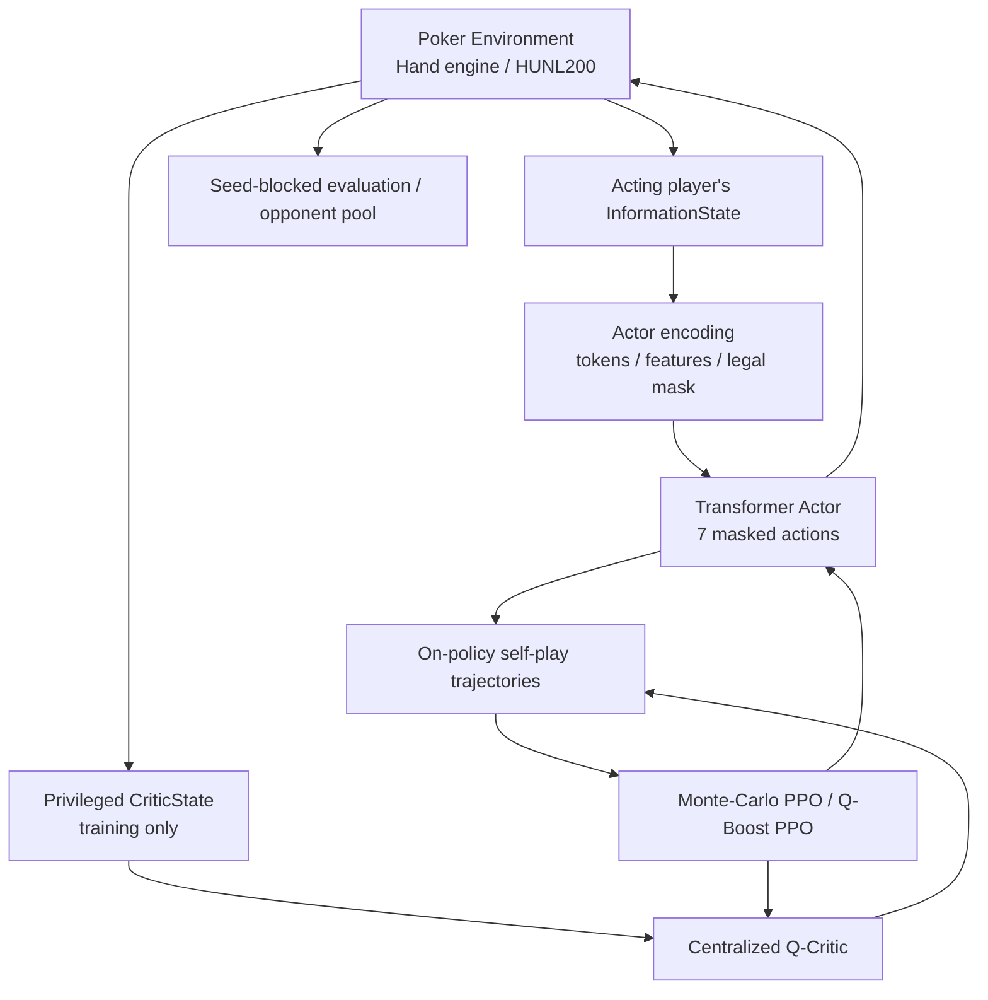

# holdem-ai

**No-Limit Texas Hold'em environments, self-play agents, and reproducible reinforcement-learning experiments.**

This repository develops poker game environments and an experimental heads-up no-limit Hold'em (HUNL) learning stack. Its two core workstreams are **Environment** (game rules, state transitions, payoffs, and evaluation infrastructure) and **Agent** (policy models, self-play, optimization, and strategy diagnostics).

> **Research status:** This is an experimental implementation, not a solved HUNL bot or a verified GTO strategy. VRPO-Lite and Q-Boosting are project-specific experimental implementations, not a faithful reproduction of all algorithms and results in the original VRPO paper.

**[Read the Phase 0–16 Technical Report](docs/PROJECT_REPORT.md)**

## Objectives

1. **Environment:** Simulate legal poker decisions, privately dealt cards, public histories, side pots, chip transfers, and tournament progression.
2. **Agent:** Learn legal-action policies from self-play while keeping player-visible observations distinct from privileged training-only critic states.
3. **Research:** Compare PPO with experimental Q-Boost PPO using controlled checkpoints, seeded evaluations, and diagnostics that distinguish empirical win rates from equilibrium properties.

## System architecture



The **Actor** receives only its own private cards and public information. The **Critic** may receive both players' hole cards during training through an explicit privileged interface; it must never supply those private features to the acting policy.

## Development phases

| Phase | Main deliverable |
| --- | --- |
| 0 | Project setup, Git/GitHub, Python 3.11, `uv`, reproducible workflow |
| 1 | RLCard heads-up baseline |
| 2 / 2.1 | Heads-up blind/order audits and corrected local RLCard rules |
| 3 | Independent 2–6-player hand engine with betting and side pots |
| 4 | Six-player single-table tournament environment |
| 5 | Common Agent interface, legal masks, seven-action abstraction, self-play |
| 6 | HUNL200 adapter, actor/critic privacy boundary, CPU rollouts |
| 7 | Tokenized observation and action encoding |
| 8 | Transformer Actor and centralized zero-sum Q-Critic |
| 9 | On-policy Monte-Carlo PPO baseline |
| 10 | Experimental Q-Boost PPO control-variate objective |
| 11 | Batched neural self-play, time budgets, checkpoints, progress reporting |
| 12 | Seed-blocked, seat/button-balanced evaluation |
| 13 | Batch-scaling experiments and action diagnostics |
| 14 | Multi-seed, matched-start PPO vs. Q-Boost study |
| 15 | Long-run training management and held-out finalization |
| 16 | Frozen opponent-pool evaluation and street/position/SPR diagnostics |

The phase numbers identify development milestones, **not** independent certifications of strategy strength. Details on tested results, documented reports, and unresolved validation are in the [technical report](docs/PROJECT_REPORT.md).

## Game configurations

- **Corrected RLCard HUNL:** baseline heads-up adapter with fixed abstract actions.
- **Independent 2–6-player hands:** a Python betting/showdown engine with explicit raise-to amounts and side pots.
- **6-max tournament:** hand-to-hand stacks, elimination, position rotation, and blind levels.
- **HUNL200 research environment:** two players, 200 big-blind effective starting stacks, seven abstract actions (fold, check, call, half-pot raise, pot raise, double-pot raise, all-in).

The current HUNL200 neural policy head is **discrete** and is not the paper's base-16, multi-step action encoding.

## Installation

Use Python 3.11 and [uv](https://docs.astral.sh/uv/). Run the commands from the repository root:

```powershell
git clone https://github.com/TheMostEvident/holdem-ai.git
cd holdem-ai
uv sync --extra dev
uv run --extra dev python -m pytest -q
```

For GPU-dependent experiments, install the project's `gpu` extra and verify a CUDA-compatible PyTorch environment:

```powershell
uv sync --extra dev --extra gpu
uv run --extra dev --extra gpu python -m pytest -q
```

The GPU development target documented in this project is Windows, GTX 1070 (8 GB), and PyTorch CUDA. GPU support is hardware/driver dependent and is not guaranteed by installing an extra alone.

## Quick start

Run the corrected heads-up baseline:

```powershell
uv run python main.py --hands 100 --seed 42
```

Inspect a neural policy and its opponents (requires a **locally available trusted** compatible checkpoint):

```powershell
uv run --extra gpu python -m scripts.phase16_evaluate --candidate runs/phase14_main/seed_52/ppo/best.pt --opponents random,calling_station,tight,pot_pressure --groups 100 --seed 16010000 --mode sampled --device cuda --output-json runs/phase16/evaluation.json
```

Training commands, checkpoint migration, paired evaluation, and run-specific options are documented in the [full report](docs/PROJECT_REPORT.md) and phase-specific implementation documents in `docs/`. Training checkpoints and experimental outputs are not included in the repository by default.

## Core mathematical conventions

For player `i`, one hand's **big-blind-normalized payoff** is:

$$
R_i = \frac{C_i^{\mathrm{final}} - C_i^{\mathrm{initial}}}{BB}, \qquad R_0 + R_1 = 0
$$

The sample mean across `N` hands converts to **bb/100** as:

$$
\widehat J_{\mathrm{bb/100}} = \frac{100}{N}\sum_{h=1}^{N} R_h
$$

A **seed-blocked** evaluation balances both physical seats and button placements; the statistical unit is the independently shuffled deck seed, **not** each of its four games.

## Evaluation and limitations

- Positive return against RandomLegalPolicy, CallingStation, Tight, or PotPressure establishes performance **against those selected baselines**, not GTO strength.
- Q-Boost's logit-gradient variance proxy is **not** full-network gradient variance.
- Multi-seed comparisons, checkpoint selection, and final held-out tests must be reported separately to avoid selection bias.
- Some historical call/all-in amounts are not represented exactly in earlier observation histories; perfect recall is therefore **not established**.
- Comprehensive poker rules certification, Nash exploitability estimates, and statistically conclusive superiority of Q-Boost over PPO remain open research tasks.

## Documentation

The two primary entry points are:

- **[README.md](README.md)** — project overview and reproducible starting point.
- **[docs/PROJECT_REPORT.md](docs/PROJECT_REPORT.md)** — integrated Phase 0–16 research and engineering report.

Other files inside `docs/` are historical phase-level engineering notes and implementation references. They are not additional project README files.

## Repository

[TheMostEvident/holdem-ai](https://github.com/TheMostEvident/holdem-ai)
