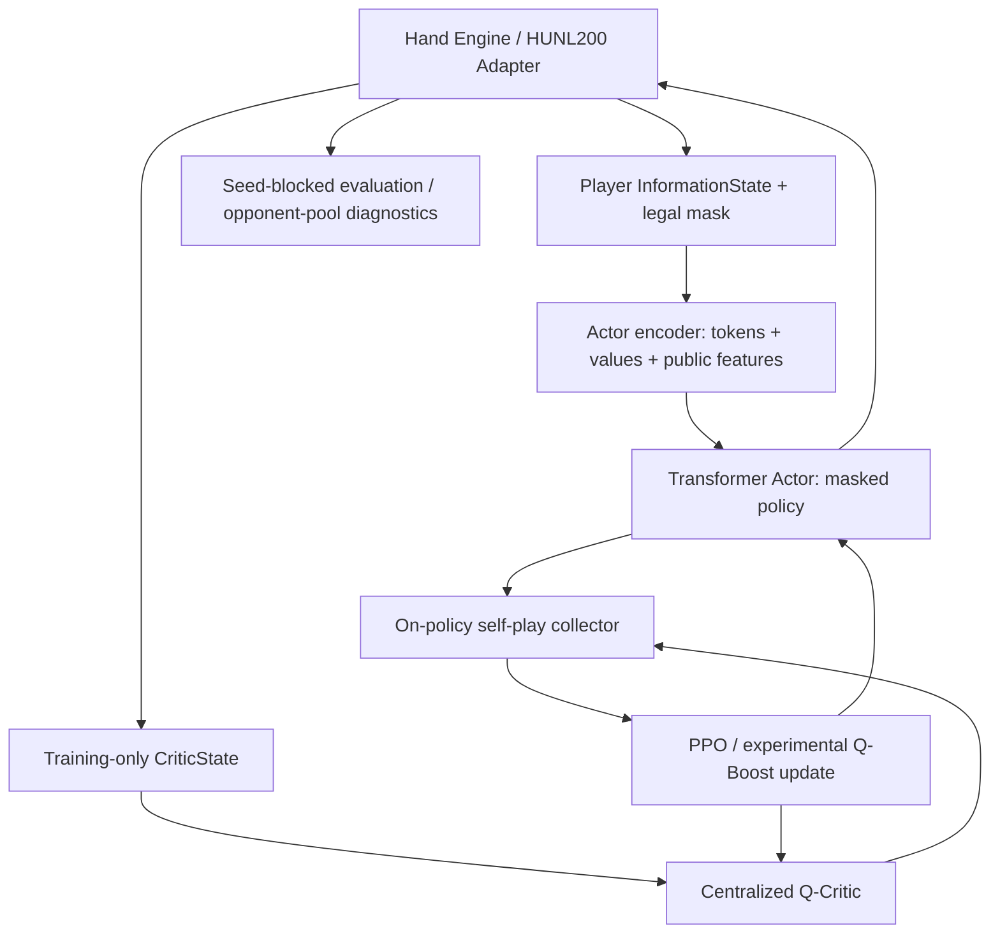

# HUNL AI Agent 전체 개발 기술보고서

> [!abstract] 목적과 자료 범위
> **작성일:** 2026-10-13 · Repository: [TheMostEvident/holdem-ai](https://github.com/TheMostEvident/holdem-ai) · 기준 Branch: `main`
>
> 이 보고서는 Phase별 **신규·변경 Python 파일, 수정 동기, 알고리즘, 관측된 실험 결과와 미검증 사항**을 장기 보존하기 위해 만든 Obsidian Markdown 원본이다. Base Phase 0–16과 Expand E1–E7은 이미 작성되어 GitHub에 보관된 두 통합보고서의 기술 내용을 포함하고, 이후 **Phase 15의 세부 Agent 진단, Phase 16 Ablation/Stress, 2026-10-13 Phase 17 로컬 실험, GUI·Checkpoint PR**을 별도 변경 이력으로 덧붙였다.
>
> **자료 출처 주의:** 이전 Agent 채팅의 대화 원문 전체는 현재 대화에 직접 첨부되지 않았다. “모든 이전 발화”를 재열람했다고 말할 수는 없다. 이전 채팅으로부터 GitHub에 축적된 `.py`, Phase 문서, 보고서와 이번 대화에 제공된 `summary.json`을 토대로 복원 가능한 개발 이력을 집대성한다. 이전 문서의 테스트 수치는 **당시 문서의 기록**이며 본 보고서 작성 중 새로 수행한 테스트가 아니다.

## 0. 읽는 법과 증거 수준

| 표기 | 의미 |
|---|---|
| **Implemented** | 소스가 현재 Repository에서 확인됨 |
| **Documented-Test** | 해당 Phase 기술문서에 테스트 또는 실험 수행 결과가 기록됨 |
| **Local-Log** | 사용자가 채팅에 제공한 실제 로컬 실행 결과 |
| **Pending** | 현재 세션에서 실기·독립 평가 미검증 |
| **Experiment** | 실험 가설/탐색적 결과. GTO 인증이 아님 |

**Phase 이름 충돌 주의:** `Base Phase 17`은 **Continuous Stack 평가**와 **5시간 PPO GPU Retrain**이라는 두 개의 별도 문서가 존재한다. `Expand E1~E7`은 다인 Agent의 별도 연구 Track이며 `Tournament ENV 1.1~1.7`과도 구별한다.

### 기준선의 현재 상태

| 축 | 현황 | 판정 |
|---|---|---|
| Base P0–4 | RLCard 보정, 독립 2~6인 Engine, Tournament | 규칙·Adapter 구현 |
| Base P5–10 | InformationState, Legal7, Transformer Actor, Centralized Q, PPO, QBoost | 학습 엔진 구현 |
| Base P11–14 | Batch, Resume, Seed-Blocked 비교, Multi-Seed | 평가 설계/학습 기반 |
| Base P15–16 | Policy Collapse 진단, A0~A3, Critic/Reward, Stress | 원인 규명 진행 중 |
| **P17 Retrain** | **5,000 Updates / 640,000 Hands (Local-Log)** | **5시간 미완료, 강도 검증 미완** |
| Expand E1–E7 | 2~6인 PPO, Toy MCCFR, Search, 상대 모델링 | 별도 연구/실험 Track |
| GUI/Tournament | Human-vs-Agent, Frozen Actor, Journal/Replay | 런타임·Checkpoint QA 별도 |

### 핵심 불변식

$$
\sum_i S_{i,t}+P_t=C_{\mathrm{total}}
$$

$$
\pi_\theta(a\mid I_i)=0 \quad (a\notin\mathcal A_{\mathrm{legal}}(I_i))
$$

$$
I_i=(\text{own hole cards},\text{board},\text{public history},
\text{stacks},\text{position},\text{legal mask})
$$

Actor에게 상대 Hole Cards, 미래 덱, Critic의 Privileged State를 제공하지 않는다. 모든 학습 목표와 GUI 추론은 포커 엔진의 Legal Action·칩 회계를 최종 권위로 삼는다.

---

# Part I. Base Phase 0–16 원본 통합 기술 기록

> [!info] 출처와 보존 방법
> 아래는 `docs/PROJECT_REPORT.md`의 당시 작성된 기술 보고서를 현재 문서에 직접 포함한 것이다. Phase 0~16 전체 개발 이유·설계·수식·검증·파일 기록을 보존한다. 원본 문서의 “향후 할 일” 또는 옛 `holdem_agent_phaseN` 패키지 경로는 작성 당시의 역사적 설명일 수 있다. **현재 최종 `src/holdem_ai/` 구조 및 2026-10-13 결과는 Part III 이후의 최신 보충 기록을 우선 참조한다.**

## holdem-ai — Integrated Research and Engineering Report (Phase 0–16)

> **Scope and evidence.** This report integrates the project's Phase 0–16 engineering records (including Phase 2.1, the Phase 11 progress patch, and the Phase 12–16 roadmap). It distinguishes **locally reported execution results** from **implementation documentation**, **later retrospective claims**, and **proposed tests**. Some phase documents were prepared with simulated engines; their acceptance criteria are not equivalent to verified execution on the target Windows/GTX 1070 machine.
>
> **Scientific interpretation.** A functioning poker simulator is not complete rules certification; passing unit tests is not evidence of strong poker play; beating selected fixed opponents is not a Nash exploitability or GTO measurement. This project's experimental VRPO-Lite/Q-Boost methods are not presented as a full replication of the original VRPO paper.

**Repository:** [TheMostEvident/holdem-ai](https://github.com/TheMostEvident/holdem-ai)  
**Related document:** [Project README](../README.md)  
**Report date:** October 12, 2026

### 1. Research objectives

The project separates two interconnected objectives:

- **Environment:** build a poker simulator with legal betting, randomized cards, player-specific observations, showdown accounting, terminal payoffs, and tournament state.
- **Agent:** build learning and evaluation pipelines for strategies that interact with that simulator; first using legal random policies and later Transformer Actor/Critic models trained by PPO and experimental Q-Boosting.

The general agent-environment interaction is

$$
I_t^i=O_i(s_t,h_t^{\mathrm{public}}),\quad
a_t\sim\pi_\theta(\cdot\mid I_t^i),\quad
s_{t+1}\sim P(\cdot\mid s_t,a_t),\quad
r_{t+1}^i=R_i(s_t,a_t,s_{t+1}).
$$

Here $s_t$ includes private game-engine state, whereas $I_t^i$ is limited to player $i$'s permissible information. The Environment work expanded from heads-up no-limit Hold'em (HUNL) to 2–6-player hands and a six-player elimination tournament. The neural-learning track subsequently refocused on two-player **HUNL200**, with 200 big blinds of starting stack.

### 2. System architecture



Privacy and correctness are distinct responsibilities: the environment decides which bets are legal, the observation adapter prevents opponent hole cards from entering the Actor input, and the Critic's privileged state is restricted to training. The 7-action abstraction is a project-specific approximation to continuous no-limit betting.

### 3. Development timeline and evidence

| Phase | Scope | Evidence or qualification |
| --- | --- | --- |
| 0 | Git, GitHub, Python, uv, reproducible structure | Developer environment configured |
| 1 | RLCard HUNL baseline | 5 tests passed; 5-hand smoke rollout |
| 2 | Rule specifications and upstream audit | 27 passed, 1 xfailed; three upstream position/blind failures |
| 2.1 | Corrected local HUNL rules | 43 passed, 1 xfailed; 100 sampled corrected hands audited |
| 3 | Independent 2–6-player hand engine | 74 passed, 1 xfailed; multiplayer audits reported |
| 4 | 6-max tournament | 113 passed, 1 xfailed; 100 completed tournaments reported |
| 5 | Agent interface, masks, betting abstraction, rewards | 176 passed, 1 xfailed for the full regression suite |
| 6 | HUNL200 adapter, training-state isolation, CPU benchmark | Implementation specification; target-machine confirmation separate |
| 7 | Actor/Critic observation encoding | Documented tests and smoke criteria; exact action history incomplete |
| 8 | Transformer Actor and centralized Q-Critic | Model structure and forward/backward smoke; not yet PPO |
| 9 | Monte-Carlo PPO | Optimization and checkpoint interfaces; not VRPO |
| 10 | Experimental Q-Boost PPO | Corrected control-variate surrogate; comparative benefit unproven |
| 11 | Batched self-play, runs, checkpoints, progress | Later progress document reports 304 Windows/CUDA tests passed |
| 12 | Reproducible seed-blocked evaluation | Statistical protocol and evaluator; held-out results not supplied here |
| 13 | Batch scaling and diagnostics | Phase 14 cites 91.77 training hands/s for H=64/B=32, based on two measurements |
| 14 | Matched-start, multi-seed comparison | Controlled design; later Phase 15 report quotes validation scores |
| 15 | Long-run and best-checkpoint management | Implementation specification; five-hour final results unverified here |
| 16 | Fixed opponent pool and strategy diagnostics | Evaluation-only code; final trained-policy pool results not provided |

Bracketed test counts are **historical records**, not a fresh end-to-end regression run performed while preparing this document.

### 4. Phase 0 — Project foundation

The repository is named `holdem-ai` and the Python import namespace is `holdem_ai`. The original source layout separated `environment`, `agents`, `training`, `evaluation`, and `ui`, with later phases adding standalone `holdem_agent_phaseN/` packages and `scripts/phaseN_*.py` command-line programs.

The Windows workflow uses Git, GitHub, Python 3.11 and `uv`, with `uv.lock` capturing dependency resolution and `.venv/` excluded from Git. A remote repository already existed when the initial local repository was pushed, so unrelated Git histories were merged and the README conflict resolved rather than force-pushing. The repeated deployment cycle is:

```text
Implement Python + tests -> apply patch -> uv test -> scenario audit
-> inspect logs -> git commit -> push
```

For general setup:

```powershell
uv sync --extra dev
uv run --extra dev python -m pytest -q
```

### 5. Phase 1 — RLCard baseline

A two-player `HandEngine` wrapper exposed `reset`, `state`, `current_player`, `legal_actions`, `step`, `is_over`, `get_result`, and `play_hand`. A `RandomAgent` selected among available actions. RLCard's original abstraction used five action indices, not arbitrary continuous bets. The initial experiment used 200-chip stacks and a 2-chip big blind.

Five observed hands yielded $-50$ bb/100 for player 0:

$$
\widehat J_0=\frac{100}{5}(-0.5-0.5+1-2-0.5)=-50.
$$

Five hands demonstrate integration, not statistically meaningful performance.

### 6. Phase 2 / 2.1 — Rules audit and correction

For heads-up poker the dealer/button is also the small blind:

$$
\mathrm{BTN}=\mathrm{SB},\qquad
\mathrm{FirstActor}_{\mathrm{preflop}}=\mathrm{BTN},\qquad
\mathrm{FirstActor}_{\mathrm{postflop}}=\mathrm{BB}.
$$

For a player's street contribution $c$, the current street maximum $h$, previous full-raise increment $r$, and remaining stack $S$, the main legality reference is

$$
\mathrm{ToCall}=\min(S,\max(0,h-c)),\qquad
\mathrm{MinRaiseTo}=\begin{cases}BB & h=0,\\ h+r & h>0,\end{cases}\qquad
\mathrm{MaxRaiseTo}=c+S.
$$

A raise below the minimum is only permitted in defined short all-in conditions, and such an all-in need not reopen raising. Side pots use sorted positive contribution levels $0=u_0<u_1<\dots<u_m$:

$$
P_k=(u_k-u_{k-1})\left|\{i:c_i\ge u_k\}\right|.
$$

An audit of the original RLCard 1.2.0 configuration found that the button posted the wrong blind and acted in the wrong preflop order, even while zero-sum payoffs held in all 100 random audit hands. The correction was implemented **inside the project**, without editing installed RLCard files. The corrected adapter tested position/blinds for both button assignments, postflop order, and 100 sampled games, passing the checked scenarios. This was **not** an independent certification of all poker rules.

### 7. Phase 3 — Independent multiplayer hand engine

A separate `MultiPlayerHandEngine` implemented two to six seats, rotating positions, card dealing, street-by-street betting, folds, checks, calls, raises, all-ins, side pots, showdown, and payout. The custom interface additionally allowed `step_raise_to(amount)`, where `amount` denotes the **target total committed in the current street**, not chips to add.

The main financial invariant is chip conservation:

$$
\sum_i C_i^{\mathrm{before}}=\sum_i C_i^{\mathrm{after}}.
$$

The reported tests verified selected betting, seat, all-in, side-pot, and randomized gameplay cases. The corrected RLCard heads-up wrapper and this independent multiplayer engine remained separate components.

### 8. Phase 4 — Tournament engine

The tournament layer maintains chip stacks between hands, rotating button/blind positions as players bust, escalating blinds, and stopping when one participant owns all chips. A recorded example ended after 15 hands with the winner holding 6,000 chips. The reported 100-tournament audit completed **100/100 tournaments**, with 1,086 total hands, 500 total eliminations, and average 10.86 hands per tournament. The full test suite then reported **113 passed, 1 xfailed**.

The tournament's elimination/placement objective differs from maximizing the chip delta in a cash-game hand. No prize-payout or ICM policy objective was claimed for this stage.

### 9. Phase 5 — Agent interface and self-play

Phase 5 introduced the immutable `InformationState` record, `Turn`/`Terminal` return types, an `AgentPolicy.act(observation,rng)` protocol, policy masking, rewards, an RLCard adapter, a self-play runner, and a JSON-stable information-state key.

The information-state contract stores acting player, scalar features, legal action mask, own private cards, visible board, stage, public state, and observable history. A serialized key alone **does not prove perfect recall**.

For legal-action indicator $m_a$ and nonnegative proposed weights $w_a$, the policy distribution is

$$
\pi(a\mid I)=\begin{cases}
\frac{m_aw_a}{\sum_b m_bw_b},&\sum_bm_bw_b>0,\\
\frac{m_a}{\sum_bm_b},&\text{otherwise}.
\end{cases}
$$

The seven abstract action heads are: fold, check, call, half-pot raise, pot raise, double-pot raise, and all-in. For pot $P$, street contribution $c$, call amount $k$, and multiplier $f\in\{1/2,1,2\}$:

$$
B_{\mathrm{raise\ to}}^{(f)}=c+k+\mathrm{round}_{\mathrm{chip}}\left[f(P+k)\right].
$$

The engine supplies the actual minimum/maximum raise, re-opening, all-in and side-pot rules. A separate reward interface includes chip delta and a zero-sum tournament winner indicator:

$$
r_i^{\mathrm{chip}}=\frac{C_i^{\mathrm{end}}-C_i^{\mathrm{start}}}{c},\qquad
r_i^{\mathrm{tournament}}=\mathbf1[i=w]-\frac1N.
$$

A NumPy-to-JSON conversion hotfix resolved a serialization failure. Historical regression results: **176 passed, 1 xfailed**. The phase did not yet train a CFR algorithm or connect the pre-existing 6-max tournament engine to a trainable 6-player policy.

### 10. Phase 6 — HUNL200 integration

The independent multiplayer engine was used in two-seat mode with a fixed 200-BB starting stack, BB=100 chips, SB=50 chips and configurable button. `HUNL200Adapter` maps seven policy actions to the existing engine's integer calls or `step_raise_to`. Importantly, policy index **4 is pot-raise**, whereas the underlying engine index **4 means all-in**; action-ID spaces must never be conflated.

The acting policy receives only `InformationState`. The explicitly enabled `training_state()` path returns a distinct `CriticState` containing both hole-card pairs, but no undealt future deck order. A global trajectory collector records adjacent **global decision transitions**, whereas Phase 5's runner can connect successive actions of the **same seat**. These are different time indices.

Terminal BB payoffs satisfy

$$
R_i=\frac{C_i^{\mathrm{final}}-C_i^{\mathrm{initial}}}{BB},\quad R_0+R_1=0.
$$

CPU one/two/four-worker random-policy benchmarks were designed for this phase. A later document cites approximately 2,896 random hands/s, which is **not** a valid estimate of neural PPO training throughput.

### 11. Phase 7 — VRPO-Lite encoding

The project-specific vocabulary has **73 token types**: padding, sequence/role/seat markers, 52 cards, 4 streets, and 5 poker action types. Raise-to amounts are represented in a token-value channel normalized by the big blind. Inputs are not silently truncated at 256 tokens; excess history raises an exception.

`encode_actor(InformationState)` supplies token IDs, token values, 20 scalar features, and a seven-action mask. `encode_critic(CriticState)` supplies training-only tokens and 24 centralized numeric features. GPU batching produces padded tensors and attention masks. The action mask ensures that illegal actions have zero selection probability.

The Phase 6 history schema did not preserve **exact paid amounts** for every call/all-in entry. This prevents a perfect-recall claim without further data-model changes. The encoding is not the original paper's base-16 multi-step betting scheme.

### 12. Phase 8 — Neural architecture

Phase 8 implements a causal-token Transformer Actor and a separate centralized Q-Critic. Token embeddings, position embeddings and an `asinh`-transformed numeric-value embedding feed the Transformer; the last valid position is pooled with transformed scalar features.

$$
Z=\mathrm{Transformer}_{\mathrm{causal}}
\left(E_{\mathrm{token}}(T)+E_{\mathrm{pos}}+W_v\mathrm{asinh}(V)\right)
$$

$$
\pi_\theta(a\mid I)=\frac{m_a\exp z_\theta(I,a)}
{\sum_b m_b\exp z_\theta(I,b)}.
$$

The reported initial network configuration uses two Transformer layers, embedding width 64, two attention heads, feed-forward width 128, and maximum length 256. The Actor has **99,975 parameters**, Critic **100,487**, Actor output `[B,7]`, and Critic output `[B,2,7]`.

The Critic enforces two-seat zero-sum values $Q_{\phi,1}(s,a)=-Q_{\phi,0}(s,a)$ and terminal bootstrap values of zero. These constraints would need reconsideration for tournament/ICM objectives. Phase 8 validates forward/backward and tensor contracts; it does **not** by itself perform policy optimization.

### 13. Phase 9 — On-policy Monte-Carlo PPO

The same decentralized Actor acts in both seats during self-play; a privileged centralized Critic is a training-time estimator, not an information channel to the playing Actor. Returns are terminal hand payoffs in BB, with $\gamma=1$, **no GAE** and **no TD(0)**.

For acting seat $i_t$:

$$
G_t^{i_t}=R_{i_t},\qquad
V_{\mathrm{old}}^{i_t}(s_t,I_t)
=\sum_a\pi_{\mathrm{old}}(a\mid I_t)Q_{\phi_{\mathrm{old}},i_t}(s_t,a),
$$

$$
\hat A_t=G_t^{i_t}-V_{\mathrm{old}}^{i_t}(s_t,I_t).
$$

After standardizing advantage and defining $\rho_t(\theta)=\pi_\theta(a_t\mid I_t)/\pi_{\mathrm{old}}(a_t\mid I_t)$, the PPO objective maximizes

$$
L^{\mathrm{CLIP}}
=\mathbb E_t\left[
\min\left(\rho_t\tilde A_t,\mathrm{clip}(\rho_t,1-\epsilon,1+\epsilon)\tilde A_t\right)
\right].
$$

The Q-Critic minimizes the observed-action Huber loss against Monte-Carlo returns:

$$
\mathcal L_Q=\mathbb E_t\left[
\mathrm{Huber}(Q_{\phi,i_t}(s_t,a_t)-G_t^{i_t})
\right].
$$

It does **not** obtain supervised labels for every unplayed counterfactual action. Training/Adam/checkpoint functionality was introduced at this phase, but PPO is not guaranteed to converge to a Nash equilibrium in general imperfect-information games.

### 14. Phase 10 — Experimental Q-Boost control variate

Naively substituting $G-Q(s,a)$ in a policy-gradient surrogate omits an action-dependent gradient component. Phase 10 adds an analytic sum over all seven actions. With $\beta\in[0,1]$, frozen old policy $\pi_0$, and frozen old critic $\hat Q_0$:

$$
\hat V_0=\sum_a\pi_0(a\mid I)\hat Q_0(s,a)
$$

$$
\delta_t^{(\beta)}
=G_t-\hat V_0-\beta\left[\hat Q_0(s_t,a_t)-\hat V_0\right].
$$

Standardization uses the **same fixed mean and scale computed from the unboosted Monte-Carlo advantage**, rather than separately normalizing the residual and analytic term. The maximized objective is

$$
\begin{aligned}
J_{\mathrm{QB}}(\theta)=\frac1N\sum_t\Big[&
\min\{\rho_t\tilde\delta_t,\mathrm{clip}(\rho_t,1-\epsilon,1+\epsilon)\tilde\delta_t\}\\
&+\frac\beta{\sigma_A}\sum_a\big(\pi_\theta(a\mid I_t)-\pi_0(a\mid I_t)\big)\hat Q_0(s_t,a)\Big].
\end{aligned}
$$

At $\beta=0$, the objective reduces to the PPO baseline. The phase documents an old-policy gradient identity, but PPO clipping away from the old policy introduces surrogate bias. A reported logit-gradient **proxy** variance ratio is not a variance guarantee for the full network gradient. Whether Q-Boost improves real poker performance must be established empirically.

### 15. Phase 11 — Batched on-policy self-play

Multiple independent HUNL200 games are held active within one process. At each scheduling step, the current decision from each active game is batched for neural Actor inference. All data for update $k$ is collected using the frozen current policy $\theta_k$; only then are optimizer steps performed.

$$
D_k\sim\pi_{\theta_k},\qquad\theta_{k+1}=\mathrm{Update}(\theta_k,D_k).
$$

The infrastructure includes an elapsed-time budget, resumable atomic checkpoints, structured JSONL logs, random and frozen-anchor evaluation, optional `tqdm` progress, ETA and safe stopping at update/evaluation boundaries. A later Phase 11 progress note reports **304 passed** on the user's Windows/CUDA environment, although the full raw console log is not among the supplied sources.

The approximately **30–45 neural hands/s** cited in that documentation, the Phase 6 random CPU hands/s, and the Phase 13 end-to-end optimizer hands/s measure different workloads and must not be interchanged.

### 16. Phase 12 — Seed-blocked reproducible evaluation

For each independently shuffled deck seed $k$, evaluate the candidate in all four seat/button combinations. Each seed block is the statistical unit:

$$
X_k=\frac14\sum_{b=0}^{1}\sum_{s=0}^{1}R(k,b,s),\qquad
\hat J=100\bar X\ \ [\mathrm{bb/100}].
$$

Approximate standard error and confidence interval:

$$
\mathrm{SE}(\hat J)=100\frac{s_X}{\sqrt K},\qquad
\mathrm{CI}_{0.95}\approx\hat J\pm1.96\,\mathrm{SE}(\hat J).
$$

To compare candidate A and control C against the **same opponent** under the **same seed blocks**:

$$
D_k=X_k^A-X_k^C,\qquad
\widehat{\Delta J}=100\bar D.
$$

The interval must use the variation in $D_k$, not a subtraction of independent confidence intervals. The evaluator separates validation and held-out test card seeds, greedy versus sampled policies, action counts and weight fingerprints. This is seed-matched and seat-swapped, but **not** a complete counterfactual duplicate-poker estimator.

### 17. Phase 13 — Batch scaling

The key controlled parameters are update hands $H$, simultaneously active environments $B$, minibatch decisions $M$, and PPO epochs $E$. For $N_k$ collected decisions, the optimizer performs approximately

$$
N_{\mathrm{mini},k}=E\left\lceil\frac{N_k}{M}\right\rceil
$$

minibatches per update. The rate is evaluated against the **number of opportunities where an action was legal**:

$$
\hat p(a\mid a\text{ legal})=
\frac{\sum_t\mathbf1[a_t=a]}{\sum_t\mathbf1[a\in\mathcal A(I_t)]}.
$$

This is an aggregated descriptive rate, not one fixed information-state probability. A later Phase 14 document cites **91.77 end-to-end training hands/s** for $H=64$, $B=32$ on the GTX 1070, based on only two observations for that case. It is a useful provisional configuration, not a proven globally optimal batch setting.

### 18. Phase 14 — Multi-seed controlled PPO vs. Q-Boost experiment

For each training seed, PPO and Q-Boost are initialized from the **same complete Phase 9 checkpoint**, including Actor, Critic and Adam states. Each algorithm subsequently collects its **own on-policy trajectories**, even when deck seed schedules are matched.

$$
N_{\mathrm{train}}=S\times2\times U\times H,
$$

where $S$ is number of training seeds, $U$ is updates per algorithm, and $H$ is hands per update.

The best model in each arm is selected on a fixed validation opponent, including the original untrained-from-stage checkpoint as an eligible candidate. Held-out test is run only after all arms finish, and must not be reused to tune hyperparameters.

For the paired effect per training seed $s$, aggregate deck-block differences:

$$
\hat\Delta_s=\frac{100}{K}\sum_{k=1}^K
\left(X_{s,\mathrm{QB},k}-X_{s,\mathrm{PPO},k}\right).
$$

Cross-seed standard error uses $\mathrm{sd}(\hat\Delta_s)/\sqrt S$; a small $S=3$ yields low power. A later Phase 15 document quotes PPO's **best validation** scores for seeds 51/52/53 as **809.50 / 858.125 / 456.75 bb/100**. These are not final held-out effect estimates. The supplied evidence does not justify a definitive claim that either algorithm is statistically superior.

### 19. Phase 15 — Long-run training and checkpoint selection

The long-running stage warm-starts from selected Phase 14 `best.pt` checkpoints while preserving Actor, Critic and Adam states. It reuses the earlier PPO/Q-Boost losses and collects new on-policy data. Validation is performed against two fixed opponents: the frozen stage-start Actor and RandomLegalPolicy.

A heuristic validation score is

$$
S_t=\frac12\left[
\big(J_A(t)-J_A(0)\big)+\big(J_R(t)-J_R(0)\big)
\right],\qquad
t^*=\arg\max_t S_t.
$$

Checkpoint safeguards include atomic `latest.pt`, separate `best.pt`, SHA-256 lineage, resume/config checks, per-run locking, recovery records and safety stops on sustained entropy or approximate-KL warnings. Typical documented thresholds are entropy below 0.45 or approximate KL above 0.10 for 12 consecutive warnings; these are protective heuristics, not optimality conditions.

The finalization command uses an untouched card bank, writes `final_report.json`, and seals the run. A five-hour budget and a documented command are **not** proof that a particular five-hour run completed or improved strategy strength.

### 20. Phase 16 — Opponent pool and poker strategy diagnostics

Phase 16 is **evaluation only**. It does not update Phase 15 models or learn an adaptive opponent. A frozen candidate plays a fixed pool of intentionally simple opponents:

| Opponent | Description | Diagnostic purpose |
| --- | --- | --- |
| Random | Uniform among legal actions | Sanity baseline |
| CallingStation | Prefer check/call | Overcalling sensitivity |
| Tight | Prefer check/fold | Overfolding sensitivity |
| PotPressure | Prefer pot-sized aggression | Aggression response |
| Frozen checkpoint | Prior trained Actor | Snapshot comparison |

For opponent $o$, estimate:

$$
X_{o,k}=\frac14\sum_{b,s\in\{0,1\}}R_{o,k,b,s},\qquad
\hat J_o=\frac{100}{K}\sum_k X_{o,k}.
$$

The average over a **predeclared** opponent pool and the worst observed pool mean are descriptive indicators, not a minimax game value or Nash exploitability. Strategy metrics are stratified by street, button versus big-blind position, and effective stack-to-pot ratio:

$$
\mathrm{SPR}(I)=
\frac{\min(S_{\mathrm{hero}},S_{\mathrm{villain}})}
{\max(P,10^{-9})}.
$$

Normalized policy entropy is

$$
H_{\mathrm{norm}}(\pi\mid I)=
\begin{cases}
\frac{-\sum_{a\in\mathcal A(I)}\pi(a\mid I)\log\pi(a\mid I)}
{\log\lvert\mathcal A(I)\rvert}, & \lvert\mathcal A(I)\rvert>1,\\
0,&\text{otherwise}.
\end{cases}
$$

Reports can be exported to JSON, CSV and Markdown without raw hole cards or Critic state. The source documentation describes Linux/CPU mock-engine development validation; it does **not** supply final pool performance for a completed Phase 15 model.

### 21. Core invariants and performance units

1. **Privacy:** the acting Actor cannot receive the other player's hole cards or deck order.
2. **Legality:** the environment enforces minimum raise, all-in, reopening and side-pot eligibility; a policy mask is a representation of its admissible moves.
3. **Chip conservation:** for no-rake hands, total chips before and after equal.
4. **Zero-sum terminal returns:** for HUNL chip objectives, $R_0+R_1=0$.
5. **On-policy training:** each optimization update uses decisions sampled by the current old policy, not replay from a diverged behavior policy.
6. **Units:** per-hand BB return and **bb/100** are different quantities:

$$
R_{i,h}^{\mathrm{BB}}=\frac{C_{i,h}^{\mathrm{end}}-C_{i,h}^{\mathrm{start}}}{BB_h},\quad
\widehat{bb/100}_i=\frac{100}{N}\sum_{h=1}^{N}R_{i,h}^{\mathrm{BB}}.
$$

7. **Inference limits:** sequential single-decision GPU inference, CPU random rollout, and batched neural self-play have different computational costs.

### 22. Risks and next steps

| Priority | Open issue | Recommended verification |
| --- | --- | --- |
| P0 | Latest Phase 15/16 Windows/GPU logs and final artifacts not available in these source records | Run complete regression suite; archive hashes, checkpoint lineage and held-out reports |
| P0 | Action history can omit exact call/all-in amounts | Version a complete public action-history schema and test perfect recall |
| P1 | Fixed baseline pool is weak | Add stronger frozen snapshots and rule-based opponents with preregistered evaluation |
| P1 | Q-Boost performance gain is not established | Matched initial checkpoints, multiple seeds, paired deck-block differences and uncertainty intervals |
| P1 | Simulator not externally certified | Differential tests against independent poker rules engines; adversarial edge cases |
| P2 | Exploitability/GTO assessment missing | Add an independently justified best-response/CFR evaluation methodology |
| P2 | Full VRPO paper replication incomplete | Separate the project-specific VRPO-Lite contract from faithful paper replication goals |

### 23. Reproduction commands

From the Git repository root on Windows PowerShell:

```powershell
uv sync --extra dev --extra gpu
uv run --extra dev --extra gpu python -m pytest -q

## Corrected HUNL baseline
uv run python main.py --hands 100 --seed 42

## Phase 12 seeded validation; requires a real local checkpoint
uv run --extra gpu python -m scripts.phase12_evaluate --candidate checkpoints/phase11_pilot.pt --groups 100 --partition validation --mode greedy --device cuda --output-json runs/phase12/greedy_random.json

## Phase 16 opponent-pool diagnostics; requires a real local checkpoint
uv run --extra gpu python -m scripts.phase16_evaluate --candidate runs/phase14_main/seed_52/ppo/best.pt --opponents random,calling_station,tight,pot_pressure --groups 100 --seed 16010000 --mode sampled --device cuda --output-json runs/phase16/pool.json
```

Outputs under `runs/`, checkpoint `.pt` files and extracted deployment bundles must not be automatically committed to Git. Always validate a checkpoint's provenance before loading it.

### Appendix A — Source document map

This English integrated report is a **consolidated technical rendition** of the following primary project notes; long per-phase installation transcripts, individual test inventories and historical PowerShell error logs remain in those source documents:

| Phase | Source document |
| --- | --- |
| 0–4 | `Environment_Phase0-4_전체_구축_기록.md` (user-provided source) |
| 5 | `Phase5_Agent_구현_기록.md` (user-provided source) |
| 6 | `docs/PHASE6_HUNL200_INTEGRATION.md` |
| 7 | `docs/PHASE7_VRPO_LITE_ENCODING.md` |
| 8 | `docs/PHASE8_VRPO_LITE_NETWORKS.md` |
| 9 | `docs/PHASE9_PPO_BASELINE.md` |
| 10 | `docs/PHASE10_QBOOST_PPO.md` |
| 11 | `docs/PHASE11_FIVE_HOUR_TRAINING.md`, `docs/PHASE11_PROGRESS.md` |
| 12 | `docs/PHASE12_EVALUATION.md` |
| 13 | `docs/PHASE13_BATCH_SCALING.md` |
| 14 | `docs/PHASE14_CONTROLLED_STUDY.md` |
| 15 | `docs/PHASE15_LONG_RUN_TRAINING.md` |
| 16 | `docs/PHASE16_OPPONENT_POOL_AND_STRATEGY.md` |
| Roadmap | `docs/ROADMAP_PHASE12_TO_16.md` |

**Evidence boundary:** repository source code and existing phase descriptions were consulted for documentation purposes. This report does not claim any new live training experiment, independent poker-rule certification or statistically significant GTO/exploitability finding.


---

# Part II. Expand E1–E7 원본 기술 기록

> [!info] Track 분리
> 아래는 `docs/EXPAND_PHASE01_TO_07_INTEGRATED_TECHNICAL_REPORT.md`의 전체 기술 내용을 보존한 것이다. 별도의 2~6인 Dynamic Table, Information Encoding, Multi-Agent PPO, MCCFR, Search, Opponent Modeling, Integration 단계가 설명된다. 이 옛 문서의 “아직 Git Push하지 않았다” 또는 테스트 환경 상태 문장은 **작성 당시의 상태**다. 현재 GitHub `main`에는 `src/holdem_ai/expand/` 하위 소스가 포함되어 있다. 옛 문서의 격리 Test `164 passed, 7 skipped`를 현재 Windows/GPU 전체 회귀 성공으로 오인하지 않는다.

---
title: "Dynamic 6-Max NLHE AI — Expand Phase 1~7 통합 기술 보고서"
aliases:
  - "Expanded 6-Max Technical Report"
  - "Expand Phase 1-7 Integration"
tags:
  - poker-ai/6max
  - reinforcement-learning
  - mccfr
  - subgame-search
  - opponent-modeling
  - architecture
created: 2026-10-12
version: "1.0-unified-prototype"
status: "Integrated package built and isolated tests passed; Windows/real-engine/CUDA acceptance pending"
repository: "https://github.com/TheMostEvident/holdem-ai"
---

## Expand Phase 1~7 — Dynamic 6-Max No-Limit Hold'em AI 통합 기술 보고서

> [!abstract] 목적 및 판정
> 7개의 독립적인 추가형 Expand 패치를 **하나의 소스 트리**로 병합하여 설치·검증 절차를 단일화했다. 이 보고서는 실제 병합된 Python 코드, 각 Phase의 기술 문서와 로컬 테스트에 기반한다. **Base Phase 1~16 수정 없음. 실제 Windows 엔진/CUDA 실행 및 GitHub Push는 아직 수행하지 않았다.** 특히 E4/E5는 **Pluribus 완전 재현이 아닌 연구용 프로토타입**이다.

### 0. 문서의 기준선과 검증 범위

| 항목 | 내용 / 판정 |
|---|---|
| Base Repository | `TheMostEvident/holdem-ai` (별도 설치 필요) |
| 기준 모델 | Base Phase 1~16 HUNL 시스템과 독립된 Expand 기능 |
| 통합 대상 | `holdem-ai-expand-phase01.zip` ~ `phase07.zip` |
| 설치 모델 | **단일 Additive Overlay**: `src/`, `scripts/`, `tests/`, `docs/` |
| 충돌 처리 | `README.md` 7개만 경로 충돌 → 각각 `docs/phase_original_readmes/`에 보존 |
| 나머지 소스 | **서로 다른 경로**, 변경 없이 바이너리 동일하게 병합 |
| 공급망 검증 | 모든 병합 원본의 SHA-256, 원본 ZIP SHA-256을 `SOURCE_MANIFEST.json`에 수록 |
| 이 통합본의 격리 환경 테스트 | **164 passed, 7 skipped**; 실제 엔진 없는 환경에서 통합 재실행 |
| 미실시 | 실제 Base Phase 3 엔진 통합, 전체 Base Regression, GTX 1070 CUDA, 성능 실험, Git Push |
| 훈련된 6-Max PPO 모델 | **통합 ZIP에는 포함되지 않음**. Phase 3 학습 필요 |
| Pluribus 원본 학습 Blueprint | **제공되지 않음**. Phase 4에서 새로 연구용 학습 필요 |

> [!warning] "통합"의 정확한 의미
> 하나의 ZIP 안에 E1~E7의 소스와 CLI, 테스트를 합쳤다는 뜻이다. **E4 정보집합-이력 어댑터 및 E5 Search가 실전 6인 AI 정책까지 자동으로 연결되었다는 의미가 아니다.** E7은 검증된 E3 Neural Policy를 우선 사용할 수 있으며 E4/E5 사용은 별도 호환성 검증 후 명시적 연결이 필요하다.

### 1. 프로젝트 목표와 범위

최종 목표는 플레이어 입·퇴장, 유효 스택, 포지션, 상대 행동이 변하는 **동적 2~6인 No-Limit Hold'em** 환경에서 합법적인 행동을 결정하는 정책이다.

$$
\boxed{\pi_\theta(a_t\mid I_{i,t},\mathcal N_t)},\qquad 2\le |\mathcal N_t|\le 6
$$

- **Cash Game 먼저**: 핸드 사이에 Join/Leave/Rebuy/Sit-Out/Resume, 스택 이월, 손익을 Big Blind 단위로 측정한다.
- **Tournament 별도**: 블라인드 상승, Late Registration, Re-entry, 탈락, 순위·상금 보상을 독립적으로 처리한다.
- **두 학습/의사결정 트랙**: E3 Neural PPO와 E4 MCCFR Blueprint + E5 Search는 별도 출처의 전략이다.
- **상대 적응**: E6는 공개 행동만으로 상대 모델을 구성하고, 사전에 존재하는 후보 정책만 제한적으로 선택·보간한다.

이 버전은 연구용 프로토타입이며 실제 돈을 사용하는 서비스에 바로 연결하기 위한 제품이 아니다.

### 2. 아키텍처 및 모듈 의존성

```text
Base Phase 3: MultiPlayerHandEngine (게임 규칙·카드·Side Pot·정산)
                        |
          E1 DynamicTable / TableState
             (물리적 6좌석, Join/Leave)
                        |
          E2 InformationState / Encoder
             (Hero Cards + Public State)
                        |
                 E7 Policy Router
           +------------+--------------+
           |            |              |
       E3 Neural     E4 MCCFR       E5 Search
          PPO        Blueprint     (opt-in / bounded)
           |            |              |
           +------------+--------------+
                        |
                 E6 Optional Guard
              (Evidence, Expert, KL/TV)
                        |
               E2 ActionTranslator
                        |
          Base Phase 3 Legality / Engine
                        |
       E7 Cash / Tournament Benchmark
                        |
                 JSON + Manifest
```

#### 2.1 디렉터리 체계

```text
holdem-ai/                                # 기존 Git Repository
  src/holdem_ai/expand/
    environment/                         # E1: DynamicTable, EventLedger
    information/                         # E2: Public State, 7 Action, Encoder, PolicyV2
    rl/                                  # E3: Collector, ActorCritic, PPO, Trainer
    pluribus/
      abstraction/                       # E4: Card Bucketing Prototype
      blueprint/                         # E4: MCCFR / Kuhn / Leduc / Holdem
      search/                            # E5: Belief / Continuation / Solver / Nested Session
    opponent/                            # E6: Model, Bridge, Router, Adaptation
    integration/                         # E7: IntegratedPokerAgent, Tournament, Benchmark
  scripts/expand_phase01_smoke.py
  scripts/expand_phase02_smoke.py
  scripts/expand_phase03_train.py
  scripts/expand_phase03_evaluate.py
  scripts/expand_phase04_mccfr.py
  scripts/expand_phase04_evaluate.py
  scripts/expand_phase05_search.py
  scripts/expand_phase05_evaluate.py
  scripts/expand_phase06_benchmark.py
  scripts/expand_phase07_benchmark.py
  tests/expand/                           # E1~E7 테스트 전체
  docs/EXPAND_MASTER_DESIGN_6MAX_v1_0.md
  docs/EXPAND_PHASE01_DESIGN.md
  docs/EXPAND_PHASE02_INFORMATION_AND_ENCODING.md
  docs/EXPAND_PHASE03_MULTIAGENT_PPO.md
  docs/EXPAND_PHASE04_MCCFR_BLUEPRINT.md
  docs/EXPAND_PHASE05_SUBGAME_SEARCH.md
  docs/EXPAND_PHASE06_OPPONENT_MODELING.md
  docs/EXPAND_PHASE07_INTEGRATION_TOURNAMENT_BENCHMARK.md
  docs/EXPAND_PHASE01_TO_07_INTEGRATED_TECHNICAL_REPORT.md
```

> 모든 파일은 Base 코드 위에 **추가**하는 Overlay다. 기존 `src/holdem_ai/environment/*.py`, Base `holdem_agent_phase*`, `scripts/phase*`, 학습 결과 `runs/`는 ZIP에 없다.

### 3. Expand Phase 1 — Dynamic 6-Max Table Environment

**실제 소스**: `environment/table_manager.py`, `table_state.py`, `event_ledger.py`, `cash_rules.py`, `multiway_adapter.py`, `tournament_rules.py`.

- **6개 물리적 Seat**(`seat=0..5`)를 유지하면서 각 좌석의 `player_id`, `stack`, `status`를 관리한다.
- Join, Leave, Rebuy, Sit-Out, Resume 요청은 이벤트로 큐에 기록하고 **Hand Boundary에서만 적용**한다.
- 플레이어가 All-In하여 현재 스택이 0이 되어도 **핸드 진행 중에 Bust 처리하지 않는다**. Side Pot과 Showdown 정산 후 확정한다.
- 첫 참가자의 BB 등록 대기 상태 및 Moving Button 모델이 포함되며, 공식 모든 Casino Missed-Blind/Dead-Button 정책을 인증한 것은 아니다.
- 같은 플레이어 ID 중복, 예약 좌석 중복, 음수 칩, 핸드 중 이벤트 적용, 인원 부족 등의 상태를 검사한다.
- 이벤트 기록 `EventLedger`로 운영 이력 기록 및 결정적 Replay를 지원한다.

#### 3.1 현금 보존 불변식

핸드 진행 중 각 Seat의 남은 스택 $S_i$와 기여금 $c_i$의 합은 변하지 않아야 한다.

$$
\sum_{i=0}^{5}(S_{i,t}+c_{i,t})=C_h, \quad
\sum_{i=0}^{5} S_{i,h}^{\mathrm{after}}=C_h
$$

핸드 사이에 신규 Buy-In $B_t$와 Cash-Out $O_t$가 있으면 테이블 전체 칩의 변화는

$$
\boxed{C_{t+1}=C_t+B_t-O_t},\qquad \mathrm{rake}=0.
$$

구현된 `DynamicTable`은 다음을 확인한다.

$$
\mathrm{LiveChips} = \mathrm{TotalBuyins}-\mathrm{TotalCashouts}.
$$

#### 3.2 오픈 API

```python
from holdem_ai.expand.environment.table_manager import DynamicTable

table = DynamicTable(session_id="table-001")
table.request_join("hero", buyin_chips=20000, preferred_seat=0)
table.request_join("opponent", buyin_chips=20000, preferred_seat=3)
## table.apply_boundary_events() -> table.start_hand(...) ->
## table.act(...) -> table.settle_hand()
```

칩 값은 **정수**다. 금액의 의미는 기존 Base Engine과 동일하다. `raise_to`는 **현재 Street의 목표 누적 베팅액**이지 증분 베팅액이 아니다.

### 4. Expand Phase 2 — Information State & Action Encoding

**실제 소스**: `information/schema.py`, `builder.py`, `actions.py`, `encoder.py`, `policy_v2.py`, `adapter.py`.

#### 4.1 Actor 정보경계

$$
I_{i,t}=\big(H_i,B_t,P_t,\mathbf S_t,\mathbf M_t,\mathrm{Position}_i,\mathrm{History}_t,\mathcal A(I_{i,t})\big)
$$

`InformationState`는 **행동 중인 본인의 Hole Cards**, Board, 현재 Pot, 6좌석 공개 상태, Betting History, Legal Action만 저장한다. 상대 Hole Cards·미래 Deck·Critic 전용 상태는 포함하지 않는다.

`TrainingOnlyCriticState`는 별도의 타입으로 분리되어 Actor 입력으로 전달하지 않는다. 이는 정보 누출을 방지하기 위한 인터페이스 제약이며 실제 엔진 연동 시의 비간섭 테스트는 남아 있다.

#### 4.2 7개 Action 계약

실제 액션 이름의 순서는 다음과 같다.

```python
ACTION_NAMES = (
    'fold', 'check', 'call',
    'raise_half_pot', 'raise_pot', 'raise_double_pot',
    'all_in',
)
```

- `LegalActionSpec.mask`는 정확히 **7개의 bool**이다.
- 불가능한 행동의 확률은 0으로 마스킹한다.
- 짧은 Stack으로 Call하여 전체 Stack이 투입되는 경우에도 행동은 **Call**로 표현한다. All-In Raise와 중복하지 않는다.
- Raise-to 금액은 Engine에서 검증 가능한 **정수 칩 목표액**으로 전달한다.

$$
\pi_\theta(a\mid I)
=\frac{\exp z_\theta(I,a)\,\mathbf1[a\in\mathcal A(I)]}{\sum_b\exp z_\theta(I,b)\,\mathbf1[b\in\mathcal A(I)]}
$$

#### 4.3 가변 참가자 인코딩

$$
X_{\mathrm{seat}}\in\mathbb R^{6\times19},\quad
X_{\mathrm{history}}\in\mathbb R^{128\times21}.
$$

`occupied`(좌석 점유)와 `dealt_in`(현재 핸드 참가)는 별개다. Fold, All-In, Sit-Out, Waiting BB 및 Vacancy를 동일 상태로 합쳐서는 안 된다. `PolicyV2`는 Seat Token과 Action History를 처리하는 Neural Actor의 초기 구조이며, **네트워크 생성 ≠ 학습된 정책 보유**이다.

### 5. Expand Phase 3 — Multi-Agent PPO Self-Play

**실제 소스**: `rl/model.py`, `collector.py`, `population.py`, `returns.py`, `ppo.py`, `trainer.py`.

#### 5.1 Rollout 및 보상

- 한 핸드에서 여러 Seat의 행동이 섞이더라도 **(Hand, Seat)** 단위로 Trajectory를 보존한다.
- Learner는 하나의 Neural Policy를 공유하며 상대는 scripted 또는 **이전 PPO Snapshot**이 될 수 있다.
- 검증에는 학습과 겹치지 않는 Card Seed를 사용한다.
- 모델 갱신은 Rollout 후에 수행하며 Checkpoint는 Actor, Critic, Optimizer, Config 및 RNG 복원 자료를 기록한다.

$$
R_{i,h}^{\rm chips}=S_{i,h}^{\rm after}-S_{i,h}^{\rm before},\qquad
R_{i,h}^{\rm bb}=\frac{R_{i,h}^{\rm chips}}{BB_h}.
$$

#### 5.2 GAE / PPO

$$
\delta_t^{(i)}=r_t^{(i)}+\gamma V_\phi(o_{t+1}^{(i)})-V_\phi(o_t^{(i)})
$$

$$
\hat A_t^{(i)}=\delta_t^{(i)}+\gamma\lambda(1-d_t^{(i)})\hat A_{t+1}^{(i)}
$$

$$
\rho_t(\theta)=\frac{\pi_\theta(a_t\mid I_t)}{\pi_{\theta_{old}}(a_t\mid I_t)},\quad
L_{\rm policy}=-\mathbb E\left[\min\left(\rho_t\hat A_t,\operatorname{clip}(\rho_t,1-\epsilon,1+\epsilon)\hat A_t\right)\right]
$$

$$
L_{\rm total}=L_{\rm policy}+c_V L_{\rm value}-c_H H(\pi_\theta).
$$

**핵심 주의**: Expand E3의 `expand-e03-v1` 체크포인트는 Base HUNL Phase 15 또는 Base Phase 14 `.pt` 체크포인트와 **호환되지 않는다**. E7은 학습된 E3 모델 체크포인트가 지정되었을 때만 이를 Neural Agent로 불러온다.

### 6. Expand Phase 4 — Pluribus-style MCCFR Blueprint

**실제 소스**: `pluribus/blueprint/mccfr.py`, `toy_games.py`, `kuhn_reference.py`, `holdem.py`, `checkpoint.py`, `evaluate.py`, `pluribus/abstraction/cards.py`.

`MCCFRSolver`는 External Sampling으로 상대·Chance 행동을 샘플링하고 Traverser의 행동만 분기하며, Linear Weighting으로 Regret/평균전략을 관리한다.

$$
R_i^{T}(I,a)=\sum_{t=1}^{T} w_t\big[\hat v_i^t(I,a)-\hat v_i^t(I)\big]
$$

$$
\sigma_i^{t+1}(I,a)=
\begin{cases}
\dfrac{[R_i^t(I,a)]_+}{\sum_b[R_i^t(I,b)]_+}, & \sum_b[R_i^t(I,b)]_+>0\\
\dfrac{1}{|\mathcal A(I)|}, & \text{otherwise}
\end{cases}
$$

`InfosetStore`는 Regret/Strategy Array를 저장하며 예산 초과 시 iteration의 부분 상태 저장을 피하도록 설계되었다.

**정확성 검증**: 2인 Kuhn Poker의 정확한 Best Response 기반 NashConv 검증 테스트를 포함한다. 기존 Phase 4 개발 기록에서 10,000 Iterations 후 약 `0.013`의 NashConv를 관측했다. 이는 **Kuhn 전용 결과**이며 6-Max 게임의 Exploitability 값이 아니다. 이번 통합 작업은 그 코드를 병합하여 테스트했지만 긴 원본 실험을 다시 학습한 것은 아니다.

#### 6.1 원본 Pluribus와 다른 점

- 원본 학습된 100BB 6-Max Blueprint 미보유.
- Card Bucket은 **프로토타입 해시 기반 Abstraction**이며, 원본의 Equity-based Bucketing과 다르다.
- 원본의 Negative-Regret Pruning은 미구현.
- 큰 6-Max Tree에서 Memory/Node Budget 내 수렴 및 전략 강도 미검증.
- **다인 게임의 Nash 수렴을 HUNL과 동일하게 보장하지 않는다.**

### 7. Expand Phase 5 — Depth-Limited Subgame Search

**실제 소스**: `pluribus/search/belief.py`, `solver.py`, `continuations.py`, `nested.py`.

#### 7.1 Belief와 불완전정보

현재 Hero가 알고 있는 카드와 Board는 고정한 채 가능한 상대의 Private Cards를 샘플링한다. 카드 중복은 허용되지 않는다.

$$
P(H_{-i}\mid I_i,\,a_{1:t})\propto P(a_{1:t}\mid H_{-i},I_i)P(H_{-i}\mid I_i)
$$

관측된 상대 행동으로부터 정확한 범위를 복원한다는 의미는 아니다. 정확한 행동 우도나 공동 카드 분포를 추정하는 고급 모델은 후속 작업이다.

#### 7.2 Bounded Search

`SearchBudget`은 `max_time_ms`, `max_nodes`, `max_memory_mb`(**추정량**), `max_iterations`, `max_infosets`, `depth`를 가진다. 예산을 넘거나 불완전 탐색 결과이면 마지막 유효 전략/Blueprint로 Fallback한다.

$$
\pi_{\rm output}(a\mid I)=
(1-\alpha)\pi_{\rm local}(a\mid I)+\alpha\pi_{\rm blueprint}(a\mid I),\quad \alpha=0.15\;(\text{기본})
$$

Leaf Continuation에는 `blueprint / fold-biased / call-biased / raise-biased` 프로토타입을 제공한다.

> [!warning] 원본 재현 범위
> **Phase 5는 현재 의사결정에서 다시 탐색하는 근사 프로토타입**이다. 원본 Pluribus의 Betting-Round 시작점부터 완전한 Nested Re-solving과 정확한 Leaf Continuation Game을 구현한 상태가 아니다. 초기 Toy Search 비교에서 Blueprint보다 성능이 좋은 증거도 아직 없다.

### 8. Expand Phase 6 — Opponent Modeling & Adaptive Strategy

**실제 소스**: `opponent/schema.py`, `model.py`, `bridge.py`, `router.py`, `adaptive.py`, `persistence.py`.

**식별자 구조**: `(Player ID, Join Tenure ID)`를 키로 사용한다. 좌석 이동이나 신규 참가자가 이전 플레이어의 행동 통계를 가져서는 안 된다.

#### 8.1 Public Action Model

상대 행동은 Street·Position·SPR·**상대 본인의 합법 행동 집합**에 조건화하여 카운트를 수집한다.

$$
\widehat P_j(a\mid c)=\frac{N_{j,c,a}+\alpha}{\sum_{b\in\mathcal A(c)}N_{j,c,b}+\alpha|\mathcal A(c)|}
$$

Phase 1/2 Bridge는 **엔진이 행동을 성공적으로 받아들인 뒤** 공개 정보를 기록한다. 성공하지 않은 Bet 명령을 상대 행동 관측으로 기록하지 않는다.

#### 8.2 안전한 정책 적응

상대 스타일 분류 및 `StyleExpertRouter`는 이미 존재하는 Hero 후보 정책을 선택할 수 있지만, **Counter-Strategy를 직접 새로 학습하지 않는다**. 사전 모델의 행동 적응은 기본 전략을 제한된 범위로 혼합한다.

$$
\pi_{\rm adapt}(a)=(1-\eta)\pi_{\rm base}(a)+\eta\pi_{\rm proposal}(a)
$$

$$
\boxed{D_{KL}(\pi_{\rm adapt}\Vert\pi_{\rm base})\le0.025},\qquad
D_{TV}(\pi_{\rm adapt},\pi_{\rm base})\le0.075.
$$

이 값은 기본 `GuardConfig`의 제안 정책 변경 한계로, **GTO 보장이나 실측 수익률 개선의 증거가 아니다**. 변화 탐지나 표본 부족 시 기본 전략을 유지한다.

**격리 합성 실험**: Tight→Aggressive 전략 변화 시나리오 16개 블록에서 변화 신호 검출을 확인했다. 이는 공개 행동 예측 평가이지 실제 Poker EV 성능이 아니다.

### 9. Expand Phase 7 — Integrated Agent, Tournament & Benchmark

**실제 소스**: `integration/agent.py`, `source_bridges.py`, `tournament.py`, `benchmark.py`, `manifest.py`.

#### 9.1 정책 라우팅

```text
Hero-visible InformationState
  -> E5 Search       (검증된 root belief 공급된 경우에만)
  -> E4 Blueprint    (검증된 exact infoset-key 공급된 경우에만)
  -> E3 Neural       (신뢰 가능한 E3 checkpoint 지정)
  -> Uniform Legal   (긴급 Fallback, 학습된 AI 아님)
  -> E6 Optional Adaptive Guard (기존 유효 후보 정책만)
  -> E2 Legal Action Translator
```

$$
\pi_{\rm routed}=\operatorname{FirstVerifiedValid}\{\pi_{E5},\pi_{E4},\pi_{E3},\pi_{U}\}.
$$

E2의 일반적인 `PublicAction`은 E4가 요구하는 Base Engine의 **원본 행동 ID와 정확한 Raise-to 이력**을 반드시 보존하지 않는다. 따라서 E2→E4 exact Infoset Key 변환은 아직 완전히 검증되지 않았고, **E7 기본 CLI는 E4/E5를 자동으로 활성화하지 않는다**.

#### 9.2 Tournament 확장

`SingleTableTournament`는 Base Hand Engine을 재사용하고 **Hand Boundary**에서 등록·재참가·탈락을 처리한다.

| 항목 | 지원 여부 / 주의 |
|---|---|
| 2~6인 단일 테이블 | 지원 |
| Blind Levels / 상승 | 지원 |
| Late Registration | 지원, 제한된 등록 기간 |
| Re-entry | 지원, 새로운 Entry ID 부여 |
| Side Pot / All-In 정산 | Base Engine 재사용 |
| 종합 칩 EV와 상금 EV 분리 | 지원 |
| Ante | **미지원**; 설정 시 명시적인 오류 |
| 여러 테이블 / 테이블 병합 | 미지원 |
| 공식 Dead Button 및 Missed Blind 전체 인증 | 미수행 |
| ICM 기반 의사결정 | 미구현 |
| 리바이 비용을 포함한 Player-Level 순손익 | 미구현; Entry별 상금 기록만 |

Cash Reward와 Tournament Reward는 목적이 다르다.

$$
R_i^{\rm cash}=\frac{S_{i,\mathrm{after}}-S_{i,\mathrm{before}}}{BB_h},\quad
R_i^{\rm tournament}=p_{\operatorname{rank}(i)}.
$$

#### 9.3 Scientific Benchmark

Cash Benchmark는 인원 $N\in\{2,3,4,5,6\}$, 초기 스택 BB, Opponent Type의 조합별로 **독립된 테이블 Session Block**을 수집한다. 신규 참가자 BB 대기·준비 핸드는 별도 집계하며 수익률 표본에 포함하지 않는다.

$$
\widehat J_{bb/100}=100\overline X,\quad
SE(\widehat J)=100\frac{s_X}{\sqrt K},\quad
CI_{95\%}\approx\widehat J\pm1.96SE.
$$

자기 전략과 비교 대상이 동일 카드 시드·자리 배치로 수집된다면 대응 차이 $D_k=X_{A,k}-X_{B,k}$로 CI를 구성해야 한다.

$$
\widehat\Delta=100\overline D,\quad
SE(\widehat\Delta)=100\frac{s_D}{\sqrt K}.
$$

**주의**: 같은 시드를 사용해도 행동 경로는 달라질 수 있다. 2명 이상의 상대가 관여하는 상태에서 **독립 세션 블록 수가 적으면** 정규근사 CI는 불안정하다. 훈련 Seed·평가 Seed·출력 파일은 분리한다.

### 10. 설치 방식과 신뢰성

#### 10.1 통합 ZIP의 구조

`holdem-ai-expand-phase01-to-07-unified.zip`에는 다음이 포함된다.

- **1~7의 모든 Python 소스**, CLI, Mock/Real 통합 테스트.
- **8개**의 원문 설계·Phase 문서(마스터 설계 1 + 개별 Phase 문서 7).
- 이 **통합 기술 보고서** 및 **Phase별 원본 README 7개**.
- `SOURCE_MANIFEST.json` — 7개 원본 ZIP SHA-256 및 병합 파일별 SHA-256.
- `install_expand.py` — manifest 검증, 안전한 덮어쓰기 방지, Dry Run 및 설치.
- ZIP 루트 `README.md` — 일괄 사용법.

원본 모델 체크포인트, 학습된 가중치, `runs/`, `checkpoints/`, 기존 Base Phase 1~16 소스는 **포함하지 않는다**.

#### 10.2 안전 설치 — Windows PowerShell

리포지토리 `holdem-ai` 루트에서 실행한다. ZIP을 `holdem-ai` 폴더 안에 두었다고 가정한다.

```powershell
Expand-Archive .\holdem-ai-expand-phase01-to-07-unified.zip `
  -DestinationPath .\holdem-ai-expand-unified -Force

## 1) 원본 117개 + 통합 보고서 1개, 총 118개 SHA-256 확인
uv run --extra dev --extra gpu python .\holdem-ai-expand-unified\install_expand.py --verify-only

## 2) 미리보기 — 실제 변경 없음
uv run --extra dev --extra gpu python .\holdem-ai-expand-unified\install_expand.py --repo . --dry-run

## 3) 1회 일괄 설치
uv run --extra dev --extra gpu python .\holdem-ai-expand-unified\install_expand.py --repo .
```

설치기는 다음 원칙을 따른다.

1. Base `pyproject.toml` 및 `src/holdem_ai/environment/multi_player_engine.py`가 없는 디렉터리에는 설치 거절.
2. Manifest의 `src/holdem_ai/expand/`, `scripts/expand_phase*.py`, `tests/expand/`, `docs/EXPAND_*`와 Phase별 README만 설치 허용.
3. 이미 **같은 SHA-256**의 파일이 있으면 변경 없이 건너뜀.
4. 다른 내용의 동일 경로가 있으면 기본적으로 **거절**, 임의 덮어쓰기 없음.
5. `--force`는 충돌 분석 후 **Expand 경로만** 덮어쓸 때 선택적으로 사용 가능.
6. Base 파일·학습 Checkpoint·실험 결과 폴더를 건드리지 않음.

#### 10.3 필수 테스트

```powershell
## 테스트 디스커버리 및 Expand E1~E7 전체
uv run --extra dev --extra gpu python -m pytest -q tests/expand -rs

## Base Phase 1~16 포함 전체 Regression
uv run --extra dev --extra gpu python -m pytest -q
```

**중요**: 제공된 패키지 자체의 격리 환경에선 Base Phase 3 Engine이 없으므로 7개 Real Engine 테스트가 `skip`된다. **사용자의 실제 리포지토리에 설치한 다음 이 테스트가 skip되지 않는지 반드시 확인**한다.

### 11. 귀가 후 단계별 Acceptance Command

아래 명령은 `holdem-ai` 프로젝트 루트에서 실행한다. `runs/` 출력이 이미 있으면 **다른 파일명/실험 루트**를 선택한다.

#### Gate A — 실제 2~6인 Table, InformationState

```powershell
uv run --extra gpu python -m scripts.expand_phase01_smoke `
  --hands-per-n 10 --seed 170001 `
  --output-json runs/expand_phase01/smoke_10.json

uv run --extra gpu python -m scripts.expand_phase02_smoke `
  --hands-per-n 10 --seed 180201 `
  --output-json runs/expand_phase02/smoke_10.json
```

문제 없으면 각각 `--hands-per-n 1000`으로 2~6인 인원별 장기 실험을 실행한다.

#### Gate B — E3 PPO Pilot / Resume

```powershell
uv run --extra gpu python -m scripts.expand_phase03_train `
  --root runs/expand_phase03_pilot --device cuda `
  --max-updates 3 --hands-per-update 8 `
  --width 32 --heads 4 --layers 1 `
  --epochs 2 --minibatch-size 16 `
  --eval-every 1 --eval-hands 4 --snapshot-every 1

uv run --extra gpu python -m scripts.expand_phase03_train `
  --root runs/expand_phase03_pilot --resume --device cuda --max-updates 3
```

성공 시 E3 모델은 `runs/expand_phase03_pilot/best.pt`에 저장된다. **이 학습기와 Base Phase 15의 체크포인트는 분리**한다.

#### Gate C — E4 MCCFR Kuhn Toy + 6-Max 연결

```powershell
uv run --extra gpu python -m scripts.expand_phase04_mccfr `
  --game kuhn --players 2 --iterations 10000 `
  --root runs/expand_phase04_kuhn_main --seed 42 `
  --save-every 500 --eval-hands 200

## 홀덤 연결은 실제 엔진 확인 후, 매우 작은 자원 예산부터 시작
uv run --extra gpu python -m scripts.expand_phase04_mccfr `
  --game holdem --players 6 --stack-bb 2 --iterations 2 `
  --postflop-buckets 16 --node-budget 20000 `
  --root runs/expand_phase04_holdem6_pilot
```

6-Max 2BB 실험은 **규칙/탐색 연결 확인용**이지 100BB 실전 수준의 학습이 아니다.

#### Gate D — E5 Toy Search / Holdem Search

```powershell
uv run --extra gpu python -m scripts.expand_phase05_search `
  --game kuhn --players 2 --iterations 40 --time-ms 5000 `
  --nodes 5000 --depth 2 `
  --output-json runs/expand_phase05/kuhn_search_40.json

uv run --extra gpu python -m scripts.expand_phase05_search `
  --game holdem --players 6 --stack-bb 2 --iterations 10 `
  --time-ms 500 --nodes 500 --depth 1 `
  --output-json runs/expand_phase05/holdem6_smoke.json
```

#### Gate E — E6 Synthetic Opponent Shift

```powershell
uv run --extra gpu python -m scripts.expand_phase06_benchmark `
  --blocks 16 --warmup 90 --post-shift 90 `
  --initial-style tight --new-style aggressive --seed 660006 `
  --output-json runs/expand_phase06/style_shift_16.json `
  --checkpoint runs/expand_phase06/registry_16.json
```

#### Gate F — E7 Cash/Tournament 실행

학습된 E3 체크포인트 없이도 **Uniform-Legal Baseline**으로 먼저 엔진을 점검한다.

```powershell
uv run --extra gpu python -m scripts.expand_phase07_benchmark `
  --mode cash --groups 2 --players 2,3 --stacks-bb 100 `
  --opponents calling_station --seed 7070001 `
  --output-json runs/expand_phase07/cash_smoke_uniform.json

uv run --extra gpu python -m scripts.expand_phase07_benchmark `
  --mode tournament --groups 2 --players 2,3 `
  --opponents calling_station --seed 7074000 `
  --output-json runs/expand_phase07/tournament_smoke_uniform.json
```

실제 PPO 모델로 평가하려면 다음과 같이 **E3 모델을 명시적으로 지정**한다.

```powershell
uv run --extra gpu python -m scripts.expand_phase07_benchmark `
  --mode cash --groups 300 --players 2,3,4,5,6 `
  --stacks-bb 20,100,200 `
  --opponents random,calling_station,tight,pot_pressure `
  --checkpoint runs/expand_phase03_pilot/best.pt `
  --device cuda --seed 7071000 `
  --output-json runs/expand_phase07/cash_ppo_300.json
```

이 경우 목표 평가 핸드 수는

$$
5\;\text{player counts}\times 3\;\text{stack sizes}\times 4\;\text{opponents}\times300\;\text{blocks}
=\boxed{18,000\ \text{scored hands}}.
$$

참여 대기 준비 핸드는 추가로 진행될 수 있다.

### 12. 독립 검증 결과와 남은 Acceptance Gate

이번 통합 작업에서 실제 ZIP 원본을 병합한 폴더에서 아래 명령을 실행했다.

```bash
PYTHONPATH=src:. python -m pytest tests/expand -q -rs
```

**결과:** `164 passed, 7 skipped`. 7개 Skip은 모두 다음 모듈의 Base Engine Import 실패 때문이다.

| 보류 모듈 | 누락된 실제 의존성 |
|---|---|
| `test_e01_real_engine.py` | `holdem_ai.environment.multi_player_engine` |
| `test_e02_real_engine.py` | 동일 |
| `test_e03_real_engine.py` | 동일 |
| `test_e04_real_engine.py` | 동일 |
| `test_e05_real_engine.py` | 동일 |
| `test_e06_real_engine.py` | 동일 |
| `test_e07_real_engine.py` | 동일 |

테스트 격리 환경에서는 실제 엔진을 갖고 있지 않으며 PyTorch CPU 빌드만 확인했다. 따라서 **실제 게임 엔진과의 호환성, 6-Max 경기 품질, Windows CUDA 실행 성공은 아직 주장할 수 없다.**

#### 12.1 귀가 후 보고받을 로그

- `git status` 및 설치기 Dry Run/실제 설치 출력.
- `pytest -q tests/expand -rs` 전체 출력(실제 엔진 7개 Skip 여부 포함).
- `pytest -q` 전체 Base+Expand Regression 결과.
- Phase 1·2 인원별 게임 Smoke 결과 JSON.
- E3 CUDA Pilot `summary`, `best.pt` 생성 및 `--resume` 로그.
- E4 Kuhn/6-Max 연결, E5 Search 실행 출력.
- E6 Synthetic Shift 보고서.
- E7 Cash/Tournament Smoke JSON, 플레이어 수·스택별 결과.
- 에러 로그가 있다면 원문 Traceback과 실행 커맨드.

#### 12.2 다음 수용/수정 조건

- [ ] 실제 Base Phase 3 엔진에서 E1~E7 통합 테스트 **Skip 없이** 실행.
- [ ] 전체 Base+Expand Regression 통과.
- [ ] 2~6인 Cash 평가에서 칩 보존/Legal Action/Seat ID 보장.
- [ ] CUDA PPO Update/Checkpoint Resume 정상.
- [ ] E4/E5 Research Solver가 예산 초과 시 안전하게 중단하거나 Fallback.
- [ ] Tournament의 BB/Ante/등록·탈락 규칙과 상품 보상 검증.
- [ ] E7 실제 E3 모델 평가가 Uniform Baseline과 명확히 구분되어 기록.
- [ ] 로컬 결과 확인 후에만 **GitHub Commit/Push**.

### 13. 향후 연구에서 가장 중요한 미구현 과제

#### 13.1 Hand-Range-Aware Opponent Pool

현재의 E3 `random`, `calling_station`, `tight`, `pot_pressure`는 간단한 Scripted Baseline이다. **상대의 카드와 Position에 따라 합리적으로 Fold/Call/Raise하는 강한 Range-Aware 상대 풀**은 아직 구현되지 않았다.

수학적으로 실제 Equity는 상대 Hole Card에 대한 사전 Uniform Range와, 행동을 관측한 **사후 Range**에서 달라질 수 있다.

$$
P(h_j\mid a,I)=\frac{P(a\mid h_j,I)P(h_j\mid I)}{\sum_{h'_j}P(a\mid h'_j,I)P(h'_j\mid I)}.
$$

이는 이후 E6를 개선하는 **Opponent Range Tracker** 및 E3 League Self-Play 확장으로 설계할 수 있다. **현재 E6는 공개 행동 스타일의 확률을 추정하지만 숨겨진 Hole Card의 정확한 Range를 산출하지 않는다.**

#### 13.2 Slumbot 외부 벤치마크

Slumbot은 기본적으로 HUNL(2인)에 적합하다. 연구용 외부 HUNL 평가나 CFR 소스 참고에는 활용할 수 있지만, 그대로 6-Max의 5명 상대를 공급하는 데 적합하지 않다. **Slumbot 소스·모델·웹 API는 이 통합 ZIP에 포함되어 있지 않다.**

#### 13.3 Pluribus 수준 개선

- 원본 논문: Brown & Sandholm (2019), *Superhuman AI for Multiplayer Poker*.
- 원본 Supplement: MCCFR, Action/Card Abstraction, Nested Imperfect-Information Search.
- Research References: [원본 논문](https://noambrown.github.io/papers/19-Science-Superhuman.pdf), [Supplementary Materials](https://noambrown.github.io/papers/19-Science-Superhuman_Supp.pdf).
- 이 패키지: MCCFR 기초·Toy 게임·근사 Search와 안전한 Route를 제공하며, **원본 Pluribus의 대규모 실전 Blueprint 및 Search 품질을 재현했다는 근거는 없다**.

### 14. 변경 이력과 출처 보존

통합 과정에서 개별 ZIP의 `src/`, `scripts/`, `tests/`, `docs/` 파일들은 **수정하지 않았다**. 동일 이름인 ZIP 루트의 `README.md`만 충돌해 7개를 다른 위치에 각각 보존했다. 패키지 밖의 새로운 산출물은 이 보고서, 통합 README, 설치기 및 SHA-256 Manifest다. 상세 Phase별 설계·실험 명세는 **원문 기술 문서**를 확인해야 한다.

| 문서 | 개발 Phase |
|---|---|
| `EXPAND_MASTER_DESIGN_6MAX_v1_0.md` | 전체 1~7 최초 상세 설계서(작성 당시 구현 전) |
| `EXPAND_PHASE01_DESIGN.md` | Cash Dynamic Table |
| `EXPAND_PHASE02_INFORMATION_AND_ENCODING.md` | Information State, Encoder |
| `EXPAND_PHASE03_MULTIAGENT_PPO.md` | Neural Self-Play |
| `EXPAND_PHASE04_MCCFR_BLUEPRINT.md` | MCCFR |
| `EXPAND_PHASE05_SUBGAME_SEARCH.md` | Search |
| `EXPAND_PHASE06_OPPONENT_MODELING.md` | Opponent Adaptation |
| `EXPAND_PHASE07_INTEGRATION_TOURNAMENT_BENCHMARK.md` | Integration, Tournament, Evaluation |

> [!success] 현재 판정
> **7개의 추가형 코드 패치는 하나의 무충돌 설치 구조로 통합되었고, 격리 단위·모의 엔진 테스트 164개가 통과했다.** 실제 Base Phase 3 엔진과 Windows/CUDA, 전체 Regression 및 전략 성능 수용 시험은 귀가 후 진행한다. 이 최종 판정이 완료되기 전에는 실전용 6-Max 강한 AI 완성으로 표시하지 않는다.


---

# Part III. Phase별 Python 변경 이력 — 현재 `main` 기준

> [!important] 파일 목록 읽는 방법
> 이하 표는 이 보고서에서 **Phase별로 핵심 변경 파일과 그 변경의 이유를 재정리한 최신 소스 지도**다. `src/holdem_ai/` 아래 상대경로이며, `scripts/`와 `tests/`는 프로젝트 루트 기준이다. 이전 보고서가 사용한 Overlay/ZIP 패키지 이름과 **현재 Git Repository의 실제 파일 경로**가 다를 수 있다.

## Base Phase 0~4 — Environment 개발 근거

| Phase | Python 파일 | 무엇을 만들었나 / 왜 수정했나 |
|---|---|---|
| 0 | `main.py`, `src/holdem_ai/__init__.py` | CLI 실행과 Python Package 구성, 코드/실험 분리 |
| 1 | `environment/rlcard_adapter.py`, `hand_engine.py`, `scripts/audit_rlcard.py` | 최초 RLCard HUNL 단일 Hand·상태/보상 API 확인 |
| 2 | `environment/seat_manager.py`, `actions.py`, `pot_manager.py`, `hand_evaluator.py`, `rules_audit.py` | SB/BB·BTN·최소 Raise·Side Pot·Showdown을 독립 감사해 업스트림 규칙 불일치 발견 |
| 2.1 | **신규** `environment/corrected_game.py`, `corrected_round.py`, `scripts/audit_corrected.py`; **수정** `hand_engine.py`, `main.py` | RLCard 1.2.0 Heads-up Blind/행동 순서 오류를 설치 패키지 오염 없이 보정; 원본 Auditor와 보정 Auditor를 분리 |
| 3 | `environment/multi_player_engine.py`, `multi_player_seats.py`, `scripts/audit_multiplayer.py` | 2~6인 Hand, 생존 Seat, All-in, Side Pot, 서로 다른 Stack 지원 |
| 4 | `environment/tournament_env.py`, `blind_manager.py`, `player_manager.py`, `rewards.py`, `scripts/run_tournament.py`, `audit_tournament.py` | Knockout·Blind Progress·Hand 간 Stack 승계·순위. Agent의 정책 학습과 엔진 규칙 분리 |

### Phase 2.1의 핵심 수정 이유

원본 HUNL은 버튼이 SB를 포스팅하고 Preflop 먼저 행동하며, Postflop에는 BB가 먼저 행동한다. 이 규칙이 깨진 원본 환경에서 학습하면 **처음부터 다른 게임의 정책**을 학습할 위험이 있다. 따라서 게임 확률 모델의 복잡도를 키우기 전 행동 순서를 보정했다.

## Base Phase 5~10 — Agent·학습기

| Phase | Python 핵심 파일 | 기능과 수정 목적 |
|---|---|---|
| 5 | `core/schema.py`, `agents/policies.py`, `environment/bet_abstraction.py`, `training/episode_runner.py`, `utils/snapshot.py`, `scripts/phase5_rlcard_smoke.py` | Env가 달라도 동일한 `InformationState/Turn/Terminal` 및 Mask-Correct Policy를 사용 |
| 6 | `environment/hunl200_adapter.py`, `training/global_rollout.py`, `scripts/phase6_benchmark.py`, `phase6_hardware_probe.py` | HUNL200 엔진을 Agent 계약에 연결, Critic 전용 정보 분리, 7-action→Native Action 변환 |
| 7 | `encoding/vocabulary.py`, `observation.py`, `actions.py`, `tensors.py`, `scripts/phase7_smoke.py` | 카드/Street/History Token, 7개 Legal Mask, 가변 길이 Batching, Actor/Critic 입력 분리 |
| 8 | `models/transformer.py`, `agents/neural_policy.py`, `scripts/phase8_smoke.py` | 2-layer Transformer Actor와 Centralized Q-Critic, Frozen Actor 추론 인터페이스 |
| 9 | `training/ppo.py`, `ppo_session.py`, `scripts/phase9_train.py` | Frozen Old-Policy, Clipped Surrogate, Observed Action Q-Huber, Adam/Resume 기준선 |
| 10 | `training/qboost.py`, `qboost_session.py`, `scripts/phase10_train.py` | PPO Gradient의 Action-Dependent Q Control Variate와 보정항 실험, `beta=0` PPO 동치 검사 |

### Phase 6 — 7-action 해석 충돌 방지

| Agent Head | Index | Native Engine |
|---|---:|---|
| Fold | 0 | `step(0)` |
| Check | 1 | `step(1)` |
| Call | 2 | `step(1)` |
| Half-Pot Raise | 3 | `step_raise_to` |
| Pot Raise | 4 | `step_raise_to` |
| Double-Pot Raise | 5 | `step_raise_to` |
| Explicit All-in Raise | 6 | `step(4)` |

Native Action `4`가 All-in이라고 Agent Head `4`까지 All-in으로 처리하면 안 된다. Short Stack Call도 **명시적 Action 6**과 구분한다.

### Phase 9 — PPO와 Phase 10 — QBoost 수식

$$
r_t(\theta)
=\frac{\pi_{\theta}(a_t\mid I_t)}
{\pi_{\theta_\mathrm{old}}(a_t\mid I_t)}
$$

$$
L_{\mathrm{PPO}}
=-\mathbb E_t\min\left(r_t\hat A_t,\operatorname{clip}
(r_t,1-\epsilon,1+\epsilon)\hat A_t\right)
-\alpha H(\pi_\theta)
$$

$$
V_{\phi,\mathrm{old}}(s_t,i)
=\sum_{a}\pi_\mathrm{old}(a\mid I_t)Q_{\phi,\mathrm{old}}(s_t,i,a)
$$

$$
\hat A_t=\operatorname{Normalize}(G_i-V_{\phi,\mathrm{old}}(s_t,i)),
\qquad
L_Q=\operatorname{SmoothL1}(Q_\phi(s_t,i,a_t),G_i)
$$

**PPO에도 이미 Centralized Q-Critic이 있다.** QBoost의 차이는 Critic 존재 여부가 아니라 Gradient에 Action-Dependent Control Variate 및 분석적 보정항을 추가하는 것이다. 이 코드의 QBoost는 **VRPO 논문 전체의 동등 구현이라고 주장하지 않는다.**

## Base Phase 11~14 — 대량 수집·평가·비교

| Phase | Python 핵심 파일 | 이유·변경 |
|---|---|---|
| 11 | `training/batched_collector.py`, `experiments/time_budget.py`, `utils/progress.py`, `scripts/phase11_train.py`, `phase11_benchmark.py`, `phase11_compare.py` | 순차 추론 병목을 여러 Hand의 현재 Decision Batch로 완화. Time Budget/Resume/Progress/ETA/JSONL |
| 12 | `evaluation/seed_blocked.py`, `seed_statistics.py`, `scripts/phase12_evaluate.py` | 4 Seat/Button Layout을 1 Deck Seed Group으로 묶어 의사 중복·평가분산·CI 오류 완화 |
| 13 | `experiments/batch_scaling.py`, `evaluation/action_diagnostics.py`, `scripts/phase13_train.py`, `phase13_benchmark.py`, `phase13_compare.py` | Hands/Update, 동시 Env, Optimizer Minibatch, PPO Epoch의 실제 학습 속도·Gradient Noise 탐색 |
| 14 | `experiments/controlled_study.py`, `evaluation/seed_statistics.py`, `scripts/phase14_study.py` | 동일 시작 Actor/Critic/Adam의 PPO·QBoost를 다중 Seed별 On-Policy로 비교, Validation Best와 독립 Test 분리 |

Phase 11 Batch Collector는 현재 Policy의 On-Policy Data만 각 Update에서 사용한다. 한번 생성한 Rollout을 다른 학습 Policy로 반복 사용하지 않는다.

Phase 12 평가:

$$
X_k=\frac{1}{4}\sum_{j=1}^{4}R_{k,j}^{BB},
\quad
\widehat J_{bb/100}=100\frac{1}{K}\sum_{k=1}^{K}X_k
$$

$$
\mathrm{CI}_{95\%}\approx
\widehat J\pm 1.96\frac{s_{100X_k}}{\sqrt K}
$$

통계 Replicate는 Hand 4개가 아니라 Deck Seed Group 1개다. Phase 13 문서상 `H=64,B=32`의 GTX1070 학습 Throughput은 **91.77 Hands/s**로 기록됐지만 **2회 측정만으로 최적 설정 확정 불가**.

Phase 14의 PPO Validation Best는 Seed51=809.50, Seed52=858.125, Seed53=456.75 bb/100(Phase15 설계문서 인용)이며 Seed52 PPO Checkpoint가 이후 실험 초기값으로 쓰였다. 이 Validation 값 자체로 독립 Test 성능 또는 GTO를 주장하지 않는다.

---

# Part IV. Phase 15 — Long-Run 및 Collapse 원인 분석

## 15.1 Train/Save/Resume

| `.py` | 용도·이유 |
|---|---|
| `experiments/longrun.py` | 새 Run Root, Source Checkpoint SHA, 원자적 `latest.pt` / `best.pt`, Resume, Validation |
| `scripts/phase15_train.py` | 장시간 PPO/QBoost Training CLI |
| `scripts/phase15_finalize.py` | 학습 이후 별도 최종 독립 평가 |
| `evaluation/ppo_metric_audit.py` | 과거 Log의 Entropy, Approx KL, Clip, Gradient Norm 읽기 |
| `tests/test_phase15_longrun.py` / `test_phase15_gpu.py` | 중단·파일·상태 검증 |

**수정 이유:** 단순히 5시간 동안 업데이트만 수행하면 실험 도중 붕괴 시점을 복원할 수 없었다. 따라서 `latest.pt`와 `best.pt`, Manifest, Metrics Ledger, 시드 분리, 원자적 저장을 추가했다.

**실제 기록** (`docs/PHASE15_EXPERIMENT_REPORT_2026-10-13.md`):

| Run | 신규 Update | Hands | Stop | 탐색적 Best |
|---|---:|---:|---|---:|
| 최초 구성 | 197 | 12,608 | 연속 Entropy Safety Stop | 0 bb/100 |
| Stability Pilot | 100 | 12,800 | Update Limit | +98.25 bb/100 |
| Pilot Resume | 246 | 31,488 | Update 450 Safety Stop | +413.375 bb/100 at Update375 |
| Pilot+Resume | 346 | 44,288 | 추가 학습 후 붕괴 신호 | 독립 Final Test 결과 아님 |

## 15.2 Safety & Reward Telemetry

| `.py` | 변경 |
|---|---|
| `experiments/ppo_safety.py` | Entropy를 Stop 자동 조건이 아닌 기본 **경고**로 분리하고 KL Stop은 독립 계산 |
| `experiments/longrun.py` | Legacy Run과 새 Manifest 안전 정책 구별 |
| `evaluation/action_diagnostics.py` | 선택 빈도와 Legal Opportunity 분모 분리 |
| `evaluation/reward_diagnostics.py` | Step/Hand 별 Return Tail, Street Coverage |
| `tests/test_phase15_safety_phase3.py` | Warn/Stop 논리 검증 |

$$
w_{H,t}=\mathbf1[H_t<h_{\min}],\qquad
w_{KL,t}=\mathbf1[\widehat{KL}_t>k_{\max}]
$$

$$
w_{\mathrm{stop},t}=w_{KL,t}
\lor(\text{entropy\_stop\_enabled}\land w_{H,t})
$$

**이유:** 낮은 평균 Entropy는 Action Legality/Visited State 분포의 변화 때문에도 나타날 수 있다. 따라서 이를 단독 Collapse 증명으로 취급하지 않는다.

## 15.3 Critic·Terminal Reward·Preflop 별도 감사

| `.py` | 만든 이유 / 조사 대상 |
|---|---|
| `evaluation/critic_diagnostics.py` / `scripts/phase15_critic_audit.py` | 선택 Action Q의 On-Policy RMSE, Bias, EV; 같은 Reference Rollout과 각자 Rollout 구분 |
| `evaluation/terminal_reward_audit.py` / `scripts/phase15_terminal_reward_audit.py` | 200BB 단위 ±Reward, Hand-weighted vs Decision-weighted, Showdown/Fold 종료 |
| `evaluation/fixed_state_policy_audit.py` / `scripts/phase15_policy_audit.py` | 동일 InformationState에서 정책 확률 변화 측정 |
| `evaluation/initial_policy_comparison.py` / `scripts/phase15_initial_policy_comparison.py` | Uniform Legal, Random Initialized, Trained Phase14 비교 |
| `evaluation/preflop_sequence_audit.py` / `scripts/phase15_preflop_sequence_audit.py` | 첫 All-in 전 Pot/2Pot/Call 등 Action Head 시퀀스 |
| `tests/test_phase15_critic_diagnostics.py`, `test_phase15_terminal_reward_audit.py`, `test_phase15_initial_policy_comparison.py`, `test_phase15_preflop_sequence_audit.py` | 진단 지표·마스킹·분모 안전 검증 |

$$
\operatorname{RMSE}
=\sqrt{\frac1N\sum_t(Q_\phi(s_t,i_t,a_t)-G_t)^2}
$$

$$
\operatorname{EV}=1-\frac{\operatorname{Var}(G-\widehat Q)}
{\operatorname{Var}(G)}
$$

문서상 관찰: Phase14 Update104 및 Phase15 Best Update125의 Self-Play Hand 중 **약 84%에서 명시적 Preflop All-in이 발생**. 예시 Top Sequence `Pot → Double Pot → Double Pot → All-in`이 반복되었다(관련 기술문서에 115회 사례). Terminal Reward 표준편차 약 193–196BB인 조사와 Critic EV≈0이 Phase16 가설로 이어졌다.

> [!warning] 수치 해석
> “Hand 중 All-in 1회 이상”과 “All-in이 합법인 Decision 중 선택 비율”은 분모가 다르다. 또한 “마지막 Actor Decision이 Preflop”은 보드가 Preflop 상태에서 Showdown되었다는 뜻이 아니다. All-in 이후 Board는 자동 완성될 수 있다.

---

# Part V. Phase 16 — PPO 진단·Ablation·Stability Stress

## 16.1 고정 Opponent Pool (평가 전용)

| `.py` | 이유 |
|---|---|
| `evaluation/opponent_pool.py` | Calling Station, Tight, Pot Pressure, Random 및 Frozen Checkpoint를 공통 Seed에 배치 |
| `evaluation/strategy_diagnostics.py` / `strategy_report.py` | SPR, Street, Position별 Action Probability/Entropy |
| `scripts/phase16_evaluate.py` | 비교 결과 JSON/CSV/Markdown |
| `tests/test_phase16_evaluation.py` / `test_phase16_opponents.py` / `test_phase16_diagnostics.py` | 정적 평가/통계 검증 |

$$
J_{\mathrm{worst,observed}}=\min_{o\in\mathcal O}\widehat J_o
$$

이 수치는 실험에 포함한 고정 상대에 대한 최악 관측 점수일 뿐 Nash Exploitability가 아니다.

## 16.2 A0~A3 실험 분기

| Arm | 변경점 | 실험 목적 |
|---|---|---|
| **A0** | Original PPO, privileged Q, Huber Return | Control |
| **A1** | Q/Return을 200BB 단위로 Scale | Critic Target Scale |
| **A2** | Direct privileged V(s) Critic | Q-Head 기반 Baseline의 영향 |
| **A3** | A0 + Exact Post-Update KL Gate | 급격한 Policy Drift 통제 |

**Python 파일:** `experiments/ppo_ablation.py`, `scripts/phase16_ppo_ablation.py`, `tests/test_phase16_ppo_ablation.py`.

$$
\widehat D_{KL}(\pi_{old}\Vert\pi_{new})
=\frac1N\sum_t\sum_{a\in A(I_t)}
\pi_{old}(a\mid I_t)
\log\frac{\pi_{old}(a\mid I_t)}{\pi_{new}(a\mid I_t)}
$$

A3는 `KL>0.02`면 Actor, Critic, **Actor Adam과 Critic Adam 모두** 이전 상태로 되돌린다. 반대로 A0는 기본적으로 관측만 하고 극단적인 KL 경고 수준에서 중단한다. 주어진 State Sample의 평균 KL 한계일 뿐 모든 Poker Information Set의 Global Trust Region 보장은 아니다.

Phase16 문서에 따르면 A1/A2는 독립 10 Update Pilot에서 A0 대비 확실한 개선을 입증하지 못했다.

## 16.3 A0/A3 100-Update Long Stress

**Python:** `experiments/ppo_stress.py`, `scripts/phase16_ppo_stress.py`, `tests/test_phase16_ppo_stress.py`.

변경 이유는 **10번의 업데이트에서 작은 KL이 나왔다고 장기 안정성을 주장할 수 없기 때문**이다. 매 Arm 128 Hands×100 Attempted Updates = 12,800 Hands, 전체 25,600 Hands를 비교하도록 설계했다. Full-State `latest.pt`, Immutable Snapshot, Manifest 검증, Resume 중 빠진 Log 재구성을 추가했다.

`docs/PHASE17_FIVE_HOUR_GPU_RETRAIN.md`는 A0와 A3의 100 추가 Update 실험에서 **A3 Rejection 0, Frozen Phase14와 Random Legal 기준 A3−A0=0 bb/100**을 기록한다. 즉 Gate를 만들었다는 것과 Gate의 효과를 입증했다는 것은 다르다.

---

# Part VI. Phase 17 — 장시간 GPU Retrain 실제 결과

> [!tip] Phase 17의 두 종류
> ① `evaluation/continuous_stack.py` + `scripts/phase17_evaluate.py`: **연속 Stack 평가 전용**.
>
> ② `experiments/ppo_five_hour.py` + `scripts/phase17_gpu_retrain.py`: **5시간 누적 실행 목표의 PPO 재학습**. 이 둘을 같은 훈련 Run으로 혼동하지 않는다.

## 17.1 변화·목적

| `.py` | 변경 목적 |
|---|---|
| `experiments/ppo_five_hour.py` | Cumulative Active Seconds, Update Boundary Stop, Atomic Full-State Checkpoint, Manifest SHA, Resume 및 `best.pt` 선정 |
| `experiments/ppo_stress.py` | Phase16 Exact Post-Update KL / Original PPO A0 재사용 |
| `scripts/phase17_gpu_retrain.py` | `--duration-hours 5`, `--max-updates`, GPU 실행·평가 CLI |
| `evaluation/critic_diagnostics.py` | On-Policy Critic RMSE/EV, 행동 Coverage |
| `evaluation/seed_blocked.py` | Frozen Phase14, Random Legal과 Seat/Button 균형의 Seed-Blocked 평가 |
| `tests/test_phase17_gpu_retrain.py` | Resume, 저장 무결성, Manifest 충돌, KL Safety |

출발점은 `runs/phase14_main/seed_52/ppo/best.pt`의 **Global Update104**이며 Phase16 Update204를 시작점으로 쓰지 않는다. PPO Loss·Actor/Q-Critic 아키텍처를 새로 바꾼 Task가 아니라 **장기 관측·재학습·복구** Task다.

## 17.2 2026-10-13 사용자 실측 `summary.json`

| 항목 | 결과 |
|---|---:|
| `protocol` | `phase17_five_hour_ppo_v1` |
| `variant` | `a0` |
| `attempted_updates` | **5,000** |
| `accepted_updates` | **5,000** |
| `rejected_updates` | **0** |
| `global_update` | **5,104** |
| `training_hands` | **640,000** |
| `elapsed_active_seconds` | **12,743.274** |
| `duration_seconds` | **18,000** (5h) |
| `validation_count` | **200** |
| `best_global_update` | **2,104** |
| `best_validation_score_bb100` | **1,450.4687** |
| `stop_reason` | **`max_updates_ceiling`** |
| `complete` | **`false`** |

$$
H_{\mathrm{train}}=5{,}000\times128=640{,}000
$$

$$
t_{\mathrm{actual}}
=12{,}743.274\ {\rm s}
\approx3{\rm h}\ 32{\rm m}\ 23{\rm s}
$$

$$
\frac{t_{\mathrm{actual}}}{t_{\mathrm{target}}}
=\frac{12743.274}{18000}\approx0.708
$$

**정확한 결론:** Update Ceiling 5,000을 모두 실행했고 640,000 Hands 학습이 진행됐다. 다만 요청된 **5시간 활성 실행 예산까지 도달하기 전에 상한 종료**했고 `complete=false`이다. 따라서 “5시간 전체를 마쳤다”는 표현은 정확하지 않다.

**모델 선택:**

| 파일 | 의미 |
|---|---|
| `runs/phase17_ppo_5h_seed_01/best.pt` | Global Update **2104** 시점의 반복 Validation 최고점 Checkpoint |
| `runs/phase17_ppo_5h_seed_01/latest.pt` | Global Update **5104** 시점의 가장 최근 Full-State Checkpoint |
| `progress.json` / `summary.json` | 현재 Training Attempt Ledger·종료 사유 |
| `metrics.jsonl` | PPO/KL/Critic/행동/Validation 기록 |

**주의:** `best_validation_score_bb100=1450.4687`은 반복 사용한 Validation 카드에서 선정한 **탐색적 모델 선택 점수**다. 독립 Test에서 실현 가능한 기대 bb/100이나 GTO 성능을 입증하지 않는다. Phase15에 존재한 Preflop All-in·Critic EV≈0 문제도 장시간 실행만으로 해결됐다고 주장할 수 없다.

## 17.3 연속 Stack 평가 전용 Track

| `.py` | 목적 |
|---|---|
| `evaluation/continuous_stack.py` | Hand마다 초기 Stack으로 리셋하지 않고 파산 시 Match 종료 |
| `scripts/phase17_evaluate.py` | 50/350, 100/300, 200/200, 300/100, 350/50 BB 등의 Scenario |
| `tests/test_phase17_continuous_stack.py` | 자금·Seed/매치·파산 종료 회귀 |

`docs/PROJECT_PROGRESS_GUI16_PHASE17.md`에 기록된 예전 Pilot 결과의 신뢰구간은 모두 0을 포함하며, Stack별 강도 순위는 입증되지 않았다.

---

# Part VII. Expand E1~E7 파일 지도 및 연구상 구분

| Track | 주요 새 Python 파일 (`src/holdem_ai/expand/` 상대경로) | 이유·역할 |
|---|---|---|
| E1 | `environment/table_state.py`, `cash_rules.py`, `event_ledger.py`, `multiway_adapter.py`, `table_manager.py`, `tournament_rules.py` | Seat ID 유지, Join/Leave/Sitout/Rebuy 이벤트를 Hand Boundary에서 확정, 기존 Hand Engine 비침범 |
| E2 | `information/schema.py`, `actions.py`, `builder.py`, `encoder.py`, `adapter.py`, `policy_v2.py` | 2~6인 가변 테이블 Observation, 7 Action·Legal Mask·Integer Raise-to, Actor 정보 경계 |
| E3 | `rl/model.py`, `collector.py`, `population.py`, `returns.py`, `ppo.py`, `trainer.py` | 다인 Self-Play PPO, seat/hand별 Reward·GAE, Config/Checkpoint/Resume |
| E4 | `pluribus/abstraction/cards.py`, `pluribus/blueprint/toy_games.py`, `kuhn_reference.py`, `mccfr.py`, `holdem.py`, `checkpoint.py`, `evaluate.py` | Toy MCCFR→6Max 작은 Abstraction, Exact Kuhn NashConv, Budget 제한 |
| E5 | `pluribus/search/belief.py`, `solver.py`, `continuations.py`, `nested.py` | Belief-conditioned Bounded Search, Leaf Continuation, 예산 초과 안전 종료 |
| E6 | `opponent/schema.py`, `model.py`, `bridge.py`, `router.py`, `adaptive.py`, `persistence.py` | 공개 Action 기반 상대 스타일 추정, 기존 Expert Policy 라우팅 |
| E7 | `integration/agent.py`, `source_bridges.py`, `tournament.py`, `benchmark.py`, `manifest.py` | E3/E4/E5/E6 Source Contract와 Tournament/Cash 통합 Benchmark |

| E-Phase | 실행 `scripts/*.py` |
|---|---|
| E1 | `expand_phase01_smoke.py` |
| E2 | `expand_phase02_smoke.py` |
| E3 | `expand_phase03_train.py`, `expand_phase03_evaluate.py` |
| E4 | `expand_phase04_mccfr.py`, `expand_phase04_evaluate.py` |
| E5 | `expand_phase05_search.py`, `expand_phase05_evaluate.py` |
| E6 | `expand_phase06_benchmark.py` |
| E7 | `expand_phase07_benchmark.py` |

**E4 범위 제한:** Toy 2인 Kuhn 10,000 Iterations 후 NashConv 약 0.013이라는 기존 문서 수치는 Kuhn에만 적용된다. 이것을 6인 NLHE의 exploitability로 해석해서는 안 된다.

**E3 Checkpoint 비호환:** `runs/expand_phase03_pilot/best.pt`는 2~6인용 PPO이며 HUNL200 Phase17의 2인 Transformer Actor Checkpoint와 별개다. Tournament GUI의 `Trained PPO with other Improved Bots`는 E3의 Multi-Seat Actor를 사용하며, Cash→Tournament 성능은 탐색적 Domain Transfer다.

---

# Part VIII. Human GUI / Tournament 연계와 2026-10-13 변경 기록

## GUI Task의 단계별 Python 소스

| 단계 | Python 핵심 파일 | 만들거나 수정한 이유 |
|---|---|---|
| HUNL GUI 1.0 | `game_service/interactive_adapter.py`, `session_manager.py`, `state_projection.py`, `action_adapter.py`, `scripts/gui10_smoke.py` | 사람 1명 vs Bot 1명, 유효한 Turn/Action, 비밀 카드 비노출 |
| GUI 1.1 | `backend/main.py`, `game_router.py`, `schemas.py`, `scripts/gui11_smoke.py` | FastAPI Session CRUD, Revision Conflict(409), Illegal(422) |
| GUI 1.2 | `frontend/src/HUNLApp.tsx`, `components/PokerTable.tsx` 등 | React Poker Table, 공개 Projection 읽기 |
| GUI 1.3 | `game_service/interactive_adapter.py`, `session_manager.py`, `backend/game_router.py` | 사람의 임의 Raise-to, 엔진 합법성 검증 |
| GUI 1.4 | `game_service/checkpoint_catalog.py`, `agents/neural_policy.py`, `evaluation/checkpoint_loader.py`, `scripts/gui14_smoke.py` | 저장된 PPO/QBoost Actor를 **추론 전용**으로 로드; 학습은 실행하지 않음 |
| GUI 1.5 | `game_service/session_analytics.py`, `backend/game_router.py`, `schemas.py` | Hand History·bb/100·공개 Showdown 분석 |
| GUI 1.6 | `game_service/session_manager.py`, `state_projection.py`, `scripts/gui16_smoke.py` | Hand 종료 시 Stack을 이어가는 Continuous Match |
| Tournament ENV 1.1 | `tournament_service/session.py`, `backend/tournament_router.py`, `tournament_schemas.py` | Tournament와 HTTP 세션 연결, 상태/리비전 단일 권위 |
| ENV 1.3/1.3.1 | `tournament_service/improved_bot.py`, `scripts/tournament_env131_diagnose.py` | Calling/Folding 편중 및 Pot Raise 조건 오류 보정 |
| ENV 1.4 | `tournament_service/trained_actor.py`, `session.py` | Expand E3 PPO와 Native Tournament 5-action 간 Bridge |
| ENV 1.5/1.6 | `tournament_service/session.py`, `journal.py`, `backend/tournament_router.py` | Ranking/Blind, SQLite, Replay, Actor-visible Export |
| ENV 1.6.1 | `environment/tournament_env.py`, `tournament_service/session.py` | 정산된 Showdown 카드만 공개; Fold 카드 비노출 |
| ENV 1.7 | `scripts/tournament_env17_release_audit.py` | Git 민감파일/Release QA |

Tournament Action Mapping:

$$
\operatorname{ExpandHead}[0..6]
\rightarrow\operatorname{Native}[0..4]:
(0,1,1,2,3,\varnothing,4)
$$

Expand Double Pot(index 5)은 Native 5-action에 해당하지 않아 Mask out한다. GUI는 가중치를 절대로 자동 재학습하지 않는다.

## 오늘 GitHub PR — 실제 통합된 수정사항

| PR | 수정/통합 파일 | 변경 이유와 결과 |
|---|---|---|
| [#16](https://github.com/TheMostEvident/holdem-ai/pull/16) | Agent Phase15~17 연구 Python·진단 스크립트 Branch→main | 이전 Agent 연구를 기본 Branch에 통합 |
| [#17](https://github.com/TheMostEvident/holdem-ai/pull/17) | `frontend/src/App.tsx`, `environment-landing.css`, `App.test.tsx` | GUI를 열면 HUNL/Tournament 중 반드시 선택하게 변경 |
| [#18](https://github.com/TheMostEvident/holdem-ai/pull/18) | `HUNLApp.tsx`, `TournamentApp.tsx`, `scripts/start_gui_with_models.ps1`, 선택 테스트 | PPO 선택 비활성화 완화, Checkpoint 누락 시 **실행 오류를 명확히**, Tournament 라벨을 **Trained PPO with other Improved Bots**로 |
| [#19](https://github.com/TheMostEvident/holdem-ai/pull/19) | `TournamentApp.tsx`, `styles.css`, `TournamentControlsLayout.test.tsx`, Launcher | 너무 아래에 있던 Fold/Check/Call/Raise/All-in을 **테이블 위의 조작 Dock**으로 이동; last/latest→best 전환 |
| [#20](https://github.com/TheMostEvident/holdem-ai/pull/20) | Launcher·설정 문서 | 자동 모델 탐색에서 Phase14보다 **Phase17 best.pt 우선** |
| [#21](https://github.com/TheMostEvident/holdem-ai/pull/21) | `scripts/start_gui_with_models.ps1` | PowerShell 변수 뒤 `:` 때문에 나는 Parser Error 수정, `$EnvironmentName` 변수를 중괄호로 구분 |

### 2026-10-13 PowerShell Error의 정확한 원인

원래 Launcher의 `Write-Host` 안에서 **변수 바로 뒤 Colon**을 사용했다. PowerShell은 이를 잘못된 Drive-style 변수 참조로 파싱하여, 실제 모델을 로딩하기 전에 스크립트 자체를 중단했다. **수정은 파서 문법 수정이며 Phase17 학습 오류가 아니다.**

### GUI Checkpoint 운용 결정

```powershell
# Stop existing Backend; repo root:
git switch main
git pull --ff-only origin main
Test-Path ".\runs\phase17_ppo_5h_seed_01\best.pt"
.\scripts\start_gui_with_models.ps1 -PpoCheckpoint ".\runs\phase17_ppo_5h_seed_01\best.pt"

# Other PowerShell, frontend:
cd frontend
npm.cmd ci
npm.cmd test
npm.cmd run build
npm.cmd run dev
```

- HUNL Trained PPO는 Phase17 `best.pt`(Global Update2104)를 우선 사용하도록 결정했다.
- QBoost는 별도의 **실제 QBoost Training Checkpoint**를 연결한다.
- Tournament는 Expand E3의 별도 `best.pt`가 필요하다.
- 기존 환경변수가 남아 있으면 자동 탐색보다 먼저 적용되므로 올바른 경로를 명시한다.
- `*.pt`와 `runs/`는 Git Ignore이므로 **코드 Push ≠ 모델 업로드**다.
- Backend Restart 및 새 Game Session을 만들어야 새로운 Frozen Actor가 적용된다.
- 클릭 가능한 메뉴 ≠ 모델 파일을 찾음 ≠ 호환 모델을 추론 성공함.

---

# Part IX. 연구 한계, 다음 단계, 재현성

## 실험 지표와 단위

| 지표 | 의미 | 피해야 할 오류 |
|---|---|---|
| \(G_i\), \(Q_\phi\) | BB 단위 Return/Q | 이미 bb/100으로 착각 |
| `bb/100` | 100 Hands 평균 BB | 작은 Sample의 큰 수치만으로 우월성 주장 |
| Legal-conditioned Action Rate | 액션이 Legal인 Decision 중 선택 횟수 비율 | Hand별 1회 이상 발생률과 혼동 |
| Hand-weighted All-in | Hand 중 명시적 All-in 발생 여부 | 전체 Decision 확률과 혼동 |
| Exact Post-Update KL | Old/New 정책의 **표본 상태** 평균 Categorical KL | 모든 Game State에서의 Trust Region 보장 |
| Critic RMSE/EV | 관측 Terminal Return 설명력 | Agent 실전 승률로 오해 |
| Best Validation | 반복 Validation 중 최대 점수 | Independent Holdout Test로 오해 |

## 현재 미해결 Agent 연구 Task

1. Phase17 **5시간 Target 미달**과 Update Ceiling의 차이를 정확히 보존; 연구 설계를 바꾸려면 새 Run/Manifest.
2. Phase15~17 **Preflop All-in/Fold 편향**을 Hand/Decision/Legal Opportunity/Street 별로 재평가.
3. Centralized Q-Critic의 Target Scale, Bias, RMSE, EV 및 On-Policy Calibration 확인.
4. 4-layout Seed-Blocked 평가에서 충분한 독립 그룹 수와 **봉인한 Test Seed**를 보장.
5. PPO vs QBoost의 다중 Train Seed, 동등 Opponent Pool, Paired CI·Held-out 최종 Test.
6. Expand E3 모델의 Cash→Tournament 도메인 차이 및 ICM/Knockout 전용 훈련 부재.
7. 브라우저 실제 GUI·FastAPI·모델 로더를 통합 Smoke Test; Checkpoint Format/Frozen Actor/Action Legality.
8. **Human-in-the-Loop RL**: 지금까지 GUI는 추론과 게임 기록을 다루는 수준이며, 사람의 게임 기록을 수집해 PPO 학습/평가/승격까지 자동화하는 폐루프가 완성된 것은 아니다.

## 검증 명령 (본 보고서 작성 중 실행된 것으로 표시하지 않음)

```powershell
git switch main
git pull --ff-only origin main
uv sync --extra dev --extra gui --extra gpu
uv run --extra dev --extra gui --extra gpu python -m pytest -q

cd frontend
npm.cmd ci
npm.cmd test
npm.cmd run build
npm.cmd run dev
```

## 소스 문서·추적 링크

- [[PROJECT_REPORT]] · [[PHASE9_PPO_BASELINE]] · [[PHASE10_QBOOST_PPO]]
- [[PHASE11_FIVE_HOUR_TRAINING]] · [[PHASE12_EVALUATION]] · [[PHASE13_BATCH_SCALING]] · [[PHASE14_CONTROLLED_STUDY]]
- [[PHASE15_EXPERIMENT_REPORT_2026-10-13]] · [[PHASE15_LONG_RUN_TRAINING]] · [[PHASE15_CRITIC_DIAGNOSIS]]
- [[PHASE15_PREFLOP_SEQUENCE_AUDIT]] · [[PHASE15_TERMINAL_REWARD_AUDIT]] · [[PHASE15_THREE_POLICY_COMPARISON]]
- [[PHASE16_PPO_ABLATION]] · [[PHASE16_LONG_STRESS_TEST]] · [[PHASE16_OPPONENT_POOL_AND_STRATEGY]]
- [[PHASE17_FIVE_HOUR_GPU_RETRAIN]] · [[PHASE17_CONTINUOUS_STACK_EVALUATION]]
- [[EXPAND_PHASE01_TO_07_INTEGRATED_TECHNICAL_REPORT]]
- [[TOURNAMENT_ENV_PHASE1_FULL_TECHNICAL_REPORT]] · [[GUI_TRAINED_CHECKPOINT_SETUP]]

> [!warning] 최종 결론
> 현재 저장소는 **HUNL Self-Play PPO/QBoost Agent 개발과 Collapse·Critic 진단, 6인 Expand 연구, GUI 실제 추론 연결을 위한 소스 인프라**를 확보했다. 하지만 Phase17 640,000 Hands 학습 성공과 **전략 안정성·강함·GTO 입증**은 별개 문제다. 다음 연구는 더 많은 Update 자체보다, **정확한 행동/보상 분모, Postflop Coverage, Critic Calibration, 독립 Test 및 재현 가능한 Checkpoint 비교**를 먼저 해결해야 한다.
