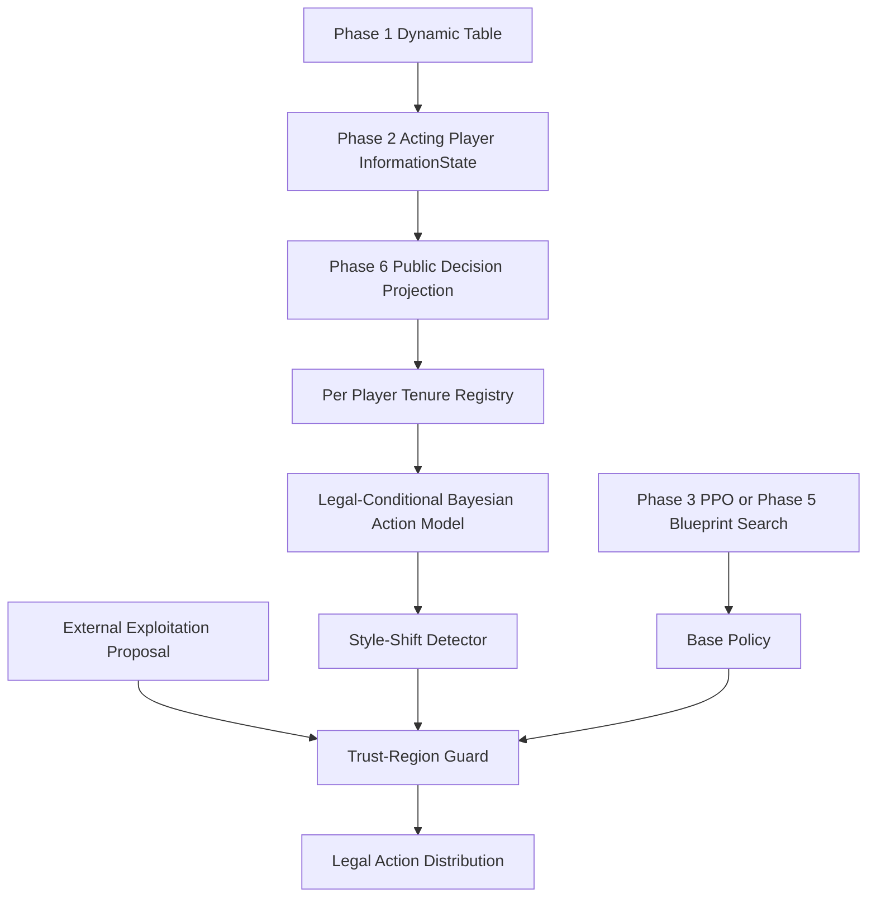

# Expand Phase 6 — Opponent Modeling & Adaptive Strategy

> [!warning] 구현 상태와 원본 Pluribus의 구분
> 이 Phase는 **Pluribus 원본의 공식 구성요소가 아닌 별도 확장 연구**다. 현재 구현은 공개 행동 기반 분포 추정, 변화 탐지 및 보수적인 정책 변경 허가 시스템이다. 상대에 대한 **최적 Counter-Strategy를 스스로 학습한 모델은 아니며**, Phase 1~5와의 실게임 종단 간 통합 및 성능 검증도 아직 수행하지 않았다.

## 0. 역할과 데이터 경계



- Base Actor 입력에는 기존 Phase 2의 공개 정보 + **본인 Hole Cards**만 허용한다.
- 상대 모델은 본인의 Hole Cards조차 저장하지 않는다. **누구의 Hole Cards, 미래 Deck, Training Critic State도 저장하지 않는다.**
- 상대 관측치는 합법적이며 **실제 수행된 행동**만 수집한다.
- `Action Translator`의 합법 행동 이름은 Phase 2의 `ACTION_NAMES`를 사용한다.
- 강제 Small Blind/Big Blind는 VPIP에 포함하지 않는다.
- 관측 데이터는 Session/Player Tenure 단위이므로 같은 물리적 Seat에 다른 사람이 앉으면 서로 섞이지 않는다.

## 1. 모델의 수학적 정의

### 1.1 Player / Session / Seat

\[
\mathrm{key}(j)=(\mathrm{PlayerId}_j,\mathrm{JoinTenureId}_j)
\]

`JoinTenureId`는 **Phase 1의 `request_join`이 발급한 고유 Event ID**를 전달한다. 단순한 `seat_id`나 테이블의 전체 `session_id`만 사용하지 않는다.

같은 `PlayerId`가 같은 `seat_id`로 재입장하더라도 `JoinTenureId`가 다르면 새로운 상대 모델이다.

### 1.2 Context Conditional Action Model

정확한 관측 컨텍스트를 다음처럼 정의한다.

\[
c=(\mathrm{street},\mathrm{position},\mathrm{SPRBucket},\mathcal A_{legal})
\]

\[
\mathcal A_{legal}\subseteq\{\mathrm{fold,check,call,raise\_half\_pot,raise\_pot,raise\_double\_pot,all\_in}\}
\]

동일한 Context에서만 관측 횟수를 합산한다. `CHECK`가 불법인 상황의 `CALL`과 Check 가능 상황의 `CHECK`는 별도로 추정한다.

Long / Recent 가중치:

\[
N^{L}_{t,a}=\lambda_L N^L_{t-1,a}+\mathbf 1[a_t=a]
\]

\[
N^{R}_{t,a}=\lambda_R N^R_{t-1,a}+\mathbf 1[a_t=a]
\]

기본값은

\[
\lambda_L=0.995,\qquad \lambda_R=0.88,\qquad\lambda_R<\lambda_L
\]

이다. Dirichlet prior \(\alpha=0.5\)로 다음처럼 예측한다.

\[
\hat p^L(a\mid c)=\frac{N^L_{t,a}+\alpha}{\sum_bN^L_{t,b}+|\mathcal A_{legal}|\alpha}
\]

관측치가 0개인 Context는 합법 행동에 대한 균등분포다. 동일 선호 전략에서도 적은 표본에서는 추정이 강해지지 않도록 완만한 prior를 둔다.

### 1.3 Nonstationary Change Detection

\[
D_{KL}(p_R\Vert p_L)=\sum_a p_R(a)\log\frac{p_R(a)}{p_L(a)}
\]

서로 다른 effective sample size에서 동일 \(\alpha\)를 사용하면 정지 상태에서도 가짜 KL 이동이 생기므로, **KL 계산에서 Recent prior를 effective count 비율만큼 조정**한다.

\[
\alpha_R=\alpha\frac{\sum_aN^R_a}{\sum_aN^L_a}
\]

기본 탐지 조건은 아래를 모두 만족하는 경우다.

\[
N^R_{eff}\ge8,\quad N^L_{eff}\ge20,\quad D_{KL}>0.13
\]

이 초과가 2회 연속 발생할 때 Change Signal을 활성화한다. 그 시점에서 Long baseline을 Recent 가중치로 초기화하며, 이후 최소 10개 공개 이벤트 동안 적응을 잠시 제한한다. 새 표본이 다시 18개 이상의 Long effective count를 갖추기 전까지 기본 정책을 사용한다.

> [!important] 변화 탐지 경보의 의미
> 고정 임계값 기반 탐지는 **통계적 검정 유의수준이나 False Positive Rate 보증이 아니다.** 특히 상대가 의도적으로 페이크·스위칭하는 경우 신뢰할 수 없을 수 있으므로 절대적인 정책 변경 명령이 아니라 방어적 *fallback trigger*로 취급한다.

### 1.4 Preflop 진단

- `VPIP`: 강제 블라인드를 제외하고 프리플롭에 자발적으로 Call 또는 Raise한 핸드의 비율.
- `PFR`: 프리플롭에서 한 번 이상 Raise한 핸드의 비율.
- `3-Bet`: 이전에 공개된 Raise가 존재하는 프리플롭에서 다시 Raise한 핸드의 비율(본 단계는 **전체 프리플롭 참여 핸드 분모의 빈도**로 보고; *3-bet opportunity conditional rate*와 다름).

\[
VPIP_j=\frac{\#\mathrm{voluntarily\;entering\;preflop\;hands}_j}{\#\mathrm{observed\;preflop\;hands}_j}
\]

\[
PFR_j=\frac{\#\mathrm{preflop\;raising\;hands}_j}{\#\mathrm{observed\;preflop\;hands}_j}
\]

실제 엔진이 `preflop_raises_before`를 정확히 계산하도록 `PublicOpponentTracker`에서 Phase 2의 공개 History를 사용한다. 핸드 종료 시 `close_hand()`를 호출해야 요약 빈도가 확정된다.

## 2. Adaptive Strategy의 책임 범위

**`SafeAdaptivePolicy`는 자체적으로 베팅을 최적화하지 않는다.** 다음 세 가지를 입력으로 받는다.

1. `base`: Phase 3 PPO 또는 Phase 5 Blueprint/Search가 만든 합법 행동 분포.
2. `proposal`: 별도 Counter-Strategy 모델에서 만든 합법 행동 분포. **현재 Phase 6에서는 학습하지 않는다.**
3. `evidence`: 상대가 실제 행동했던 Context의 공개 행동 모델 및 변화 여부. 상대의 합법 행동 집합은 현재 Hero의 합법 행동 집합과 다를 수 있다.

`StyleExpertRouter`는 `fold_heavy / calling / aggressive`를 추정하고 **이미 존재하는 세 종류의 Hero 정책 Expert** 중 하나를 후보로 반환한다. `StyleExpertRouter` 자체는 학습을 하지 않는다. 스타일이 불확실하면 후보가 없으므로 기본 정책으로 돌아간다. 이 경로는 Phase 6에서 구현했지만, Hero의 카드·Pot Odds에 따른 올바른 Expert 생성은 Phase 7 통합에서 수행해야 한다.

그다음

\[
\pi_{adapt}(a)=(1-\eta)\pi_{base}(a)+\eta\pi_{proposal}(a)
\]

를 제한한다.

\[
\eta\le\eta_{max}\frac{N^L_{eff}}{N^L_{eff}+\kappa}
\]

기본값은 \(\eta_{max}=0.3\), \(\kappa=20\)이며, 아래 제한을 동시에 만족하도록 **이분 탐색**으로 \(\eta\)를 낮춘다.

\[
\boxed{D_{KL}(\pi_{adapt}\Vert\pi_{base})\le0.025}
\]

\[
\boxed{D_{TV}(\pi_{adapt},\pi_{base})\le0.075}
\]

\[
D_{TV}(p,q)=\frac12\sum_a|p(a)-q(a)|
\]

`base[a]=0`이면 `proposal[a]`에도 질량을 주지 않는다. 합법 행동 마스크를 초과하거나, Change Signal이 켜지거나, 데이터가 부족하면 `base`를 그대로 반환한다.

> [!warning] Trust Region에 대한 주의
> KL/TV 제한은 **정책 분포가 기본 정책에서 얼마나 달라지는지만 제한**한다. 포커에서 실제 EV가 감소하지 않는다는 보장이 없다. Phase 7에서 별도 카드/상대 홀드아웃 검증이 필요하다.

## 3. 공개 정보 수집 인터페이스

```python
from holdem_ai.expand.opponent import PublicOpponentTracker, SafeAdaptivePolicy

tracker = PublicOpponentTracker()

# Table boundary 이후; Phase1 request_join(... )의 결과 event ID가 tenure가 된다.
tracker.sync_seats(table.snapshot(), tenure_by_player)

before = phase2_adapter.observe()
selected_action = "call"  # 현재 행동이 합법인 상황 예시

# !!! Phase1 실제 엔진이 행동을 ACCEPT한 이후에만 기록 !!!
phase2_adapter.act_abstract(selected_action)
evidence = tracker.record_accepted_action(
    before,
    handle=current_hand_handle,
    player_id=acting_player_id,
    player_session_id=tenure_by_player[acting_player_id],
    action_index=hand_action_index,
    action=selected_action,
)

# Hand Settlement 이후 기록 확정
after = phase2_adapter.settle_hand()
tracker.close_hand(current_hand_handle)
```

`tracker.record_accepted_action()`은 7개 **Phase 2 추상 Action**만 지원한다. 자유로운 `raise_to` 값을 사용하는 경우 E7에서 합법 베팅 사이즈 버킷으로 매핑하는 전용 계층을 새로 만들고 테스트해야 한다. 지금은 근사 버킷으로 잘못 기록하지 않고 실패한다.

### `SafeAdaptivePolicy` 호출

```python
from holdem_ai.expand.opponent import SafeAdaptivePolicy, StyleExpertRouter

base = {'fold': 0.20, 'call': 0.60, 'raise_pot': 0.20}
proposal = {'fold': 0.05, 'call': 0.05, 'raise_pot': 0.90}
legal = ('fold','call','raise_pot')

evidence = tracker.registry.evidence(opponent_seat, context)
# 직접 후보를 공급할 수도 있고, 이미 학습된 Policy Expert 집합에서
# StyleExpertRouter(...).propose(evidence, experts, hero_legal=legal).proposal
# 로 선택한 후보를 사용할 수도 있다.
result = SafeAdaptivePolicy().adjust(
    base, proposal, evidence, legal=legal,
    expected_opponent_context=evidence.context if evidence else None,
)

# result.probabilities : 최종 합법 정책
# result.used_proposal : 실제 변형 여부
# result.reason : insufficient_evidence / change_point_fallback / bounded_adaptation ...
# result.kl_from_base, result.tv_from_base : 안전성 수치
```

실전에서는 **상대의 Context와 Hero Action Legal Context가 일반적으로 다르므로** `opponent_seat`의 `evidence`는 **상대가 실제로 관측된 Context**에서 가져와야 한다. `SafeAdaptivePolicy`는 Hero의 `legal`과 상대 Context의 `legal`을 동일하다고 가정하지 않는다. `expected_opponent_context` 옵션으로 조회 실수를 검증할 수 있다. 단순히 Hero Legal Set으로 상대 모델을 조회해서는 안 된다. 이 Phase는 상황별 Exploitation Network를 제공하지 않으므로 Phase 7에서 Opponent Feature Aggregator를 설계해야 한다.

## 4. Synthetic Evaluation (의도적으로 홀덤 엔진과 무관)

`expand_phase06_benchmark.py`는 공개 행동 스트림으로만 Forecasting과 Change Signal을 검사한다.

- Scenario 1: Tight 스타일; `fold/call/raise_pot=(0.76, 0.20, 0.04)`.
- Scenario 2: Aggressive 스타일; `fold/call/raise_pot=(0.08, 0.17, 0.75)`.
- 처음 90 행동은 Tight, 다음 90 행동은 Aggressive; 즉 Transition 하나.
- 16개 독립 PRNG Block.
- 모델은 다음 행동을 관측하기 **전에** 예측한다. 따라서 자기 자신의 정답으로 예측하는 Data Leakage는 없다.
- 기본 비교 대상은 **균등 분포의 단순 예측기**이며 강한 상대 모델이 아니다.
- 적응 Gate 실험에는 `StyleExpertRouter`와 사전 정의된 **합성 검증용 정책 분포 3개**를 사용한다. 이 정책은 홀덤에서 학습된 Counter-Strategy가 아니며 Style Routing과 제한의 작동 여부만 검증한다.

Online NLL:

\[
L_{online}=\frac1T\sum_{t=1}^T -\log\hat p_{t-1}(a_t)
\]

\[
\Delta L=L_{uniform}-L_{online}
\]

16 Block 평가(2026-10-12 본 작업 환경에서 실행한 합성 실험):

| 지표 | 값 |
|---|---:|
| Uniform NLL | 1.098612 |
| Online Opponent Model NLL | 0.766122 |
| Block-mean improvement | +0.332491 |
| 95% normal CI (block level) | [+0.310901, +0.354081] |
| Style-shift signal detected | 16 / 16 blocks |
| Max observed policy KL | 0.012583 |
| Max observed policy TV | 0.071326 |

위 결과는 **Synthetic Forecasting 전용**이며 `bb/100`, Equity, Game Value 또는 GTO Exploitability가 아니다. 새로운 외부 상대·Betting History·Stack·Hand Strength 데이터에서의 개선을 보증하지 않는다.

## 5. 설치 — Windows PowerShell

Expand Phase 1~5가 설치된 프로젝트 루트에서:

```powershell
Expand-Archive .\holdem-ai-expand-phase06.zip `
  -DestinationPath .\holdem-ai-expand-phase06 -Force

Copy-Item .\holdem-ai-expand-phase06\src\holdem_ai\expand\opponent `
  .\src\holdem_ai\expand\ -Recurse -Force

Copy-Item .\holdem-ai-expand-phase06\scripts\expand_phase06_benchmark.py `
  .\scripts\ -Force

Copy-Item .\holdem-ai-expand-phase06\tests\expand\test_e06_*.py `
  .\tests\expand\ -Force

Copy-Item .\holdem-ai-expand-phase06\docs\EXPAND_PHASE06_OPPONENT_MODELING.md `
  .\docs\ -Force
```

독립 테스트 / 통합 Regression:

```powershell
uv run --extra dev --extra gpu python -m pytest -q -k e06
uv run --extra dev --extra gpu python -m pytest -q tests/expand
uv run --extra dev --extra gpu python -m pytest -q
```

Synthetic Scenario 평가:

```powershell
uv run --extra gpu python -m scripts.expand_phase06_benchmark `
  --blocks 16 --warmup 90 --post-shift 90 `
  --initial-style tight --new-style aggressive `
  --seed 660006 `
  --output-json runs/expand_phase06/style_shift_16.json `
  --checkpoint runs/expand_phase06/registry_16.json
```

이미 같은 Output 경로가 있으면 덮어쓰지 않는다. 반드시 새 이름을 사용한다.

## 6. Test Matrix 및 완료 조건

| 항목 | 본 작업 환경 | Windows 실제 엔진 |
|---|---|---|
| Player Tenure/Seat isolation | Pass | Pending |
| SPR, Action Context Conditioning | Pass | Pending |
| Dirichlet Smoothing / Decay | Pass | Pending |
| Stationary vs Nonstationary Detection | Pass (Synthetic) | Pending |
| Safe KL/TV Policy Guard | Pass | Pending |
| StyleExpertRouter (외부 Expert 라우팅) | Pass (Synthetic) | Pending |
| Checkpoint integrity & Restore | Pass | Pending |
| Phase 2 private cards projection | Pass (Synthetic Typed State) | Pending |
| Real Hold'em event collection | Test file included, skipped | Pending |
| Adaptive vs Baseline Real 6-Max EV | Not tested | Pending — Expand Phase 7 |

`tests/expand/test_e06_real_engine.py`에는 실제 Phase 3 엔진으로 여러 핸드를 실행하면서 합법 행동 공개 기록이 누적되는지 검증하는 수용 시험이 있다.

## 7. Resource Limits / Checkpoint / Data Privacy

`OpponentRegistry`는 추정 Context와 관측 Event ID를 **무한히 저장하지 않도록** 제한한다. 기본값 `max_contexts_per_player=1024`, `max_event_ids=200000`을 넘으면 임의의 오래된 정보를 버리지 않고 **오류로 중단**한다. 데이터 저장·삭제 정책은 배포 전에 별도로 마련해야 한다.

`save_registry(...)` / `load_registry(...)`는 JSON payload SHA256 검증을 수행한다. SHA256은 **인증/서명이나 신뢰할 수 없는 파일에 대한 보안 보증이 아니라 우발적 변경 감지 장치**이다. 모델 Snapshot에는 `PlayerId`도 들어가므로 **익명화된 ID를 사용하거나 로컬 비공개 보관**해야 한다.

학습된 카드 네트워크 Checkpoint와 섞이지 않도록 파일명 `runs/expand_phase06/registry_*.json`을 사용한다.

## 8. Expand Phase 7에 넘겨야 할 조건

1. Player Join Tenure Event ID를 Dynamic Table에 안정적으로 전파.
2. Phase 2 관측과 행동 커밋의 **원자적인 순서** 보장.
3. Opponent Feature Aggregator와 실제 Card-Conditioned Counter-Strategy 제안자 구현.
4. Base (PPO vs Blueprint+Search)와 Adaptive를 **동일 Seed Block, Player Mix, Card Deal**로 대결 평가.
5. Seat Swap, Player Swap, Abrupt Change, Adversarial Fake Style, Cold-Start와 Rebuy 연구.
6. Base PPO/Blueprint 출력을 Phase 2의 동일 `ACTION_NAMES`와 합법 Mask로 매핑.
7. 결괏값 `bb/100`과 CI는 독립 Hand/Session Block 기반 보고.
8. Tournament ICM/Placement Reward는 Cash chip EV와 독립적으로 확장.

## 9. Pluribus 원본과 차이

원본 Pluribus는 주로 MCCFR Blueprint 및 Depth-Limited Search를 활용했다. 본 Phase의 **온라인 Opponent Modeling / style adaptation은 프로젝트의 신규 연구 요소**다. Phase 5의 Search 역시 원본 Pluribus의 완전한 Nested Search를 재현한 것은 아니다.

설계 참조: `EXPAND_MASTER_DESIGN_6MAX_v1_0.md`, E6.1~E6.4.
