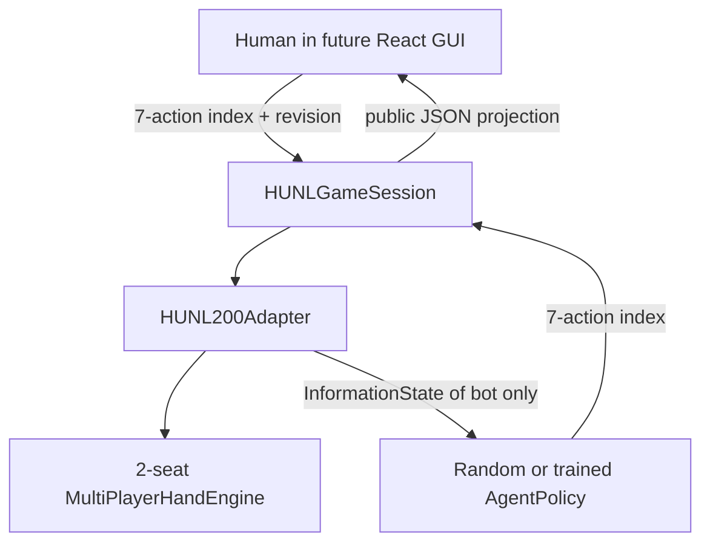

# GUI-1.0 — HUNL Human vs Trained Agent: Interface Contract

> Scope: **HEADS-UP only (2 seats), single-hand reset at 200BB, human seat 0, bot seat 1**. No React or FastAPI in this phase; that is GUI-1.1~1.3. No 6-Max or tournament play.

## 1. Goal



$$
I_t^i = O_i(S_t),\qquad a_t \sim \pi_\theta(\cdot\mid I_t^i),\qquad S_{t+1}=T(S_t,a_t).
$$

Separation requirement: `AgentPolicy.act(observation, rng)` only receives its acting seat's `InformationState`. The GUI sees `project_human_view` output only. The private internal `HUNL200Adapter.engine` and `CriticState` **MUST NOT** be serialized to browser clients.

## 2. Existing code reused (no replacement)

- `holdem_ai.environment.hunl200_adapter.HUNL200Adapter`: Phase 6 heads-up interface.
- `holdem_ai.core.schema.InformationState`, `Turn`, `Terminal`: Phase 5.
- `holdem_ai.environment.bet_abstraction`: fixed 7-head action labels and masks.
- `holdem_ai.agents.policies.RandomLegalPolicy`: baseline AgentPolicy.
- `holdem_ai.agents.neural_policy.NeuralActorPolicy`: injection-ready (checkpoint loading in GUI-1.4).
- `holdem_ai.environment.multi_player_engine.MultiPlayerHandEngine`: real betting, cards, showdown.

### Seven actions

| Index | Label | Description |
|---:|---|---|
| 0 | `fold` | Fold |
| 1 | `check` | Check |
| 2 | `call` | Call (including short all-in call) |
| 3 | `raise_half_pot` | 0.5 pot raise-to abstraction |
| 4 | `raise_pot` | 1 pot raise-to abstraction |
| 5 | `raise_double_pot` | 2 pot raise-to abstraction |
| 6 | `all_in` | All-in **raise** when permitted |

`action_index` means **policy head index**; it is NOT the original 5-index engine action ID. `raise_to` means total contribution on the current street. Illegal and duplicate abstract raises are masked out. A short all-in *call* is still `call`.

**Restriction**: During GUI-1.0 humans submit an available 7-action index, just like a bot. Arbitrary `raise_to` by a human is intentionally postponed until GUI-1.3, requiring an explicit, tested method in HUNL200Adapter to keep its action history/encoder consistent. Do not write to `_history` or `_choices` directly from UI code.

## 3. Human public state

`session.view()` returns a new JSON-serializable dict, with this stable draft contract:

```json
{
  "game_type": "HUNL200",
  "hand_number": 1,
  "revision": 1,
  "phase": "playing",
  "hero_seat": 0,
  "button": 0,
  "small_blind": 50,
  "big_blind": 100,
  "street": "preflop",
  "board": [],
  "hero_cards": ["hA", "sK"],
  "seats": [
    {"seat": 0, "role": "human", "stack": 19950, "street_bet": 50, "total_contribution": 50, "status": "active"},
    {"seat": 1, "role": "bot", "stack": 19900, "street_bet": 100, "total_contribution": 100, "status": "active"}
  ],
  "pot": 150,
  "to_act": 0,
  "your_turn": true,
  "to_call": 50,
  "min_raise_to": 200,
  "max_raise_to": 20000,
  "actions": [{"index": 2, "label": "call", "kind": "call", "raise_to": null}],
  "action_log": [],
  "completed_hands": 0,
  "cumulative_bb": 0.0,
  "bb_per_100": 0.0,
  "hand_result": null
}
```

The sample contains **illustrative hole cards**; actual holes are freshly shuffled by the game engine. `actions` lists all engine-legal choices, not just the example call shown above.

At terminal state, `phase="complete"`, `to_act=null`, `actions=[]`, and `hand_result` is populated. The bot's hole cards are released only when an actual showdown occurs (`result.folded` contains no folds and five community cards are on board). They remain hidden when a hand ends by fold.

**Never expose**: opponent's unrevealed hole cards, future cards, burned cards, shuffled deck, privileged critic, or a full game engine state object.

## 4. Action and concurrency safety

Browser requests (in GUI-1.1) will contain `session_id`, `action_index`, `expected_revision`. The transport must not accept a browser-supplied mask, cards, pot, stack or bet target as authoritative.

$$
\mathrm{Accept}(a,r)\iff r=r_{server}\land a\in \mathcal A_{legal}(I_t).
$$

Every legal action increments `revision`; a stale request is refused. Per-session locks prevent concurrent state mutation in the Python process. GUI-1.1 will implement request schema, HTTP conflict status mapping, loopback binding, restricted CORS, resource limits and clear errors.

## 5. Session semantics

- `HUNLGameSession.start_hand()` deals and runs bot actions automatically until it is the human turn, or the hand finishes.
- `play_human_action(index, expected_revision=r)` validates, advances engine, executes any necessary bot turns, and returns a fresh view.
- `view()` is side-effect free, and does not start or advance hands.
- `start_hand()` rejects calls while the current hand is still active; after termination it deals a fresh 200BB hand and rotates button (`0,1,0,1,...`).
- `HUNLSessionRegistry` uses unpredictable IDs, is process-local, and is not a production persistence/auth solution.

### Metrics

$$
R_{hero,h}^{BB}=\frac{C_{hero,h}^{final}-200\,BB}{BB},
\qquad \sum_{i=0}^{1}R_{i,h}^{BB}=0.
$$

$$
\widehat J_{bb/100}=\frac{100}{N}\sum_{h=1}^N R_{hero,h}^{BB}.
$$

**Interpretation**: a descriptive session sample statistic; tiny session sample sizes, different opponents, and unbalanced seat/button mix cannot establish strategy strength. Here hands reset stacks instead of persisting cash-game bankroll.

## 6. Run/validate

From the existing project root after extracting the patch:

```powershell
uv sync --extra dev
uv run --extra dev python -m pytest -q
uv run --extra dev python -m pytest tests/test_gui10_hunl_contract.py -q
uv run python scripts/gui10_smoke.py --hands 20 --seed 42
```

No trained checkpoint is distributed in this patch. To experiment with a trained bot in Python, pass a **compatible trusted** `NeuralActorPolicy` instance as `bot_policy`. Automated checkpoint discovery/loading, configuration and validation are GUI-1.4 tasks.

## 7. GUI-1.0 non-goals and next work

- **GUI-1.1**: FastAPI endpoints, Pydantic validation, localhost-only security and CORS, serializing game sessions.
- **GUI-1.2**: React table, cards/board, dealer button, stacks and pot.
- **GUI-1.3**: Human betting controls including arbitrary raise-to; explicit `HUNL200Adapter.step_raise_to` extension, legal-reopen validation and histories.
- **GUI-1.4**: Trusted Phase-15/16 checkpoint loader, PPO/Q-Boost model compatibility checks, model-vs-human validation.
- **GUI-1.5**: Session dashboard, hand statistics, performance QA.

The project remains **HUNL only** for this GUI effort. The existing 6-Max and tournament engine source files are retained untouched for future work.
