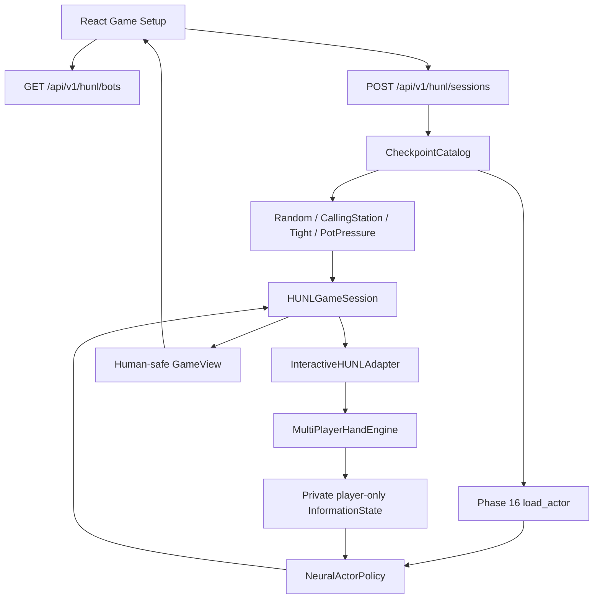

# GUI-1.4 — Human vs Trained HUNL Agent

## Objective

`GUI-1.0~1.3`의 2인 200BB 로컬 게임에 Phase 15/16의 **신뢰할 수 있는 Actor 체크포인트**를 연결한다.

$$
I_t^{bot} = O_{bot}(s_t),\qquad
\pi_{\theta}(a\mid I_t^{bot}),\qquad
 a_t \sim \pi_{\theta}(\cdot \mid I_t^{bot})
$$

- `mode=sampled`: 합법 7-action 분포에서 확률적으로 샘플링(혼합전략 평가 권장).
- `mode=greedy`: 합법 행동 중 확률이 최대인 행동 선택(추가적인 결정론적 진단용).
- `Human`: 기존 GUI-1.3의 임의 `Raise-to` 입력 사용.
- `Bot`: 기존 HUNL200의 7개 추상 행동만 사용.
- 새로운 RL 학습은 **수행하지 않는다**. Actor는 `eval()`, frozen weights를 사용한다.

## Component flow



## Checkpoint API and file safety

| Bot id | Checkpoint source | Runtime |
|---|---|---|
| `random`, `calling_station`, `tight`, `pot_pressure` | built-in baseline | CPU / no model file |
| `ppo` | `HOLDEM_AI_PPO_CHECKPOINT` | Actor inference |
| `qboost` | `HOLDEM_AI_QBOOST_CHECKPOINT` | Actor inference |

Checkpoint *paths* are read solely from server environment variables. Client cannot submit a filesystem path, upload arbitrary weights, or ask the server to download weights. `GET /bots` advertises file presence only; the strict compatibility load happens at session creation. Unconfigured or incompatible checkpoints cause explicit 422 errors **without fallback** to Random Bot. The Phase 16 loader uses `torch.load(..., weights_only=True)` and strict `TransformerActor` weights; even so, **only load files from trusted local training runs**.

No `.pt` files are bundled in this patch. Locally choose an actual Phase 15/16-compatible checkpoint, e.g. a `best.pt` resulting from a successful long-run training execution. Algorithm IDs (`ppo` or `qboost`) are *user configuration labels* for the file paths: the GUI does not independently authenticate the training algorithm of the checkpoint.

The server locks neural game settings to `small_blind=50`, `big_blind=100`, `stack_bb=200` to avoid accidental out-of-distribution parameters. Existing custom human Raise-to options remain supported, **but non-abstract betting sequences were not necessarily present in training**. Agent quality for those sequences is not established.

## Windows PowerShell configuration

From project root:

```powershell
# GUI + API packages. Only needed once.
uv add --optional gui "fastapi>=0.115,<1" "uvicorn>=0.30,<1" "httpx>=0.27,<1"
uv sync --extra dev --extra gui --extra gpu

# IMPORTANT: replace these with YOUR ACTUAL trusted checkpoint paths.
$env:HOLDEM_AI_PPO_CHECKPOINT = (Resolve-Path ".\runs\phase15_ppo\best.pt").Path
$env:HOLDEM_AI_QBOOST_CHECKPOINT = (Resolve-Path ".\runs\phase15_qboost\best.pt").Path

# default CPU; optionally cuda if your installed PyTorch supports GPU
$env:HOLDEM_AI_GUI_DEVICE = "cpu"
$env:HOLDEM_AI_GUI_POLICY_MODE = "sampled"

uv run --extra dev --extra gui --extra gpu python -m pytest -q
uv run --extra dev --extra gui --extra gpu python -m scripts.gui14_smoke --bot ppo --hands 3
uv run --extra gui --extra gpu python -m backend.main
```

`Resolve-Path` needs the file to exist. If only one checkpoint is available, configure only its corresponding environment variable; the other neural choice remains disabled. On Windows, setting `$env:...` applies to the **current PowerShell process**. The React process can run in a separate terminal; the FastAPI server process requires the environment variables.

React:

```powershell
cd frontend
npm install
npm run test
npm run build
npm run dev
```

Open `http://127.0.0.1:5173`. The model dropdown shows both built-in and neural slots; unavailable neural slots are disabled. If the model file exists but is corrupted/incompatible, game creation returns a diagnostic error without exposing the path.

## HTTP endpoints

Existing GUI-1.3 API preserved. New:

```http
GET /api/v1/hunl/bots
```

Response (example):

```json
{
  "bots": [
    { "id": "random", "label": "Random policy", "trained": false, "available": true, "message": "Ready to play" },
    { "id": "ppo", "label": "Trained PPO", "trained": true, "available": false, "message": "Checkpoint file not configured or missing" }
  ],
  "device": "cpu",
  "policy_mode": "sampled"
}
```

The real response additionally contains the other built-in and Q-Boost slots.

```http
POST /api/v1/hunl/sessions
Content-Type: application/json

{"bot":"ppo","seed":42,"small_blind":50,"big_blind":100,"stack_bb":200}
```

All existing action, raise-to, revision, next-hand, and privacy contracts are unchanged.

## Validation and limits

- Checkpoint list: disabled without model, no file path leakage.
- Strict load error: malformed checkpoint yields 422; no fallback.
- Selection: PPO/Q-Boost independent slots, CPU vs CUDA, sampled/greedy.
- Caching: immutable actor shared; per-session independent RNG; file size/mtime change invalidates cache.
- Privacy: Bot sees only its `InformationState`, not Human's hole cards or centralized CriticState.
- Regression: GUI-1.0~1.4 backend 34 tests passed in phase-compatible fixture; all phase-compatible verification tests 137 passed, 3 skipped.
- Limit: fixture uses a **mock checkpoint loader**; genuine Phase 15 checkpoint inference, latest full repo regressions, npm build and browser end-to-end are not verified here.
- Local-only FastAPI: no authentication; never bind this development server to public networks.
- Pluribus-level strength or GTO is **not** implied by the ability to load a checkpoint.

## Follow-up

GUI-1.5: result display, hand histories, opponent selection metadata in saved outcomes, more extensive realistic hand QA and measured performance reporting (with sampling caveats).
