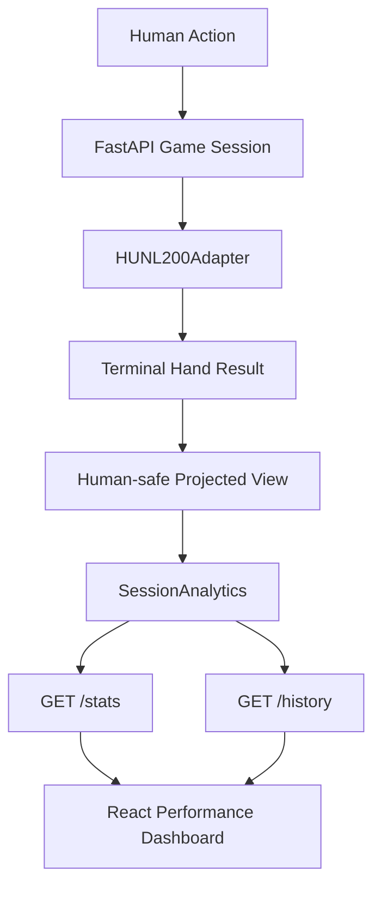

# GUI-1.5 — Performance Dashboard, Hand History & Final Validation

## 1. Objective

GUI Mode 1에서 Human($i=0$)과 Bot($i=1$)이 실행한 **완료된 HUNL 핸드**의 기록을 서버 세션에 보존하고, React에서 누적 결과, 액션 타임라인 및 결과를 시각화한다.

> [!important] 구현 범위
> 이 단계는 *학습*이 아니라 GUI Mode 1의 **Human vs Agent 평가 UI**다. Tournament / 6-Max / 외부 온라인 플랫폼 연동은 포함하지 않는다.

## 2. Data Flow



$$
R_{i,h}^{BB}=\frac{S_{i,h}^{final}-S_{i,h}^{initial}}{BB_h},
\qquad
\widehat{bb/100}=\frac{100}{N}\sum_{h=1}^{N} R_{i,h}^{BB}.
$$

현재 HUNL200은 **매 핸드 200BB로 초기화**하므로, `cumulative_bb`는 각 핸드 결과의 합이며 실시간 캐시 게임의 스택 이월을 의미하지 않는다.

승률:

$$
\widehat{p}_{win}=\frac{N_{win}}{N_{completed}}.
$$

표본 표준편차와 근사 신뢰구간(설명용):

$$
s_R^2=\frac{1}{N-1}\sum_{h=1}^N (R_h^{BB}-\bar R^{BB})^2,
$$

$$
\widehat{bb/100}\pm 1.96\,\frac{100s_R}{\sqrt{N}}.
$$

> [!warning] 통계 해석
> 위 구간은 독립 핸드·정규근사를 가정한 **참고치**다. 실제 인간과의 세션은 상대 적응, 시드·포지션 차이 때문에 독립성이 보장되지 않는다. 적은 핸드의 플러스 bb/100은 강한 전략이나 GTO의 증거가 아니다. 과학적 성능 비교에는 기존 Phase 12/16의 seed-blocked 평가를 계속 사용한다.

## 3. Server implementation

- `src/holdem_ai/game_service/session_analytics.py`: 종료 핸드의 안전한 공개 상태 스냅샷만 받아 기록. 500건 상세 기록 유지, 전체 통계는 계속 누적. Welford 온라인 분산.
- `session_manager.py`: 각 핸드가 Terminal 상태가 될 때 정확히 한 번 기록. 새 핸드에서는 기록 유지.
- `backend/schemas.py`: 명시적인 `SessionStatsResponse`, `CompletedHandView`, `HistoryResponse` (Pydantic extra=forbid).
- `backend/game_router.py`: 세션별 통계/기록 조회.

| Method | Path | Result |
|---|---|---|
| GET | `/api/v1/hunl/sessions/{session_id}/stats` | 전체 누적 손익, W/L/Even, Showdown 수, CI, 최대 낙폭 |
| GET | `/api/v1/hunl/sessions/{session_id}/history?offset=0&limit=30` | 최근 완료 핸드부터 30건(최대 100건/페이지) |

새 API는 기존 `GameView`, `/actions`, `/raise-to`, `/next-hand`를 변경하지 않는다.

## 4. Privacy Invariant

게임 도중 상대 Hole Cards는 서버의 정책 입력으로만 전달된다. 공개 API에 포함하지 않는다.

$$
O_{human}(s)\cap H_{villain}=\varnothing\quad\text{(before terminal showdown)}.
$$

Fold로 종료된 완료 기록에서도 `result.opponent_cards=null`. Showdown에서만 공개. 덱, burn cards, CriticState, 체크포인트 로컬 경로는 공개 기록에 포함하지 않는다.

## 5. Frontend

- `SessionAnalyticsPanel.tsx`: 누적 BB 라인, 승률 및 핸드별 Journal, 클릭 시 개인 카드·공개 보드·행동 이력·Showdown 결과 확장
- `lib/analytics.ts`: 그래프 수치 변환, Win Rate 계산
- `api/client.ts`: `/stats`, `/history` 추가
- `App.tsx`: GUI-1.4의 라이브 테이블 및 기존 Bet Panel 아래 Dashboard 부착
- 현재 핸드를 플레이하는 동안 완료 기록 통계는 변하지 않으며, 종료 시 갱신
- Preview fixture는 실적에 포함되지 않음

## 6. Local validation

프로젝트 루트 PowerShell:

```powershell
Expand-Archive -Path "$HOME\Downloads\holdem-ai-gui-1-0-to-1-5.zip" -DestinationPath . -Force
uv add --optional gui "fastapi>=0.115,<1" "uvicorn>=0.30,<1" "httpx>=0.27,<1"
uv sync --extra dev --extra gui --extra gpu
uv run --extra dev --extra gui --extra gpu python -m pytest -q
uv run --extra dev --extra gui --extra gpu python -m scripts.gui15_smoke --hands 20 --seed 42
```

Backend 터미널:

```powershell
uv run --extra gui --extra gpu python -m backend.main
```

Frontend **별도 터미널**:

```powershell
cd frontend
npm install
npm run test
npm run typecheck
npm run build
npm run dev
```

브라우저: `http://127.0.0.1:5173`.

## 7. Validation status and limitations

- 별도 Phase 1–4 기반 통합 검증 샌드박스에서 GUI-1.0~1.5 및 기존 Environment 회귀 테스트 실행.
- Phase 15의 **실제 PPO/Q-Boost 학습 체크포인트와 함께** 돌아가는 Windows/CUDA/React 브라우저 끝단 테스트는 **아직 실행하지 못함**.
- Node 의존성 저장소 접근이 없어 npm 설치, `npm run build`, 시각적 렌더링 테스트는 사용자의 로컬 PC에서 최종 확인 필요.
- 서버 세션은 메모리 전용이다. 서버 재시작·세션 삭제 시 기록이 사라짐. CSV 영속 내보내기는 향후 확장.
- 정확한 호출 이력은 기존 게임 서비스가 제공하는 공개 이벤트 수준으로만 저장. 이전 버전부터 일부 Call/All-in의 *정확한 금액*이 보존되지 않는 제약은 여전하다.
- 기존 HUNL200의 자유 Raise-to 입력은 학습 시 사용한 7-action abstraction 밖의 금액을 포함할 수 있다. 연구 결과의 해석에 주의한다.

## 8. Acceptance Checklist

- [x] 컴포넌트/API/기록 코드 작성
- [x] 테스트: 빈 세션, 종료된 핸드, 프라이버시, 페이지네이션, 누적 통계, 세션 격리, 보존 제한
- [x] 별도 호환 환경 통합 Python 테스트
- [ ] 사용자 전체 Phase 0–16 코드 통합 테스트
- [ ] 사용자 로컬 Node 브라우저 빌드 및 실제 플레이 확인
- [ ] 사용자 Phase15 Checkpoint 경로 지정 후 Human vs PPO/QBoost E2E 확인
