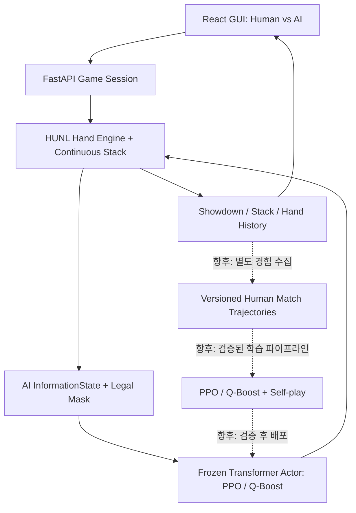

# holdem-ai — GUI 1.0–1.6 / Phase 17 개발 현황 및 Human-in-the-Loop RL 로드맵

> 작성일: 2026-10-13  
> 범위: 기존 [Phase 0–16 기술 보고서](PROJECT_REPORT.md) 이후의 GUI 개발, Phase 17 가변 스택 평가, 실제 Windows 검증, 향후 사람과의 대국 기반 학습 목표  
> 상태 표기: **구현**, **사용자 로컬 실행 확인**, **미검증**, **향후 개발 계획**을 엄격히 구분한다.

## 1. Executive summary

현재 프로젝트의 목표는 단순한 Random Bot 게임이 아니다. **인간 플레이어가 GUI에서 대결하는 상대가 바로 프로젝트에서 PPO 또는 Q-Boost PPO로 학습한 HUNL 정책이어야 하며, 인간 대국을 이후의 개선된 정책 학습에 활용하는 시스템**을 구축하는 것이다.

현재까지 확인된 사실:

1. Phase 0–16: HUNL200 실험 환경, Transformer Actor, PPO 및 실험적 Q-Boost PPO 학습/평가 도구가 존재한다.
2. GUI 1.0–1.6: React + FastAPI의 HUNL Heads-Up 게임, 베팅 입력, 모델 체크포인트 추론 연결, Hand History/통계, **Continuous Stack Play Mode** 코드를 구현했다.
3. **학습 코드는 Independent Hand(각 핸드 200BB 초기화)가 기본값**이며, GUI Play는 이전 핸드의 칩을 이어받도록 분리했다.
4. 사용자 Windows 로컬에서 Phase 17 통합 Python 테스트 **690 passed, 1 xfailed, 1 warning (30.40초)**를 보고했다.
5. GUI 1.5 TypeScript 오류 수정 후 Windows에서 `typecheck`·`vite build` 및 Vitest **11/11** 통과를 보고했다. GUI 1.6 초기 테스트 타입 오류는 수정 패치가 전달되었으며, 최신 완성본 전체 TypeScript 재검증 로그는 별도로 확보하지 않았다.
6. 실제 GUI 스크린샷에서 Continuous Stack 매치의 정산 및 Match Over 화면을 확인했다. 단일 스크린샷은 모든 규칙·상태 전이를 완전 검증하는 근거가 아니다.
7. Phase 17은 Phase 14 Pilot **Q-Boost PPO** 체크포인트로 Calling Station 상대 **가변 스택 평가를 실제 실행**했다.
8. **인간과 대국하면서 Actor 가중치를 자동 업데이트하고 다음 대국에 배포하는 Human-in-the-Loop 학습 루프는 아직 구현되지 않았다.**

> **저장소 상태 주의:** 본 문서가 GitHub에 게시되는 시점, GUI 1.0–1.6 및 Phase 17 소스·테스트는 사용자의 Windows 프로젝트에 ZIP 패치로 설치·검증되었다. 해당 소스들이 모두 원격 GitHub `main`에 Push되었다는 뜻은 아니다. 보고서 커밋과 로컬 코드 Push는 별개이다.

## 2. 사용자 목표와 실행 모드

| 구분 | Training / Research | GUI Play |
|---|---|---|
| 주된 실행 경로 | Python CLI / RL 파이프라인 | React + FastAPI |
| 기본 핸드 | Independent, 매번 200BB | Continuous, 최초 200BB |
| 핸드 간 스택 | 매번 초기화 | 직전 최종 스택 계승 |
| 정책 | PPO / Q-Boost, 실험·자기대국 | 학습된 정책을 명시 선택하여 대전 |
| 게임 종료 | 다음 독립 핸드 가능 | 한쪽 스택 0 시 Match Over |
| 모델 가중치 갱신 | 별도 학습 명령으로 가능 | 현재 GUI 대국 도중 자동 갱신 **안 함** |

**Independent Hand는 폐기하지 않는다.** 기존 재현 가능한 PPO/Q-Boost 학습 환경을 유지한다. 브라우저 Play는 Continuous Stack을 사용한다.

### 2.1 칩 보존과 스택 승계

```math
S_{i,h+1}^{\mathrm{start}}=S_{i,h}^{\mathrm{final}}
```

기본 스택은 각 200BB이며 리바이와 레이크가 없는 Heads-Up Play 매치에서는

```math
S_{\mathrm{Hero},h}+S_{\mathrm{Agent},h}=400\,BB
```

가 성립해야 한다. 예: BB=100칩일 때 총합은 40,000칩. 매 핸드 버튼 위치를 교대하고, 블라인드보다 작은 Short Stack과 강제 올인 이후의 자동 정산까지 처리해야 한다.

### 2.2 AI 추론과 정보 보호

```math
a_t^{\mathrm{AI}}\sim\pi_{\theta}(\cdot\mid I_t^{\mathrm{AI}},\mathcal A_t^{\mathrm{legal}})
```

- Actor 입력은 자기 Hole Cards, 공개 카드/베팅·히스토리, 합법 행동 마스크 등 **해당 플레이어가 관측 가능한 InformationState**만 포함한다.
- 상대의 비공개 카드는 합법적인 Showdown이 일어나기 전 GUI/Actor에 제공하지 않는다.
- 학습 중 중앙집중식 Critic의 특권 상태를 추론 시 Actor에 전달하지 않는다.
- GUI 사람이 입력하는 자유로운 `raise-to`와, 학습 정책의 **7개 행동 추상화**는 별도 경계로 유지한다.

## 3. GUI 개발 현황

| GUI 단계 | 주요 개발 내용 | 증거 / 제한 |
|---|---|---|
| 1.0 | HUNL Game Session, Bot 인터페이스, 상태 프로젝션 | Python 테스트 및 스모크 |
| 1.1 | FastAPI 게임 세션, 턴, 액션, revision 충돌 방지 | API 테스트 |
| 1.2 | React/TypeScript Heads-Up 테이블 | 실제 Windows에서 프론트엔드 빌드 검증 진행 |
| 1.3 | Fold / Check / Call / Raise-to / All-In 조작 | GUI API 연동 |
| 1.4 | 로컬 체크포인트 로더와 PPO/Q-Boost 추론 선택 | 체크포인트 지정 필요; 기본 Random Bot과 구분 |
| 1.5 | Hand History, 누적 BB, 승패, 통계 및 차트 | 로컬에서 TypeScript 수정 후 빌드·테스트 통과 |
| 1.6 | Continuous Stack, Match Over, Play/Training 구분 | 사용자 실제 브라우저 대전 화면 확인; 추가 회귀 검증 필요 |

### 3.1 실행 아키텍처



실선은 현재 구현된 대국 흐름을 의미한다. 점선은 **미구현 Human-in-the-Loop 기능**이다.

### 3.2 실제 학습된 AI와 대국하기

사용자 로컬에 다음 Phase 14 Pilot 체크포인트가 존재함을 파일 목록으로 확인했다.

- `runs/phase14_pilot/seed_41/ppo/best.pt`
- `runs/phase14_pilot/seed_41/qboost/best.pt`
- Phase 14 Main의 `seed_51`, `seed_52`, `seed_53` PPO/Q-Boost `best.pt`도 확인했다.

반면 예시 경로 `runs/phase15_ppo/best.pt`는 로컬에 없어서 `FileNotFoundError`가 발생했다. **Phase 15 장시간 학습을 완료한 최종 모델이 있다는 증거는 아직 없다.**

예시: Windows PowerShell에서 프로젝트 루트 기준

```powershell
$env:HOLDEM_AI_QBOOST_CHECKPOINT = (Resolve-Path ".\runs\phase14_pilot\seed_41\qboost\best.pt").Path
$env:HOLDEM_AI_PPO_CHECKPOINT = (Resolve-Path ".\runs\phase14_pilot\seed_41\ppo\best.pt").Path
$env:HOLDEM_AI_GUI_DEVICE = "cpu"
$env:HOLDEM_AI_GUI_POLICY_MODE = "sampled"
uv run --extra gui --extra gpu python -m backend.main
```

React GUI에서 **Trained Q-Boost PPO**를 선택하고 새 세션을 생성해야 학습된 정책과 대국하게 된다. 환경변수 없이 기본 Random Bot을 선택한 게임은 학습된 정책과의 대전이 아니다. **이 연결은 추론 전용이며 온라인 학습이 아니다.**

## 4. 테스트 및 현장 검증

### 4.1 Python

사용자가 GUI/Phase 17 적용 후 Windows Python 3.11/uv 프로젝트에서 실행한 결과:

```text
690 passed, 1 xfailed, 1 warning in 30.40s
```

`xfailed` 1개는 예상 실패로서 일반적인 테스트 실패가 아니다. Starlette/httpx deprecation 경고가 1개 있었고, 향후 의존성 관리 대상이다.

### 4.2 React / TypeScript

사용자는 GUI 1.5 TypeScript 핫픽스 이후 다음 항목의 성공 로그를 제공했다.

- `npm.cmd run typecheck` 성공
- `npm.cmd run build` 성공 (Vite 6.4.4)
- `npm.cmd run test` 성공 (**11 tests, 3 files**)
- `npm.cmd run dev` 성공 (127.0.0.1:5173)

GUI 1.6에서 테스트 fixture의 `starting_stacks` 누락으로 타입 검사가 한 차례 실패했고, 이를 보완한 수정 패치를 전달했다. 실제 Continuous Stack 대전 화면은 제공되었으나, **그 이후의 전체 타입 검사·빌드 로그는 추가 확인 대상**이다.

### 4.3 플레이 검증

사용자가 GUI 스크린샷을 제공했다. 스택을 연속 승계하는 설계의 대전 화면, 쇼다운/정산, 파산에 따른 Match Over 화면을 확인했다. 코드 내부 검증에서는 Short Stack 자동 종료도 다루었지만, 추가 Windows 실제 플레이 케이스(블라인드 미만 스택, 여러 핸드의 버튼 교대, 중복 요청)를 더 점검해야 한다.

## 5. Phase 17 — 가변 스택 평가 결과

### 5.1 실험 프로토콜

- 후보: Phase 14 Pilot `seed_41/qboost/best.pt`
- Actor ID: `actor:1aacab05bca91717`
- 상대: `builtin:calling_station` (**인간이 아님**)
- 정책 행동 선택: `sampled`
- 그룹: 독립 카드 시드 10개 / 시나리오
- 그룹당 위치 배치: 4개 (좌석과 버튼 교차)
- 최대 핸드: 20 / 매치
- 시작 스택: 후보 50, 100, 200, 300, 350BB (상대는 400BB에서 차감)
- 평가 대상: **매 핸드 스택이 이어지는 Continuous Match**, Phase 16의 독립 200BB 평가와 다름

```math
b_g = 100\,\frac{\sum_{\ell=1}^{4} \Delta S_{g,\ell}^{BB}}
{\sum_{\ell=1}^{4} H_{g,\ell}},
\qquad
\widehat{\mu}=\frac{1}{G}\sum_{g=1}^{G} b_g
```

```math
CI_{95\%}\approx \widehat{\mu}\pm1.96\,\frac{s_b}{\sqrt G}
```

통계 단위는 **핸드가 아니라 시드 그룹**이다. 파산 시 매치가 조기 종료되므로 시나리오별 실제 핸드 수가 다르다.

### 5.2 실제 관측 결과

| 후보/상대 시작 스택 (BB) | 매치 | 핸드 | 평균 bb/100 | 근사 95% 신뢰구간 | 후보 파산율 |
|---|---:|---:|---:|---|---:|
| 50 / 350 | 40 | 151 | -621.854 | [-1554.417, +310.709] | 90.0% |
| 100 / 300 | 40 | 161 | -363.636 | [-1076.364, +349.091] | 77.5% |
| 200 / 200 | 40 | 109 | +318.182 | [-961.519, +1597.882] | 50.0% |
| 300 / 100 | 40 | 131 | -29.060 | [-2018.023, +1959.904] | 27.5% |
| 350 / 50 | 40 | 173 | -47.351 | [-1358.976, +1264.274] | 15.0% |

**해석 한계**

1. 모든 95% 신뢰구간이 0을 포함한다. 특정 스택에서의 수익성이나 스택 간 우월성이 입증된 것은 아니다.
2. 50BB 시작의 높은 파산율과 350BB 시작의 낮은 파산율은 **처음 감당할 수 있는 손실의 차이**에도 영향을 받는다.
3. 각 그룹의 핸드 수가 조기 파산에 의해 달라져 `bb/100`가 불안정할 수 있다.
4. Calling Station에 대한 결과이지 강한 인간 플레이어·GTO 정책에 대한 보증이 아니다.
5. 200/200BB 역시 Continuous Match이므로 기존 200BB Independent Hand 학습 성적과 동일시하면 안 된다.

추가 지표로 평균 매치 순손익, Match Over 도달 비율, 생존 핸드 수, SPR/스택 구간별 행동 빈도를 함께 보고한다.

```math
\overline R_{\mathrm{match}}^{BB}
=\frac1M\sum_{m=1}^{M}
\frac{S_{m,\mathrm{final}}-S_{m,\mathrm{initial}}}{BB}
```

현재 제공된 보고서의 `Control: None`은 **PPO vs Q-Boost 직접 비교가 아직 실행되지 않았다는 뜻**이다.

## 6. 목표 수정: Human-in-the-Loop RL

사용자가 명확히 한 최종 요구는 다음과 같다.

> **GUI에서 나와 대국하는 상대는 훈련된, 그리고 지속적으로 개선할 HUNL AI여야 한다. 내 대국 경험이 학습에 반영되어야 한다. Random Bot은 테스트 기준선이지 최종 상대가 아니다.**

### 6.1 목표 학습 루프

```text
Human vs current trained checkpoint
  -> durable, versioned AI-side trajectories
  -> offline quality/safety checks
  -> PPO/Q-Boost updates + self-play mixture
  -> held-out evaluation vs frozen baselines
  -> checkpoint promotion only if accepted
  -> next GUI sessions use approved model
```

이를 위해 다음 구분이 중요하다.

- **현재 구현:** 학습된 Actor **로드 및 추론**, GUI 플레이, 표시용 손익/핸드 기록.
- **미구현:** 학습에 충분한 상세 로그의 영구 저장, 정책 버전 관리, 사람 대국 경험의 학습 파이프라인 통합, 모델 자동 갱신, 안전한 체크포인트 승격.
- **주의:** Human Match History가 존재한다는 사실만으로 PPO 학습이 이루어지는 것은 아니다.

### 6.2 경험 데이터 설계 초안

AI가 행동한 시점의 데이터만 Actor 업데이트에 사용해야 한다.

```math
D_{\mathrm{human}}
=
\left\{(I_t^{AI}, a_t^{AI},
\log\pi_{\theta_{\mathrm{behavior}}}(a_t^{AI}\mid I_t^{AI}),
\mathcal A_t^{legal}, R_h^{AI},
v_{\mathrm{checkpoint}}, \mathrm{match\_id})\right\}.
```

보존할 권장 메타데이터: 체크포인트 SHA/버전, 행동 마스크, 액션 인덱스/실제 엔진 실행 액션, 데크 시드 또는 공개 가능한 재현 ID(비밀 카드 비공개 정책 준수), 블라인드, 실제 시작 스택, 핸드 종료 보상, 정책 추론 모드, 오류/중단 여부.

**PPO는 On-policy 알고리즘**이므로 오래된 체크포인트가 생성한 경험을 현재 정책의 데이터인 것처럼 반복해서 사용하면 안 된다. 정책 버전 식별, 중요도 보정 또는 별도 오프폴리시/보조 학습 설계, 최신 Self-play와의 혼합 및 검증이 필요하다. 인간의 선택을 즉시 모방하는 것과 인간을 상대로 더 나은 정책을 학습하는 것은 다른 과제다.

### 6.3 다음 우선순위

1. GUI Play의 기본 상대를 **설정된 학습 체크포인트가 유효할 때 Trained Q-Boost**로 지정한다. 체크포인트가 없다면 명시적으로 오류를 표시하고 Random Bot으로 조용히 대체하지 않는다.
2. 인간 대국의 **AI 관측 기반 상세 Trajectory**를 메모리 외에 영구 저장한다.
3. 학습용/배포용 체크포인트를 분리하고 **정책 버전별 리플레이 버퍼**를 구축한다.
4. 제한된 인간 대국 경험 + 새로운 Self-play를 사용하는 보수적 업데이트를 구현한다.
5. 이전 승인 정책·기준 Bot과 고정 시드 블록으로 비교하고 개선된 체크포인트만 배포한다.
6. GUI에는 상대 모델 ID, 학습 버전, 업데이트 상태, 학습용으로 보관된 핸드 수를 표시한다.

## 7. 저장소 통합 및 재현성 체크리스트

**원격 `main`에 보고서만 추가하는 것과 사용자의 로컬 GUI/Phase17 구현 코드를 업로드하는 것은 별개다.**

권장 원칙:

- 로컬 `backend/`, `frontend/`, `src/holdem_ai/game_service/`, GUI 스모크/테스트, `scripts/phase17_evaluate.py` 및 `src/holdem_ai/evaluation/continuous_stack.py`를 검토·선별하여 Push한다.
- `runs/`의 학습 결과, `checkpoints/` 가중치, `frontend/node_modules/`, `frontend/dist/`, `.venv/`, 모든 다운로드 ZIP을 소스 커밋에 무조건 포함하지 않는다.
- `git add -A`보다는 명시적 경로 `git add ...`를 사용한다.
- Push 이전 `git diff --cached --stat`와 `git status --short`를 확인하고 비밀 정보와 큰 바이너리 파일을 검사한다.
- 최종 Windows 회귀 테스트: Python `pytest`, React `typecheck`/`build`/`test`, FastAPI + GUI 실제 연속 대국, 학습 체크포인트로 실제 추론 테스트.
- 모든 평가 수치에는 **체크포인트 경로/해시, 시드, 매치 수, 환경 모드**를 기록한다.

## 8. 결론

**Environment / GUI**는 연속 스택 기반으로 실제 브라우저에서 대국하는 수준까지 도달했다. **Agent / Evaluation**은 학습된 Q-Boost 체크포인트의 가변 스택 상대 평가를 실행했다. 하지만 **인간과의 대국으로 모델을 지속 학습시키는 폐루프(collect → train → evaluate → deploy)**는 아직 개발 목표다.

다음 우선순위는 가변 스택에서 무작정 장시간 재학습하는 것이 아니라 **실제 학습된 Agent 기본 연결, 인간 대국 데이터의 지속 저장, 정책 버전별 학습·검증·배포 파이프라인**을 구현하는 것이다.
