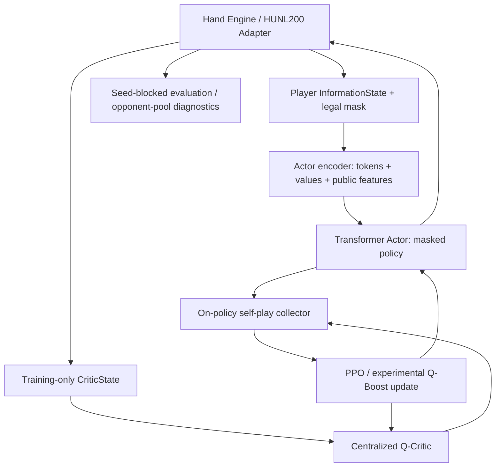

# holdem-ai — Integrated Research and Engineering Report (Phase 0–16)

> **Scope and evidence.** This report integrates the project's Phase 0–16 engineering records (including Phase 2.1, the Phase 11 progress patch, and the Phase 12–16 roadmap). It distinguishes **locally reported execution results** from **implementation documentation**, **later retrospective claims**, and **proposed tests**. Some phase documents were prepared with simulated engines; their acceptance criteria are not equivalent to verified execution on the target Windows/GTX 1070 machine.
>
> **Scientific interpretation.** A functioning poker simulator is not complete rules certification; passing unit tests is not evidence of strong poker play; beating selected fixed opponents is not a Nash exploitability or GTO measurement. This project's experimental VRPO-Lite/Q-Boost methods are not presented as a full replication of the original VRPO paper.

**Repository:** [TheMostEvident/holdem-ai](https://github.com/TheMostEvident/holdem-ai)  
**Related document:** [Project README](../README.md)  
**Report date:** October 12, 2026

## 1. Research objectives

The project separates two interconnected objectives:

- **Environment:** build a poker simulator with legal betting, randomized cards, player-specific observations, showdown accounting, terminal payoffs, and tournament state.
- **Agent:** build learning and evaluation pipelines for strategies that interact with that simulator; first using legal random policies and later Transformer Actor/Critic models trained by PPO and experimental Q-Boosting.

The general agent-environment interaction is

$$
I_t^i=O_i(s_t,h_t^{\mathrm{public}}),\quad
a_t\sim\pi_\theta(\cdot\mid I_t^i),\quad
s_{t+1}\sim P(\cdot\mid s_t,a_t),\quad
r_{t+1}^i=R_i(s_t,a_t,s_{t+1}).
$$

Here \(s_t\) includes private game-engine state, whereas \(I_t^i\) is limited to player \(i\)'s permissible information. The Environment work expanded from heads-up no-limit Hold'em (HUNL) to 2–6-player hands and a six-player elimination tournament. The neural-learning track subsequently refocused on two-player **HUNL200**, with 200 big blinds of starting stack.

## 2. System architecture



Privacy and correctness are distinct responsibilities: the environment decides which bets are legal, the observation adapter prevents opponent hole cards from entering the Actor input, and the Critic's privileged state is restricted to training. The 7-action abstraction is a project-specific approximation to continuous no-limit betting.

## 3. Development timeline and evidence

| Phase | Scope | Evidence or qualification |
| --- | --- | --- |
| 0 | Git, GitHub, Python, uv, reproducible structure | Developer environment configured |
| 1 | RLCard HUNL baseline | 5 tests passed; 5-hand smoke rollout |
| 2 | Rule specifications and upstream audit | 27 passed, 1 xfailed; three upstream position/blind failures |
| 2.1 | Corrected local HUNL rules | 43 passed, 1 xfailed; 100 sampled corrected hands audited |
| 3 | Independent 2–6-player hand engine | 74 passed, 1 xfailed; multiplayer audits reported |
| 4 | 6-max tournament | 113 passed, 1 xfailed; 100 completed tournaments reported |
| 5 | Agent interface, masks, betting abstraction, rewards | 176 passed, 1 xfailed for the full regression suite |
| 6 | HUNL200 adapter, training-state isolation, CPU benchmark | Implementation specification; target-machine confirmation separate |
| 7 | Actor/Critic observation encoding | Documented tests and smoke criteria; exact action history incomplete |
| 8 | Transformer Actor and centralized Q-Critic | Model structure and forward/backward smoke; not yet PPO |
| 9 | Monte-Carlo PPO | Optimization and checkpoint interfaces; not VRPO |
| 10 | Experimental Q-Boost PPO | Corrected control-variate surrogate; comparative benefit unproven |
| 11 | Batched self-play, runs, checkpoints, progress | Later progress document reports 304 Windows/CUDA tests passed |
| 12 | Reproducible seed-blocked evaluation | Statistical protocol and evaluator; held-out results not supplied here |
| 13 | Batch scaling and diagnostics | Phase 14 cites 91.77 training hands/s for H=64/B=32, based on two measurements |
| 14 | Matched-start, multi-seed comparison | Controlled design; later Phase 15 report quotes validation scores |
| 15 | Long-run and best-checkpoint management | Implementation specification; five-hour final results unverified here |
| 16 | Fixed opponent pool and strategy diagnostics | Evaluation-only code; final trained-policy pool results not provided |

Bracketed test counts are **historical records**, not a fresh end-to-end regression run performed while preparing this document.

## 4. Phase 0 — Project foundation

The repository is named `holdem-ai` and the Python import namespace is `holdem_ai`. The original source layout separated `environment`, `agents`, `training`, `evaluation`, and `ui`, with later phases adding standalone `holdem_agent_phaseN/` packages and `scripts/phaseN_*.py` command-line programs.

The Windows workflow uses Git, GitHub, Python 3.11 and `uv`, with `uv.lock` capturing dependency resolution and `.venv/` excluded from Git. A remote repository already existed when the initial local repository was pushed, so unrelated Git histories were merged and the README conflict resolved rather than force-pushing. The repeated deployment cycle is:

```text
Implement Python + tests -> apply patch -> uv test -> scenario audit
-> inspect logs -> git commit -> push
```

For general setup:

```powershell
uv sync --extra dev
uv run --extra dev python -m pytest -q
```

## 5. Phase 1 — RLCard baseline

A two-player `HandEngine` wrapper exposed `reset`, `state`, `current_player`, `legal_actions`, `step`, `is_over`, `get_result`, and `play_hand`. A `RandomAgent` selected among available actions. RLCard's original abstraction used five action indices, not arbitrary continuous bets. The initial experiment used 200-chip stacks and a 2-chip big blind.

Five observed hands yielded \(-50\) bb/100 for player 0:

$$
\widehat J_0=\frac{100}{5}(-0.5-0.5+1-2-0.5)=-50.
$$

Five hands demonstrate integration, not statistically meaningful performance.

## 6. Phase 2 / 2.1 — Rules audit and correction

For heads-up poker the dealer/button is also the small blind:

$$
\mathrm{BTN}=\mathrm{SB},\qquad
\mathrm{FirstActor}_{\mathrm{preflop}}=\mathrm{BTN},\qquad
\mathrm{FirstActor}_{\mathrm{postflop}}=\mathrm{BB}.
$$

For a player's street contribution \(c\), the current street maximum \(h\), previous full-raise increment \(r\), and remaining stack \(S\), the main legality reference is

$$
\mathrm{ToCall}=\min(S,\max(0,h-c)),\qquad
\mathrm{MinRaiseTo}=\begin{cases}BB & h=0,\\ h+r & h>0,\end{cases}\qquad
\mathrm{MaxRaiseTo}=c+S.
$$

A raise below the minimum is only permitted in defined short all-in conditions, and such an all-in need not reopen raising. Side pots use sorted positive contribution levels \(0=u_0<u_1<\dots<u_m\):

$$
P_k=(u_k-u_{k-1})\left|\{i:c_i\ge u_k\}\right|.
$$

An audit of the original RLCard 1.2.0 configuration found that the button posted the wrong blind and acted in the wrong preflop order, even while zero-sum payoffs held in all 100 random audit hands. The correction was implemented **inside the project**, without editing installed RLCard files. The corrected adapter tested position/blinds for both button assignments, postflop order, and 100 sampled games, passing the checked scenarios. This was **not** an independent certification of all poker rules.

## 7. Phase 3 — Independent multiplayer hand engine

A separate `MultiPlayerHandEngine` implemented two to six seats, rotating positions, card dealing, street-by-street betting, folds, checks, calls, raises, all-ins, side pots, showdown, and payout. The custom interface additionally allowed `step_raise_to(amount)`, where `amount` denotes the **target total committed in the current street**, not chips to add.

The main financial invariant is chip conservation:

$$
\sum_i C_i^{\mathrm{before}}=\sum_i C_i^{\mathrm{after}}.
$$

The reported tests verified selected betting, seat, all-in, side-pot, and randomized gameplay cases. The corrected RLCard heads-up wrapper and this independent multiplayer engine remained separate components.

## 8. Phase 4 — Tournament engine

The tournament layer maintains chip stacks between hands, rotating button/blind positions as players bust, escalating blinds, and stopping when one participant owns all chips. A recorded example ended after 15 hands with the winner holding 6,000 chips. The reported 100-tournament audit completed **100/100 tournaments**, with 1,086 total hands, 500 total eliminations, and average 10.86 hands per tournament. The full test suite then reported **113 passed, 1 xfailed**.

The tournament's elimination/placement objective differs from maximizing the chip delta in a cash-game hand. No prize-payout or ICM policy objective was claimed for this stage.

## 9. Phase 5 — Agent interface and self-play

Phase 5 introduced the immutable `InformationState` record, `Turn`/`Terminal` return types, an `AgentPolicy.act(observation,rng)` protocol, policy masking, rewards, an RLCard adapter, a self-play runner, and a JSON-stable information-state key.

The information-state contract stores acting player, scalar features, legal action mask, own private cards, visible board, stage, public state, and observable history. A serialized key alone **does not prove perfect recall**.

For legal-action indicator \(m_a\) and nonnegative proposed weights \(w_a\), the policy distribution is

$$
\pi(a\mid I)=\begin{cases}
\frac{m_aw_a}{\sum_b m_bw_b},&\sum_bm_bw_b>0,\\
\frac{m_a}{\sum_bm_b},&\text{otherwise}.
\end{cases}
$$

The seven abstract action heads are: fold, check, call, half-pot raise, pot raise, double-pot raise, and all-in. For pot \(P\), street contribution \(c\), call amount \(k\), and multiplier \(f\in\{1/2,1,2\}\):

$$
B_{\mathrm{raise\ to}}^{(f)}=c+k+\operatorname{round}_{\mathrm{chip}}\left[f(P+k)\right].
$$

The engine supplies the actual minimum/maximum raise, re-opening, all-in and side-pot rules. A separate reward interface includes chip delta and a zero-sum tournament winner indicator:

$$
r_i^{\mathrm{chip}}=\frac{C_i^{\mathrm{end}}-C_i^{\mathrm{start}}}{c},\qquad
r_i^{\mathrm{tournament}}=\mathbf1[i=w]-\frac1N.
$$

A NumPy-to-JSON conversion hotfix resolved a serialization failure. Historical regression results: **176 passed, 1 xfailed**. The phase did not yet train a CFR algorithm or connect the pre-existing 6-max tournament engine to a trainable 6-player policy.

## 10. Phase 6 — HUNL200 integration

The independent multiplayer engine was used in two-seat mode with a fixed 200-BB starting stack, BB=100 chips, SB=50 chips and configurable button. `HUNL200Adapter` maps seven policy actions to the existing engine's integer calls or `step_raise_to`. Importantly, policy index **4 is pot-raise**, whereas the underlying engine index **4 means all-in**; action-ID spaces must never be conflated.

The acting policy receives only `InformationState`. The explicitly enabled `training_state()` path returns a distinct `CriticState` containing both hole-card pairs, but no undealt future deck order. A global trajectory collector records adjacent **global decision transitions**, whereas Phase 5's runner can connect successive actions of the **same seat**. These are different time indices.

Terminal BB payoffs satisfy

$$
R_i=\frac{C_i^{\mathrm{final}}-C_i^{\mathrm{initial}}}{BB},\quad R_0+R_1=0.
$$

CPU one/two/four-worker random-policy benchmarks were designed for this phase. A later document cites approximately 2,896 random hands/s, which is **not** a valid estimate of neural PPO training throughput.

## 11. Phase 7 — VRPO-Lite encoding

The project-specific vocabulary has **73 token types**: padding, sequence/role/seat markers, 52 cards, 4 streets, and 5 poker action types. Raise-to amounts are represented in a token-value channel normalized by the big blind. Inputs are not silently truncated at 256 tokens; excess history raises an exception.

`encode_actor(InformationState)` supplies token IDs, token values, 20 scalar features, and a seven-action mask. `encode_critic(CriticState)` supplies training-only tokens and 24 centralized numeric features. GPU batching produces padded tensors and attention masks. The action mask ensures that illegal actions have zero selection probability.

The Phase 6 history schema did not preserve **exact paid amounts** for every call/all-in entry. This prevents a perfect-recall claim without further data-model changes. The encoding is not the original paper's base-16 multi-step betting scheme.

## 12. Phase 8 — Neural architecture

Phase 8 implements a causal-token Transformer Actor and a separate centralized Q-Critic. Token embeddings, position embeddings and an `asinh`-transformed numeric-value embedding feed the Transformer; the last valid position is pooled with transformed scalar features.

$$
Z=\mathrm{Transformer}_{\mathrm{causal}}
\left(E_{\mathrm{token}}(T)+E_{\mathrm{pos}}+W_v\operatorname{asinh}(V)\right)
$$

$$
\pi_\theta(a\mid I)=\frac{m_a\exp z_\theta(I,a)}
{\sum_b m_b\exp z_\theta(I,b)}.
$$

The reported initial network configuration uses two Transformer layers, embedding width 64, two attention heads, feed-forward width 128, and maximum length 256. The Actor has **99,975 parameters**, Critic **100,487**, Actor output `[B,7]`, and Critic output `[B,2,7]`.

The Critic enforces two-seat zero-sum values \(Q_{\phi,1}(s,a)=-Q_{\phi,0}(s,a)\) and terminal bootstrap values of zero. These constraints would need reconsideration for tournament/ICM objectives. Phase 8 validates forward/backward and tensor contracts; it does **not** by itself perform policy optimization.

## 13. Phase 9 — On-policy Monte-Carlo PPO

The same decentralized Actor acts in both seats during self-play; a privileged centralized Critic is a training-time estimator, not an information channel to the playing Actor. Returns are terminal hand payoffs in BB, with \(\gamma=1\), **no GAE** and **no TD(0)**.

For acting seat \(i_t\):

$$
G_t^{i_t}=R_{i_t},\qquad
V_{\mathrm{old}}^{i_t}(s_t,I_t)
=\sum_a\pi_{\mathrm{old}}(a\mid I_t)Q_{\phi_{\mathrm{old}},i_t}(s_t,a),
$$

$$
\hat A_t=G_t^{i_t}-V_{\mathrm{old}}^{i_t}(s_t,I_t).
$$

After standardizing advantage and defining \(\rho_t(\theta)=\pi_\theta(a_t\mid I_t)/\pi_{\mathrm{old}}(a_t\mid I_t)\), the PPO objective maximizes

$$
L^{\mathrm{CLIP}}
=\mathbb E_t\left[
\min\left(\rho_t\tilde A_t,\operatorname{clip}(\rho_t,1-\epsilon,1+\epsilon)\tilde A_t\right)
\right].
$$

The Q-Critic minimizes the observed-action Huber loss against Monte-Carlo returns:

$$
\mathcal L_Q=\mathbb E_t\left[
\operatorname{Huber}(Q_{\phi,i_t}(s_t,a_t)-G_t^{i_t})
\right].
$$

It does **not** obtain supervised labels for every unplayed counterfactual action. Training/Adam/checkpoint functionality was introduced at this phase, but PPO is not guaranteed to converge to a Nash equilibrium in general imperfect-information games.

## 14. Phase 10 — Experimental Q-Boost control variate

Naively substituting \(G-Q(s,a)\) in a policy-gradient surrogate omits an action-dependent gradient component. Phase 10 adds an analytic sum over all seven actions. With \(\beta\in[0,1]\), frozen old policy \(\pi_0\), and frozen old critic \(\hat Q_0\):

$$
\hat V_0=\sum_a\pi_0(a\mid I)\hat Q_0(s,a)
$$

$$
\delta_t^{(\beta)}
=G_t-\hat V_0-\beta\left[\hat Q_0(s_t,a_t)-\hat V_0\right].
$$

Standardization uses the **same fixed mean and scale computed from the unboosted Monte-Carlo advantage**, rather than separately normalizing the residual and analytic term. The maximized objective is

$$
\begin{aligned}
J_{\mathrm{QB}}(\theta)=\frac1N\sum_t\Big[&
\min\{\rho_t\tilde\delta_t,\operatorname{clip}(\rho_t,1-\epsilon,1+\epsilon)\tilde\delta_t\}\\
&+\frac\beta{\sigma_A}\sum_a\big(\pi_\theta(a\mid I_t)-\pi_0(a\mid I_t)\big)\hat Q_0(s_t,a)\Big].
\end{aligned}
$$

At \(\beta=0\), the objective reduces to the PPO baseline. The phase documents an old-policy gradient identity, but PPO clipping away from the old policy introduces surrogate bias. A reported logit-gradient **proxy** variance ratio is not a variance guarantee for the full network gradient. Whether Q-Boost improves real poker performance must be established empirically.

## 15. Phase 11 — Batched on-policy self-play

Multiple independent HUNL200 games are held active within one process. At each scheduling step, the current decision from each active game is batched for neural Actor inference. All data for update \(k\) is collected using the frozen current policy \(\theta_k\); only then are optimizer steps performed.

$$
D_k\sim\pi_{\theta_k},\qquad\theta_{k+1}=\mathrm{Update}(\theta_k,D_k).
$$

The infrastructure includes an elapsed-time budget, resumable atomic checkpoints, structured JSONL logs, random and frozen-anchor evaluation, optional `tqdm` progress, ETA and safe stopping at update/evaluation boundaries. A later Phase 11 progress note reports **304 passed** on the user's Windows/CUDA environment, although the full raw console log is not among the supplied sources.

The approximately **30–45 neural hands/s** cited in that documentation, the Phase 6 random CPU hands/s, and the Phase 13 end-to-end optimizer hands/s measure different workloads and must not be interchanged.

## 16. Phase 12 — Seed-blocked reproducible evaluation

For each independently shuffled deck seed \(k\), evaluate the candidate in all four seat/button combinations. Each seed block is the statistical unit:

$$
X_k=\frac14\sum_{b=0}^{1}\sum_{s=0}^{1}R(k,b,s),\qquad
\hat J=100\bar X\ \ [\mathrm{bb/100}].
$$

Approximate standard error and confidence interval:

$$
\mathrm{SE}(\hat J)=100\frac{s_X}{\sqrt K},\qquad
\mathrm{CI}_{95\%}\approx\hat J\pm1.96\,\mathrm{SE}(\hat J).
$$

To compare candidate A and control C against the **same opponent** under the **same seed blocks**:

$$
D_k=X_k^A-X_k^C,\qquad
\widehat{\Delta J}=100\bar D.
$$

The interval must use the variation in \(D_k\), not a subtraction of independent confidence intervals. The evaluator separates validation and held-out test card seeds, greedy versus sampled policies, action counts and weight fingerprints. This is seed-matched and seat-swapped, but **not** a complete counterfactual duplicate-poker estimator.

## 17. Phase 13 — Batch scaling

The key controlled parameters are update hands \(H\), simultaneously active environments \(B\), minibatch decisions \(M\), and PPO epochs \(E\). For \(N_k\) collected decisions, the optimizer performs approximately

$$
N_{\mathrm{mini},k}=E\left\lceil\frac{N_k}{M}\right\rceil
$$

minibatches per update. The rate is evaluated against the **number of opportunities where an action was legal**:

$$
\hat p(a\mid a\text{ legal})=
\frac{\sum_t\mathbf1[a_t=a]}{\sum_t\mathbf1[a\in\mathcal A(I_t)]}.
$$

This is an aggregated descriptive rate, not one fixed information-state probability. A later Phase 14 document cites **91.77 end-to-end training hands/s** for \(H=64\), \(B=32\) on the GTX 1070, based on only two observations for that case. It is a useful provisional configuration, not a proven globally optimal batch setting.

## 18. Phase 14 — Multi-seed controlled PPO vs. Q-Boost experiment

For each training seed, PPO and Q-Boost are initialized from the **same complete Phase 9 checkpoint**, including Actor, Critic and Adam states. Each algorithm subsequently collects its **own on-policy trajectories**, even when deck seed schedules are matched.

$$
N_{\mathrm{train}}=S\times2\times U\times H,
$$

where \(S\) is number of training seeds, \(U\) is updates per algorithm, and \(H\) is hands per update.

The best model in each arm is selected on a fixed validation opponent, including the original untrained-from-stage checkpoint as an eligible candidate. Held-out test is run only after all arms finish, and must not be reused to tune hyperparameters.

For the paired effect per training seed \(s\), aggregate deck-block differences:

$$
\hat\Delta_s=\frac{100}{K}\sum_{k=1}^K
\left(X_{s,\mathrm{QB},k}-X_{s,\mathrm{PPO},k}\right).
$$

Cross-seed standard error uses \(\mathrm{sd}(\hat\Delta_s)/\sqrt S\); a small \(S=3\) yields low power. A later Phase 15 document quotes PPO's **best validation** scores for seeds 51/52/53 as **809.50 / 858.125 / 456.75 bb/100**. These are not final held-out effect estimates. The supplied evidence does not justify a definitive claim that either algorithm is statistically superior.

## 19. Phase 15 — Long-run training and checkpoint selection

The long-running stage warm-starts from selected Phase 14 `best.pt` checkpoints while preserving Actor, Critic and Adam states. It reuses the earlier PPO/Q-Boost losses and collects new on-policy data. Validation is performed against two fixed opponents: the frozen stage-start Actor and RandomLegalPolicy.

A heuristic validation score is

$$
S_t=\frac12\left[
\big(J_A(t)-J_A(0)\big)+\big(J_R(t)-J_R(0)\big)
\right],\qquad
t^*=\arg\max_t S_t.
$$

Checkpoint safeguards include atomic `latest.pt`, separate `best.pt`, SHA-256 lineage, resume/config checks, per-run locking, recovery records and safety stops on sustained entropy or approximate-KL warnings. Typical documented thresholds are entropy below 0.45 or approximate KL above 0.10 for 12 consecutive warnings; these are protective heuristics, not optimality conditions.

The finalization command uses an untouched card bank, writes `final_report.json`, and seals the run. A five-hour budget and a documented command are **not** proof that a particular five-hour run completed or improved strategy strength.

## 20. Phase 16 — Opponent pool and poker strategy diagnostics

Phase 16 is **evaluation only**. It does not update Phase 15 models or learn an adaptive opponent. A frozen candidate plays a fixed pool of intentionally simple opponents:

| Opponent | Description | Diagnostic purpose |
| --- | --- | --- |
| Random | Uniform among legal actions | Sanity baseline |
| CallingStation | Prefer check/call | Overcalling sensitivity |
| Tight | Prefer check/fold | Overfolding sensitivity |
| PotPressure | Prefer pot-sized aggression | Aggression response |
| Frozen checkpoint | Prior trained Actor | Snapshot comparison |

For opponent \(o\), estimate:

$$
X_{o,k}=\frac14\sum_{b,s\in\{0,1\}}R_{o,k,b,s},\qquad
\hat J_o=\frac{100}{K}\sum_k X_{o,k}.
$$

The average over a **predeclared** opponent pool and the worst observed pool mean are descriptive indicators, not a minimax game value or Nash exploitability. Strategy metrics are stratified by street, button versus big-blind position, and effective stack-to-pot ratio:

$$
\mathrm{SPR}(I)=
\frac{\min(S_{\mathrm{hero}},S_{\mathrm{villain}})}
{\max(P,10^{-9})}.
$$

Normalized policy entropy is

$$
H_{\mathrm{norm}}(\pi\mid I)=
\begin{cases}
\frac{-\sum_{a\in\mathcal A(I)}\pi(a\mid I)\log\pi(a\mid I)}
{\log\lvert\mathcal A(I)\rvert}, & \lvert\mathcal A(I)\rvert>1,\\
0,&\text{otherwise}.
\end{cases}
$$

Reports can be exported to JSON, CSV and Markdown without raw hole cards or Critic state. The source documentation describes Linux/CPU mock-engine development validation; it does **not** supply final pool performance for a completed Phase 15 model.

## 21. Core invariants and performance units

1. **Privacy:** the acting Actor cannot receive the other player's hole cards or deck order.
2. **Legality:** the environment enforces minimum raise, all-in, reopening and side-pot eligibility; a policy mask is a representation of its admissible moves.
3. **Chip conservation:** for no-rake hands, total chips before and after equal.
4. **Zero-sum terminal returns:** for HUNL chip objectives, \(R_0+R_1=0\).
5. **On-policy training:** each optimization update uses decisions sampled by the current old policy, not replay from a diverged behavior policy.
6. **Units:** per-hand BB return and **bb/100** are different quantities:

$$
R_{i,h}^{\mathrm{BB}}=\frac{C_{i,h}^{\mathrm{end}}-C_{i,h}^{\mathrm{start}}}{BB_h},\quad
\widehat{bb/100}_i=\frac{100}{N}\sum_{h=1}^{N}R_{i,h}^{\mathrm{BB}}.
$$

7. **Inference limits:** sequential single-decision GPU inference, CPU random rollout, and batched neural self-play have different computational costs.

## 22. Risks and next steps

| Priority | Open issue | Recommended verification |
| --- | --- | --- |
| P0 | Latest Phase 15/16 Windows/GPU logs and final artifacts not available in these source records | Run complete regression suite; archive hashes, checkpoint lineage and held-out reports |
| P0 | Action history can omit exact call/all-in amounts | Version a complete public action-history schema and test perfect recall |
| P1 | Fixed baseline pool is weak | Add stronger frozen snapshots and rule-based opponents with preregistered evaluation |
| P1 | Q-Boost performance gain is not established | Matched initial checkpoints, multiple seeds, paired deck-block differences and uncertainty intervals |
| P1 | Simulator not externally certified | Differential tests against independent poker rules engines; adversarial edge cases |
| P2 | Exploitability/GTO assessment missing | Add an independently justified best-response/CFR evaluation methodology |
| P2 | Full VRPO paper replication incomplete | Separate the project-specific VRPO-Lite contract from faithful paper replication goals |

## 23. Reproduction commands

From the Git repository root on Windows PowerShell:

```powershell
uv sync --extra dev --extra gpu
uv run --extra dev --extra gpu python -m pytest -q

# Corrected HUNL baseline
uv run python main.py --hands 100 --seed 42

# Phase 12 seeded validation; requires a real local checkpoint
uv run --extra gpu python -m scripts.phase12_evaluate --candidate checkpoints/phase11_pilot.pt --groups 100 --partition validation --mode greedy --device cuda --output-json runs/phase12/greedy_random.json

# Phase 16 opponent-pool diagnostics; requires a real local checkpoint
uv run --extra gpu python -m scripts.phase16_evaluate --candidate runs/phase14_main/seed_52/ppo/best.pt --opponents random,calling_station,tight,pot_pressure --groups 100 --seed 16010000 --mode sampled --device cuda --output-json runs/phase16/pool.json
```

Outputs under `runs/`, checkpoint `.pt` files and extracted deployment bundles must not be automatically committed to Git. Always validate a checkpoint's provenance before loading it.

## Appendix A — Source document map

This English integrated report is a **consolidated technical rendition** of the following primary project notes; long per-phase installation transcripts, individual test inventories and historical PowerShell error logs remain in those source documents:

| Phase | Source document |
| --- | --- |
| 0–4 | `Environment_Phase0-4_전체_구축_기록.md` (user-provided source) |
| 5 | `Phase5_Agent_구현_기록.md` (user-provided source) |
| 6 | `docs/PHASE6_HUNL200_INTEGRATION.md` |
| 7 | `docs/PHASE7_VRPO_LITE_ENCODING.md` |
| 8 | `docs/PHASE8_VRPO_LITE_NETWORKS.md` |
| 9 | `docs/PHASE9_PPO_BASELINE.md` |
| 10 | `docs/PHASE10_QBOOST_PPO.md` |
| 11 | `docs/PHASE11_FIVE_HOUR_TRAINING.md`, `docs/PHASE11_PROGRESS.md` |
| 12 | `docs/PHASE12_EVALUATION.md` |
| 13 | `docs/PHASE13_BATCH_SCALING.md` |
| 14 | `docs/PHASE14_CONTROLLED_STUDY.md` |
| 15 | `docs/PHASE15_LONG_RUN_TRAINING.md` |
| 16 | `docs/PHASE16_OPPONENT_POOL_AND_STRATEGY.md` |
| Roadmap | `docs/ROADMAP_PHASE12_TO_16.md` |

**Evidence boundary:** repository source code and existing phase descriptions were consulted for documentation purposes. This report does not claim any new live training experiment, independent poker-rule certification or statistically significant GTO/exploitability finding.
