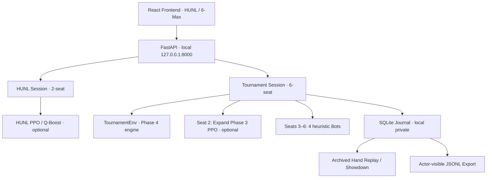

# Tournament ENV Phase 1.7 — 최종 통합 검증 및 GitHub Release 준비

> **Scope:** Environment only · Windows PowerShell · HUNL/6-Max 공존 · 학습 코드/모델 가중치 변경 없음
>
> **상태:** 최종 점검용 스크립트와 통합 테스트 제공. **전체 Windows 테스트·실제 Push는 사용자 로컬에서 수행 후 확인해야 한다.**

## 1. 아키텍처 및 구성



**세션 설정을 명시적으로 구분한다.**

| 모드 | 학습 모델 | Checkpoint 예 | 기본·Fallback |
| --- | --- | --- | --- |
| HUNL | `PPO` 또는 `Q-Boost PPO` | `runs/phase14_pilot/seed_41/qboost/best.pt` | GUI 선택에 따라 Random·기준 Bot |
| Tournament | `Expand Phase3 multi-seat PPO` (2–6인 캐시게임용) | `runs/expand_phase03_pilot/best.pt` | 정책 명시 선택; 누락 시 오류, 몰래 대체 금지 |
| Tournament Improved | 별도 강화학습 모델 아님 | 없음 | 규칙 기반 Heuristic Bot 4명 |

Tournament에서 학습된 PPO를 사용하는 경우 **원래 학습 환경이 캐시게임이며 토너먼트 전용 최적화가 검증된 모델은 아니라는 사실**을 유지한다.

## 2. 완료 범위

| 단계 | 내용 | 근거·상태 |
| --- | --- | --- |
| 1.1 | 6인 엔진 / FastAPI / Human 행동 | Windows 11개 테스트 + 전체 713개 통과 보고 |
| 1.2 | 6인 React GUI | Windows TypeScript typecheck/build/Vitest 18개 통과 보고 |
| 1.2.1 | Hole Card 숫자·문양 표시 | 사용자 실제 GUI 수정 확인 |
| 1.3 | Improved Bot 4명 | 코드 구현 / 이후 공격성 패치 적용 확인 |
| 1.3.1 | Call/Fold 편향 및 Raise 조건 버그 수정 | 사용자 실제 Bot Raise 동작 확인 |
| 1.4 | Expand Phase3 PPO inference | 사용자 브라우저 대전 성공 보고 |
| 1.5 | Blind/Ranking/Elimination/Champion UX | 패치 제공; 이전 테스트 로그와 구분 |
| 1.6 | SQLite·Recorded Replay·JSONL Export | 사용자 전체 테스트 통과 + 게임 재실행 확인 |
| 1.6.1 | Showdown Hole Card 공개 | 패치 전달; 최종 로컬 빌드 재검증 필요 |
| **1.7** | **통합 계약 테스트·안전한 Stage/Push·문서** | **이 패치의 범위** |

**반드시 구분:** GitHub `main`에는 이전 GUI/Phase17 소스까지만 반영되어 있었고, 오늘의 Tournament ENV 1.1~1.6.1 변경은 로컬 패치로 제공되었다. Phase 1.7 스크립트는 자동 Push를 수행하지 않는다.

## 3. Environment 불변 조건

### 3.1 칩 보존

진행 중인 6인 토너먼트:

$$
\boxed{\sum_{i=0}^{5} S_{i,t}^{\mathrm{behind}} + P_t = C_{\mathrm{total}}}
$$

핸드 정산 후:

$$
\boxed{\sum_{i=0}^{5} S_{i,h}^{\mathrm{final}} = C_{\mathrm{total}}}
$$

정산 간 스택 연속성:

$$
\boxed{S_{i,h+1}^{\mathrm{start}}=S_{i,h}^{\mathrm{final}}}
$$

### 3.2 Actor 정보 경계

$$
\pi_{\theta}(a\mid I_t,\mathcal A_t^{\mathrm{legal}})
$$

`I_t`에는 행동 플레이어의 자신의 홀 카드만 포함한다. 덱, 상대의 숨겨진 손패, 모델 학습용 특권 Critic State는 입력되지 않는다. **5-action Tournament 엔진과 7-action 멀티플레이어 PPO 간 변환은 어댑터에서만 수행**한다.

### 3.3 Showdown 공개

$$
\operatorname{Reveal}(i,h)=\begin{cases}
\operatorname{HoleCards}(i,h), & i\in C_h,\ |C_h|\ge2,\ |B_h|=5,\ \text{after settlement}\\
\varnothing,&\text{otherwise}
\end{cases}
$$

Fold한 선수의 홀 카드는 공개하지 않는다. 구형 SQLite 기록에는 공개 카드 필드가 없을 수 있다. **Showdown 정보는 오직 정산 결과에서 공개**하며, `actor_transition.v1` 행동 데이터에 섞지 않는다.

### 3.4 영구성 범위

- `SQLite`: 기록은 서버 재시작 후에도 조회 가능.
- `Recorded Replay`: 저장 당시의 행동·공개 프레임을 재생. 게임 엔진을 새로 실행하는 Deterministic Re-simulation이 아님.
- `Resume`: 서버 종료 전 진행 중이던 게임을 이어서 플레이하는 기능은 **없음**.
- `JSONL`: Acting-player visible transition 데이터. PPO 학습용 GAE/Return이 완성된 형식은 아님.

## 4. Phase 1.7 패치 적용

오늘 Phase 1.1~1.6.1까지 순서대로 ZIP을 적용했다는 전제다. 프로젝트 루트에서:

```powershell
cd C:\Users\yiydg\Desktop\workspace\holdem-ai-starter\holdem-ai
Expand-Archive -Path "$HOME\Downloads\holdem-ai-tournament-env-phase-1-7.zip" -DestinationPath . -Force
```

### 4.1 통합 테스트 — 로컬 Windows

Backend와 Frontend Dev 서버를 먼저 종료한 후:

```powershell
powershell -ExecutionPolicy Bypass -File .\scripts\tournament_env17_verify.ps1
```

실행 구성:

1. `uv run --extra dev --extra gui --extra gpu python -m pytest -q` — 전체 Python 회귀.
2. `npm.cmd run typecheck` — TypeScript.
3. `npm.cmd run build` — Vite 생산 빌드.
4. `npm.cmd run test` — Vitest.
5. `tournament_env17_release_audit.py` — Git 민감 파일 검사(읽기 전용).

빠른 검사(전체 회귀 대신 1.7 테스트 중심):

```powershell
powershell -ExecutionPolicy Bypass -File .\scripts\tournament_env17_verify.ps1 -Quick
```

실제 학습된 6인 PPO 체크포인트 로딩까지 재검증:

```powershell
$env:HOLDEM_AI_TOURNAMENT_CHECKPOINT = (Resolve-Path ".\runs\expand_phase03_pilot\best.pt").Path
$env:HOLDEM_AI_TOURNAMENT_DEVICE = "cpu"
$env:HOLDEM_AI_TOURNAMENT_POLICY_MODE = "sampled"
powershell -ExecutionPolicy Bypass -File .\scripts\tournament_env17_verify.ps1 -WithAgentSmoke
```

**주의:** Phase 1.7 통합 테스트는 캐시게임용 PPO가 토너먼트에서 강하다는 승률 검증이 아니다. 배포 연결·규칙·영구성 검증이다.

## 5. 안전한 GitHub Stage → Commit → Push

### 5.1 Git 상태 확인 (먼저 실행)

```powershell
git status -sb
git branch --show-current
git remote -v
git diff --stat
```

다른 작업의 수정 사항도 있을 수 있으므로 **`git add -A`, `git add .` 사용 금지**. Phase1.7 스크립트는 Phase 1.1~1.7 코드·테스트·문서만 Stage한다.

Dry-run으로 Stage 예정 파일 확인:

```powershell
powershell -ExecutionPolicy Bypass -File .\scripts\tournament_env17_stage.ps1 -DryRun
```

Git에 추가하고 `.gitignore` 보호 규칙을 **기존 내용 뒤에 덧붙일 때**:

```powershell
powershell -ExecutionPolicy Bypass -File .\scripts\tournament_env17_stage.ps1
```

스크립트는 다음을 수행한다.

- `runs/`, `checkpoints/`, `.local/`, `*.pt`, `*.sqlite3`, `*.jsonl` 등의 패턴을 `.gitignore`에 *추가*.
- `tournament_env17_manifest.txt`에 적힌 **한정된 파일만** `git add --`.
- `git diff --cached --check`로 포맷 검사.
- `release_audit --strict`로 Git 인덱스의 민감 자료 검사.
- **절대로 Commit이나 Push를 자동 수행하지 않음.**

**커밋 전 필수 검토:**

```powershell
git diff --cached --name-status
git diff --cached --stat
git diff --cached --check
uv run --extra dev --extra gui python -m scripts.tournament_env17_release_audit --strict
```

의도치 않게 Stage된 파일은 `git restore --staged -- "경로"`로 제거한다. 기존 Staged 파일이 이미 있으면 Stage 스크립트는 제거하지 않으므로 직접 검토해야 한다.

### 5.2 Commit과 Push (전체 테스트 확인 후, 사용자 수동 실행)

```powershell
git commit -m "feat(tournament-env): complete six-max GUI, inference and persistent replay"
git push origin main
```

**단, 현재 Branch가 `main`이고 원격이 동일할 때만 위 명령을 그대로 사용한다.** 다른 Branch나 최신 원격 커밋이 있다면 먼저 `git branch --show-current`, `git fetch origin`, `git status -sb` 등으로 확인해야 한다. 다른 사람 작업이 있을 때 무조건 강제 Push하지 않는다.

최종 확인:

```powershell
git log -1 --oneline
git status -sb
git rev-parse HEAD
git rev-parse origin/main
```

커밋 SHA와 `origin/main`이 같으면 해당 Branch Push 동기화가 완료된 것이다. 단, 다른 untracked 파일이 남아 있으면 `git status`는 깨끗하지 않을 수 있으며 이는 다른 작업 파일일 수 있다.

## 6. 최종 QA 수동 체크리스트

- [ ] HUNL 모드에서 학습된 PPO/Q-Boost를 명시 선택해 대전 가능.
- [ ] Tournament에서 실제 체크포인트를 선택했을 때 Seat 2가 **trained**로 표시.
- [ ] Tournament의 Improved Bot 4명이 Fold/Call/Raise를 정상 선택.
- [ ] 모든 공개 프레임에서 칩 총량 보존.
- [ ] 블라인드 상승, 버튼 회전, 생존/탈락, 우승 표시.
- [ ] 쇼다운 이후 **참가자 홀 카드만** 공개하고 폴더의 카드는 비공개.
- [ ] Saved Sessions & Replay에서 완료된 핸드 조회.
- [ ] Backend 재시작 이후 기록 열람(라이브 재개 기능은 없음).
- [ ] JSONL 내보내기에서 각 Acting Player 자신의 카드만 포함.
- [ ] SQLite, Checkpoints, `runs/`, `.env` 등 민감 자료 Stage되지 않음.
- [ ] 전체 Python + TypeScript + Vite + Vitest 통과.
- [ ] `origin/main`의 최신 Commit과 로컬 `HEAD` 동기화 확인.

## 7. 다음 확장 작업 (현재 범위 밖)

1. Tournament 특화 PPO/CFR 학습: **Agent 팀 관할**.
2. 영구 세션 *이어하기(Resume)*: 다음 Environment 개발 후보.
3. 게임 정책 우열 실험(승률, bb/100, CI): Agent 평가 프로젝트와 분리해 검증.
4. 네트워크 공개 서버·다중 사용자 인증: 현재는 127.0.0.1 전용 테스트 서버로 유지.

> Phase 1.7 완료 선언은 **실제 Windows 통합 테스트 + Stage 검사 + 성공적인 GitHub Push** 로그가 확인된 뒤에만 한다.
