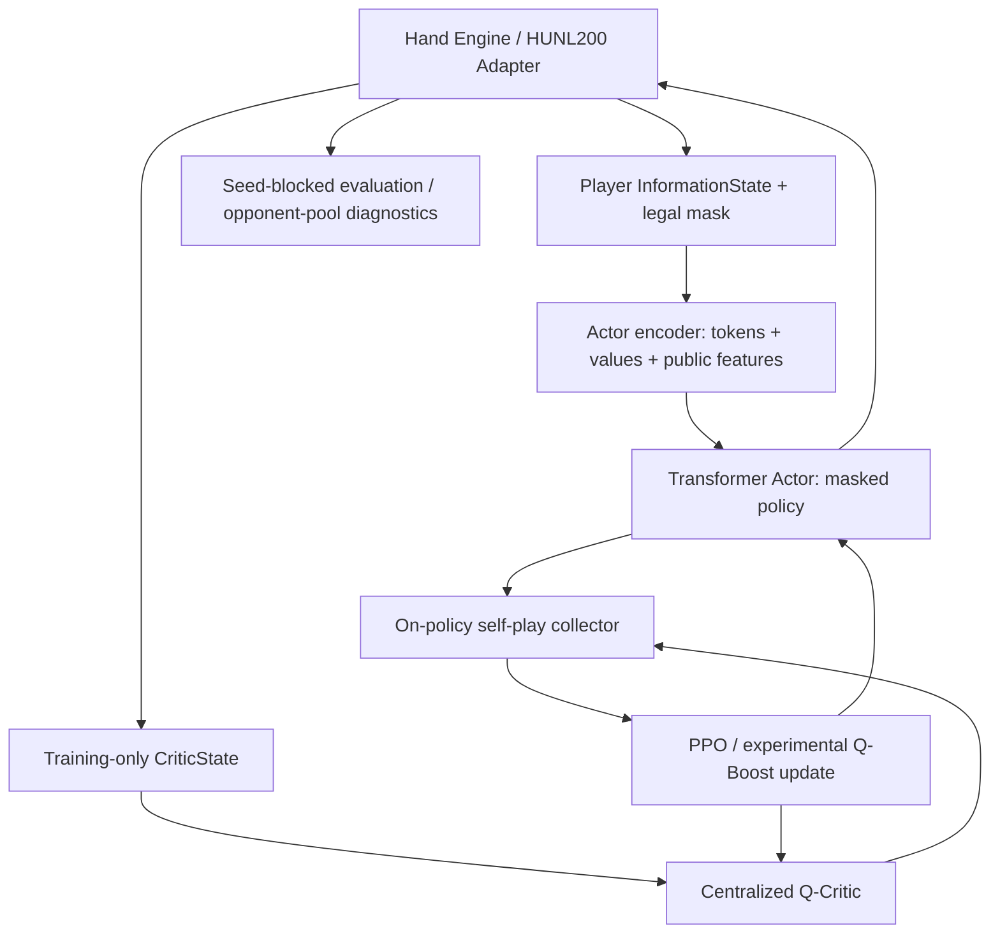
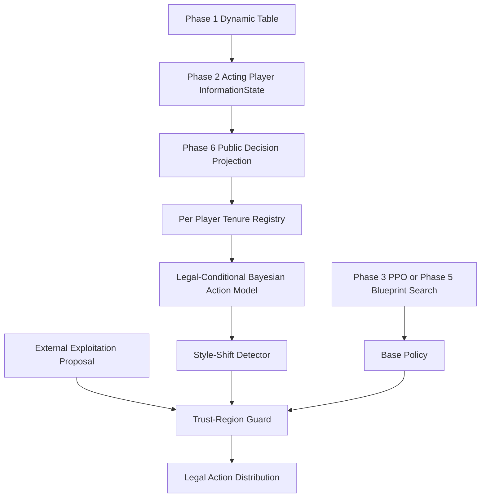
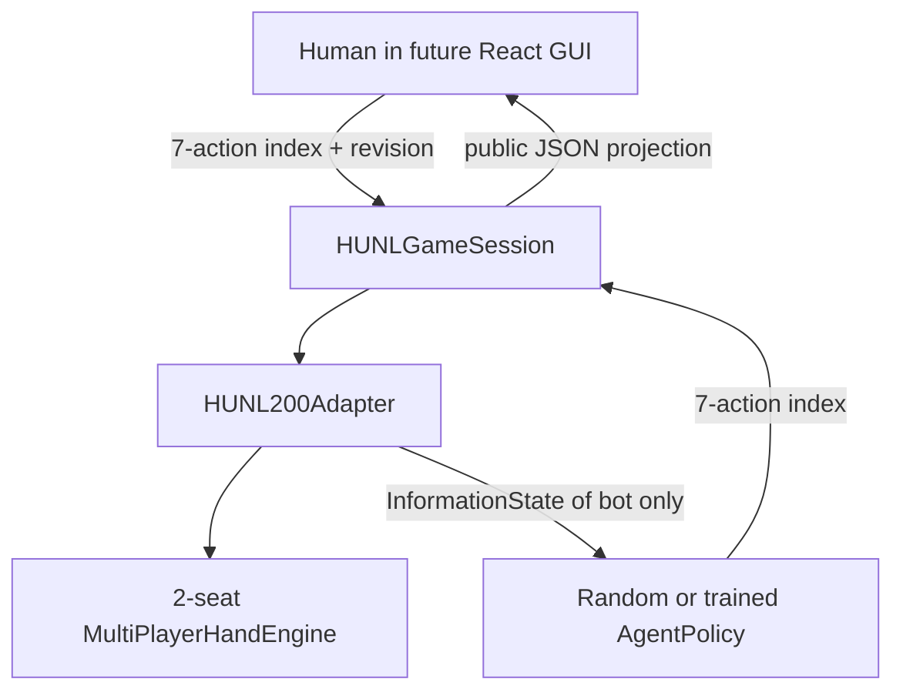

# Verbatim original Markdown: Volume 1/7

**Integral source appendix to the [canonical technical report](../POKER_AI_FINAL_INTEGRATED_TECHNICAL_REPORT.md).** Original commit `6a8ae368ddc02f814140d3770bc5993eaf9a15e4`. Each entire source is enclosed between explicit delimiters, including historical frontmatter, code, equations, logs and links. Source SHA indicates bytes of original Git blob. This is the original report content, not a synopsis.


## MD-001 — docs/AGENT_DEVELOPMENT_TECHNICAL_REPORT_2026-10-13.md

Original Blob SHA `f7a6f0ba1eade50fb252572a243c558bf72089d8`, 93299 bytes.

<a id="md-012"></a>

<!-- BEGIN_MD_SOURCE path="docs/AGENT_DEVELOPMENT_TECHNICAL_REPORT_2026-10-13.md" sha="f7a6f0ba1eade50fb252572a243c558bf72089d8" -->

````````markdown
---
title: HUNL Agent 전체 개발 기술보고서 — Phase 0~17 / Expand E1~E7
date: 2026-10-13
project: holdem-ai
type: technical-report
status: source-reviewed
tags: [HUNL, Poker-AI, Agent, PPO, QBoost, SelfPlay, MCCFR, Obsidian]
aliases: [HUNL Agent 개발 이력, Holdem AI Agent Technical Report]
---

# HUNL AI Agent 전체 개발 기술보고서

> [!abstract] 목적과 자료 범위
> **작성일:** 2026-10-13 · Repository: [TheMostEvident/holdem-ai](https://github.com/TheMostEvident/holdem-ai) · 기준 Branch: `main`
>
> 이 보고서는 Phase별 **신규·변경 Python 파일, 수정 동기, 알고리즘, 관측된 실험 결과와 미검증 사항**을 장기 보존하기 위해 만든 Obsidian Markdown 원본이다. Base Phase 0–16과 Expand E1–E7은 이미 작성되어 GitHub에 보관된 두 통합보고서의 기술 내용을 포함하고, 이후 **Phase 15의 세부 Agent 진단, Phase 16 Ablation/Stress, 2026-10-13 Phase 17 로컬 실험, GUI·Checkpoint PR**을 별도 변경 이력으로 덧붙였다.
>
> **자료 출처 주의:** 이전 Agent 채팅의 대화 원문 전체는 현재 대화에 직접 첨부되지 않았다. “모든 이전 발화”를 재열람했다고 말할 수는 없다. 이전 채팅으로부터 GitHub에 축적된 `.py`, Phase 문서, 보고서와 이번 대화에 제공된 `summary.json`을 토대로 복원 가능한 개발 이력을 집대성한다. 이전 문서의 테스트 수치는 **당시 문서의 기록**이며 본 보고서 작성 중 새로 수행한 테스트가 아니다.

## 0. 읽는 법과 증거 수준

| 표기 | 의미 |
|---|---|
| **Implemented** | 소스가 현재 Repository에서 확인됨 |
| **Documented-Test** | 해당 Phase 기술문서에 테스트 또는 실험 수행 결과가 기록됨 |
| **Local-Log** | 사용자가 채팅에 제공한 실제 로컬 실행 결과 |
| **Pending** | 현재 세션에서 실기·독립 평가 미검증 |
| **Experiment** | 실험 가설/탐색적 결과. GTO 인증이 아님 |

**Phase 이름 충돌 주의:** `Base Phase 17`은 **Continuous Stack 평가**와 **5시간 PPO GPU Retrain**이라는 두 개의 별도 문서가 존재한다. `Expand E1~E7`은 다인 Agent의 별도 연구 Track이며 `Tournament ENV 1.1~1.7`과도 구별한다.

### 기준선의 현재 상태

| 축 | 현황 | 판정 |
|---|---|---|
| Base P0–4 | RLCard 보정, 독립 2~6인 Engine, Tournament | 규칙·Adapter 구현 |
| Base P5–10 | InformationState, Legal7, Transformer Actor, Centralized Q, PPO, QBoost | 학습 엔진 구현 |
| Base P11–14 | Batch, Resume, Seed-Blocked 비교, Multi-Seed | 평가 설계/학습 기반 |
| Base P15–16 | Policy Collapse 진단, A0~A3, Critic/Reward, Stress | 원인 규명 진행 중 |
| **P17 Retrain** | **5,000 Updates / 640,000 Hands (Local-Log)** | **5시간 미완료, 강도 검증 미완** |
| Expand E1–E7 | 2~6인 PPO, Toy MCCFR, Search, 상대 모델링 | 별도 연구/실험 Track |
| GUI/Tournament | Human-vs-Agent, Frozen Actor, Journal/Replay | 런타임·Checkpoint QA 별도 |

### 핵심 불변식

$$
\sum_i S_{i,t}+P_t=C_{\mathrm{total}}
$$

$$
\pi_\theta(a\mid I_i)=0 \quad (a\notin\mathcal A_{\mathrm{legal}}(I_i))
$$

$$
I_i=(\text{own hole cards},\text{board},\text{public history},
\text{stacks},\text{position},\text{legal mask})
$$

Actor에게 상대 Hole Cards, 미래 덱, Critic의 Privileged State를 제공하지 않는다. 모든 학습 목표와 GUI 추론은 포커 엔진의 Legal Action·칩 회계를 최종 권위로 삼는다.

---

# Part I. Base Phase 0–16 원본 통합 기술 기록

> [!info] 출처와 보존 방법
> 아래는 `docs/PROJECT_REPORT.md`의 당시 작성된 기술 보고서를 현재 문서에 직접 포함한 것이다. Phase 0~16 전체 개발 이유·설계·수식·검증·파일 기록을 보존한다. 원본 문서의 “향후 할 일” 또는 옛 `holdem_agent_phaseN` 패키지 경로는 작성 당시의 역사적 설명일 수 있다. **현재 최종 `src/holdem_ai/` 구조 및 2026-10-13 결과는 Part III 이후의 최신 보충 기록을 우선 참조한다.**

## holdem-ai — Integrated Research and Engineering Report (Phase 0–16)

> **Scope and evidence.** This report integrates the project's Phase 0–16 engineering records (including Phase 2.1, the Phase 11 progress patch, and the Phase 12–16 roadmap). It distinguishes **locally reported execution results** from **implementation documentation**, **later retrospective claims**, and **proposed tests**. Some phase documents were prepared with simulated engines; their acceptance criteria are not equivalent to verified execution on the target Windows/GTX 1070 machine.
>
> **Scientific interpretation.** A functioning poker simulator is not complete rules certification; passing unit tests is not evidence of strong poker play; beating selected fixed opponents is not a Nash exploitability or GTO measurement. This project's experimental VRPO-Lite/Q-Boost methods are not presented as a full replication of the original VRPO paper.

**Repository:** [TheMostEvident/holdem-ai](https://github.com/TheMostEvident/holdem-ai)  
**Related document:** [Project README](../README.md)  
**Report date:** October 12, 2026

### 1. Research objectives

The project separates two interconnected objectives:

- **Environment:** build a poker simulator with legal betting, randomized cards, player-specific observations, showdown accounting, terminal payoffs, and tournament state.
- **Agent:** build learning and evaluation pipelines for strategies that interact with that simulator; first using legal random policies and later Transformer Actor/Critic models trained by PPO and experimental Q-Boosting.

The general agent-environment interaction is

$$
I_t^i=O_i(s_t,h_t^{\mathrm{public}}),\quad
a_t\sim\pi_\theta(\cdot\mid I_t^i),\quad
s_{t+1}\sim P(\cdot\mid s_t,a_t),\quad
r_{t+1}^i=R_i(s_t,a_t,s_{t+1}).
$$

Here $s_t$ includes private game-engine state, whereas $I_t^i$ is limited to player $i$'s permissible information. The Environment work expanded from heads-up no-limit Hold'em (HUNL) to 2–6-player hands and a six-player elimination tournament. The neural-learning track subsequently refocused on two-player **HUNL200**, with 200 big blinds of starting stack.

### 2. System architecture



Privacy and correctness are distinct responsibilities: the environment decides which bets are legal, the observation adapter prevents opponent hole cards from entering the Actor input, and the Critic's privileged state is restricted to training. The 7-action abstraction is a project-specific approximation to continuous no-limit betting.

### 3. Development timeline and evidence

| Phase | Scope | Evidence or qualification |
| --- | --- | --- |
| 0 | Git, GitHub, Python, uv, reproducible structure | Developer environment configured |
| 1 | RLCard HUNL baseline | 5 tests passed; 5-hand smoke rollout |
| 2 | Rule specifications and upstream audit | 27 passed, 1 xfailed; three upstream position/blind failures |
| 2.1 | Corrected local HUNL rules | 43 passed, 1 xfailed; 100 sampled corrected hands audited |
| 3 | Independent 2–6-player hand engine | 74 passed, 1 xfailed; multiplayer audits reported |
| 4 | 6-max tournament | 113 passed, 1 xfailed; 100 completed tournaments reported |
| 5 | Agent interface, masks, betting abstraction, rewards | 176 passed, 1 xfailed for the full regression suite |
| 6 | HUNL200 adapter, training-state isolation, CPU benchmark | Implementation specification; target-machine confirmation separate |
| 7 | Actor/Critic observation encoding | Documented tests and smoke criteria; exact action history incomplete |
| 8 | Transformer Actor and centralized Q-Critic | Model structure and forward/backward smoke; not yet PPO |
| 9 | Monte-Carlo PPO | Optimization and checkpoint interfaces; not VRPO |
| 10 | Experimental Q-Boost PPO | Corrected control-variate surrogate; comparative benefit unproven |
| 11 | Batched self-play, runs, checkpoints, progress | Later progress document reports 304 Windows/CUDA tests passed |
| 12 | Reproducible seed-blocked evaluation | Statistical protocol and evaluator; held-out results not supplied here |
| 13 | Batch scaling and diagnostics | Phase 14 cites 91.77 training hands/s for H=64/B=32, based on two measurements |
| 14 | Matched-start, multi-seed comparison | Controlled design; later Phase 15 report quotes validation scores |
| 15 | Long-run and best-checkpoint management | Implementation specification; five-hour final results unverified here |
| 16 | Fixed opponent pool and strategy diagnostics | Evaluation-only code; final trained-policy pool results not provided |

Bracketed test counts are **historical records**, not a fresh end-to-end regression run performed while preparing this document.

### 4. Phase 0 — Project foundation

The repository is named `holdem-ai` and the Python import namespace is `holdem_ai`. The original source layout separated `environment`, `agents`, `training`, `evaluation`, and `ui`, with later phases adding standalone `holdem_agent_phaseN/` packages and `scripts/phaseN_*.py` command-line programs.

The Windows workflow uses Git, GitHub, Python 3.11 and `uv`, with `uv.lock` capturing dependency resolution and `.venv/` excluded from Git. A remote repository already existed when the initial local repository was pushed, so unrelated Git histories were merged and the README conflict resolved rather than force-pushing. The repeated deployment cycle is:

```text
Implement Python + tests -> apply patch -> uv test -> scenario audit
-> inspect logs -> git commit -> push
```

For general setup:

```powershell
uv sync --extra dev
uv run --extra dev python -m pytest -q
```

### 5. Phase 1 — RLCard baseline

A two-player `HandEngine` wrapper exposed `reset`, `state`, `current_player`, `legal_actions`, `step`, `is_over`, `get_result`, and `play_hand`. A `RandomAgent` selected among available actions. RLCard's original abstraction used five action indices, not arbitrary continuous bets. The initial experiment used 200-chip stacks and a 2-chip big blind.

Five observed hands yielded $-50$ bb/100 for player 0:

$$
\widehat J_0=\frac{100}{5}(-0.5-0.5+1-2-0.5)=-50.
$$

Five hands demonstrate integration, not statistically meaningful performance.

### 6. Phase 2 / 2.1 — Rules audit and correction

For heads-up poker the dealer/button is also the small blind:

$$
\mathrm{BTN}=\mathrm{SB},\qquad
\mathrm{FirstActor}_{\mathrm{preflop}}=\mathrm{BTN},\qquad
\mathrm{FirstActor}_{\mathrm{postflop}}=\mathrm{BB}.
$$

For a player's street contribution $c$, the current street maximum $h$, previous full-raise increment $r$, and remaining stack $S$, the main legality reference is

$$
\mathrm{ToCall}=\min(S,\max(0,h-c)),\qquad
\mathrm{MinRaiseTo}=\begin{cases}BB & h=0,\\ h+r & h>0,\end{cases}\qquad
\mathrm{MaxRaiseTo}=c+S.
$$

A raise below the minimum is only permitted in defined short all-in conditions, and such an all-in need not reopen raising. Side pots use sorted positive contribution levels $0=u_0<u_1<\dots<u_m$:

$$
P_k=(u_k-u_{k-1})\left|\{i:c_i\ge u_k\}\right|.
$$

An audit of the original RLCard 1.2.0 configuration found that the button posted the wrong blind and acted in the wrong preflop order, even while zero-sum payoffs held in all 100 random audit hands. The correction was implemented **inside the project**, without editing installed RLCard files. The corrected adapter tested position/blinds for both button assignments, postflop order, and 100 sampled games, passing the checked scenarios. This was **not** an independent certification of all poker rules.

### 7. Phase 3 — Independent multiplayer hand engine

A separate `MultiPlayerHandEngine` implemented two to six seats, rotating positions, card dealing, street-by-street betting, folds, checks, calls, raises, all-ins, side pots, showdown, and payout. The custom interface additionally allowed `step_raise_to(amount)`, where `amount` denotes the **target total committed in the current street**, not chips to add.

The main financial invariant is chip conservation:

$$
\sum_i C_i^{\mathrm{before}}=\sum_i C_i^{\mathrm{after}}.
$$

The reported tests verified selected betting, seat, all-in, side-pot, and randomized gameplay cases. The corrected RLCard heads-up wrapper and this independent multiplayer engine remained separate components.

### 8. Phase 4 — Tournament engine

The tournament layer maintains chip stacks between hands, rotating button/blind positions as players bust, escalating blinds, and stopping when one participant owns all chips. A recorded example ended after 15 hands with the winner holding 6,000 chips. The reported 100-tournament audit completed **100/100 tournaments**, with 1,086 total hands, 500 total eliminations, and average 10.86 hands per tournament. The full test suite then reported **113 passed, 1 xfailed**.

The tournament's elimination/placement objective differs from maximizing the chip delta in a cash-game hand. No prize-payout or ICM policy objective was claimed for this stage.

### 9. Phase 5 — Agent interface and self-play

Phase 5 introduced the immutable `InformationState` record, `Turn`/`Terminal` return types, an `AgentPolicy.act(observation,rng)` protocol, policy masking, rewards, an RLCard adapter, a self-play runner, and a JSON-stable information-state key.

The information-state contract stores acting player, scalar features, legal action mask, own private cards, visible board, stage, public state, and observable history. A serialized key alone **does not prove perfect recall**.

For legal-action indicator $m_a$ and nonnegative proposed weights $w_a$, the policy distribution is

$$
\pi(a\mid I)=\begin{cases}
\frac{m_aw_a}{\sum_b m_bw_b},&\sum_bm_bw_b>0,\\
\frac{m_a}{\sum_bm_b},&\text{otherwise}.
\end{cases}
$$

The seven abstract action heads are: fold, check, call, half-pot raise, pot raise, double-pot raise, and all-in. For pot $P$, street contribution $c$, call amount $k$, and multiplier $f\in\{1/2,1,2\}$:

$$
B_{\mathrm{raise\ to}}^{(f)}=c+k+\mathrm{round}_{\mathrm{chip}}\left[f(P+k)\right].
$$

The engine supplies the actual minimum/maximum raise, re-opening, all-in and side-pot rules. A separate reward interface includes chip delta and a zero-sum tournament winner indicator:

$$
r_i^{\mathrm{chip}}=\frac{C_i^{\mathrm{end}}-C_i^{\mathrm{start}}}{c},\qquad
r_i^{\mathrm{tournament}}=\mathbf1[i=w]-\frac1N.
$$

A NumPy-to-JSON conversion hotfix resolved a serialization failure. Historical regression results: **176 passed, 1 xfailed**. The phase did not yet train a CFR algorithm or connect the pre-existing 6-max tournament engine to a trainable 6-player policy.

### 10. Phase 6 — HUNL200 integration

The independent multiplayer engine was used in two-seat mode with a fixed 200-BB starting stack, BB=100 chips, SB=50 chips and configurable button. `HUNL200Adapter` maps seven policy actions to the existing engine's integer calls or `step_raise_to`. Importantly, policy index **4 is pot-raise**, whereas the underlying engine index **4 means all-in**; action-ID spaces must never be conflated.

The acting policy receives only `InformationState`. The explicitly enabled `training_state()` path returns a distinct `CriticState` containing both hole-card pairs, but no undealt future deck order. A global trajectory collector records adjacent **global decision transitions**, whereas Phase 5's runner can connect successive actions of the **same seat**. These are different time indices.

Terminal BB payoffs satisfy

$$
R_i=\frac{C_i^{\mathrm{final}}-C_i^{\mathrm{initial}}}{BB},\quad R_0+R_1=0.
$$

CPU one/two/four-worker random-policy benchmarks were designed for this phase. A later document cites approximately 2,896 random hands/s, which is **not** a valid estimate of neural PPO training throughput.

### 11. Phase 7 — VRPO-Lite encoding

The project-specific vocabulary has **73 token types**: padding, sequence/role/seat markers, 52 cards, 4 streets, and 5 poker action types. Raise-to amounts are represented in a token-value channel normalized by the big blind. Inputs are not silently truncated at 256 tokens; excess history raises an exception.

`encode_actor(InformationState)` supplies token IDs, token values, 20 scalar features, and a seven-action mask. `encode_critic(CriticState)` supplies training-only tokens and 24 centralized numeric features. GPU batching produces padded tensors and attention masks. The action mask ensures that illegal actions have zero selection probability.

The Phase 6 history schema did not preserve **exact paid amounts** for every call/all-in entry. This prevents a perfect-recall claim without further data-model changes. The encoding is not the original paper's base-16 multi-step betting scheme.

### 12. Phase 8 — Neural architecture

Phase 8 implements a causal-token Transformer Actor and a separate centralized Q-Critic. Token embeddings, position embeddings and an `asinh`-transformed numeric-value embedding feed the Transformer; the last valid position is pooled with transformed scalar features.

$$
Z=\mathrm{Transformer}_{\mathrm{causal}}
\left(E_{\mathrm{token}}(T)+E_{\mathrm{pos}}+W_v\mathrm{asinh}(V)\right)
$$

$$
\pi_\theta(a\mid I)=\frac{m_a\exp z_\theta(I,a)}
{\sum_b m_b\exp z_\theta(I,b)}.
$$

The reported initial network configuration uses two Transformer layers, embedding width 64, two attention heads, feed-forward width 128, and maximum length 256. The Actor has **99,975 parameters**, Critic **100,487**, Actor output `[B,7]`, and Critic output `[B,2,7]`.

The Critic enforces two-seat zero-sum values $Q_{\phi,1}(s,a)=-Q_{\phi,0}(s,a)$ and terminal bootstrap values of zero. These constraints would need reconsideration for tournament/ICM objectives. Phase 8 validates forward/backward and tensor contracts; it does **not** by itself perform policy optimization.

### 13. Phase 9 — On-policy Monte-Carlo PPO

The same decentralized Actor acts in both seats during self-play; a privileged centralized Critic is a training-time estimator, not an information channel to the playing Actor. Returns are terminal hand payoffs in BB, with $\gamma=1$, **no GAE** and **no TD(0)**.

For acting seat $i_t$:

$$
G_t^{i_t}=R_{i_t},\qquad
V_{\mathrm{old}}^{i_t}(s_t,I_t)
=\sum_a\pi_{\mathrm{old}}(a\mid I_t)Q_{\phi_{\mathrm{old}},i_t}(s_t,a),
$$

$$
\hat A_t=G_t^{i_t}-V_{\mathrm{old}}^{i_t}(s_t,I_t).
$$

After standardizing advantage and defining $\rho_t(\theta)=\pi_\theta(a_t\mid I_t)/\pi_{\mathrm{old}}(a_t\mid I_t)$, the PPO objective maximizes

$$
L^{\mathrm{CLIP}}
=\mathbb E_t\left[
\min\left(\rho_t\tilde A_t,\mathrm{clip}(\rho_t,1-\epsilon,1+\epsilon)\tilde A_t\right)
\right].
$$

The Q-Critic minimizes the observed-action Huber loss against Monte-Carlo returns:

$$
\mathcal L_Q=\mathbb E_t\left[
\mathrm{Huber}(Q_{\phi,i_t}(s_t,a_t)-G_t^{i_t})
\right].
$$

It does **not** obtain supervised labels for every unplayed counterfactual action. Training/Adam/checkpoint functionality was introduced at this phase, but PPO is not guaranteed to converge to a Nash equilibrium in general imperfect-information games.

### 14. Phase 10 — Experimental Q-Boost control variate

Naively substituting $G-Q(s,a)$ in a policy-gradient surrogate omits an action-dependent gradient component. Phase 10 adds an analytic sum over all seven actions. With $\beta\in[0,1]$, frozen old policy $\pi_0$, and frozen old critic $\hat Q_0$:

$$
\hat V_0=\sum_a\pi_0(a\mid I)\hat Q_0(s,a)
$$

$$
\delta_t^{(\beta)}
=G_t-\hat V_0-\beta\left[\hat Q_0(s_t,a_t)-\hat V_0\right].
$$

Standardization uses the **same fixed mean and scale computed from the unboosted Monte-Carlo advantage**, rather than separately normalizing the residual and analytic term. The maximized objective is

$$
\begin{aligned}
J_{\mathrm{QB}}(\theta)=\frac1N\sum_t\Big[&
\min\{\rho_t\tilde\delta_t,\mathrm{clip}(\rho_t,1-\epsilon,1+\epsilon)\tilde\delta_t\}\\
&+\frac\beta{\sigma_A}\sum_a\big(\pi_\theta(a\mid I_t)-\pi_0(a\mid I_t)\big)\hat Q_0(s_t,a)\Big].
\end{aligned}
$$

At $\beta=0$, the objective reduces to the PPO baseline. The phase documents an old-policy gradient identity, but PPO clipping away from the old policy introduces surrogate bias. A reported logit-gradient **proxy** variance ratio is not a variance guarantee for the full network gradient. Whether Q-Boost improves real poker performance must be established empirically.

### 15. Phase 11 — Batched on-policy self-play

Multiple independent HUNL200 games are held active within one process. At each scheduling step, the current decision from each active game is batched for neural Actor inference. All data for update $k$ is collected using the frozen current policy $\theta_k$; only then are optimizer steps performed.

$$
D_k\sim\pi_{\theta_k},\qquad\theta_{k+1}=\mathrm{Update}(\theta_k,D_k).
$$

The infrastructure includes an elapsed-time budget, resumable atomic checkpoints, structured JSONL logs, random and frozen-anchor evaluation, optional `tqdm` progress, ETA and safe stopping at update/evaluation boundaries. A later Phase 11 progress note reports **304 passed** on the user's Windows/CUDA environment, although the full raw console log is not among the supplied sources.

The approximately **30–45 neural hands/s** cited in that documentation, the Phase 6 random CPU hands/s, and the Phase 13 end-to-end optimizer hands/s measure different workloads and must not be interchanged.

### 16. Phase 12 — Seed-blocked reproducible evaluation

For each independently shuffled deck seed $k$, evaluate the candidate in all four seat/button combinations. Each seed block is the statistical unit:

$$
X_k=\frac14\sum_{b=0}^{1}\sum_{s=0}^{1}R(k,b,s),\qquad
\hat J=100\bar X\ \ [\mathrm{bb/100}].
$$

Approximate standard error and confidence interval:

$$
\mathrm{SE}(\hat J)=100\frac{s_X}{\sqrt K},\qquad
\mathrm{CI}_{0.95}\approx\hat J\pm1.96\,\mathrm{SE}(\hat J).
$$

To compare candidate A and control C against the **same opponent** under the **same seed blocks**:

$$
D_k=X_k^A-X_k^C,\qquad
\widehat{\Delta J}=100\bar D.
$$

The interval must use the variation in $D_k$, not a subtraction of independent confidence intervals. The evaluator separates validation and held-out test card seeds, greedy versus sampled policies, action counts and weight fingerprints. This is seed-matched and seat-swapped, but **not** a complete counterfactual duplicate-poker estimator.

### 17. Phase 13 — Batch scaling

The key controlled parameters are update hands $H$, simultaneously active environments $B$, minibatch decisions $M$, and PPO epochs $E$. For $N_k$ collected decisions, the optimizer performs approximately

$$
N_{\mathrm{mini},k}=E\left\lceil\frac{N_k}{M}\right\rceil
$$

minibatches per update. The rate is evaluated against the **number of opportunities where an action was legal**:

$$
\hat p(a\mid a\text{ legal})=
\frac{\sum_t\mathbf1[a_t=a]}{\sum_t\mathbf1[a\in\mathcal A(I_t)]}.
$$

This is an aggregated descriptive rate, not one fixed information-state probability. A later Phase 14 document cites **91.77 end-to-end training hands/s** for $H=64$, $B=32$ on the GTX 1070, based on only two observations for that case. It is a useful provisional configuration, not a proven globally optimal batch setting.

### 18. Phase 14 — Multi-seed controlled PPO vs. Q-Boost experiment

For each training seed, PPO and Q-Boost are initialized from the **same complete Phase 9 checkpoint**, including Actor, Critic and Adam states. Each algorithm subsequently collects its **own on-policy trajectories**, even when deck seed schedules are matched.

$$
N_{\mathrm{train}}=S\times2\times U\times H,
$$

where $S$ is number of training seeds, $U$ is updates per algorithm, and $H$ is hands per update.

The best model in each arm is selected on a fixed validation opponent, including the original untrained-from-stage checkpoint as an eligible candidate. Held-out test is run only after all arms finish, and must not be reused to tune hyperparameters.

For the paired effect per training seed $s$, aggregate deck-block differences:

$$
\hat\Delta_s=\frac{100}{K}\sum_{k=1}^K
\left(X_{s,\mathrm{QB},k}-X_{s,\mathrm{PPO},k}\right).
$$

Cross-seed standard error uses $\mathrm{sd}(\hat\Delta_s)/\sqrt S$; a small $S=3$ yields low power. A later Phase 15 document quotes PPO's **best validation** scores for seeds 51/52/53 as **809.50 / 858.125 / 456.75 bb/100**. These are not final held-out effect estimates. The supplied evidence does not justify a definitive claim that either algorithm is statistically superior.

### 19. Phase 15 — Long-run training and checkpoint selection

The long-running stage warm-starts from selected Phase 14 `best.pt` checkpoints while preserving Actor, Critic and Adam states. It reuses the earlier PPO/Q-Boost losses and collects new on-policy data. Validation is performed against two fixed opponents: the frozen stage-start Actor and RandomLegalPolicy.

A heuristic validation score is

$$
S_t=\frac12\left[
\big(J_A(t)-J_A(0)\big)+\big(J_R(t)-J_R(0)\big)
\right],\qquad
t^*=\arg\max_t S_t.
$$

Checkpoint safeguards include atomic `latest.pt`, separate `best.pt`, SHA-256 lineage, resume/config checks, per-run locking, recovery records and safety stops on sustained entropy or approximate-KL warnings. Typical documented thresholds are entropy below 0.45 or approximate KL above 0.10 for 12 consecutive warnings; these are protective heuristics, not optimality conditions.

The finalization command uses an untouched card bank, writes `final_report.json`, and seals the run. A five-hour budget and a documented command are **not** proof that a particular five-hour run completed or improved strategy strength.

### 20. Phase 16 — Opponent pool and poker strategy diagnostics

Phase 16 is **evaluation only**. It does not update Phase 15 models or learn an adaptive opponent. A frozen candidate plays a fixed pool of intentionally simple opponents:

| Opponent | Description | Diagnostic purpose |
| --- | --- | --- |
| Random | Uniform among legal actions | Sanity baseline |
| CallingStation | Prefer check/call | Overcalling sensitivity |
| Tight | Prefer check/fold | Overfolding sensitivity |
| PotPressure | Prefer pot-sized aggression | Aggression response |
| Frozen checkpoint | Prior trained Actor | Snapshot comparison |

For opponent $o$, estimate:

$$
X_{o,k}=\frac14\sum_{b,s\in\{0,1\}}R_{o,k,b,s},\qquad
\hat J_o=\frac{100}{K}\sum_k X_{o,k}.
$$

The average over a **predeclared** opponent pool and the worst observed pool mean are descriptive indicators, not a minimax game value or Nash exploitability. Strategy metrics are stratified by street, button versus big-blind position, and effective stack-to-pot ratio:

$$
\mathrm{SPR}(I)=
\frac{\min(S_{\mathrm{hero}},S_{\mathrm{villain}})}
{\max(P,10^{-9})}.
$$

Normalized policy entropy is

$$
H_{\mathrm{norm}}(\pi\mid I)=
\begin{cases}
\frac{-\sum_{a\in\mathcal A(I)}\pi(a\mid I)\log\pi(a\mid I)}
{\log\lvert\mathcal A(I)\rvert}, & \lvert\mathcal A(I)\rvert>1,\\
0,&\text{otherwise}.
\end{cases}
$$

Reports can be exported to JSON, CSV and Markdown without raw hole cards or Critic state. The source documentation describes Linux/CPU mock-engine development validation; it does **not** supply final pool performance for a completed Phase 15 model.

### 21. Core invariants and performance units

1. **Privacy:** the acting Actor cannot receive the other player's hole cards or deck order.
2. **Legality:** the environment enforces minimum raise, all-in, reopening and side-pot eligibility; a policy mask is a representation of its admissible moves.
3. **Chip conservation:** for no-rake hands, total chips before and after equal.
4. **Zero-sum terminal returns:** for HUNL chip objectives, $R_0+R_1=0$.
5. **On-policy training:** each optimization update uses decisions sampled by the current old policy, not replay from a diverged behavior policy.
6. **Units:** per-hand BB return and **bb/100** are different quantities:

$$
R_{i,h}^{\mathrm{BB}}=\frac{C_{i,h}^{\mathrm{end}}-C_{i,h}^{\mathrm{start}}}{BB_h},\quad
\widehat{bb/100}_i=\frac{100}{N}\sum_{h=1}^{N}R_{i,h}^{\mathrm{BB}}.
$$

7. **Inference limits:** sequential single-decision GPU inference, CPU random rollout, and batched neural self-play have different computational costs.

### 22. Risks and next steps

| Priority | Open issue | Recommended verification |
| --- | --- | --- |
| P0 | Latest Phase 15/16 Windows/GPU logs and final artifacts not available in these source records | Run complete regression suite; archive hashes, checkpoint lineage and held-out reports |
| P0 | Action history can omit exact call/all-in amounts | Version a complete public action-history schema and test perfect recall |
| P1 | Fixed baseline pool is weak | Add stronger frozen snapshots and rule-based opponents with preregistered evaluation |
| P1 | Q-Boost performance gain is not established | Matched initial checkpoints, multiple seeds, paired deck-block differences and uncertainty intervals |
| P1 | Simulator not externally certified | Differential tests against independent poker rules engines; adversarial edge cases |
| P2 | Exploitability/GTO assessment missing | Add an independently justified best-response/CFR evaluation methodology |
| P2 | Full VRPO paper replication incomplete | Separate the project-specific VRPO-Lite contract from faithful paper replication goals |

### 23. Reproduction commands

From the Git repository root on Windows PowerShell:

```powershell
uv sync --extra dev --extra gpu
uv run --extra dev --extra gpu python -m pytest -q

## Corrected HUNL baseline
uv run python main.py --hands 100 --seed 42

## Phase 12 seeded validation; requires a real local checkpoint
uv run --extra gpu python -m scripts.phase12_evaluate --candidate checkpoints/phase11_pilot.pt --groups 100 --partition validation --mode greedy --device cuda --output-json runs/phase12/greedy_random.json

## Phase 16 opponent-pool diagnostics; requires a real local checkpoint
uv run --extra gpu python -m scripts.phase16_evaluate --candidate runs/phase14_main/seed_52/ppo/best.pt --opponents random,calling_station,tight,pot_pressure --groups 100 --seed 16010000 --mode sampled --device cuda --output-json runs/phase16/pool.json
```

Outputs under `runs/`, checkpoint `.pt` files and extracted deployment bundles must not be automatically committed to Git. Always validate a checkpoint's provenance before loading it.

### Appendix A — Source document map

This English integrated report is a **consolidated technical rendition** of the following primary project notes; long per-phase installation transcripts, individual test inventories and historical PowerShell error logs remain in those source documents:

| Phase | Source document |
| --- | --- |
| 0–4 | `Environment_Phase0-4_전체_구축_기록.md` (user-provided source) |
| 5 | `Phase5_Agent_구현_기록.md` (user-provided source) |
| 6 | `docs/PHASE6_HUNL200_INTEGRATION.md` |
| 7 | `docs/PHASE7_VRPO_LITE_ENCODING.md` |
| 8 | `docs/PHASE8_VRPO_LITE_NETWORKS.md` |
| 9 | `docs/PHASE9_PPO_BASELINE.md` |
| 10 | `docs/PHASE10_QBOOST_PPO.md` |
| 11 | `docs/PHASE11_FIVE_HOUR_TRAINING.md`, `docs/PHASE11_PROGRESS.md` |
| 12 | `docs/PHASE12_EVALUATION.md` |
| 13 | `docs/PHASE13_BATCH_SCALING.md` |
| 14 | `docs/PHASE14_CONTROLLED_STUDY.md` |
| 15 | `docs/PHASE15_LONG_RUN_TRAINING.md` |
| 16 | `docs/PHASE16_OPPONENT_POOL_AND_STRATEGY.md` |
| Roadmap | `docs/ROADMAP_PHASE12_TO_16.md` |

**Evidence boundary:** repository source code and existing phase descriptions were consulted for documentation purposes. This report does not claim any new live training experiment, independent poker-rule certification or statistically significant GTO/exploitability finding.


---

# Part II. Expand E1–E7 원본 기술 기록

> [!info] Track 분리
> 아래는 `docs/EXPAND_PHASE01_TO_07_INTEGRATED_TECHNICAL_REPORT.md`의 전체 기술 내용을 보존한 것이다. 별도의 2~6인 Dynamic Table, Information Encoding, Multi-Agent PPO, MCCFR, Search, Opponent Modeling, Integration 단계가 설명된다. 이 옛 문서의 “아직 Git Push하지 않았다” 또는 테스트 환경 상태 문장은 **작성 당시의 상태**다. 현재 GitHub `main`에는 `src/holdem_ai/expand/` 하위 소스가 포함되어 있다. 옛 문서의 격리 Test `164 passed, 7 skipped`를 현재 Windows/GPU 전체 회귀 성공으로 오인하지 않는다.


## Expand Phase 1~7 — Dynamic 6-Max No-Limit Hold'em AI 통합 기술 보고서

> [!abstract] 목적 및 판정
> 7개의 독립적인 추가형 Expand 패치를 **하나의 소스 트리**로 병합하여 설치·검증 절차를 단일화했다. 이 보고서는 실제 병합된 Python 코드, 각 Phase의 기술 문서와 로컬 테스트에 기반한다. **Base Phase 1~16 수정 없음. 실제 Windows 엔진/CUDA 실행 및 GitHub Push는 아직 수행하지 않았다.** 특히 E4/E5는 **Pluribus 완전 재현이 아닌 연구용 프로토타입**이다.

### 0. 문서의 기준선과 검증 범위

| 항목 | 내용 / 판정 |
|---|---|
| Base Repository | `TheMostEvident/holdem-ai` (별도 설치 필요) |
| 기준 모델 | Base Phase 1~16 HUNL 시스템과 독립된 Expand 기능 |
| 통합 대상 | `holdem-ai-expand-phase01.zip` ~ `phase07.zip` |
| 설치 모델 | **단일 Additive Overlay**: `src/`, `scripts/`, `tests/`, `docs/` |
| 충돌 처리 | `README.md` 7개만 경로 충돌 → 각각 `docs/phase_original_readmes/`에 보존 |
| 나머지 소스 | **서로 다른 경로**, 변경 없이 바이너리 동일하게 병합 |
| 공급망 검증 | 모든 병합 원본의 SHA-256, 원본 ZIP SHA-256을 `SOURCE_MANIFEST.json`에 수록 |
| 이 통합본의 격리 환경 테스트 | **164 passed, 7 skipped**; 실제 엔진 없는 환경에서 통합 재실행 |
| 미실시 | 실제 Base Phase 3 엔진 통합, 전체 Base Regression, GTX 1070 CUDA, 성능 실험, Git Push |
| 훈련된 6-Max PPO 모델 | **통합 ZIP에는 포함되지 않음**. Phase 3 학습 필요 |
| Pluribus 원본 학습 Blueprint | **제공되지 않음**. Phase 4에서 새로 연구용 학습 필요 |

> [!warning] "통합"의 정확한 의미
> 하나의 ZIP 안에 E1~E7의 소스와 CLI, 테스트를 합쳤다는 뜻이다. **E4 정보집합-이력 어댑터 및 E5 Search가 실전 6인 AI 정책까지 자동으로 연결되었다는 의미가 아니다.** E7은 검증된 E3 Neural Policy를 우선 사용할 수 있으며 E4/E5 사용은 별도 호환성 검증 후 명시적 연결이 필요하다.

### 1. 프로젝트 목표와 범위

최종 목표는 플레이어 입·퇴장, 유효 스택, 포지션, 상대 행동이 변하는 **동적 2~6인 No-Limit Hold'em** 환경에서 합법적인 행동을 결정하는 정책이다.

$$
\boxed{\pi_\theta(a_t\mid I_{i,t},\mathcal N_t)},\qquad 2\le |\mathcal N_t|\le 6
$$

- **Cash Game 먼저**: 핸드 사이에 Join/Leave/Rebuy/Sit-Out/Resume, 스택 이월, 손익을 Big Blind 단위로 측정한다.
- **Tournament 별도**: 블라인드 상승, Late Registration, Re-entry, 탈락, 순위·상금 보상을 독립적으로 처리한다.
- **두 학습/의사결정 트랙**: E3 Neural PPO와 E4 MCCFR Blueprint + E5 Search는 별도 출처의 전략이다.
- **상대 적응**: E6는 공개 행동만으로 상대 모델을 구성하고, 사전에 존재하는 후보 정책만 제한적으로 선택·보간한다.

이 버전은 연구용 프로토타입이며 실제 돈을 사용하는 서비스에 바로 연결하기 위한 제품이 아니다.

### 2. 아키텍처 및 모듈 의존성

```text
Base Phase 3: MultiPlayerHandEngine (게임 규칙·카드·Side Pot·정산)
                        |
          E1 DynamicTable / TableState
             (물리적 6좌석, Join/Leave)
                        |
          E2 InformationState / Encoder
             (Hero Cards + Public State)
                        |
                 E7 Policy Router
           +------------+--------------+
           |            |              |
       E3 Neural     E4 MCCFR       E5 Search
          PPO        Blueprint     (opt-in / bounded)
           |            |              |
           +------------+--------------+
                        |
                 E6 Optional Guard
              (Evidence, Expert, KL/TV)
                        |
               E2 ActionTranslator
                        |
          Base Phase 3 Legality / Engine
                        |
       E7 Cash / Tournament Benchmark
                        |
                 JSON + Manifest
```

#### 2.1 디렉터리 체계

```text
holdem-ai/                                # 기존 Git Repository
  src/holdem_ai/expand/
    environment/                         # E1: DynamicTable, EventLedger
    information/                         # E2: Public State, 7 Action, Encoder, PolicyV2
    rl/                                  # E3: Collector, ActorCritic, PPO, Trainer
    pluribus/
      abstraction/                       # E4: Card Bucketing Prototype
      blueprint/                         # E4: MCCFR / Kuhn / Leduc / Holdem
      search/                            # E5: Belief / Continuation / Solver / Nested Session
    opponent/                            # E6: Model, Bridge, Router, Adaptation
    integration/                         # E7: IntegratedPokerAgent, Tournament, Benchmark
  scripts/expand_phase01_smoke.py
  scripts/expand_phase02_smoke.py
  scripts/expand_phase03_train.py
  scripts/expand_phase03_evaluate.py
  scripts/expand_phase04_mccfr.py
  scripts/expand_phase04_evaluate.py
  scripts/expand_phase05_search.py
  scripts/expand_phase05_evaluate.py
  scripts/expand_phase06_benchmark.py
  scripts/expand_phase07_benchmark.py
  tests/expand/                           # E1~E7 테스트 전체
  docs/EXPAND_MASTER_DESIGN_6MAX_v1_0.md
  docs/EXPAND_PHASE01_DESIGN.md
  docs/EXPAND_PHASE02_INFORMATION_AND_ENCODING.md
  docs/EXPAND_PHASE03_MULTIAGENT_PPO.md
  docs/EXPAND_PHASE04_MCCFR_BLUEPRINT.md
  docs/EXPAND_PHASE05_SUBGAME_SEARCH.md
  docs/EXPAND_PHASE06_OPPONENT_MODELING.md
  docs/EXPAND_PHASE07_INTEGRATION_TOURNAMENT_BENCHMARK.md
  docs/EXPAND_PHASE01_TO_07_INTEGRATED_TECHNICAL_REPORT.md
```

> 모든 파일은 Base 코드 위에 **추가**하는 Overlay다. 기존 `src/holdem_ai/environment/*.py`, Base `holdem_agent_phase*`, `scripts/phase*`, 학습 결과 `runs/`는 ZIP에 없다.

### 3. Expand Phase 1 — Dynamic 6-Max Table Environment

**실제 소스**: `environment/table_manager.py`, `table_state.py`, `event_ledger.py`, `cash_rules.py`, `multiway_adapter.py`, `tournament_rules.py`.

- **6개 물리적 Seat**(`seat=0..5`)를 유지하면서 각 좌석의 `player_id`, `stack`, `status`를 관리한다.
- Join, Leave, Rebuy, Sit-Out, Resume 요청은 이벤트로 큐에 기록하고 **Hand Boundary에서만 적용**한다.
- 플레이어가 All-In하여 현재 스택이 0이 되어도 **핸드 진행 중에 Bust 처리하지 않는다**. Side Pot과 Showdown 정산 후 확정한다.
- 첫 참가자의 BB 등록 대기 상태 및 Moving Button 모델이 포함되며, 공식 모든 Casino Missed-Blind/Dead-Button 정책을 인증한 것은 아니다.
- 같은 플레이어 ID 중복, 예약 좌석 중복, 음수 칩, 핸드 중 이벤트 적용, 인원 부족 등의 상태를 검사한다.
- 이벤트 기록 `EventLedger`로 운영 이력 기록 및 결정적 Replay를 지원한다.

#### 3.1 현금 보존 불변식

핸드 진행 중 각 Seat의 남은 스택 $S_i$와 기여금 $c_i$의 합은 변하지 않아야 한다.

$$
\sum_{i=0}^{5}(S_{i,t}+c_{i,t})=C_h, \quad
\sum_{i=0}^{5} S_{i,h}^{\mathrm{after}}=C_h
$$

핸드 사이에 신규 Buy-In $B_t$와 Cash-Out $O_t$가 있으면 테이블 전체 칩의 변화는

$$
\boxed{C_{t+1}=C_t+B_t-O_t},\qquad \mathrm{rake}=0.
$$

구현된 `DynamicTable`은 다음을 확인한다.

$$
\mathrm{LiveChips} = \mathrm{TotalBuyins}-\mathrm{TotalCashouts}.
$$

#### 3.2 오픈 API

```python
from holdem_ai.expand.environment.table_manager import DynamicTable

table = DynamicTable(session_id="table-001")
table.request_join("hero", buyin_chips=20000, preferred_seat=0)
table.request_join("opponent", buyin_chips=20000, preferred_seat=3)
## table.apply_boundary_events() -> table.start_hand(...) ->
## table.act(...) -> table.settle_hand()
```

칩 값은 **정수**다. 금액의 의미는 기존 Base Engine과 동일하다. `raise_to`는 **현재 Street의 목표 누적 베팅액**이지 증분 베팅액이 아니다.

### 4. Expand Phase 2 — Information State & Action Encoding

**실제 소스**: `information/schema.py`, `builder.py`, `actions.py`, `encoder.py`, `policy_v2.py`, `adapter.py`.

#### 4.1 Actor 정보경계

$$
I_{i,t}=\big(H_i,B_t,P_t,\mathbf S_t,\mathbf M_t,\mathrm{Position}_i,\mathrm{History}_t,\mathcal A(I_{i,t})\big)
$$

`InformationState`는 **행동 중인 본인의 Hole Cards**, Board, 현재 Pot, 6좌석 공개 상태, Betting History, Legal Action만 저장한다. 상대 Hole Cards·미래 Deck·Critic 전용 상태는 포함하지 않는다.

`TrainingOnlyCriticState`는 별도의 타입으로 분리되어 Actor 입력으로 전달하지 않는다. 이는 정보 누출을 방지하기 위한 인터페이스 제약이며 실제 엔진 연동 시의 비간섭 테스트는 남아 있다.

#### 4.2 7개 Action 계약

실제 액션 이름의 순서는 다음과 같다.

```python
ACTION_NAMES = (
    'fold', 'check', 'call',
    'raise_half_pot', 'raise_pot', 'raise_double_pot',
    'all_in',
)
```

- `LegalActionSpec.mask`는 정확히 **7개의 bool**이다.
- 불가능한 행동의 확률은 0으로 마스킹한다.
- 짧은 Stack으로 Call하여 전체 Stack이 투입되는 경우에도 행동은 **Call**로 표현한다. All-In Raise와 중복하지 않는다.
- Raise-to 금액은 Engine에서 검증 가능한 **정수 칩 목표액**으로 전달한다.

$$
\pi_\theta(a\mid I)
=\frac{\exp z_\theta(I,a)\,\mathbf1[a\in\mathcal A(I)]}{\sum_b\exp z_\theta(I,b)\,\mathbf1[b\in\mathcal A(I)]}
$$

#### 4.3 가변 참가자 인코딩

$$
X_{\mathrm{seat}}\in\mathbb R^{6\times19},\quad
X_{\mathrm{history}}\in\mathbb R^{128\times21}.
$$

`occupied`(좌석 점유)와 `dealt_in`(현재 핸드 참가)는 별개다. Fold, All-In, Sit-Out, Waiting BB 및 Vacancy를 동일 상태로 합쳐서는 안 된다. `PolicyV2`는 Seat Token과 Action History를 처리하는 Neural Actor의 초기 구조이며, **네트워크 생성 ≠ 학습된 정책 보유**이다.

### 5. Expand Phase 3 — Multi-Agent PPO Self-Play

**실제 소스**: `rl/model.py`, `collector.py`, `population.py`, `returns.py`, `ppo.py`, `trainer.py`.

#### 5.1 Rollout 및 보상

- 한 핸드에서 여러 Seat의 행동이 섞이더라도 **(Hand, Seat)** 단위로 Trajectory를 보존한다.
- Learner는 하나의 Neural Policy를 공유하며 상대는 scripted 또는 **이전 PPO Snapshot**이 될 수 있다.
- 검증에는 학습과 겹치지 않는 Card Seed를 사용한다.
- 모델 갱신은 Rollout 후에 수행하며 Checkpoint는 Actor, Critic, Optimizer, Config 및 RNG 복원 자료를 기록한다.

$$
R_{i,h}^{\rm chips}=S_{i,h}^{\rm after}-S_{i,h}^{\rm before},\qquad
R_{i,h}^{\rm bb}=\frac{R_{i,h}^{\rm chips}}{BB_h}.
$$

#### 5.2 GAE / PPO

$$
\delta_t^{(i)}=r_t^{(i)}+\gamma V_\phi(o_{t+1}^{(i)})-V_\phi(o_t^{(i)})
$$

$$
\hat A_t^{(i)}=\delta_t^{(i)}+\gamma\lambda(1-d_t^{(i)})\hat A_{t+1}^{(i)}
$$

$$
\rho_t(\theta)=\frac{\pi_\theta(a_t\mid I_t)}{\pi_{\theta_{old}}(a_t\mid I_t)},\quad
L_{\rm policy}=-\mathbb E\left[\min\left(\rho_t\hat A_t,\operatorname{clip}(\rho_t,1-\epsilon,1+\epsilon)\hat A_t\right)\right]
$$

$$
L_{\rm total}=L_{\rm policy}+c_V L_{\rm value}-c_H H(\pi_\theta).
$$

**핵심 주의**: Expand E3의 `expand-e03-v1` 체크포인트는 Base HUNL Phase 15 또는 Base Phase 14 `.pt` 체크포인트와 **호환되지 않는다**. E7은 학습된 E3 모델 체크포인트가 지정되었을 때만 이를 Neural Agent로 불러온다.

### 6. Expand Phase 4 — Pluribus-style MCCFR Blueprint

**실제 소스**: `pluribus/blueprint/mccfr.py`, `toy_games.py`, `kuhn_reference.py`, `holdem.py`, `checkpoint.py`, `evaluate.py`, `pluribus/abstraction/cards.py`.

`MCCFRSolver`는 External Sampling으로 상대·Chance 행동을 샘플링하고 Traverser의 행동만 분기하며, Linear Weighting으로 Regret/평균전략을 관리한다.

$$
R_i^{T}(I,a)=\sum_{t=1}^{T} w_t\big[\hat v_i^t(I,a)-\hat v_i^t(I)\big]
$$

$$
\sigma_i^{t+1}(I,a)=
\begin{cases}
\dfrac{[R_i^t(I,a)]_+}{\sum_b[R_i^t(I,b)]_+}, & \sum_b[R_i^t(I,b)]_+>0\\
\dfrac{1}{|\mathcal A(I)|}, & \text{otherwise}
\end{cases}
$$

`InfosetStore`는 Regret/Strategy Array를 저장하며 예산 초과 시 iteration의 부분 상태 저장을 피하도록 설계되었다.

**정확성 검증**: 2인 Kuhn Poker의 정확한 Best Response 기반 NashConv 검증 테스트를 포함한다. 기존 Phase 4 개발 기록에서 10,000 Iterations 후 약 `0.013`의 NashConv를 관측했다. 이는 **Kuhn 전용 결과**이며 6-Max 게임의 Exploitability 값이 아니다. 이번 통합 작업은 그 코드를 병합하여 테스트했지만 긴 원본 실험을 다시 학습한 것은 아니다.

#### 6.1 원본 Pluribus와 다른 점

- 원본 학습된 100BB 6-Max Blueprint 미보유.
- Card Bucket은 **프로토타입 해시 기반 Abstraction**이며, 원본의 Equity-based Bucketing과 다르다.
- 원본의 Negative-Regret Pruning은 미구현.
- 큰 6-Max Tree에서 Memory/Node Budget 내 수렴 및 전략 강도 미검증.
- **다인 게임의 Nash 수렴을 HUNL과 동일하게 보장하지 않는다.**

### 7. Expand Phase 5 — Depth-Limited Subgame Search

**실제 소스**: `pluribus/search/belief.py`, `solver.py`, `continuations.py`, `nested.py`.

#### 7.1 Belief와 불완전정보

현재 Hero가 알고 있는 카드와 Board는 고정한 채 가능한 상대의 Private Cards를 샘플링한다. 카드 중복은 허용되지 않는다.

$$
P(H_{-i}\mid I_i,\,a_{1:t})\propto P(a_{1:t}\mid H_{-i},I_i)P(H_{-i}\mid I_i)
$$

관측된 상대 행동으로부터 정확한 범위를 복원한다는 의미는 아니다. 정확한 행동 우도나 공동 카드 분포를 추정하는 고급 모델은 후속 작업이다.

#### 7.2 Bounded Search

`SearchBudget`은 `max_time_ms`, `max_nodes`, `max_memory_mb`(**추정량**), `max_iterations`, `max_infosets`, `depth`를 가진다. 예산을 넘거나 불완전 탐색 결과이면 마지막 유효 전략/Blueprint로 Fallback한다.

$$
\pi_{\rm output}(a\mid I)=
(1-\alpha)\pi_{\rm local}(a\mid I)+\alpha\pi_{\rm blueprint}(a\mid I),\quad \alpha=0.15\;(\text{기본})
$$

Leaf Continuation에는 `blueprint / fold-biased / call-biased / raise-biased` 프로토타입을 제공한다.

> [!warning] 원본 재현 범위
> **Phase 5는 현재 의사결정에서 다시 탐색하는 근사 프로토타입**이다. 원본 Pluribus의 Betting-Round 시작점부터 완전한 Nested Re-solving과 정확한 Leaf Continuation Game을 구현한 상태가 아니다. 초기 Toy Search 비교에서 Blueprint보다 성능이 좋은 증거도 아직 없다.

### 8. Expand Phase 6 — Opponent Modeling & Adaptive Strategy

**실제 소스**: `opponent/schema.py`, `model.py`, `bridge.py`, `router.py`, `adaptive.py`, `persistence.py`.

**식별자 구조**: `(Player ID, Join Tenure ID)`를 키로 사용한다. 좌석 이동이나 신규 참가자가 이전 플레이어의 행동 통계를 가져서는 안 된다.

#### 8.1 Public Action Model

상대 행동은 Street·Position·SPR·**상대 본인의 합법 행동 집합**에 조건화하여 카운트를 수집한다.

$$
\widehat P_j(a\mid c)=\frac{N_{j,c,a}+\alpha}{\sum_{b\in\mathcal A(c)}N_{j,c,b}+\alpha|\mathcal A(c)|}
$$

Phase 1/2 Bridge는 **엔진이 행동을 성공적으로 받아들인 뒤** 공개 정보를 기록한다. 성공하지 않은 Bet 명령을 상대 행동 관측으로 기록하지 않는다.

#### 8.2 안전한 정책 적응

상대 스타일 분류 및 `StyleExpertRouter`는 이미 존재하는 Hero 후보 정책을 선택할 수 있지만, **Counter-Strategy를 직접 새로 학습하지 않는다**. 사전 모델의 행동 적응은 기본 전략을 제한된 범위로 혼합한다.

$$
\pi_{\rm adapt}(a)=(1-\eta)\pi_{\rm base}(a)+\eta\pi_{\rm proposal}(a)
$$

$$
\boxed{D_{KL}(\pi_{\rm adapt}\Vert\pi_{\rm base})\le0.025},\qquad
D_{TV}(\pi_{\rm adapt},\pi_{\rm base})\le0.075.
$$

이 값은 기본 `GuardConfig`의 제안 정책 변경 한계로, **GTO 보장이나 실측 수익률 개선의 증거가 아니다**. 변화 탐지나 표본 부족 시 기본 전략을 유지한다.

**격리 합성 실험**: Tight→Aggressive 전략 변화 시나리오 16개 블록에서 변화 신호 검출을 확인했다. 이는 공개 행동 예측 평가이지 실제 Poker EV 성능이 아니다.

### 9. Expand Phase 7 — Integrated Agent, Tournament & Benchmark

**실제 소스**: `integration/agent.py`, `source_bridges.py`, `tournament.py`, `benchmark.py`, `manifest.py`.

#### 9.1 정책 라우팅

```text
Hero-visible InformationState
  -> E5 Search       (검증된 root belief 공급된 경우에만)
  -> E4 Blueprint    (검증된 exact infoset-key 공급된 경우에만)
  -> E3 Neural       (신뢰 가능한 E3 checkpoint 지정)
  -> Uniform Legal   (긴급 Fallback, 학습된 AI 아님)
  -> E6 Optional Adaptive Guard (기존 유효 후보 정책만)
  -> E2 Legal Action Translator
```

$$
\pi_{\rm routed}=\operatorname{FirstVerifiedValid}\{\pi_{E5},\pi_{E4},\pi_{E3},\pi_{U}\}.
$$

E2의 일반적인 `PublicAction`은 E4가 요구하는 Base Engine의 **원본 행동 ID와 정확한 Raise-to 이력**을 반드시 보존하지 않는다. 따라서 E2→E4 exact Infoset Key 변환은 아직 완전히 검증되지 않았고, **E7 기본 CLI는 E4/E5를 자동으로 활성화하지 않는다**.

#### 9.2 Tournament 확장

`SingleTableTournament`는 Base Hand Engine을 재사용하고 **Hand Boundary**에서 등록·재참가·탈락을 처리한다.

| 항목 | 지원 여부 / 주의 |
|---|---|
| 2~6인 단일 테이블 | 지원 |
| Blind Levels / 상승 | 지원 |
| Late Registration | 지원, 제한된 등록 기간 |
| Re-entry | 지원, 새로운 Entry ID 부여 |
| Side Pot / All-In 정산 | Base Engine 재사용 |
| 종합 칩 EV와 상금 EV 분리 | 지원 |
| Ante | **미지원**; 설정 시 명시적인 오류 |
| 여러 테이블 / 테이블 병합 | 미지원 |
| 공식 Dead Button 및 Missed Blind 전체 인증 | 미수행 |
| ICM 기반 의사결정 | 미구현 |
| 리바이 비용을 포함한 Player-Level 순손익 | 미구현; Entry별 상금 기록만 |

Cash Reward와 Tournament Reward는 목적이 다르다.

$$
R_i^{\rm cash}=\frac{S_{i,\mathrm{after}}-S_{i,\mathrm{before}}}{BB_h},\quad
R_i^{\rm tournament}=p_{\operatorname{rank}(i)}.
$$

#### 9.3 Scientific Benchmark

Cash Benchmark는 인원 $N\in\{2,3,4,5,6\}$, 초기 스택 BB, Opponent Type의 조합별로 **독립된 테이블 Session Block**을 수집한다. 신규 참가자 BB 대기·준비 핸드는 별도 집계하며 수익률 표본에 포함하지 않는다.

$$
\widehat J_{bb/100}=100\overline X,\quad
SE(\widehat J)=100\frac{s_X}{\sqrt K},\quad
CI_{95\%}\approx\widehat J\pm1.96SE.
$$

자기 전략과 비교 대상이 동일 카드 시드·자리 배치로 수집된다면 대응 차이 $D_k=X_{A,k}-X_{B,k}$로 CI를 구성해야 한다.

$$
\widehat\Delta=100\overline D,\quad
SE(\widehat\Delta)=100\frac{s_D}{\sqrt K}.
$$

**주의**: 같은 시드를 사용해도 행동 경로는 달라질 수 있다. 2명 이상의 상대가 관여하는 상태에서 **독립 세션 블록 수가 적으면** 정규근사 CI는 불안정하다. 훈련 Seed·평가 Seed·출력 파일은 분리한다.

### 10. 설치 방식과 신뢰성

#### 10.1 통합 ZIP의 구조

`holdem-ai-expand-phase01-to-07-unified.zip`에는 다음이 포함된다.

- **1~7의 모든 Python 소스**, CLI, Mock/Real 통합 테스트.
- **8개**의 원문 설계·Phase 문서(마스터 설계 1 + 개별 Phase 문서 7).
- 이 **통합 기술 보고서** 및 **Phase별 원본 README 7개**.
- `SOURCE_MANIFEST.json` — 7개 원본 ZIP SHA-256 및 병합 파일별 SHA-256.
- `install_expand.py` — manifest 검증, 안전한 덮어쓰기 방지, Dry Run 및 설치.
- ZIP 루트 `README.md` — 일괄 사용법.

원본 모델 체크포인트, 학습된 가중치, `runs/`, `checkpoints/`, 기존 Base Phase 1~16 소스는 **포함하지 않는다**.

#### 10.2 안전 설치 — Windows PowerShell

리포지토리 `holdem-ai` 루트에서 실행한다. ZIP을 `holdem-ai` 폴더 안에 두었다고 가정한다.

```powershell
Expand-Archive .\holdem-ai-expand-phase01-to-07-unified.zip `
  -DestinationPath .\holdem-ai-expand-unified -Force

## 1) 원본 117개 + 통합 보고서 1개, 총 118개 SHA-256 확인
uv run --extra dev --extra gpu python .\holdem-ai-expand-unified\install_expand.py --verify-only

## 2) 미리보기 — 실제 변경 없음
uv run --extra dev --extra gpu python .\holdem-ai-expand-unified\install_expand.py --repo . --dry-run

## 3) 1회 일괄 설치
uv run --extra dev --extra gpu python .\holdem-ai-expand-unified\install_expand.py --repo .
```

설치기는 다음 원칙을 따른다.

1. Base `pyproject.toml` 및 `src/holdem_ai/environment/multi_player_engine.py`가 없는 디렉터리에는 설치 거절.
2. Manifest의 `src/holdem_ai/expand/`, `scripts/expand_phase*.py`, `tests/expand/`, `docs/EXPAND_*`와 Phase별 README만 설치 허용.
3. 이미 **같은 SHA-256**의 파일이 있으면 변경 없이 건너뜀.
4. 다른 내용의 동일 경로가 있으면 기본적으로 **거절**, 임의 덮어쓰기 없음.
5. `--force`는 충돌 분석 후 **Expand 경로만** 덮어쓸 때 선택적으로 사용 가능.
6. Base 파일·학습 Checkpoint·실험 결과 폴더를 건드리지 않음.

#### 10.3 필수 테스트

```powershell
## 테스트 디스커버리 및 Expand E1~E7 전체
uv run --extra dev --extra gpu python -m pytest -q tests/expand -rs

## Base Phase 1~16 포함 전체 Regression
uv run --extra dev --extra gpu python -m pytest -q
```

**중요**: 제공된 패키지 자체의 격리 환경에선 Base Phase 3 Engine이 없으므로 7개 Real Engine 테스트가 `skip`된다. **사용자의 실제 리포지토리에 설치한 다음 이 테스트가 skip되지 않는지 반드시 확인**한다.

### 11. 귀가 후 단계별 Acceptance Command

아래 명령은 `holdem-ai` 프로젝트 루트에서 실행한다. `runs/` 출력이 이미 있으면 **다른 파일명/실험 루트**를 선택한다.

#### Gate A — 실제 2~6인 Table, InformationState

```powershell
uv run --extra gpu python -m scripts.expand_phase01_smoke `
  --hands-per-n 10 --seed 170001 `
  --output-json runs/expand_phase01/smoke_10.json

uv run --extra gpu python -m scripts.expand_phase02_smoke `
  --hands-per-n 10 --seed 180201 `
  --output-json runs/expand_phase02/smoke_10.json
```

문제 없으면 각각 `--hands-per-n 1000`으로 2~6인 인원별 장기 실험을 실행한다.

#### Gate B — E3 PPO Pilot / Resume

```powershell
uv run --extra gpu python -m scripts.expand_phase03_train `
  --root runs/expand_phase03_pilot --device cuda `
  --max-updates 3 --hands-per-update 8 `
  --width 32 --heads 4 --layers 1 `
  --epochs 2 --minibatch-size 16 `
  --eval-every 1 --eval-hands 4 --snapshot-every 1

uv run --extra gpu python -m scripts.expand_phase03_train `
  --root runs/expand_phase03_pilot --resume --device cuda --max-updates 3
```

성공 시 E3 모델은 `runs/expand_phase03_pilot/best.pt`에 저장된다. **이 학습기와 Base Phase 15의 체크포인트는 분리**한다.

#### Gate C — E4 MCCFR Kuhn Toy + 6-Max 연결

```powershell
uv run --extra gpu python -m scripts.expand_phase04_mccfr `
  --game kuhn --players 2 --iterations 10000 `
  --root runs/expand_phase04_kuhn_main --seed 42 `
  --save-every 500 --eval-hands 200

## 홀덤 연결은 실제 엔진 확인 후, 매우 작은 자원 예산부터 시작
uv run --extra gpu python -m scripts.expand_phase04_mccfr `
  --game holdem --players 6 --stack-bb 2 --iterations 2 `
  --postflop-buckets 16 --node-budget 20000 `
  --root runs/expand_phase04_holdem6_pilot
```

6-Max 2BB 실험은 **규칙/탐색 연결 확인용**이지 100BB 실전 수준의 학습이 아니다.

#### Gate D — E5 Toy Search / Holdem Search

```powershell
uv run --extra gpu python -m scripts.expand_phase05_search `
  --game kuhn --players 2 --iterations 40 --time-ms 5000 `
  --nodes 5000 --depth 2 `
  --output-json runs/expand_phase05/kuhn_search_40.json

uv run --extra gpu python -m scripts.expand_phase05_search `
  --game holdem --players 6 --stack-bb 2 --iterations 10 `
  --time-ms 500 --nodes 500 --depth 1 `
  --output-json runs/expand_phase05/holdem6_smoke.json
```

#### Gate E — E6 Synthetic Opponent Shift

```powershell
uv run --extra gpu python -m scripts.expand_phase06_benchmark `
  --blocks 16 --warmup 90 --post-shift 90 `
  --initial-style tight --new-style aggressive --seed 660006 `
  --output-json runs/expand_phase06/style_shift_16.json `
  --checkpoint runs/expand_phase06/registry_16.json
```

#### Gate F — E7 Cash/Tournament 실행

학습된 E3 체크포인트 없이도 **Uniform-Legal Baseline**으로 먼저 엔진을 점검한다.

```powershell
uv run --extra gpu python -m scripts.expand_phase07_benchmark `
  --mode cash --groups 2 --players 2,3 --stacks-bb 100 `
  --opponents calling_station --seed 7070001 `
  --output-json runs/expand_phase07/cash_smoke_uniform.json

uv run --extra gpu python -m scripts.expand_phase07_benchmark `
  --mode tournament --groups 2 --players 2,3 `
  --opponents calling_station --seed 7074000 `
  --output-json runs/expand_phase07/tournament_smoke_uniform.json
```

실제 PPO 모델로 평가하려면 다음과 같이 **E3 모델을 명시적으로 지정**한다.

```powershell
uv run --extra gpu python -m scripts.expand_phase07_benchmark `
  --mode cash --groups 300 --players 2,3,4,5,6 `
  --stacks-bb 20,100,200 `
  --opponents random,calling_station,tight,pot_pressure `
  --checkpoint runs/expand_phase03_pilot/best.pt `
  --device cuda --seed 7071000 `
  --output-json runs/expand_phase07/cash_ppo_300.json
```

이 경우 목표 평가 핸드 수는

$$
5\;\text{player counts}\times 3\;\text{stack sizes}\times 4\;\text{opponents}\times300\;\text{blocks}
=\boxed{18,000\ \text{scored hands}}.
$$

참여 대기 준비 핸드는 추가로 진행될 수 있다.

### 12. 독립 검증 결과와 남은 Acceptance Gate

이번 통합 작업에서 실제 ZIP 원본을 병합한 폴더에서 아래 명령을 실행했다.

```bash
PYTHONPATH=src:. python -m pytest tests/expand -q -rs
```

**결과:** `164 passed, 7 skipped`. 7개 Skip은 모두 다음 모듈의 Base Engine Import 실패 때문이다.

| 보류 모듈 | 누락된 실제 의존성 |
|---|---|
| `test_e01_real_engine.py` | `holdem_ai.environment.multi_player_engine` |
| `test_e02_real_engine.py` | 동일 |
| `test_e03_real_engine.py` | 동일 |
| `test_e04_real_engine.py` | 동일 |
| `test_e05_real_engine.py` | 동일 |
| `test_e06_real_engine.py` | 동일 |
| `test_e07_real_engine.py` | 동일 |

테스트 격리 환경에서는 실제 엔진을 갖고 있지 않으며 PyTorch CPU 빌드만 확인했다. 따라서 **실제 게임 엔진과의 호환성, 6-Max 경기 품질, Windows CUDA 실행 성공은 아직 주장할 수 없다.**

#### 12.1 귀가 후 보고받을 로그

- `git status` 및 설치기 Dry Run/실제 설치 출력.
- `pytest -q tests/expand -rs` 전체 출력(실제 엔진 7개 Skip 여부 포함).
- `pytest -q` 전체 Base+Expand Regression 결과.
- Phase 1·2 인원별 게임 Smoke 결과 JSON.
- E3 CUDA Pilot `summary`, `best.pt` 생성 및 `--resume` 로그.
- E4 Kuhn/6-Max 연결, E5 Search 실행 출력.
- E6 Synthetic Shift 보고서.
- E7 Cash/Tournament Smoke JSON, 플레이어 수·스택별 결과.
- 에러 로그가 있다면 원문 Traceback과 실행 커맨드.

#### 12.2 다음 수용/수정 조건

- [ ] 실제 Base Phase 3 엔진에서 E1~E7 통합 테스트 **Skip 없이** 실행.
- [ ] 전체 Base+Expand Regression 통과.
- [ ] 2~6인 Cash 평가에서 칩 보존/Legal Action/Seat ID 보장.
- [ ] CUDA PPO Update/Checkpoint Resume 정상.
- [ ] E4/E5 Research Solver가 예산 초과 시 안전하게 중단하거나 Fallback.
- [ ] Tournament의 BB/Ante/등록·탈락 규칙과 상품 보상 검증.
- [ ] E7 실제 E3 모델 평가가 Uniform Baseline과 명확히 구분되어 기록.
- [ ] 로컬 결과 확인 후에만 **GitHub Commit/Push**.

### 13. 향후 연구에서 가장 중요한 미구현 과제

#### 13.1 Hand-Range-Aware Opponent Pool

현재의 E3 `random`, `calling_station`, `tight`, `pot_pressure`는 간단한 Scripted Baseline이다. **상대의 카드와 Position에 따라 합리적으로 Fold/Call/Raise하는 강한 Range-Aware 상대 풀**은 아직 구현되지 않았다.

수학적으로 실제 Equity는 상대 Hole Card에 대한 사전 Uniform Range와, 행동을 관측한 **사후 Range**에서 달라질 수 있다.

$$
P(h_j\mid a,I)=\frac{P(a\mid h_j,I)P(h_j\mid I)}{\sum_{h'_j}P(a\mid h'_j,I)P(h'_j\mid I)}.
$$

이는 이후 E6를 개선하는 **Opponent Range Tracker** 및 E3 League Self-Play 확장으로 설계할 수 있다. **현재 E6는 공개 행동 스타일의 확률을 추정하지만 숨겨진 Hole Card의 정확한 Range를 산출하지 않는다.**

#### 13.2 Slumbot 외부 벤치마크

Slumbot은 기본적으로 HUNL(2인)에 적합하다. 연구용 외부 HUNL 평가나 CFR 소스 참고에는 활용할 수 있지만, 그대로 6-Max의 5명 상대를 공급하는 데 적합하지 않다. **Slumbot 소스·모델·웹 API는 이 통합 ZIP에 포함되어 있지 않다.**

#### 13.3 Pluribus 수준 개선

- 원본 논문: Brown & Sandholm (2019), *Superhuman AI for Multiplayer Poker*.
- 원본 Supplement: MCCFR, Action/Card Abstraction, Nested Imperfect-Information Search.
- Research References: [원본 논문](https://noambrown.github.io/papers/19-Science-Superhuman.pdf), [Supplementary Materials](https://noambrown.github.io/papers/19-Science-Superhuman_Supp.pdf).
- 이 패키지: MCCFR 기초·Toy 게임·근사 Search와 안전한 Route를 제공하며, **원본 Pluribus의 대규모 실전 Blueprint 및 Search 품질을 재현했다는 근거는 없다**.

### 14. 변경 이력과 출처 보존

통합 과정에서 개별 ZIP의 `src/`, `scripts/`, `tests/`, `docs/` 파일들은 **수정하지 않았다**. 동일 이름인 ZIP 루트의 `README.md`만 충돌해 7개를 다른 위치에 각각 보존했다. 패키지 밖의 새로운 산출물은 이 보고서, 통합 README, 설치기 및 SHA-256 Manifest다. 상세 Phase별 설계·실험 명세는 **원문 기술 문서**를 확인해야 한다.

| 문서 | 개발 Phase |
|---|---|
| `EXPAND_MASTER_DESIGN_6MAX_v1_0.md` | 전체 1~7 최초 상세 설계서(작성 당시 구현 전) |
| `EXPAND_PHASE01_DESIGN.md` | Cash Dynamic Table |
| `EXPAND_PHASE02_INFORMATION_AND_ENCODING.md` | Information State, Encoder |
| `EXPAND_PHASE03_MULTIAGENT_PPO.md` | Neural Self-Play |
| `EXPAND_PHASE04_MCCFR_BLUEPRINT.md` | MCCFR |
| `EXPAND_PHASE05_SUBGAME_SEARCH.md` | Search |
| `EXPAND_PHASE06_OPPONENT_MODELING.md` | Opponent Adaptation |
| `EXPAND_PHASE07_INTEGRATION_TOURNAMENT_BENCHMARK.md` | Integration, Tournament, Evaluation |

> [!success] 현재 판정
> **7개의 추가형 코드 패치는 하나의 무충돌 설치 구조로 통합되었고, 격리 단위·모의 엔진 테스트 164개가 통과했다.** 실제 Base Phase 3 엔진과 Windows/CUDA, 전체 Regression 및 전략 성능 수용 시험은 귀가 후 진행한다. 이 최종 판정이 완료되기 전에는 실전용 6-Max 강한 AI 완성으로 표시하지 않는다.


---

# Part III. Phase별 Python 변경 이력 — 현재 `main` 기준

> [!important] 파일 목록 읽는 방법
> 이하 표는 이 보고서에서 **Phase별로 핵심 변경 파일과 그 변경의 이유를 재정리한 최신 소스 지도**다. `src/holdem_ai/` 아래 상대경로이며, `scripts/`와 `tests/`는 프로젝트 루트 기준이다. 이전 보고서가 사용한 Overlay/ZIP 패키지 이름과 **현재 Git Repository의 실제 파일 경로**가 다를 수 있다.

## Base Phase 0~4 — Environment 개발 근거

| Phase | Python 파일 | 무엇을 만들었나 / 왜 수정했나 |
|---|---|---|
| 0 | `main.py`, `src/holdem_ai/__init__.py` | CLI 실행과 Python Package 구성, 코드/실험 분리 |
| 1 | `environment/rlcard_adapter.py`, `hand_engine.py`, `scripts/audit_rlcard.py` | 최초 RLCard HUNL 단일 Hand·상태/보상 API 확인 |
| 2 | `environment/seat_manager.py`, `actions.py`, `pot_manager.py`, `hand_evaluator.py`, `rules_audit.py` | SB/BB·BTN·최소 Raise·Side Pot·Showdown을 독립 감사해 업스트림 규칙 불일치 발견 |
| 2.1 | **신규** `environment/corrected_game.py`, `corrected_round.py`, `scripts/audit_corrected.py`; **수정** `hand_engine.py`, `main.py` | RLCard 1.2.0 Heads-up Blind/행동 순서 오류를 설치 패키지 오염 없이 보정; 원본 Auditor와 보정 Auditor를 분리 |
| 3 | `environment/multi_player_engine.py`, `multi_player_seats.py`, `scripts/audit_multiplayer.py` | 2~6인 Hand, 생존 Seat, All-in, Side Pot, 서로 다른 Stack 지원 |
| 4 | `environment/tournament_env.py`, `blind_manager.py`, `player_manager.py`, `rewards.py`, `scripts/run_tournament.py`, `audit_tournament.py` | Knockout·Blind Progress·Hand 간 Stack 승계·순위. Agent의 정책 학습과 엔진 규칙 분리 |

### Phase 2.1의 핵심 수정 이유

원본 HUNL은 버튼이 SB를 포스팅하고 Preflop 먼저 행동하며, Postflop에는 BB가 먼저 행동한다. 이 규칙이 깨진 원본 환경에서 학습하면 **처음부터 다른 게임의 정책**을 학습할 위험이 있다. 따라서 게임 확률 모델의 복잡도를 키우기 전 행동 순서를 보정했다.

## Base Phase 5~10 — Agent·학습기

| Phase | Python 핵심 파일 | 기능과 수정 목적 |
|---|---|---|
| 5 | `core/schema.py`, `agents/policies.py`, `environment/bet_abstraction.py`, `training/episode_runner.py`, `utils/snapshot.py`, `scripts/phase5_rlcard_smoke.py` | Env가 달라도 동일한 `InformationState/Turn/Terminal` 및 Mask-Correct Policy를 사용 |
| 6 | `environment/hunl200_adapter.py`, `training/global_rollout.py`, `scripts/phase6_benchmark.py`, `phase6_hardware_probe.py` | HUNL200 엔진을 Agent 계약에 연결, Critic 전용 정보 분리, 7-action→Native Action 변환 |
| 7 | `encoding/vocabulary.py`, `observation.py`, `actions.py`, `tensors.py`, `scripts/phase7_smoke.py` | 카드/Street/History Token, 7개 Legal Mask, 가변 길이 Batching, Actor/Critic 입력 분리 |
| 8 | `models/transformer.py`, `agents/neural_policy.py`, `scripts/phase8_smoke.py` | 2-layer Transformer Actor와 Centralized Q-Critic, Frozen Actor 추론 인터페이스 |
| 9 | `training/ppo.py`, `ppo_session.py`, `scripts/phase9_train.py` | Frozen Old-Policy, Clipped Surrogate, Observed Action Q-Huber, Adam/Resume 기준선 |
| 10 | `training/qboost.py`, `qboost_session.py`, `scripts/phase10_train.py` | PPO Gradient의 Action-Dependent Q Control Variate와 보정항 실험, `beta=0` PPO 동치 검사 |

### Phase 6 — 7-action 해석 충돌 방지

| Agent Head | Index | Native Engine |
|---|---:|---|
| Fold | 0 | `step(0)` |
| Check | 1 | `step(1)` |
| Call | 2 | `step(1)` |
| Half-Pot Raise | 3 | `step_raise_to` |
| Pot Raise | 4 | `step_raise_to` |
| Double-Pot Raise | 5 | `step_raise_to` |
| Explicit All-in Raise | 6 | `step(4)` |

Native Action `4`가 All-in이라고 Agent Head `4`까지 All-in으로 처리하면 안 된다. Short Stack Call도 **명시적 Action 6**과 구분한다.

### Phase 9 — PPO와 Phase 10 — QBoost 수식

$$
r_t(\theta)
=\frac{\pi_{\theta}(a_t\mid I_t)}
{\pi_{\theta_\mathrm{old}}(a_t\mid I_t)}
$$

$$
L_{\mathrm{PPO}}
=-\mathbb E_t\min\left(r_t\hat A_t,\operatorname{clip}
(r_t,1-\epsilon,1+\epsilon)\hat A_t\right)
-\alpha H(\pi_\theta)
$$

$$
V_{\phi,\mathrm{old}}(s_t,i)
=\sum_{a}\pi_\mathrm{old}(a\mid I_t)Q_{\phi,\mathrm{old}}(s_t,i,a)
$$

$$
\hat A_t=\operatorname{Normalize}(G_i-V_{\phi,\mathrm{old}}(s_t,i)),
\qquad
L_Q=\operatorname{SmoothL1}(Q_\phi(s_t,i,a_t),G_i)
$$

**PPO에도 이미 Centralized Q-Critic이 있다.** QBoost의 차이는 Critic 존재 여부가 아니라 Gradient에 Action-Dependent Control Variate 및 분석적 보정항을 추가하는 것이다. 이 코드의 QBoost는 **VRPO 논문 전체의 동등 구현이라고 주장하지 않는다.**

## Base Phase 11~14 — 대량 수집·평가·비교

| Phase | Python 핵심 파일 | 이유·변경 |
|---|---|---|
| 11 | `training/batched_collector.py`, `experiments/time_budget.py`, `utils/progress.py`, `scripts/phase11_train.py`, `phase11_benchmark.py`, `phase11_compare.py` | 순차 추론 병목을 여러 Hand의 현재 Decision Batch로 완화. Time Budget/Resume/Progress/ETA/JSONL |
| 12 | `evaluation/seed_blocked.py`, `seed_statistics.py`, `scripts/phase12_evaluate.py` | 4 Seat/Button Layout을 1 Deck Seed Group으로 묶어 의사 중복·평가분산·CI 오류 완화 |
| 13 | `experiments/batch_scaling.py`, `evaluation/action_diagnostics.py`, `scripts/phase13_train.py`, `phase13_benchmark.py`, `phase13_compare.py` | Hands/Update, 동시 Env, Optimizer Minibatch, PPO Epoch의 실제 학습 속도·Gradient Noise 탐색 |
| 14 | `experiments/controlled_study.py`, `evaluation/seed_statistics.py`, `scripts/phase14_study.py` | 동일 시작 Actor/Critic/Adam의 PPO·QBoost를 다중 Seed별 On-Policy로 비교, Validation Best와 독립 Test 분리 |

Phase 11 Batch Collector는 현재 Policy의 On-Policy Data만 각 Update에서 사용한다. 한번 생성한 Rollout을 다른 학습 Policy로 반복 사용하지 않는다.

Phase 12 평가:

$$
X_k=\frac{1}{4}\sum_{j=1}^{4}R_{k,j}^{BB},
\quad
\widehat J_{bb/100}=100\frac{1}{K}\sum_{k=1}^{K}X_k
$$

$$
\mathrm{CI}_{95\%}\approx
\widehat J\pm 1.96\frac{s_{100X_k}}{\sqrt K}
$$

통계 Replicate는 Hand 4개가 아니라 Deck Seed Group 1개다. Phase 13 문서상 `H=64,B=32`의 GTX1070 학습 Throughput은 **91.77 Hands/s**로 기록됐지만 **2회 측정만으로 최적 설정 확정 불가**.

Phase 14의 PPO Validation Best는 Seed51=809.50, Seed52=858.125, Seed53=456.75 bb/100(Phase15 설계문서 인용)이며 Seed52 PPO Checkpoint가 이후 실험 초기값으로 쓰였다. 이 Validation 값 자체로 독립 Test 성능 또는 GTO를 주장하지 않는다.

---

# Part IV. Phase 15 — Long-Run 및 Collapse 원인 분석

## 15.1 Train/Save/Resume

| `.py` | 용도·이유 |
|---|---|
| `experiments/longrun.py` | 새 Run Root, Source Checkpoint SHA, 원자적 `latest.pt` / `best.pt`, Resume, Validation |
| `scripts/phase15_train.py` | 장시간 PPO/QBoost Training CLI |
| `scripts/phase15_finalize.py` | 학습 이후 별도 최종 독립 평가 |
| `evaluation/ppo_metric_audit.py` | 과거 Log의 Entropy, Approx KL, Clip, Gradient Norm 읽기 |
| `tests/test_phase15_longrun.py` / `test_phase15_gpu.py` | 중단·파일·상태 검증 |

**수정 이유:** 단순히 5시간 동안 업데이트만 수행하면 실험 도중 붕괴 시점을 복원할 수 없었다. 따라서 `latest.pt`와 `best.pt`, Manifest, Metrics Ledger, 시드 분리, 원자적 저장을 추가했다.

**실제 기록** (`docs/PHASE15_EXPERIMENT_REPORT_2026-10-13.md`):

| Run | 신규 Update | Hands | Stop | 탐색적 Best |
|---|---:|---:|---|---:|
| 최초 구성 | 197 | 12,608 | 연속 Entropy Safety Stop | 0 bb/100 |
| Stability Pilot | 100 | 12,800 | Update Limit | +98.25 bb/100 |
| Pilot Resume | 246 | 31,488 | Update 450 Safety Stop | +413.375 bb/100 at Update375 |
| Pilot+Resume | 346 | 44,288 | 추가 학습 후 붕괴 신호 | 독립 Final Test 결과 아님 |

## 15.2 Safety & Reward Telemetry

| `.py` | 변경 |
|---|---|
| `experiments/ppo_safety.py` | Entropy를 Stop 자동 조건이 아닌 기본 **경고**로 분리하고 KL Stop은 독립 계산 |
| `experiments/longrun.py` | Legacy Run과 새 Manifest 안전 정책 구별 |
| `evaluation/action_diagnostics.py` | 선택 빈도와 Legal Opportunity 분모 분리 |
| `evaluation/reward_diagnostics.py` | Step/Hand 별 Return Tail, Street Coverage |
| `tests/test_phase15_safety_phase3.py` | Warn/Stop 논리 검증 |

$$
w_{H,t}=\mathbf1[H_t<h_{\min}],\qquad
w_{KL,t}=\mathbf1[\widehat{KL}_t>k_{\max}]
$$

$$
w_{\mathrm{stop},t}=w_{KL,t}
\lor(\text{entropy\_stop\_enabled}\land w_{H,t})
$$

**이유:** 낮은 평균 Entropy는 Action Legality/Visited State 분포의 변화 때문에도 나타날 수 있다. 따라서 이를 단독 Collapse 증명으로 취급하지 않는다.

## 15.3 Critic·Terminal Reward·Preflop 별도 감사

| `.py` | 만든 이유 / 조사 대상 |
|---|---|
| `evaluation/critic_diagnostics.py` / `scripts/phase15_critic_audit.py` | 선택 Action Q의 On-Policy RMSE, Bias, EV; 같은 Reference Rollout과 각자 Rollout 구분 |
| `evaluation/terminal_reward_audit.py` / `scripts/phase15_terminal_reward_audit.py` | 200BB 단위 ±Reward, Hand-weighted vs Decision-weighted, Showdown/Fold 종료 |
| `evaluation/fixed_state_policy_audit.py` / `scripts/phase15_policy_audit.py` | 동일 InformationState에서 정책 확률 변화 측정 |
| `evaluation/initial_policy_comparison.py` / `scripts/phase15_initial_policy_comparison.py` | Uniform Legal, Random Initialized, Trained Phase14 비교 |
| `evaluation/preflop_sequence_audit.py` / `scripts/phase15_preflop_sequence_audit.py` | 첫 All-in 전 Pot/2Pot/Call 등 Action Head 시퀀스 |
| `tests/test_phase15_critic_diagnostics.py`, `test_phase15_terminal_reward_audit.py`, `test_phase15_initial_policy_comparison.py`, `test_phase15_preflop_sequence_audit.py` | 진단 지표·마스킹·분모 안전 검증 |

$$
\operatorname{RMSE}
=\sqrt{\frac1N\sum_t(Q_\phi(s_t,i_t,a_t)-G_t)^2}
$$

$$
\operatorname{EV}=1-\frac{\operatorname{Var}(G-\widehat Q)}
{\operatorname{Var}(G)}
$$

문서상 관찰: Phase14 Update104 및 Phase15 Best Update125의 Self-Play Hand 중 **약 84%에서 명시적 Preflop All-in이 발생**. 예시 Top Sequence `Pot → Double Pot → Double Pot → All-in`이 반복되었다(관련 기술문서에 115회 사례). Terminal Reward 표준편차 약 193–196BB인 조사와 Critic EV≈0이 Phase16 가설로 이어졌다.

> [!warning] 수치 해석
> “Hand 중 All-in 1회 이상”과 “All-in이 합법인 Decision 중 선택 비율”은 분모가 다르다. 또한 “마지막 Actor Decision이 Preflop”은 보드가 Preflop 상태에서 Showdown되었다는 뜻이 아니다. All-in 이후 Board는 자동 완성될 수 있다.

---

# Part V. Phase 16 — PPO 진단·Ablation·Stability Stress

## 16.1 고정 Opponent Pool (평가 전용)

| `.py` | 이유 |
|---|---|
| `evaluation/opponent_pool.py` | Calling Station, Tight, Pot Pressure, Random 및 Frozen Checkpoint를 공통 Seed에 배치 |
| `evaluation/strategy_diagnostics.py` / `strategy_report.py` | SPR, Street, Position별 Action Probability/Entropy |
| `scripts/phase16_evaluate.py` | 비교 결과 JSON/CSV/Markdown |
| `tests/test_phase16_evaluation.py` / `test_phase16_opponents.py` / `test_phase16_diagnostics.py` | 정적 평가/통계 검증 |

$$
J_{\mathrm{worst,observed}}=\min_{o\in\mathcal O}\widehat J_o
$$

이 수치는 실험에 포함한 고정 상대에 대한 최악 관측 점수일 뿐 Nash Exploitability가 아니다.

## 16.2 A0~A3 실험 분기

| Arm | 변경점 | 실험 목적 |
|---|---|---|
| **A0** | Original PPO, privileged Q, Huber Return | Control |
| **A1** | Q/Return을 200BB 단위로 Scale | Critic Target Scale |
| **A2** | Direct privileged V(s) Critic | Q-Head 기반 Baseline의 영향 |
| **A3** | A0 + Exact Post-Update KL Gate | 급격한 Policy Drift 통제 |

**Python 파일:** `experiments/ppo_ablation.py`, `scripts/phase16_ppo_ablation.py`, `tests/test_phase16_ppo_ablation.py`.

$$
\widehat D_{KL}(\pi_{old}\Vert\pi_{new})
=\frac1N\sum_t\sum_{a\in A(I_t)}
\pi_{old}(a\mid I_t)
\log\frac{\pi_{old}(a\mid I_t)}{\pi_{new}(a\mid I_t)}
$$

A3는 `KL>0.02`면 Actor, Critic, **Actor Adam과 Critic Adam 모두** 이전 상태로 되돌린다. 반대로 A0는 기본적으로 관측만 하고 극단적인 KL 경고 수준에서 중단한다. 주어진 State Sample의 평균 KL 한계일 뿐 모든 Poker Information Set의 Global Trust Region 보장은 아니다.

Phase16 문서에 따르면 A1/A2는 독립 10 Update Pilot에서 A0 대비 확실한 개선을 입증하지 못했다.

## 16.3 A0/A3 100-Update Long Stress

**Python:** `experiments/ppo_stress.py`, `scripts/phase16_ppo_stress.py`, `tests/test_phase16_ppo_stress.py`.

변경 이유는 **10번의 업데이트에서 작은 KL이 나왔다고 장기 안정성을 주장할 수 없기 때문**이다. 매 Arm 128 Hands×100 Attempted Updates = 12,800 Hands, 전체 25,600 Hands를 비교하도록 설계했다. Full-State `latest.pt`, Immutable Snapshot, Manifest 검증, Resume 중 빠진 Log 재구성을 추가했다.

`docs/PHASE17_FIVE_HOUR_GPU_RETRAIN.md`는 A0와 A3의 100 추가 Update 실험에서 **A3 Rejection 0, Frozen Phase14와 Random Legal 기준 A3−A0=0 bb/100**을 기록한다. 즉 Gate를 만들었다는 것과 Gate의 효과를 입증했다는 것은 다르다.

---

# Part VI. Phase 17 — 장시간 GPU Retrain 실제 결과

> [!tip] Phase 17의 두 종류
> ① `evaluation/continuous_stack.py` + `scripts/phase17_evaluate.py`: **연속 Stack 평가 전용**.
>
> ② `experiments/ppo_five_hour.py` + `scripts/phase17_gpu_retrain.py`: **5시간 누적 실행 목표의 PPO 재학습**. 이 둘을 같은 훈련 Run으로 혼동하지 않는다.

## 17.1 변화·목적

| `.py` | 변경 목적 |
|---|---|
| `experiments/ppo_five_hour.py` | Cumulative Active Seconds, Update Boundary Stop, Atomic Full-State Checkpoint, Manifest SHA, Resume 및 `best.pt` 선정 |
| `experiments/ppo_stress.py` | Phase16 Exact Post-Update KL / Original PPO A0 재사용 |
| `scripts/phase17_gpu_retrain.py` | `--duration-hours 5`, `--max-updates`, GPU 실행·평가 CLI |
| `evaluation/critic_diagnostics.py` | On-Policy Critic RMSE/EV, 행동 Coverage |
| `evaluation/seed_blocked.py` | Frozen Phase14, Random Legal과 Seat/Button 균형의 Seed-Blocked 평가 |
| `tests/test_phase17_gpu_retrain.py` | Resume, 저장 무결성, Manifest 충돌, KL Safety |

출발점은 `runs/phase14_main/seed_52/ppo/best.pt`의 **Global Update104**이며 Phase16 Update204를 시작점으로 쓰지 않는다. PPO Loss·Actor/Q-Critic 아키텍처를 새로 바꾼 Task가 아니라 **장기 관측·재학습·복구** Task다.

## 17.2 2026-10-13 사용자 실측 `summary.json`

| 항목 | 결과 |
|---|---:|
| `protocol` | `phase17_five_hour_ppo_v1` |
| `variant` | `a0` |
| `attempted_updates` | **5,000** |
| `accepted_updates` | **5,000** |
| `rejected_updates` | **0** |
| `global_update` | **5,104** |
| `training_hands` | **640,000** |
| `elapsed_active_seconds` | **12,743.274** |
| `duration_seconds` | **18,000** (5h) |
| `validation_count` | **200** |
| `best_global_update` | **2,104** |
| `best_validation_score_bb100` | **1,450.4687** |
| `stop_reason` | **`max_updates_ceiling`** |
| `complete` | **`false`** |

$$
H_{\mathrm{train}}=5{,}000\times128=640{,}000
$$

$$
t_{\mathrm{actual}}
=12{,}743.274\ {\rm s}
\approx3{\rm h}\ 32{\rm m}\ 23{\rm s}
$$

$$
\frac{t_{\mathrm{actual}}}{t_{\mathrm{target}}}
=\frac{12743.274}{18000}\approx0.708
$$

**정확한 결론:** Update Ceiling 5,000을 모두 실행했고 640,000 Hands 학습이 진행됐다. 다만 요청된 **5시간 활성 실행 예산까지 도달하기 전에 상한 종료**했고 `complete=false`이다. 따라서 “5시간 전체를 마쳤다”는 표현은 정확하지 않다.

**모델 선택:**

| 파일 | 의미 |
|---|---|
| `runs/phase17_ppo_5h_seed_01/best.pt` | Global Update **2104** 시점의 반복 Validation 최고점 Checkpoint |
| `runs/phase17_ppo_5h_seed_01/latest.pt` | Global Update **5104** 시점의 가장 최근 Full-State Checkpoint |
| `progress.json` / `summary.json` | 현재 Training Attempt Ledger·종료 사유 |
| `metrics.jsonl` | PPO/KL/Critic/행동/Validation 기록 |

**주의:** `best_validation_score_bb100=1450.4687`은 반복 사용한 Validation 카드에서 선정한 **탐색적 모델 선택 점수**다. 독립 Test에서 실현 가능한 기대 bb/100이나 GTO 성능을 입증하지 않는다. Phase15에 존재한 Preflop All-in·Critic EV≈0 문제도 장시간 실행만으로 해결됐다고 주장할 수 없다.

## 17.3 연속 Stack 평가 전용 Track

| `.py` | 목적 |
|---|---|
| `evaluation/continuous_stack.py` | Hand마다 초기 Stack으로 리셋하지 않고 파산 시 Match 종료 |
| `scripts/phase17_evaluate.py` | 50/350, 100/300, 200/200, 300/100, 350/50 BB 등의 Scenario |
| `tests/test_phase17_continuous_stack.py` | 자금·Seed/매치·파산 종료 회귀 |

`docs/PROJECT_PROGRESS_GUI16_PHASE17.md`에 기록된 예전 Pilot 결과의 신뢰구간은 모두 0을 포함하며, Stack별 강도 순위는 입증되지 않았다.

---

# Part VII. Expand E1~E7 파일 지도 및 연구상 구분

| Track | 주요 새 Python 파일 (`src/holdem_ai/expand/` 상대경로) | 이유·역할 |
|---|---|---|
| E1 | `environment/table_state.py`, `cash_rules.py`, `event_ledger.py`, `multiway_adapter.py`, `table_manager.py`, `tournament_rules.py` | Seat ID 유지, Join/Leave/Sitout/Rebuy 이벤트를 Hand Boundary에서 확정, 기존 Hand Engine 비침범 |
| E2 | `information/schema.py`, `actions.py`, `builder.py`, `encoder.py`, `adapter.py`, `policy_v2.py` | 2~6인 가변 테이블 Observation, 7 Action·Legal Mask·Integer Raise-to, Actor 정보 경계 |
| E3 | `rl/model.py`, `collector.py`, `population.py`, `returns.py`, `ppo.py`, `trainer.py` | 다인 Self-Play PPO, seat/hand별 Reward·GAE, Config/Checkpoint/Resume |
| E4 | `pluribus/abstraction/cards.py`, `pluribus/blueprint/toy_games.py`, `kuhn_reference.py`, `mccfr.py`, `holdem.py`, `checkpoint.py`, `evaluate.py` | Toy MCCFR→6Max 작은 Abstraction, Exact Kuhn NashConv, Budget 제한 |
| E5 | `pluribus/search/belief.py`, `solver.py`, `continuations.py`, `nested.py` | Belief-conditioned Bounded Search, Leaf Continuation, 예산 초과 안전 종료 |
| E6 | `opponent/schema.py`, `model.py`, `bridge.py`, `router.py`, `adaptive.py`, `persistence.py` | 공개 Action 기반 상대 스타일 추정, 기존 Expert Policy 라우팅 |
| E7 | `integration/agent.py`, `source_bridges.py`, `tournament.py`, `benchmark.py`, `manifest.py` | E3/E4/E5/E6 Source Contract와 Tournament/Cash 통합 Benchmark |

| E-Phase | 실행 `scripts/*.py` |
|---|---|
| E1 | `expand_phase01_smoke.py` |
| E2 | `expand_phase02_smoke.py` |
| E3 | `expand_phase03_train.py`, `expand_phase03_evaluate.py` |
| E4 | `expand_phase04_mccfr.py`, `expand_phase04_evaluate.py` |
| E5 | `expand_phase05_search.py`, `expand_phase05_evaluate.py` |
| E6 | `expand_phase06_benchmark.py` |
| E7 | `expand_phase07_benchmark.py` |

**E4 범위 제한:** Toy 2인 Kuhn 10,000 Iterations 후 NashConv 약 0.013이라는 기존 문서 수치는 Kuhn에만 적용된다. 이것을 6인 NLHE의 exploitability로 해석해서는 안 된다.

**E3 Checkpoint 비호환:** `runs/expand_phase03_pilot/best.pt`는 2~6인용 PPO이며 HUNL200 Phase17의 2인 Transformer Actor Checkpoint와 별개다. Tournament GUI의 `Trained PPO with other Improved Bots`는 E3의 Multi-Seat Actor를 사용하며, Cash→Tournament 성능은 탐색적 Domain Transfer다.

---

# Part VIII. Human GUI / Tournament 연계와 2026-10-13 변경 기록

## GUI Task의 단계별 Python 소스

| 단계 | Python 핵심 파일 | 만들거나 수정한 이유 |
|---|---|---|
| HUNL GUI 1.0 | `game_service/interactive_adapter.py`, `session_manager.py`, `state_projection.py`, `action_adapter.py`, `scripts/gui10_smoke.py` | 사람 1명 vs Bot 1명, 유효한 Turn/Action, 비밀 카드 비노출 |
| GUI 1.1 | `backend/main.py`, `game_router.py`, `schemas.py`, `scripts/gui11_smoke.py` | FastAPI Session CRUD, Revision Conflict(409), Illegal(422) |
| GUI 1.2 | `frontend/src/HUNLApp.tsx`, `components/PokerTable.tsx` 등 | React Poker Table, 공개 Projection 읽기 |
| GUI 1.3 | `game_service/interactive_adapter.py`, `session_manager.py`, `backend/game_router.py` | 사람의 임의 Raise-to, 엔진 합법성 검증 |
| GUI 1.4 | `game_service/checkpoint_catalog.py`, `agents/neural_policy.py`, `evaluation/checkpoint_loader.py`, `scripts/gui14_smoke.py` | 저장된 PPO/QBoost Actor를 **추론 전용**으로 로드; 학습은 실행하지 않음 |
| GUI 1.5 | `game_service/session_analytics.py`, `backend/game_router.py`, `schemas.py` | Hand History·bb/100·공개 Showdown 분석 |
| GUI 1.6 | `game_service/session_manager.py`, `state_projection.py`, `scripts/gui16_smoke.py` | Hand 종료 시 Stack을 이어가는 Continuous Match |
| Tournament ENV 1.1 | `tournament_service/session.py`, `backend/tournament_router.py`, `tournament_schemas.py` | Tournament와 HTTP 세션 연결, 상태/리비전 단일 권위 |
| ENV 1.3/1.3.1 | `tournament_service/improved_bot.py`, `scripts/tournament_env131_diagnose.py` | Calling/Folding 편중 및 Pot Raise 조건 오류 보정 |
| ENV 1.4 | `tournament_service/trained_actor.py`, `session.py` | Expand E3 PPO와 Native Tournament 5-action 간 Bridge |
| ENV 1.5/1.6 | `tournament_service/session.py`, `journal.py`, `backend/tournament_router.py` | Ranking/Blind, SQLite, Replay, Actor-visible Export |
| ENV 1.6.1 | `environment/tournament_env.py`, `tournament_service/session.py` | 정산된 Showdown 카드만 공개; Fold 카드 비노출 |
| ENV 1.7 | `scripts/tournament_env17_release_audit.py` | Git 민감파일/Release QA |

Tournament Action Mapping:

$$
\operatorname{ExpandHead}[0..6]
\rightarrow\operatorname{Native}[0..4]:
(0,1,1,2,3,\varnothing,4)
$$

Expand Double Pot(index 5)은 Native 5-action에 해당하지 않아 Mask out한다. GUI는 가중치를 절대로 자동 재학습하지 않는다.

## 오늘 GitHub PR — 실제 통합된 수정사항

| PR | 수정/통합 파일 | 변경 이유와 결과 |
|---|---|---|
| [#16](https://github.com/TheMostEvident/holdem-ai/pull/16) | Agent Phase15~17 연구 Python·진단 스크립트 Branch→main | 이전 Agent 연구를 기본 Branch에 통합 |
| [#17](https://github.com/TheMostEvident/holdem-ai/pull/17) | `frontend/src/App.tsx`, `environment-landing.css`, `App.test.tsx` | GUI를 열면 HUNL/Tournament 중 반드시 선택하게 변경 |
| [#18](https://github.com/TheMostEvident/holdem-ai/pull/18) | `HUNLApp.tsx`, `TournamentApp.tsx`, `scripts/start_gui_with_models.ps1`, 선택 테스트 | PPO 선택 비활성화 완화, Checkpoint 누락 시 **실행 오류를 명확히**, Tournament 라벨을 **Trained PPO with other Improved Bots**로 |
| [#19](https://github.com/TheMostEvident/holdem-ai/pull/19) | `TournamentApp.tsx`, `styles.css`, `TournamentControlsLayout.test.tsx`, Launcher | 너무 아래에 있던 Fold/Check/Call/Raise/All-in을 **테이블 위의 조작 Dock**으로 이동; last/latest→best 전환 |
| [#20](https://github.com/TheMostEvident/holdem-ai/pull/20) | Launcher·설정 문서 | 자동 모델 탐색에서 Phase14보다 **Phase17 best.pt 우선** |
| [#21](https://github.com/TheMostEvident/holdem-ai/pull/21) | `scripts/start_gui_with_models.ps1` | PowerShell 변수 뒤 `:` 때문에 나는 Parser Error 수정, `$EnvironmentName` 변수를 중괄호로 구분 |

### 2026-10-13 PowerShell Error의 정확한 원인

원래 Launcher의 `Write-Host` 안에서 **변수 바로 뒤 Colon**을 사용했다. PowerShell은 이를 잘못된 Drive-style 변수 참조로 파싱하여, 실제 모델을 로딩하기 전에 스크립트 자체를 중단했다. **수정은 파서 문법 수정이며 Phase17 학습 오류가 아니다.**

### GUI Checkpoint 운용 결정

```powershell
# Stop existing Backend; repo root:
git switch main
git pull --ff-only origin main
Test-Path ".\runs\phase17_ppo_5h_seed_01\best.pt"
.\scripts\start_gui_with_models.ps1 -PpoCheckpoint ".\runs\phase17_ppo_5h_seed_01\best.pt"

# Other PowerShell, frontend:
cd frontend
npm.cmd ci
npm.cmd test
npm.cmd run build
npm.cmd run dev
```

- HUNL Trained PPO는 Phase17 `best.pt`(Global Update2104)를 우선 사용하도록 결정했다.
- QBoost는 별도의 **실제 QBoost Training Checkpoint**를 연결한다.
- Tournament는 Expand E3의 별도 `best.pt`가 필요하다.
- 기존 환경변수가 남아 있으면 자동 탐색보다 먼저 적용되므로 올바른 경로를 명시한다.
- `*.pt`와 `runs/`는 Git Ignore이므로 **코드 Push ≠ 모델 업로드**다.
- Backend Restart 및 새 Game Session을 만들어야 새로운 Frozen Actor가 적용된다.
- 클릭 가능한 메뉴 ≠ 모델 파일을 찾음 ≠ 호환 모델을 추론 성공함.

---

# Part IX. 연구 한계, 다음 단계, 재현성

## 실험 지표와 단위

| 지표 | 의미 | 피해야 할 오류 |
|---|---|---|
| \(G_i\), \(Q_\phi\) | BB 단위 Return/Q | 이미 bb/100으로 착각 |
| `bb/100` | 100 Hands 평균 BB | 작은 Sample의 큰 수치만으로 우월성 주장 |
| Legal-conditioned Action Rate | 액션이 Legal인 Decision 중 선택 횟수 비율 | Hand별 1회 이상 발생률과 혼동 |
| Hand-weighted All-in | Hand 중 명시적 All-in 발생 여부 | 전체 Decision 확률과 혼동 |
| Exact Post-Update KL | Old/New 정책의 **표본 상태** 평균 Categorical KL | 모든 Game State에서의 Trust Region 보장 |
| Critic RMSE/EV | 관측 Terminal Return 설명력 | Agent 실전 승률로 오해 |
| Best Validation | 반복 Validation 중 최대 점수 | Independent Holdout Test로 오해 |

## 현재 미해결 Agent 연구 Task

1. Phase17 **5시간 Target 미달**과 Update Ceiling의 차이를 정확히 보존; 연구 설계를 바꾸려면 새 Run/Manifest.
2. Phase15~17 **Preflop All-in/Fold 편향**을 Hand/Decision/Legal Opportunity/Street 별로 재평가.
3. Centralized Q-Critic의 Target Scale, Bias, RMSE, EV 및 On-Policy Calibration 확인.
4. 4-layout Seed-Blocked 평가에서 충분한 독립 그룹 수와 **봉인한 Test Seed**를 보장.
5. PPO vs QBoost의 다중 Train Seed, 동등 Opponent Pool, Paired CI·Held-out 최종 Test.
6. Expand E3 모델의 Cash→Tournament 도메인 차이 및 ICM/Knockout 전용 훈련 부재.
7. 브라우저 실제 GUI·FastAPI·모델 로더를 통합 Smoke Test; Checkpoint Format/Frozen Actor/Action Legality.
8. **Human-in-the-Loop RL**: 지금까지 GUI는 추론과 게임 기록을 다루는 수준이며, 사람의 게임 기록을 수집해 PPO 학습/평가/승격까지 자동화하는 폐루프가 완성된 것은 아니다.

## 검증 명령 (본 보고서 작성 중 실행된 것으로 표시하지 않음)

```powershell
git switch main
git pull --ff-only origin main
uv sync --extra dev --extra gui --extra gpu
uv run --extra dev --extra gui --extra gpu python -m pytest -q

cd frontend
npm.cmd ci
npm.cmd test
npm.cmd run build
npm.cmd run dev
```

## 소스 문서·추적 링크

- [[PROJECT_REPORT]] · [[PHASE9_PPO_BASELINE]] · [[PHASE10_QBOOST_PPO]]
- [[PHASE11_FIVE_HOUR_TRAINING]] · [[PHASE12_EVALUATION]] · [[PHASE13_BATCH_SCALING]] · [[PHASE14_CONTROLLED_STUDY]]
- [[PHASE15_EXPERIMENT_REPORT_2026-10-13]] · [[PHASE15_LONG_RUN_TRAINING]] · [[PHASE15_CRITIC_DIAGNOSIS]]
- [[PHASE15_PREFLOP_SEQUENCE_AUDIT]] · [[PHASE15_TERMINAL_REWARD_AUDIT]] · [[PHASE15_THREE_POLICY_COMPARISON]]
- [[PHASE16_PPO_ABLATION]] · [[PHASE16_LONG_STRESS_TEST]] · [[PHASE16_OPPONENT_POOL_AND_STRATEGY]]
- [[PHASE17_FIVE_HOUR_GPU_RETRAIN]] · [[PHASE17_CONTINUOUS_STACK_EVALUATION]]
- [[EXPAND_PHASE01_TO_07_INTEGRATED_TECHNICAL_REPORT]]
- [[TOURNAMENT_ENV_PHASE1_FULL_TECHNICAL_REPORT]] · [[GUI_TRAINED_CHECKPOINT_SETUP]]

> [!warning] 최종 결론
> 현재 저장소는 **HUNL Self-Play PPO/QBoost Agent 개발과 Collapse·Critic 진단, 6인 Expand 연구, GUI 실제 추론 연결을 위한 소스 인프라**를 확보했다. 하지만 Phase17 640,000 Hands 학습 성공과 **전략 안정성·강함·GTO 입증**은 별개 문제다. 다음 연구는 더 많은 Update 자체보다, **정확한 행동/보상 분모, Postflop Coverage, Critic Calibration, 독립 Test 및 재현 가능한 Checkpoint 비교**를 먼저 해결해야 한다.

````````

<!-- END_MD_SOURCE path="docs/AGENT_DEVELOPMENT_TECHNICAL_REPORT_2026-10-13.md" -->


## MD-002 — docs/architecture.md

Original Blob SHA `0578cd874748b556a888925a7f3672b0e3f9a1f9`, 601 bytes.

<a id="md-070"></a>

<!-- BEGIN_MD_SOURCE path="docs/architecture.md" sha="0578cd874748b556a888925a7f3672b0e3f9a1f9" -->

````````markdown
# Architecture

```text
Environment -> player-specific observation + legal actions
Agent       -> action
Environment -> next state + payoff
Training    -> self-play trajectories + agent update
Evaluation  -> benchmark and tournament results
UI          -> sanitized game view, action input, replay
```

## Constraints

- Maintain strict hidden-information boundaries.
- Test 2–6 player betting rules, heads-up position transitions, and side-pot payouts.
- Carry stacks across hands in tournament mode; eliminate players at zero stack.
- Never assume the initial scaffold is a complete 6-max engine.

````````

<!-- END_MD_SOURCE path="docs/architecture.md" -->


## MD-003 — docs/archive/INTEGRATED_SOURCE_SNAPSHOT_01.md

Original Blob SHA `32deaae54133ee6c596c1722367024164b7f4f4f`, 298011 bytes.

<a id="md-071"></a>

<!-- BEGIN_MD_SOURCE path="docs/archive/INTEGRATED_SOURCE_SNAPSHOT_01.md" sha="32deaae54133ee6c596c1722367024164b7f4f4f" -->

````````markdown
# Original Markdown source snapshot — chunk 01 of 06

Source tree: f12d58052cbad0bb7da52c9c6acf8ec137f32af6. Only text between SOURCE_CONTENT_BEGIN and SOURCE_CONTENT_END is the original source.


---

<!-- SOURCE_BEGIN path="docs/AGENT_DEVELOPMENT_TECHNICAL_REPORT_2026-10-13.md" blob="f7a6f0ba1eade50fb252572a243c558bf72089d8" -->

## Source 1: docs/AGENT_DEVELOPMENT_TECHNICAL_REPORT_2026-10-13.md

SHA: f7a6f0ba1eade50fb252572a243c558bf72089d8 | UTF8 size: 93299

<!-- SOURCE_CONTENT_BEGIN -->
---
title: HUNL Agent 전체 개발 기술보고서 — Phase 0~17 / Expand E1~E7
date: 2026-10-13
project: holdem-ai
type: technical-report
status: source-reviewed
tags: [HUNL, Poker-AI, Agent, PPO, QBoost, SelfPlay, MCCFR, Obsidian]
aliases: [HUNL Agent 개발 이력, Holdem AI Agent Technical Report]
---

# HUNL AI Agent 전체 개발 기술보고서

> [!abstract] 목적과 자료 범위
> **작성일:** 2026-10-13 · Repository: [TheMostEvident/holdem-ai](https://github.com/TheMostEvident/holdem-ai) · 기준 Branch: `main`
>
> 이 보고서는 Phase별 **신규·변경 Python 파일, 수정 동기, 알고리즘, 관측된 실험 결과와 미검증 사항**을 장기 보존하기 위해 만든 Obsidian Markdown 원본이다. Base Phase 0–16과 Expand E1–E7은 이미 작성되어 GitHub에 보관된 두 통합보고서의 기술 내용을 포함하고, 이후 **Phase 15의 세부 Agent 진단, Phase 16 Ablation/Stress, 2026-10-13 Phase 17 로컬 실험, GUI·Checkpoint PR**을 별도 변경 이력으로 덧붙였다.
>
> **자료 출처 주의:** 이전 Agent 채팅의 대화 원문 전체는 현재 대화에 직접 첨부되지 않았다. “모든 이전 발화”를 재열람했다고 말할 수는 없다. 이전 채팅으로부터 GitHub에 축적된 `.py`, Phase 문서, 보고서와 이번 대화에 제공된 `summary.json`을 토대로 복원 가능한 개발 이력을 집대성한다. 이전 문서의 테스트 수치는 **당시 문서의 기록**이며 본 보고서 작성 중 새로 수행한 테스트가 아니다.

## 0. 읽는 법과 증거 수준

| 표기 | 의미 |
|---|---|
| **Implemented** | 소스가 현재 Repository에서 확인됨 |
| **Documented-Test** | 해당 Phase 기술문서에 테스트 또는 실험 수행 결과가 기록됨 |
| **Local-Log** | 사용자가 채팅에 제공한 실제 로컬 실행 결과 |
| **Pending** | 현재 세션에서 실기·독립 평가 미검증 |
| **Experiment** | 실험 가설/탐색적 결과. GTO 인증이 아님 |

**Phase 이름 충돌 주의:** `Base Phase 17`은 **Continuous Stack 평가**와 **5시간 PPO GPU Retrain**이라는 두 개의 별도 문서가 존재한다. `Expand E1~E7`은 다인 Agent의 별도 연구 Track이며 `Tournament ENV 1.1~1.7`과도 구별한다.

### 기준선의 현재 상태

| 축 | 현황 | 판정 |
|---|---|---|
| Base P0–4 | RLCard 보정, 독립 2~6인 Engine, Tournament | 규칙·Adapter 구현 |
| Base P5–10 | InformationState, Legal7, Transformer Actor, Centralized Q, PPO, QBoost | 학습 엔진 구현 |
| Base P11–14 | Batch, Resume, Seed-Blocked 비교, Multi-Seed | 평가 설계/학습 기반 |
| Base P15–16 | Policy Collapse 진단, A0~A3, Critic/Reward, Stress | 원인 규명 진행 중 |
| **P17 Retrain** | **5,000 Updates / 640,000 Hands (Local-Log)** | **5시간 미완료, 강도 검증 미완** |
| Expand E1–E7 | 2~6인 PPO, Toy MCCFR, Search, 상대 모델링 | 별도 연구/실험 Track |
| GUI/Tournament | Human-vs-Agent, Frozen Actor, Journal/Replay | 런타임·Checkpoint QA 별도 |

### 핵심 불변식

$$
\sum_i S_{i,t}+P_t=C_{\mathrm{total}}
$$

$$
\pi_\theta(a\mid I_i)=0 \quad (a\notin\mathcal A_{\mathrm{legal}}(I_i))
$$

$$
I_i=(\text{own hole cards},\text{board},\text{public history},
\text{stacks},\text{position},\text{legal mask})
$$

Actor에게 상대 Hole Cards, 미래 덱, Critic의 Privileged State를 제공하지 않는다. 모든 학습 목표와 GUI 추론은 포커 엔진의 Legal Action·칩 회계를 최종 권위로 삼는다.

---

# Part I. Base Phase 0–16 원본 통합 기술 기록

> [!info] 출처와 보존 방법
> 아래는 `docs/PROJECT_REPORT.md`의 당시 작성된 기술 보고서를 현재 문서에 직접 포함한 것이다. Phase 0~16 전체 개발 이유·설계·수식·검증·파일 기록을 보존한다. 원본 문서의 “향후 할 일” 또는 옛 `holdem_agent_phaseN` 패키지 경로는 작성 당시의 역사적 설명일 수 있다. **현재 최종 `src/holdem_ai/` 구조 및 2026-10-13 결과는 Part III 이후의 최신 보충 기록을 우선 참조한다.**

## holdem-ai — Integrated Research and Engineering Report (Phase 0–16)

> **Scope and evidence.** This report integrates the project's Phase 0–16 engineering records (including Phase 2.1, the Phase 11 progress patch, and the Phase 12–16 roadmap). It distinguishes **locally reported execution results** from **implementation documentation**, **later retrospective claims**, and **proposed tests**. Some phase documents were prepared with simulated engines; their acceptance criteria are not equivalent to verified execution on the target Windows/GTX 1070 machine.
>
> **Scientific interpretation.** A functioning poker simulator is not complete rules certification; passing unit tests is not evidence of strong poker play; beating selected fixed opponents is not a Nash exploitability or GTO measurement. This project's experimental VRPO-Lite/Q-Boost methods are not presented as a full replication of the original VRPO paper.

**Repository:** [TheMostEvident/holdem-ai](https://github.com/TheMostEvident/holdem-ai)  
**Related document:** [Project README](../README.md)  
**Report date:** October 12, 2026

### 1. Research objectives

The project separates two interconnected objectives:

- **Environment:** build a poker simulator with legal betting, randomized cards, player-specific observations, showdown accounting, terminal payoffs, and tournament state.
- **Agent:** build learning and evaluation pipelines for strategies that interact with that simulator; first using legal random policies and later Transformer Actor/Critic models trained by PPO and experimental Q-Boosting.

The general agent-environment interaction is

$$
I_t^i=O_i(s_t,h_t^{\mathrm{public}}),\quad
a_t\sim\pi_\theta(\cdot\mid I_t^i),\quad
s_{t+1}\sim P(\cdot\mid s_t,a_t),\quad
r_{t+1}^i=R_i(s_t,a_t,s_{t+1}).
$$

Here $s_t$ includes private game-engine state, whereas $I_t^i$ is limited to player $i$'s permissible information. The Environment work expanded from heads-up no-limit Hold'em (HUNL) to 2–6-player hands and a six-player elimination tournament. The neural-learning track subsequently refocused on two-player **HUNL200**, with 200 big blinds of starting stack.

### 2. System architecture


Privacy and correctness are distinct responsibilities: the environment decides which bets are legal, the observation adapter prevents opponent hole cards from entering the Actor input, and the Critic's privileged state is restricted to training. The 7-action abstraction is a project-specific approximation to continuous no-limit betting.

### 3. Development timeline and evidence

| Phase | Scope | Evidence or qualification |
| --- | --- | --- |
| 0 | Git, GitHub, Python, uv, reproducible structure | Developer environment configured |
| 1 | RLCard HUNL baseline | 5 tests passed; 5-hand smoke rollout |
| 2 | Rule specifications and upstream audit | 27 passed, 1 xfailed; three upstream position/blind failures |
| 2.1 | Corrected local HUNL rules | 43 passed, 1 xfailed; 100 sampled corrected hands audited |
| 3 | Independent 2–6-player hand engine | 74 passed, 1 xfailed; multiplayer audits reported |
| 4 | 6-max tournament | 113 passed, 1 xfailed; 100 completed tournaments reported |
| 5 | Agent interface, masks, betting abstraction, rewards | 176 passed, 1 xfailed for the full regression suite |
| 6 | HUNL200 adapter, training-state isolation, CPU benchmark | Implementation specification; target-machine confirmation separate |
| 7 | Actor/Critic observation encoding | Documented tests and smoke criteria; exact action history incomplete |
| 8 | Transformer Actor and centralized Q-Critic | Model structure and forward/backward smoke; not yet PPO |
| 9 | Monte-Carlo PPO | Optimization and checkpoint interfaces; not VRPO |
| 10 | Experimental Q-Boost PPO | Corrected control-variate surrogate; comparative benefit unproven |
| 11 | Batched self-play, runs, checkpoints, progress | Later progress document reports 304 Windows/CUDA tests passed |
| 12 | Reproducible seed-blocked evaluation | Statistical protocol and evaluator; held-out results not supplied here |
| 13 | Batch scaling and diagnostics | Phase 14 cites 91.77 training hands/s for H=64/B=32, based on two measurements |
| 14 | Matched-start, multi-seed comparison | Controlled design; later Phase 15 report quotes validation scores |
| 15 | Long-run and best-checkpoint management | Implementation specification; five-hour final results unverified here |
| 16 | Fixed opponent pool and strategy diagnostics | Evaluation-only code; final trained-policy pool results not provided |

Bracketed test counts are **historical records**, not a fresh end-to-end regression run performed while preparing this document.

### 4. Phase 0 — Project foundation

The repository is named `holdem-ai` and the Python import namespace is `holdem_ai`. The original source layout separated `environment`, `agents`, `training`, `evaluation`, and `ui`, with later phases adding standalone `holdem_agent_phaseN/` packages and `scripts/phaseN_*.py` command-line programs.

The Windows workflow uses Git, GitHub, Python 3.11 and `uv`, with `uv.lock` capturing dependency resolution and `.venv/` excluded from Git. A remote repository already existed when the initial local repository was pushed, so unrelated Git histories were merged and the README conflict resolved rather than force-pushing. The repeated deployment cycle is:

```text
Implement Python + tests -> apply patch -> uv test -> scenario audit
-> inspect logs -> git commit -> push
```

For general setup:

```powershell
uv sync --extra dev
uv run --extra dev python -m pytest -q
```

### 5. Phase 1 — RLCard baseline

A two-player `HandEngine` wrapper exposed `reset`, `state`, `current_player`, `legal_actions`, `step`, `is_over`, `get_result`, and `play_hand`. A `RandomAgent` selected among available actions. RLCard's original abstraction used five action indices, not arbitrary continuous bets. The initial experiment used 200-chip stacks and a 2-chip big blind.

Five observed hands yielded $-50$ bb/100 for player 0:

$$
\widehat J_0=\frac{100}{5}(-0.5-0.5+1-2-0.5)=-50.
$$

Five hands demonstrate integration, not statistically meaningful performance.

### 6. Phase 2 / 2.1 — Rules audit and correction

For heads-up poker the dealer/button is also the small blind:

$$
\mathrm{BTN}=\mathrm{SB},\qquad
\mathrm{FirstActor}_{\mathrm{preflop}}=\mathrm{BTN},\qquad
\mathrm{FirstActor}_{\mathrm{postflop}}=\mathrm{BB}.
$$

For a player's street contribution $c$, the current street maximum $h$, previous full-raise increment $r$, and remaining stack $S$, the main legality reference is

$$
\mathrm{ToCall}=\min(S,\max(0,h-c)),\qquad
\mathrm{MinRaiseTo}=\begin{cases}BB & h=0,\\ h+r & h>0,\end{cases}\qquad
\mathrm{MaxRaiseTo}=c+S.
$$

A raise below the minimum is only permitted in defined short all-in conditions, and such an all-in need not reopen raising. Side pots use sorted positive contribution levels $0=u_0<u_1<\dots<u_m$:

$$
P_k=(u_k-u_{k-1})\left|\{i:c_i\ge u_k\}\right|.
$$

An audit of the original RLCard 1.2.0 configuration found that the button posted the wrong blind and acted in the wrong preflop order, even while zero-sum payoffs held in all 100 random audit hands. The correction was implemented **inside the project**, without editing installed RLCard files. The corrected adapter tested position/blinds for both button assignments, postflop order, and 100 sampled games, passing the checked scenarios. This was **not** an independent certification of all poker rules.

### 7. Phase 3 — Independent multiplayer hand engine

A separate `MultiPlayerHandEngine` implemented two to six seats, rotating positions, card dealing, street-by-street betting, folds, checks, calls, raises, all-ins, side pots, showdown, and payout. The custom interface additionally allowed `step_raise_to(amount)`, where `amount` denotes the **target total committed in the current street**, not chips to add.

The main financial invariant is chip conservation:

$$
\sum_i C_i^{\mathrm{before}}=\sum_i C_i^{\mathrm{after}}.
$$

The reported tests verified selected betting, seat, all-in, side-pot, and randomized gameplay cases. The corrected RLCard heads-up wrapper and this independent multiplayer engine remained separate components.

### 8. Phase 4 — Tournament engine

The tournament layer maintains chip stacks between hands, rotating button/blind positions as players bust, escalating blinds, and stopping when one participant owns all chips. A recorded example ended after 15 hands with the winner holding 6,000 chips. The reported 100-tournament audit completed **100/100 tournaments**, with 1,086 total hands, 500 total eliminations, and average 10.86 hands per tournament. The full test suite then reported **113 passed, 1 xfailed**.

The tournament's elimination/placement objective differs from maximizing the chip delta in a cash-game hand. No prize-payout or ICM policy objective was claimed for this stage.

### 9. Phase 5 — Agent interface and self-play

Phase 5 introduced the immutable `InformationState` record, `Turn`/`Terminal` return types, an `AgentPolicy.act(observation,rng)` protocol, policy masking, rewards, an RLCard adapter, a self-play runner, and a JSON-stable information-state key.

The information-state contract stores acting player, scalar features, legal action mask, own private cards, visible board, stage, public state, and observable history. A serialized key alone **does not prove perfect recall**.

For legal-action indicator $m_a$ and nonnegative proposed weights $w_a$, the policy distribution is

$$
\pi(a\mid I)=\begin{cases}
\frac{m_aw_a}{\sum_b m_bw_b},&\sum_bm_bw_b>0,\\
\frac{m_a}{\sum_bm_b},&\text{otherwise}.
\end{cases}
$$

The seven abstract action heads are: fold, check, call, half-pot raise, pot raise, double-pot raise, and all-in. For pot $P$, street contribution $c$, call amount $k$, and multiplier $f\in\{1/2,1,2\}$:

$$
B_{\mathrm{raise\ to}}^{(f)}=c+k+\mathrm{round}_{\mathrm{chip}}\left[f(P+k)\right].
$$

The engine supplies the actual minimum/maximum raise, re-opening, all-in and side-pot rules. A separate reward interface includes chip delta and a zero-sum tournament winner indicator:

$$
r_i^{\mathrm{chip}}=\frac{C_i^{\mathrm{end}}-C_i^{\mathrm{start}}}{c},\qquad
r_i^{\mathrm{tournament}}=\mathbf1[i=w]-\frac1N.
$$

A NumPy-to-JSON conversion hotfix resolved a serialization failure. Historical regression results: **176 passed, 1 xfailed**. The phase did not yet train a CFR algorithm or connect the pre-existing 6-max tournament engine to a trainable 6-player policy.

### 10. Phase 6 — HUNL200 integration

The independent multiplayer engine was used in two-seat mode with a fixed 200-BB starting stack, BB=100 chips, SB=50 chips and configurable button. `HUNL200Adapter` maps seven policy actions to the existing engine's integer calls or `step_raise_to`. Importantly, policy index **4 is pot-raise**, whereas the underlying engine index **4 means all-in**; action-ID spaces must never be conflated.

The acting policy receives only `InformationState`. The explicitly enabled `training_state()` path returns a distinct `CriticState` containing both hole-card pairs, but no undealt future deck order. A global trajectory collector records adjacent **global decision transitions**, whereas Phase 5's runner can connect successive actions of the **same seat**. These are different time indices.

Terminal BB payoffs satisfy

$$
R_i=\frac{C_i^{\mathrm{final}}-C_i^{\mathrm{initial}}}{BB},\quad R_0+R_1=0.
$$

CPU one/two/four-worker random-policy benchmarks were designed for this phase. A later document cites approximately 2,896 random hands/s, which is **not** a valid estimate of neural PPO training throughput.

### 11. Phase 7 — VRPO-Lite encoding

The project-specific vocabulary has **73 token types**: padding, sequence/role/seat markers, 52 cards, 4 streets, and 5 poker action types. Raise-to amounts are represented in a token-value channel normalized by the big blind. Inputs are not silently truncated at 256 tokens; excess history raises an exception.

`encode_actor(InformationState)` supplies token IDs, token values, 20 scalar features, and a seven-action mask. `encode_critic(CriticState)` supplies training-only tokens and 24 centralized numeric features. GPU batching produces padded tensors and attention masks. The action mask ensures that illegal actions have zero selection probability.

The Phase 6 history schema did not preserve **exact paid amounts** for every call/all-in entry. This prevents a perfect-recall claim without further data-model changes. The encoding is not the original paper's base-16 multi-step betting scheme.

### 12. Phase 8 — Neural architecture

Phase 8 implements a causal-token Transformer Actor and a separate centralized Q-Critic. Token embeddings, position embeddings and an `asinh`-transformed numeric-value embedding feed the Transformer; the last valid position is pooled with transformed scalar features.

$$
Z=\mathrm{Transformer}_{\mathrm{causal}}
\left(E_{\mathrm{token}}(T)+E_{\mathrm{pos}}+W_v\mathrm{asinh}(V)\right)
$$

$$
\pi_\theta(a\mid I)=\frac{m_a\exp z_\theta(I,a)}
{\sum_b m_b\exp z_\theta(I,b)}.
$$

The reported initial network configuration uses two Transformer layers, embedding width 64, two attention heads, feed-forward width 128, and maximum length 256. The Actor has **99,975 parameters**, Critic **100,487**, Actor output `[B,7]`, and Critic output `[B,2,7]`.

The Critic enforces two-seat zero-sum values $Q_{\phi,1}(s,a)=-Q_{\phi,0}(s,a)$ and terminal bootstrap values of zero. These constraints would need reconsideration for tournament/ICM objectives. Phase 8 validates forward/backward and tensor contracts; it does **not** by itself perform policy optimization.

### 13. Phase 9 — On-policy Monte-Carlo PPO

The same decentralized Actor acts in both seats during self-play; a privileged centralized Critic is a training-time estimator, not an information channel to the playing Actor. Returns are terminal hand payoffs in BB, with $\gamma=1$, **no GAE** and **no TD(0)**.

For acting seat $i_t$:

$$
G_t^{i_t}=R_{i_t},\qquad
V_{\mathrm{old}}^{i_t}(s_t,I_t)
=\sum_a\pi_{\mathrm{old}}(a\mid I_t)Q_{\phi_{\mathrm{old}},i_t}(s_t,a),
$$

$$
\hat A_t=G_t^{i_t}-V_{\mathrm{old}}^{i_t}(s_t,I_t).
$$

After standardizing advantage and defining $\rho_t(\theta)=\pi_\theta(a_t\mid I_t)/\pi_{\mathrm{old}}(a_t\mid I_t)$, the PPO objective maximizes

$$
L^{\mathrm{CLIP}}
=\mathbb E_t\left[
\min\left(\rho_t\tilde A_t,\mathrm{clip}(\rho_t,1-\epsilon,1+\epsilon)\tilde A_t\right)
\right].
$$

The Q-Critic minimizes the observed-action Huber loss against Monte-Carlo returns:

$$
\mathcal L_Q=\mathbb E_t\left[
\mathrm{Huber}(Q_{\phi,i_t}(s_t,a_t)-G_t^{i_t})
\right].
$$

It does **not** obtain supervised labels for every unplayed counterfactual action. Training/Adam/checkpoint functionality was introduced at this phase, but PPO is not guaranteed to converge to a Nash equilibrium in general imperfect-information games.

### 14. Phase 10 — Experimental Q-Boost control variate

Naively substituting $G-Q(s,a)$ in a policy-gradient surrogate omits an action-dependent gradient component. Phase 10 adds an analytic sum over all seven actions. With $\beta\in[0,1]$, frozen old policy $\pi_0$, and frozen old critic $\hat Q_0$:

$$
\hat V_0=\sum_a\pi_0(a\mid I)\hat Q_0(s,a)
$$

$$
\delta_t^{(\beta)}
=G_t-\hat V_0-\beta\left[\hat Q_0(s_t,a_t)-\hat V_0\right].
$$

Standardization uses the **same fixed mean and scale computed from the unboosted Monte-Carlo advantage**, rather than separately normalizing the residual and analytic term. The maximized objective is

$$
\begin{aligned}
J_{\mathrm{QB}}(\theta)=\frac1N\sum_t\Big[&
\min\{\rho_t\tilde\delta_t,\mathrm{clip}(\rho_t,1-\epsilon,1+\epsilon)\tilde\delta_t\}\\
&+\frac\beta{\sigma_A}\sum_a\big(\pi_\theta(a\mid I_t)-\pi_0(a\mid I_t)\big)\hat Q_0(s_t,a)\Big].
\end{aligned}
$$

At $\beta=0$, the objective reduces to the PPO baseline. The phase documents an old-policy gradient identity, but PPO clipping away from the old policy introduces surrogate bias. A reported logit-gradient **proxy** variance ratio is not a variance guarantee for the full network gradient. Whether Q-Boost improves real poker performance must be established empirically.

### 15. Phase 11 — Batched on-policy self-play

Multiple independent HUNL200 games are held active within one process. At each scheduling step, the current decision from each active game is batched for neural Actor inference. All data for update $k$ is collected using the frozen current policy $\theta_k$; only then are optimizer steps performed.

$$
D_k\sim\pi_{\theta_k},\qquad\theta_{k+1}=\mathrm{Update}(\theta_k,D_k).
$$

The infrastructure includes an elapsed-time budget, resumable atomic checkpoints, structured JSONL logs, random and frozen-anchor evaluation, optional `tqdm` progress, ETA and safe stopping at update/evaluation boundaries. A later Phase 11 progress note reports **304 passed** on the user's Windows/CUDA environment, although the full raw console log is not among the supplied sources.

The approximately **30–45 neural hands/s** cited in that documentation, the Phase 6 random CPU hands/s, and the Phase 13 end-to-end optimizer hands/s measure different workloads and must not be interchanged.

### 16. Phase 12 — Seed-blocked reproducible evaluation

For each independently shuffled deck seed $k$, evaluate the candidate in all four seat/button combinations. Each seed block is the statistical unit:

$$
X_k=\frac14\sum_{b=0}^{1}\sum_{s=0}^{1}R(k,b,s),\qquad
\hat J=100\bar X\ \ [\mathrm{bb/100}].
$$

Approximate standard error and confidence interval:

$$
\mathrm{SE}(\hat J)=100\frac{s_X}{\sqrt K},\qquad
\mathrm{CI}_{0.95}\approx\hat J\pm1.96\,\mathrm{SE}(\hat J).
$$

To compare candidate A and control C against the **same opponent** under the **same seed blocks**:

$$
D_k=X_k^A-X_k^C,\qquad
\widehat{\Delta J}=100\bar D.
$$

The interval must use the variation in $D_k$, not a subtraction of independent confidence intervals. The evaluator separates validation and held-out test card seeds, greedy versus sampled policies, action counts and weight fingerprints. This is seed-matched and seat-swapped, but **not** a complete counterfactual duplicate-poker estimator.

### 17. Phase 13 — Batch scaling

The key controlled parameters are update hands $H$, simultaneously active environments $B$, minibatch decisions $M$, and PPO epochs $E$. For $N_k$ collected decisions, the optimizer performs approximately

$$
N_{\mathrm{mini},k}=E\left\lceil\frac{N_k}{M}\right\rceil
$$

minibatches per update. The rate is evaluated against the **number of opportunities where an action was legal**:

$$
\hat p(a\mid a\text{ legal})=
\frac{\sum_t\mathbf1[a_t=a]}{\sum_t\mathbf1[a\in\mathcal A(I_t)]}.
$$

This is an aggregated descriptive rate, not one fixed information-state probability. A later Phase 14 document cites **91.77 end-to-end training hands/s** for $H=64$, $B=32$ on the GTX 1070, based on only two observations for that case. It is a useful provisional configuration, not a proven globally optimal batch setting.

### 18. Phase 14 — Multi-seed controlled PPO vs. Q-Boost experiment

For each training seed, PPO and Q-Boost are initialized from the **same complete Phase 9 checkpoint**, including Actor, Critic and Adam states. Each algorithm subsequently collects its **own on-policy trajectories**, even when deck seed schedules are matched.

$$
N_{\mathrm{train}}=S\times2\times U\times H,
$$

where $S$ is number of training seeds, $U$ is updates per algorithm, and $H$ is hands per update.

The best model in each arm is selected on a fixed validation opponent, including the original untrained-from-stage checkpoint as an eligible candidate. Held-out test is run only after all arms finish, and must not be reused to tune hyperparameters.

For the paired effect per training seed $s$, aggregate deck-block differences:

$$
\hat\Delta_s=\frac{100}{K}\sum_{k=1}^K
\left(X_{s,\mathrm{QB},k}-X_{s,\mathrm{PPO},k}\right).
$$

Cross-seed standard error uses $\mathrm{sd}(\hat\Delta_s)/\sqrt S$; a small $S=3$ yields low power. A later Phase 15 document quotes PPO's **best validation** scores for seeds 51/52/53 as **809.50 / 858.125 / 456.75 bb/100**. These are not final held-out effect estimates. The supplied evidence does not justify a definitive claim that either algorithm is statistically superior.

### 19. Phase 15 — Long-run training and checkpoint selection

The long-running stage warm-starts from selected Phase 14 `best.pt` checkpoints while preserving Actor, Critic and Adam states. It reuses the earlier PPO/Q-Boost losses and collects new on-policy data. Validation is performed against two fixed opponents: the frozen stage-start Actor and RandomLegalPolicy.

A heuristic validation score is

$$
S_t=\frac12\left[
\big(J_A(t)-J_A(0)\big)+\big(J_R(t)-J_R(0)\big)
\right],\qquad
t^*=\arg\max_t S_t.
$$

Checkpoint safeguards include atomic `latest.pt`, separate `best.pt`, SHA-256 lineage, resume/config checks, per-run locking, recovery records and safety stops on sustained entropy or approximate-KL warnings. Typical documented thresholds are entropy below 0.45 or approximate KL above 0.10 for 12 consecutive warnings; these are protective heuristics, not optimality conditions.

The finalization command uses an untouched card bank, writes `final_report.json`, and seals the run. A five-hour budget and a documented command are **not** proof that a particular five-hour run completed or improved strategy strength.

### 20. Phase 16 — Opponent pool and poker strategy diagnostics

Phase 16 is **evaluation only**. It does not update Phase 15 models or learn an adaptive opponent. A frozen candidate plays a fixed pool of intentionally simple opponents:

| Opponent | Description | Diagnostic purpose |
| --- | --- | --- |
| Random | Uniform among legal actions | Sanity baseline |
| CallingStation | Prefer check/call | Overcalling sensitivity |
| Tight | Prefer check/fold | Overfolding sensitivity |
| PotPressure | Prefer pot-sized aggression | Aggression response |
| Frozen checkpoint | Prior trained Actor | Snapshot comparison |

For opponent $o$, estimate:

$$
X_{o,k}=\frac14\sum_{b,s\in\{0,1\}}R_{o,k,b,s},\qquad
\hat J_o=\frac{100}{K}\sum_k X_{o,k}.
$$

The average over a **predeclared** opponent pool and the worst observed pool mean are descriptive indicators, not a minimax game value or Nash exploitability. Strategy metrics are stratified by street, button versus big-blind position, and effective stack-to-pot ratio:

$$
\mathrm{SPR}(I)=
\frac{\min(S_{\mathrm{hero}},S_{\mathrm{villain}})}
{\max(P,10^{-9})}.
$$

Normalized policy entropy is

$$
H_{\mathrm{norm}}(\pi\mid I)=
\begin{cases}
\frac{-\sum_{a\in\mathcal A(I)}\pi(a\mid I)\log\pi(a\mid I)}
{\log\lvert\mathcal A(I)\rvert}, & \lvert\mathcal A(I)\rvert>1,\\
0,&\text{otherwise}.
\end{cases}
$$

Reports can be exported to JSON, CSV and Markdown without raw hole cards or Critic state. The source documentation describes Linux/CPU mock-engine development validation; it does **not** supply final pool performance for a completed Phase 15 model.

### 21. Core invariants and performance units

1. **Privacy:** the acting Actor cannot receive the other player's hole cards or deck order.
2. **Legality:** the environment enforces minimum raise, all-in, reopening and side-pot eligibility; a policy mask is a representation of its admissible moves.
3. **Chip conservation:** for no-rake hands, total chips before and after equal.
4. **Zero-sum terminal returns:** for HUNL chip objectives, $R_0+R_1=0$.
5. **On-policy training:** each optimization update uses decisions sampled by the current old policy, not replay from a diverged behavior policy.
6. **Units:** per-hand BB return and **bb/100** are different quantities:

$$
R_{i,h}^{\mathrm{BB}}=\frac{C_{i,h}^{\mathrm{end}}-C_{i,h}^{\mathrm{start}}}{BB_h},\quad
\widehat{bb/100}_i=\frac{100}{N}\sum_{h=1}^{N}R_{i,h}^{\mathrm{BB}}.
$$

7. **Inference limits:** sequential single-decision GPU inference, CPU random rollout, and batched neural self-play have different computational costs.

### 22. Risks and next steps

| Priority | Open issue | Recommended verification |
| --- | --- | --- |
| P0 | Latest Phase 15/16 Windows/GPU logs and final artifacts not available in these source records | Run complete regression suite; archive hashes, checkpoint lineage and held-out reports |
| P0 | Action history can omit exact call/all-in amounts | Version a complete public action-history schema and test perfect recall |
| P1 | Fixed baseline pool is weak | Add stronger frozen snapshots and rule-based opponents with preregistered evaluation |
| P1 | Q-Boost performance gain is not established | Matched initial checkpoints, multiple seeds, paired deck-block differences and uncertainty intervals |
| P1 | Simulator not externally certified | Differential tests against independent poker rules engines; adversarial edge cases |
| P2 | Exploitability/GTO assessment missing | Add an independently justified best-response/CFR evaluation methodology |
| P2 | Full VRPO paper replication incomplete | Separate the project-specific VRPO-Lite contract from faithful paper replication goals |

### 23. Reproduction commands

From the Git repository root on Windows PowerShell:

```powershell
uv sync --extra dev --extra gpu
uv run --extra dev --extra gpu python -m pytest -q

## Corrected HUNL baseline
uv run python main.py --hands 100 --seed 42

## Phase 12 seeded validation; requires a real local checkpoint
uv run --extra gpu python -m scripts.phase12_evaluate --candidate checkpoints/phase11_pilot.pt --groups 100 --partition validation --mode greedy --device cuda --output-json runs/phase12/greedy_random.json

## Phase 16 opponent-pool diagnostics; requires a real local checkpoint
uv run --extra gpu python -m scripts.phase16_evaluate --candidate runs/phase14_main/seed_52/ppo/best.pt --opponents random,calling_station,tight,pot_pressure --groups 100 --seed 16010000 --mode sampled --device cuda --output-json runs/phase16/pool.json
```

Outputs under `runs/`, checkpoint `.pt` files and extracted deployment bundles must not be automatically committed to Git. Always validate a checkpoint's provenance before loading it.

### Appendix A — Source document map

This English integrated report is a **consolidated technical rendition** of the following primary project notes; long per-phase installation transcripts, individual test inventories and historical PowerShell error logs remain in those source documents:

| Phase | Source document |
| --- | --- |
| 0–4 | `Environment_Phase0-4_전체_구축_기록.md` (user-provided source) |
| 5 | `Phase5_Agent_구현_기록.md` (user-provided source) |
| 6 | `docs/PHASE6_HUNL200_INTEGRATION.md` |
| 7 | `docs/PHASE7_VRPO_LITE_ENCODING.md` |
| 8 | `docs/PHASE8_VRPO_LITE_NETWORKS.md` |
| 9 | `docs/PHASE9_PPO_BASELINE.md` |
| 10 | `docs/PHASE10_QBOOST_PPO.md` |
| 11 | `docs/PHASE11_FIVE_HOUR_TRAINING.md`, `docs/PHASE11_PROGRESS.md` |
| 12 | `docs/PHASE12_EVALUATION.md` |
| 13 | `docs/PHASE13_BATCH_SCALING.md` |
| 14 | `docs/PHASE14_CONTROLLED_STUDY.md` |
| 15 | `docs/PHASE15_LONG_RUN_TRAINING.md` |
| 16 | `docs/PHASE16_OPPONENT_POOL_AND_STRATEGY.md` |
| Roadmap | `docs/ROADMAP_PHASE12_TO_16.md` |

**Evidence boundary:** repository source code and existing phase descriptions were consulted for documentation purposes. This report does not claim any new live training experiment, independent poker-rule certification or statistically significant GTO/exploitability finding.


---

# Part II. Expand E1–E7 원본 기술 기록

> [!info] Track 분리
> 아래는 `docs/EXPAND_PHASE01_TO_07_INTEGRATED_TECHNICAL_REPORT.md`의 전체 기술 내용을 보존한 것이다. 별도의 2~6인 Dynamic Table, Information Encoding, Multi-Agent PPO, MCCFR, Search, Opponent Modeling, Integration 단계가 설명된다. 이 옛 문서의 “아직 Git Push하지 않았다” 또는 테스트 환경 상태 문장은 **작성 당시의 상태**다. 현재 GitHub `main`에는 `src/holdem_ai/expand/` 하위 소스가 포함되어 있다. 옛 문서의 격리 Test `164 passed, 7 skipped`를 현재 Windows/GPU 전체 회귀 성공으로 오인하지 않는다.


## Expand Phase 1~7 — Dynamic 6-Max No-Limit Hold'em AI 통합 기술 보고서

> [!abstract] 목적 및 판정
> 7개의 독립적인 추가형 Expand 패치를 **하나의 소스 트리**로 병합하여 설치·검증 절차를 단일화했다. 이 보고서는 실제 병합된 Python 코드, 각 Phase의 기술 문서와 로컬 테스트에 기반한다. **Base Phase 1~16 수정 없음. 실제 Windows 엔진/CUDA 실행 및 GitHub Push는 아직 수행하지 않았다.** 특히 E4/E5는 **Pluribus 완전 재현이 아닌 연구용 프로토타입**이다.

### 0. 문서의 기준선과 검증 범위

| 항목 | 내용 / 판정 |
|---|---|
| Base Repository | `TheMostEvident/holdem-ai` (별도 설치 필요) |
| 기준 모델 | Base Phase 1~16 HUNL 시스템과 독립된 Expand 기능 |
| 통합 대상 | `holdem-ai-expand-phase01.zip` ~ `phase07.zip` |
| 설치 모델 | **단일 Additive Overlay**: `src/`, `scripts/`, `tests/`, `docs/` |
| 충돌 처리 | `README.md` 7개만 경로 충돌 → 각각 `docs/phase_original_readmes/`에 보존 |
| 나머지 소스 | **서로 다른 경로**, 변경 없이 바이너리 동일하게 병합 |
| 공급망 검증 | 모든 병합 원본의 SHA-256, 원본 ZIP SHA-256을 `SOURCE_MANIFEST.json`에 수록 |
| 이 통합본의 격리 환경 테스트 | **164 passed, 7 skipped**; 실제 엔진 없는 환경에서 통합 재실행 |
| 미실시 | 실제 Base Phase 3 엔진 통합, 전체 Base Regression, GTX 1070 CUDA, 성능 실험, Git Push |
| 훈련된 6-Max PPO 모델 | **통합 ZIP에는 포함되지 않음**. Phase 3 학습 필요 |
| Pluribus 원본 학습 Blueprint | **제공되지 않음**. Phase 4에서 새로 연구용 학습 필요 |

> [!warning] "통합"의 정확한 의미
> 하나의 ZIP 안에 E1~E7의 소스와 CLI, 테스트를 합쳤다는 뜻이다. **E4 정보집합-이력 어댑터 및 E5 Search가 실전 6인 AI 정책까지 자동으로 연결되었다는 의미가 아니다.** E7은 검증된 E3 Neural Policy를 우선 사용할 수 있으며 E4/E5 사용은 별도 호환성 검증 후 명시적 연결이 필요하다.

### 1. 프로젝트 목표와 범위

최종 목표는 플레이어 입·퇴장, 유효 스택, 포지션, 상대 행동이 변하는 **동적 2~6인 No-Limit Hold'em** 환경에서 합법적인 행동을 결정하는 정책이다.

$$
\boxed{\pi_\theta(a_t\mid I_{i,t},\mathcal N_t)},\qquad 2\le |\mathcal N_t|\le 6
$$

- **Cash Game 먼저**: 핸드 사이에 Join/Leave/Rebuy/Sit-Out/Resume, 스택 이월, 손익을 Big Blind 단위로 측정한다.
- **Tournament 별도**: 블라인드 상승, Late Registration, Re-entry, 탈락, 순위·상금 보상을 독립적으로 처리한다.
- **두 학습/의사결정 트랙**: E3 Neural PPO와 E4 MCCFR Blueprint + E5 Search는 별도 출처의 전략이다.
- **상대 적응**: E6는 공개 행동만으로 상대 모델을 구성하고, 사전에 존재하는 후보 정책만 제한적으로 선택·보간한다.

이 버전은 연구용 프로토타입이며 실제 돈을 사용하는 서비스에 바로 연결하기 위한 제품이 아니다.

### 2. 아키텍처 및 모듈 의존성

```text
Base Phase 3: MultiPlayerHandEngine (게임 규칙·카드·Side Pot·정산)
                        |
          E1 DynamicTable / TableState
             (물리적 6좌석, Join/Leave)
                        |
          E2 InformationState / Encoder
             (Hero Cards + Public State)
                        |
                 E7 Policy Router
           +------------+--------------+
           |            |              |
       E3 Neural     E4 MCCFR       E5 Search
          PPO        Blueprint     (opt-in / bounded)
           |            |              |
           +------------+--------------+
                        |
                 E6 Optional Guard
              (Evidence, Expert, KL/TV)
                        |
               E2 ActionTranslator
                        |
          Base Phase 3 Legality / Engine
                        |
       E7 Cash / Tournament Benchmark
                        |
                 JSON + Manifest
```

#### 2.1 디렉터리 체계

```text
holdem-ai/                                # 기존 Git Repository
  src/holdem_ai/expand/
    environment/                         # E1: DynamicTable, EventLedger
    information/                         # E2: Public State, 7 Action, Encoder, PolicyV2
    rl/                                  # E3: Collector, ActorCritic, PPO, Trainer
    pluribus/
      abstraction/                       # E4: Card Bucketing Prototype
      blueprint/                         # E4: MCCFR / Kuhn / Leduc / Holdem
      search/                            # E5: Belief / Continuation / Solver / Nested Session
    opponent/                            # E6: Model, Bridge, Router, Adaptation
    integration/                         # E7: IntegratedPokerAgent, Tournament, Benchmark
  scripts/expand_phase01_smoke.py
  scripts/expand_phase02_smoke.py
  scripts/expand_phase03_train.py
  scripts/expand_phase03_evaluate.py
  scripts/expand_phase04_mccfr.py
  scripts/expand_phase04_evaluate.py
  scripts/expand_phase05_search.py
  scripts/expand_phase05_evaluate.py
  scripts/expand_phase06_benchmark.py
  scripts/expand_phase07_benchmark.py
  tests/expand/                           # E1~E7 테스트 전체
  docs/EXPAND_MASTER_DESIGN_6MAX_v1_0.md
  docs/EXPAND_PHASE01_DESIGN.md
  docs/EXPAND_PHASE02_INFORMATION_AND_ENCODING.md
  docs/EXPAND_PHASE03_MULTIAGENT_PPO.md
  docs/EXPAND_PHASE04_MCCFR_BLUEPRINT.md
  docs/EXPAND_PHASE05_SUBGAME_SEARCH.md
  docs/EXPAND_PHASE06_OPPONENT_MODELING.md
  docs/EXPAND_PHASE07_INTEGRATION_TOURNAMENT_BENCHMARK.md
  docs/EXPAND_PHASE01_TO_07_INTEGRATED_TECHNICAL_REPORT.md
```

> 모든 파일은 Base 코드 위에 **추가**하는 Overlay다. 기존 `src/holdem_ai/environment/*.py`, Base `holdem_agent_phase*`, `scripts/phase*`, 학습 결과 `runs/`는 ZIP에 없다.

### 3. Expand Phase 1 — Dynamic 6-Max Table Environment

**실제 소스**: `environment/table_manager.py`, `table_state.py`, `event_ledger.py`, `cash_rules.py`, `multiway_adapter.py`, `tournament_rules.py`.

- **6개 물리적 Seat**(`seat=0..5`)를 유지하면서 각 좌석의 `player_id`, `stack`, `status`를 관리한다.
- Join, Leave, Rebuy, Sit-Out, Resume 요청은 이벤트로 큐에 기록하고 **Hand Boundary에서만 적용**한다.
- 플레이어가 All-In하여 현재 스택이 0이 되어도 **핸드 진행 중에 Bust 처리하지 않는다**. Side Pot과 Showdown 정산 후 확정한다.
- 첫 참가자의 BB 등록 대기 상태 및 Moving Button 모델이 포함되며, 공식 모든 Casino Missed-Blind/Dead-Button 정책을 인증한 것은 아니다.
- 같은 플레이어 ID 중복, 예약 좌석 중복, 음수 칩, 핸드 중 이벤트 적용, 인원 부족 등의 상태를 검사한다.
- 이벤트 기록 `EventLedger`로 운영 이력 기록 및 결정적 Replay를 지원한다.

#### 3.1 현금 보존 불변식

핸드 진행 중 각 Seat의 남은 스택 $S_i$와 기여금 $c_i$의 합은 변하지 않아야 한다.

$$
\sum_{i=0}^{5}(S_{i,t}+c_{i,t})=C_h, \quad
\sum_{i=0}^{5} S_{i,h}^{\mathrm{after}}=C_h
$$

핸드 사이에 신규 Buy-In $B_t$와 Cash-Out $O_t$가 있으면 테이블 전체 칩의 변화는

$$
\boxed{C_{t+1}=C_t+B_t-O_t},\qquad \mathrm{rake}=0.
$$

구현된 `DynamicTable`은 다음을 확인한다.

$$
\mathrm{LiveChips} = \mathrm{TotalBuyins}-\mathrm{TotalCashouts}.
$$

#### 3.2 오픈 API

```python
from holdem_ai.expand.environment.table_manager import DynamicTable

table = DynamicTable(session_id="table-001")
table.request_join("hero", buyin_chips=20000, preferred_seat=0)
table.request_join("opponent", buyin_chips=20000, preferred_seat=3)
## table.apply_boundary_events() -> table.start_hand(...) ->
## table.act(...) -> table.settle_hand()
```

칩 값은 **정수**다. 금액의 의미는 기존 Base Engine과 동일하다. `raise_to`는 **현재 Street의 목표 누적 베팅액**이지 증분 베팅액이 아니다.

### 4. Expand Phase 2 — Information State & Action Encoding

**실제 소스**: `information/schema.py`, `builder.py`, `actions.py`, `encoder.py`, `policy_v2.py`, `adapter.py`.

#### 4.1 Actor 정보경계

$$
I_{i,t}=\big(H_i,B_t,P_t,\mathbf S_t,\mathbf M_t,\mathrm{Position}_i,\mathrm{History}_t,\mathcal A(I_{i,t})\big)
$$

`InformationState`는 **행동 중인 본인의 Hole Cards**, Board, 현재 Pot, 6좌석 공개 상태, Betting History, Legal Action만 저장한다. 상대 Hole Cards·미래 Deck·Critic 전용 상태는 포함하지 않는다.

`TrainingOnlyCriticState`는 별도의 타입으로 분리되어 Actor 입력으로 전달하지 않는다. 이는 정보 누출을 방지하기 위한 인터페이스 제약이며 실제 엔진 연동 시의 비간섭 테스트는 남아 있다.

#### 4.2 7개 Action 계약

실제 액션 이름의 순서는 다음과 같다.

```python
ACTION_NAMES = (
    'fold', 'check', 'call',
    'raise_half_pot', 'raise_pot', 'raise_double_pot',
    'all_in',
)
```

- `LegalActionSpec.mask`는 정확히 **7개의 bool**이다.
- 불가능한 행동의 확률은 0으로 마스킹한다.
- 짧은 Stack으로 Call하여 전체 Stack이 투입되는 경우에도 행동은 **Call**로 표현한다. All-In Raise와 중복하지 않는다.
- Raise-to 금액은 Engine에서 검증 가능한 **정수 칩 목표액**으로 전달한다.

$$
\pi_\theta(a\mid I)
=\frac{\exp z_\theta(I,a)\,\mathbf1[a\in\mathcal A(I)]}{\sum_b\exp z_\theta(I,b)\,\mathbf1[b\in\mathcal A(I)]}
$$

#### 4.3 가변 참가자 인코딩

$$
X_{\mathrm{seat}}\in\mathbb R^{6\times19},\quad
X_{\mathrm{history}}\in\mathbb R^{128\times21}.
$$

`occupied`(좌석 점유)와 `dealt_in`(현재 핸드 참가)는 별개다. Fold, All-In, Sit-Out, Waiting BB 및 Vacancy를 동일 상태로 합쳐서는 안 된다. `PolicyV2`는 Seat Token과 Action History를 처리하는 Neural Actor의 초기 구조이며, **네트워크 생성 ≠ 학습된 정책 보유**이다.

### 5. Expand Phase 3 — Multi-Agent PPO Self-Play

**실제 소스**: `rl/model.py`, `collector.py`, `population.py`, `returns.py`, `ppo.py`, `trainer.py`.

#### 5.1 Rollout 및 보상

- 한 핸드에서 여러 Seat의 행동이 섞이더라도 **(Hand, Seat)** 단위로 Trajectory를 보존한다.
- Learner는 하나의 Neural Policy를 공유하며 상대는 scripted 또는 **이전 PPO Snapshot**이 될 수 있다.
- 검증에는 학습과 겹치지 않는 Card Seed를 사용한다.
- 모델 갱신은 Rollout 후에 수행하며 Checkpoint는 Actor, Critic, Optimizer, Config 및 RNG 복원 자료를 기록한다.

$$
R_{i,h}^{\rm chips}=S_{i,h}^{\rm after}-S_{i,h}^{\rm before},\qquad
R_{i,h}^{\rm bb}=\frac{R_{i,h}^{\rm chips}}{BB_h}.
$$

#### 5.2 GAE / PPO

$$
\delta_t^{(i)}=r_t^{(i)}+\gamma V_\phi(o_{t+1}^{(i)})-V_\phi(o_t^{(i)})
$$

$$
\hat A_t^{(i)}=\delta_t^{(i)}+\gamma\lambda(1-d_t^{(i)})\hat A_{t+1}^{(i)}
$$

$$
\rho_t(\theta)=\frac{\pi_\theta(a_t\mid I_t)}{\pi_{\theta_{old}}(a_t\mid I_t)},\quad
L_{\rm policy}=-\mathbb E\left[\min\left(\rho_t\hat A_t,\operatorname{clip}(\rho_t,1-\epsilon,1+\epsilon)\hat A_t\right)\right]
$$

$$
L_{\rm total}=L_{\rm policy}+c_V L_{\rm value}-c_H H(\pi_\theta).
$$

**핵심 주의**: Expand E3의 `expand-e03-v1` 체크포인트는 Base HUNL Phase 15 또는 Base Phase 14 `.pt` 체크포인트와 **호환되지 않는다**. E7은 학습된 E3 모델 체크포인트가 지정되었을 때만 이를 Neural Agent로 불러온다.

### 6. Expand Phase 4 — Pluribus-style MCCFR Blueprint

**실제 소스**: `pluribus/blueprint/mccfr.py`, `toy_games.py`, `kuhn_reference.py`, `holdem.py`, `checkpoint.py`, `evaluate.py`, `pluribus/abstraction/cards.py`.

`MCCFRSolver`는 External Sampling으로 상대·Chance 행동을 샘플링하고 Traverser의 행동만 분기하며, Linear Weighting으로 Regret/평균전략을 관리한다.

$$
R_i^{T}(I,a)=\sum_{t=1}^{T} w_t\big[\hat v_i^t(I,a)-\hat v_i^t(I)\big]
$$

$$
\sigma_i^{t+1}(I,a)=
\begin{cases}
\dfrac{[R_i^t(I,a)]_+}{\sum_b[R_i^t(I,b)]_+}, & \sum_b[R_i^t(I,b)]_+>0\\
\dfrac{1}{|\mathcal A(I)|}, & \text{otherwise}
\end{cases}
$$

`InfosetStore`는 Regret/Strategy Array를 저장하며 예산 초과 시 iteration의 부분 상태 저장을 피하도록 설계되었다.

**정확성 검증**: 2인 Kuhn Poker의 정확한 Best Response 기반 NashConv 검증 테스트를 포함한다. 기존 Phase 4 개발 기록에서 10,000 Iterations 후 약 `0.013`의 NashConv를 관측했다. 이는 **Kuhn 전용 결과**이며 6-Max 게임의 Exploitability 값이 아니다. 이번 통합 작업은 그 코드를 병합하여 테스트했지만 긴 원본 실험을 다시 학습한 것은 아니다.

#### 6.1 원본 Pluribus와 다른 점

- 원본 학습된 100BB 6-Max Blueprint 미보유.
- Card Bucket은 **프로토타입 해시 기반 Abstraction**이며, 원본의 Equity-based Bucketing과 다르다.
- 원본의 Negative-Regret Pruning은 미구현.
- 큰 6-Max Tree에서 Memory/Node Budget 내 수렴 및 전략 강도 미검증.
- **다인 게임의 Nash 수렴을 HUNL과 동일하게 보장하지 않는다.**

### 7. Expand Phase 5 — Depth-Limited Subgame Search

**실제 소스**: `pluribus/search/belief.py`, `solver.py`, `continuations.py`, `nested.py`.

#### 7.1 Belief와 불완전정보

현재 Hero가 알고 있는 카드와 Board는 고정한 채 가능한 상대의 Private Cards를 샘플링한다. 카드 중복은 허용되지 않는다.

$$
P(H_{-i}\mid I_i,\,a_{1:t})\propto P(a_{1:t}\mid H_{-i},I_i)P(H_{-i}\mid I_i)
$$

관측된 상대 행동으로부터 정확한 범위를 복원한다는 의미는 아니다. 정확한 행동 우도나 공동 카드 분포를 추정하는 고급 모델은 후속 작업이다.

#### 7.2 Bounded Search

`SearchBudget`은 `max_time_ms`, `max_nodes`, `max_memory_mb`(**추정량**), `max_iterations`, `max_infosets`, `depth`를 가진다. 예산을 넘거나 불완전 탐색 결과이면 마지막 유효 전략/Blueprint로 Fallback한다.

$$
\pi_{\rm output}(a\mid I)=
(1-\alpha)\pi_{\rm local}(a\mid I)+\alpha\pi_{\rm blueprint}(a\mid I),\quad \alpha=0.15\;(\text{기본})
$$

Leaf Continuation에는 `blueprint / fold-biased / call-biased / raise-biased` 프로토타입을 제공한다.

> [!warning] 원본 재현 범위
> **Phase 5는 현재 의사결정에서 다시 탐색하는 근사 프로토타입**이다. 원본 Pluribus의 Betting-Round 시작점부터 완전한 Nested Re-solving과 정확한 Leaf Continuation Game을 구현한 상태가 아니다. 초기 Toy Search 비교에서 Blueprint보다 성능이 좋은 증거도 아직 없다.

### 8. Expand Phase 6 — Opponent Modeling & Adaptive Strategy

**실제 소스**: `opponent/schema.py`, `model.py`, `bridge.py`, `router.py`, `adaptive.py`, `persistence.py`.

**식별자 구조**: `(Player ID, Join Tenure ID)`를 키로 사용한다. 좌석 이동이나 신규 참가자가 이전 플레이어의 행동 통계를 가져서는 안 된다.

#### 8.1 Public Action Model

상대 행동은 Street·Position·SPR·**상대 본인의 합법 행동 집합**에 조건화하여 카운트를 수집한다.

$$
\widehat P_j(a\mid c)=\frac{N_{j,c,a}+\alpha}{\sum_{b\in\mathcal A(c)}N_{j,c,b}+\alpha|\mathcal A(c)|}
$$

Phase 1/2 Bridge는 **엔진이 행동을 성공적으로 받아들인 뒤** 공개 정보를 기록한다. 성공하지 않은 Bet 명령을 상대 행동 관측으로 기록하지 않는다.

#### 8.2 안전한 정책 적응

상대 스타일 분류 및 `StyleExpertRouter`는 이미 존재하는 Hero 후보 정책을 선택할 수 있지만, **Counter-Strategy를 직접 새로 학습하지 않는다**. 사전 모델의 행동 적응은 기본 전략을 제한된 범위로 혼합한다.

$$
\pi_{\rm adapt}(a)=(1-\eta)\pi_{\rm base}(a)+\eta\pi_{\rm proposal}(a)
$$

$$
\boxed{D_{KL}(\pi_{\rm adapt}\Vert\pi_{\rm base})\le0.025},\qquad
D_{TV}(\pi_{\rm adapt},\pi_{\rm base})\le0.075.
$$

이 값은 기본 `GuardConfig`의 제안 정책 변경 한계로, **GTO 보장이나 실측 수익률 개선의 증거가 아니다**. 변화 탐지나 표본 부족 시 기본 전략을 유지한다.

**격리 합성 실험**: Tight→Aggressive 전략 변화 시나리오 16개 블록에서 변화 신호 검출을 확인했다. 이는 공개 행동 예측 평가이지 실제 Poker EV 성능이 아니다.

### 9. Expand Phase 7 — Integrated Agent, Tournament & Benchmark

**실제 소스**: `integration/agent.py`, `source_bridges.py`, `tournament.py`, `benchmark.py`, `manifest.py`.

#### 9.1 정책 라우팅

```text
Hero-visible InformationState
  -> E5 Search       (검증된 root belief 공급된 경우에만)
  -> E4 Blueprint    (검증된 exact infoset-key 공급된 경우에만)
  -> E3 Neural       (신뢰 가능한 E3 checkpoint 지정)
  -> Uniform Legal   (긴급 Fallback, 학습된 AI 아님)
  -> E6 Optional Adaptive Guard (기존 유효 후보 정책만)
  -> E2 Legal Action Translator
```

$$
\pi_{\rm routed}=\operatorname{FirstVerifiedValid}\{\pi_{E5},\pi_{E4},\pi_{E3},\pi_{U}\}.
$$

E2의 일반적인 `PublicAction`은 E4가 요구하는 Base Engine의 **원본 행동 ID와 정확한 Raise-to 이력**을 반드시 보존하지 않는다. 따라서 E2→E4 exact Infoset Key 변환은 아직 완전히 검증되지 않았고, **E7 기본 CLI는 E4/E5를 자동으로 활성화하지 않는다**.

#### 9.2 Tournament 확장

`SingleTableTournament`는 Base Hand Engine을 재사용하고 **Hand Boundary**에서 등록·재참가·탈락을 처리한다.

| 항목 | 지원 여부 / 주의 |
|---|---|
| 2~6인 단일 테이블 | 지원 |
| Blind Levels / 상승 | 지원 |
| Late Registration | 지원, 제한된 등록 기간 |
| Re-entry | 지원, 새로운 Entry ID 부여 |
| Side Pot / All-In 정산 | Base Engine 재사용 |
| 종합 칩 EV와 상금 EV 분리 | 지원 |
| Ante | **미지원**; 설정 시 명시적인 오류 |
| 여러 테이블 / 테이블 병합 | 미지원 |
| 공식 Dead Button 및 Missed Blind 전체 인증 | 미수행 |
| ICM 기반 의사결정 | 미구현 |
| 리바이 비용을 포함한 Player-Level 순손익 | 미구현; Entry별 상금 기록만 |

Cash Reward와 Tournament Reward는 목적이 다르다.

$$
R_i^{\rm cash}=\frac{S_{i,\mathrm{after}}-S_{i,\mathrm{before}}}{BB_h},\quad
R_i^{\rm tournament}=p_{\operatorname{rank}(i)}.
$$

#### 9.3 Scientific Benchmark

Cash Benchmark는 인원 $N\in\{2,3,4,5,6\}$, 초기 스택 BB, Opponent Type의 조합별로 **독립된 테이블 Session Block**을 수집한다. 신규 참가자 BB 대기·준비 핸드는 별도 집계하며 수익률 표본에 포함하지 않는다.

$$
\widehat J_{bb/100}=100\overline X,\quad
SE(\widehat J)=100\frac{s_X}{\sqrt K},\quad
CI_{95\%}\approx\widehat J\pm1.96SE.
$$

자기 전략과 비교 대상이 동일 카드 시드·자리 배치로 수집된다면 대응 차이 $D_k=X_{A,k}-X_{B,k}$로 CI를 구성해야 한다.

$$
\widehat\Delta=100\overline D,\quad
SE(\widehat\Delta)=100\frac{s_D}{\sqrt K}.
$$

**주의**: 같은 시드를 사용해도 행동 경로는 달라질 수 있다. 2명 이상의 상대가 관여하는 상태에서 **독립 세션 블록 수가 적으면** 정규근사 CI는 불안정하다. 훈련 Seed·평가 Seed·출력 파일은 분리한다.

### 10. 설치 방식과 신뢰성

#### 10.1 통합 ZIP의 구조

`holdem-ai-expand-phase01-to-07-unified.zip`에는 다음이 포함된다.

- **1~7의 모든 Python 소스**, CLI, Mock/Real 통합 테스트.
- **8개**의 원문 설계·Phase 문서(마스터 설계 1 + 개별 Phase 문서 7).
- 이 **통합 기술 보고서** 및 **Phase별 원본 README 7개**.
- `SOURCE_MANIFEST.json` — 7개 원본 ZIP SHA-256 및 병합 파일별 SHA-256.
- `install_expand.py` — manifest 검증, 안전한 덮어쓰기 방지, Dry Run 및 설치.
- ZIP 루트 `README.md` — 일괄 사용법.

원본 모델 체크포인트, 학습된 가중치, `runs/`, `checkpoints/`, 기존 Base Phase 1~16 소스는 **포함하지 않는다**.

#### 10.2 안전 설치 — Windows PowerShell

리포지토리 `holdem-ai` 루트에서 실행한다. ZIP을 `holdem-ai` 폴더 안에 두었다고 가정한다.

```powershell
Expand-Archive .\holdem-ai-expand-phase01-to-07-unified.zip `
  -DestinationPath .\holdem-ai-expand-unified -Force

## 1) 원본 117개 + 통합 보고서 1개, 총 118개 SHA-256 확인
uv run --extra dev --extra gpu python .\holdem-ai-expand-unified\install_expand.py --verify-only

## 2) 미리보기 — 실제 변경 없음
uv run --extra dev --extra gpu python .\holdem-ai-expand-unified\install_expand.py --repo . --dry-run

## 3) 1회 일괄 설치
uv run --extra dev --extra gpu python .\holdem-ai-expand-unified\install_expand.py --repo .
```

설치기는 다음 원칙을 따른다.

1. Base `pyproject.toml` 및 `src/holdem_ai/environment/multi_player_engine.py`가 없는 디렉터리에는 설치 거절.
2. Manifest의 `src/holdem_ai/expand/`, `scripts/expand_phase*.py`, `tests/expand/`, `docs/EXPAND_*`와 Phase별 README만 설치 허용.
3. 이미 **같은 SHA-256**의 파일이 있으면 변경 없이 건너뜀.
4. 다른 내용의 동일 경로가 있으면 기본적으로 **거절**, 임의 덮어쓰기 없음.
5. `--force`는 충돌 분석 후 **Expand 경로만** 덮어쓸 때 선택적으로 사용 가능.
6. Base 파일·학습 Checkpoint·실험 결과 폴더를 건드리지 않음.

#### 10.3 필수 테스트

```powershell
## 테스트 디스커버리 및 Expand E1~E7 전체
uv run --extra dev --extra gpu python -m pytest -q tests/expand -rs

## Base Phase 1~16 포함 전체 Regression
uv run --extra dev --extra gpu python -m pytest -q
```

**중요**: 제공된 패키지 자체의 격리 환경에선 Base Phase 3 Engine이 없으므로 7개 Real Engine 테스트가 `skip`된다. **사용자의 실제 리포지토리에 설치한 다음 이 테스트가 skip되지 않는지 반드시 확인**한다.

### 11. 귀가 후 단계별 Acceptance Command

아래 명령은 `holdem-ai` 프로젝트 루트에서 실행한다. `runs/` 출력이 이미 있으면 **다른 파일명/실험 루트**를 선택한다.

#### Gate A — 실제 2~6인 Table, InformationState

```powershell
uv run --extra gpu python -m scripts.expand_phase01_smoke `
  --hands-per-n 10 --seed 170001 `
  --output-json runs/expand_phase01/smoke_10.json

uv run --extra gpu python -m scripts.expand_phase02_smoke `
  --hands-per-n 10 --seed 180201 `
  --output-json runs/expand_phase02/smoke_10.json
```

문제 없으면 각각 `--hands-per-n 1000`으로 2~6인 인원별 장기 실험을 실행한다.

#### Gate B — E3 PPO Pilot / Resume

```powershell
uv run --extra gpu python -m scripts.expand_phase03_train `
  --root runs/expand_phase03_pilot --device cuda `
  --max-updates 3 --hands-per-update 8 `
  --width 32 --heads 4 --layers 1 `
  --epochs 2 --minibatch-size 16 `
  --eval-every 1 --eval-hands 4 --snapshot-every 1

uv run --extra gpu python -m scripts.expand_phase03_train `
  --root runs/expand_phase03_pilot --resume --device cuda --max-updates 3
```

성공 시 E3 모델은 `runs/expand_phase03_pilot/best.pt`에 저장된다. **이 학습기와 Base Phase 15의 체크포인트는 분리**한다.

#### Gate C — E4 MCCFR Kuhn Toy + 6-Max 연결

```powershell
uv run --extra gpu python -m scripts.expand_phase04_mccfr `
  --game kuhn --players 2 --iterations 10000 `
  --root runs/expand_phase04_kuhn_main --seed 42 `
  --save-every 500 --eval-hands 200

## 홀덤 연결은 실제 엔진 확인 후, 매우 작은 자원 예산부터 시작
uv run --extra gpu python -m scripts.expand_phase04_mccfr `
  --game holdem --players 6 --stack-bb 2 --iterations 2 `
  --postflop-buckets 16 --node-budget 20000 `
  --root runs/expand_phase04_holdem6_pilot
```

6-Max 2BB 실험은 **규칙/탐색 연결 확인용**이지 100BB 실전 수준의 학습이 아니다.

#### Gate D — E5 Toy Search / Holdem Search

```powershell
uv run --extra gpu python -m scripts.expand_phase05_search `
  --game kuhn --players 2 --iterations 40 --time-ms 5000 `
  --nodes 5000 --depth 2 `
  --output-json runs/expand_phase05/kuhn_search_40.json

uv run --extra gpu python -m scripts.expand_phase05_search `
  --game holdem --players 6 --stack-bb 2 --iterations 10 `
  --time-ms 500 --nodes 500 --depth 1 `
  --output-json runs/expand_phase05/holdem6_smoke.json
```

#### Gate E — E6 Synthetic Opponent Shift

```powershell
uv run --extra gpu python -m scripts.expand_phase06_benchmark `
  --blocks 16 --warmup 90 --post-shift 90 `
  --initial-style tight --new-style aggressive --seed 660006 `
  --output-json runs/expand_phase06/style_shift_16.json `
  --checkpoint runs/expand_phase06/registry_16.json
```

#### Gate F — E7 Cash/Tournament 실행

학습된 E3 체크포인트 없이도 **Uniform-Legal Baseline**으로 먼저 엔진을 점검한다.

```powershell
uv run --extra gpu python -m scripts.expand_phase07_benchmark `
  --mode cash --groups 2 --players 2,3 --stacks-bb 100 `
  --opponents calling_station --seed 7070001 `
  --output-json runs/expand_phase07/cash_smoke_uniform.json

uv run --extra gpu python -m scripts.expand_phase07_benchmark `
  --mode tournament --groups 2 --players 2,3 `
  --opponents calling_station --seed 7074000 `
  --output-json runs/expand_phase07/tournament_smoke_uniform.json
```

실제 PPO 모델로 평가하려면 다음과 같이 **E3 모델을 명시적으로 지정**한다.

```powershell
uv run --extra gpu python -m scripts.expand_phase07_benchmark `
  --mode cash --groups 300 --players 2,3,4,5,6 `
  --stacks-bb 20,100,200 `
  --opponents random,calling_station,tight,pot_pressure `
  --checkpoint runs/expand_phase03_pilot/best.pt `
  --device cuda --seed 7071000 `
  --output-json runs/expand_phase07/cash_ppo_300.json
```

이 경우 목표 평가 핸드 수는

$$
5\;\text{player counts}\times 3\;\text{stack sizes}\times 4\;\text{opponents}\times300\;\text{blocks}
=\boxed{18,000\ \text{scored hands}}.
$$

참여 대기 준비 핸드는 추가로 진행될 수 있다.

### 12. 독립 검증 결과와 남은 Acceptance Gate

이번 통합 작업에서 실제 ZIP 원본을 병합한 폴더에서 아래 명령을 실행했다.

```bash
PYTHONPATH=src:. python -m pytest tests/expand -q -rs
```

**결과:** `164 passed, 7 skipped`. 7개 Skip은 모두 다음 모듈의 Base Engine Import 실패 때문이다.

| 보류 모듈 | 누락된 실제 의존성 |
|---|---|
| `test_e01_real_engine.py` | `holdem_ai.environment.multi_player_engine` |
| `test_e02_real_engine.py` | 동일 |
| `test_e03_real_engine.py` | 동일 |
| `test_e04_real_engine.py` | 동일 |
| `test_e05_real_engine.py` | 동일 |
| `test_e06_real_engine.py` | 동일 |
| `test_e07_real_engine.py` | 동일 |

테스트 격리 환경에서는 실제 엔진을 갖고 있지 않으며 PyTorch CPU 빌드만 확인했다. 따라서 **실제 게임 엔진과의 호환성, 6-Max 경기 품질, Windows CUDA 실행 성공은 아직 주장할 수 없다.**

#### 12.1 귀가 후 보고받을 로그

- `git status` 및 설치기 Dry Run/실제 설치 출력.
- `pytest -q tests/expand -rs` 전체 출력(실제 엔진 7개 Skip 여부 포함).
- `pytest -q` 전체 Base+Expand Regression 결과.
- Phase 1·2 인원별 게임 Smoke 결과 JSON.
- E3 CUDA Pilot `summary`, `best.pt` 생성 및 `--resume` 로그.
- E4 Kuhn/6-Max 연결, E5 Search 실행 출력.
- E6 Synthetic Shift 보고서.
- E7 Cash/Tournament Smoke JSON, 플레이어 수·스택별 결과.
- 에러 로그가 있다면 원문 Traceback과 실행 커맨드.

#### 12.2 다음 수용/수정 조건

- [ ] 실제 Base Phase 3 엔진에서 E1~E7 통합 테스트 **Skip 없이** 실행.
- [ ] 전체 Base+Expand Regression 통과.
- [ ] 2~6인 Cash 평가에서 칩 보존/Legal Action/Seat ID 보장.
- [ ] CUDA PPO Update/Checkpoint Resume 정상.
- [ ] E4/E5 Research Solver가 예산 초과 시 안전하게 중단하거나 Fallback.
- [ ] Tournament의 BB/Ante/등록·탈락 규칙과 상품 보상 검증.
- [ ] E7 실제 E3 모델 평가가 Uniform Baseline과 명확히 구분되어 기록.
- [ ] 로컬 결과 확인 후에만 **GitHub Commit/Push**.

### 13. 향후 연구에서 가장 중요한 미구현 과제

#### 13.1 Hand-Range-Aware Opponent Pool

현재의 E3 `random`, `calling_station`, `tight`, `pot_pressure`는 간단한 Scripted Baseline이다. **상대의 카드와 Position에 따라 합리적으로 Fold/Call/Raise하는 강한 Range-Aware 상대 풀**은 아직 구현되지 않았다.

수학적으로 실제 Equity는 상대 Hole Card에 대한 사전 Uniform Range와, 행동을 관측한 **사후 Range**에서 달라질 수 있다.

$$
P(h_j\mid a,I)=\frac{P(a\mid h_j,I)P(h_j\mid I)}{\sum_{h'_j}P(a\mid h'_j,I)P(h'_j\mid I)}.
$$

이는 이후 E6를 개선하는 **Opponent Range Tracker** 및 E3 League Self-Play 확장으로 설계할 수 있다. **현재 E6는 공개 행동 스타일의 확률을 추정하지만 숨겨진 Hole Card의 정확한 Range를 산출하지 않는다.**

#### 13.2 Slumbot 외부 벤치마크

Slumbot은 기본적으로 HUNL(2인)에 적합하다. 연구용 외부 HUNL 평가나 CFR 소스 참고에는 활용할 수 있지만, 그대로 6-Max의 5명 상대를 공급하는 데 적합하지 않다. **Slumbot 소스·모델·웹 API는 이 통합 ZIP에 포함되어 있지 않다.**

#### 13.3 Pluribus 수준 개선

- 원본 논문: Brown & Sandholm (2019), *Superhuman AI for Multiplayer Poker*.
- 원본 Supplement: MCCFR, Action/Card Abstraction, Nested Imperfect-Information Search.
- Research References: [원본 논문](https://noambrown.github.io/papers/19-Science-Superhuman.pdf), [Supplementary Materials](https://noambrown.github.io/papers/19-Science-Superhuman_Supp.pdf).
- 이 패키지: MCCFR 기초·Toy 게임·근사 Search와 안전한 Route를 제공하며, **원본 Pluribus의 대규모 실전 Blueprint 및 Search 품질을 재현했다는 근거는 없다**.

### 14. 변경 이력과 출처 보존

통합 과정에서 개별 ZIP의 `src/`, `scripts/`, `tests/`, `docs/` 파일들은 **수정하지 않았다**. 동일 이름인 ZIP 루트의 `README.md`만 충돌해 7개를 다른 위치에 각각 보존했다. 패키지 밖의 새로운 산출물은 이 보고서, 통합 README, 설치기 및 SHA-256 Manifest다. 상세 Phase별 설계·실험 명세는 **원문 기술 문서**를 확인해야 한다.

| 문서 | 개발 Phase |
|---|---|
| `EXPAND_MASTER_DESIGN_6MAX_v1_0.md` | 전체 1~7 최초 상세 설계서(작성 당시 구현 전) |
| `EXPAND_PHASE01_DESIGN.md` | Cash Dynamic Table |
| `EXPAND_PHASE02_INFORMATION_AND_ENCODING.md` | Information State, Encoder |
| `EXPAND_PHASE03_MULTIAGENT_PPO.md` | Neural Self-Play |
| `EXPAND_PHASE04_MCCFR_BLUEPRINT.md` | MCCFR |
| `EXPAND_PHASE05_SUBGAME_SEARCH.md` | Search |
| `EXPAND_PHASE06_OPPONENT_MODELING.md` | Opponent Adaptation |
| `EXPAND_PHASE07_INTEGRATION_TOURNAMENT_BENCHMARK.md` | Integration, Tournament, Evaluation |

> [!success] 현재 판정
> **7개의 추가형 코드 패치는 하나의 무충돌 설치 구조로 통합되었고, 격리 단위·모의 엔진 테스트 164개가 통과했다.** 실제 Base Phase 3 엔진과 Windows/CUDA, 전체 Regression 및 전략 성능 수용 시험은 귀가 후 진행한다. 이 최종 판정이 완료되기 전에는 실전용 6-Max 강한 AI 완성으로 표시하지 않는다.


---

# Part III. Phase별 Python 변경 이력 — 현재 `main` 기준

> [!important] 파일 목록 읽는 방법
> 이하 표는 이 보고서에서 **Phase별로 핵심 변경 파일과 그 변경의 이유를 재정리한 최신 소스 지도**다. `src/holdem_ai/` 아래 상대경로이며, `scripts/`와 `tests/`는 프로젝트 루트 기준이다. 이전 보고서가 사용한 Overlay/ZIP 패키지 이름과 **현재 Git Repository의 실제 파일 경로**가 다를 수 있다.

## Base Phase 0~4 — Environment 개발 근거

| Phase | Python 파일 | 무엇을 만들었나 / 왜 수정했나 |
|---|---|---|
| 0 | `main.py`, `src/holdem_ai/__init__.py` | CLI 실행과 Python Package 구성, 코드/실험 분리 |
| 1 | `environment/rlcard_adapter.py`, `hand_engine.py`, `scripts/audit_rlcard.py` | 최초 RLCard HUNL 단일 Hand·상태/보상 API 확인 |
| 2 | `environment/seat_manager.py`, `actions.py`, `pot_manager.py`, `hand_evaluator.py`, `rules_audit.py` | SB/BB·BTN·최소 Raise·Side Pot·Showdown을 독립 감사해 업스트림 규칙 불일치 발견 |
| 2.1 | **신규** `environment/corrected_game.py`, `corrected_round.py`, `scripts/audit_corrected.py`; **수정** `hand_engine.py`, `main.py` | RLCard 1.2.0 Heads-up Blind/행동 순서 오류를 설치 패키지 오염 없이 보정; 원본 Auditor와 보정 Auditor를 분리 |
| 3 | `environment/multi_player_engine.py`, `multi_player_seats.py`, `scripts/audit_multiplayer.py` | 2~6인 Hand, 생존 Seat, All-in, Side Pot, 서로 다른 Stack 지원 |
| 4 | `environment/tournament_env.py`, `blind_manager.py`, `player_manager.py`, `rewards.py`, `scripts/run_tournament.py`, `audit_tournament.py` | Knockout·Blind Progress·Hand 간 Stack 승계·순위. Agent의 정책 학습과 엔진 규칙 분리 |

### Phase 2.1의 핵심 수정 이유

원본 HUNL은 버튼이 SB를 포스팅하고 Preflop 먼저 행동하며, Postflop에는 BB가 먼저 행동한다. 이 규칙이 깨진 원본 환경에서 학습하면 **처음부터 다른 게임의 정책**을 학습할 위험이 있다. 따라서 게임 확률 모델의 복잡도를 키우기 전 행동 순서를 보정했다.

## Base Phase 5~10 — Agent·학습기

| Phase | Python 핵심 파일 | 기능과 수정 목적 |
|---|---|---|
| 5 | `core/schema.py`, `agents/policies.py`, `environment/bet_abstraction.py`, `training/episode_runner.py`, `utils/snapshot.py`, `scripts/phase5_rlcard_smoke.py` | Env가 달라도 동일한 `InformationState/Turn/Terminal` 및 Mask-Correct Policy를 사용 |
| 6 | `environment/hunl200_adapter.py`, `training/global_rollout.py`, `scripts/phase6_benchmark.py`, `phase6_hardware_probe.py` | HUNL200 엔진을 Agent 계약에 연결, Critic 전용 정보 분리, 7-action→Native Action 변환 |
| 7 | `encoding/vocabulary.py`, `observation.py`, `actions.py`, `tensors.py`, `scripts/phase7_smoke.py` | 카드/Street/History Token, 7개 Legal Mask, 가변 길이 Batching, Actor/Critic 입력 분리 |
| 8 | `models/transformer.py`, `agents/neural_policy.py`, `scripts/phase8_smoke.py` | 2-layer Transformer Actor와 Centralized Q-Critic, Frozen Actor 추론 인터페이스 |
| 9 | `training/ppo.py`, `ppo_session.py`, `scripts/phase9_train.py` | Frozen Old-Policy, Clipped Surrogate, Observed Action Q-Huber, Adam/Resume 기준선 |
| 10 | `training/qboost.py`, `qboost_session.py`, `scripts/phase10_train.py` | PPO Gradient의 Action-Dependent Q Control Variate와 보정항 실험, `beta=0` PPO 동치 검사 |

### Phase 6 — 7-action 해석 충돌 방지

| Agent Head | Index | Native Engine |
|---|---:|---|
| Fold | 0 | `step(0)` |
| Check | 1 | `step(1)` |
| Call | 2 | `step(1)` |
| Half-Pot Raise | 3 | `step_raise_to` |
| Pot Raise | 4 | `step_raise_to` |
| Double-Pot Raise | 5 | `step_raise_to` |
| Explicit All-in Raise | 6 | `step(4)` |

Native Action `4`가 All-in이라고 Agent Head `4`까지 All-in으로 처리하면 안 된다. Short Stack Call도 **명시적 Action 6**과 구분한다.

### Phase 9 — PPO와 Phase 10 — QBoost 수식

$$
r_t(\theta)
=\frac{\pi_{\theta}(a_t\mid I_t)}
{\pi_{\theta_\mathrm{old}}(a_t\mid I_t)}
$$

$$
L_{\mathrm{PPO}}
=-\mathbb E_t\min\left(r_t\hat A_t,\operatorname{clip}
(r_t,1-\epsilon,1+\epsilon)\hat A_t\right)
-\alpha H(\pi_\theta)
$$

$$
V_{\phi,\mathrm{old}}(s_t,i)
=\sum_{a}\pi_\mathrm{old}(a\mid I_t)Q_{\phi,\mathrm{old}}(s_t,i,a)
$$

$$
\hat A_t=\operatorname{Normalize}(G_i-V_{\phi,\mathrm{old}}(s_t,i)),
\qquad
L_Q=\operatorname{SmoothL1}(Q_\phi(s_t,i,a_t),G_i)
$$

**PPO에도 이미 Centralized Q-Critic이 있다.** QBoost의 차이는 Critic 존재 여부가 아니라 Gradient에 Action-Dependent Control Variate 및 분석적 보정항을 추가하는 것이다. 이 코드의 QBoost는 **VRPO 논문 전체의 동등 구현이라고 주장하지 않는다.**

## Base Phase 11~14 — 대량 수집·평가·비교

| Phase | Python 핵심 파일 | 이유·변경 |
|---|---|---|
| 11 | `training/batched_collector.py`, `experiments/time_budget.py`, `utils/progress.py`, `scripts/phase11_train.py`, `phase11_benchmark.py`, `phase11_compare.py` | 순차 추론 병목을 여러 Hand의 현재 Decision Batch로 완화. Time Budget/Resume/Progress/ETA/JSONL |
| 12 | `evaluation/seed_blocked.py`, `seed_statistics.py`, `scripts/phase12_evaluate.py` | 4 Seat/Button Layout을 1 Deck Seed Group으로 묶어 의사 중복·평가분산·CI 오류 완화 |
| 13 | `experiments/batch_scaling.py`, `evaluation/action_diagnostics.py`, `scripts/phase13_train.py`, `phase13_benchmark.py`, `phase13_compare.py` | Hands/Update, 동시 Env, Optimizer Minibatch, PPO Epoch의 실제 학습 속도·Gradient Noise 탐색 |
| 14 | `experiments/controlled_study.py`, `evaluation/seed_statistics.py`, `scripts/phase14_study.py` | 동일 시작 Actor/Critic/Adam의 PPO·QBoost를 다중 Seed별 On-Policy로 비교, Validation Best와 독립 Test 분리 |

Phase 11 Batch Collector는 현재 Policy의 On-Policy Data만 각 Update에서 사용한다. 한번 생성한 Rollout을 다른 학습 Policy로 반복 사용하지 않는다.

Phase 12 평가:

$$
X_k=\frac{1}{4}\sum_{j=1}^{4}R_{k,j}^{BB},
\quad
\widehat J_{bb/100}=100\frac{1}{K}\sum_{k=1}^{K}X_k
$$

$$
\mathrm{CI}_{95\%}\approx
\widehat J\pm 1.96\frac{s_{100X_k}}{\sqrt K}
$$

통계 Replicate는 Hand 4개가 아니라 Deck Seed Group 1개다. Phase 13 문서상 `H=64,B=32`의 GTX1070 학습 Throughput은 **91.77 Hands/s**로 기록됐지만 **2회 측정만으로 최적 설정 확정 불가**.

Phase 14의 PPO Validation Best는 Seed51=809.50, Seed52=858.125, Seed53=456.75 bb/100(Phase15 설계문서 인용)이며 Seed52 PPO Checkpoint가 이후 실험 초기값으로 쓰였다. 이 Validation 값 자체로 독립 Test 성능 또는 GTO를 주장하지 않는다.

---

# Part IV. Phase 15 — Long-Run 및 Collapse 원인 분석

## 15.1 Train/Save/Resume

| `.py` | 용도·이유 |
|---|---|
| `experiments/longrun.py` | 새 Run Root, Source Checkpoint SHA, 원자적 `latest.pt` / `best.pt`, Resume, Validation |
| `scripts/phase15_train.py` | 장시간 PPO/QBoost Training CLI |
| `scripts/phase15_finalize.py` | 학습 이후 별도 최종 독립 평가 |
| `evaluation/ppo_metric_audit.py` | 과거 Log의 Entropy, Approx KL, Clip, Gradient Norm 읽기 |
| `tests/test_phase15_longrun.py` / `test_phase15_gpu.py` | 중단·파일·상태 검증 |

**수정 이유:** 단순히 5시간 동안 업데이트만 수행하면 실험 도중 붕괴 시점을 복원할 수 없었다. 따라서 `latest.pt`와 `best.pt`, Manifest, Metrics Ledger, 시드 분리, 원자적 저장을 추가했다.

**실제 기록** (`docs/PHASE15_EXPERIMENT_REPORT_2026-10-13.md`):

| Run | 신규 Update | Hands | Stop | 탐색적 Best |
|---|---:|---:|---|---:|
| 최초 구성 | 197 | 12,608 | 연속 Entropy Safety Stop | 0 bb/100 |
| Stability Pilot | 100 | 12,800 | Update Limit | +98.25 bb/100 |
| Pilot Resume | 246 | 31,488 | Update 450 Safety Stop | +413.375 bb/100 at Update375 |
| Pilot+Resume | 346 | 44,288 | 추가 학습 후 붕괴 신호 | 독립 Final Test 결과 아님 |

## 15.2 Safety & Reward Telemetry

| `.py` | 변경 |
|---|---|
| `experiments/ppo_safety.py` | Entropy를 Stop 자동 조건이 아닌 기본 **경고**로 분리하고 KL Stop은 독립 계산 |
| `experiments/longrun.py` | Legacy Run과 새 Manifest 안전 정책 구별 |
| `evaluation/action_diagnostics.py` | 선택 빈도와 Legal Opportunity 분모 분리 |
| `evaluation/reward_diagnostics.py` | Step/Hand 별 Return Tail, Street Coverage |
| `tests/test_phase15_safety_phase3.py` | Warn/Stop 논리 검증 |

$$
w_{H,t}=\mathbf1[H_t<h_{\min}],\qquad
w_{KL,t}=\mathbf1[\widehat{KL}_t>k_{\max}]
$$

$$
w_{\mathrm{stop},t}=w_{KL,t}
\lor(\text{entropy\_stop\_enabled}\land w_{H,t})
$$

**이유:** 낮은 평균 Entropy는 Action Legality/Visited State 분포의 변화 때문에도 나타날 수 있다. 따라서 이를 단독 Collapse 증명으로 취급하지 않는다.

## 15.3 Critic·Terminal Reward·Preflop 별도 감사

| `.py` | 만든 이유 / 조사 대상 |
|---|---|
| `evaluation/critic_diagnostics.py` / `scripts/phase15_critic_audit.py` | 선택 Action Q의 On-Policy RMSE, Bias, EV; 같은 Reference Rollout과 각자 Rollout 구분 |
| `evaluation/terminal_reward_audit.py` / `scripts/phase15_terminal_reward_audit.py` | 200BB 단위 ±Reward, Hand-weighted vs Decision-weighted, Showdown/Fold 종료 |
| `evaluation/fixed_state_policy_audit.py` / `scripts/phase15_policy_audit.py` | 동일 InformationState에서 정책 확률 변화 측정 |
| `evaluation/initial_policy_comparison.py` / `scripts/phase15_initial_policy_comparison.py` | Uniform Legal, Random Initialized, Trained Phase14 비교 |
| `evaluation/preflop_sequence_audit.py` / `scripts/phase15_preflop_sequence_audit.py` | 첫 All-in 전 Pot/2Pot/Call 등 Action Head 시퀀스 |
| `tests/test_phase15_critic_diagnostics.py`, `test_phase15_terminal_reward_audit.py`, `test_phase15_initial_policy_comparison.py`, `test_phase15_preflop_sequence_audit.py` | 진단 지표·마스킹·분모 안전 검증 |

$$
\operatorname{RMSE}
=\sqrt{\frac1N\sum_t(Q_\phi(s_t,i_t,a_t)-G_t)^2}
$$

$$
\operatorname{EV}=1-\frac{\operatorname{Var}(G-\widehat Q)}
{\operatorname{Var}(G)}
$$

문서상 관찰: Phase14 Update104 및 Phase15 Best Update125의 Self-Play Hand 중 **약 84%에서 명시적 Preflop All-in이 발생**. 예시 Top Sequence `Pot → Double Pot → Double Pot → All-in`이 반복되었다(관련 기술문서에 115회 사례). Terminal Reward 표준편차 약 193–196BB인 조사와 Critic EV≈0이 Phase16 가설로 이어졌다.

> [!warning] 수치 해석
> “Hand 중 All-in 1회 이상”과 “All-in이 합법인 Decision 중 선택 비율”은 분모가 다르다. 또한 “마지막 Actor Decision이 Preflop”은 보드가 Preflop 상태에서 Showdown되었다는 뜻이 아니다. All-in 이후 Board는 자동 완성될 수 있다.

---

# Part V. Phase 16 — PPO 진단·Ablation·Stability Stress

## 16.1 고정 Opponent Pool (평가 전용)

| `.py` | 이유 |
|---|---|
| `evaluation/opponent_pool.py` | Calling Station, Tight, Pot Pressure, Random 및 Frozen Checkpoint를 공통 Seed에 배치 |
| `evaluation/strategy_diagnostics.py` / `strategy_report.py` | SPR, Street, Position별 Action Probability/Entropy |
| `scripts/phase16_evaluate.py` | 비교 결과 JSON/CSV/Markdown |
| `tests/test_phase16_evaluation.py` / `test_phase16_opponents.py` / `test_phase16_diagnostics.py` | 정적 평가/통계 검증 |

$$
J_{\mathrm{worst,observed}}=\min_{o\in\mathcal O}\widehat J_o
$$

이 수치는 실험에 포함한 고정 상대에 대한 최악 관측 점수일 뿐 Nash Exploitability가 아니다.

## 16.2 A0~A3 실험 분기

| Arm | 변경점 | 실험 목적 |
|---|---|---|
| **A0** | Original PPO, privileged Q, Huber Return | Control |
| **A1** | Q/Return을 200BB 단위로 Scale | Critic Target Scale |
| **A2** | Direct privileged V(s) Critic | Q-Head 기반 Baseline의 영향 |
| **A3** | A0 + Exact Post-Update KL Gate | 급격한 Policy Drift 통제 |

**Python 파일:** `experiments/ppo_ablation.py`, `scripts/phase16_ppo_ablation.py`, `tests/test_phase16_ppo_ablation.py`.

$$
\widehat D_{KL}(\pi_{old}\Vert\pi_{new})
=\frac1N\sum_t\sum_{a\in A(I_t)}
\pi_{old}(a\mid I_t)
\log\frac{\pi_{old}(a\mid I_t)}{\pi_{new}(a\mid I_t)}
$$

A3는 `KL>0.02`면 Actor, Critic, **Actor Adam과 Critic Adam 모두** 이전 상태로 되돌린다. 반대로 A0는 기본적으로 관측만 하고 극단적인 KL 경고 수준에서 중단한다. 주어진 State Sample의 평균 KL 한계일 뿐 모든 Poker Information Set의 Global Trust Region 보장은 아니다.

Phase16 문서에 따르면 A1/A2는 독립 10 Update Pilot에서 A0 대비 확실한 개선을 입증하지 못했다.

## 16.3 A0/A3 100-Update Long Stress

**Python:** `experiments/ppo_stress.py`, `scripts/phase16_ppo_stress.py`, `tests/test_phase16_ppo_stress.py`.

변경 이유는 **10번의 업데이트에서 작은 KL이 나왔다고 장기 안정성을 주장할 수 없기 때문**이다. 매 Arm 128 Hands×100 Attempted Updates = 12,800 Hands, 전체 25,600 Hands를 비교하도록 설계했다. Full-State `latest.pt`, Immutable Snapshot, Manifest 검증, Resume 중 빠진 Log 재구성을 추가했다.

`docs/PHASE17_FIVE_HOUR_GPU_RETRAIN.md`는 A0와 A3의 100 추가 Update 실험에서 **A3 Rejection 0, Frozen Phase14와 Random Legal 기준 A3−A0=0 bb/100**을 기록한다. 즉 Gate를 만들었다는 것과 Gate의 효과를 입증했다는 것은 다르다.

---

# Part VI. Phase 17 — 장시간 GPU Retrain 실제 결과

> [!tip] Phase 17의 두 종류
> ① `evaluation/continuous_stack.py` + `scripts/phase17_evaluate.py`: **연속 Stack 평가 전용**.
>
> ② `experiments/ppo_five_hour.py` + `scripts/phase17_gpu_retrain.py`: **5시간 누적 실행 목표의 PPO 재학습**. 이 둘을 같은 훈련 Run으로 혼동하지 않는다.

## 17.1 변화·목적

| `.py` | 변경 목적 |
|---|---|
| `experiments/ppo_five_hour.py` | Cumulative Active Seconds, Update Boundary Stop, Atomic Full-State Checkpoint, Manifest SHA, Resume 및 `best.pt` 선정 |
| `experiments/ppo_stress.py` | Phase16 Exact Post-Update KL / Original PPO A0 재사용 |
| `scripts/phase17_gpu_retrain.py` | `--duration-hours 5`, `--max-updates`, GPU 실행·평가 CLI |
| `evaluation/critic_diagnostics.py` | On-Policy Critic RMSE/EV, 행동 Coverage |
| `evaluation/seed_blocked.py` | Frozen Phase14, Random Legal과 Seat/Button 균형의 Seed-Blocked 평가 |
| `tests/test_phase17_gpu_retrain.py` | Resume, 저장 무결성, Manifest 충돌, KL Safety |

출발점은 `runs/phase14_main/seed_52/ppo/best.pt`의 **Global Update104**이며 Phase16 Update204를 시작점으로 쓰지 않는다. PPO Loss·Actor/Q-Critic 아키텍처를 새로 바꾼 Task가 아니라 **장기 관측·재학습·복구** Task다.

## 17.2 2026-10-13 사용자 실측 `summary.json`

| 항목 | 결과 |
|---|---:|
| `protocol` | `phase17_five_hour_ppo_v1` |
| `variant` | `a0` |
| `attempted_updates` | **5,000** |
| `accepted_updates` | **5,000** |
| `rejected_updates` | **0** |
| `global_update` | **5,104** |
| `training_hands` | **640,000** |
| `elapsed_active_seconds` | **12,743.274** |
| `duration_seconds` | **18,000** (5h) |
| `validation_count` | **200** |
| `best_global_update` | **2,104** |
| `best_validation_score_bb100` | **1,450.4687** |
| `stop_reason` | **`max_updates_ceiling`** |
| `complete` | **`false`** |

$$
H_{\mathrm{train}}=5{,}000\times128=640{,}000
$$

$$
t_{\mathrm{actual}}
=12{,}743.274\ {\rm s}
\approx3{\rm h}\ 32{\rm m}\ 23{\rm s}
$$

$$
\frac{t_{\mathrm{actual}}}{t_{\mathrm{target}}}
=\frac{12743.274}{18000}\approx0.708
$$

**정확한 결론:** Update Ceiling 5,000을 모두 실행했고 640,000 Hands 학습이 진행됐다. 다만 요청된 **5시간 활성 실행 예산까지 도달하기 전에 상한 종료**했고 `complete=false`이다. 따라서 “5시간 전체를 마쳤다”는 표현은 정확하지 않다.

**모델 선택:**

| 파일 | 의미 |
|---|---|
| `runs/phase17_ppo_5h_seed_01/best.pt` | Global Update **2104** 시점의 반복 Validation 최고점 Checkpoint |
| `runs/phase17_ppo_5h_seed_01/latest.pt` | Global Update **5104** 시점의 가장 최근 Full-State Checkpoint |
| `progress.json` / `summary.json` | 현재 Training Attempt Ledger·종료 사유 |
| `metrics.jsonl` | PPO/KL/Critic/행동/Validation 기록 |

**주의:** `best_validation_score_bb100=1450.4687`은 반복 사용한 Validation 카드에서 선정한 **탐색적 모델 선택 점수**다. 독립 Test에서 실현 가능한 기대 bb/100이나 GTO 성능을 입증하지 않는다. Phase15에 존재한 Preflop All-in·Critic EV≈0 문제도 장시간 실행만으로 해결됐다고 주장할 수 없다.

## 17.3 연속 Stack 평가 전용 Track

| `.py` | 목적 |
|---|---|
| `evaluation/continuous_stack.py` | Hand마다 초기 Stack으로 리셋하지 않고 파산 시 Match 종료 |
| `scripts/phase17_evaluate.py` | 50/350, 100/300, 200/200, 300/100, 350/50 BB 등의 Scenario |
| `tests/test_phase17_continuous_stack.py` | 자금·Seed/매치·파산 종료 회귀 |

`docs/PROJECT_PROGRESS_GUI16_PHASE17.md`에 기록된 예전 Pilot 결과의 신뢰구간은 모두 0을 포함하며, Stack별 강도 순위는 입증되지 않았다.

---

# Part VII. Expand E1~E7 파일 지도 및 연구상 구분

| Track | 주요 새 Python 파일 (`src/holdem_ai/expand/` 상대경로) | 이유·역할 |
|---|---|---|
| E1 | `environment/table_state.py`, `cash_rules.py`, `event_ledger.py`, `multiway_adapter.py`, `table_manager.py`, `tournament_rules.py` | Seat ID 유지, Join/Leave/Sitout/Rebuy 이벤트를 Hand Boundary에서 확정, 기존 Hand Engine 비침범 |
| E2 | `information/schema.py`, `actions.py`, `builder.py`, `encoder.py`, `adapter.py`, `policy_v2.py` | 2~6인 가변 테이블 Observation, 7 Action·Legal Mask·Integer Raise-to, Actor 정보 경계 |
| E3 | `rl/model.py`, `collector.py`, `population.py`, `returns.py`, `ppo.py`, `trainer.py` | 다인 Self-Play PPO, seat/hand별 Reward·GAE, Config/Checkpoint/Resume |
| E4 | `pluribus/abstraction/cards.py`, `pluribus/blueprint/toy_games.py`, `kuhn_reference.py`, `mccfr.py`, `holdem.py`, `checkpoint.py`, `evaluate.py` | Toy MCCFR→6Max 작은 Abstraction, Exact Kuhn NashConv, Budget 제한 |
| E5 | `pluribus/search/belief.py`, `solver.py`, `continuations.py`, `nested.py` | Belief-conditioned Bounded Search, Leaf Continuation, 예산 초과 안전 종료 |
| E6 | `opponent/schema.py`, `model.py`, `bridge.py`, `router.py`, `adaptive.py`, `persistence.py` | 공개 Action 기반 상대 스타일 추정, 기존 Expert Policy 라우팅 |
| E7 | `integration/agent.py`, `source_bridges.py`, `tournament.py`, `benchmark.py`, `manifest.py` | E3/E4/E5/E6 Source Contract와 Tournament/Cash 통합 Benchmark |

| E-Phase | 실행 `scripts/*.py` |
|---|---|
| E1 | `expand_phase01_smoke.py` |
| E2 | `expand_phase02_smoke.py` |
| E3 | `expand_phase03_train.py`, `expand_phase03_evaluate.py` |
| E4 | `expand_phase04_mccfr.py`, `expand_phase04_evaluate.py` |
| E5 | `expand_phase05_search.py`, `expand_phase05_evaluate.py` |
| E6 | `expand_phase06_benchmark.py` |
| E7 | `expand_phase07_benchmark.py` |

**E4 범위 제한:** Toy 2인 Kuhn 10,000 Iterations 후 NashConv 약 0.013이라는 기존 문서 수치는 Kuhn에만 적용된다. 이것을 6인 NLHE의 exploitability로 해석해서는 안 된다.

**E3 Checkpoint 비호환:** `runs/expand_phase03_pilot/best.pt`는 2~6인용 PPO이며 HUNL200 Phase17의 2인 Transformer Actor Checkpoint와 별개다. Tournament GUI의 `Trained PPO with other Improved Bots`는 E3의 Multi-Seat Actor를 사용하며, Cash→Tournament 성능은 탐색적 Domain Transfer다.

---

# Part VIII. Human GUI / Tournament 연계와 2026-10-13 변경 기록

## GUI Task의 단계별 Python 소스

| 단계 | Python 핵심 파일 | 만들거나 수정한 이유 |
|---|---|---|
| HUNL GUI 1.0 | `game_service/interactive_adapter.py`, `session_manager.py`, `state_projection.py`, `action_adapter.py`, `scripts/gui10_smoke.py` | 사람 1명 vs Bot 1명, 유효한 Turn/Action, 비밀 카드 비노출 |
| GUI 1.1 | `backend/main.py`, `game_router.py`, `schemas.py`, `scripts/gui11_smoke.py` | FastAPI Session CRUD, Revision Conflict(409), Illegal(422) |
| GUI 1.2 | `frontend/src/HUNLApp.tsx`, `components/PokerTable.tsx` 등 | React Poker Table, 공개 Projection 읽기 |
| GUI 1.3 | `game_service/interactive_adapter.py`, `session_manager.py`, `backend/game_router.py` | 사람의 임의 Raise-to, 엔진 합법성 검증 |
| GUI 1.4 | `game_service/checkpoint_catalog.py`, `agents/neural_policy.py`, `evaluation/checkpoint_loader.py`, `scripts/gui14_smoke.py` | 저장된 PPO/QBoost Actor를 **추론 전용**으로 로드; 학습은 실행하지 않음 |
| GUI 1.5 | `game_service/session_analytics.py`, `backend/game_router.py`, `schemas.py` | Hand History·bb/100·공개 Showdown 분석 |
| GUI 1.6 | `game_service/session_manager.py`, `state_projection.py`, `scripts/gui16_smoke.py` | Hand 종료 시 Stack을 이어가는 Continuous Match |
| Tournament ENV 1.1 | `tournament_service/session.py`, `backend/tournament_router.py`, `tournament_schemas.py` | Tournament와 HTTP 세션 연결, 상태/리비전 단일 권위 |
| ENV 1.3/1.3.1 | `tournament_service/improved_bot.py`, `scripts/tournament_env131_diagnose.py` | Calling/Folding 편중 및 Pot Raise 조건 오류 보정 |
| ENV 1.4 | `tournament_service/trained_actor.py`, `session.py` | Expand E3 PPO와 Native Tournament 5-action 간 Bridge |
| ENV 1.5/1.6 | `tournament_service/session.py`, `journal.py`, `backend/tournament_router.py` | Ranking/Blind, SQLite, Replay, Actor-visible Export |
| ENV 1.6.1 | `environment/tournament_env.py`, `tournament_service/session.py` | 정산된 Showdown 카드만 공개; Fold 카드 비노출 |
| ENV 1.7 | `scripts/tournament_env17_release_audit.py` | Git 민감파일/Release QA |

Tournament Action Mapping:

$$
\operatorname{ExpandHead}[0..6]
\rightarrow\operatorname{Native}[0..4]:
(0,1,1,2,3,\varnothing,4)
$$

Expand Double Pot(index 5)은 Native 5-action에 해당하지 않아 Mask out한다. GUI는 가중치를 절대로 자동 재학습하지 않는다.

## 오늘 GitHub PR — 실제 통합된 수정사항

| PR | 수정/통합 파일 | 변경 이유와 결과 |
|---|---|---|
| [#16](https://github.com/TheMostEvident/holdem-ai/pull/16) | Agent Phase15~17 연구 Python·진단 스크립트 Branch→main | 이전 Agent 연구를 기본 Branch에 통합 |
| [#17](https://github.com/TheMostEvident/holdem-ai/pull/17) | `frontend/src/App.tsx`, `environment-landing.css`, `App.test.tsx` | GUI를 열면 HUNL/Tournament 중 반드시 선택하게 변경 |
| [#18](https://github.com/TheMostEvident/holdem-ai/pull/18) | `HUNLApp.tsx`, `TournamentApp.tsx`, `scripts/start_gui_with_models.ps1`, 선택 테스트 | PPO 선택 비활성화 완화, Checkpoint 누락 시 **실행 오류를 명확히**, Tournament 라벨을 **Trained PPO with other Improved Bots**로 |
| [#19](https://github.com/TheMostEvident/holdem-ai/pull/19) | `TournamentApp.tsx`, `styles.css`, `TournamentControlsLayout.test.tsx`, Launcher | 너무 아래에 있던 Fold/Check/Call/Raise/All-in을 **테이블 위의 조작 Dock**으로 이동; last/latest→best 전환 |
| [#20](https://github.com/TheMostEvident/holdem-ai/pull/20) | Launcher·설정 문서 | 자동 모델 탐색에서 Phase14보다 **Phase17 best.pt 우선** |
| [#21](https://github.com/TheMostEvident/holdem-ai/pull/21) | `scripts/start_gui_with_models.ps1` | PowerShell 변수 뒤 `:` 때문에 나는 Parser Error 수정, `$EnvironmentName` 변수를 중괄호로 구분 |

### 2026-10-13 PowerShell Error의 정확한 원인

원래 Launcher의 `Write-Host` 안에서 **변수 바로 뒤 Colon**을 사용했다. PowerShell은 이를 잘못된 Drive-style 변수 참조로 파싱하여, 실제 모델을 로딩하기 전에 스크립트 자체를 중단했다. **수정은 파서 문법 수정이며 Phase17 학습 오류가 아니다.**

### GUI Checkpoint 운용 결정

```powershell
# Stop existing Backend; repo root:
git switch main
git pull --ff-only origin main
Test-Path ".\runs\phase17_ppo_5h_seed_01\best.pt"
.\scripts\start_gui_with_models.ps1 -PpoCheckpoint ".\runs\phase17_ppo_5h_seed_01\best.pt"

# Other PowerShell, frontend:
cd frontend
npm.cmd ci
npm.cmd test
npm.cmd run build
npm.cmd run dev
```

- HUNL Trained PPO는 Phase17 `best.pt`(Global Update2104)를 우선 사용하도록 결정했다.
- QBoost는 별도의 **실제 QBoost Training Checkpoint**를 연결한다.
- Tournament는 Expand E3의 별도 `best.pt`가 필요하다.
- 기존 환경변수가 남아 있으면 자동 탐색보다 먼저 적용되므로 올바른 경로를 명시한다.
- `*.pt`와 `runs/`는 Git Ignore이므로 **코드 Push ≠ 모델 업로드**다.
- Backend Restart 및 새 Game Session을 만들어야 새로운 Frozen Actor가 적용된다.
- 클릭 가능한 메뉴 ≠ 모델 파일을 찾음 ≠ 호환 모델을 추론 성공함.

---

# Part IX. 연구 한계, 다음 단계, 재현성

## 실험 지표와 단위

| 지표 | 의미 | 피해야 할 오류 |
|---|---|---|
| \(G_i\), \(Q_\phi\) | BB 단위 Return/Q | 이미 bb/100으로 착각 |
| `bb/100` | 100 Hands 평균 BB | 작은 Sample의 큰 수치만으로 우월성 주장 |
| Legal-conditioned Action Rate | 액션이 Legal인 Decision 중 선택 횟수 비율 | Hand별 1회 이상 발생률과 혼동 |
| Hand-weighted All-in | Hand 중 명시적 All-in 발생 여부 | 전체 Decision 확률과 혼동 |
| Exact Post-Update KL | Old/New 정책의 **표본 상태** 평균 Categorical KL | 모든 Game State에서의 Trust Region 보장 |
| Critic RMSE/EV | 관측 Terminal Return 설명력 | Agent 실전 승률로 오해 |
| Best Validation | 반복 Validation 중 최대 점수 | Independent Holdout Test로 오해 |

## 현재 미해결 Agent 연구 Task

1. Phase17 **5시간 Target 미달**과 Update Ceiling의 차이를 정확히 보존; 연구 설계를 바꾸려면 새 Run/Manifest.
2. Phase15~17 **Preflop All-in/Fold 편향**을 Hand/Decision/Legal Opportunity/Street 별로 재평가.
3. Centralized Q-Critic의 Target Scale, Bias, RMSE, EV 및 On-Policy Calibration 확인.
4. 4-layout Seed-Blocked 평가에서 충분한 독립 그룹 수와 **봉인한 Test Seed**를 보장.
5. PPO vs QBoost의 다중 Train Seed, 동등 Opponent Pool, Paired CI·Held-out 최종 Test.
6. Expand E3 모델의 Cash→Tournament 도메인 차이 및 ICM/Knockout 전용 훈련 부재.
7. 브라우저 실제 GUI·FastAPI·모델 로더를 통합 Smoke Test; Checkpoint Format/Frozen Actor/Action Legality.
8. **Human-in-the-Loop RL**: 지금까지 GUI는 추론과 게임 기록을 다루는 수준이며, 사람의 게임 기록을 수집해 PPO 학습/평가/승격까지 자동화하는 폐루프가 완성된 것은 아니다.

## 검증 명령 (본 보고서 작성 중 실행된 것으로 표시하지 않음)

```powershell
git switch main
git pull --ff-only origin main
uv sync --extra dev --extra gui --extra gpu
uv run --extra dev --extra gui --extra gpu python -m pytest -q

cd frontend
npm.cmd ci
npm.cmd test
npm.cmd run build
npm.cmd run dev
```

## 소스 문서·추적 링크

- [[PROJECT_REPORT]] · [[PHASE9_PPO_BASELINE]] · [[PHASE10_QBOOST_PPO]]
- [[PHASE11_FIVE_HOUR_TRAINING]] · [[PHASE12_EVALUATION]] · [[PHASE13_BATCH_SCALING]] · [[PHASE14_CONTROLLED_STUDY]]
- [[PHASE15_EXPERIMENT_REPORT_2026-10-13]] · [[PHASE15_LONG_RUN_TRAINING]] · [[PHASE15_CRITIC_DIAGNOSIS]]
- [[PHASE15_PREFLOP_SEQUENCE_AUDIT]] · [[PHASE15_TERMINAL_REWARD_AUDIT]] · [[PHASE15_THREE_POLICY_COMPARISON]]
- [[PHASE16_PPO_ABLATION]] · [[PHASE16_LONG_STRESS_TEST]] · [[PHASE16_OPPONENT_POOL_AND_STRATEGY]]
- [[PHASE17_FIVE_HOUR_GPU_RETRAIN]] · [[PHASE17_CONTINUOUS_STACK_EVALUATION]]
- [[EXPAND_PHASE01_TO_07_INTEGRATED_TECHNICAL_REPORT]]
- [[TOURNAMENT_ENV_PHASE1_FULL_TECHNICAL_REPORT]] · [[GUI_TRAINED_CHECKPOINT_SETUP]]

> [!warning] 최종 결론
> 현재 저장소는 **HUNL Self-Play PPO/QBoost Agent 개발과 Collapse·Critic 진단, 6인 Expand 연구, GUI 실제 추론 연결을 위한 소스 인프라**를 확보했다. 하지만 Phase17 640,000 Hands 학습 성공과 **전략 안정성·강함·GTO 입증**은 별개 문제다. 다음 연구는 더 많은 Update 자체보다, **정확한 행동/보상 분모, Postflop Coverage, Critic Calibration, 독립 Test 및 재현 가능한 Checkpoint 비교**를 먼저 해결해야 한다.

<!-- SOURCE_CONTENT_END -->

<!-- SOURCE_END path="docs/AGENT_DEVELOPMENT_TECHNICAL_REPORT_2026-10-13.md" -->


---

<!-- SOURCE_BEGIN path="docs/architecture.md" blob="0578cd874748b556a888925a7f3672b0e3f9a1f9" -->

## Source 2: docs/architecture.md

SHA: 0578cd874748b556a888925a7f3672b0e3f9a1f9 | UTF8 size: 601

<!-- SOURCE_CONTENT_BEGIN -->
# Architecture

```text
Environment -> player-specific observation + legal actions
Agent       -> action
Environment -> next state + payoff
Training    -> self-play trajectories + agent update
Evaluation  -> benchmark and tournament results
UI          -> sanitized game view, action input, replay
```

## Constraints

- Maintain strict hidden-information boundaries.
- Test 2–6 player betting rules, heads-up position transitions, and side-pot payouts.
- Carry stacks across hands in tournament mode; eliminate players at zero stack.
- Never assume the initial scaffold is a complete 6-max engine.

<!-- SOURCE_CONTENT_END -->

<!-- SOURCE_END path="docs/architecture.md" -->


---

<!-- SOURCE_BEGIN path="docs/EXPAND_MASTER_DESIGN_6MAX_v1_0.md" blob="1b605f8ef601a450922059fe6653609313b838bf" -->

## Source 3: docs/EXPAND_MASTER_DESIGN_6MAX_v1_0.md

SHA: 1b605f8ef601a450922059fe6653609313b838bf | UTF8 size: 50610

<!-- SOURCE_CONTENT_BEGIN -->
---
title: "6-Max NLHE AI — Expand Phase 1~7 Architecture Specification"
aliases:
  - "Expand Master Design"
  - "6-Max Pluribus-inspired AI Architecture"
tags:
  - poker-ai
  - 6max
  - no-limit-holdem
  - reinforcement-learning
  - mccfr
  - pluribus
  - architecture
  - cash-game
  - tournament
created: 2026-10-12
version: "1.0"
status: "Design Specified — Implementation Not Started"
project: "TheMostEvident/holdem-ai"
---

# Expand Phase 1~7 — 6-Max No-Limit Hold'em AI 상세 아키텍처 명세서

> [!abstract] 이 문서의 목적
> 기존 **Base Phase 1~16(HUNL 중심 구현)**을 보존하고, 새로운 **Expand Phase 1~7(동적 2~6인 No-Limit Hold'em)**을 **각 단계별로 설계 → 구현 → 테스트 → 실험 → GitHub Push**하는 개발 계약을 확정한다. 이 문서는 **상세 설계 문서이지, 구현 완료 보고서가 아니다.**
>
> **운영 결정:** Cash Game을 먼저 구현한다. Tournament는 동일한 Hand Engine·TableState·InformationState 위에 서로 다른 운영 규칙과 보상 구조를 추가해 지원한다.

## 0. 최신 상태·용어·설계 경계

| 항목 | 현 상태 | 주의 |
|---|---|---|
| Base Phase 1~16 | 소스 개발 및 GitHub Push 기록 존재 | HUNL 전용 학습을 6-Max 학습으로 오인하지 않는다 |
| Base Phase 15 | 학습 인프라 코드/테스트 완료 | 5시간 장시간 PPO/Q-Boost 학습은 미실행 |
| Base Phase 16 | Frozen Actor 상대 풀 평가 코드 및 소규모 GPU 파일럿 완료 | 6명이 동시에 플레이한 테스트가 아님 |
| Expand Phase 1~7 | **이 문서로 설계 기준 확정** | 소스·학습·평가를 새로 구현해야 함 |
| 연구 출처 | Brown & Sandholm, *Science* 2019 및 30p Supplement | Pluribus 원본 소스/훈련된 Blueprint 미확보 |

### 0.1 분류

- **HUNL**: 2인 Heads-Up No-Limit Texas Hold'em. Base Phase 6~16의 주요 RL 대상.
- **6-Max NLHE**: 최대 6개 물리 좌석에 2~6명의 플레이어가 참여하는 No-Limit Texas Hold'em.
- **Cash Game**: 테이블 간 칩 구매·환급이 가능한 지속 세션; 기본 보상은 칩 수익.
- **Tournament**: 블라인드 상승·탈락·상금 분배·등록 규칙이 있는 세션; 최종 보상은 상금/순위 기반.
- **Blueprint**: 오프라인 Self-Play로 학습한 추상 게임 전략.
- **Search**: 현재 공개 정보와 가능한 비공개 카드 분포를 바탕으로 제한 깊이 부분게임을 계산하는 온라인 전략 도출.
- **Expand Phase**: 기존 Base Phase 번호와 완전히 독립된 6-Max 개발 단계.

> [!warning] 논문 재현성의 한계
> Pluribus 원본의 핵심은 **External-Sampling Linear MCCFR 기반 Blueprint + Depth-Limited Imperfect-Information Search**다. 원본은 고정된 6인/100BB 시작 스택으로 평가했다. 이 문서의 Dynamic Cash/Tournament와 PPO·Opponent Adaptation은 **원본 외 확장**이다. 따라서 각 기능에 `ORIGINAL`, `ADAPTATION`, `NEW` 출처 라벨을 부여한다. 6인 CFR의 수렴이나 Pluribus 수준 성능은 보장하지 않는다.

### 0.2 설계 원칙

1. 한 번에 **한 Expand Phase**만 구현한다. 단계별 테스트/Push가 끝나야 다음 Phase로 이동.
2. 공통 `HandEngine`의 **게임 규칙**과 `TableManager`의 **운영 규칙**을 분리.
3. Hand의 공정성·칩 보존·합법 행동·비공개 정보 경계를 학습 성능보다 먼저 검증.
4. **Actor의 관측**과 (훈련할 때만 사용 가능한) **Critic용 특권 정보**를 별도 타입으로 분리.
5. 연구 구현에서 정확성(작은 게임) → 재현성 → 자원 관리 → 6-Max 확장 순으로 진행.
6. 출처의 실제 숫자와 제안한 파일럿 설정을 구분.
7. 6-Max Cash와 Tournament에서 평가 기준을 혼용하지 않는다.
8. 학습 Seed, Validation Seed, Final Test Seed는 분리하여 Test 오염을 방지.

---

# Part I. 시스템 요구사항

## 1. Product Specification

### 1.1 목표

시간에 따라 플레이어 구성·스택·상대 전략이 달라지는 테이블에서, 정보집합에 조건화된 **확률적 혼합전략**을 학습하고 합법적인 홀덤 행동을 결정한다.

$$
\pi_\theta(a\mid I_{i,t},\mathcal N_t),\qquad
2\leq |\mathcal N_t|\leq 6.
$$

- \(\mathcal N_t\): 다음 Hand에 참가할 수 있는 플레이어 집합.
- \(I_{i,t}\): 플레이어 \(i\)의 비공개 카드·공개 카드·스택·베팅 이력 등 법적으로 관측 가능한 정보.
- \(a\): Fold, Check, Call, Raise-to, All-In 등의 실제 유효 행동.

### 1.2 필수 기능

| ID | 요구사항 | 검증 방법 |
|---|---|---|
| FR-01 | 2~6인 한 손(Hand)의 완전한 규칙 진행 | 모든 N에 대한 Property Tests |
| FR-02 | 플레이어 입장·퇴장·재구매·버스트 처리 | Event Sequence Tests |
| FR-03 | Seat와 Player의 고유 식별자 분리 | ID 불변성 테스트 |
| FR-04 | All-In·Multiway Side Pot·Tie·Odd Chip 처리 | 정산 기준 사례/반례 |
| FR-05 | Cash 규칙으로 무기한 Session 진행 | 1,000+ Hand Stress Test |
| FR-06 | Tournament 등록·탈락·상금·블라인드 확장 | 별도 운영 정책 테스트 |
| FR-07 | Actor는 자신의 카드와 Public State만 열람 | Hidden-Information Noninterference Test |
| FR-08 | 2~6인 Variable-Size Input 지원 | Mask 및 Permutation Tests |
| FR-09 | 6인 Multi-Agent RL 학습·재개 가능 | Pilot Update / Resume Regression |
| FR-10 | Pluribus-inspired MCCFR와 Search가 각각 독립 평가 가능 | Toy Poker와 6-Max Pilot |
| FR-11 | 다양한 상대·스택·포지션에 대한 평가/CI | Holdout Evaluation Protocol |

### 1.3 범위

**MVP Cash:** 6좌석, 2~6인, Buy-In 20~300BB(제안 값), 기준 100BB, 고정 블라인드, 레이크 0, Ante 0, 핸드 사이 입·퇴장, 승패 후 Stack 이월. **설계 단위는 정수 칩**, 기본 SB=50, BB=100칩으로 고정해 0.5BB 문제를 피한다.

**Tournament:** 별도 RuleSet으로 Blind Schedule, Buy-In/Registration, Re-entry Window, Prize Ladder를 명세하고 Expand 1부터 인터페이스를 고정하되, 검증·확장은 단계적으로 수행한다. 금전 보상 정책은 샌드박스 환경 내 시뮬레이션으로 제한.

**초기 비범위:** 분산 멀티노드 전체 Pluribus 계산량 재현, 원본 Blueprint 복원, 원본 C++ 코드 복제, 실제 현금 게임 자동화/외부 서비스 접속, 선수 성능 우월성 선언.

---

# Part II. 수학적 게임 정의

## 2. Extensive-Form / Partially Observable Stochastic Game

핸드 내부는 고정된 참가자 수 \(N_h\)를 갖는 불완전정보 전개형 게임으로 정의한다.

$$
\mathcal G_h=(\mathcal P_h,\mathcal H,\mathcal Z,P,\{A(h)\},T,u,\{\mathcal I_i\}),
\quad 2\leq N_h=|\mathcal P_h|\leq 6.
$$

- \(\mathcal H\): Hand의 전체 History(Deck 포함).
- \(\mathcal Z\): Terminal History.
- \(P(h)\): 행동자 또는 Chance.
- \(u_i(z)\): 종료 시 플레이어 \(i\)의 순 칩 손익.
- \(\mathcal I_i\): 플레이어가 구분할 수 없는 History들의 분할.

**한 손 내부 레이크가 없다면**

$$
\sum_{i\in\mathcal P_h}u_i(z)=0.
$$

테이블의 Hand 간 운영까지 포함하면 플레이어 입퇴장과 카드 분포를 포함하는 가변 참가자 확률 게임이 된다. Hand 경계에서만 참여자 집합 \(\mathcal N_t\) 변경을 허용한다.

### 2.1 Hand 상의 칩 보존

핸드 시작 총액 \(C_h\), 시점 \(t\)의 각 플레이어 미투입 스택 \(S_{i,t}\), Pot에 투자된 칩 \(c_{i,t}\)에 대해:

$$
\boxed{\sum_i(S_{i,t}+c_{i,t})=C_h},\qquad
\boxed{\sum_iS_{i,\mathrm{after}}=C_h}\quad(\mathrm{rake}=0).
$$

Side Pot은 Pot의 분할일 뿐 새로운 칩을 생성하지 않는다. Dead Money, Uncalled Bet 반환, Short All-In을 포함해 검증해야 한다.

### 2.2 Session 상의 칩 이동

$$
C^{\mathrm{table}}_{h+1}=C^{\mathrm{table}}_h
+\sum_iB^{\mathrm{in}}_{i,h}
-\sum_iB^{\mathrm{out}}_{i,h}
-\mathrm{rake}_h.
$$

외부 Buy-In을 보상으로 해석하지 않는다. Cash Hand 보상은 **핸드 시작 스택과 종료 스택의 차이**로 정의한다.

$$
r^{\mathrm{cash}}_{i,h}
=\frac{S_{i,h}^{\mathrm{end}}-S_{i,h}^{\mathrm{start}}}{BB_h}.
$$

\(S^{start}\)는 Blind 공제 이전 값. 세션 평가에서는 관측 Hand 수 기준으로 \(100\bar r\) = bb/100을 기록한다.

**Tournament:** 최종 보상을 \(R_i^{\mathrm{tournament}}=p_{\mathrm{rank}(i)}\) (선정한 상금 단위)로 별도 정의한다. 중간 칩 변화는 Critic 보조 신호일 수 있으나 최종 상금 EV와 동치라고 가정하지 않는다.

### 2.3 게임 동안 상태 변경

- `seat_occupancy`: Seat를 점유하는 Player 인스턴스 존재 여부.
- `hand_eligible`: 다음 핸드 참여 가능 여부.
- `hand_status`: `NOT_IN_HAND | ACTIVE | FOLDED | ALL_IN | SHOWDOWN_ELIGIBLE`.
- `table_status`: `EMPTY | WAITING | SEATED | SITTING_OUT | PENDING_LEAVE | BUSTED`.
- `ALL_IN`은 **현재 Hand의 Showdown 대상**이고 `BUSTED`와 다르다.

`stack == 0`이라는 단일 조건으로 핸드 중 탈락 처리하지 않는다.

---

# Part III. 전체 소프트웨어 아키텍처

## 3. 상위 컴포넌트

```text
                       CashRuleSet       TournamentRuleSet
                            \                 /
                             \               /
                              TableManager
                                   |
               Join/Leave/Buyin <- EventLedger -> SeatRegistry
                                   |
                            MultiPlayerHandEngine [Base Phase 3]
                                   |
                     Public State / Private State Guards
                                   |
                           InformationState v1
                                   |
                         ActionTranslator / Mask
                                   |
                      +------------+-------------+
                      |                          |
                  Neural RL Track            MCCFR Track
               Seat Encoder + PPO       Abstraction + Blueprint
                      |                          |
             Multi-Agent Collector       Depth-Limited Search
                      |                          |
                      +------------+-------------+
                                   |
                          CandidatePolicy API
                                   |
                      EvaluationArena / Reports
```

### 3.1 기존 코드와의 연결점

| 기존 코드 | 검증된 역할 | Expand에서의 처리 |
|---|---|---|
| `src/holdem_ai/environment/multi_player_engine.py` | 2~6인 Hand, 합법 액션, Side Pot 정산, `step_raise_to` | **재사용·회귀 테스트**. 새 Table Manager가 Hand 사이 Stack을 전달 |
| `src/holdem_ai/environment/tournament_env.py` | 누적 Stack, 블라인드 레벨, 0-Stack 탈락 | 공통 코어에 맞춰 **정책 어댑터로 리팩터링**. 초기 버전의 종료/재진입 제한 유지 명시 |
| Base Phase 5 Agent Interface | 정책 호출 표면 | `PolicyV2` 어댑터 제공 |
| Base Phase 6~8 | HUNL Actor, Encoder, Network | 6인용 Encoder와 Mask가 신규 필수. **기존 체크포인트 직접 호환으로 가정 금지** |
| Base Phase 9~15 | PPO/Q-Boost, GPU 수집, Checkpoint | Optimizer·Checkpoint 패턴 재사용 가능; **6인 Collector는 새 구현** |
| Base Phase 16 | 상대 풀, BB/100, 조건부 행동 프로파일 | 6인용 평가에서 Seat와 상대 집합·군집 CI 반영 |

### 3.2 권장 소스 구조 — 제안, 아직 생성 전

```text
src/holdem_ai/expand/
  __init__.py
  common/
    types.py
    rng.py
    seed_registry.py
    checkpoint.py
  environment/
    table_state.py
    seat_registry.py
    table_manager.py
    cash_rules.py
    tournament_rules.py
    event_ledger.py
    multiway_adapter.py
  information/
    schema.py
    encoder.py
    masks.py
    history_encoder.py
    policy_view.py
    critic_view.py
  actions/
    translator.py
    abstraction.py
    legal.py
  rl/
    policy.py
    multiagent_collector.py
    ppo.py
    opponent_population.py
    training_runner.py
  pluribus/
    blueprint/
      infoset.py
      regret_store.py
      external_sampling.py
      blueprint_export.py
    abstraction/
      card_features.py
      card_buckets.py
      bet_sizes.py
    search/
      public_belief.py
      nested_solver.py
      continuation.py
      off_tree.py
      resource_budget.py
  adaptation/
    opponent_memory.py
    style_tracker.py
    guardrail.py
  evaluation/
    arena.py
    metrics.py
    diagnostics.py
    holdout.py
  integration/
    policy_router.py
    artifact_manifest.py
scripts/
  expand_phase01_smoke.py ... expand_phase07_benchmark.py
tests/expand/
  test_e01_*.py ... test_e07_*.py
docs/
  EXPAND_MASTER_DESIGN.md
  EXPAND_PHASE01_DESIGN.md ... EXPAND_PHASE07_DESIGN.md
```

### 3.3 공통 API 계약 (의사 타입 명세)

```python
from dataclasses import dataclass
from typing import Literal, Protocol

SeatId = int              # 0..5, stable physical seat index
PlayerId = str            # unique player identity, never recycled
HandId = str

@dataclass(frozen=True)
class TableConfig:
    mode: Literal["cash", "tournament"]
    small_blind: int
    big_blind: int
    max_seats: int = 6
    min_buyin_bb: int = 20
    max_buyin_bb: int = 300
    rake_bps: int = 0
    seating_rule: str = "moving_button"

@dataclass(frozen=True)
class PlayerSeat:
    seat_id: SeatId
    player_id: PlayerId | None
    stack_chips: int
    seat_status: str

@dataclass(frozen=True)
class TableSnapshot:
    config: TableConfig
    seats: tuple[PlayerSeat, ...]  # always length 6
    button_seat: SeatId | None
    hand_number: int
    session_id: str

@dataclass(frozen=True)
class Action:
    kind: Literal["fold", "check", "call", "raise_to", "all_in"]
    raise_to_chips: int | None = None  # total wager THIS betting street

class PokerPolicy(Protocol):
    def act(self, observation: "InformationState", rng_seed: int) -> Action: ...
```

> [!warning] `raise_to` 의미
> Base Phase 3 `step_raise_to(amount)`는 *현재 베팅 Street에 이 플레이어가 총 투입할 목표액*이다. 추가로 지불할 칩 수가 아니다. 포맷 혼동은 치명적인 버그이므로 변환 계층에서 검증한다.

---

# Part IV. Expand Phase 1~7 상세 설계

## Expand Phase 1 — Dynamic 6-Max Table Environment

**구현 대상:** Cash 운영 코어를 먼저 구현하고 Tournament RuleSet용 인터페이스를 남긴다. Base Phase 3의 Hand Engine을 교체하지 않고 래핑한다.

### E1.1 상태 전이 명세

```text
VACANT --join request--> RESERVED --hand boundary--> SEATED
SEATED --sitout--> SITTING_OUT --resume--> SEATED
SEATED --leave request during hand--> PENDING_LEAVE --settle--> VACANT
SEATED --final stack == 0--> BUSTED --cash removal--> VACANT
BUSTED --rebuy--> RESERVED (Cash) OR REENTRY_PENDING (Tournament rules)
ALL_IN (hand only) --showdown--> SEATED or BUSTED
```

**핸드 진행 중 `join`, `leave`, `rebuy`, 좌석 교체는 즉시 적용 금지.** 변경 이벤트를 Queue에 넣고 Hand Settlement 이후 원자적으로 적용한다. 참여자 수 \(<2\)이면 다음 Hand를 시작하지 않고 `WAITING_FOR_PLAYERS`에 머문다.

### E1.2 규칙 전략

- `CashRuleSet`: 고정 SB=50, BB=100; 20~300BB Buy-In; 스택 이월; 0 Stack 후 자동 자리 정리; 신규 입장 대기열; 레이크 0.
- `TournamentRuleSet`: Blind Schedule, Ante(초기 0), Registration Close, Re-entry Policy, Prize Structure, Placement Rule, Table Completion. **E1에서는 명세와 Stub만**, 별도 Tournament 전체 행동 검증은 후속 수용 시험에서 확장.
- Button: 초기에는 기존 엔진과 호환되는 `moving_button` 규칙을 명시적으로 선택. 빈 좌석·신규 참가·헤즈업 전환 때 이동을 Reference Rule과 비교 시험. **실제 Casino의 Dead Button/Waiting for BB 정책은 분리 가능한 선택형 규칙**으로 설계하고 구현·테스트 전 '공식 모든 룰을 지원한다'고 주장하지 않는다.
- 현금 게임 참가자 Entry: 다음 Hand부터 활성화; Blind를 피하기 위한 부정 참가(예: BTN 입장)를 방지하기 위해 `wait_for_big_blind` 또는 `post_to_enter`를 RuleSet에 명시적으로 둔다. **MVP 선택: `wait_for_big_blind`**. 신규 참가자는 별도 대기 마커를 가진다. **교착 방지:** 한 명만 이미 착석해 있고 신규 참가자가 처음으로 2인 게임을 성립시키는 경우, `TableManager`는 첫 핸드의 BTN/BB를 공정하게 배정하면서 두 번째 플레이어를 즉시 활성화해야 한다. 아무 핸드도 열 수 없는 상태에서 BB 차례를 영원히 기다리게 하지 않는다.
- Tournament Late Registration: 기본 비활성; 구체적인 Window와 Re-entry Stack Rule을 지정할 때만 활성.

### E1.3 핵심 함수 계약

```python
class DynamicTable:
    def request_join(self, player_id: str, buyin_chips: int, preferred_seat: int | None = None) -> str: ...
    def request_leave(self, player_id: str) -> str: ...
    def request_rebuy(self, player_id: str, amount_chips: int) -> str: ...
    def start_hand(self, seed: int) -> "HandHandle": ...
    def act(self, player_id: str, action: Action) -> "StepEvent": ...
    def settle_hand(self) -> "Settlement": ...
    def apply_boundary_events(self) -> None: ...
    def snapshot(self) -> TableSnapshot: ...
```

`request_*`는 이벤트 ID를 반환하고, 실제 변경은 Hand Boundary에서 `EventLedger`에 한 번만 기록한다(멱등성). 플레이어 ID/좌석 ID/핸드 ID를 동일한 타입으로 취급하지 않는다.

### E1.4 상태 불변식

$$
\begin{aligned}
&0\le S_i\in\mathbb Z,\qquad|\mathrm{seats}|=6,\\
&\text{one PlayerId per occupied seat, one seat per PlayerId},\\
&\sum_i(S_{i,t}+c_{i,t})=C_h,\\
&\sum_i S_{i,h}^{\rm end}=C_h\quad(\text{rake}=0),\\
&\text{changing participants} \implies \text{between hands only}.
\end{aligned}
$$

### E1.5 테스트 계획 / 완료 기준

- 최소 2~6명 각 1,000 Hand RNG Smoke; Side Pot 수작업 기준 사례.
- **Short All-in** 후 Call 및 Reopening, 여러 Short All-In 합산, Fold된 투자금 분배, Tie Odd Chips.
- Heads-Up ↔ 3인 ↔ 6인 전이, 신규 플레이어 SB/BB 우선권, Button 이동.
- 핸드 중 Leave, Join, 재구매 동시 요청, 중복 요청, Seat 충돌, Seat0 제거 후 Seat0 새 ID 입장.
- Money Ledger 정확성; `sum(stacks)+pot` 불변.
- 결정적 Seed Replay 동일 Hand History, 파일 기반 이벤트 재생.
- Base Phase 3/4/16 기존 테스트가 깨지지 않음.

**E1 산출물:** `DynamicTable`, `CashRuleSet`, `TableSnapshot`, `EventLedger`, 테스트, Smoke CLI, `EXPAND_PHASE01_DESIGN.md`. **금지:** E1에서 PPO 학습 및 Pluribus Blueprint 구현.

---

## Expand Phase 2 — 6-Max Information State, Seat Encoding & Action Abstraction

**목표:** Variable N을 처리하는 Actor Observation과 불완전정보 격리·합법 Action Translation을 만든다.

### E2.1 공개 정보와 개인 정보

플레이어 \(i\)의 관측값은

$$
I_{i,t}=\big(H_i,B_t,P_t,\mathbf S_t,\mathbf C_t,\mathbf M_t,\mathrm{Position}_i,\mathrm{ActionHistory}_t,\mathrm{LegalMask}_t\big).
$$

- `hero_hole`: 자기 카드 2장만.
- `board`: 공개 카드 0/3/4/5장.
- `pot`, `street`, `to_call`, `min_raise_to`, `max_raise_to`.
- `seats[6]`: Stack(칩 또는 BB), Street Contribution, Total Contribution, Seat/Hand 상태, 상대 공개 Player ID(옵션), Relative Position.
- `history`: Action의 **seat_id / street / action type / 실제 raise_to**.
- `legal`: 현재 Player에 대한 유효 Action 목록 + Action Size Bound.
- **제외:** 상대 Hole Cards, 미래 카드, RNG 내부 상태, 숨겨진 Showdown 전략·범위의 진실값.

타입을 분리한다.

```python
@dataclass(frozen=True)
class PublicSeatFeatures:
    occupied: bool
    dealt_in: bool
    folded: bool
    all_in: bool
    stack_bb: float
    invested_bb: float
    street_bet_bb: float
    relative_position: int

@dataclass(frozen=True)
class InformationState:
    hero_seat: int
    hero_hole: tuple[str, str]
    board: tuple[str, ...]
    street: int
    seats: tuple[PublicSeatFeatures, ...]  # 6
    action_history: tuple["PublicAction", ...]
    legal_actions: "LegalActionSpec"
    pot_bb: float
    big_blind_chips: int

@dataclass(frozen=True)
class TrainingOnlyCriticState:
    # Never passed to the acting policy, evaluation, or real-time agent.
    full_hand_state: object
```

### E2.2 Neural Input

각 Seat 특징 벡터 \(x_j\in\mathbb R^{d_s}\), Position/Street/Hand Global 벡터 \(g\), Mask \(m_j\in\{0,1\}\):

$$
Z=\operatorname{TransformerEncoder}(x_0,\dots,x_5;\,m_0,\dots,m_5),
$$
$$
\ell=f_\theta\big(\operatorname{Pool}(Z,m),g,H_i,B_t\big),
\quad
\pi_\theta(a\mid I)=\operatorname{MaskedSoftmax}(\ell,\mathcal A(I)).
$$

`seat_id`는 고정 물리 위치, `relative_position`은 Button 기준 회전된 위치로 구별한다. Occupied지만 Sitout 상태인 좌석은 Seat Token 유지하되 `eligible/dealt_in` Mask를 따로 사용한다. Tournament에서 탈락자는 `occupied=0` 또는 Tournament 정책의 다른 명시적 상태로만 처리.

### E2.3 실 Action API ↔ Abstract Action

Base Phase 3의 액션: `0=FOLD, 1=CHECK_CALL, 2=HALF_POT_RAISE, 3=POT_RAISE, 4=ALL_IN`, 그리고 `step_raise_to`(Custom Raise-to).

Expand에서 중립적 타입은 `Action(kind, raise_to_chips)`. `CHECK_CALL`을 `to_call==0`이면 CHECK, 그 외 CALL로 해석한다.

초기 RL Discrete Action Set (제안):

$$
\mathcal A_{\rm abs}=\{\mathrm{fold,check,call,raise}_{0.5P},\mathrm{raise}_{P},\mathrm{raise}_{2P},\mathrm{allin}\}.
$$

`raise_(kP)`는 **Raise-after-call Size Definition**을 정확히 하나로 고정한다. 금액 계산:

$$
\mathrm{toCall}=\max(0,b_{\max}-b_i),\qquad
P'=P+\mathrm{toCall},
$$
$$
\mathrm{targetRaiseTo}=b_i+\mathrm{toCall}+\lfloor kP'\rfloor.
$$

합법 범위는 `min_raise_to <= target <= street_bet_i+stack_i`, 그렇지 않으면 그 Abstract Action은 Mask. `ALL_IN`은 최대 베팅액을 뜻하지만 모든 All-In이 Raise 가능한 것은 아니다. Short All-In 가능 여부는 Hand Engine의 최종 Rule이 판정.

> [!important] Call/Check와 Fold 구분
> `CHECK` 가능 시 `FOLD`를 UI에 보여줄 수는 있지만 학습 목표에서는 불필요한 Fold를 마스킹할지 규칙적으로 정의해야 한다. 초기 구현에서는 **게임 엔진이 유효하다고 판단하는 Action은 모두 허용**하고 전략 편향 없이 분포를 학습한다.

### E2.4 정보 누출 검증

- 상대 Hole Cards만 변경한 두 상태에서 동일 Public + Hero Observation 여부.
- 미래 Deck을 변경해도 현재 Actor Observation 동일 여부.
- Actor Serialization에서 Critic State가 전송되지 않음.
- 합법 Action Mask가 2~6인, Fold/All-In/Short Stack 조건마다 Engine과 동일.
- 무작위 색상 Suit Permutation / Seat Rotation 테스트: 의미를 보존하는 변환 범위에서 Encoding이 일관적인지 검증.

**E2 산출물:** `InformationState v1`, `SeatEncoder`, `ActionTranslator`, `PolicyV2`, 검사 및 문서. **금지:** 카드 Bucketing이 정확한 GTO 전략을 보장한다는 주장.

---

## Expand Phase 3 — Multi-Agent PPO Self-Play Baseline

**목표:** Expand E1/E2 환경에서 실제 2~6인 Self-Play 데이터를 수집하고 PPO 기반 학습이 안정적으로 작동하는지를 검증. **PPO는 Pluribus 원본 구성요소가 아님(NEW).**

### E3.1 정책 인구 및 Seat 배정

- `trainable`: 새 6-Max Actor.
- `frozen snapshots`: 이전 버전 정책.
- `scripted`: Random/Calling Station/Tight/Pot Pressure/기초 Rule Agent.
- 한 게임 세션에 2~6명 배정; 필요하면 동일 Trainable Weight를 여러 좌석에서 공유하되 **Gradient Update는 수집 완료 후 수행**.
- \(N\sim p_N\). MVP \(p_N\): 2~6 균일. 6-Max 성능 확보를 위해 \(N=6\) 최소 비율도 따로 관리.
- Cash 초기 Stack \(S_i/BB\sim p_S\). 초기 100BB 중심에서 확장(커리큘럼).
- Snapshot Ratio는 실험 Config에 고정. 평가에서는 학습 중 사용한 Opponent Pool과 **별개의** 상대를 포함.

### E3.2 보상

한 Hand의 Cash 보상:

$$
r_{i,h}=\frac{S_{i,h}^{end}-S_{i,h}^{start}}{BB}.
$$

Multi-Agent Reward \(\sum r_{i,h}=0\) (레이크 0). 행동 시점 중간 보상은 기본 0, Terminal에서 Player별 해당 Hand 보상을 부여. Hand 도중 포기·Leave 요청하더라도 후속 정산을 반드시 포함.

### E3.3 PPO

시간 단계별 Advantage \(\hat A_t\)에 대해:

$$
\rho_t(\theta)=\frac{\pi_\theta(a_t\mid I_t)}{\pi_{\theta_{old}}(a_t\mid I_t)},
$$
$$
L_{\rm clip}(\theta)=\mathbb E_t\left[
\min\{\rho_t\hat A_t,\operatorname{clip}(\rho_t,1-\epsilon,1+\epsilon)\hat A_t\}\right].
$$

전체 손실(최대화 표기):

$$
J= L_{\rm clip}-\lambda_V L_V+\lambda_H\,\mathbb E[\mathcal H(\pi_\theta)].
$$

GAE는 Trajectory를 적절한 Episode로 분리하고 **Hand/Tournament Termination**, `done/truncated`, 플레이어의 행동 시점 간 간격을 구분한다. 6인 플레이어의 Decision Steps가 서로 인터리브되므로 Seat별 행동 시퀀스를 각각 재구성한다.

### E3.4 Collector 계약

```python
@dataclass(frozen=True)
class MultiAgentTransition:
    session_id: str
    hand_id: str
    player_id: str
    seat_id: int
    observation: InformationState
    action: Action
    action_logprob: float
    value: float
    reward_bb: float
    terminal_hand: bool
    terminal_session: bool
    policy_version: str

class MultiAgentCollector:
    def collect(self, *, num_hands: int, seat_policy_assignments: object, seed: int) -> list[MultiAgentTransition]: ...
```

학습용 Observation과 Real-Time Acting Observation의 Schemas는 같아야 한다. Critic만 별도 Privileged Features를 받을 수 있으나 출처와 안정성 실험을 구분해 기록.

### E3.5 학습·재개·성능 검증

- `latest.pt`, `best.pt`, `run.json`, `state.json`, `metrics.jsonl`, SHA-256, RNG States, Opponent Pool Manifest.
- GPU 메모리 측정, 1/3/6인 Rollout Time, Policy Entropy, Approx KL, Illegal Action Count.
- Pilot: 3 Updates와 Hand End-to-End.
- 2~6인과 전략 혼합 그룹에서 Checkpoint Load, Resume가 동일 설정을 복원.
- Baseline vs Random/Tight 등: 큰 차이의 통계적 해석은 충분한 독립 Seed/Cluster 수집 후.

**E3 완료 정의:** Multi-Agent PPO가 실 Hand의 보상으로 학습 업데이트를 하며, 정책·Checkpoint·평가가 재현 가능하다. **강한 게임 실력은 별도 결과.**

---

## Expand Phase 4 — Pluribus-style MCCFR Blueprint

**원본 출처:** External-Sampling Linear MCCFR, Negative-Regret Pruning, Action/Information Abstraction (`ORIGINAL`); 6인 캐시 변형과 작은 자원 설정은 `ADAPTATION`.

### E4.1 개발 순서 (반드시 작은 게임부터)

1. Kuhn Poker: External Sampling의 Regret/Strategy 축적 검증.
2. Leduc Poker: Chance Sampling, Showdown, Information Sets, 2인 게임의 전략 수렴 경향 테스트.
3. 3인 작은 추상 게임: Terminal Zero-Sum·Regret 업데이트 검증. **다인 수렴 보장 아님.**
4. 2~6인 제한된 Betting Tree: Memory/Time 예산 테스트.
5. 6-Max Blueprint 파일럿: Current Strategy 및 일정 Snapshot의 평가.

### E4.2 Regret

행동 \(a\in\mathcal A(I)\)의 누적 Counterfactual Regret:

$$
R_i^T(I,a)=\sum_{t=1}^T w_t
\left[v_i^{\sigma^t}(I,a)-v_i^{\sigma^t}(I)\right].
$$

Regret Matching:

$$
\sigma_i^{T+1}(I,a)=
\begin{cases}
\dfrac{[R_i^T(I,a)]_+}{\sum_b[R_i^T(I,b)]_+},&\sum_b[R_i^T(I,b)]_+>0,\\[4pt]
\dfrac1{|\mathcal A(I)|},&\text{otherwise}.
\end{cases}
$$

### E4.3 External Sampling MCCFR: 추상 구현 계약

```text
for iteration t:
    traverser = t mod N
    sample chance events (deals)
    recursively traverse:
        terminal -> reward vector
        chance node -> sample by true chance distribution
        other player's node -> sample according to current strategy
        traverser's node -> evaluate each legal abstract action
           compute sampled counterfactual regret difference
           update regret storage
    write iteration metrics & safe checkpoint
```

실제 Counterfactual Weight, Sampling Probability Correction은 원본 Supplement Algorithm 1과 Reference Toy Solver 테스트로 확정하며, 위 도식만으로 충분한 구현이 아니다.

### E4.4 Linear CFR 및 Pruning

원본은 처음 400분 동안 10분마다 Discounting, 200분 뒤 매우 부정적인 Regret를 가진 행동을 95% 반복에서 Prune하는 방법을 사용했다. 이 수치는 **원본의 칩 단위·Storage Scale·CPU 설정**에 묶여 있으므로 MVP에서 그대로 복사하지 않는다.

- V1: **Pruning OFF**로 정확성 확인.
- V2: Linear Weight/Discounting을 단독 도입해 Toy Game 비교.
- V3: Pruning 도입; 마지막 Street/즉시 Terminal Action은 Prune 제외.
- Pruning 활성화 전 `relative regret threshold`를 포맷과 수치 범위에 맞춰 정의.
- Negative Regret Skip Percent와 Action Coverage 로깅.

원본 참고: Supplement pp.14–17 (텍스트 p.14~16의 Regret/Snapshot/Algorithm 1 구간).

### E4.5 Card/Bet Abstraction

- Original Blueprint: Preflop Lossless, 이후 Street별 200 Buckets.
- Original Real-Time Search: 현재 Street Lossless, 이후 Street별 500 Buckets.
- 현재 하드웨어 기준 **MVP 제안**: 16/32/64 Bucket Ablation, 2~4개 Raise Size로 작동 검증. 200/500을 곧바로 달성했다고 주장 금지.
- Feature 예시: Showdown Equity Estimate, Equity Distribution, Future Hand Potential, Board Texture. 카드 Bucketing의 학습 입력/Seed/메트릭을 고정하고 중복 카드 차단.
- Abstraction Fingerprint: `hash(config + centroid arrays + schema_version)`; 학습·Search·Evaluation 모두 동일한 호환 Abstraction ID 사용.

### E4.6 저장소·자원

Regret/Strategy에 각각 float32 \(4\) bytes를 쓴다면 단순 dense 메모리 근사:

$$
M\approx 8|\mathcal I|\cdot\bar A\ \mathrm{bytes}+M_{\mathrm{metadata}}.
$$

Sparse Infoset 생성, 압축 저장, 메모리 상한 8~12GB 중 안전값 설정(시스템 RAM 16GB에 맞춰 측정 후 결정). 원본은 4바이트 정수 Regret 및 구조화된 Sparse Storage 최적화를 사용했다. Python Dict만으로 대형 실제 Blueprint를 처리한다는 보장은 없음.

### E4.7 완료 기준

- Kuhn/Leduc 수치 레퍼런스와 Regret 및 전략 sanity test.
- 무작위 시드에서 Invalid Action/Probability/NaN = 0.
- Save-Load 이후 Abstraction ID/Regret Fingerprint 동일.
- 6인 축소 게임 실행 및 제한된 메모리·시간에서 안전 종료.
- 2인 toy equilibrium metric은 참고하되 6인 전체 GTO 주장 금지.

---

## Expand Phase 5 — Depth-Limited Subgame Search

**목표:** Pluribus 원본 Supplement의 Nested Search와 Leaf Continuations를 원칙적으로 구현하고, 자원 부족·Off-Tree 상황에 안전한 Fallback을 제공한다.

### E5.1 Public Belief와 Range

플레이어 \(j\)의 가능한 홀카드 \(h_j\)에 대한 추정 분포:

$$
b_{j,t}(h_j) \propto
b_{j,0}(h_j)
\prod_{k\le t:\,\mathrm{actor}(k)=j}
\hat\pi_j(a_k\mid h_j,\mathcal H_k^{public}).
$$

**Joint Card Consistency:** 여러 상대의 Hand Range는 덱 충돌 제약으로 완전히 독립적이지 않다. 정확한 계산은 \(P(H_1,\ldots,H_N\mid\mathrm{public})\)의 Card Exclusion을 반영해야 한다. 구현은 정확한 Joint Enumeration 또는 충돌 없는 샘플링으로 근사하되 그 오류를 기록한다.

`PublicBelief`의 입력은 공개 이력, 내 카드, 공개 보드, Blueprint/상대 정책 가정만 허용. 실제 Rival Hole Cards나 future RNG를 Search 평가에 사용하지 않는다.

### E5.2 Subgame Root

- 현재 Betting Round의 **시작 Public State**를 Root로 정의.
- 상대가 현재 추상화 밖 Action을 사용하면 그 Action을 Public Tree에 삽입하고 Root부터 다시 계산.
- 이전에 실제 선택한 **내 Hole Card에 해당하는 실제 결정**의 Action 확률은 고정. 상대의 과거 행동 정책은 새 Search에서 변화 가능.
- Street가 바뀌면 Root를 새 Street 시작 Public State로 변경.
- 문제 크기 제한 시 Blueprint 또는 Safe-Fallback Policy로 전환.

### E5.3 Continuation Strategy

Pluribus의 원본 구성:

$$
\mathcal C=\{\pi_B,\pi_F,\pi_C,\pi_R\}.
$$

\(\pi_B\): Blueprint, \(\pi_F\): Fold에 가중치 5배, \(\pi_C\): Call 5배, \(\pi_R\): 모든 Raise Action 5배. 모든 재가중은 **원래 합법 Action 집합 위에서 재정규화**한다.

$$
\pi_F(a\mid I)=
\frac{w_F(a)\pi_B(a\mid I)}{\sum_{a'} w_F(a')\pi_B(a'\mid I)},\qquad
w_F(a)=\begin{cases}5,&a=\mathrm{fold}\\1,&\text{otherwise.}\end{cases}
$$

Call/raise도 동일 방식. Leaf에 도달한 각 활성 Player는 \(\mathcal C\) 중 하나 또는 혼합분포를 선택하는 확장 Action을 가진다. 이 선택은 해당 Player가 구분하지 못하는 Leaf Infoset에서 일관되어야 한다.

> [!important] 원본과 차이
> 원본 Supplement에는 **네 개의 Continuation Strategy**가 명시되어 있다. 단순히 Leaf에서 항상 Blueprint로 계속하거나 별도 Neural Value만 반환하는 것은 Pluribus의 Nested Search와 동등하지 않다.

### E5.4 Search Contract / Budget

```python
@dataclass(frozen=True)
class SearchBudget:
    max_time_ms: int
    max_nodes: int
    max_memory_mb: int
    max_iterations: int

@dataclass(frozen=True)
class SearchResult:
    action_probabilities: dict[str, float]
    status: str  # solved / timeout / resource_guard / fallback
    iterations: int
    nodes: int
    elapsed_ms: float
    search_root_id: str
    abstraction_id: str
```

시작 설정 **제안**: max_time_ms=500, max_memory_mb=1024, Max Nodes는 측정 기반. 실제 실행에선 Timeout 시 반환한 Distribution의 합이 1이어야 하며, Invalid Action은 반드시 0.

### E5.5 원본 Nested Search 최소 동작

```text
initialize current_public_state, blueprint_strategy
on opponent_action(a):
  if a is off-tree:
    add actual action to public subgame
    re-solve from betting-round root
  advance public history
  if new street: update root; re-solve
on our_turn:
  sample action from current search strategy
  mark our actual infoset/action frozen
  advance history
  if new street: update root; re-solve
```

### E5.6 완료 기준

- Private-Information Leak / Card Collision 금지.
- Toy Subgame exact EV/Strategy sanity.
- Off-Tree Raise-to Action과 Search Re-rooting 검증.
- Search Recompute 시 본인이 과거에 실제 선택한 Action 확률 보존.
- Leaf Continuation Choice에서 같은 Player Infoset 일관성.
- 동일 Seed Search 재현성, Resource Limit과 Fallback 항상 정상 작동.
- Search vs Blueprint A/B 평가. +bb/100이라도 표본 부족 시 성능 개선 주장하지 않음.

---

## Expand Phase 6 — Opponent Modeling & Adaptive Strategy

**목표:** Pluribus 원본의 고정 Blueprint 기반 Search와 별도로, 실제로 변하는 상대 전략의 추정·제어·성능 평가를 수행한다. `NEW` 연구로 표시한다.

> [!warning] Pluribus와의 구분
> 원본 Pluribus는 실전에서 상대의 장기 성향을 온라인으로 학습하는 식의 명시적 Opponent Adaptation을 목표로 하지 않았다. 따라서 본 Phase의 Opponent Modeling은 원본 설계의 복제가 아닌 별도 확장 연구다.

### E6.1 상대 행동 패턴

공개 이벤트만 저장. 플레이어 \(j\)에 대해 다음을 관찰:

$$
\hat f_j(a\mid \mathrm{street},\mathrm{position},\mathrm{SPR\ bucket},\mathrm{legal\ set})
=\frac{N_{j,a}+\alpha_a}{N_{j,\mathrm{eligible}}+\sum_{a'}\alpha_{a'}}.
$$

사전분포(Prior), 최소 샘플 수, Exponential Decay, Street별 VPIP/PFR/3-Bet 등의 진단을 명세하되 Legal Action으로 조건화한다. 플레이어 교체 시 Seat ID를 기준으로 통계를 이어붙이지 말고 **PlayerId + Session**으로 키를 관리한다.

### E6.2 Nonstationary Opponents

상대 분포가 바뀌는 구간 \(\tau\)를 정의하고 탐지:

$$
D_t=\mathrm{KL}(\hat p_{j,t}^{recent}\|\hat p_{j,t}^{long})
$$

은 후보 Change Indicator. KL은 표본이 작으면 불안정하므로 스무딩·Bootstrap/절제 기준을 강제한다. 탐지 실패보다 **잘못된 상대 추정에 과도하게 의존하는 전략 변화**를 제한하는 것이 우선.

### E6.3 Robustness Guard

- 기본 전략 = Blueprint+Search 또는 PPO Baseline.
- Adaptive Modification은 Evidence가 충분할 때만 적용.
- 행동 분포가 지나치게 치우치지 않도록 Trust Region / KL Budget:

$$
D_{\mathrm{KL}}(\pi_{\mathrm{adapt}}(\cdot|I)\|\pi_{\mathrm{base}}(\cdot|I))\le\delta.
$$

- Adversarial/Deceptive Opponent 테스트. Style Shift 발생 시 자동 Fallback.
- 실제 실시간 적응 여부는 엄격한 Holdout 상대와 Change-Point Scenario에서 검증.

### E6.4 완료 기준

- 같은 Seat에 새 Player가 들어오면 추정 데이터가 섞이지 않음.
- 적은 표본에서는 기본 정책 유지.
- Opponent Swap 이후 Change Detection 및 회복 속도 로깅.
- Adaptive vs Nonadaptive 정책을 같은 Scenario Block으로 비교하며 과적합/Exploitability Proxy를 측정.
- 이 Phase에서 학습 데이터를 Test Deck과 공유하지 않음.

---

## Expand Phase 7 — Integration, Tournament Extension & Scientific Benchmark

**목표:** 1~6 단계의 코어를 하나의 Policy API로 묶고, Cash Evaluation을 완료한 뒤 Tournament 모드를 확장·검증한다.

### E7.1 Policy Routing

```python
class IntegratedPokerAgent:
    def act(self, obs: InformationState, rng_seed: int) -> Action:
        # 1. Validate observation + legal actions.
        # 2. Determine available blueprint/search/adaptive components.
        # 3. Prefer verified policy according to routing manifest.
        # 4. Use guarded fallback on timeout/incompatibility.
        # 5. Enforce exact ActionTranslator validation.
        ...
```

정책 라우팅 예:

```text
E2/3 Neural baseline ---------------------------> fallback
E4 Blueprint --(compatible abstraction)--------> preflop/base
E5 Search -----(time & memory budget)-----------> refined policy
E6 Adaptation --(sufficient evidence & KL cap)--> guarded adjustment
```

**동일 시점에 여러 경로를 합칠 경우 구체적인 우선순위, 모든 Fallback 조건 및 Strategy Profile Provenance를 저장.**

### E7.2 Tournament Architecture

- `TournamentRuleSet`은 `TableState`와 `HandEngine`을 그대로 사용.
- 추가 정책: Rising Blinds, Antes, Late Registration Window, Re-entry Count/Stack, Payout Structure, Rank Assignment, Table Ending.
- 0 Stack이 Hand 종료 시 확정되면 Elimination Event; Re-entry가 허용되면 **새 참가 이벤트**로 취급하되 Tournament Identity/Entry ID 별도 관리.
- Winner-Take-All과 Multi-Payout의 Return Function 분리.
- ICM은 Tournament Approximation/Feature로 도입 가능하지만 정확한 Prize EV와 동일하다고 단정하지 않는다.
- E7에서는 기본 Single-Table Tournament까지를 수용 기준으로 정하고 2개 이상 테이블 병합은 확장 과제.

### E7.3 현금 보상과 토너먼트 목표 구분

Cash:

$$
J_{\rm cash}(\pi)=\mathbb E[\Delta \mathrm{chips}/BB],
\quad \widehat{bb/100}=100\overline{\Delta \mathrm{chips}/BB}.
$$

Tournament:

$$
J_{\rm tournament}(\pi)=\mathbb E[p_{\mathrm{rank}(i)}],
$$

Tournament 성과는 한 번의 우승 여부 외에 **Mean Prize EV, Win Rate, ITM Rate, Elimination Time, Risk by Stack Regime** 등을 평가한다. 한 Tournament를 하나의 독립 통계 단위로 취급하는 것을 기본으로 한다.

### E7.4 Benchmark Matrices

| Axis | 설정 |
|---|---|
| 인원 | N=2,3,4,5,6 |
| 스택 | 20/50/100/200/300BB 및 비대칭 혼합 |
| 좌석 | Button·Relative Position 균형화 |
| 상대 | Random, Calling Station, Tight, Pot Pressure, PPO Snapshot, CFR Blueprint, Adaptive Opponent |
| 변동 | 입장, 퇴장, Bust, Buy-In, Rebuy, Opponent Strategy Shift |
| 정책 | Neural PPO, Blueprint, Search, Search+Adaptive, Full Integrated |
| 모드 | Cash 주평가 → Tournament 보조 평가 |
| 검증 | Held-out Deck/Training Seed/Scenario Splits |

### E7.5 통계

Hand Cluster별 순손익을 \(X_b\)라 할 때 Cash:

$$
\hat\mu_{bb/100}=100\cdot\frac1B\sum_{b=1}^B X_b,
\quad \mathrm{SE}=100\frac{\operatorname{sd}(X_b)}{\sqrt B}.
$$

단, **동적 테이블에서는 인접 Hand가 Stack/상대/Session을 공유하여 독립이 아닐 수 있음**. 그러므로 기본 CI는 Session 단위 Cluster Bootstrap 또는 독립 Seat/Deck Rotation Block을 사용하고, 단순 Hand IID CI는 진단용으로만 표시한다.

알고리즘 A/B 비교는 **동일 시드·좌석·상대 시나리오**를 사용해 가능하면 Block 수준 대응 차이 \(D_b=X_b^A-X_b^B\)를 계산한다. 큰 손실과 Rare All-In의 높은 분산을 고려해 다중 독립 학습 Seed를 보고한다.

### E7.6 최종 완료 조건

- 통합 모델이 Cash에서 2~6인, 다양한 Stacks, Join/Leave/Bust, Opponent Shift를 처리.
- Tournament 단일 테이블이 Blind Schedule·등록·Re-entry 설정·상금 래더에 따라 종료.
- Illegal Action=0, Hidden Info Leak=0, Chip Conservation 위반=0.
- 이종 상대 풀과 새 Deck에서 Reproducible Evaluation 및 CI.
- Search-Time/Mem Budget 준수 및 Latency/Fallback 통계.
- Release Manifest에 Git Commit, Checkpoint SHA, Config, Seed Bank, Abstraction ID, Evaluation Script Hash 저장.
- 성능 우월성 주장은 통계적으로 입증되는 범위만 표시.

---

# Part V. 연구 명세·학습 실행 프로토콜

## 4. Randomness and Reproducibility

동적 Session에서 별도 RNG Namespace를 둔다.

```text
SeedRegistry
  environment_deal  [session,hand]
  seat_assignment   [session,hand]
  opponent_sample   [session,hand]
  policy_sampling   [player,hand,decision]
  model_init        [experiment]
  training_batches  [experiment,update]
  validation        [separate immutable bank]
  final_test        [sealed independent bank]
```

Seed와 Deck를 저장해 재현하더라도 **Hidden Deck가 Actor 관측으로 들어가는 일은 금지**. 학습과 평가의 동일 Card Bank 재사용은 시나리오 통제를 목적으로만 허용, 최종 Holdout Card Bank는 학습/모델 선택에 미사용.

## 5. Artifact Metadata

모든 학습 모델은 아래 Manifest를 가진다.

```yaml
artifact_schema: expand-v1
expand_phase: 3
source_commit: "<git-sha>"
environment_ruleset: "cash-v1"
observation_schema: "information-v1"
action_schema: "abstract-actions-v1"
policy_architecture: "six-seat-transformer-v1"
training_seed: 0
training_deck_namespace: "<seed-bank-id>"
validation_deck_namespace: "<seed-bank-id>"
checkpoint_sha256: "<sha256>"
```

MCCFR/Search에서는 `abstraction_id`, `regret_checkpoint`, `blueprint_version`, `search_budget`를 더 기록.

## 6. 우선순위와 리스크

| 우선순위 | 위험 | 대응 |
|---|---|---|
| P0 | Invalid Raise / Pot 정산 오류 | E1 Property/Oracle Tests |
| P0 | Opponent Hole Cards 유출 | E2 Noninterference Tests |
| P0 | Cash Buy-In을 Agent Reward로 혼동 | Hand-level Reward 계산·Ledger 경계 |
| P1 | HUNL Actor를 그대로 6인에 사용 | E2 새 Observation·Network 및 Compatibility Gate |
| P1 | Multi-Agent 학습의 불안정성 | Snapshot Opponents, KL/Entropy, 세션 Seed Holdout |
| P1 | MCCFR CPU 메모리 폭증 | Sparse Store, Toy Game, Memory Budget, Pruning 실험 |
| P1 | Search에서 합법 Off-Tree 행동 무시 | Actual Raise-to Injection + Nested Re-solving |
| P1 | Pluribus의 성능을 그대로 기대 | Algorithmic Verification와 Real-Game Evaluation 분리 |
| P2 | Adaptive Opponent Overfit | Evidence Threshold, KL Cap, Opponent Shift Benchmark |
| P2 | Tournament Cash-Equity 오용 | Prize-EV Objective 분리 |

### 6.1 개발 시스템 제약

기존 테스트 환경은 Windows / Python 3.11 / `uv`, CUDA 11.8 / GTX 1070 8GB / RAM 16GB였음. 모든 본 학습 시간·Search 처리량은 **실측 전 미확정**. 원본 Pluribus는 64-core CPU 서버 8일, 약 12,400 CPU core-hours, Blueprint 생성 시 512GB 미만 메모리를 사용했다. 따라서 Original Scale을 단일 GTX1070 시스템에서 빠르게 재현한다는 가정은 하지 않는다.

---

# Part VI. 단계별 산출물 및 개발 운영 규칙

## 7. 단계별 계약

| Expand Phase | 명칭 | 필수 주요 산출물 | 다음 단계 진입 Gate |
|---|---|---|---|
| **1** | Dynamic 6-Max Table | TableManager, CashRuleSet, EventLedger, Chip Invariants | 2~6인 Hand/입퇴장/SidePot 회귀 테스트와 Push |
| **2** | Information State & Abstraction | Public Observation, Seat Encoder, Legal Action Translator | Hidden Info Leak=0, Action Translator 일치, Push |
| **3** | Multi-Agent PPO Baseline | Collector, PPO, Opponent Population, Resume | GPU/CPU Pilot, Reproducibility, Push |
| **4** | MCCFR Blueprint | Toy MCCFR, Abstraction, Regret Store, Blueprint | Toy References / 6인 축소 게임 / Memory Guard, Push |
| **5** | Depth-Limited Nested Search | Public Belief, Leaf Continuations, Off-Tree, Resource Guard | Search Correctness/Timeout/Fallback, Push |
| **6** | Opponent Adaptation | StyleTracker, Change Detection, Robust Policy Cap | Shift Holdout/Ablation 및 과적합 점검, Push |
| **7** | Integration & Tournament | PolicyRouter, Cash Benchmark, Tournament RuleSet | Full Regression, 다양한 상대/인원 테스트, Push |

### 7.1 각 Phase의 동일한 진행 방식

```text
1. 해당 Expand Phase 설계 명세 검토
       ↓
2. 구현 파일 및 테스트 추가 (기존 Base 수정 최소화)
       ↓
3. pytest 전용 테스트 통과
       ↓
4. 전체 프로젝트 Regression 테스트 통과
       ↓
5. CPU/GPU Pilot 실제 실행 (해당 Phase에서 필요할 때)
       ↓
6. 결과 분석 및 미해결 항목 기록
       ↓
7. git add 특정 파일 → commit → push
       ↓
8. 다음 Expand Phase로 진행
```

**이번 요청으로는 설계만 완료하며 코드 수정·Push·학습은 실행하지 않는다.**

### 7.2 실행 커맨드의 계약(미래에 구현되기 전에는 실행 불가)

```powershell
# Expand Phase 1 구현이 완성된 후에만 예시로 사용할 커맨드
uv run --extra dev --extra gpu python -m pytest -q tests/expand -k e01
uv run --extra dev --extra gpu python -m pytest -q
uv run --extra gpu python -m scripts.expand_phase01_smoke

# Expand Phase 3 구현 후
uv run --extra gpu python -m scripts.expand_phase03_train --help

# Expand Phase 4 구현 후
uv run --extra gpu python -m scripts.expand_phase04_mccfr --help

# Expand Phase 7 구현 후
uv run --extra gpu python -m scripts.expand_phase07_benchmark --help
```

CLI 옵션은 해당 Phase 구현 시 상세 확정. 위 명령은 **파일 네이밍의 목표 계약이지 현재 동작하는 코드가 아니다.**

---

# Part VII. 원본 Pluribus 대조표와 참고문헌

## 8. 원본 대조표

| 항목 | Original Pluribus | Expand 설계 |
|---|---|---|
| 게임 | 6인, 시작 100BB | 2~6인, Stack 이월/가변 |
| Blueprint | External Sampling Linear MCCFR | 원리 재구현 + 메모리 제약용 축소 설정 |
| Blueprint Card Abstraction | Preflop Lossless, 이후 200 Buckets | Toy → 16/32/64 → 가능한 범위 확대 |
| Search Card Abstraction | 현재 Street Lossless, 이후 500 Buckets | 동일 원리, 초기 축소 Search |
| Action Abstraction | 상황별 여러 베팅 크기 | 정확한 Raise-to 변환·Resource-bounded action set |
| Regret Pruning | 원본 95% 일부 반복 Pruning | 정확성 검증 후만 활성 |
| Off-Tree | Off-Tree Raise 삽입 및 Nested Re-solving | E5에 그대로 설계 반영 |
| Leaf | Blueprint/Fold/Call/Raise 4 Continuations | 동일 원리, 구현·평가 후 활용 |
| PPO | 원본 핵심 아님 | 독립 Neural RL Baseline `NEW` |
| Opponent Modeling | 장기 상대 스타일 적응 중심 아님 | `NEW`, E6에서 연구 |
| Dynamic Cash | 원본 평가 실험 밖 | `NEW`, E1 |
| Tournament | 원본 평가 실험 밖 | `NEW`, E7 |

## 9. 참고문헌·재현성

1. Brown, N., & Sandholm, T. (2019). *Superhuman AI for multiplayer poker*. **Science**, 365(6456), 885–890. DOI: [10.1126/science.aay2400](https://doi.org/10.1126/science.aay2400).
2. **Original Supplement**: [Noam Brown — Supplementary Materials (30 pages)](https://noambrown.github.io/papers/19-Science-Superhuman_Supp.pdf) — Card Abstraction, Blueprint Algorithm 1, Nested Search Algorithm 2, Continuation Strategies.
3. **Original Paper**: [Noam Brown — Science Paper](https://noambrown.github.io/papers/19-Science-Superhuman.pdf).
4. Meta AI Research: [Pluribus: First AI to Beat Pros in 6-Player Poker](https://ai.meta.com/blog/pluribus-first-ai-to-beat-pros-in-6-player-poker/) — Original Pluribus는 인간 상대 성향을 장기 온라인 학습하는 시스템으로 제시되지 않음.
5. Repository: [TheMostEvident/holdem-ai](https://github.com/TheMostEvident/holdem-ai) — Base Phase 1~16 구현 근거.
6. 기존 Obsidian 연구 기록: `HUNL_AI_Complete_Obsidian_Phase0-16_2026-10-12.md`, `Holdem_AI_Cash_vs_Tournament_Research.md`.

## 10. 미해결·명시적 선택 사항 (구현 직전 확인)

| ID | 설계 선택 | 현 결정 | 확인 시점 |
|---|---|---|---|
| OPEN-01 | Cash 입장 Blind Rule | `wait_for_big_blind` (MVP) | Expand 1 구현 전 |
| OPEN-02 | Button Rule | 기존 Moving Button 기준, Dead Button은 후속 | Expand 1 테스트 설계 |
| OPEN-03 | Tournament Late Registration | 초기 비활성, RuleSet으로 확장 | Expand 7 |
| OPEN-04 | Rake | 최초 0; 변경 가능 Config | Expand 1 |
| OPEN-05 | Cash Buy-In | 20~300BB, 기본 100BB | Expand 1 |
| OPEN-06 | Card Bucket 규모 | Toy/16/32/64 → 자원 기준 조정 | Expand 4 |
| OPEN-07 | Search 상한 | 초기 500ms/1024MB 제안, 실측으로 조정 | Expand 5 |
| OPEN-08 | PPO-CFR 결합 | 독립 트랙으로 시작, 향후 별도 연구 | Expand 7 |
| OPEN-09 | Tournament 평가 가치 | Payout EV 우선, ICM 보조 | Expand 7 |

> [!success] 설계상의 완료 선언
> Expand Phase 1~7의 **목적·선후관계·컴포넌트 계약·수학적 정의·완료 Gate**를 이 문서에서 확정했다. 이것은 **구현 완료 선언이 아니다**. 이후 사용자가 요청할 때 **Expand Phase 1 한 단계만** 구현한다. 그 단계의 실제 테스트 결과와 Push가 확인되면 Expand Phase 2로 넘어간다.

<!-- SOURCE_CONTENT_END -->

<!-- SOURCE_END path="docs/EXPAND_MASTER_DESIGN_6MAX_v1_0.md" -->


---

<!-- SOURCE_BEGIN path="docs/EXPAND_PHASE01_DESIGN.md" blob="91ca1d88c526ee961f660690ef89a7f08e41648d" -->

## Source 4: docs/EXPAND_PHASE01_DESIGN.md

SHA: 91ca1d88c526ee961f660690ef89a7f08e41648d | UTF8 size: 12011

<!-- SOURCE_CONTENT_BEGIN -->
---
title: "Expand Phase 1 — Dynamic 6-Max Table Environment"
project: "HUNL to 6-Max NLHE Expansion"
phase: "Expand Phase 1"
version: "1.0.0-patch"
status: "local unit tests passed; Windows real-engine acceptance pending"
date: 2026-10-12
tags:
  - holdem
  - 6max
  - cash-game
  - event-sourcing
  - expand-phase01
---

# Expand Phase 1 — Dynamic 6-Max Table Environment

> [!important] 학습과 구현의 경계
> 이 Phase는 **Cash Game의 동적 테이블/정산 코어**만 만든다. 기존 Base Phase 1~16 소스는 변경하지 않는다. PPO, MCCFR, Card Abstraction, Neural 6-Max Encoder, Pluribus Search는 이번 패치의 범위가 아니다. Tournament는 **RuleSet Stub만** 추가했고 **실제 Tournament 실행을 지원하지 않는다**.

원본 프로젝트의 `EXPAND_MASTER_DESIGN_6MAX_v1_0.md`의 E1.1~E1.5를 구현 기준으로 사용한다.

## 1. 게임 정책 및 명세

| 항목 | E1 구현값 | 비고 |
|---|---|---|
| 모드 | `cash` | Tournament는 E7 예정 |
| 좌석 수 | 물리 좌석 `0..5`, 항상 6개 | 실제 인원은 2~6 |
| 블라인드 | SB=50, BB=100 | 정수 Chip |
| 레이크 | 0 | 다른 값은 ValueError |
| 최초 Buy-In | 20~300BB | 기본 예제 100BB |
| Stack | 핸드 사이 이월 | Bust는 **쇼다운 후** 판단 |
| Button | 기존 Phase 3 Moving Button | Dead Button 미구현 |
| 참가 | `wait_for_big_blind` | 2인 테이블 성립 시 bootstrap 예외 |
| 이벤트 처리 | 핸드 경계 전용 | 핸드 중에는 예약만 가능 |
| 이벤트 로그 | append-only JSONL + deterministic replay | 로그에 RNG Seed가 있어 비공개 자료로 보관 |

### 1.1 게임 불변식

핸드 중 플레이어별 잔여 Stack $S_{i,t}$, 베팅 누적 기여금 $c_{i,t}$:

$$
\boxed{\sum_{i=0}^{5}(S_{i,t}+c_{i,t})=C_h}
$$

핸드 종료 후:

$$
\boxed{\sum_{i=0}^{5} S^{\text{after}}_{i,h}=C_h},\qquad
\boxed{\sum_i u_i(h)=0}
$$

레이크가 없는 Cash Session에서는 외부 자금 흐름을 따로 추적한다.

$$
\boxed{C_{\text{table}}=\sum B^{\text{in}}-\sum B^{\text{out}}}
$$

참가자 수 $N_h$는 **핸드 시작 시점에 고정**되며 $2\le N_h\le6$이다. 승리/패배의 기본 Hand Reward는

$$
R_i^{\mathrm{cash}}=\frac{S_{i,\mathrm{end}}-S_{i,\mathrm{start}}}{BB}
$$

이다. Buy-In과 Cash-Out을 Hand Reward에 넣지 않는다.

## 2. 기존 Base 코드와의 정확한 연동

- 재사용: `holdem_ai.environment.multi_player_engine.MultiPlayerHandEngine`
- `MultiPlayerHandEngine(stacks=(..., 6 seats), button=i, small_blind=50, big_blind=100, seed=j)`
- `reset()` 이후 `observe(current_player)` / `step(action_id)` / `step_raise_to(amount)` / `is_over()` / `get_result()`를 사용.
- `engine.seats.small_blind`, `engine.seats.big_blind`, `engine.current_player`를 활용.
- **`step_raise_to(amount)`는 현재 Street의 총 누적 베팅 금액**, 추가 지불액이 아님.
- 기존 5 Action ID: fold 0, check/call 1, half-pot 2, pot 3, all-in raise 4. **Short All-In Call**은 call(1)로 변환.
- Phase 3 Hand Engine이 Side Pot, Uncalled Wager, Odd Chips, Tie 정산을 전담한다.

> [!warning] 정보 경계
> `DynamicTable.observe_current()`는 베이스 엔진에서 **현재 행동하는 플레이어의 관측만** 반환한다. 학습용 정형 `InformationState`와 Actor/Critic 강제 분리는 Expand Phase 2의 계약이다. `ledger`/`seed`는 리플레이 목적의 특권 데이터이므로 학습 Actor의 관측에 절대로 입력하면 안 된다.

## 3. 구성 파일

```text
src/holdem_ai/expand/
  __init__.py
  environment/
    __init__.py
    table_state.py       # immutable TableConfig/PlayerSeat/Action/Settlement
    cash_rules.py        # buy-in/top-up 검증
    tournament_rules.py  # E7 extension stub (fail-closed)
    event_ledger.py      # JSONL Journal + Seq
    multiway_adapter.py  # 기존 Phase 3 Hand Engine 연결
    table_manager.py     # DynamicTable + replay_journal
scripts/
  expand_phase01_smoke.py
 tests/expand/
  conftest.py
  test_e01_table_unit.py
  test_e01_real_engine.py
 docs/
  EXPAND_PHASE01_DESIGN.md
```

추가형 Patch로서 기존 Phase 1~16 파일을 수정하거나 덮어쓰지 않는다.

## 4. 공개 객체 계약

```python
from holdem_ai.expand.environment import (
    TableConfig,
    DynamicTable,
    Action,
    TableSnapshot,
    HandHandle,
    StepEvent,
    Settlement,
    replay_journal,
)

table = DynamicTable(TableConfig(mode='cash'), session_id='sixmax-demo')
table.request_join('hero', 10000, preferred_seat=0)
table.request_join('villain', 10000, preferred_seat=1)
hand = table.start_hand(seed=123)

while table.current_player_id is not None:
    obs = table.observe_current()
    action = Action('call' if obs['raw_obs']['to_call'] else 'check')
    event = table.act(table.current_player_id, action)

settlement = table.settle_hand()
print(settlement.payoffs_bb)
print(table.snapshot())
```

`start_hand()`는 아직 2명이 성립하지 않으면 `None`을 반환한다(`WAITING_FOR_PLAYERS`). `settle_hand()`는 종료된 Hand에 한 번만 호출할 수 있다. 새로운 Hand를 시작하기 전에 이전 Hand를 반드시 정산해야 한다.

### 4.1 새 참가자

1. `request_join()`이 Seat를 즉시 `reserved`로 표시하지만 아직 자금을 테이블로 옮기지 않으며 게임에 참가하지 않는다.
2. 다음 핸드 경계에서 Buy-In을 적용한 뒤 `waiting_bb`로 만든다.
3. 기존 참가자 2명 이상이 있으면 다음 Hand에서 **BB를 내는 좌석에 해당할 때만** `seated`로 전환한다. 처음으로 테이블이 2인 구성을 갖추는 경우에는 교착 방지를 위해 즉시 입장한다.
4. Hand 시작 후에는 `participants`가 고정된다. Seat 변경 예약은 진행 중 Hand에 영향을 주지 않는다.

이 `wait_for_big_blind` 구현은 **본 프로젝트의 MVP 규칙**이며 전 세계 Casino의 모든 Seat Entry/Dead Button 규칙을 구현한 것은 아니다.

### 4.2 Leave / Sitout / Resume

`request_leave(player_id)`는 핸드 도중에도 호출할 수 있지만, 실제 Cash-Out은 Settlement 뒤에 일어난다. `request_sitout()`/`request_resume()`도 핸드 경계에만 적용된다. 복귀자는 `waiting_bb`로 들어가 BB 차례를 기다린다.

### 4.3 Bust / Rebuy / All-In

핸드 도중 Stack이 0이 되어도 **All-In Player가 무조건 탈락하는 것은 아니다**. `get_result().final_stacks`가 0인 경우에만 Bust 대상이다. 미리 Queue에 넣은 Rebuy가 있다면 정산 후 채우고 `waiting_bb`로 돌아온다. 그렇지 않으면 Cash Game에서 해당 Seat를 비운다.

Top-up 검증은 Buy-In 최대 300BB를 넘지 않도록 하며, 핸드 중 예약한 Top-up은 **핸드 시작 스택을 기준으로 보수적으로 검사**한다. 손실을 예상하여 미래의 가용 Stack을 미리 차감하지 않는다. 손실 정산이 끝난 뒤 다시 요청하면 현재 Stack 기준으로 검사된다.

### 4.4 토너먼트

`TournamentRuleSet`은 확장을 위한 데이터 타입과 명시적 `NotImplementedError`만 제공한다. 이 Phase에서 Tournament가 지원된다고 표현하면 안 된다. Expand Phase 7의 Tournament 구현에서는 추가로 Blind Level, Ante, Late Registration, Re-entry, Prize EV, Placement Rules를 결정한다.

## 5. 이벤트 로그와 리플레이

JSONL Example:

```json
{"seq":1,"event":"table_created","config":{"mode":"cash"},"session_id":"demo"}
{"seq":2,"event":"request","event_id":"demo:event:00000001","kind":"join","player_id":"hero","seat":0,"chips":10000}
```

위 JSON은 **필드 설명용 축약 예제**로, 실제 `table_created.config`에는 전체 `TableConfig`가 기록된다.

```python
live = DynamicTable(journal_path='runs/expand_phase01/session.jsonl', session_id='demo')
# ... table.request_*, table.start_hand, table.act, table.settle_hand ...
restored = replay_journal('runs/expand_phase01/session.jsonl')
assert restored.snapshot() == live.snapshot()
```

Journal replay는 사건 목록을 단순 로딩하지 않고 **같은 명령을 다시 실행해 전체 생성 이벤트를 비교**한다. 재현 가능한 Seed와 Actor의 실제 행동이 기록돼야 하므로 Journal이 유출되면 카드 배분이 재현될 수 있다. 데이터 보관 권한을 제한하고, 해당 파일을 공개 학습 관측에 섞지 않는다.

**현재 한계:** 이벤트 기록은 각 행을 fsync하는 append-only 저널이지만, 단일 프로세스 이벤트 루프 전용이다. 다중 프로세스 동시 쓰기, 임의 중간 종료 이후 부분 JSONL 행 자동 복구, 주식 거래 수준의 ACID Transaction, 이벤트 로그 스냅샷 압축은 아직 제공하지 않는다. 잘못된 사용으로 중간에 예외가 발생했다면 새 Journal로 안전하게 다시 시작한다.

## 6. 설치: Windows PowerShell

기존 프로젝트 루트 `C:\Users\yiydg\Desktop\workspace\holdem-ai-starter\holdem-ai`에서 실행한다.

ZIP 파일을 같은 디렉터리에 `holdem-ai-expand-phase01` 이름으로 압축 해제:

```powershell
Copy-Item .\holdem-ai-expand-phase01\src\holdem_ai\expand .\src\holdem_ai\ -Recurse -Force
Copy-Item .\holdem-ai-expand-phase01\scripts\expand_phase01_smoke.py .\scripts\ -Force
Copy-Item .\holdem-ai-expand-phase01\tests\expand .\tests\ -Recurse -Force
Copy-Item .\holdem-ai-expand-phase01\docs\EXPAND_PHASE01_DESIGN.md .\docs\ -Force
Copy-Item .\holdem-ai-expand-phase01\docs\EXPAND_MASTER_DESIGN_6MAX_v1_0.md .\docs\ -Force
```

### 6.1 단위 + 실제 엔진 테스트

```powershell
uv run --extra dev --extra gpu python -m pytest -q tests/expand
uv run --extra dev --extra gpu python -m pytest -q
```

테스트 범위: Event Queue, Buy-In, Rebuy, Bust, In-Hand Leave, Sitout/Resume, Duplicate IDs, Replay/Tamper Detection, 실제 Phase 3 Hand Engine, Side-Pot/Uncalled/Odd Chips.

### 6.2 짧은 실제 게임 Smoke (5×10 Hands)

```powershell
uv run --extra gpu python -m scripts.expand_phase01_smoke `
  --hands-per-n 10 `
  --seed 170001 `
  --output-json runs/expand_phase01/smoke_10.json
```

### 6.3 본 검증 (2~6인 목표 각 1,000 Hand, 총 5,000 Hand)

```powershell
uv run --extra gpu python -m scripts.expand_phase01_smoke `
  --hands-per-n 1000 `
  --seed 170101 `
  --output-json runs/expand_phase01/smoke_1000.json
```

`--hands-per-n`의 `n`은 **실제 참가자 수**로 사용한다. Bootstrap/Waiting-BB 이후 정확히 $N$명이 참가한 Hands만 1,000개까지 카운트하며, 준비 단계의 2~$(N-1)$인 핸드는 `warmup_hands`로 별도 기록한다. 따라서 전체 플레이 Hand 수는 5,000개보다 많아질 수 있다.

> [!important] 결과 파일 비덮어쓰기
> 동일 경로에 JSON이 있으면 `FileExistsError`로 중단한다. 다른 Seed/파일명으로 실행한다. `runs/`와 Checkpoint는 별도 로컬 관리한다.

## 7. E1 Acceptance Gate

- [x] 공개 API 및 6좌석 Mutable Registry / Immutable Snapshot 구현.
- [x] Join/Leave/Rebuy/Sitout/Resume의 Hand Boundary Queue 구현.
- [x] Moving Button + `wait_for_big_blind`/Bootstrap 정책 구현.
- [x] Base Phase 3의 Engine Factory로 연결, Action 변환 및 정산 코드 작성.
- [x] Seq Journal 및 전체 이벤트 결정적 Replay 구현.
- [x] 작업 컨테이너에서 isolated unit test 통과.
- [ ] Windows에서 **실제 Base Phase 3 엔진** 통합 테스트 통과.
- [ ] 2~6 Seat Smoke 각 1,000 Hands 실행 및 통계 확인.
- [ ] 기존 전체 Regression Test 통과.
- [ ] GitHub Commit & Push 확인.

다음 Expand Phase는 위 검증 및 Push 완료 후 진행한다.

## 8. Git Push (검증 완료 후)

```powershell
git status
git add src/holdem_ai/expand/ tests/expand/ scripts/expand_phase01_smoke.py docs/EXPAND_PHASE01_DESIGN.md docs/EXPAND_MASTER_DESIGN_6MAX_v1_0.md
git diff --cached --stat
git commit -m "Implement Expand Phase 1 dynamic 6-max cash table"
git push origin main
git status
```

**주의:** 이 Patch에는 기존 Base Phase 1~16을 수정하는 파일이 포함되지 않는다.

<!-- SOURCE_CONTENT_END -->

<!-- SOURCE_END path="docs/EXPAND_PHASE01_DESIGN.md" -->


---

<!-- SOURCE_BEGIN path="docs/EXPAND_PHASE01_TO_07_INTEGRATED_TECHNICAL_REPORT.md" blob="c9df096164fbd3a3200f1a93dfcaff4af3099617" -->

## Source 5: docs/EXPAND_PHASE01_TO_07_INTEGRATED_TECHNICAL_REPORT.md

SHA: c9df096164fbd3a3200f1a93dfcaff4af3099617 | UTF8 size: 31992

<!-- SOURCE_CONTENT_BEGIN -->
---
title: "Dynamic 6-Max NLHE AI — Expand Phase 1~7 통합 기술 보고서"
aliases:
  - "Expanded 6-Max Technical Report"
  - "Expand Phase 1-7 Integration"
tags:
  - poker-ai/6max
  - reinforcement-learning
  - mccfr
  - subgame-search
  - opponent-modeling
  - architecture
created: 2026-10-12
version: "1.0-unified-prototype"
status: "Integrated package built and isolated tests passed; Windows/real-engine/CUDA acceptance pending"
repository: "https://github.com/TheMostEvident/holdem-ai"
---

# Expand Phase 1~7 — Dynamic 6-Max No-Limit Hold'em AI 통합 기술 보고서

> [!abstract] 목적 및 판정
> 7개의 독립적인 추가형 Expand 패치를 **하나의 소스 트리**로 병합하여 설치·검증 절차를 단일화했다. 이 보고서는 실제 병합된 Python 코드, 각 Phase의 기술 문서와 로컬 테스트에 기반한다. **Base Phase 1~16 수정 없음. 실제 Windows 엔진/CUDA 실행 및 GitHub Push는 아직 수행하지 않았다.** 특히 E4/E5는 **Pluribus 완전 재현이 아닌 연구용 프로토타입**이다.

## 0. 문서의 기준선과 검증 범위

| 항목 | 내용 / 판정 |
|---|---|
| Base Repository | `TheMostEvident/holdem-ai` (별도 설치 필요) |
| 기준 모델 | Base Phase 1~16 HUNL 시스템과 독립된 Expand 기능 |
| 통합 대상 | `holdem-ai-expand-phase01.zip` ~ `phase07.zip` |
| 설치 모델 | **단일 Additive Overlay**: `src/`, `scripts/`, `tests/`, `docs/` |
| 충돌 처리 | `README.md` 7개만 경로 충돌 → 각각 `docs/phase_original_readmes/`에 보존 |
| 나머지 소스 | **서로 다른 경로**, 변경 없이 바이너리 동일하게 병합 |
| 공급망 검증 | 모든 병합 원본의 SHA-256, 원본 ZIP SHA-256을 `SOURCE_MANIFEST.json`에 수록 |
| 이 통합본의 격리 환경 테스트 | **164 passed, 7 skipped**; 실제 엔진 없는 환경에서 통합 재실행 |
| 미실시 | 실제 Base Phase 3 엔진 통합, 전체 Base Regression, GTX 1070 CUDA, 성능 실험, Git Push |
| 훈련된 6-Max PPO 모델 | **통합 ZIP에는 포함되지 않음**. Phase 3 학습 필요 |
| Pluribus 원본 학습 Blueprint | **제공되지 않음**. Phase 4에서 새로 연구용 학습 필요 |

> [!warning] "통합"의 정확한 의미
> 하나의 ZIP 안에 E1~E7의 소스와 CLI, 테스트를 합쳤다는 뜻이다. **E4 정보집합-이력 어댑터 및 E5 Search가 실전 6인 AI 정책까지 자동으로 연결되었다는 의미가 아니다.** E7은 검증된 E3 Neural Policy를 우선 사용할 수 있으며 E4/E5 사용은 별도 호환성 검증 후 명시적 연결이 필요하다.

## 1. 프로젝트 목표와 범위

최종 목표는 플레이어 입·퇴장, 유효 스택, 포지션, 상대 행동이 변하는 **동적 2~6인 No-Limit Hold'em** 환경에서 합법적인 행동을 결정하는 정책이다.

$$
\boxed{\pi_\theta(a_t\mid I_{i,t},\mathcal N_t)},\qquad 2\le |\mathcal N_t|\le 6
$$

- **Cash Game 먼저**: 핸드 사이에 Join/Leave/Rebuy/Sit-Out/Resume, 스택 이월, 손익을 Big Blind 단위로 측정한다.
- **Tournament 별도**: 블라인드 상승, Late Registration, Re-entry, 탈락, 순위·상금 보상을 독립적으로 처리한다.
- **두 학습/의사결정 트랙**: E3 Neural PPO와 E4 MCCFR Blueprint + E5 Search는 별도 출처의 전략이다.
- **상대 적응**: E6는 공개 행동만으로 상대 모델을 구성하고, 사전에 존재하는 후보 정책만 제한적으로 선택·보간한다.

이 버전은 연구용 프로토타입이며 실제 돈을 사용하는 서비스에 바로 연결하기 위한 제품이 아니다.

## 2. 아키텍처 및 모듈 의존성

```text
Base Phase 3: MultiPlayerHandEngine (게임 규칙·카드·Side Pot·정산)
                        |
          E1 DynamicTable / TableState
             (물리적 6좌석, Join/Leave)
                        |
          E2 InformationState / Encoder
             (Hero Cards + Public State)
                        |
                 E7 Policy Router
           +------------+--------------+
           |            |              |
       E3 Neural     E4 MCCFR       E5 Search
          PPO        Blueprint     (opt-in / bounded)
           |            |              |
           +------------+--------------+
                        |
                 E6 Optional Guard
              (Evidence, Expert, KL/TV)
                        |
               E2 ActionTranslator
                        |
          Base Phase 3 Legality / Engine
                        |
       E7 Cash / Tournament Benchmark
                        |
                 JSON + Manifest
```

### 2.1 디렉터리 체계

```text
holdem-ai/                                # 기존 Git Repository
  src/holdem_ai/expand/
    environment/                         # E1: DynamicTable, EventLedger
    information/                         # E2: Public State, 7 Action, Encoder, PolicyV2
    rl/                                  # E3: Collector, ActorCritic, PPO, Trainer
    pluribus/
      abstraction/                       # E4: Card Bucketing Prototype
      blueprint/                         # E4: MCCFR / Kuhn / Leduc / Holdem
      search/                            # E5: Belief / Continuation / Solver / Nested Session
    opponent/                            # E6: Model, Bridge, Router, Adaptation
    integration/                         # E7: IntegratedPokerAgent, Tournament, Benchmark
  scripts/expand_phase01_smoke.py
  scripts/expand_phase02_smoke.py
  scripts/expand_phase03_train.py
  scripts/expand_phase03_evaluate.py
  scripts/expand_phase04_mccfr.py
  scripts/expand_phase04_evaluate.py
  scripts/expand_phase05_search.py
  scripts/expand_phase05_evaluate.py
  scripts/expand_phase06_benchmark.py
  scripts/expand_phase07_benchmark.py
  tests/expand/                           # E1~E7 테스트 전체
  docs/EXPAND_MASTER_DESIGN_6MAX_v1_0.md
  docs/EXPAND_PHASE01_DESIGN.md
  docs/EXPAND_PHASE02_INFORMATION_AND_ENCODING.md
  docs/EXPAND_PHASE03_MULTIAGENT_PPO.md
  docs/EXPAND_PHASE04_MCCFR_BLUEPRINT.md
  docs/EXPAND_PHASE05_SUBGAME_SEARCH.md
  docs/EXPAND_PHASE06_OPPONENT_MODELING.md
  docs/EXPAND_PHASE07_INTEGRATION_TOURNAMENT_BENCHMARK.md
  docs/EXPAND_PHASE01_TO_07_INTEGRATED_TECHNICAL_REPORT.md
```

> 모든 파일은 Base 코드 위에 **추가**하는 Overlay다. 기존 `src/holdem_ai/environment/*.py`, Base `holdem_agent_phase*`, `scripts/phase*`, 학습 결과 `runs/`는 ZIP에 없다.

## 3. Expand Phase 1 — Dynamic 6-Max Table Environment

**실제 소스**: `environment/table_manager.py`, `table_state.py`, `event_ledger.py`, `cash_rules.py`, `multiway_adapter.py`, `tournament_rules.py`.

- **6개 물리적 Seat**(`seat=0..5`)를 유지하면서 각 좌석의 `player_id`, `stack`, `status`를 관리한다.
- Join, Leave, Rebuy, Sit-Out, Resume 요청은 이벤트로 큐에 기록하고 **Hand Boundary에서만 적용**한다.
- 플레이어가 All-In하여 현재 스택이 0이 되어도 **핸드 진행 중에 Bust 처리하지 않는다**. Side Pot과 Showdown 정산 후 확정한다.
- 첫 참가자의 BB 등록 대기 상태 및 Moving Button 모델이 포함되며, 공식 모든 Casino Missed-Blind/Dead-Button 정책을 인증한 것은 아니다.
- 같은 플레이어 ID 중복, 예약 좌석 중복, 음수 칩, 핸드 중 이벤트 적용, 인원 부족 등의 상태를 검사한다.
- 이벤트 기록 `EventLedger`로 운영 이력 기록 및 결정적 Replay를 지원한다.

### 3.1 현금 보존 불변식

핸드 진행 중 각 Seat의 남은 스택 $S_i$와 기여금 $c_i$의 합은 변하지 않아야 한다.

$$
\sum_{i=0}^{5}(S_{i,t}+c_{i,t})=C_h, \quad
\sum_{i=0}^{5} S_{i,h}^{\mathrm{after}}=C_h
$$

핸드 사이에 신규 Buy-In $B_t$와 Cash-Out $O_t$가 있으면 테이블 전체 칩의 변화는

$$
\boxed{C_{t+1}=C_t+B_t-O_t},\qquad \mathrm{rake}=0.
$$

구현된 `DynamicTable`은 다음을 확인한다.

$$
\mathrm{LiveChips} = \mathrm{TotalBuyins}-\mathrm{TotalCashouts}.
$$

### 3.2 오픈 API

```python
from holdem_ai.expand.environment.table_manager import DynamicTable

table = DynamicTable(session_id="table-001")
table.request_join("hero", buyin_chips=20000, preferred_seat=0)
table.request_join("opponent", buyin_chips=20000, preferred_seat=3)
# table.apply_boundary_events() -> table.start_hand(...) ->
# table.act(...) -> table.settle_hand()
```

칩 값은 **정수**다. 금액의 의미는 기존 Base Engine과 동일하다. `raise_to`는 **현재 Street의 목표 누적 베팅액**이지 증분 베팅액이 아니다.

## 4. Expand Phase 2 — Information State & Action Encoding

**실제 소스**: `information/schema.py`, `builder.py`, `actions.py`, `encoder.py`, `policy_v2.py`, `adapter.py`.

### 4.1 Actor 정보경계

$$
I_{i,t}=\big(H_i,B_t,P_t,\mathbf S_t,\mathbf M_t,\mathrm{Position}_i,\mathrm{History}_t,\mathcal A(I_{i,t})\big)
$$

`InformationState`는 **행동 중인 본인의 Hole Cards**, Board, 현재 Pot, 6좌석 공개 상태, Betting History, Legal Action만 저장한다. 상대 Hole Cards·미래 Deck·Critic 전용 상태는 포함하지 않는다.

`TrainingOnlyCriticState`는 별도의 타입으로 분리되어 Actor 입력으로 전달하지 않는다. 이는 정보 누출을 방지하기 위한 인터페이스 제약이며 실제 엔진 연동 시의 비간섭 테스트는 남아 있다.

### 4.2 7개 Action 계약

실제 액션 이름의 순서는 다음과 같다.

```python
ACTION_NAMES = (
    'fold', 'check', 'call',
    'raise_half_pot', 'raise_pot', 'raise_double_pot',
    'all_in',
)
```

- `LegalActionSpec.mask`는 정확히 **7개의 bool**이다.
- 불가능한 행동의 확률은 0으로 마스킹한다.
- 짧은 Stack으로 Call하여 전체 Stack이 투입되는 경우에도 행동은 **Call**로 표현한다. All-In Raise와 중복하지 않는다.
- Raise-to 금액은 Engine에서 검증 가능한 **정수 칩 목표액**으로 전달한다.

$$
\pi_\theta(a\mid I)
=\frac{\exp z_\theta(I,a)\,\mathbf1[a\in\mathcal A(I)]}{\sum_b\exp z_\theta(I,b)\,\mathbf1[b\in\mathcal A(I)]}
$$

### 4.3 가변 참가자 인코딩

$$
X_{\mathrm{seat}}\in\mathbb R^{6\times19},\quad
X_{\mathrm{history}}\in\mathbb R^{128\times21}.
$$

`occupied`(좌석 점유)와 `dealt_in`(현재 핸드 참가)는 별개다. Fold, All-In, Sit-Out, Waiting BB 및 Vacancy를 동일 상태로 합쳐서는 안 된다. `PolicyV2`는 Seat Token과 Action History를 처리하는 Neural Actor의 초기 구조이며, **네트워크 생성 ≠ 학습된 정책 보유**이다.

## 5. Expand Phase 3 — Multi-Agent PPO Self-Play

**실제 소스**: `rl/model.py`, `collector.py`, `population.py`, `returns.py`, `ppo.py`, `trainer.py`.

### 5.1 Rollout 및 보상

- 한 핸드에서 여러 Seat의 행동이 섞이더라도 **(Hand, Seat)** 단위로 Trajectory를 보존한다.
- Learner는 하나의 Neural Policy를 공유하며 상대는 scripted 또는 **이전 PPO Snapshot**이 될 수 있다.
- 검증에는 학습과 겹치지 않는 Card Seed를 사용한다.
- 모델 갱신은 Rollout 후에 수행하며 Checkpoint는 Actor, Critic, Optimizer, Config 및 RNG 복원 자료를 기록한다.

$$
R_{i,h}^{\rm chips}=S_{i,h}^{\rm after}-S_{i,h}^{\rm before},\qquad
R_{i,h}^{\rm bb}=\frac{R_{i,h}^{\rm chips}}{BB_h}.
$$

### 5.2 GAE / PPO

$$
\delta_t^{(i)}=r_t^{(i)}+\gamma V_\phi(o_{t+1}^{(i)})-V_\phi(o_t^{(i)})
$$

$$
\hat A_t^{(i)}=\delta_t^{(i)}+\gamma\lambda(1-d_t^{(i)})\hat A_{t+1}^{(i)}
$$

$$
\rho_t(\theta)=\frac{\pi_\theta(a_t\mid I_t)}{\pi_{\theta_{old}}(a_t\mid I_t)},\quad
L_{\rm policy}=-\mathbb E\left[\min\left(\rho_t\hat A_t,\operatorname{clip}(\rho_t,1-\epsilon,1+\epsilon)\hat A_t\right)\right]
$$

$$
L_{\rm total}=L_{\rm policy}+c_V L_{\rm value}-c_H H(\pi_\theta).
$$

**핵심 주의**: Expand E3의 `expand-e03-v1` 체크포인트는 Base HUNL Phase 15 또는 Base Phase 14 `.pt` 체크포인트와 **호환되지 않는다**. E7은 학습된 E3 모델 체크포인트가 지정되었을 때만 이를 Neural Agent로 불러온다.

## 6. Expand Phase 4 — Pluribus-style MCCFR Blueprint

**실제 소스**: `pluribus/blueprint/mccfr.py`, `toy_games.py`, `kuhn_reference.py`, `holdem.py`, `checkpoint.py`, `evaluate.py`, `pluribus/abstraction/cards.py`.

`MCCFRSolver`는 External Sampling으로 상대·Chance 행동을 샘플링하고 Traverser의 행동만 분기하며, Linear Weighting으로 Regret/평균전략을 관리한다.

$$
R_i^{T}(I,a)=\sum_{t=1}^{T} w_t\big[\hat v_i^t(I,a)-\hat v_i^t(I)\big]
$$

$$
\sigma_i^{t+1}(I,a)=
\begin{cases}
\dfrac{[R_i^t(I,a)]_+}{\sum_b[R_i^t(I,b)]_+}, & \sum_b[R_i^t(I,b)]_+>0\\
\dfrac{1}{|\mathcal A(I)|}, & \text{otherwise}
\end{cases}
$$

`InfosetStore`는 Regret/Strategy Array를 저장하며 예산 초과 시 iteration의 부분 상태 저장을 피하도록 설계되었다.

**정확성 검증**: 2인 Kuhn Poker의 정확한 Best Response 기반 NashConv 검증 테스트를 포함한다. 기존 Phase 4 개발 기록에서 10,000 Iterations 후 약 `0.013`의 NashConv를 관측했다. 이는 **Kuhn 전용 결과**이며 6-Max 게임의 Exploitability 값이 아니다. 이번 통합 작업은 그 코드를 병합하여 테스트했지만 긴 원본 실험을 다시 학습한 것은 아니다.

### 6.1 원본 Pluribus와 다른 점

- 원본 학습된 100BB 6-Max Blueprint 미보유.
- Card Bucket은 **프로토타입 해시 기반 Abstraction**이며, 원본의 Equity-based Bucketing과 다르다.
- 원본의 Negative-Regret Pruning은 미구현.
- 큰 6-Max Tree에서 Memory/Node Budget 내 수렴 및 전략 강도 미검증.
- **다인 게임의 Nash 수렴을 HUNL과 동일하게 보장하지 않는다.**

## 7. Expand Phase 5 — Depth-Limited Subgame Search

**실제 소스**: `pluribus/search/belief.py`, `solver.py`, `continuations.py`, `nested.py`.

### 7.1 Belief와 불완전정보

현재 Hero가 알고 있는 카드와 Board는 고정한 채 가능한 상대의 Private Cards를 샘플링한다. 카드 중복은 허용되지 않는다.

$$
P(H_{-i}\mid I_i,\,a_{1:t})\propto P(a_{1:t}\mid H_{-i},I_i)P(H_{-i}\mid I_i)
$$

관측된 상대 행동으로부터 정확한 범위를 복원한다는 의미는 아니다. 정확한 행동 우도나 공동 카드 분포를 추정하는 고급 모델은 후속 작업이다.

### 7.2 Bounded Search

`SearchBudget`은 `max_time_ms`, `max_nodes`, `max_memory_mb`(**추정량**), `max_iterations`, `max_infosets`, `depth`를 가진다. 예산을 넘거나 불완전 탐색 결과이면 마지막 유효 전략/Blueprint로 Fallback한다.

$$
\pi_{\rm output}(a\mid I)=
(1-\alpha)\pi_{\rm local}(a\mid I)+\alpha\pi_{\rm blueprint}(a\mid I),\quad \alpha=0.15\;(\text{기본})
$$

Leaf Continuation에는 `blueprint / fold-biased / call-biased / raise-biased` 프로토타입을 제공한다.

> [!warning] 원본 재현 범위
> **Phase 5는 현재 의사결정에서 다시 탐색하는 근사 프로토타입**이다. 원본 Pluribus의 Betting-Round 시작점부터 완전한 Nested Re-solving과 정확한 Leaf Continuation Game을 구현한 상태가 아니다. 초기 Toy Search 비교에서 Blueprint보다 성능이 좋은 증거도 아직 없다.

## 8. Expand Phase 6 — Opponent Modeling & Adaptive Strategy

**실제 소스**: `opponent/schema.py`, `model.py`, `bridge.py`, `router.py`, `adaptive.py`, `persistence.py`.

**식별자 구조**: `(Player ID, Join Tenure ID)`를 키로 사용한다. 좌석 이동이나 신규 참가자가 이전 플레이어의 행동 통계를 가져서는 안 된다.

### 8.1 Public Action Model

상대 행동은 Street·Position·SPR·**상대 본인의 합법 행동 집합**에 조건화하여 카운트를 수집한다.

$$
\widehat P_j(a\mid c)=\frac{N_{j,c,a}+\alpha}{\sum_{b\in\mathcal A(c)}N_{j,c,b}+\alpha|\mathcal A(c)|}
$$

Phase 1/2 Bridge는 **엔진이 행동을 성공적으로 받아들인 뒤** 공개 정보를 기록한다. 성공하지 않은 Bet 명령을 상대 행동 관측으로 기록하지 않는다.

### 8.2 안전한 정책 적응

상대 스타일 분류 및 `StyleExpertRouter`는 이미 존재하는 Hero 후보 정책을 선택할 수 있지만, **Counter-Strategy를 직접 새로 학습하지 않는다**. 사전 모델의 행동 적응은 기본 전략을 제한된 범위로 혼합한다.

$$
\pi_{\rm adapt}(a)=(1-\eta)\pi_{\rm base}(a)+\eta\pi_{\rm proposal}(a)
$$

$$
\boxed{D_{KL}(\pi_{\rm adapt}\Vert\pi_{\rm base})\le0.025},\qquad
D_{TV}(\pi_{\rm adapt},\pi_{\rm base})\le0.075.
$$

이 값은 기본 `GuardConfig`의 제안 정책 변경 한계로, **GTO 보장이나 실측 수익률 개선의 증거가 아니다**. 변화 탐지나 표본 부족 시 기본 전략을 유지한다.

**격리 합성 실험**: Tight→Aggressive 전략 변화 시나리오 16개 블록에서 변화 신호 검출을 확인했다. 이는 공개 행동 예측 평가이지 실제 Poker EV 성능이 아니다.

## 9. Expand Phase 7 — Integrated Agent, Tournament & Benchmark

**실제 소스**: `integration/agent.py`, `source_bridges.py`, `tournament.py`, `benchmark.py`, `manifest.py`.

### 9.1 정책 라우팅

```text
Hero-visible InformationState
  -> E5 Search       (검증된 root belief 공급된 경우에만)
  -> E4 Blueprint    (검증된 exact infoset-key 공급된 경우에만)
  -> E3 Neural       (신뢰 가능한 E3 checkpoint 지정)
  -> Uniform Legal   (긴급 Fallback, 학습된 AI 아님)
  -> E6 Optional Adaptive Guard (기존 유효 후보 정책만)
  -> E2 Legal Action Translator
```

$$
\pi_{\rm routed}=\operatorname{FirstVerifiedValid}\{\pi_{E5},\pi_{E4},\pi_{E3},\pi_{U}\}.
$$

E2의 일반적인 `PublicAction`은 E4가 요구하는 Base Engine의 **원본 행동 ID와 정확한 Raise-to 이력**을 반드시 보존하지 않는다. 따라서 E2→E4 exact Infoset Key 변환은 아직 완전히 검증되지 않았고, **E7 기본 CLI는 E4/E5를 자동으로 활성화하지 않는다**.

### 9.2 Tournament 확장

`SingleTableTournament`는 Base Hand Engine을 재사용하고 **Hand Boundary**에서 등록·재참가·탈락을 처리한다.

| 항목 | 지원 여부 / 주의 |
|---|---|
| 2~6인 단일 테이블 | 지원 |
| Blind Levels / 상승 | 지원 |
| Late Registration | 지원, 제한된 등록 기간 |
| Re-entry | 지원, 새로운 Entry ID 부여 |
| Side Pot / All-In 정산 | Base Engine 재사용 |
| 종합 칩 EV와 상금 EV 분리 | 지원 |
| Ante | **미지원**; 설정 시 명시적인 오류 |
| 여러 테이블 / 테이블 병합 | 미지원 |
| 공식 Dead Button 및 Missed Blind 전체 인증 | 미수행 |
| ICM 기반 의사결정 | 미구현 |
| 리바이 비용을 포함한 Player-Level 순손익 | 미구현; Entry별 상금 기록만 |

Cash Reward와 Tournament Reward는 목적이 다르다.

$$
R_i^{\rm cash}=\frac{S_{i,\mathrm{after}}-S_{i,\mathrm{before}}}{BB_h},\quad
R_i^{\rm tournament}=p_{\operatorname{rank}(i)}.
$$

### 9.3 Scientific Benchmark

Cash Benchmark는 인원 $N\in\{2,3,4,5,6\}$, 초기 스택 BB, Opponent Type의 조합별로 **독립된 테이블 Session Block**을 수집한다. 신규 참가자 BB 대기·준비 핸드는 별도 집계하며 수익률 표본에 포함하지 않는다.

$$
\widehat J_{bb/100}=100\overline X,\quad
SE(\widehat J)=100\frac{s_X}{\sqrt K},\quad
CI_{95\%}\approx\widehat J\pm1.96SE.
$$

자기 전략과 비교 대상이 동일 카드 시드·자리 배치로 수집된다면 대응 차이 $D_k=X_{A,k}-X_{B,k}$로 CI를 구성해야 한다.

$$
\widehat\Delta=100\overline D,\quad
SE(\widehat\Delta)=100\frac{s_D}{\sqrt K}.
$$

**주의**: 같은 시드를 사용해도 행동 경로는 달라질 수 있다. 2명 이상의 상대가 관여하는 상태에서 **독립 세션 블록 수가 적으면** 정규근사 CI는 불안정하다. 훈련 Seed·평가 Seed·출력 파일은 분리한다.

## 10. 설치 방식과 신뢰성

### 10.1 통합 ZIP의 구조

`holdem-ai-expand-phase01-to-07-unified.zip`에는 다음이 포함된다.

- **1~7의 모든 Python 소스**, CLI, Mock/Real 통합 테스트.
- **8개**의 원문 설계·Phase 문서(마스터 설계 1 + 개별 Phase 문서 7).
- 이 **통합 기술 보고서** 및 **Phase별 원본 README 7개**.
- `SOURCE_MANIFEST.json` — 7개 원본 ZIP SHA-256 및 병합 파일별 SHA-256.
- `install_expand.py` — manifest 검증, 안전한 덮어쓰기 방지, Dry Run 및 설치.
- ZIP 루트 `README.md` — 일괄 사용법.

원본 모델 체크포인트, 학습된 가중치, `runs/`, `checkpoints/`, 기존 Base Phase 1~16 소스는 **포함하지 않는다**.

### 10.2 안전 설치 — Windows PowerShell

리포지토리 `holdem-ai` 루트에서 실행한다. ZIP을 `holdem-ai` 폴더 안에 두었다고 가정한다.

```powershell
Expand-Archive .\holdem-ai-expand-phase01-to-07-unified.zip `
  -DestinationPath .\holdem-ai-expand-unified -Force

# 1) 원본 117개 + 통합 보고서 1개, 총 118개 SHA-256 확인
uv run --extra dev --extra gpu python .\holdem-ai-expand-unified\install_expand.py --verify-only

# 2) 미리보기 — 실제 변경 없음
uv run --extra dev --extra gpu python .\holdem-ai-expand-unified\install_expand.py --repo . --dry-run

# 3) 1회 일괄 설치
uv run --extra dev --extra gpu python .\holdem-ai-expand-unified\install_expand.py --repo .
```

설치기는 다음 원칙을 따른다.

1. Base `pyproject.toml` 및 `src/holdem_ai/environment/multi_player_engine.py`가 없는 디렉터리에는 설치 거절.
2. Manifest의 `src/holdem_ai/expand/`, `scripts/expand_phase*.py`, `tests/expand/`, `docs/EXPAND_*`와 Phase별 README만 설치 허용.
3. 이미 **같은 SHA-256**의 파일이 있으면 변경 없이 건너뜀.
4. 다른 내용의 동일 경로가 있으면 기본적으로 **거절**, 임의 덮어쓰기 없음.
5. `--force`는 충돌 분석 후 **Expand 경로만** 덮어쓸 때 선택적으로 사용 가능.
6. Base 파일·학습 Checkpoint·실험 결과 폴더를 건드리지 않음.

### 10.3 필수 테스트

```powershell
# 테스트 디스커버리 및 Expand E1~E7 전체
uv run --extra dev --extra gpu python -m pytest -q tests/expand -rs

# Base Phase 1~16 포함 전체 Regression
uv run --extra dev --extra gpu python -m pytest -q
```

**중요**: 제공된 패키지 자체의 격리 환경에선 Base Phase 3 Engine이 없으므로 7개 Real Engine 테스트가 `skip`된다. **사용자의 실제 리포지토리에 설치한 다음 이 테스트가 skip되지 않는지 반드시 확인**한다.

## 11. 귀가 후 단계별 Acceptance Command

아래 명령은 `holdem-ai` 프로젝트 루트에서 실행한다. `runs/` 출력이 이미 있으면 **다른 파일명/실험 루트**를 선택한다.

### Gate A — 실제 2~6인 Table, InformationState

```powershell
uv run --extra gpu python -m scripts.expand_phase01_smoke `
  --hands-per-n 10 --seed 170001 `
  --output-json runs/expand_phase01/smoke_10.json

uv run --extra gpu python -m scripts.expand_phase02_smoke `
  --hands-per-n 10 --seed 180201 `
  --output-json runs/expand_phase02/smoke_10.json
```

문제 없으면 각각 `--hands-per-n 1000`으로 2~6인 인원별 장기 실험을 실행한다.

### Gate B — E3 PPO Pilot / Resume

```powershell
uv run --extra gpu python -m scripts.expand_phase03_train `
  --root runs/expand_phase03_pilot --device cuda `
  --max-updates 3 --hands-per-update 8 `
  --width 32 --heads 4 --layers 1 `
  --epochs 2 --minibatch-size 16 `
  --eval-every 1 --eval-hands 4 --snapshot-every 1

uv run --extra gpu python -m scripts.expand_phase03_train `
  --root runs/expand_phase03_pilot --resume --device cuda --max-updates 3
```

성공 시 E3 모델은 `runs/expand_phase03_pilot/best.pt`에 저장된다. **이 학습기와 Base Phase 15의 체크포인트는 분리**한다.

### Gate C — E4 MCCFR Kuhn Toy + 6-Max 연결

```powershell
uv run --extra gpu python -m scripts.expand_phase04_mccfr `
  --game kuhn --players 2 --iterations 10000 `
  --root runs/expand_phase04_kuhn_main --seed 42 `
  --save-every 500 --eval-hands 200

# 홀덤 연결은 실제 엔진 확인 후, 매우 작은 자원 예산부터 시작
uv run --extra gpu python -m scripts.expand_phase04_mccfr `
  --game holdem --players 6 --stack-bb 2 --iterations 2 `
  --postflop-buckets 16 --node-budget 20000 `
  --root runs/expand_phase04_holdem6_pilot
```

6-Max 2BB 실험은 **규칙/탐색 연결 확인용**이지 100BB 실전 수준의 학습이 아니다.

### Gate D — E5 Toy Search / Holdem Search

```powershell
uv run --extra gpu python -m scripts.expand_phase05_search `
  --game kuhn --players 2 --iterations 40 --time-ms 5000 `
  --nodes 5000 --depth 2 `
  --output-json runs/expand_phase05/kuhn_search_40.json

uv run --extra gpu python -m scripts.expand_phase05_search `
  --game holdem --players 6 --stack-bb 2 --iterations 10 `
  --time-ms 500 --nodes 500 --depth 1 `
  --output-json runs/expand_phase05/holdem6_smoke.json
```

### Gate E — E6 Synthetic Opponent Shift

```powershell
uv run --extra gpu python -m scripts.expand_phase06_benchmark `
  --blocks 16 --warmup 90 --post-shift 90 `
  --initial-style tight --new-style aggressive --seed 660006 `
  --output-json runs/expand_phase06/style_shift_16.json `
  --checkpoint runs/expand_phase06/registry_16.json
```

### Gate F — E7 Cash/Tournament 실행

학습된 E3 체크포인트 없이도 **Uniform-Legal Baseline**으로 먼저 엔진을 점검한다.

```powershell
uv run --extra gpu python -m scripts.expand_phase07_benchmark `
  --mode cash --groups 2 --players 2,3 --stacks-bb 100 `
  --opponents calling_station --seed 7070001 `
  --output-json runs/expand_phase07/cash_smoke_uniform.json

uv run --extra gpu python -m scripts.expand_phase07_benchmark `
  --mode tournament --groups 2 --players 2,3 `
  --opponents calling_station --seed 7074000 `
  --output-json runs/expand_phase07/tournament_smoke_uniform.json
```

실제 PPO 모델로 평가하려면 다음과 같이 **E3 모델을 명시적으로 지정**한다.

```powershell
uv run --extra gpu python -m scripts.expand_phase07_benchmark `
  --mode cash --groups 300 --players 2,3,4,5,6 `
  --stacks-bb 20,100,200 `
  --opponents random,calling_station,tight,pot_pressure `
  --checkpoint runs/expand_phase03_pilot/best.pt `
  --device cuda --seed 7071000 `
  --output-json runs/expand_phase07/cash_ppo_300.json
```

이 경우 목표 평가 핸드 수는

$$
5\;\text{player counts}\times 3\;\text{stack sizes}\times 4\;\text{opponents}\times300\;\text{blocks}
=\boxed{18,000\ \text{scored hands}}.
$$

참여 대기 준비 핸드는 추가로 진행될 수 있다.

## 12. 독립 검증 결과와 남은 Acceptance Gate

이번 통합 작업에서 실제 ZIP 원본을 병합한 폴더에서 아래 명령을 실행했다.

```bash
PYTHONPATH=src:. python -m pytest tests/expand -q -rs
```

**결과:** `164 passed, 7 skipped`. 7개 Skip은 모두 다음 모듈의 Base Engine Import 실패 때문이다.

| 보류 모듈 | 누락된 실제 의존성 |
|---|---|
| `test_e01_real_engine.py` | `holdem_ai.environment.multi_player_engine` |
| `test_e02_real_engine.py` | 동일 |
| `test_e03_real_engine.py` | 동일 |
| `test_e04_real_engine.py` | 동일 |
| `test_e05_real_engine.py` | 동일 |
| `test_e06_real_engine.py` | 동일 |
| `test_e07_real_engine.py` | 동일 |

테스트 격리 환경에서는 실제 엔진을 갖고 있지 않으며 PyTorch CPU 빌드만 확인했다. 따라서 **실제 게임 엔진과의 호환성, 6-Max 경기 품질, Windows CUDA 실행 성공은 아직 주장할 수 없다.**

### 12.1 귀가 후 보고받을 로그

- `git status` 및 설치기 Dry Run/실제 설치 출력.
- `pytest -q tests/expand -rs` 전체 출력(실제 엔진 7개 Skip 여부 포함).
- `pytest -q` 전체 Base+Expand Regression 결과.
- Phase 1·2 인원별 게임 Smoke 결과 JSON.
- E3 CUDA Pilot `summary`, `best.pt` 생성 및 `--resume` 로그.
- E4 Kuhn/6-Max 연결, E5 Search 실행 출력.
- E6 Synthetic Shift 보고서.
- E7 Cash/Tournament Smoke JSON, 플레이어 수·스택별 결과.
- 에러 로그가 있다면 원문 Traceback과 실행 커맨드.

### 12.2 다음 수용/수정 조건

- [ ] 실제 Base Phase 3 엔진에서 E1~E7 통합 테스트 **Skip 없이** 실행.
- [ ] 전체 Base+Expand Regression 통과.
- [ ] 2~6인 Cash 평가에서 칩 보존/Legal Action/Seat ID 보장.
- [ ] CUDA PPO Update/Checkpoint Resume 정상.
- [ ] E4/E5 Research Solver가 예산 초과 시 안전하게 중단하거나 Fallback.
- [ ] Tournament의 BB/Ante/등록·탈락 규칙과 상품 보상 검증.
- [ ] E7 실제 E3 모델 평가가 Uniform Baseline과 명확히 구분되어 기록.
- [ ] 로컬 결과 확인 후에만 **GitHub Commit/Push**.

## 13. 향후 연구에서 가장 중요한 미구현 과제

### 13.1 Hand-Range-Aware Opponent Pool

현재의 E3 `random`, `calling_station`, `tight`, `pot_pressure`는 간단한 Scripted Baseline이다. **상대의 카드와 Position에 따라 합리적으로 Fold/Call/Raise하는 강한 Range-Aware 상대 풀**은 아직 구현되지 않았다.

수학적으로 실제 Equity는 상대 Hole Card에 대한 사전 Uniform Range와, 행동을 관측한 **사후 Range**에서 달라질 수 있다.

$$
P(h_j\mid a,I)=\frac{P(a\mid h_j,I)P(h_j\mid I)}{\sum_{h'_j}P(a\mid h'_j,I)P(h'_j\mid I)}.
$$

이는 이후 E6를 개선하는 **Opponent Range Tracker** 및 E3 League Self-Play 확장으로 설계할 수 있다. **현재 E6는 공개 행동 스타일의 확률을 추정하지만 숨겨진 Hole Card의 정확한 Range를 산출하지 않는다.**

### 13.2 Slumbot 외부 벤치마크

Slumbot은 기본적으로 HUNL(2인)에 적합하다. 연구용 외부 HUNL 평가나 CFR 소스 참고에는 활용할 수 있지만, 그대로 6-Max의 5명 상대를 공급하는 데 적합하지 않다. **Slumbot 소스·모델·웹 API는 이 통합 ZIP에 포함되어 있지 않다.**

### 13.3 Pluribus 수준 개선

- 원본 논문: Brown & Sandholm (2019), *Superhuman AI for Multiplayer Poker*.
- 원본 Supplement: MCCFR, Action/Card Abstraction, Nested Imperfect-Information Search.
- Research References: [원본 논문](https://noambrown.github.io/papers/19-Science-Superhuman.pdf), [Supplementary Materials](https://noambrown.github.io/papers/19-Science-Superhuman_Supp.pdf).
- 이 패키지: MCCFR 기초·Toy 게임·근사 Search와 안전한 Route를 제공하며, **원본 Pluribus의 대규모 실전 Blueprint 및 Search 품질을 재현했다는 근거는 없다**.

## 14. 변경 이력과 출처 보존

통합 과정에서 개별 ZIP의 `src/`, `scripts/`, `tests/`, `docs/` 파일들은 **수정하지 않았다**. 동일 이름인 ZIP 루트의 `README.md`만 충돌해 7개를 다른 위치에 각각 보존했다. 패키지 밖의 새로운 산출물은 이 보고서, 통합 README, 설치기 및 SHA-256 Manifest다. 상세 Phase별 설계·실험 명세는 **원문 기술 문서**를 확인해야 한다.

| 문서 | 개발 Phase |
|---|---|
| `EXPAND_MASTER_DESIGN_6MAX_v1_0.md` | 전체 1~7 최초 상세 설계서(작성 당시 구현 전) |
| `EXPAND_PHASE01_DESIGN.md` | Cash Dynamic Table |
| `EXPAND_PHASE02_INFORMATION_AND_ENCODING.md` | Information State, Encoder |
| `EXPAND_PHASE03_MULTIAGENT_PPO.md` | Neural Self-Play |
| `EXPAND_PHASE04_MCCFR_BLUEPRINT.md` | MCCFR |
| `EXPAND_PHASE05_SUBGAME_SEARCH.md` | Search |
| `EXPAND_PHASE06_OPPONENT_MODELING.md` | Opponent Adaptation |
| `EXPAND_PHASE07_INTEGRATION_TOURNAMENT_BENCHMARK.md` | Integration, Tournament, Evaluation |

> [!success] 현재 판정
> **7개의 추가형 코드 패치는 하나의 무충돌 설치 구조로 통합되었고, 격리 단위·모의 엔진 테스트 164개가 통과했다.** 실제 Base Phase 3 엔진과 Windows/CUDA, 전체 Regression 및 전략 성능 수용 시험은 귀가 후 진행한다. 이 최종 판정이 완료되기 전에는 실전용 6-Max 강한 AI 완성으로 표시하지 않는다.

<!-- SOURCE_CONTENT_END -->

<!-- SOURCE_END path="docs/EXPAND_PHASE01_TO_07_INTEGRATED_TECHNICAL_REPORT.md" -->


---

<!-- SOURCE_BEGIN path="docs/EXPAND_PHASE02_INFORMATION_AND_ENCODING.md" blob="851a18da34b6dcc51c3616f8454e06181245ab68" -->

## Source 6: docs/EXPAND_PHASE02_INFORMATION_AND_ENCODING.md

SHA: 851a18da34b6dcc51c3616f8454e06181245ab68 | UTF8 size: 15623

<!-- SOURCE_CONTENT_BEGIN -->
---
title: "Expand Phase 2 — 6-Max Information State, Seat Encoder & Action Translator"
project: "HUNL → Dynamic 6-Max NLHE"
phase: "Expand Phase 2"
version: "1.0.0-patch"
date: 2026-10-12
status: "standalone tests passed; real Base Phase 3 and Windows GPU acceptance pending"
tags:
  - poker
  - six-max
  - reinforcement-learning
  - obsidian
  - information-state
  - no-leakage
  - expand-phase02
---

# Expand Phase 2 — 6-Max Information State, Seat Encoder & Action Translator

> [!important] 범위와 Gate
> **본 Phase는 관측·인코딩·합법 행동 변환과 비학습 Neural Policy까지만 구현한다.** `PolicyV2`는 무작위 초기화된 네트워크이며 학습된 강력한 홀덤 AI가 아니다. 6인 PPO 학습은 Expand Phase 3, Pluribus-style MCCFR은 Expand Phase 4, Subgame Search는 Expand Phase 5, Tournament 운영은 Expand Phase 7의 별도 작업이다. **Expand Phase 1의 Windows 통합 테스트가 아직 끝나지 않았으며, 이 패치의 Windows 실제 게임/GTX 1070 검증도 아직 수행하지 않았다.** 이 두 보류 사항을 3~7단계에서 `완료`로 간주하지 않는다.

## 1. 설계 목표

최대 6개의 **물리 좌석**을 유지하고 **실제 핸드 참여 인원은 2~6명**인 Cash Game에 대해, 오직 행동권이 있는 플레이어에게 공개된 정보만 전달한다.

$$
I_{i,t}=(H_i,B_t,P_t,S_{0:5},C_{0:5},M_{0:5},p_i,h_t^{\mathrm{public}},\mathcal A(I_{i,t})).
$$

- $H_i$: 본인 Hole Cards 2장. 상대 카드 금지.
- $B_t$: 공개 Board 0/3/4/5장.
- $P_t$: Pot 크기.
- $S_j$: Seat $j$의 잔여 스택.
- $C_j$: Seat $j$의 Pot 기여금 및 현재 Street의 베팅.
- $M_j$: 물리 좌석 점유, 현재 핸드 참가, Fold, All-In, Sitout/Waiting 상태.
- $p_i$: 현재 Button 대비 상대 위치.
- $h_t^{\mathrm{public}}$: 공개 행동 이력의 행동 당시 Street·좌석·베팅 금액.
- $\mathcal A$: 합법 행동 및 Raise 금액.

> [!warning] 비공개 상태의 엄격 분리
> **금지 입력**: 다른 플레이어 Hole Cards, 미래 Deck, 덱 RNG Seed, 내부 Engine 객체, EventLedger, Hand Result가 나오기 전의 Showdown Truth, `TrainingOnlyCriticState`.
> 
> `make_information_state()`는 `DynamicTable.observe_current()`에서 얻는 **현재 행동 플레이어의 raw_obs를 allowlist로 복사**한다. 구현자가 임의의 `observation['hidden_...']`, `raw_obs['seed']`, `raw_obs['opponent_holes']`를 추가해도 반환하는 객체가 달라지지 않아야 한다.

### 1.1 데이터 구조

```python
@dataclass(frozen=True)
class PublicSeatFeatures:
    occupied: bool
    dealt_in: bool
    folded: bool
    all_in: bool
    seat_status: str       # current hand state (active/folded/allin/out)
    table_status: str      # seated/waiting_bb/sitting_out/reserved/...
    stack_bb: float
    invested_bb: float
    street_bet_bb: float
    relative_position: int # physical clockwise offset from button 0..5
    is_hero: bool

@dataclass(frozen=True)
class InformationState:
    hero_seat: int
    hero_hole: tuple[str, str]
    board: tuple[str, ...]
    street: str
    button_seat: int
    seats: tuple[PublicSeatFeatures, ...]  # always length 6
    action_history: tuple[PublicAction, ...]
    legal_actions: LegalActionSpec
    pot_bb: float
    to_call_bb: float
    big_blind_chips: int
    num_dealt_in: int
```

**세 가지 마스크는 서로 다르다.**

$$
M_j^{\mathrm{occupied}}=\mathbf 1[\text{player at physical seat }j]
$$

$$
M_j^{\mathrm{dealt}}=\mathbf 1[\text{player }j\text{ received cards in this hand}]
$$

$$
M_k^{\mathrm{legal}}=\mathbf 1[a_k\in\mathcal A(I)]
$$

예를 들어 `sitting_out` 플레이어는 `occupied=1`, `dealt_in=0`일 수 있다. 핸드 도중 Fold했다면 `dealt_in=1`, `folded=1`이다. 이 두 경우를 하나의 `active` Flag만으로 처리하면 안 된다.

> `relative_position=(seat-button)%6`는 **물리적 좌석의 시계 방향 거리**이지 UTG/HJ/CO 명칭이나 참가 플레이어 순서가 아니다. Phase 3의 시계 방향 행동순서 학습에 필요한 추가 포지션 특징은 별도 확장이 가능하다.

### 1.2 이력의 Street 보존

Base Phase 3 `raw_obs['action_history']`는 `(seat_id, action_id)`만 보유하여 과거 행동의 Street가 빠져 있다. **현재 Street를 과거 행동에 일괄 붙이면 잘못된 학습 데이터가 된다.**

`Phase2TableAdapter`는 `act()` **실행 직전** `InformationState`에서 Street / Pot / toCall / Raise-to를 기록하고, `DynamicTable.act()` 성공 후에만 `PublicAction`을 확정한다. 엔진과 추적기의 action count 또는 seat가 불일치하면 관측 생성을 **실패 처리**한다.

`Phase2TableAdapter`는 핸드 **시작 전** 연결하고, 이후 `start_hand()`, `act_abstract()`, `settle_hand()`를 반드시 이 Adapter를 통해 호출한다. 중간에 E1 `table.act()`를 우회하면, 다음 E2 Observation은 예외를 발생시킨다. 이것은 **실패를 숨기지 않는 설계**다.

---

## 2. Action Abstraction — 정확한 베팅 수식

$$
\mathcal A_{\mathrm{abs}} = \{\mathrm{Fold},\mathrm{Check},\mathrm{Call},\mathrm{Raise}_{0.5P},\mathrm{Raise}_P,\mathrm{Raise}_{2P},\mathrm{AllIn}\}.
$$

**인덱스 0..6은 순서가 고정**된다.

| Index | Name | 대상 E1 Action |
|---:|---|---|
| 0 | `fold` | `Action('fold')` |
| 1 | `check` | `Action('check')` (`to_call=0`) |
| 2 | `call` | `Action('call')` (`to_call>0`) |
| 3 | `raise_half_pot` | `Action('raise_to', target)` |
| 4 | `raise_pot` | `Action('raise_to', target)` |
| 5 | `raise_double_pot` | `Action('raise_to', target)` |
| 6 | `all_in` | `Action('all_in')` — Raising All-In만 |

**크기 계산은 정수 칩 기준으로 수행한다.**

- $b_i$: 현재 Street에서 Hero의 누적 베팅
- $c=\mathrm{toCall}$
- $P=\mathrm{pot}$ (현재까지 Pot 총액)
- $S_i$: Hero의 현재 잔여 스택

$$
P'=P+c,\qquad T(k)=b_i+c+\lfloor k P'\rfloor,\qquad k\in\{0.5,1,2\}.
$$

$$
T_{\min}=\mathrm{minRaiseTo},\qquad T_{\max}=b_i+S_i.
$$

해당 사이즈가 합법인 조건:

$$
M^{\mathrm{legal}}_{\mathrm{raise}(k)} = \mathbf{1}[\mathrm{raising\_permitted}]\cdot\mathbf{1}[T_{\min}\le T(k)\le T_{\max}]\cdot\mathbf{1}[T(k)>b_i+c].
$$

`raising_permitted`는 **기존 Phase 3 엔진의 합법 Action ID 4 (raising All-In 가능)**을 권위 있는 지표로 사용한다. Half/Pot Size에는 엔진의 ID 2/3도 동시에 확인한다. `DoublePot`은 Custom `step_raise_to()` 경로로 제공한다. 짧은 All-In **Call**은 `call` 하나로 정규화하여 행동 중복을 없앤다.

동일한 목표 칩 금액을 가진 Raise Size는 정책에서 1개만 허용한다. 우선순위 `HalfPot → Pot → DoublePot → AllIn`. 목표액이 상한/하한을 벗어나면 **조용히 Clamp하지 않고 Action Mask에서 제외**한다.

마스크가 적용된 Actor의 확률은

$$
\pi_\theta(a\mid I)=
\frac{M_a\exp(\ell_a-\max_b\ell_b)}
{\sum_{b}M_b\exp(\ell_b-\max_c\ell_c)},
\qquad M_a=0\Rightarrow\pi_\theta(a\mid I)=0.
$$

샘플링된 Action은 반드시 `to_table_action`을 거쳐 E1 Table Engine에 넘긴다. **E1의 Full `raise_to` API는 보존되지만 E2 정책의 베팅 사이즈는 3개 추상 크기 + All-In으로 제한된다.** 미래 Pluribus-style Search는 더 많은 Action Size를 별도로 설계할 수 있다.

### 2.1 Action Translation 수치 예제

$$
P=150,\quad b_i=0,\quad c=100,\quad T_{\min}=200,\quad S_i=10,000.
$$

$$
T(0.5)=225,\quad T(1)=350,\quad T(2)=600,\quad T_{\max}=10,000.
$$

---

## 3. 6-Seat Encoder 및 PolicyV2

```text
InformationState
  ├── SeatFeature[6,19], occupiedMask[6]
  ├── CardOneHot[52 + 52]   # Hero Hole / Public Board
  ├── StreetOneHot[4], GlobalFeature[6]
  ├── PublicHistory[128,21], historyMask[128]
  └── LegalMask[7]
           ↓
    SeatTransformer(width=64)
    + GRU(PublicHistory)
    + Global Card/Bet Features
           ↓
    FeedForward → logits[7]
           ↓
    MaskedSoftmax → action
```

$$
X_{\mathrm{seat}}\in\mathbb{R}^{6\times19},\quad
M_{\mathrm{seat}}\in\{0,1\}^{6},\quad
X_{\mathrm{global}}\in\mathbb{R}^{110},
$$

$$
X_{\mathrm{history}}\in\mathbb{R}^{128\times21},\quad
M_{\mathrm{history}}\in\{0,1\}^{128},\quad
M_{\mathrm{legal}}\in\{0,1\}^{7}.
$$

**좌석 Token의 입력 마스크:** `occupied=1`인 좌석은 Sitout여도 Transformer Attention에 포함한다. 빈 좌석만 Padding한다. 좌석의 절대 Index보다 Button 대비 상대 거리를 Feature로 사용하며, 공개 베팅 이력도 Button 상대 좌표로 인코딩한다.

**Card 표현:** `cA` = Club Ace, `hK` = Heart King 형식. Hero Hole과 Board를 각각 52길이 Multi-Hot으로 인코딩한다. Suit Rotation은 채널 순열에 대응하며 모델 자체가 Suit Permutation Invariant인 것은 아니다.

**History 길이:** 현재는 최근 128개의 공개 행동을 사용한다. 이전 이력을 InformationState에 보관하되 Neural 입력에서는 가장 최근 128개로 잘라 사용한다. 카드·보드 등의 수치 입력은 Big Blind로 정규화하고 큰 숫자에는 부호 보존 Log1p 압축을 적용한다.

**PolicyV2:** PyTorch TransformerEncoder + GRU + MLP. `forward(list[EncodedObservation]) -> masked_logits[B,7]`을 제공하고 모델 출력의 합법 행동 확률 합은 1이다. 무작위 초기화된 Actor만 제공하며, PPO 학습·Checkpoint·Optimizer·Self-Play Collector는 Expand Phase 3에서 구현한다. PyTorch는 `information.PolicyV2`에 접근할 때 Lazy Import된다.

> [!warning] Real-time / Pluribus 제약
> 이 Phase의 Card OneHot은 **Pluribus 200/500 Buckets**가 아니다. 이 Phase는 MCCFR, GTO, Nash Equilibrium, Exploitability를 계산하지 않는다.

---

## 4. 안전 불변식과 검증 게이트

| 검증 | 현재 로컬 검증 | 실제 Windows 엔진 검증 |
|---|---|---|
| 6좌석 정보 구조, Sitout/Waiting Mask | 단위 통과 | 보류 |
| Hero 카드 외 비공개 필드 제외 | 단위 통과 | 보류 |
| Fold/Check/Call/Half/Pot/Double/AllIn | 단위 통과 | 보류 |
| Short AllIn Call은 `call`로만 선택 | 단위 통과 | 보류 |
| `raise_to` 정수 칩 정확성 및 중복 제거 | 단위 통과 | 보류 |
| 공개 이력의 Street 추적과 불일치 감지 | Fake Engine 단위 통과 | 보류 |
| `PolicyV2` 7 Action Mask·Gradient | CPU 단위 통과 | CUDA 보류 |
| 물리 좌석 순열에 대한 Attention 일관성 | CPU 단위 통과 | CUDA 보류 |
| Base Phase 3와 통합(2~6명) | Real-Engine 전용 테스트 존재 | **보류** |
| Base Phase 1~16 전체 Regression | 현 Sandbox에 전체 소스 없음 | **보류** |

**회귀 테스트의 필수 불변식:**

$$\sum_i u_i(h)=0,\quad\sum_i S_{i,\mathrm{after}}=\sum_i S_{i,\mathrm{before}}.$$

$$\forall a\notin\mathcal A(I),\quad\pi_\theta(a\mid I)=0.$$

$$\mathrm{Obs}(H_{-i}, D_{\mathrm{future}})=\mathrm{Obs}(H'_{-i},D'_{\mathrm{future}}),$$

마지막 동등성은 본인 Hole / Public State / 행동 이력을 **고정**하고 다른 플레이어의 비공개 카드와 미래 덱만 바꾸는 조건을 의미한다.

---

## 5. 설치 및 실행 (Windows PowerShell, Phase 1이 먼저 설치되어 있어야 함)

ZIP `holdem-ai-expand-phase02.zip`을 프로젝트 루트로 이동한 후:

```powershell
Expand-Archive .\holdem-ai-expand-phase02.zip `
  -DestinationPath .\holdem-ai-expand-phase02 -Force

# Only add new Phase2 information package; never overwrite Phase1 source.
Copy-Item .\holdem-ai-expand-phase02\src\holdem_ai\expand\information `
  .\src\holdem_ai\expand\ -Recurse -Force

Copy-Item .\holdem-ai-expand-phase02\scripts\expand_phase02_smoke.py `
  .\scripts\ -Force

Copy-Item .\holdem-ai-expand-phase02\tests\expand\test_e02_*.py `
  .\tests\expand\ -Force

Copy-Item .\holdem-ai-expand-phase02\docs\EXPAND_PHASE02_INFORMATION_AND_ENCODING.md `
  .\docs\ -Force
```

> [!important] 주의: 파일 복사 순서
> 사용자 프로젝트에 **Expand Phase 1**이 아직 설치되어 있지 않다면 먼저 `holdem-ai-expand-phase01.zip`을 설치한다. 이 Phase 2 패치는 **Phase 1 소스 파일과 conftest.py를 덮어쓰지 않는다**. `pip`/`uv`가 `src/holdem_ai` 패키지를 이미 인식한다는 기존 프로젝트 구조를 사용한다.

### 5.1 Phase 2 Unit + Engine Integration

```powershell
uv run --extra dev --extra gpu python -m pytest -q -k e02
uv run --extra dev --extra gpu python -m pytest -q tests/expand
uv run --extra dev --extra gpu python -m pytest -q
```

실제 Base Phase 3 소스가 설치되어 있으면 `test_e02_real_engine.py`는 Skip하지 않고 실행된다.

### 5.2 Smoke (2~6인, 인원별 10 Hands)

```powershell
uv run --extra gpu python -m scripts.expand_phase02_smoke `
  --hands-per-n 10 `
  --seed 180201 `
  --output-json runs/expand_phase02/smoke_10.json
```

### 5.3 Acceptance (2~6인, 인원별 1,000 Hands)

```powershell
uv run --extra gpu python -m scripts.expand_phase02_smoke `
  --hands-per-n 1000 `
  --seed 180301 `
  --output-json runs/expand_phase02/smoke_1000.json
```

$$N_{\mathrm{target}}=\sum_{n=2}^6 1,000=5,000\text{ hands},$$

신규 참가자가 BB를 기다리는 준비 Hand는 별도 `entry_setup_hands`로 집계하기 때문에 총 Hand 수는 5,000보다 많을 수 있다.

> **출력 경로는 기존 파일을 덮어쓰지 않는다(`open(...,'x')`).** 재실행하려면 다른 파일명을 선택한다.

### 5.4 API 예제

```python
from holdem_ai.expand.environment import DynamicTable
from holdem_ai.expand.information import Phase2TableAdapter, encode_observation
from holdem_ai.expand.information.policy_v2 import PolicyV2

table = DynamicTable(session_id='cash-sixmax')
env = Phase2TableAdapter(table)
for i in range(6):
    table.request_join(f'player-{i}',10000,preferred_seat=i)

hand = env.start_hand(seed=123)
model = PolicyV2(width=64, heads=4, layers=2)
while table.current_player_id is not None:
    info = env.observe()                  # ONLY Acting Player's InfoState
    encoded = encode_observation(info)   # Deterministic observation vectors
    move = model.select_action(encoded, rng_seed=123 + len(info.action_history))
    env.act_abstract(move)                # Legality-preserving table action
settlement = env.settle_hand()
```

> 위 예제는 **무작위로 초기화된 모델**을 시연하므로 학습 성과를 의미하지 않는다. 6명이 처음부터 동시에 참가하지 않을 수 있으며, Phase 1 `wait_for_big_blind` 규칙이 적용된다.

---

## 6. 후속 Phase 계약

- **Expand Phase 3:** 이 `EncodedObservation`, `PolicyV2` 및 `Phase2TableAdapter`를 불변 입력 계약으로 삼아 Multi-Agent PPO Collector와 Optimizer를 구현한다. 6인 Self-Play 보상은 Terminal Hand Result에서 `bb` 단위로 계산한다.
- **Expand Phase 4:** MCCFR 및 Abstraction은 신규 Track이며 Neural PPO를 Pluribus 원본으로 오인하지 않는다.
- **Expand Phase 5:** Depth-Limited Search는 별도 Subgame API를 사용한다.
- **Expand Phase 6:** Opponent ID와 장기 통계는 현재 InformationState에 없으며, Player ID/관측 보안 정책과 함께 별도 버전으로 추가한다.
- **Expand Phase 7:** Tournament-specific 관측 상태(Blinds/Ante, Payout/ICM, Registration) 확장 및 통합 Benchmark.

> [!note] 설계 상 추가 고려사항
> `InformationState v1`에 `table_status`와 `seat_status`의 두 단계 상태를 도입했다. Phase 3 전에 **Observation Schema Version을 Checkpoint Manifest에 명시**해야 하며, 이후 필드를 변경한다면 호환 변환 또는 새 모델 버전을 발급해야 한다.

<!-- SOURCE_CONTENT_END -->

<!-- SOURCE_END path="docs/EXPAND_PHASE02_INFORMATION_AND_ENCODING.md" -->


---

<!-- SOURCE_BEGIN path="docs/EXPAND_PHASE03_MULTIAGENT_PPO.md" blob="29844dc36e183337d393e493e82ca3c3a1373cb0" -->

## Source 7: docs/EXPAND_PHASE03_MULTIAGENT_PPO.md

SHA: 29844dc36e183337d393e493e82ca3c3a1373cb0 | UTF8 size: 15621

<!-- SOURCE_CONTENT_BEGIN -->
---
title: "Expand Phase 3 — Dynamic 6-Max Multi-Agent PPO Self-Play"
version: "1.0.0-patch"
date: 2026-10-12
status: "implemented; isolated CPU tests passed; real Phase 3 / Windows GPU acceptance pending"
project: "HUNL to flexible 6-Max NLHE"
tags: [poker, six-max, multi-agent, PPO, self-play, reinforcement-learning, expand-phase03]
---

# Expand Phase 3 — Multi-Agent PPO Self-Play

> [!IMPORTANT] 완료 범위와 검증 상태
> **NEW neural baseline** (Pluribus 원본이 아님). E1 DynamicTable과 E2 Phase2TableAdapter / `PolicyV2`를 **그대로 재사용**한다. HUNL Base Phase 1~16 및 Expand 1~2 파일은 변경하지 않는다. 현재 실제 Base Phase 3 게임 엔진이 작업 환경에 없어서 테스트 전용 엔진을 사용한 격리 CPU 테스트만 수행했다. Windows 사용자 측에서 전체 테스트와 **실제 Hold'em 게임/GTX 1070 CUDA 수용 시험**을 해야 한다. E3의 학습 완료는 강한 실력이나 GTO 성질을 의미하지 않는다.
>
> E4의 External-Sampling Linear MCCFR Blueprint / E5 Depth-Limited Search는 별개 알고리즘 트랙이다. E3는 이들을 구현하지 않는다.

## 1. Objective와 비목표

- **지원 인원**: 한 핸드에서 $N\in\{2,3,4,5,6\}$.
- **상태**: E1의 물리 좌석 6개, E2의 개인 카드/공개 정보 허용 목록, 합법 행동 7개.
- **학습**: PPO Actor + 관측 정보만 받는 Value Critic, 복수 Seat의 공유 가중치, scripted/snapshot 상대 혼합.
- **학습 경계**: Hand 단위 Terminal 보상, 참가 Seat 단위 GAE, 모든 Rollout 수집 완료 후 1회 PPO Update.
- **지속성**: `latest.pt`, `best.pt`, `run.json`, `state.json`, `metrics.jsonl`, `validation_anchor.json`, snapshot 파일.
- **학습 중 Player 입장/퇴장**: E1의 Hand Boundary 제약을 따른다. E3 Collector 기본 세션은 초기 2~6인 로스터가 BB 입장 규칙에 따라 정착된 이후 학습을 시작한다. Collector 자체가 학습 중에 새 사람을 임의로 입장시키는 커리큘럼은 **아직 없다**. Bust 이후 세션을 새로 만든다.
- **Not implemented**: 6-Max 토너먼트, Opponent Online Adaptation, MCCFR, Search, human UI, 대용량 병렬 환경/분산 PPO, 믿을 만한 exploitability 산출.

## 2. Module 및 Interface

```text
src/holdem_ai/expand/rl/
  __init__.py
  model.py         # ActorCritic(PolicyV2 + ValueV2)
  population.py    # scripted opponents, role mixture
  collector.py     # E1/E2 real-hand 2..6p rollout, freeze during collection
  returns.py       # per-(session,hand,seat) GAE
  ppo.py           # clipped PPO
  trainer.py       # checkpoints, snapshots, resume, validation, heldout
scripts/
  expand_phase03_train.py
  expand_phase03_evaluate.py
tests/expand/
  e03_fake_engine.py  # test-only, NOT a poker rules engine
  test_e03_*.py
```

`PolicyV2` 생성 시 인수는 `width`, `heads`, `layers`이며 E2의 7-action 구조를 그대로 유지한다. Critic(`ValueV2`)은 `EncodedObservation`만 허용한다. `TrainingOnlyCriticState`, 전체 Deck, 상대 Hole Cards, 전용 RNG Seed는 두 모델에 전달하지 않는다. E2는 `InformationState`의 정의와 `encode_observation()`을 소유하며, E3에서 중복 정의하지 않는다.

### 2.1 핵심 타입

```python
@dataclass(frozen=True)
class MultiAgentTransition:
    session_id: str
    hand_id: str
    player_id: str
    seat_id: int
    observation: InformationState
    encoded: EncodedObservation
    action: str
    action_logprob: float
    value: float
    reward_bb: float
    terminal_hand: bool
    terminal_session: bool
    policy_version: str
    num_players: int
```

`terminal_session`은 현 Cash-Game per-hand rollout에서 `False`로 기록한다. Tournament / Session GAE는 E7에서 따로 설계한다. 배우는 플레이어마다 같은 가중치를 공유할 수 있지만 `seat_id`, `player_id`, `hand_id`별 Trajectory는 섞지 않는다.

### 2.2 행동/보상 경계

행동 정책은 E2의 7개 추상 Action에서만 샘플링한다.

$$
\mathcal A=\{\mathrm{Fold,Check,Call,Raise}_{0.5P},\mathrm{Raise}_{P},\mathrm{Raise}_{2P},\mathrm{AllIn}\}.
$$

E1/E2의 `to_table_action()`이 실제 합법 `raise_to`(현재 Street 누적 목표 베팅액)를 만든다. E3는 실수 Raise 금액을 만들거나 목표액을 Clamp하지 않는다.

핸드 $h$에서 Seat $i$의 보상은

$$
R_{i,h}=\frac{S^{\mathrm{end}}_{i,h}-S^{\mathrm{start}}_{i,h}}{BB}=\frac{\mathrm{payoffs\_chips}_{i,h}}{BB}.
$$

Rake가 없으면 반드시

$$\sum_{i=0}^{5}R_{i,h}=0.$$

중간 결정 $t$에는 $r_{i,t}=0$을 주고, 같은 Seat의 **마지막 의사결정**에 $r_{i,T_i}=R_{i,h}$을 준다. `Fold`한 Seat도 앞서 내린 의사결정이 있으면 Terminal 보상이 그 마지막 결정에 할당된다. 상대의 마지막 결정과 혼동하면 안 된다. Blind 강제 All-In 등으로 어떤 Seat에 **선택 의사결정이 전혀 없을 때는 해당 Seat의 PPO 샘플을 만들지 않는다**. 테이블의 총 보상 제로섬 검증은 별도로 수행한다.

## 3. Multi-Agent Collector

- `RolloutConfig.num_players=(2,3,4,5,6)`에서 `random.Random`으로 균등하게 Hand 대상 인원 $N$을 선택.
- 각 $N$에 E1 `DynamicTable` 세션을 유지. BB 대기 인원이 있는 동안 진행한 Warmup Hand는 **실제로 Settled되지만 학습 Hands 수에서 제외**.
- 로스터가 $N$명이 된 핸드를 `hands_per_update`에 포함. Bust로 인원이 줄면 새 Cash 테이블을 생성. Stack은 E1이 Hand 간에 이월한다.
- `player_0`은 Trainable, 나머지 참가 Player는 `shared_policy_fraction` 확률로 공유 Trainable, `snapshot_fraction` 확률로 이전 정책 Snapshot, 나머지는 Scripted. Snapshot이 없을 때 해당 질량은 Scripted.
- 한 Rollout 동안 Trainable Actor는 `.eval()`과 `@torch.no_grad()` 추론만 사용. PPO `optimizer.step()`은 **모든 Hand 수집 이후** 수행.
- Schedule / Seat Setup / Deck RNG / Opponent Role RNG / Action RNG는 분리하여, 행동 샘플링이 다음 대상 인원 추첨에 영향을 주지 않도록 구성. 그러나 **행동 경로와 탈락 때문에 두 서로 다른 후보 정책이 항상 동일한 게임 진행을 공유한다는 보장은 없다**.
- 자의적으로 상대 Hole Card/Deck를 읽지 않는다. `Phase2TableAdapter.observe()`가 생성한 상태만 Actor/Critic에게 전달.

Opponent 역할:

| 역할 | 구현 |
|---|---|
| Trainable | 현재 Actor / Critic 공유, 여러 Seat 가능 |
| Random | 모든 현재 합법 추상 행동 중 균등 샘플 |
| Calling Station | Check > Call > Fold |
| Tight | Check > Fold > Call (핸드 강도 모델 아님) |
| Pot Pressure | Pot > Double Pot > Half Pot > All-in > Call > Check > Fold |
| Frozen Snapshot | 예전 ActorCritic Weight를 읽기 전용으로 추론 |

기본값:

$$
P(\mathrm{shared})=0.25,\qquad P(\mathrm{snapshot})=0.25,\qquad P(\mathrm{scripted})=0.50
$$

Snapshot이 아직 없는 첫 Update에서는 공유 정책 25%, Scripted 75%가 될 수 있다. **이는 학습용 상대 분포이며, Final Evaluation Pool과 같지 않아야 한다.**

## 4. Advantage와 PPO

Seat $i$의 **본인 행동 시점**을 $\tau_0,\dots,\tau_{T_i}$라 하자. 다른 플레이어들의 결정이 그 사이에 끼어 있어도 다음 단계는 $\tau_{k+1}$이다.

$$
\delta_{i,k}=r_{i,k}+\gamma(1-d_{i,k})V_\phi(I_{i,\tau_{k+1}})-V_\phi(I_{i,\tau_k}),
$$

$$
\hat A_{i,k}=\delta_{i,k}+\gamma\lambda(1-d_{i,k})\hat A_{i,k+1},\qquad
\hat G_{i,k}=\hat A_{i,k}+V_\phi(I_{i,\tau_k}).
$$

기본 $\gamma=1$, $\lambda=0.95$. 각 Hand 마지막 의사결정은 $d_{i,T_i}=1$이므로 미래 가치가 0이다. 초기 E3에서는 Hand Boundary를 Episode Terminal로 보며, 복수 Hand에 걸친 Session GAE는 포함하지 않는다.

$$
\rho_t(\theta)=\exp\left[\log\pi_\theta(a_t|I_t)-\log\pi_{\mathrm{old}}(a_t|I_t)\right],
$$

$$
L^{clip}=\mathbb E\left[\min\{\rho_t\hat A_t,\operatorname{clip}(\rho_t,1-\epsilon,1+\epsilon)\hat A_t\}\right],
$$

$$
\mathcal L=-L^{clip}+c_V\mathbb E[(V_\phi-\hat G)^2]-c_H\,\mathbb E[\mathcal H(\pi_\theta)].
$$

기본 $\epsilon=0.2$, $c_V=0.5$, $c_H=0.01$, Adam learning rate $3\times10^{-4}$, 2 epochs, minibatch size 64, gradient clipping norm 1, approximate KL 경계 0.20. `Approx KL`은 PPO 모니터링용 경험적 추정량이지 GTO 보장이 아니다. Learned payoff의 고분산·작은 평가 샘플에는 주의해야 한다.

## 5. Checkpoint & Resume

```text
runs/expand_phase03_main/
  .expand03.lock            # 실행 충돌 방지 OS lock, 빈 폴더 검사 예외
  run.json                  # 고정 Config / 알고리즘 버전
  latest.pt                 # Model + Adam + torch CPU/CUDA RNG + snapshots + progress
  best.pt                   # Validation 승자 or 학습 전 초기 모델
  state.json                # completed_updates / best_update / best SHA-256
  validation_anchor.json    # 초기 정책 vs random/calling_station 성능
  metrics.jsonl             # 1 Record/Update and Initial baseline
  summary.json              # 마지막 호출 요약
  snapshots/update_XXXXXXX.pt
```

`--max-updates`는 **해당 호출의 추가 Update 수**이며 전체 누적 목표가 아니다. `--resume` 실행에는 `--root`, `--resume`, `--device`, `--max-updates`만 사용하고, 나머지 설정은 `run.json`에서 복원된다. Checkpoint는 `.tmp` 임시 파일에 쓰고 원자적 교체한다. 상태·Best 해시 불일치는 **멈춰서 확인**한다. 정전/프로세스 종료가 연속된 `best.pt`/`latest.pt`/`state.json` 원자 교체 사이에 끼면 자동 무손실 복구가 반드시 성공하는 것은 아니다. 백업 없이 Run 디렉터리 수정을 금지한다.

최적 정책 선택 점수는 Training과 분리된 Validation 카드 시드 도메인을 사용한다.

$$
S_t=\frac12\left[(J_R(t)-J_R(0))+(J_C(t)-J_C(0))\right],
$$

$J_R$는 Random, $J_C$는 Calling Station 상대의 평균 bb/100이다. `best.pt`는 $S_t$가 기존 최고보다 클 때만 교체한다. **초기 모델이 그대로 Best일 수 있다.** Small-Hands Validation은 노이즈가 매우 크며, Best 선택에 반복 사용했으므로 unbiased Test가 아니다. 보수적 평가를 위해 별도 `expand_phase03_evaluate`의 `seed=340000000`을 최초 한 번 사용하고 다른 미학습/미최적화 Bank에서 확인한다.

- Train rollout_seed: 기본 320,000,000
- Validation seed: 기본 330,000,000
- 별도 Heldout evaluation seed: 기본 340,000,000

기본 운영은 단일 Process/단일 GPU 또는 CPU이다. 다중 Process 수집·AMP·Distributed Synchronization은 E3 구현 범위 밖이다.

## 6. 사용법 — Windows PowerShell

> 먼저 **Expand Phase 1과 2를 순서대로 설치**해야 한다. ZIP을 프로젝트 루트로 복사해 압축을 풀고 아래를 실행한다. 기존 Base Source를 덮어쓰지 않는다.

```powershell
Expand-Archive .\holdem-ai-expand-phase03.zip -DestinationPath .\holdem-ai-expand-phase03 -Force

Copy-Item .\holdem-ai-expand-phase03\src\holdem_ai\expand\rl .\src\holdem_ai\expand\ -Recurse -Force
Copy-Item .\holdem-ai-expand-phase03\scripts\expand_phase03_*.py .\scripts\ -Force
Copy-Item .\holdem-ai-expand-phase03\tests\expand\test_e03_*.py .\tests\expand\ -Force
Copy-Item .\holdem-ai-expand-phase03\tests\expand\e03_fake_engine.py .\tests\expand\ -Force
Copy-Item .\holdem-ai-expand-phase03\docs\EXPAND_PHASE03_MULTIAGENT_PPO.md .\docs\ -Force
```

### Gate A — Unit / Regression

```powershell
uv run --extra dev --extra gpu python -m pytest -q -k e03
uv run --extra dev --extra gpu python -m pytest -q tests/expand
uv run --extra dev --extra gpu python -m pytest -q
```

### Gate B — CPU/GTX 1070 Pilot (3 Updates)

```powershell
uv run --extra gpu python -m scripts.expand_phase03_train `
  --root runs/expand_phase03_pilot `
  --device cuda `
  --max-updates 3 `
  --hands-per-update 8 `
  --width 32 --heads 4 --layers 1 `
  --epochs 2 --minibatch-size 16 `
  --eval-every 1 --eval-hands 4 `
  --snapshot-every 1
```

3 × 8 = **24개의 학습 대상 Hand**. BB 입장 대기 중 Warmup Hand는 이 수에서 제외되고 실제 총 진행 Hand는 더 많을 수 있다. 2~6인의 실제 인원 분포는 난수 표본이므로 24 Hand에서 모든 인원이 등장한다고 보장하지 않는다. CPU 파일럿은 `--device cpu`로 대체 가능하다.

### Gate C — Resume (additional 3 Updates)

```powershell
uv run --extra gpu python -m scripts.expand_phase03_train `
  --root runs/expand_phase03_pilot `
  --resume --device cuda --max-updates 3
```

### Gate D — 본 학습 새 Run (나중에 실행)

```powershell
uv run --extra gpu python -m scripts.expand_phase03_train `
  --root runs/expand_phase03_main `
  --device cuda --max-updates 100 `
  --hands-per-update 64 `
  --width 64 --heads 4 --layers 2 `
  --epochs 2 --minibatch-size 64 `
  --eval-every 10 --eval-hands 40 `
  --snapshot-every 10
```

### Gate E — 독립 평가 (학습 없이 Best 읽기)

```powershell
uv run --extra gpu python -m scripts.expand_phase03_evaluate `
  --candidate runs/expand_phase03_pilot/best.pt `
  --hands-per-cell 100 `
  --num-players 2,3,4,5,6 `
  --opponents random,calling_station,tight,pot_pressure `
  --seed 340000000 --device cuda `
  --output-json runs/expand_phase03/eval_pilot_100.json
```

$5\text{ PlayerCounts}\times4\text{ Opponents}\times100\text{ Hands}=2{,}000$ **평가 대상 Hand**이며, 준비 핸드(Warmup)를 제외한 수다. CSV/MD 파일은 이 버전에서 자동 출력하지 않고 JSON을 기록한다. 같은 출력 경로가 이미 있으면 덮어쓰지 않는다.

### Gate F — 2~6명별 실제 엔진 테스트 / CUDA

기존 테스트의 `test_e03_real_engine.py`는 실제 Base Phase 3 엔진이 존재할 때 자동으로 실행된다. GTX 1070 학습은 사용자의 로컬에서 수행해야 한다. 일부 게임 규칙 버그가 발견될 경우 **E3를 승인하지 않고 해당 현상을 재현하는 테스트를 추가한 뒤** 별도 패치로 수정한다.

## 7. 테스트 해석과 명시적 한계

| 테스트 계층 | 현재 결과 |
|---|---|
| E1/E2/E3 Sandbox isolated CPU tests | **45 passed** |
| Base Phase3 2~6 실제 핸드 통합 모듈 | **3 skipped** (해당 엔진이 Sandbox에 없음; E1/E2/E3 각 1개) |
| Windows Python 3.11 / GTX 1070 CUDA | **미실행** |
| 기존 Base Phase 1~16 regression | **미실행** |
| 3 Updates 실제 Hold'em Training | **미실행** |
| Phase4 MCCFR, Phase5 Search | **미구현** |

> [!CAUTION] 모델 성능의 해석
> `bb/100`은 해당 Scripted Opponent Pool·스택 조건·Card Seed 하의 관측 수익률이다. `CI95_normal`은 각 핸드 독립성을 단순 가정하는 탐색적 정상 근사로, Cash Session의 Stack 의존성이 있으면 과도하게 좁을 수 있다. 정식 모델 비교는 별도 Independent Seeds / Session-Cluster CI / 동일 규칙의 평가 프로토콜을 추가해야 한다. Phase 16 HUNL 평가 모델과 네트워크 형식도 직접 호환되지 않는다.

## 8. 완료 승인(Windows 로그 수령 후)

- [ ] `pytest -q -k e03`에서 실제 엔진용 테스트가 Skip 없이 통과
- [ ] `pytest -q tests/expand` 통과
- [ ] Base Phase 1~16 `pytest -q` 전체 통과
- [ ] CUDA 학습 3 Updates + Checkpoint Load/Resume 확인
- [ ] **2~6인별 게임 및 Chip Conservation** 검증
- [ ] GAE / action-masking / 불법 행동 0 / JSONL 로그 검증
- [ ] 검증 후 GitHub Commit & Push

E3가 통과할 때까지 E4 작업은 독립적으로 개발 가능하지만, **통합 시스템 완료로 표시하지 않는다**.

<!-- SOURCE_CONTENT_END -->

<!-- SOURCE_END path="docs/EXPAND_PHASE03_MULTIAGENT_PPO.md" -->


---

<!-- SOURCE_BEGIN path="docs/EXPAND_PHASE04_MCCFR_BLUEPRINT.md" blob="39e55dbcf6860edd71a4202945defdf10d0b1d36" -->

## Source 8: docs/EXPAND_PHASE04_MCCFR_BLUEPRINT.md

SHA: 39e55dbcf6860edd71a4202945defdf10d0b1d36 | UTF8 size: 14494

<!-- SOURCE_CONTENT_BEGIN -->
---
title: Expand Phase 4 — External-Sampling MCCFR Blueprint
aliases:
  - Expand E4
  - Pluribus-style MCCFR Prototype
date: 2026-10-12
status: isolated-tests-passed / Windows-real-engine-pending
project: 6-Max NLHE Expand
phase: "Expand Phase 4"
tags:
  - poker
  - 6max
  - mccfr
  - pluribus
  - reinforcement-learning
---

# Expand Phase 4 — MCCFR Blueprint: Implementation & Acceptance Specification

> **중요:** 이것은 Pluribus **원본 코드/원본 Blueprint를 복제한 것이 아니다.** 공개된 *External-Sampling Linear MCCFR* 구조를 참고하여 단계별 수학적 검증을 할 수 있도록 제작한 **CPU 기반 연구용 Python 프로토타입**이다. Postflop Card Buckets는 **학습된 Equity/EMD Buckets가 아닌 SHA-256 재현성 검증용 임시 버킷**이다. Negative-Regret Pruning 및 온라인 Nested Search는 **아직 구현되지 않았다**. (Nested Search는 Expand Phase 5 대상.) 대규모 6-Max 완전 전략 성능 주장은 불가능하다.

## 1. 목표와 비범위

**구현 목표 E4**

1. Kuhn 2인 게임의 수학적 검증 가능한 External Sampling MCCFR.
2. Leduc 2/3인, Kuhn 3인 데이터 수집·제로섬 및 합법 행동 검사.
3. 기존 Phase 3 `MultiPlayerHandEngine`에 2~6인 6좌석 인덱스 그대로 연결.
4. 원자적 Iteration(예산 초과 시 부분 Regret 업데이트 금지), `max_nodes/max_infosets/max_depth` 자원 제한.
5. Linear MCCFR weight, Current/Average 전략, Checkpoint, 정확한 Resume, 독립 평가.
6. 6-Max 홀덤용 Abstraction ID를 모든 Checkpoint에 기록하여 호환성 검증.

**비범위**: Pluribus 원본 학습량, 원본 200 equity buckets, 95% negative-regret pruning, 500 search buckets, 실시간 Nested Search, GTO 인증, Tensor/GPU 최적화, 무제한 Action Tree. 또한 Tournament 및 DynamicTable의 join/leave는 Phase 1 및 후속 통합 과제이고 E4에서는 **단일 핸드의 고정 2~6인 샘플**을 다룬다.

## 2. 기존 Phase와의 관계

```text
Base Phase 3 MultiPlayerHandEngine   E1 DynamicTable ── E2 Info Encoder ── E3 PPO
            │                                                      │
            └──── E4 HoldemState / Adaptor ── External MCCFR ── Blueprint
                                                              │
                                             E5 Subgame Search (future)
```

- `src/holdem_ai/expand/pluribus/...`만 추가. 기존 Base Phase 1~16 / Expand 1~3 파일 수정 없음.
- Phase3의 `step(int action_id)`와 `observe(current_actor)`가 유일한 홀덤 엔진 결합 지점.
- PPO `.pt`와 MCCFR `blueprint.json.gz`는 형식이 다르며 서로 로딩 불가.
- HUNL 2인 정책을 6인 Blueprint로 주장하지 않는다.

## 3. 수식 — External-Sampling Linear MCCFR

### 3.1 Regret Matching

정보집합 $I$와 추상 행동 $a \in \mathcal A(I)$에서:

$$
\sigma_i^t(I,a)=\frac{[R_i^{t-1}(I,a)]_+}{\sum_{b\in\mathcal A(I)}[R_i^{t-1}(I,b)]_+},
$$

단 분모가 $0$이면 $\sigma=1/|\mathcal A(I)|$로 설정.

상대방·Chance 노드는 해당 현재 정책에서 **하나만 샘플링**하고, Traverser $i$의 노드는 합법 행동을 전부 탐색한다.

$$
\hat v_i(I)=\sum_{a\in\mathcal A(I)}\sigma_i^t(I,a)\hat v_i(I,a)
$$

$$
R_i^{t}(I,a)\leftarrow R_i^{t-1}(I,a)
 + w_t\big(\hat v_i(I,a)-\hat v_i(I)\big)
$$

$$
w_t=\left\lfloor\frac{t-1}{N}\right\rfloor+1
$$

여기서 $N$은 현재 게임 플레이어 수이며 Traverser를 $t\bmod N$으로 순회한다. 각 Iteration에서 Strategy를 변경하면 계산 편향이 생길 수 있으므로 **Iteration 동안 Regret/Strategy Delta를 임시로 보관하고 성공한 뒤 한 번에 Commit**한다.

### 3.2 Average Strategy의 Own-Reach Weight

Traverser $i$는 자기 선택지들을 전개하고, 상대 행동은 정책대로 샘플링한다. 이때 Traverser의 과거 자체 행동 도달확률을 $\pi_i$라 하면:

$$
S_i(I,a)\leftarrow S_i(I,a) + w_t \pi_i^{\sigma^t}(I)\sigma_i^t(I,a)
$$

상대와 Chance의 도달확률은 방문 Sampling으로 처리된다. 정책별 샘플링 확률과 추가 Weight를 중복 적용하지 않도록 구분한다.

$$
\bar\sigma_i(I,a)=\frac{S_i(I,a)}{\sum_b S_i(I,b)}
$$

Average 값이 아직 없다면 유니폼 Fallback이다. Resume는 `iteration`, `config`, `infoset tables`을 JSON.gz Checkpoint에 보존하고 Iteration RNG를 `(seed, global_iteration)` 해시로 재생성한다.

### 3.3 2인 Kuhn NashConv

$$
\operatorname{NashConv}(\bar\sigma)=
\max_{\pi_0}u_0(\pi_0,\bar\sigma_1)+
\max_{\pi_1}u_1(\bar\sigma_0,\pi_1)
$$

Kuhn 2인에서는 가능한 카드 배분 6개 및 두 플레이어의 가능한 Deterministic Best Response를 열거해 **Toy Game 한정 정확한 NashConv**를 계산한다.

격리 검증(Seed 42):

| 학습 Iterations | Kuhn NashConv |
|---|---:|
| 0 | 0.916667 |
| 3,000 | 0.050732 |
| 10,000 | 0.013073 |
| 30,000 | 0.015137 |

이 결과는 Pluribus/6-Max의 NashConv나 Exploitability를 의미하지 않는다. Monte Carlo 학습 특성상 단조 감소하지 않는다.

### 3.4 보상

핸드 정산 직후:

$$
r_i=\frac{\mathrm{payoffs\_chips}_i}{BB},\qquad
\sum_{i=0}^{5}r_i=0
$$

Seat가 비어 있어도 물리 ID는 0~5를 유지한다. 실제 Traverser는 활성 Seat 집합에서 $t\bmod N$으로 선택한다. Kuhn/Leduc toy에서는 ante 단위 칩 보상.

## 4. Abstraction 계약

### 4.1 Hold'em Abstract Actions

Base Phase3 Engine ID 기반:

| E4 Name | Phase3 ID | 조건 |
|---|---:|---|
| `fold` | 0 | legal |
| `check` | 1 | `to_call=0` |
| `call` | 1 | `to_call>0` |
| `raise_half_pot` | 2 | `--allow-half-pot` 설정 시 |
| `raise_pot` | 3 | legal |
| `all_in` | 4 | legal, 기존 Raise와 동일 금액이면 중복 제거 |

E2의 7종 Action Translator 전체와 동일하지 않다. 이번 E4는 **작은 Action Tree를 대상으로 Base3 Engine의 기존 합법 ID만 사용**한다. 다음 단계에서 Off-Tree Action을 허용하려면 별도 Action/Betting Abstraction 명세가 필요하다.

### 4.2 Information Set / Private Boundary

입력은 반드시 `engine.observe(engine.current_player)['raw_obs']`에서 허용된 필드만 가져온다. 상대 Hole Cards / 미사용 Deck / 다음 카드 / RNG State / Critic State는 입력하지 않는다.

- Preflop: Hero Hole Cards **정확히 유지** (`exact`). Preflop 'lossless'는 이 프로토타입의 자기 개인 카드에 대해 정확한 카드 문자열을 사용한다는 의미이다.
- Flop/Turn/River: `(Hero Hole + Board)`를 SHA-256으로 해시하여 `K∈{16,32,64,...}`개의 `prototype_bucket`에 매핑. **강도·Equity 보존 보장이 없다**.
- Public Info: Board, Street, Button, 전체 Seat Stack/Contribution/Status, Betting History, Target Raise를 그대로 보존한다.
- `abstraction_id=sha256(config)`는 버킷 수/Action Size 옵션을 포함. 모델 체크포인트마다 반드시 동일 ID 검증.

원본 Pluribus의 Postflop 200 Equity Buckets, Search 500 Buckets 또는 EMD 유사도를 **재현했다고 주장하지 않는다**.

## 5. 비용 및 중단 조건

`MCCFRConfig`:

- `max_nodes_per_iteration=20_000` — 초과 시 해당 Iteration 전체 **Discard**.
- `max_infosets=200_000` — Sparse Dictionary 논리적 크기 제한. 실제 Python 메모리 사용량 별도 측정.
- `max_depth=256` — 비정상적인 Action Chain 방지.
- Negative-Regret Pruning: **OFF / 미구현**. 퇴화되지 않은 Toy Reference 테스트 없이는 켜지 않는다.

MCCFR Regret/Strategy의 dense float32 구조 예상치는

$$M_{dense}\approx8\,|\mathcal I|\,\bar A\;\mathrm{bytes}$$

이지만 **현재 Python float/list/dict JSON 저장**은 훨씬 큰 메모리를 사용한다. `max_infosets`는 메모리 바이트 강제 제한이 아니며 GTX 1070의 VRAM과 직접 무관하다. 대규모 6-Max의 모든 가능 상태 탐색은 현재 범위 밖이다.

## 6. 파일 및 인터페이스

```text
src/holdem_ai/expand/pluribus/
├── __init__.py
├── abstraction/
│   ├── __init__.py
│   └── cards.py             # AbstractionConfig, hero-only key, fingerprint
└── blueprint/
    ├── __init__.py
    ├── toy_games.py         # KuhnGame, LeducGame
    ├── holdem.py            # HoldemState, HoldemGame 2..6
    ├── mccfr.py             # MCCFRSolver, InfosetStore, budgets
    ├── kuhn_reference.py    # Kuhn-only exact NashConv
    ├── checkpoint.py        # Atomic gzipped JSON save / load
    └── evaluate.py          # Seed-separated uniform opponent benchmark
scripts/
├── expand_phase04_mccfr.py
└── expand_phase04_evaluate.py
tests/expand/test_e04_*.py
docs/EXPAND_PHASE04_MCCFR_BLUEPRINT.md
```

## 7. 설치 (Windows PowerShell)

아래는 Base Phase 1~16과 Expand Phase 1~3을 **이미 설치한** 상태를 전제로 한다.

```powershell
Expand-Archive .\holdem-ai-expand-phase04.zip -DestinationPath .\holdem-ai-expand-phase04 -Force

Copy-Item .\holdem-ai-expand-phase04\src\holdem_ai\expand\pluribus .\src\holdem_ai\expand\ -Recurse -Force
Copy-Item .\holdem-ai-expand-phase04\scripts\expand_phase04_*.py .\scripts\ -Force
Copy-Item .\holdem-ai-expand-phase04\tests\expand\test_e04_*.py .\tests\expand\ -Force
Copy-Item .\holdem-ai-expand-phase04\docs\EXPAND_PHASE04_MCCFR_BLUEPRINT.md .\docs\ -Force
```

**CPU 알고리즘이다.** GPU가 필수 요소는 아니다. `uv run --extra dev --extra gpu ...`는 사용자의 기존 `uv` 환경과 일치하도록 예시로 사용한다.

```powershell
uv run --extra dev --extra gpu python -m pytest -q -k e04
uv run --extra dev --extra gpu python -m pytest -q tests/expand
uv run --extra dev --extra gpu python -m pytest -q
```

## 8. 실험 커맨드

### 8.1 작은 게임 레퍼런스 — 2인 Kuhn

```powershell
uv run --extra gpu python -m scripts.expand_phase04_mccfr `
  --game kuhn --players 2 --iterations 10000 `
  --root runs/expand_phase04_kuhn_main `
  --seed 42 --save-every 500 --eval-hands 200
```

예상: `toy_nash_conv.nash_conv`가 Uniform 초기값(0.9167)에서 낮아지는지 확인. 매 학습 실행마다 통계적 흔들림은 있다.

추가 10,000 Iterations Resume:

```powershell
uv run --extra gpu python -m scripts.expand_phase04_mccfr `
  --root runs/expand_phase04_kuhn_main `
  --resume --iterations 10000 --save-every 500
```

`--resume`에서는 모델의 Game, Players, Seed, Bucket, 알고리즘을 Checkpoint에서만 복원하고 CLI의 학습 설정 변경은 허용하지 않는다.

### 8.2 3인 Kuhn / Leduc

```powershell
uv run --extra gpu python -m scripts.expand_phase04_mccfr `
  --game kuhn --players 3 --iterations 3000 `
  --root runs/expand_phase04_kuhn3

uv run --extra gpu python -m scripts.expand_phase04_mccfr `
  --game leduc --players 2 --iterations 3000 `
  --root runs/expand_phase04_leduc2
```

### 8.3 실제 Phase3 Hold'em Engine — 2인 작은 트리

```powershell
uv run --extra gpu python -m scripts.expand_phase04_mccfr `
  --game holdem --players 2 --stack-bb 2 --iterations 5 `
  --node-budget 50000 --root runs/expand_phase04_holdem2_pilot
```

### 8.4 실제 Phase3 Hold'em Engine — 6인 자원 제한 파일럿

```powershell
uv run --extra gpu python -m scripts.expand_phase04_mccfr `
  --game holdem --players 6 --stack-bb 2 --iterations 2 `
  --postflop-buckets 16 --node-budget 20000 `
  --root runs/expand_phase04_holdem6_pilot
```

**중요:** `stopped_by_budget`가 null이 아니거나 `completed_iterations=0`이면 6인 Blueprint 학습이 성공했다고 볼 수 없다. 이 경우 `max_nodes_per_iteration`을 장비에서 감당 가능한 수준으로 늘리거나 Action Tree를 더 축소한 후 재시험해야 한다. Baseline에서는 100BB Full Tree를 처리하지 않는다.

### 8.5 결과 평가(학습 수정 없음)

```powershell
uv run --extra gpu python -m scripts.expand_phase04_evaluate `
  --root runs/expand_phase04_kuhn_main --hands 500 `
  --mode average --seed 440100000 `
  --output-json runs/expand_phase04_kuhn_main/eval_500.json
```

## 9. 실험 결과 파일

```text
runs/expand_phase04_kuhn_main/
  blueprint.json.gz   # Schema+Config+Infoset Regret+Average+SHA256
  metrics.jsonl       # 성공한 Iteration 메트릭; 체크포인트 Commit 단위
  summary.json        # 가장 최근 Train 명령 결과
  eval_500.json       # 별도 평가 명령 실행 후
```

`blueprint.json.gz`는 다른 신뢰되지 않은 외부 파일을 자동 실행하는 Pickle이 아니라 JSON이다. Checkpoint는 SHA-256 무결성 검사와 Abstraction Fingerprint 검사를 거친다. 동일 Run 폴더에는 단일 Writer만 허용한다고 가정하며, **멀티프로세스 파일 락은 아직 제공하지 않는다**.

## 10. 테스트·승인 게이트

- [x] Kuhn 2인 초기 전략 대비 Exact NashConv 감소 확인 (10,000 Iterations)
- [x] Kuhn 3인, Leduc 2/3인 Toy Zero-Sum, Infoset, Chance 검증
- [x] 2~6인 홀덤 모의 엔진 연결, 물리 Seat ID/비활성 좌석 처리
- [x] JSON.gz Checkpoint, SHA-256 변조, 재개 결정성
- [x] 추상 카드 Bucket Fingerprint, Actor의 Rival Hole Card 비노출
- [x] 예산 초과/재귀 깊이 제한 시 Partial Updates 미반영
- [ ] **Windows 실제 Phase3 Engine 2~6인 실게임 테스트**
- [ ] **Windows GTX1070/CPU 리소스, 시간/메모리 프로파일**
- [ ] **전체 기존 프로젝트 Regression** (현재 작업환경은 Base 리포지토리 전체 미설치)
- [ ] **6인 제한 Tree에서 실측 유효 학습 Iterations 및 평가**
- [ ] **Negative-Regret Pruning / Equivalence Buckets / Pluribus 규모 검증** (후속 연구)

**완료 판정:** E4는 추가형 프로토타입 구현 완료. Windows 실기 시험 및 6인 Blueprint 품질 검증 전까지 **최종 승인 아님**. GitHub Push는 사용자 검증 이후에 수행.

## 11. Pluribus 출처 및 원본과의 차이

- Brown & Sandholm, *Superhuman AI for multiplayer poker*, Science (2019). https://noambrown.github.io/papers/19-Science-Superhuman.pdf
- Brown & Sandholm, Supplementary Materials (30p), External-Sampling Linear MCCFR 및 Nested Search: https://noambrown.github.io/papers/19-Science-Superhuman_Supp.pdf
- Pluribus는 오프라인 Blueprint 학습과 깊이 제한 탐색을 사용. 본 E4는 온라인 탐색 없이 MCCFR 기초 로직과 축소된 6인 게임 Adapter를 만든 단계.
- 6인 게임은 일반적으로 2인 제로섬 NashConv 수렴 보증을 그대로 사용할 수 없다.

<!-- SOURCE_CONTENT_END -->

<!-- SOURCE_END path="docs/EXPAND_PHASE04_MCCFR_BLUEPRINT.md" -->


---

<!-- SOURCE_BEGIN path="docs/EXPAND_PHASE05_SUBGAME_SEARCH.md" blob="b193f157f3ab7ca621319fcff388fd7d578dd85c" -->

## Source 9: docs/EXPAND_PHASE05_SUBGAME_SEARCH.md

SHA: b193f157f3ab7ca621319fcff388fd7d578dd85c | UTF8 size: 15379

<!-- SOURCE_CONTENT_BEGIN -->
---
title: Expand Phase 5 — Bounded Belief-Conditioned Subgame Search
aliases:
  - Expand E5
  - Pluribus-style Depth-Limited Search Prototype
phase: Expand Phase 5
status: isolated-tests-passed / real-engine-Windows-pending
project: 6-Max No-Limit Holdem
updated: 2026-10-12
tags:
  - poker
  - six-max
  - mccfr
  - search
  - imperfect-information
  - reinforcement-learning
---

# Expand Phase 5 — Depth-Limited Subgame Search

> [!IMPORTANT] 구현 수준
> 이 패치는 **MCCFR Blueprint를 읽어 현재 Player의 관측 정보로 비공개 상태를 샘플링하는, 자원 제한이 있는 Search 실험 구현**이다. **2019년 Pluribus 원본의 Nested Re-solving 및 Leaf Continuation Subgame을 완전히 구현한 것이 아니다.** 특히 현재 결정 지점에서 탐색하고, 이전 Street 시작점 전체의 정보집합을 재계산하지 않는다. 4개 Continuation은 Leaf Rollout의 정책 후보로 샘플링하며, **각 Player가 Leaf Continuation을 전략적으로 선택하는 원본 게임을 해결하지 않는다**. 이 차이를 해결하는 후속 연구/Phase7 게이트를 아래에 기록한다.
>
> Phase 1~4 Windows 게임 엔진/CUDA 실기 검증은 아직 수행하지 않았다. 본 로컬 검증은 기존 격리 테스트용 가짜 엔진 및 Kuhn/Leduc를 사용한다. CPU Search이며 GPU 사용은 필요하지 않다.

## 1. 목표와 경계

| 목표 | Phase 5에서 구현 | 제한 |
|---|---|---|
| Root Public Belief | `ToyRootBelief`, `HoldemObservationBelief` | 상대 행동 우도는 선택적; 기본 균등 샘플 |
| Deck Collision Exclusion | Known Hero + Board 고정, 52장 완전 재배분 | 실제 2~6인 게임 엔진 연동 Windows 미검증 |
| Phase4 Blueprint | 원본 `InfosetStore`를 읽기 전용 사용 | 미학습 Infoset은 균등분포 |
| Depth-Limited Search | Multi-player External Sampling CFR (로컬 Regret) | Iteration/Leaf Monte Carlo 노이즈 |
| Leaf Continuations | Blueprint, Fold/Call/Raise biased; 5x 재가중 | 원본 Continuation Action Subgame 아님 |
| Nested Public Trace | 이전 공개 행동/본인 선택을 기록, 변경 차단 | Street Start부터 전 트리 재탐색하지 않음 |
| Off-Tree Raise | 실제 `raise_to` 값을 엔진에 Replay 가능 | Search의 미래 임의 Raise Action 자동 주입 없음 |
| Budget | 시간/노드/Infoset/추정 테이블 메모리 | OS 실제 RSS의 엄격한 상한 아님 |
| Fallback | 유효 확률 분포 및 Last-Complete Search 평균전략 | Online Search가 Blueprint보다 좋은 EV 보장 없음 |
| A/B | Kuhn/Leduc Paired-Deal CLI | 독립적인 6-Max 통계 증거 아님 |

### 1.1 연구 자료

- [Brown & Sandholm (2019), Science — Superhuman AI for multiplayer poker](https://noambrown.github.io/papers/19-Science-Superhuman.pdf)
- [Original Supplementary Materials](https://noambrown.github.io/papers/19-Science-Superhuman_Supp.pdf): Search, Nested Search Algorithm 2, continuation strategies.
- [Expand Master Design](EXPAND_MASTER_DESIGN_6MAX_v1_0.md): §E5 목표/계약.

## 2. 아키텍처 / 데이터 흐름

```text
Phase 4 blueprint.json.gz (read-only)
            |
   BlueprintPolicy(store, abstraction_id)
            |                              +--- toy public observation
            |                              |
            +------> SubgameSolver <--- RootBelief.sample(rng)
                         |                  |
                    Regret Table        +--- Hold'em raw_obs (hero hole + public)
                    per Search              |   start_stacks + public action trace
                         |                  +--- conditioned collision-free deck
                         +---- bounded MCCFR iteration
                         |
                         +---- depth leaf: four continuation families
                         |
                         +---- valid normalized legal-action distribution
                                | solved / timeout / resource_guard / fallback
```

Actor Search는 `HoldemObservationBelief`에 **본인의 `raw_obs`**만 제공한다. `engine._deck`, 상대 `engine.hole_cards`, 다음 Community Card 및 Actor가 보지 못하는 CriticState를 직접 사용하지 않는다.

### 2.1 `SearchBudget` (첫 기본값)

```python
SearchBudget(
    max_time_ms=500,
    max_nodes=2500,
    max_memory_mb=64,
    max_iterations=80,
    max_infosets=1000,
    depth=2,
    max_rollout_steps=200,
    blueprint_mix=0.15,
)
```

500 ms는 *목표 시간 예산*이야. Python 시스템 호출, 엔진 `deepcopy`, Root Rejection Sampling 및 OS 스케줄링으로 실제 경과시간이 엄격히 500ms 이내라고 보장하지 않는다. `max_memory_mb`는 1 infoset=4096바이트의 **보수적 추정 테이블 카운터** 기준이므로 실제 Process RSS 상한이 아니야. 하드 실시간/메모리 격리는 별도의 프로세스 제한이 필요하다.

## 3. 수학 — Belief-Conditioned Search

Player $j$의 실제 카드 후보 $h_j$를 추정하는 일반적인 베이지안 계산은

$$
 b_{j,t}(h_j) \propto b_{j,0}(h_j)
 \prod_{k\le t:\operatorname{actor}(k)=j}
 \hat\pi_j(a_k\mid h_j,I_{j,k}).
$$

그러나 여러 Player의 카드는 독립적이지 않다.

$$
 \mathcal H_{\mathrm{valid}}
 =\{(h_0,\ldots,h_5):h_i\cap h_j=\varnothing,\;
 h_i\cap(B\cup H_{hero})=\varnothing\}.
$$

`HoldemObservationBelief`는 $H_{hero}$, 공개 보드 $B$, 핸드 시작 스택 및 이전 공개 행동들을 고정한 채 완전한 52장 덱을 **카드 중복 없이** 생성하고, 엔진으로 액션을 Replay해 해당 정보집합에 도달하는지 검증한다.

- **기본값**: 후보 덱에 대한 공개 행동의 likelihood 가중치 없이 샘플링한다(따라서 posterior의 정확한 Bayesian 갱신이 아님).
- **선택적 실험**: `opponent_likelihood(observation, action_id, raise_to)`를 전달하면 가상의 **해당 상대 관측**에서 행동 확률을 평가한 뒤 rejection-sampling으로 가중한다. 0에 가까운 likelihood에서는 재생성 시도 초과가 발생할 수 있으며, 6인 상대의 exact joint posterior라고 주장하지 않는다.
- **차단 조건**: 내 Hole Cards와 공개 카드 중복, `button`/`player_id` 이상, Public Trace와 Engine 결과 불일치 => 예외/재샘플.

### 3.1 Phase 3 덱 인덱스

현재 Base Phase 3 엔진의 카드는 Button 다음 점유 Seat부터 한 장씩 두 번, 이후 Burn/Flop, Burn/Turn, Burn/River 순서야. $n$명이 참여할 때

$$
\begin{aligned}
&\text{Hole round-1}: [0,n-1],\quad \text{Hole round-2}: [n,2n-1],\\
&\text{Burn Flop}:2n,\quad \text{Flop}:\{2n+1,2n+2,2n+3\},\\
&\text{Burn Turn}:2n+4,\quad \text{Turn}:2n+5,\\
&\text{Burn River}:2n+6,\quad \text{River}:2n+7.
\end{aligned}
$$

이는 원본 엔진의 Deal Order 계약에 종속되며, 향후 엔진 구현이 달라지면 동기화가 필요하다.

### 3.2 Regret / Blueprint 혼합

Phase4와 별도로 생성하는 일시적 Subgame Regret $R^{search}$에서

$$
\sigma^{local}(I,a)=\operatorname{RegretMatch}(R^{search}(I,a)).
$$

탐색 시 Blueprint prior를 일부 혼합한다.

$$
\sigma^{search}(I,a)=(1-\alpha)\sigma^{local}(I,a)
  +\alpha\,\pi_{blueprint}(I,a),\quad \alpha=0.15.
$$

Traverser의 Action은 전부 전개하고, 나머지 Player의 Action은 현재 전략에서 Sample한다. 정보집합 키는 Phase4 `HoldemState.infoset`을 이용한다. Iteration이 정상 완료된 뒤만 Regret/Average Table을 Commit한다. Time/Node Budget가 중단한 Iteration의 결과는 사용하지 않는다.

> [!WARNING] 이 식과 Local CFR은 **정확한 Root Counterfactual Value를 보장하지 않는다**. 특히 Leaf Rollout의 Monte Carlo 분산, Phase4의 Hash Bucket, 사전 Blueprint 혼합, 편향 없는 확률 추정기 검증 부족 등을 포함한다. 목표는 올바른 인터페이스/비공개정보 차단 및 탐색 예산 검증이다.

## 4. Leaf Continuations

$$
\mathcal C=\{\pi_B,\pi_F,\pi_C,\pi_R\}.
$$

$$
\pi_v(a\mid I)=\frac{w_v(a)\pi_B(a\mid I)}{\sum_{a'\in A(I)}w_v(a')\pi_B(a'\mid I)},\quad
w_v(a)=\begin{cases}5,&a\in\operatorname{target}(v),\\1,&\text{otherwise}.
\end{cases}
$$

- `fold_bias`: Fold만 가중치 5.
- `call_bias`: Call/Check를 가중치 5.
- `raise_bias`: Bet, Raise Half/Pot, All-In 등 Raise 유형을 **모두** 가중치 5.
- `blueprint`: 원 전략 분포.
- 합법 Action만 정규화하고 전체 확률 합이 1인지 검증한다.

동일한 탐색 Iteration/Branch에서 $(player,infoset)$이 동일하면 동일 `continuation variant`를 쓰도록 Dictionary로 묶었다. **원본 Pluribus는 이 Continuation Choice를 Leaf Subgame의 전략 행동으로 사용한다. 현재 구현은 이를 Sample해서 Rollout하는 근사**이므로 전략적 선택의 가치가 모델링되지 않는다.

## 5. Nested Session / Off-Tree 범위

- `NestedSearchSession.observe_action(...)`는 `(street,infoset,action)`으로 **내 실제 행동의 불변 기록**을 유지한다.
- 실제 `raise_to`는 Abstract Raise 크기에 없더라도 Trace에 기록된다.
- `HoldemObservationBelief`는 `action_id=5`를 `engine.step_raise_to(amount)`로 정확히 재생할 수 있다.
- Street 변경 시 Nested Session 카운터를 증가시킨다.
- **별개의 후속 작업**: 실제 Betting Round 시작 지점부터 public tree를 재구성하여 상대의 이전 정책을 재탐색하면서 내 과거 행동만 강제 고정하는 *original-style nested re-solving*, 미래 `raise_to`의 search action injection, 원본 Continuation Selection 게임. 현재 제공한 인터페이스만으로 원본 구현이 완성되었다고 볼 수 없다.

## 6. File Layout (추가형 패치)

```text
src/holdem_ai/expand/pluribus/search/
  __init__.py
  belief.py            # toy / actual Phase3 raw_obs public-consistent sampler
  continuations.py     # four leaf continuation policies
  solver.py            # SearchBudget, SearchResult, Phase4 Blueprint adapter
  nested.py            # immutable own public action trace & off-tree recording
scripts/
  expand_phase05_search.py      # current toy/holdem action distribution
  expand_phase05_evaluate.py    # toy paired blueprint vs search benchmark
tests/expand/
  test_e05_beliefs.py
  test_e05_cli.py
  test_e05_continuations.py
  test_e05_evaluate.py
  test_e05_holdem_deck.py
  test_e05_nested.py
  test_e05_real_engine.py
  test_e05_solver.py
```

**Base Phase1~16, Expand Phase1~4 코드는 수정하지 않음.**

## 7. 설치 — Windows PowerShell

`holdem-ai` 프로젝트 루트에서 Expand Phase1~4를 먼저 설치한 다음:

```powershell
Expand-Archive .\holdem-ai-expand-phase05.zip `
  -DestinationPath .\holdem-ai-expand-phase05 -Force

Copy-Item .\holdem-ai-expand-phase05\src\holdem_ai\expand\pluribus\search `
  .\src\holdem_ai\expand\pluribus\ -Recurse -Force

Copy-Item .\holdem-ai-expand-phase05\scripts\expand_phase05_*.py `
  .\scripts\ -Force

Copy-Item .\holdem-ai-expand-phase05\tests\expand\test_e05_*.py `
  .\tests\expand\ -Force

Copy-Item .\holdem-ai-expand-phase05\docs\EXPAND_PHASE05_SUBGAME_SEARCH.md `
  .\docs\ -Force
```

모든 Expanded Phase를 귀가 후 설치하는 경우, **01 → 02 → 03 → 04 → 05** 순서로 복사한다.

### 7.1 검증 게이트

```powershell
uv run --extra dev --extra gpu python -m pytest -q -k e05
uv run --extra dev --extra gpu python -m pytest -q tests/expand
uv run --extra dev --extra gpu python -m pytest -q
```

`test_e05_real_engine.py`는 Phase3 진짜 엔진이 있으면 Skip되지 않아야 한다. Windows의 이 테스트는 현재 미수행이며 **실패가 나올 경우 다음 Phase에서 넘어가기 전에 원인을 조사**해야 한다.

### 7.2 단일 Search 파일럿 (CPU)

```powershell
uv run python -m scripts.expand_phase05_search `
  --game kuhn --players 2 `
  --iterations 40 --time-ms 5000 --nodes 5000 --depth 2 `
  --output-json runs/expand_phase05/kuhn_search_40.json
```

Phase4에서 학습한 Blueprint를 이용한 Search:

```powershell
uv run python -m scripts.expand_phase05_search `
  --game kuhn --players 2 `
  --checkpoint runs/expand_phase04_kuhn_main/blueprint.json.gz `
  --iterations 100 --time-ms 1500 --nodes 5000 --depth 2 `
  --output-json runs/expand_phase05/kuhn_blueprint_search.json
```

실제 홀덤 엔진 6인용 Smoke (2BB 극소 Stack, `resource_guard`/`timeout` 가능):

```powershell
uv run python -m scripts.expand_phase05_search `
  --game holdem --players 6 --stack-bb 2 `
  --iterations 10 --time-ms 500 --nodes 500 --depth 1 `
  --output-json runs/expand_phase05/holdem6_smoke.json
```

이 명령은 본격적인 100BB 전략 훈련·성능 검증이 아니라 **엔진 연결 및 합법 행동확률의 파일럿**이야.

### 7.3 A/B Toy Poker 평가

```powershell
uv run python -m scripts.expand_phase05_evaluate `
  --game kuhn `
  --checkpoint runs/expand_phase04_kuhn_main/blueprint.json.gz `
  --hands 100 --seed 550005 --iterations 20 --time-ms 500 `
  --output-json runs/expand_phase05/kuhn_ab_100.json
```

동일 Deal과 Seat 배치를 Blueprint/검색에 반복하지만, 분기 뒤 액션이 달라질 수 있으므로 완벽한 Path Pairing은 아니다. 파일의 Normal CI는 *탐색 목적 근사치*이며 같은 Deal·좌석 사이 상관성을 완전히 반영하지 않으므로 엄밀한 유의성 추론에 사용하지 않는다. 6-Max Exploitability 보고가 아니다.

> [!NOTE] Phase 4의 `blueprint.json.gz`는 수정하지 않는다. Phase 5 실행 결과는 JSON만 생성하며 기존 JSON 파일 덮어쓰기를 방지한다.

## 8. 확인된 로컬 실험 기록

- 격리 환경: Expand Phase1~5에서 **최종 회귀 테스트 결과를 별도로 확인 후 갱신**.
- Kuhn 2인 새 Blueprint 없이 40 iteration 시험: `status=solved`, `nodes=180`, `elapsed=12.78ms`, `P(check)=0.609318`, `P(bet)=0.390682` (실행 환경의 임시 관측; Python/Seed/시스템에 따라 지연시간은 달라짐).
- 별도 2인 Kuhn Phase4 저장 Blueprint 대상 16게임 샘플: Search-Blueprint 평균 보상 차이는 `-0.125` 칩/핸드; 정규근사 95% CI `[-0.2924,+0.0424]` (아주 작은 Toy 샘플). **개선이 입증되었다는 의미가 아니다.**

## 9. Phase 5 수용 기준 및 미해결 Gate

- [x] 2~6인 Public-Consistent 카드 배분 시뮬레이션, Known Card 중복 방지
- [x] Kuhn/Leduc 자신의 카드만 고정해 Root를 재생성
- [x] Blueprint Read-Only, 유효 Legal Action 확률과 Same Seed 재현성
- [x] Four Continuations 5x Reweighting, Infoset-consistent 샘플링
- [x] Time/Node/Memory *추정치* Resource Guard/Fallback
- [x] Public Action Trace의 Off-Tree `raise_to` 기록, 내 확정 행동 변경 차단
- [ ] **Windows 실제 Phase3 Engine** 카드/베팅/Side Pot 및 `raise_to` Replay 종단 간 검증
- [ ] **원본 Pluribus Nested Search**: Street Start부터 Re-solving 및 Off-Tree Future Action Injection
- [ ] **원본 Continuation Leaf Game**: 각 Player의 Continuation Choice 최적화
- [ ] 6-Max 대규모 Blueprint/Search 성능 및 통계 유의성 확인

### 9.1 Phase 6과 연결점

Phase 6 Opponent Modeling에서는 `opponent_likelihood(...)`가 학습된 상대 모델의 후방 likelihood를 제공하도록 확장한다. Phase 7 통합 게이트 전에 카드 충돌 없는 Joint Belief, 탐색 품질 및 Best Response 성능을 검증한다.

<!-- SOURCE_CONTENT_END -->

<!-- SOURCE_END path="docs/EXPAND_PHASE05_SUBGAME_SEARCH.md" -->


---

<!-- SOURCE_BEGIN path="docs/EXPAND_PHASE06_OPPONENT_MODELING.md" blob="0b1df4a06eb72889aa8a3c87b94b2cd40d4013b9" -->

## Source 10: docs/EXPAND_PHASE06_OPPONENT_MODELING.md

SHA: 0b1df4a06eb72889aa8a3c87b94b2cd40d4013b9 | UTF8 size: 16222

<!-- SOURCE_CONTENT_BEGIN -->
---
title: "Expand Phase 6 — Opponent Modeling & Adaptive Strategy"
project: "Dynamic 6-Max NLHE Poker Agent"
phase: "Expand Phase 6"
status: "prototype implemented; real Windows game integration pending"
source: "EXPAND_MASTER_DESIGN_6MAX_v1_0.md, E6.1–E6.4"
tags:
  - holdem
  - 6max
  - rl
  - mccfr
  - opponent-modeling
  - obsidian
---

# Expand Phase 6 — Opponent Modeling & Adaptive Strategy

> [!warning] 구현 상태와 원본 Pluribus의 구분
> 이 Phase는 **Pluribus 원본의 공식 구성요소가 아닌 별도 확장 연구**다. 현재 구현은 공개 행동 기반 분포 추정, 변화 탐지 및 보수적인 정책 변경 허가 시스템이다. 상대에 대한 **최적 Counter-Strategy를 스스로 학습한 모델은 아니며**, Phase 1~5와의 실게임 종단 간 통합 및 성능 검증도 아직 수행하지 않았다.

## 0. 역할과 데이터 경계



- Base Actor 입력에는 기존 Phase 2의 공개 정보 + **본인 Hole Cards**만 허용한다.
- 상대 모델은 본인의 Hole Cards조차 저장하지 않는다. **누구의 Hole Cards, 미래 Deck, Training Critic State도 저장하지 않는다.**
- 상대 관측치는 합법적이며 **실제 수행된 행동**만 수집한다.
- `Action Translator`의 합법 행동 이름은 Phase 2의 `ACTION_NAMES`를 사용한다.
- 강제 Small Blind/Big Blind는 VPIP에 포함하지 않는다.
- 관측 데이터는 Session/Player Tenure 단위이므로 같은 물리적 Seat에 다른 사람이 앉으면 서로 섞이지 않는다.

## 1. 모델의 수학적 정의

### 1.1 Player / Session / Seat

\[
\mathrm{key}(j)=(\mathrm{PlayerId}_j,\mathrm{JoinTenureId}_j)
\]

`JoinTenureId`는 **Phase 1의 `request_join`이 발급한 고유 Event ID**를 전달한다. 단순한 `seat_id`나 테이블의 전체 `session_id`만 사용하지 않는다.

같은 `PlayerId`가 같은 `seat_id`로 재입장하더라도 `JoinTenureId`가 다르면 새로운 상대 모델이다.

### 1.2 Context Conditional Action Model

정확한 관측 컨텍스트를 다음처럼 정의한다.

\[
c=(\mathrm{street},\mathrm{position},\mathrm{SPRBucket},\mathcal A_{legal})
\]

\[
\mathcal A_{legal}\subseteq\{\mathrm{fold,check,call,raise\_half\_pot,raise\_pot,raise\_double\_pot,all\_in}\}
\]

동일한 Context에서만 관측 횟수를 합산한다. `CHECK`가 불법인 상황의 `CALL`과 Check 가능 상황의 `CHECK`는 별도로 추정한다.

Long / Recent 가중치:

\[
N^{L}_{t,a}=\lambda_L N^L_{t-1,a}+\mathbf 1[a_t=a]
\]

\[
N^{R}_{t,a}=\lambda_R N^R_{t-1,a}+\mathbf 1[a_t=a]
\]

기본값은

\[
\lambda_L=0.995,\qquad \lambda_R=0.88,\qquad\lambda_R<\lambda_L
\]

이다. Dirichlet prior \(\alpha=0.5\)로 다음처럼 예측한다.

\[
\hat p^L(a\mid c)=\frac{N^L_{t,a}+\alpha}{\sum_bN^L_{t,b}+|\mathcal A_{legal}|\alpha}
\]

관측치가 0개인 Context는 합법 행동에 대한 균등분포다. 동일 선호 전략에서도 적은 표본에서는 추정이 강해지지 않도록 완만한 prior를 둔다.

### 1.3 Nonstationary Change Detection

\[
D_{KL}(p_R\Vert p_L)=\sum_a p_R(a)\log\frac{p_R(a)}{p_L(a)}
\]

서로 다른 effective sample size에서 동일 \(\alpha\)를 사용하면 정지 상태에서도 가짜 KL 이동이 생기므로, **KL 계산에서 Recent prior를 effective count 비율만큼 조정**한다.

\[
\alpha_R=\alpha\frac{\sum_aN^R_a}{\sum_aN^L_a}
\]

기본 탐지 조건은 아래를 모두 만족하는 경우다.

\[
N^R_{eff}\ge8,\quad N^L_{eff}\ge20,\quad D_{KL}>0.13
\]

이 초과가 2회 연속 발생할 때 Change Signal을 활성화한다. 그 시점에서 Long baseline을 Recent 가중치로 초기화하며, 이후 최소 10개 공개 이벤트 동안 적응을 잠시 제한한다. 새 표본이 다시 18개 이상의 Long effective count를 갖추기 전까지 기본 정책을 사용한다.

> [!important] 변화 탐지 경보의 의미
> 고정 임계값 기반 탐지는 **통계적 검정 유의수준이나 False Positive Rate 보증이 아니다.** 특히 상대가 의도적으로 페이크·스위칭하는 경우 신뢰할 수 없을 수 있으므로 절대적인 정책 변경 명령이 아니라 방어적 *fallback trigger*로 취급한다.

### 1.4 Preflop 진단

- `VPIP`: 강제 블라인드를 제외하고 프리플롭에 자발적으로 Call 또는 Raise한 핸드의 비율.
- `PFR`: 프리플롭에서 한 번 이상 Raise한 핸드의 비율.
- `3-Bet`: 이전에 공개된 Raise가 존재하는 프리플롭에서 다시 Raise한 핸드의 비율(본 단계는 **전체 프리플롭 참여 핸드 분모의 빈도**로 보고; *3-bet opportunity conditional rate*와 다름).

\[
VPIP_j=\frac{\#\mathrm{voluntarily\;entering\;preflop\;hands}_j}{\#\mathrm{observed\;preflop\;hands}_j}
\]

\[
PFR_j=\frac{\#\mathrm{preflop\;raising\;hands}_j}{\#\mathrm{observed\;preflop\;hands}_j}
\]

실제 엔진이 `preflop_raises_before`를 정확히 계산하도록 `PublicOpponentTracker`에서 Phase 2의 공개 History를 사용한다. 핸드 종료 시 `close_hand()`를 호출해야 요약 빈도가 확정된다.

## 2. Adaptive Strategy의 책임 범위

**`SafeAdaptivePolicy`는 자체적으로 베팅을 최적화하지 않는다.** 다음 세 가지를 입력으로 받는다.

1. `base`: Phase 3 PPO 또는 Phase 5 Blueprint/Search가 만든 합법 행동 분포.
2. `proposal`: 별도 Counter-Strategy 모델에서 만든 합법 행동 분포. **현재 Phase 6에서는 학습하지 않는다.**
3. `evidence`: 상대가 실제 행동했던 Context의 공개 행동 모델 및 변화 여부. 상대의 합법 행동 집합은 현재 Hero의 합법 행동 집합과 다를 수 있다.

`StyleExpertRouter`는 `fold_heavy / calling / aggressive`를 추정하고 **이미 존재하는 세 종류의 Hero 정책 Expert** 중 하나를 후보로 반환한다. `StyleExpertRouter` 자체는 학습을 하지 않는다. 스타일이 불확실하면 후보가 없으므로 기본 정책으로 돌아간다. 이 경로는 Phase 6에서 구현했지만, Hero의 카드·Pot Odds에 따른 올바른 Expert 생성은 Phase 7 통합에서 수행해야 한다.

그다음

\[
\pi_{adapt}(a)=(1-\eta)\pi_{base}(a)+\eta\pi_{proposal}(a)
\]

를 제한한다.

\[
\eta\le\eta_{max}\frac{N^L_{eff}}{N^L_{eff}+\kappa}
\]

기본값은 \(\eta_{max}=0.3\), \(\kappa=20\)이며, 아래 제한을 동시에 만족하도록 **이분 탐색**으로 \(\eta\)를 낮춘다.

\[
\boxed{D_{KL}(\pi_{adapt}\Vert\pi_{base})\le0.025}
\]

\[
\boxed{D_{TV}(\pi_{adapt},\pi_{base})\le0.075}
\]

\[
D_{TV}(p,q)=\frac12\sum_a|p(a)-q(a)|
\]

`base[a]=0`이면 `proposal[a]`에도 질량을 주지 않는다. 합법 행동 마스크를 초과하거나, Change Signal이 켜지거나, 데이터가 부족하면 `base`를 그대로 반환한다.

> [!warning] Trust Region에 대한 주의
> KL/TV 제한은 **정책 분포가 기본 정책에서 얼마나 달라지는지만 제한**한다. 포커에서 실제 EV가 감소하지 않는다는 보장이 없다. Phase 7에서 별도 카드/상대 홀드아웃 검증이 필요하다.

## 3. 공개 정보 수집 인터페이스

```python
from holdem_ai.expand.opponent import PublicOpponentTracker, SafeAdaptivePolicy

tracker = PublicOpponentTracker()

# Table boundary 이후; Phase1 request_join(... )의 결과 event ID가 tenure가 된다.
tracker.sync_seats(table.snapshot(), tenure_by_player)

before = phase2_adapter.observe()
selected_action = "call"  # 현재 행동이 합법인 상황 예시

# !!! Phase1 실제 엔진이 행동을 ACCEPT한 이후에만 기록 !!!
phase2_adapter.act_abstract(selected_action)
evidence = tracker.record_accepted_action(
    before,
    handle=current_hand_handle,
    player_id=acting_player_id,
    player_session_id=tenure_by_player[acting_player_id],
    action_index=hand_action_index,
    action=selected_action,
)

# Hand Settlement 이후 기록 확정
after = phase2_adapter.settle_hand()
tracker.close_hand(current_hand_handle)
```

`tracker.record_accepted_action()`은 7개 **Phase 2 추상 Action**만 지원한다. 자유로운 `raise_to` 값을 사용하는 경우 E7에서 합법 베팅 사이즈 버킷으로 매핑하는 전용 계층을 새로 만들고 테스트해야 한다. 지금은 근사 버킷으로 잘못 기록하지 않고 실패한다.

### `SafeAdaptivePolicy` 호출

```python
from holdem_ai.expand.opponent import SafeAdaptivePolicy, StyleExpertRouter

base = {'fold': 0.20, 'call': 0.60, 'raise_pot': 0.20}
proposal = {'fold': 0.05, 'call': 0.05, 'raise_pot': 0.90}
legal = ('fold','call','raise_pot')

evidence = tracker.registry.evidence(opponent_seat, context)
# 직접 후보를 공급할 수도 있고, 이미 학습된 Policy Expert 집합에서
# StyleExpertRouter(...).propose(evidence, experts, hero_legal=legal).proposal
# 로 선택한 후보를 사용할 수도 있다.
result = SafeAdaptivePolicy().adjust(
    base, proposal, evidence, legal=legal,
    expected_opponent_context=evidence.context if evidence else None,
)

# result.probabilities : 최종 합법 정책
# result.used_proposal : 실제 변형 여부
# result.reason : insufficient_evidence / change_point_fallback / bounded_adaptation ...
# result.kl_from_base, result.tv_from_base : 안전성 수치
```

실전에서는 **상대의 Context와 Hero Action Legal Context가 일반적으로 다르므로** `opponent_seat`의 `evidence`는 **상대가 실제로 관측된 Context**에서 가져와야 한다. `SafeAdaptivePolicy`는 Hero의 `legal`과 상대 Context의 `legal`을 동일하다고 가정하지 않는다. `expected_opponent_context` 옵션으로 조회 실수를 검증할 수 있다. 단순히 Hero Legal Set으로 상대 모델을 조회해서는 안 된다. 이 Phase는 상황별 Exploitation Network를 제공하지 않으므로 Phase 7에서 Opponent Feature Aggregator를 설계해야 한다.

## 4. Synthetic Evaluation (의도적으로 홀덤 엔진과 무관)

`expand_phase06_benchmark.py`는 공개 행동 스트림으로만 Forecasting과 Change Signal을 검사한다.

- Scenario 1: Tight 스타일; `fold/call/raise_pot=(0.76, 0.20, 0.04)`.
- Scenario 2: Aggressive 스타일; `fold/call/raise_pot=(0.08, 0.17, 0.75)`.
- 처음 90 행동은 Tight, 다음 90 행동은 Aggressive; 즉 Transition 하나.
- 16개 독립 PRNG Block.
- 모델은 다음 행동을 관측하기 **전에** 예측한다. 따라서 자기 자신의 정답으로 예측하는 Data Leakage는 없다.
- 기본 비교 대상은 **균등 분포의 단순 예측기**이며 강한 상대 모델이 아니다.
- 적응 Gate 실험에는 `StyleExpertRouter`와 사전 정의된 **합성 검증용 정책 분포 3개**를 사용한다. 이 정책은 홀덤에서 학습된 Counter-Strategy가 아니며 Style Routing과 제한의 작동 여부만 검증한다.

Online NLL:

\[
L_{online}=\frac1T\sum_{t=1}^T -\log\hat p_{t-1}(a_t)
\]

\[
\Delta L=L_{uniform}-L_{online}
\]

16 Block 평가(2026-10-12 본 작업 환경에서 실행한 합성 실험):

| 지표 | 값 |
|---|---:|
| Uniform NLL | 1.098612 |
| Online Opponent Model NLL | 0.766122 |
| Block-mean improvement | +0.332491 |
| 95% normal CI (block level) | [+0.310901, +0.354081] |
| Style-shift signal detected | 16 / 16 blocks |
| Max observed policy KL | 0.012583 |
| Max observed policy TV | 0.071326 |

위 결과는 **Synthetic Forecasting 전용**이며 `bb/100`, Equity, Game Value 또는 GTO Exploitability가 아니다. 새로운 외부 상대·Betting History·Stack·Hand Strength 데이터에서의 개선을 보증하지 않는다.

## 5. 설치 — Windows PowerShell

Expand Phase 1~5가 설치된 프로젝트 루트에서:

```powershell
Expand-Archive .\holdem-ai-expand-phase06.zip `
  -DestinationPath .\holdem-ai-expand-phase06 -Force

Copy-Item .\holdem-ai-expand-phase06\src\holdem_ai\expand\opponent `
  .\src\holdem_ai\expand\ -Recurse -Force

Copy-Item .\holdem-ai-expand-phase06\scripts\expand_phase06_benchmark.py `
  .\scripts\ -Force

Copy-Item .\holdem-ai-expand-phase06\tests\expand\test_e06_*.py `
  .\tests\expand\ -Force

Copy-Item .\holdem-ai-expand-phase06\docs\EXPAND_PHASE06_OPPONENT_MODELING.md `
  .\docs\ -Force
```

독립 테스트 / 통합 Regression:

```powershell
uv run --extra dev --extra gpu python -m pytest -q -k e06
uv run --extra dev --extra gpu python -m pytest -q tests/expand
uv run --extra dev --extra gpu python -m pytest -q
```

Synthetic Scenario 평가:

```powershell
uv run --extra gpu python -m scripts.expand_phase06_benchmark `
  --blocks 16 --warmup 90 --post-shift 90 `
  --initial-style tight --new-style aggressive `
  --seed 660006 `
  --output-json runs/expand_phase06/style_shift_16.json `
  --checkpoint runs/expand_phase06/registry_16.json
```

이미 같은 Output 경로가 있으면 덮어쓰지 않는다. 반드시 새 이름을 사용한다.

## 6. Test Matrix 및 완료 조건

| 항목 | 본 작업 환경 | Windows 실제 엔진 |
|---|---|---|
| Player Tenure/Seat isolation | Pass | Pending |
| SPR, Action Context Conditioning | Pass | Pending |
| Dirichlet Smoothing / Decay | Pass | Pending |
| Stationary vs Nonstationary Detection | Pass (Synthetic) | Pending |
| Safe KL/TV Policy Guard | Pass | Pending |
| StyleExpertRouter (외부 Expert 라우팅) | Pass (Synthetic) | Pending |
| Checkpoint integrity & Restore | Pass | Pending |
| Phase 2 private cards projection | Pass (Synthetic Typed State) | Pending |
| Real Hold'em event collection | Test file included, skipped | Pending |
| Adaptive vs Baseline Real 6-Max EV | Not tested | Pending — Expand Phase 7 |

`tests/expand/test_e06_real_engine.py`에는 실제 Phase 3 엔진으로 여러 핸드를 실행하면서 합법 행동 공개 기록이 누적되는지 검증하는 수용 시험이 있다.

## 7. Resource Limits / Checkpoint / Data Privacy

`OpponentRegistry`는 추정 Context와 관측 Event ID를 **무한히 저장하지 않도록** 제한한다. 기본값 `max_contexts_per_player=1024`, `max_event_ids=200000`을 넘으면 임의의 오래된 정보를 버리지 않고 **오류로 중단**한다. 데이터 저장·삭제 정책은 배포 전에 별도로 마련해야 한다.

`save_registry(...)` / `load_registry(...)`는 JSON payload SHA256 검증을 수행한다. SHA256은 **인증/서명이나 신뢰할 수 없는 파일에 대한 보안 보증이 아니라 우발적 변경 감지 장치**이다. 모델 Snapshot에는 `PlayerId`도 들어가므로 **익명화된 ID를 사용하거나 로컬 비공개 보관**해야 한다.

학습된 카드 네트워크 Checkpoint와 섞이지 않도록 파일명 `runs/expand_phase06/registry_*.json`을 사용한다.

## 8. Expand Phase 7에 넘겨야 할 조건

1. Player Join Tenure Event ID를 Dynamic Table에 안정적으로 전파.
2. Phase 2 관측과 행동 커밋의 **원자적인 순서** 보장.
3. Opponent Feature Aggregator와 실제 Card-Conditioned Counter-Strategy 제안자 구현.
4. Base (PPO vs Blueprint+Search)와 Adaptive를 **동일 Seed Block, Player Mix, Card Deal**로 대결 평가.
5. Seat Swap, Player Swap, Abrupt Change, Adversarial Fake Style, Cold-Start와 Rebuy 연구.
6. Base PPO/Blueprint 출력을 Phase 2의 동일 `ACTION_NAMES`와 합법 Mask로 매핑.
7. 결괏값 `bb/100`과 CI는 독립 Hand/Session Block 기반 보고.
8. Tournament ICM/Placement Reward는 Cash chip EV와 독립적으로 확장.

## 9. Pluribus 원본과 차이

원본 Pluribus는 주로 MCCFR Blueprint 및 Depth-Limited Search를 활용했다. 본 Phase의 **온라인 Opponent Modeling / style adaptation은 프로젝트의 신규 연구 요소**다. Phase 5의 Search 역시 원본 Pluribus의 완전한 Nested Search를 재현한 것은 아니다.

설계 참조: `EXPAND_MASTER_DESIGN_6MAX_v1_0.md`, E6.1~E6.4.

<!-- SOURCE_CONTENT_END -->

<!-- SOURCE_END path="docs/EXPAND_PHASE06_OPPONENT_MODELING.md" -->


---

<!-- SOURCE_BEGIN path="docs/EXPAND_PHASE07_INTEGRATION_TOURNAMENT_BENCHMARK.md" blob="cdd5daec6e134258c373b61508198ef703b4080f" -->

## Source 11: docs/EXPAND_PHASE07_INTEGRATION_TOURNAMENT_BENCHMARK.md

SHA: cdd5daec6e134258c373b61508198ef703b4080f | UTF8 size: 20388

<!-- SOURCE_CONTENT_BEGIN -->
---
title: "Expand Phase 7 — Integration, Tournament Extension & Scientific Benchmark"
project: HUNL to Dynamic 6-Max NLHE
phase: "Expand 7"
version: "1.0-prototype"
status: "Local isolated tests passed; Windows Base Phase 3 engine acceptance pending"
date: 2026-10-12
tags:
  - poker/6max
  - reinforcement-learning
  - mccfr
  - tournament
  - evaluation
---

# Expand Phase 7 — Integrated 6-Max Poker Agent

> **Release classification:** An E1–E6 integration/evaluation **prototype**, not a certified production Poker Agent or reproduction of Pluribus. An E3 checkpoint remains necessary for learned play; if omitted, the example CLI runs an explicitly labelled **uniform legal baseline**. Pluribus-style E4/E5 requires an externally verified exact-infoset adapter, and is **not automatically enabled** by this CLI.
>
> **Testing:** E1–E7 source combination: `164 passed, 7 skipped` in an isolated mock-engine environment. Real Base Phase 3 engine + Windows/CUDA acceptance remains pending. No GitHub Push.

## 1. Objective and boundaries

The Phase 7 output is an **operational integration interface**, single-table tournament runner, and reproducible **evaluation** pipeline, without modifying Base Phase 1–16 or Expand Phase 1–6.

```text
                                    Dynamic 6-seat Table (E1)
                                                |
                                       InformationState (E2)
                                                |
                  +----------------- Policy Routing (E7) -----------------+
                  |                      |                                |
              E3 Neural            E4 Blueprint                      E5 Search
           trusted checkpoint     only verified key              only verified root
                  |                      |                                |
                  +----------------------+--------------------------------+
                                         |
                                E6 Optional Adaptation
                           candidate expert + KL/TV guard
                                         |
                               Legal ActionTranslator (E2)
                                         |
                                Base Phase 3 Hand Engine
                                         |
                              Independent-session Benchmark
                                         |
                                E7 Release Manifest
```

### 1.1 What is implemented?

| Capability | State | Notes |
|---|---|---|
| E1 Cash + E2 InformationState + E6 accepted public action registry | Implemented | E6 evidence updated **only after action acceptance** |
| E3 PPO checkpoint inference | Implemented | `from_e03_checkpoint` demands trusted E3 format |
| Neural/Blueprint/Search fallback router | Implemented | Search > Blueprint > Neural; source must be explicitly marked compatible |
| E4 Blueprint adapter | Opt-in adapter | Caller must provide **exact** infoset key. Rejects unknown/mismatched actions; missing key is NOT a trained strategy |
| E5 Search adapter | Opt-in adapter | Caller provides verified root belief; incomplete/timeout results fallback |
| E6 StyleExpertRouter + SafeAdaptivePolicy | Implemented / optional | Requires separately trained **hero policy** experts and enough public evidence |
| Cash benchmarks 2–6, 20/100/200BB, opponent pool | Implemented | Each scored hand is from an **independent table session** |
| Single-table Tournament with rising blinds | Implemented | Reuses Base Phase 3 Hand Engine; 0-chip elimination after settlement |
| Late registration and re-entry | Implemented | **Between hands only**; new entry ID; configurable registration cutoff and re-entry cap |
| Payout EV and terminal ranking | Implemented | per-entry finish rank/prize; same-hand equal-before-stack elimination tied |
| Repeatable A/B cash comparison | Implemented | identical scenario seeds, paired per-session differences |
| CLI JSON + SHA256 manifest | Implemented | checkpoint hashes, evaluation script hash, git SHA when available |
| Antes / multi-table tournament / ICM | **Not implemented** | Unsupported ante setting fails explicitly |
| Pluribus-equivalent 100BB Blueprint and full nested re-solving | **Not implemented** | E4 hash buckets, E5 approximate search not production solvers |

## 2. Integrated policy API

```python
from holdem_ai.expand.integration import (
    IntegratedPokerAgent, RoutingConfig, from_e03_checkpoint,
)

neural = from_e03_checkpoint("runs/expand_phase03_pilot/best.pt", device="cuda")
agent = IntegratedPokerAgent(neural, config=RoutingConfig())
choice = agent.act(phase2_information_state, rng_seed=12345)
table_adapter.act(choice.action)
```

`act()` inputs **only** `InformationState` plus RNG seed and optional Phase 6 public opponent evidence. It does **not** take engine instances, hidden deck, opponent hole cards, or CriticState. Source exceptions/mismatches cause labelled fallback.

Let allowed action set be $\mathcal A(I)$ and configured sources $S,E,B,N$ for Search/Blueprint/Neural. Source selection:

$$
\pi_{\rm route}(\cdot\mid I)=
\operatorname{FirstVerifiedValid}(\pi_{S},\pi_{B},\pi_{N},\pi_{U}),
\qquad \pi_U(a\mid I)=\frac{1}{|\mathcal A(I)|}
$$

The uniform emergency source is **not a claim of strategic correctness**. Every selected distribution is checked against precisely the acting hero's legal action support:

$$\mathcal A_{\pi}=\mathcal A(I), \quad
\pi(a)\ge 0,\quad \sum_{a\in\mathcal A(I)}\pi(a)=1.$$

The resulting choice is passed through E2 `to_table_action` so a Raise-to **always** means total committed on the current street, in **integer chips**. No silent bet clamping.

### 2.1 Critical E4 / E5 limitation

The E4 infoset-key generator requires the exact history of engine action IDs (and precise raise-to values). E2's `PublicAction` preserves *public action semantics* but does not in general preserve an unambiguous original engine-ID trace. Consequently, **a generic E2 → E4 exact Infoset map is currently unproven**. This is why Phase 7 does **not** automatically activate an E4 or E5 checkpoint.

```python
from holdem_ai.expand.integration import from_e04_checkpoint

# DO NOT deploy until exact_infoset_key is independently verified:
source, abstraction_id = from_e04_checkpoint(
    "runs/expand_phase04_holdem6/blueprint.json.gz",
    exact_infoset_key=verified_exact_infoset_key,
)
```

E5's opt-in adapter similarly requires an externally validated hero/public belief root:

```python
from holdem_ai.expand.integration import from_e05_solver
source = from_e05_solver(solver, verified_root_belief=verified_root_belief)
```

The E5 solver is still the *Phase 5 current-decision depth-limited approximation*, not the original Pluribus nested search.

### 2.2 E6 optional adaptation

Expert policies must be previously trained on hero-visible information. Phase 6 does **not** train them or guarantee profitability. For a trusted evidence structure $e$ and proposal $q$:

$$
\pi_{\rm adapt}=(1-\eta)\pi_{\rm base}+\eta q,
\qquad
D_{\rm KL}(\pi_{\rm adapt}\|\pi_{\rm base})\le\epsilon_{\rm KL},
\quad
D_{\rm TV}(\pi_{\rm adapt},\pi_{\rm base})\le\epsilon_{\rm TV}.
$$

Adaptation is withheld for insufficient evidence, context mismatch or strategy-shift detection. The Cash benchmark records public action samples through `PublicOpponentTracker`, identified by `(Player ID, join-tenure ID)`. **The opponent decision's legal-action set is never assumed equal to the hero's.**

## 3. Single-table Tournament

Source: `src/holdem_ai/expand/integration/tournament.py`.

Unlike E1's cash-only `DynamicTable`, E7 `SingleTableTournament` holds a roster and reuses the unchanged Base Phase 3 Hand Engine **each hand**, persisting stacks and rotating the button among surviving players.

```python
from holdem_ai.expand.integration import SingleTableTournament, TournamentConfig

cfg = TournamentConfig(
    starting_stack=2000,
    blind_levels=((10,20),(20,40),(40,80),(80,160),(160,320)),
    hands_per_level=4,
    registration_until_hand=3,
    max_reentries_per_player=1,
    payouts=(0.70, 0.30),
)
tour = SingleTableTournament(cfg)
tour.register("Alice", seat=0)
tour.register("Bob", seat=1)
# start_hand(seed) -> observe_current() -> act(E1 Action) -> settle_hand()
```

**Semantics:**

- Each registration creates a distinct `entry_id`. Re-entry does not revive a previously busted entry.
- All registrations/re-entries are permitted only **between hands** and before the cutoff. New entrants receive configured starting chips; a complete cash-equivalent ledger of entry fees is **not** implemented.
- All-in players with `stack==0` are **not eliminated mid-hand**. A bust is declared only after terminal settlement and side pots.
- Head-up SB/BTN uses the existing engine's moving-button model. No tournament dead-button model or missed-blind policy certification.
- One live entry remaining **while late registration is still open** is *not declared champion* until the window closes. The arena may wait for another entrant. `close_registration()` is provided.
- The ante setting is explicitly rejected (`NotImplementedError`) because the current Base Phase 3 hand engine does not support a tournament ante contract. **Do not add ante to rewards without implementing chip movement and pot eligibility.**
- Re-entry cannot occur before the prior entry has a confirmed hand-boundary elimination and is limited per player.
- The tournament ends only when one entry is left **and registration is closed**. `max_hands` raises rather than fabricating a winner.
- Payout ranks are based on elimination time. Simultaneous busts order by pre-hand stack; equal pre-hand stacks tie and split occupied prize slots. A re-entry is a new participant entry for this prototype's prize accounting.

### 3.1 Chip invariant

For a given hand $h$, with absent seats recorded as zero:

$$
\sum_{i=0}^{5}S_{i,h}^{\rm before}=
\sum_{i=0}^{5}S_{i,h}^{\rm after},\qquad
\sum_{i=0}^{5}R_{i,h}^{\rm chips}=0.
$$

For externally registered entries, tournament **total chips can increase between hands** when a new entry is admitted, so only per-hand invariants apply. Tournament chip gains **must not** be confused with final monetary prize utility.

### 3.2 Reward separation

Cash:

$$R^{\rm cash}_{i,h}=\frac{S^{\rm after}_{i,h}-S^{\rm before}_{i,h}}{BB_h},
\qquad \widehat{bb/100}=100\cdot\overline{R^{\rm cash}_{i,h}}.$$

Tournament:

$$R^{\rm tournament}_{i}=p_{\operatorname{rank}(i)},
\qquad \widehat J_{\rm prize}=\frac1K\sum_{k=1}^K R^{\rm tournament}_{i,k}.$$

A player who re-enters may have multiple entries. The Phase 7 report is **per-entry**, and any player-level economic EV would additionally require entry fees and rebuy cost accounting, which is out of scope.

## 4. Scientific Benchmark

Source: `src/holdem_ai/expand/integration/benchmark.py`.

### 4.1 Cash design

Each benchmark block constructs a **fresh table**, admits 2–6 players, plays possible BB-admission warm-up hands, and records **one** target hand after the entire roster is seated. Warm-up hands are counted separately and **excluded from the EV sample**. Important subtlety: warm-up dynamics condition the sampled stacks/seat states; this is a benchmark estimand, not a guaranteed uniform 100BB independent hand distribution. Position varies by `hero_seat = block_index % N`.

Benchmark axes include:

$$N\in\{2,3,4,5,6\},\qquad S_0\in\{20,100,200\}\,BB,
\qquad\mathcal O=\{\text{random, calling, tight, pot pressure}\}.$$

For independent session blocks $X_b$:

$$
\widehat{\mu}_{bb/100}=100\cdot\frac1K\sum_{b=1}^K X_b,
\quad
SE_{bb/100}=100\frac{s_X}{\sqrt K},
\quad CI_{95\%}^{\rm normal}\approx\widehat\mu\pm1.96 SE.
$$

**Caution:** The reported interval is a normal approximation. With a small number of blocks or rare large pots it can be severely inaccurate. More samples, heavy-tail diagnostics, and multiple independent model-training seeds are needed before reporting superiority.

### 4.2 Tournament design

One completed tournament is one cluster. Tournament metrics are payout EV, win rate, average number of hands, and score distributions. Cash `bb/100` is **not** reported as the tournament's primary reward. Single-table only; no multi-table merging/ICM validation.

### 4.3 Candidate-vs-baseline paired comparison

The same player count/stack/opponent/seat/deck seed is used for both frozen E3 checkpoint candidates (run separately):

$$D_b=X_b^{\rm candidate}-X_b^{\rm baseline}.$$

$$\widehat\Delta_{bb/100}=100\overline D,
\qquad SE(\widehat\Delta)=100\frac{s_D}{\sqrt K}.$$

The code rejects mismatched benchmark configs. **Matching initial RNG seeds does not guarantee identical paths once two policies take different actions.** The conditional paired confidence interval does not represent uncertainty across unseen training seeds.

### 4.4 Release Manifest

Generated JSON includes:

- Git commit SHA when the runtime is a Git checkout (otherwise null).
- E3 checkpoint exact SHA-256 and paths (plus baseline/expert files when supplied).
- Benchmark config, seed, abstraction ID.
- SHA-256 of the benchmark CLI.
- No raw hole cards or private deck in the JSON result.

Output files are protected by no-overwrite exclusive creation. Never upload training checkpoints (`*.pt`) or `runs/` wholesale by accident.

## 5. Install (Windows PowerShell)

**Prerequisite:** Expand Phase 1–6 installed in the original GitHub project's root.

```powershell
Expand-Archive .\holdem-ai-expand-phase07.zip -DestinationPath .\holdem-ai-expand-phase07 -Force

Copy-Item .\holdem-ai-expand-phase07\src\holdem_ai\expand\integration `
  .\src\holdem_ai\expand\ -Recurse -Force

Copy-Item .\holdem-ai-expand-phase07\scripts\expand_phase07_benchmark.py `
  .\scripts\ -Force

Copy-Item .\holdem-ai-expand-phase07\tests\expand\test_e07_*.py `
  .\tests\expand\ -Force

Copy-Item .\holdem-ai-expand-phase07\tests\expand\e07_fake_tournament.py `
  .\tests\expand\ -Force

Copy-Item .\holdem-ai-expand-phase07\docs\EXPAND_PHASE07_INTEGRATION_TOURNAMENT_BENCHMARK.md `
  .\docs\ -Force
```

Tests:

```powershell
uv run --extra dev --extra gpu python -m pytest -q -k e07
uv run --extra dev --extra gpu python -m pytest -q tests/expand
uv run --extra dev --extra gpu python -m pytest -q
```

### 5.1 Cash smoke (no E3 checkpoint required)

```powershell
uv run --extra gpu python -m scripts.expand_phase07_benchmark `
  --mode cash --groups 2 --players 2,3 --stacks-bb 100 `
  --opponents calling_station --seed 7070001 `
  --output-json runs/expand_phase07/cash_smoke_uniform.json
```

This is a uniform-legal **infrastructure smoke**, not a trained AI evaluation.

### 5.2 Cash full experiment with trained E3 checkpoint

Only after actual E3 training has produced the file:

```powershell
uv run --extra gpu python -m scripts.expand_phase07_benchmark `
  --mode cash --groups 300 --seed 7071000 `
  --checkpoint runs/expand_phase03_pilot/best.pt `
  --device cuda `
  --players 2,3,4,5,6 --stacks-bb 20,100,200 `
  --opponents random,calling_station,tight,pot_pressure `
  --output-json runs/expand_phase07/cash_ppo_300.json
```

Total target hands: $5\times3\times4\times300=18,000$, PLUS admission warm-ups. Start small before attempting 300 groups, especially on GTX 1070.

### 5.3 Optional paired PPO model comparison

```powershell
uv run --extra gpu python -m scripts.expand_phase07_benchmark `
  --mode cash --groups 100 --players 2,3,4,5,6 `
  --stacks-bb 100 --opponents random,calling_station,tight,pot_pressure `
  --checkpoint runs/expand_phase03_main/best.pt `
  --baseline-checkpoint runs/expand_phase03_pilot/best.pt `
  --device cuda --seed 7072000 `
  --output-json runs/expand_phase07/ppo_paired_100.json
```

The paths are examples. The script does not assume those checkpoints already exist.

### 5.4 Optional E6 adaptive experts

```powershell
uv run --extra gpu python -m scripts.expand_phase07_benchmark `
  --mode cash --groups 100 --players 2,3 --stacks-bb 100 `
  --opponents tight,pot_pressure --seed 7073000 `
  --checkpoint runs/expand_phase03_main/best.pt `
  --adaptive `
  --expert-checkpoint fold_heavy=runs/experts/fold.pt `
  --expert-checkpoint aggressive=runs/experts/aggressive.pt `
  --device cuda `
  --output-json runs/expand_phase07/adaptive_100.json
```

These expert files are **not** part of any delivered Phase 1–7 patch. They would need separate training and verification. With insufficient public evidence E6 will remain on the base policy.

### 5.5 Tournament smoke and benchmark

```powershell
uv run --extra gpu python -m scripts.expand_phase07_benchmark `
  --mode tournament --groups 2 --players 2,3 `
  --opponents calling_station --seed 7074000 `
  --output-json runs/expand_phase07/tournament_smoke_uniform.json
```

For real E3 candidate:

```powershell
uv run --extra gpu python -m scripts.expand_phase07_benchmark `
  --mode tournament --groups 100 --players 2,3,4,5,6 `
  --opponents random,calling_station,tight,pot_pressure `
  --checkpoint runs/expand_phase03_main/best.pt `
  --device cuda --seed 7075000 `
  --output-json runs/expand_phase07/tournament_ppo_100.json
```

Note: Tournament CLI evaluates the default **registration-closed, single-entry** configuration; late-registration/re-entry is tested via the `SingleTableTournament` API and is not an independent benchmark-axis CLI option yet.

## 6. Release acceptance and explicit gates

| Gate | Evidence | State |
|---|---|---|
| G1 Python source compiled | compileall | pass in sandbox |
| G2 E7 isolated tests | 23 passed | pass in sandbox |
| G3 E1–E7 combined isolated regression | 164 passed, 7 skipped | pass in sandbox |
| G4 Real Base Phase 3 hand engine tests | `test_e07_real_engine.py` | **pending** |
| G5 Windows GTX 1070 actual CUDA E3 inference | GPU pilot | **pending** |
| G6 Cash 2–6 / Side Pot / Join / Leave / Bust | full 6-Max evaluation | **pending** |
| G7 Tournament blind-level / registration / reentry real-engine traces | real engine | **pending** |
| G8 Robust E4 exact infoset mapping | old E2 raw ID preservation gap | **blocked** |
| G9 E5 full Pluribus nested search | prototype scope | **not implemented** |
| G10 Push to GitHub | only after user's own verification | **pending** |

## 7. Known constraints / planned remediation

1. Preserve **exact observed engine action IDs + raise-to amounts** in an actor-allowlisted public history without leaking hidden cards; then validate E4 key equality with game engine under controlled histories.
2. Replace Phase 4's hash-bucket prototype with learned/equity-based card abstraction, and re-evaluate large action trees and resource budgets.
3. Add full E5 Pluribus-style betting-round replay, safe search subgames, and more accurate continuation value computation.
4. Explicit ante support needs Base Hand Engine contract changes; do **not** silently charge ante outside the engine.
5. Add tournament fee/re-entry cost ledger for real player-level monetary EV; do not treat payout-only per-entry reward as net profit.
6. Benchmark with multiple independent training seeds and difficult learned opponents (not just fixed scripted profiles).
7. Compare Adaptive vs non-adaptive using predeclared held-out scenario blocks **after** actual exploit experts are trained.
8. Cash-game benchmark presently scores one hand *after* warm-up seating (conditional stack distribution). Use direct full-table seeded reset or stratification for truly fixed-stack experiments.
9. No support for cross-table migration, hand-for-hand, 7+ players, rake, or payout accounting in actual money.

## 8. Source attribution

- Base Phase 3: `src/holdem_ai/environment/multi_player_engine.py`, `multi_player_seats.py`, `pot_manager.py`.
- Expand E1: dynamic cash table & event ledger.
- Expand E2: acting-player InformationState and action translator.
- Expand E3: trusted PPO checkpoint inference only.
- Expand E4/E5: optional CFR/search sources with **explicit compatibility evidence**.
- Expand E6: public-only opponent registry, change detection, KL/TV guard.
- Pluribus: Brown & Sandholm, *Superhuman AI for Multiplayer Poker* (2019), https://noambrown.github.io/papers/19-Science-Superhuman.pdf ; Supplement https://noambrown.github.io/papers/19-Science-Superhuman_Supp.pdf . The E7 design is **our own extension** and is not the Pluribus source code.

<!-- SOURCE_CONTENT_END -->

<!-- SOURCE_END path="docs/EXPAND_PHASE07_INTEGRATION_TOURNAMENT_BENCHMARK.md" -->


---

<!-- SOURCE_BEGIN path="docs/GUI_1_0_HUNL_CONTRACT.md" blob="6fa6c26cf6b9d442ef4943e1bc6ae1b00196e506" -->

## Source 12: docs/GUI_1_0_HUNL_CONTRACT.md

SHA: 6fa6c26cf6b9d442ef4943e1bc6ae1b00196e506 | UTF8 size: 7076

<!-- SOURCE_CONTENT_BEGIN -->
---
title: GUI-1.0 HUNL Human-Agent Integration Contract
aliases: [HUNL GUI Phase 1.0]
tags: [holdem-ai, HUNL, GUI, Phase-1.0, RL, API]
status: implemented
---

# GUI-1.0 — HUNL Human vs Trained Agent: Interface Contract

> Scope: **HEADS-UP only (2 seats), single-hand reset at 200BB, human seat 0, bot seat 1**. No React or FastAPI in this phase; that is GUI-1.1~1.3. No 6-Max or tournament play.

## 1. Goal



$$
I_t^i = O_i(S_t),\qquad a_t \sim \pi_\theta(\cdot\mid I_t^i),\qquad S_{t+1}=T(S_t,a_t).
$$

Separation requirement: `AgentPolicy.act(observation, rng)` only receives its acting seat's `InformationState`. The GUI sees `project_human_view` output only. The private internal `HUNL200Adapter.engine` and `CriticState` **MUST NOT** be serialized to browser clients.

## 2. Existing code reused (no replacement)

- `holdem_ai.environment.hunl200_adapter.HUNL200Adapter`: Phase 6 heads-up interface.
- `holdem_ai.core.schema.InformationState`, `Turn`, `Terminal`: Phase 5.
- `holdem_ai.environment.bet_abstraction`: fixed 7-head action labels and masks.
- `holdem_ai.agents.policies.RandomLegalPolicy`: baseline AgentPolicy.
- `holdem_ai.agents.neural_policy.NeuralActorPolicy`: injection-ready (checkpoint loading in GUI-1.4).
- `holdem_ai.environment.multi_player_engine.MultiPlayerHandEngine`: real betting, cards, showdown.

### Seven actions

| Index | Label | Description |
|---:|---|---|
| 0 | `fold` | Fold |
| 1 | `check` | Check |
| 2 | `call` | Call (including short all-in call) |
| 3 | `raise_half_pot` | 0.5 pot raise-to abstraction |
| 4 | `raise_pot` | 1 pot raise-to abstraction |
| 5 | `raise_double_pot` | 2 pot raise-to abstraction |
| 6 | `all_in` | All-in **raise** when permitted |

`action_index` means **policy head index**; it is NOT the original 5-index engine action ID. `raise_to` means total contribution on the current street. Illegal and duplicate abstract raises are masked out. A short all-in *call* is still `call`.

**Restriction**: During GUI-1.0 humans submit an available 7-action index, just like a bot. Arbitrary `raise_to` by a human is intentionally postponed until GUI-1.3, requiring an explicit, tested method in HUNL200Adapter to keep its action history/encoder consistent. Do not write to `_history` or `_choices` directly from UI code.

## 3. Human public state

`session.view()` returns a new JSON-serializable dict, with this stable draft contract:

```json
{
  "game_type": "HUNL200",
  "hand_number": 1,
  "revision": 1,
  "phase": "playing",
  "hero_seat": 0,
  "button": 0,
  "small_blind": 50,
  "big_blind": 100,
  "street": "preflop",
  "board": [],
  "hero_cards": ["hA", "sK"],
  "seats": [
    {"seat": 0, "role": "human", "stack": 19950, "street_bet": 50, "total_contribution": 50, "status": "active"},
    {"seat": 1, "role": "bot", "stack": 19900, "street_bet": 100, "total_contribution": 100, "status": "active"}
  ],
  "pot": 150,
  "to_act": 0,
  "your_turn": true,
  "to_call": 50,
  "min_raise_to": 200,
  "max_raise_to": 20000,
  "actions": [{"index": 2, "label": "call", "kind": "call", "raise_to": null}],
  "action_log": [],
  "completed_hands": 0,
  "cumulative_bb": 0.0,
  "bb_per_100": 0.0,
  "hand_result": null
}
```

The sample contains **illustrative hole cards**; actual holes are freshly shuffled by the game engine. `actions` lists all engine-legal choices, not just the example call shown above.

At terminal state, `phase="complete"`, `to_act=null`, `actions=[]`, and `hand_result` is populated. The bot's hole cards are released only when an actual showdown occurs (`result.folded` contains no folds and five community cards are on board). They remain hidden when a hand ends by fold.

**Never expose**: opponent's unrevealed hole cards, future cards, burned cards, shuffled deck, privileged critic, or a full game engine state object.

## 4. Action and concurrency safety

Browser requests (in GUI-1.1) will contain `session_id`, `action_index`, `expected_revision`. The transport must not accept a browser-supplied mask, cards, pot, stack or bet target as authoritative.

$$
\mathrm{Accept}(a,r)\iff r=r_{server}\land a\in \mathcal A_{legal}(I_t).
$$

Every legal action increments `revision`; a stale request is refused. Per-session locks prevent concurrent state mutation in the Python process. GUI-1.1 will implement request schema, HTTP conflict status mapping, loopback binding, restricted CORS, resource limits and clear errors.

## 5. Session semantics

- `HUNLGameSession.start_hand()` deals and runs bot actions automatically until it is the human turn, or the hand finishes.
- `play_human_action(index, expected_revision=r)` validates, advances engine, executes any necessary bot turns, and returns a fresh view.
- `view()` is side-effect free, and does not start or advance hands.
- `start_hand()` rejects calls while the current hand is still active; after termination it deals a fresh 200BB hand and rotates button (`0,1,0,1,...`).
- `HUNLSessionRegistry` uses unpredictable IDs, is process-local, and is not a production persistence/auth solution.

### Metrics

$$
R_{hero,h}^{BB}=\frac{C_{hero,h}^{final}-200\,BB}{BB},
\qquad \sum_{i=0}^{1}R_{i,h}^{BB}=0.
$$

$$
\widehat J_{bb/100}=\frac{100}{N}\sum_{h=1}^N R_{hero,h}^{BB}.
$$

**Interpretation**: a descriptive session sample statistic; tiny session sample sizes, different opponents, and unbalanced seat/button mix cannot establish strategy strength. Here hands reset stacks instead of persisting cash-game bankroll.

## 6. Run/validate

From the existing project root after extracting the patch:

```powershell
uv sync --extra dev
uv run --extra dev python -m pytest -q
uv run --extra dev python -m pytest tests/test_gui10_hunl_contract.py -q
uv run python scripts/gui10_smoke.py --hands 20 --seed 42
```

No trained checkpoint is distributed in this patch. To experiment with a trained bot in Python, pass a **compatible trusted** `NeuralActorPolicy` instance as `bot_policy`. Automated checkpoint discovery/loading, configuration and validation are GUI-1.4 tasks.

## 7. GUI-1.0 non-goals and next work

- **GUI-1.1**: FastAPI endpoints, Pydantic validation, localhost-only security and CORS, serializing game sessions.
- **GUI-1.2**: React table, cards/board, dealer button, stacks and pot.
- **GUI-1.3**: Human betting controls including arbitrary raise-to; explicit `HUNL200Adapter.step_raise_to` extension, legal-reopen validation and histories.
- **GUI-1.4**: Trusted Phase-15/16 checkpoint loader, PPO/Q-Boost model compatibility checks, model-vs-human validation.
- **GUI-1.5**: Session dashboard, hand statistics, performance QA.

The project remains **HUNL only** for this GUI effort. The existing 6-Max and tournament engine source files are retained untouched for future work.

<!-- SOURCE_CONTENT_END -->

<!-- SOURCE_END path="docs/GUI_1_0_HUNL_CONTRACT.md" -->

````````

<!-- END_MD_SOURCE path="docs/archive/INTEGRATED_SOURCE_SNAPSHOT_01.md" -->


## MD-004 — docs/EXPAND_MASTER_DESIGN_6MAX_v1_0.md

Original Blob SHA `1b605f8ef601a450922059fe6653609313b838bf`, 50610 bytes.

<a id="md-013"></a>

<!-- BEGIN_MD_SOURCE path="docs/EXPAND_MASTER_DESIGN_6MAX_v1_0.md" sha="1b605f8ef601a450922059fe6653609313b838bf" -->

````````markdown
---
title: "6-Max NLHE AI — Expand Phase 1~7 Architecture Specification"
aliases:
  - "Expand Master Design"
  - "6-Max Pluribus-inspired AI Architecture"
tags:
  - poker-ai
  - 6max
  - no-limit-holdem
  - reinforcement-learning
  - mccfr
  - pluribus
  - architecture
  - cash-game
  - tournament
created: 2026-10-12
version: "1.0"
status: "Design Specified — Implementation Not Started"
project: "TheMostEvident/holdem-ai"
---

# Expand Phase 1~7 — 6-Max No-Limit Hold'em AI 상세 아키텍처 명세서

> [!abstract] 이 문서의 목적
> 기존 **Base Phase 1~16(HUNL 중심 구현)**을 보존하고, 새로운 **Expand Phase 1~7(동적 2~6인 No-Limit Hold'em)**을 **각 단계별로 설계 → 구현 → 테스트 → 실험 → GitHub Push**하는 개발 계약을 확정한다. 이 문서는 **상세 설계 문서이지, 구현 완료 보고서가 아니다.**
>
> **운영 결정:** Cash Game을 먼저 구현한다. Tournament는 동일한 Hand Engine·TableState·InformationState 위에 서로 다른 운영 규칙과 보상 구조를 추가해 지원한다.

## 0. 최신 상태·용어·설계 경계

| 항목 | 현 상태 | 주의 |
|---|---|---|
| Base Phase 1~16 | 소스 개발 및 GitHub Push 기록 존재 | HUNL 전용 학습을 6-Max 학습으로 오인하지 않는다 |
| Base Phase 15 | 학습 인프라 코드/테스트 완료 | 5시간 장시간 PPO/Q-Boost 학습은 미실행 |
| Base Phase 16 | Frozen Actor 상대 풀 평가 코드 및 소규모 GPU 파일럿 완료 | 6명이 동시에 플레이한 테스트가 아님 |
| Expand Phase 1~7 | **이 문서로 설계 기준 확정** | 소스·학습·평가를 새로 구현해야 함 |
| 연구 출처 | Brown & Sandholm, *Science* 2019 및 30p Supplement | Pluribus 원본 소스/훈련된 Blueprint 미확보 |

### 0.1 분류

- **HUNL**: 2인 Heads-Up No-Limit Texas Hold'em. Base Phase 6~16의 주요 RL 대상.
- **6-Max NLHE**: 최대 6개 물리 좌석에 2~6명의 플레이어가 참여하는 No-Limit Texas Hold'em.
- **Cash Game**: 테이블 간 칩 구매·환급이 가능한 지속 세션; 기본 보상은 칩 수익.
- **Tournament**: 블라인드 상승·탈락·상금 분배·등록 규칙이 있는 세션; 최종 보상은 상금/순위 기반.
- **Blueprint**: 오프라인 Self-Play로 학습한 추상 게임 전략.
- **Search**: 현재 공개 정보와 가능한 비공개 카드 분포를 바탕으로 제한 깊이 부분게임을 계산하는 온라인 전략 도출.
- **Expand Phase**: 기존 Base Phase 번호와 완전히 독립된 6-Max 개발 단계.

> [!warning] 논문 재현성의 한계
> Pluribus 원본의 핵심은 **External-Sampling Linear MCCFR 기반 Blueprint + Depth-Limited Imperfect-Information Search**다. 원본은 고정된 6인/100BB 시작 스택으로 평가했다. 이 문서의 Dynamic Cash/Tournament와 PPO·Opponent Adaptation은 **원본 외 확장**이다. 따라서 각 기능에 `ORIGINAL`, `ADAPTATION`, `NEW` 출처 라벨을 부여한다. 6인 CFR의 수렴이나 Pluribus 수준 성능은 보장하지 않는다.

### 0.2 설계 원칙

1. 한 번에 **한 Expand Phase**만 구현한다. 단계별 테스트/Push가 끝나야 다음 Phase로 이동.
2. 공통 `HandEngine`의 **게임 규칙**과 `TableManager`의 **운영 규칙**을 분리.
3. Hand의 공정성·칩 보존·합법 행동·비공개 정보 경계를 학습 성능보다 먼저 검증.
4. **Actor의 관측**과 (훈련할 때만 사용 가능한) **Critic용 특권 정보**를 별도 타입으로 분리.
5. 연구 구현에서 정확성(작은 게임) → 재현성 → 자원 관리 → 6-Max 확장 순으로 진행.
6. 출처의 실제 숫자와 제안한 파일럿 설정을 구분.
7. 6-Max Cash와 Tournament에서 평가 기준을 혼용하지 않는다.
8. 학습 Seed, Validation Seed, Final Test Seed는 분리하여 Test 오염을 방지.

---

# Part I. 시스템 요구사항

## 1. Product Specification

### 1.1 목표

시간에 따라 플레이어 구성·스택·상대 전략이 달라지는 테이블에서, 정보집합에 조건화된 **확률적 혼합전략**을 학습하고 합법적인 홀덤 행동을 결정한다.

$$
\pi_\theta(a\mid I_{i,t},\mathcal N_t),\qquad
2\leq |\mathcal N_t|\leq 6.
$$

- \(\mathcal N_t\): 다음 Hand에 참가할 수 있는 플레이어 집합.
- \(I_{i,t}\): 플레이어 \(i\)의 비공개 카드·공개 카드·스택·베팅 이력 등 법적으로 관측 가능한 정보.
- \(a\): Fold, Check, Call, Raise-to, All-In 등의 실제 유효 행동.

### 1.2 필수 기능

| ID | 요구사항 | 검증 방법 |
|---|---|---|
| FR-01 | 2~6인 한 손(Hand)의 완전한 규칙 진행 | 모든 N에 대한 Property Tests |
| FR-02 | 플레이어 입장·퇴장·재구매·버스트 처리 | Event Sequence Tests |
| FR-03 | Seat와 Player의 고유 식별자 분리 | ID 불변성 테스트 |
| FR-04 | All-In·Multiway Side Pot·Tie·Odd Chip 처리 | 정산 기준 사례/반례 |
| FR-05 | Cash 규칙으로 무기한 Session 진행 | 1,000+ Hand Stress Test |
| FR-06 | Tournament 등록·탈락·상금·블라인드 확장 | 별도 운영 정책 테스트 |
| FR-07 | Actor는 자신의 카드와 Public State만 열람 | Hidden-Information Noninterference Test |
| FR-08 | 2~6인 Variable-Size Input 지원 | Mask 및 Permutation Tests |
| FR-09 | 6인 Multi-Agent RL 학습·재개 가능 | Pilot Update / Resume Regression |
| FR-10 | Pluribus-inspired MCCFR와 Search가 각각 독립 평가 가능 | Toy Poker와 6-Max Pilot |
| FR-11 | 다양한 상대·스택·포지션에 대한 평가/CI | Holdout Evaluation Protocol |

### 1.3 범위

**MVP Cash:** 6좌석, 2~6인, Buy-In 20~300BB(제안 값), 기준 100BB, 고정 블라인드, 레이크 0, Ante 0, 핸드 사이 입·퇴장, 승패 후 Stack 이월. **설계 단위는 정수 칩**, 기본 SB=50, BB=100칩으로 고정해 0.5BB 문제를 피한다.

**Tournament:** 별도 RuleSet으로 Blind Schedule, Buy-In/Registration, Re-entry Window, Prize Ladder를 명세하고 Expand 1부터 인터페이스를 고정하되, 검증·확장은 단계적으로 수행한다. 금전 보상 정책은 샌드박스 환경 내 시뮬레이션으로 제한.

**초기 비범위:** 분산 멀티노드 전체 Pluribus 계산량 재현, 원본 Blueprint 복원, 원본 C++ 코드 복제, 실제 현금 게임 자동화/외부 서비스 접속, 선수 성능 우월성 선언.

---

# Part II. 수학적 게임 정의

## 2. Extensive-Form / Partially Observable Stochastic Game

핸드 내부는 고정된 참가자 수 \(N_h\)를 갖는 불완전정보 전개형 게임으로 정의한다.

$$
\mathcal G_h=(\mathcal P_h,\mathcal H,\mathcal Z,P,\{A(h)\},T,u,\{\mathcal I_i\}),
\quad 2\leq N_h=|\mathcal P_h|\leq 6.
$$

- \(\mathcal H\): Hand의 전체 History(Deck 포함).
- \(\mathcal Z\): Terminal History.
- \(P(h)\): 행동자 또는 Chance.
- \(u_i(z)\): 종료 시 플레이어 \(i\)의 순 칩 손익.
- \(\mathcal I_i\): 플레이어가 구분할 수 없는 History들의 분할.

**한 손 내부 레이크가 없다면**

$$
\sum_{i\in\mathcal P_h}u_i(z)=0.
$$

테이블의 Hand 간 운영까지 포함하면 플레이어 입퇴장과 카드 분포를 포함하는 가변 참가자 확률 게임이 된다. Hand 경계에서만 참여자 집합 \(\mathcal N_t\) 변경을 허용한다.

### 2.1 Hand 상의 칩 보존

핸드 시작 총액 \(C_h\), 시점 \(t\)의 각 플레이어 미투입 스택 \(S_{i,t}\), Pot에 투자된 칩 \(c_{i,t}\)에 대해:

$$
\boxed{\sum_i(S_{i,t}+c_{i,t})=C_h},\qquad
\boxed{\sum_iS_{i,\mathrm{after}}=C_h}\quad(\mathrm{rake}=0).
$$

Side Pot은 Pot의 분할일 뿐 새로운 칩을 생성하지 않는다. Dead Money, Uncalled Bet 반환, Short All-In을 포함해 검증해야 한다.

### 2.2 Session 상의 칩 이동

$$
C^{\mathrm{table}}_{h+1}=C^{\mathrm{table}}_h
+\sum_iB^{\mathrm{in}}_{i,h}
-\sum_iB^{\mathrm{out}}_{i,h}
-\mathrm{rake}_h.
$$

외부 Buy-In을 보상으로 해석하지 않는다. Cash Hand 보상은 **핸드 시작 스택과 종료 스택의 차이**로 정의한다.

$$
r^{\mathrm{cash}}_{i,h}
=\frac{S_{i,h}^{\mathrm{end}}-S_{i,h}^{\mathrm{start}}}{BB_h}.
$$

\(S^{start}\)는 Blind 공제 이전 값. 세션 평가에서는 관측 Hand 수 기준으로 \(100\bar r\) = bb/100을 기록한다.

**Tournament:** 최종 보상을 \(R_i^{\mathrm{tournament}}=p_{\mathrm{rank}(i)}\) (선정한 상금 단위)로 별도 정의한다. 중간 칩 변화는 Critic 보조 신호일 수 있으나 최종 상금 EV와 동치라고 가정하지 않는다.

### 2.3 게임 동안 상태 변경

- `seat_occupancy`: Seat를 점유하는 Player 인스턴스 존재 여부.
- `hand_eligible`: 다음 핸드 참여 가능 여부.
- `hand_status`: `NOT_IN_HAND | ACTIVE | FOLDED | ALL_IN | SHOWDOWN_ELIGIBLE`.
- `table_status`: `EMPTY | WAITING | SEATED | SITTING_OUT | PENDING_LEAVE | BUSTED`.
- `ALL_IN`은 **현재 Hand의 Showdown 대상**이고 `BUSTED`와 다르다.

`stack == 0`이라는 단일 조건으로 핸드 중 탈락 처리하지 않는다.

---

# Part III. 전체 소프트웨어 아키텍처

## 3. 상위 컴포넌트

```text
                       CashRuleSet       TournamentRuleSet
                            \                 /
                             \               /
                              TableManager
                                   |
               Join/Leave/Buyin <- EventLedger -> SeatRegistry
                                   |
                            MultiPlayerHandEngine [Base Phase 3]
                                   |
                     Public State / Private State Guards
                                   |
                           InformationState v1
                                   |
                         ActionTranslator / Mask
                                   |
                      +------------+-------------+
                      |                          |
                  Neural RL Track            MCCFR Track
               Seat Encoder + PPO       Abstraction + Blueprint
                      |                          |
             Multi-Agent Collector       Depth-Limited Search
                      |                          |
                      +------------+-------------+
                                   |
                          CandidatePolicy API
                                   |
                      EvaluationArena / Reports
```

### 3.1 기존 코드와의 연결점

| 기존 코드 | 검증된 역할 | Expand에서의 처리 |
|---|---|---|
| `src/holdem_ai/environment/multi_player_engine.py` | 2~6인 Hand, 합법 액션, Side Pot 정산, `step_raise_to` | **재사용·회귀 테스트**. 새 Table Manager가 Hand 사이 Stack을 전달 |
| `src/holdem_ai/environment/tournament_env.py` | 누적 Stack, 블라인드 레벨, 0-Stack 탈락 | 공통 코어에 맞춰 **정책 어댑터로 리팩터링**. 초기 버전의 종료/재진입 제한 유지 명시 |
| Base Phase 5 Agent Interface | 정책 호출 표면 | `PolicyV2` 어댑터 제공 |
| Base Phase 6~8 | HUNL Actor, Encoder, Network | 6인용 Encoder와 Mask가 신규 필수. **기존 체크포인트 직접 호환으로 가정 금지** |
| Base Phase 9~15 | PPO/Q-Boost, GPU 수집, Checkpoint | Optimizer·Checkpoint 패턴 재사용 가능; **6인 Collector는 새 구현** |
| Base Phase 16 | 상대 풀, BB/100, 조건부 행동 프로파일 | 6인용 평가에서 Seat와 상대 집합·군집 CI 반영 |

### 3.2 권장 소스 구조 — 제안, 아직 생성 전

```text
src/holdem_ai/expand/
  __init__.py
  common/
    types.py
    rng.py
    seed_registry.py
    checkpoint.py
  environment/
    table_state.py
    seat_registry.py
    table_manager.py
    cash_rules.py
    tournament_rules.py
    event_ledger.py
    multiway_adapter.py
  information/
    schema.py
    encoder.py
    masks.py
    history_encoder.py
    policy_view.py
    critic_view.py
  actions/
    translator.py
    abstraction.py
    legal.py
  rl/
    policy.py
    multiagent_collector.py
    ppo.py
    opponent_population.py
    training_runner.py
  pluribus/
    blueprint/
      infoset.py
      regret_store.py
      external_sampling.py
      blueprint_export.py
    abstraction/
      card_features.py
      card_buckets.py
      bet_sizes.py
    search/
      public_belief.py
      nested_solver.py
      continuation.py
      off_tree.py
      resource_budget.py
  adaptation/
    opponent_memory.py
    style_tracker.py
    guardrail.py
  evaluation/
    arena.py
    metrics.py
    diagnostics.py
    holdout.py
  integration/
    policy_router.py
    artifact_manifest.py
scripts/
  expand_phase01_smoke.py ... expand_phase07_benchmark.py
tests/expand/
  test_e01_*.py ... test_e07_*.py
docs/
  EXPAND_MASTER_DESIGN.md
  EXPAND_PHASE01_DESIGN.md ... EXPAND_PHASE07_DESIGN.md
```

### 3.3 공통 API 계약 (의사 타입 명세)

```python
from dataclasses import dataclass
from typing import Literal, Protocol

SeatId = int              # 0..5, stable physical seat index
PlayerId = str            # unique player identity, never recycled
HandId = str

@dataclass(frozen=True)
class TableConfig:
    mode: Literal["cash", "tournament"]
    small_blind: int
    big_blind: int
    max_seats: int = 6
    min_buyin_bb: int = 20
    max_buyin_bb: int = 300
    rake_bps: int = 0
    seating_rule: str = "moving_button"

@dataclass(frozen=True)
class PlayerSeat:
    seat_id: SeatId
    player_id: PlayerId | None
    stack_chips: int
    seat_status: str

@dataclass(frozen=True)
class TableSnapshot:
    config: TableConfig
    seats: tuple[PlayerSeat, ...]  # always length 6
    button_seat: SeatId | None
    hand_number: int
    session_id: str

@dataclass(frozen=True)
class Action:
    kind: Literal["fold", "check", "call", "raise_to", "all_in"]
    raise_to_chips: int | None = None  # total wager THIS betting street

class PokerPolicy(Protocol):
    def act(self, observation: "InformationState", rng_seed: int) -> Action: ...
```

> [!warning] `raise_to` 의미
> Base Phase 3 `step_raise_to(amount)`는 *현재 베팅 Street에 이 플레이어가 총 투입할 목표액*이다. 추가로 지불할 칩 수가 아니다. 포맷 혼동은 치명적인 버그이므로 변환 계층에서 검증한다.

---

# Part IV. Expand Phase 1~7 상세 설계

## Expand Phase 1 — Dynamic 6-Max Table Environment

**구현 대상:** Cash 운영 코어를 먼저 구현하고 Tournament RuleSet용 인터페이스를 남긴다. Base Phase 3의 Hand Engine을 교체하지 않고 래핑한다.

### E1.1 상태 전이 명세

```text
VACANT --join request--> RESERVED --hand boundary--> SEATED
SEATED --sitout--> SITTING_OUT --resume--> SEATED
SEATED --leave request during hand--> PENDING_LEAVE --settle--> VACANT
SEATED --final stack == 0--> BUSTED --cash removal--> VACANT
BUSTED --rebuy--> RESERVED (Cash) OR REENTRY_PENDING (Tournament rules)
ALL_IN (hand only) --showdown--> SEATED or BUSTED
```

**핸드 진행 중 `join`, `leave`, `rebuy`, 좌석 교체는 즉시 적용 금지.** 변경 이벤트를 Queue에 넣고 Hand Settlement 이후 원자적으로 적용한다. 참여자 수 \(<2\)이면 다음 Hand를 시작하지 않고 `WAITING_FOR_PLAYERS`에 머문다.

### E1.2 규칙 전략

- `CashRuleSet`: 고정 SB=50, BB=100; 20~300BB Buy-In; 스택 이월; 0 Stack 후 자동 자리 정리; 신규 입장 대기열; 레이크 0.
- `TournamentRuleSet`: Blind Schedule, Ante(초기 0), Registration Close, Re-entry Policy, Prize Structure, Placement Rule, Table Completion. **E1에서는 명세와 Stub만**, 별도 Tournament 전체 행동 검증은 후속 수용 시험에서 확장.
- Button: 초기에는 기존 엔진과 호환되는 `moving_button` 규칙을 명시적으로 선택. 빈 좌석·신규 참가·헤즈업 전환 때 이동을 Reference Rule과 비교 시험. **실제 Casino의 Dead Button/Waiting for BB 정책은 분리 가능한 선택형 규칙**으로 설계하고 구현·테스트 전 '공식 모든 룰을 지원한다'고 주장하지 않는다.
- 현금 게임 참가자 Entry: 다음 Hand부터 활성화; Blind를 피하기 위한 부정 참가(예: BTN 입장)를 방지하기 위해 `wait_for_big_blind` 또는 `post_to_enter`를 RuleSet에 명시적으로 둔다. **MVP 선택: `wait_for_big_blind`**. 신규 참가자는 별도 대기 마커를 가진다. **교착 방지:** 한 명만 이미 착석해 있고 신규 참가자가 처음으로 2인 게임을 성립시키는 경우, `TableManager`는 첫 핸드의 BTN/BB를 공정하게 배정하면서 두 번째 플레이어를 즉시 활성화해야 한다. 아무 핸드도 열 수 없는 상태에서 BB 차례를 영원히 기다리게 하지 않는다.
- Tournament Late Registration: 기본 비활성; 구체적인 Window와 Re-entry Stack Rule을 지정할 때만 활성.

### E1.3 핵심 함수 계약

```python
class DynamicTable:
    def request_join(self, player_id: str, buyin_chips: int, preferred_seat: int | None = None) -> str: ...
    def request_leave(self, player_id: str) -> str: ...
    def request_rebuy(self, player_id: str, amount_chips: int) -> str: ...
    def start_hand(self, seed: int) -> "HandHandle": ...
    def act(self, player_id: str, action: Action) -> "StepEvent": ...
    def settle_hand(self) -> "Settlement": ...
    def apply_boundary_events(self) -> None: ...
    def snapshot(self) -> TableSnapshot: ...
```

`request_*`는 이벤트 ID를 반환하고, 실제 변경은 Hand Boundary에서 `EventLedger`에 한 번만 기록한다(멱등성). 플레이어 ID/좌석 ID/핸드 ID를 동일한 타입으로 취급하지 않는다.

### E1.4 상태 불변식

$$
\begin{aligned}
&0\le S_i\in\mathbb Z,\qquad|\mathrm{seats}|=6,\\
&\text{one PlayerId per occupied seat, one seat per PlayerId},\\
&\sum_i(S_{i,t}+c_{i,t})=C_h,\\
&\sum_i S_{i,h}^{\rm end}=C_h\quad(\text{rake}=0),\\
&\text{changing participants} \implies \text{between hands only}.
\end{aligned}
$$

### E1.5 테스트 계획 / 완료 기준

- 최소 2~6명 각 1,000 Hand RNG Smoke; Side Pot 수작업 기준 사례.
- **Short All-in** 후 Call 및 Reopening, 여러 Short All-In 합산, Fold된 투자금 분배, Tie Odd Chips.
- Heads-Up ↔ 3인 ↔ 6인 전이, 신규 플레이어 SB/BB 우선권, Button 이동.
- 핸드 중 Leave, Join, 재구매 동시 요청, 중복 요청, Seat 충돌, Seat0 제거 후 Seat0 새 ID 입장.
- Money Ledger 정확성; `sum(stacks)+pot` 불변.
- 결정적 Seed Replay 동일 Hand History, 파일 기반 이벤트 재생.
- Base Phase 3/4/16 기존 테스트가 깨지지 않음.

**E1 산출물:** `DynamicTable`, `CashRuleSet`, `TableSnapshot`, `EventLedger`, 테스트, Smoke CLI, `EXPAND_PHASE01_DESIGN.md`. **금지:** E1에서 PPO 학습 및 Pluribus Blueprint 구현.

---

## Expand Phase 2 — 6-Max Information State, Seat Encoding & Action Abstraction

**목표:** Variable N을 처리하는 Actor Observation과 불완전정보 격리·합법 Action Translation을 만든다.

### E2.1 공개 정보와 개인 정보

플레이어 \(i\)의 관측값은

$$
I_{i,t}=\big(H_i,B_t,P_t,\mathbf S_t,\mathbf C_t,\mathbf M_t,\mathrm{Position}_i,\mathrm{ActionHistory}_t,\mathrm{LegalMask}_t\big).
$$

- `hero_hole`: 자기 카드 2장만.
- `board`: 공개 카드 0/3/4/5장.
- `pot`, `street`, `to_call`, `min_raise_to`, `max_raise_to`.
- `seats[6]`: Stack(칩 또는 BB), Street Contribution, Total Contribution, Seat/Hand 상태, 상대 공개 Player ID(옵션), Relative Position.
- `history`: Action의 **seat_id / street / action type / 실제 raise_to**.
- `legal`: 현재 Player에 대한 유효 Action 목록 + Action Size Bound.
- **제외:** 상대 Hole Cards, 미래 카드, RNG 내부 상태, 숨겨진 Showdown 전략·범위의 진실값.

타입을 분리한다.

```python
@dataclass(frozen=True)
class PublicSeatFeatures:
    occupied: bool
    dealt_in: bool
    folded: bool
    all_in: bool
    stack_bb: float
    invested_bb: float
    street_bet_bb: float
    relative_position: int

@dataclass(frozen=True)
class InformationState:
    hero_seat: int
    hero_hole: tuple[str, str]
    board: tuple[str, ...]
    street: int
    seats: tuple[PublicSeatFeatures, ...]  # 6
    action_history: tuple["PublicAction", ...]
    legal_actions: "LegalActionSpec"
    pot_bb: float
    big_blind_chips: int

@dataclass(frozen=True)
class TrainingOnlyCriticState:
    # Never passed to the acting policy, evaluation, or real-time agent.
    full_hand_state: object
```

### E2.2 Neural Input

각 Seat 특징 벡터 \(x_j\in\mathbb R^{d_s}\), Position/Street/Hand Global 벡터 \(g\), Mask \(m_j\in\{0,1\}\):

$$
Z=\operatorname{TransformerEncoder}(x_0,\dots,x_5;\,m_0,\dots,m_5),
$$
$$
\ell=f_\theta\big(\operatorname{Pool}(Z,m),g,H_i,B_t\big),
\quad
\pi_\theta(a\mid I)=\operatorname{MaskedSoftmax}(\ell,\mathcal A(I)).
$$

`seat_id`는 고정 물리 위치, `relative_position`은 Button 기준 회전된 위치로 구별한다. Occupied지만 Sitout 상태인 좌석은 Seat Token 유지하되 `eligible/dealt_in` Mask를 따로 사용한다. Tournament에서 탈락자는 `occupied=0` 또는 Tournament 정책의 다른 명시적 상태로만 처리.

### E2.3 실 Action API ↔ Abstract Action

Base Phase 3의 액션: `0=FOLD, 1=CHECK_CALL, 2=HALF_POT_RAISE, 3=POT_RAISE, 4=ALL_IN`, 그리고 `step_raise_to`(Custom Raise-to).

Expand에서 중립적 타입은 `Action(kind, raise_to_chips)`. `CHECK_CALL`을 `to_call==0`이면 CHECK, 그 외 CALL로 해석한다.

초기 RL Discrete Action Set (제안):

$$
\mathcal A_{\rm abs}=\{\mathrm{fold,check,call,raise}_{0.5P},\mathrm{raise}_{P},\mathrm{raise}_{2P},\mathrm{allin}\}.
$$

`raise_(kP)`는 **Raise-after-call Size Definition**을 정확히 하나로 고정한다. 금액 계산:

$$
\mathrm{toCall}=\max(0,b_{\max}-b_i),\qquad
P'=P+\mathrm{toCall},
$$
$$
\mathrm{targetRaiseTo}=b_i+\mathrm{toCall}+\lfloor kP'\rfloor.
$$

합법 범위는 `min_raise_to <= target <= street_bet_i+stack_i`, 그렇지 않으면 그 Abstract Action은 Mask. `ALL_IN`은 최대 베팅액을 뜻하지만 모든 All-In이 Raise 가능한 것은 아니다. Short All-In 가능 여부는 Hand Engine의 최종 Rule이 판정.

> [!important] Call/Check와 Fold 구분
> `CHECK` 가능 시 `FOLD`를 UI에 보여줄 수는 있지만 학습 목표에서는 불필요한 Fold를 마스킹할지 규칙적으로 정의해야 한다. 초기 구현에서는 **게임 엔진이 유효하다고 판단하는 Action은 모두 허용**하고 전략 편향 없이 분포를 학습한다.

### E2.4 정보 누출 검증

- 상대 Hole Cards만 변경한 두 상태에서 동일 Public + Hero Observation 여부.
- 미래 Deck을 변경해도 현재 Actor Observation 동일 여부.
- Actor Serialization에서 Critic State가 전송되지 않음.
- 합법 Action Mask가 2~6인, Fold/All-In/Short Stack 조건마다 Engine과 동일.
- 무작위 색상 Suit Permutation / Seat Rotation 테스트: 의미를 보존하는 변환 범위에서 Encoding이 일관적인지 검증.

**E2 산출물:** `InformationState v1`, `SeatEncoder`, `ActionTranslator`, `PolicyV2`, 검사 및 문서. **금지:** 카드 Bucketing이 정확한 GTO 전략을 보장한다는 주장.

---

## Expand Phase 3 — Multi-Agent PPO Self-Play Baseline

**목표:** Expand E1/E2 환경에서 실제 2~6인 Self-Play 데이터를 수집하고 PPO 기반 학습이 안정적으로 작동하는지를 검증. **PPO는 Pluribus 원본 구성요소가 아님(NEW).**

### E3.1 정책 인구 및 Seat 배정

- `trainable`: 새 6-Max Actor.
- `frozen snapshots`: 이전 버전 정책.
- `scripted`: Random/Calling Station/Tight/Pot Pressure/기초 Rule Agent.
- 한 게임 세션에 2~6명 배정; 필요하면 동일 Trainable Weight를 여러 좌석에서 공유하되 **Gradient Update는 수집 완료 후 수행**.
- \(N\sim p_N\). MVP \(p_N\): 2~6 균일. 6-Max 성능 확보를 위해 \(N=6\) 최소 비율도 따로 관리.
- Cash 초기 Stack \(S_i/BB\sim p_S\). 초기 100BB 중심에서 확장(커리큘럼).
- Snapshot Ratio는 실험 Config에 고정. 평가에서는 학습 중 사용한 Opponent Pool과 **별개의** 상대를 포함.

### E3.2 보상

한 Hand의 Cash 보상:

$$
r_{i,h}=\frac{S_{i,h}^{end}-S_{i,h}^{start}}{BB}.
$$

Multi-Agent Reward \(\sum r_{i,h}=0\) (레이크 0). 행동 시점 중간 보상은 기본 0, Terminal에서 Player별 해당 Hand 보상을 부여. Hand 도중 포기·Leave 요청하더라도 후속 정산을 반드시 포함.

### E3.3 PPO

시간 단계별 Advantage \(\hat A_t\)에 대해:

$$
\rho_t(\theta)=\frac{\pi_\theta(a_t\mid I_t)}{\pi_{\theta_{old}}(a_t\mid I_t)},
$$
$$
L_{\rm clip}(\theta)=\mathbb E_t\left[
\min\{\rho_t\hat A_t,\operatorname{clip}(\rho_t,1-\epsilon,1+\epsilon)\hat A_t\}\right].
$$

전체 손실(최대화 표기):

$$
J= L_{\rm clip}-\lambda_V L_V+\lambda_H\,\mathbb E[\mathcal H(\pi_\theta)].
$$

GAE는 Trajectory를 적절한 Episode로 분리하고 **Hand/Tournament Termination**, `done/truncated`, 플레이어의 행동 시점 간 간격을 구분한다. 6인 플레이어의 Decision Steps가 서로 인터리브되므로 Seat별 행동 시퀀스를 각각 재구성한다.

### E3.4 Collector 계약

```python
@dataclass(frozen=True)
class MultiAgentTransition:
    session_id: str
    hand_id: str
    player_id: str
    seat_id: int
    observation: InformationState
    action: Action
    action_logprob: float
    value: float
    reward_bb: float
    terminal_hand: bool
    terminal_session: bool
    policy_version: str

class MultiAgentCollector:
    def collect(self, *, num_hands: int, seat_policy_assignments: object, seed: int) -> list[MultiAgentTransition]: ...
```

학습용 Observation과 Real-Time Acting Observation의 Schemas는 같아야 한다. Critic만 별도 Privileged Features를 받을 수 있으나 출처와 안정성 실험을 구분해 기록.

### E3.5 학습·재개·성능 검증

- `latest.pt`, `best.pt`, `run.json`, `state.json`, `metrics.jsonl`, SHA-256, RNG States, Opponent Pool Manifest.
- GPU 메모리 측정, 1/3/6인 Rollout Time, Policy Entropy, Approx KL, Illegal Action Count.
- Pilot: 3 Updates와 Hand End-to-End.
- 2~6인과 전략 혼합 그룹에서 Checkpoint Load, Resume가 동일 설정을 복원.
- Baseline vs Random/Tight 등: 큰 차이의 통계적 해석은 충분한 독립 Seed/Cluster 수집 후.

**E3 완료 정의:** Multi-Agent PPO가 실 Hand의 보상으로 학습 업데이트를 하며, 정책·Checkpoint·평가가 재현 가능하다. **강한 게임 실력은 별도 결과.**

---

## Expand Phase 4 — Pluribus-style MCCFR Blueprint

**원본 출처:** External-Sampling Linear MCCFR, Negative-Regret Pruning, Action/Information Abstraction (`ORIGINAL`); 6인 캐시 변형과 작은 자원 설정은 `ADAPTATION`.

### E4.1 개발 순서 (반드시 작은 게임부터)

1. Kuhn Poker: External Sampling의 Regret/Strategy 축적 검증.
2. Leduc Poker: Chance Sampling, Showdown, Information Sets, 2인 게임의 전략 수렴 경향 테스트.
3. 3인 작은 추상 게임: Terminal Zero-Sum·Regret 업데이트 검증. **다인 수렴 보장 아님.**
4. 2~6인 제한된 Betting Tree: Memory/Time 예산 테스트.
5. 6-Max Blueprint 파일럿: Current Strategy 및 일정 Snapshot의 평가.

### E4.2 Regret

행동 \(a\in\mathcal A(I)\)의 누적 Counterfactual Regret:

$$
R_i^T(I,a)=\sum_{t=1}^T w_t
\left[v_i^{\sigma^t}(I,a)-v_i^{\sigma^t}(I)\right].
$$

Regret Matching:

$$
\sigma_i^{T+1}(I,a)=
\begin{cases}
\dfrac{[R_i^T(I,a)]_+}{\sum_b[R_i^T(I,b)]_+},&\sum_b[R_i^T(I,b)]_+>0,\\[4pt]
\dfrac1{|\mathcal A(I)|},&\text{otherwise}.
\end{cases}
$$

### E4.3 External Sampling MCCFR: 추상 구현 계약

```text
for iteration t:
    traverser = t mod N
    sample chance events (deals)
    recursively traverse:
        terminal -> reward vector
        chance node -> sample by true chance distribution
        other player's node -> sample according to current strategy
        traverser's node -> evaluate each legal abstract action
           compute sampled counterfactual regret difference
           update regret storage
    write iteration metrics & safe checkpoint
```

실제 Counterfactual Weight, Sampling Probability Correction은 원본 Supplement Algorithm 1과 Reference Toy Solver 테스트로 확정하며, 위 도식만으로 충분한 구현이 아니다.

### E4.4 Linear CFR 및 Pruning

원본은 처음 400분 동안 10분마다 Discounting, 200분 뒤 매우 부정적인 Regret를 가진 행동을 95% 반복에서 Prune하는 방법을 사용했다. 이 수치는 **원본의 칩 단위·Storage Scale·CPU 설정**에 묶여 있으므로 MVP에서 그대로 복사하지 않는다.

- V1: **Pruning OFF**로 정확성 확인.
- V2: Linear Weight/Discounting을 단독 도입해 Toy Game 비교.
- V3: Pruning 도입; 마지막 Street/즉시 Terminal Action은 Prune 제외.
- Pruning 활성화 전 `relative regret threshold`를 포맷과 수치 범위에 맞춰 정의.
- Negative Regret Skip Percent와 Action Coverage 로깅.

원본 참고: Supplement pp.14–17 (텍스트 p.14~16의 Regret/Snapshot/Algorithm 1 구간).

### E4.5 Card/Bet Abstraction

- Original Blueprint: Preflop Lossless, 이후 Street별 200 Buckets.
- Original Real-Time Search: 현재 Street Lossless, 이후 Street별 500 Buckets.
- 현재 하드웨어 기준 **MVP 제안**: 16/32/64 Bucket Ablation, 2~4개 Raise Size로 작동 검증. 200/500을 곧바로 달성했다고 주장 금지.
- Feature 예시: Showdown Equity Estimate, Equity Distribution, Future Hand Potential, Board Texture. 카드 Bucketing의 학습 입력/Seed/메트릭을 고정하고 중복 카드 차단.
- Abstraction Fingerprint: `hash(config + centroid arrays + schema_version)`; 학습·Search·Evaluation 모두 동일한 호환 Abstraction ID 사용.

### E4.6 저장소·자원

Regret/Strategy에 각각 float32 \(4\) bytes를 쓴다면 단순 dense 메모리 근사:

$$
M\approx 8|\mathcal I|\cdot\bar A\ \mathrm{bytes}+M_{\mathrm{metadata}}.
$$

Sparse Infoset 생성, 압축 저장, 메모리 상한 8~12GB 중 안전값 설정(시스템 RAM 16GB에 맞춰 측정 후 결정). 원본은 4바이트 정수 Regret 및 구조화된 Sparse Storage 최적화를 사용했다. Python Dict만으로 대형 실제 Blueprint를 처리한다는 보장은 없음.

### E4.7 완료 기준

- Kuhn/Leduc 수치 레퍼런스와 Regret 및 전략 sanity test.
- 무작위 시드에서 Invalid Action/Probability/NaN = 0.
- Save-Load 이후 Abstraction ID/Regret Fingerprint 동일.
- 6인 축소 게임 실행 및 제한된 메모리·시간에서 안전 종료.
- 2인 toy equilibrium metric은 참고하되 6인 전체 GTO 주장 금지.

---

## Expand Phase 5 — Depth-Limited Subgame Search

**목표:** Pluribus 원본 Supplement의 Nested Search와 Leaf Continuations를 원칙적으로 구현하고, 자원 부족·Off-Tree 상황에 안전한 Fallback을 제공한다.

### E5.1 Public Belief와 Range

플레이어 \(j\)의 가능한 홀카드 \(h_j\)에 대한 추정 분포:

$$
b_{j,t}(h_j) \propto
b_{j,0}(h_j)
\prod_{k\le t:\,\mathrm{actor}(k)=j}
\hat\pi_j(a_k\mid h_j,\mathcal H_k^{public}).
$$

**Joint Card Consistency:** 여러 상대의 Hand Range는 덱 충돌 제약으로 완전히 독립적이지 않다. 정확한 계산은 \(P(H_1,\ldots,H_N\mid\mathrm{public})\)의 Card Exclusion을 반영해야 한다. 구현은 정확한 Joint Enumeration 또는 충돌 없는 샘플링으로 근사하되 그 오류를 기록한다.

`PublicBelief`의 입력은 공개 이력, 내 카드, 공개 보드, Blueprint/상대 정책 가정만 허용. 실제 Rival Hole Cards나 future RNG를 Search 평가에 사용하지 않는다.

### E5.2 Subgame Root

- 현재 Betting Round의 **시작 Public State**를 Root로 정의.
- 상대가 현재 추상화 밖 Action을 사용하면 그 Action을 Public Tree에 삽입하고 Root부터 다시 계산.
- 이전에 실제 선택한 **내 Hole Card에 해당하는 실제 결정**의 Action 확률은 고정. 상대의 과거 행동 정책은 새 Search에서 변화 가능.
- Street가 바뀌면 Root를 새 Street 시작 Public State로 변경.
- 문제 크기 제한 시 Blueprint 또는 Safe-Fallback Policy로 전환.

### E5.3 Continuation Strategy

Pluribus의 원본 구성:

$$
\mathcal C=\{\pi_B,\pi_F,\pi_C,\pi_R\}.
$$

\(\pi_B\): Blueprint, \(\pi_F\): Fold에 가중치 5배, \(\pi_C\): Call 5배, \(\pi_R\): 모든 Raise Action 5배. 모든 재가중은 **원래 합법 Action 집합 위에서 재정규화**한다.

$$
\pi_F(a\mid I)=
\frac{w_F(a)\pi_B(a\mid I)}{\sum_{a'} w_F(a')\pi_B(a'\mid I)},\qquad
w_F(a)=\begin{cases}5,&a=\mathrm{fold}\\1,&\text{otherwise.}\end{cases}
$$

Call/raise도 동일 방식. Leaf에 도달한 각 활성 Player는 \(\mathcal C\) 중 하나 또는 혼합분포를 선택하는 확장 Action을 가진다. 이 선택은 해당 Player가 구분하지 못하는 Leaf Infoset에서 일관되어야 한다.

> [!important] 원본과 차이
> 원본 Supplement에는 **네 개의 Continuation Strategy**가 명시되어 있다. 단순히 Leaf에서 항상 Blueprint로 계속하거나 별도 Neural Value만 반환하는 것은 Pluribus의 Nested Search와 동등하지 않다.

### E5.4 Search Contract / Budget

```python
@dataclass(frozen=True)
class SearchBudget:
    max_time_ms: int
    max_nodes: int
    max_memory_mb: int
    max_iterations: int

@dataclass(frozen=True)
class SearchResult:
    action_probabilities: dict[str, float]
    status: str  # solved / timeout / resource_guard / fallback
    iterations: int
    nodes: int
    elapsed_ms: float
    search_root_id: str
    abstraction_id: str
```

시작 설정 **제안**: max_time_ms=500, max_memory_mb=1024, Max Nodes는 측정 기반. 실제 실행에선 Timeout 시 반환한 Distribution의 합이 1이어야 하며, Invalid Action은 반드시 0.

### E5.5 원본 Nested Search 최소 동작

```text
initialize current_public_state, blueprint_strategy
on opponent_action(a):
  if a is off-tree:
    add actual action to public subgame
    re-solve from betting-round root
  advance public history
  if new street: update root; re-solve
on our_turn:
  sample action from current search strategy
  mark our actual infoset/action frozen
  advance history
  if new street: update root; re-solve
```

### E5.6 완료 기준

- Private-Information Leak / Card Collision 금지.
- Toy Subgame exact EV/Strategy sanity.
- Off-Tree Raise-to Action과 Search Re-rooting 검증.
- Search Recompute 시 본인이 과거에 실제 선택한 Action 확률 보존.
- Leaf Continuation Choice에서 같은 Player Infoset 일관성.
- 동일 Seed Search 재현성, Resource Limit과 Fallback 항상 정상 작동.
- Search vs Blueprint A/B 평가. +bb/100이라도 표본 부족 시 성능 개선 주장하지 않음.

---

## Expand Phase 6 — Opponent Modeling & Adaptive Strategy

**목표:** Pluribus 원본의 고정 Blueprint 기반 Search와 별도로, 실제로 변하는 상대 전략의 추정·제어·성능 평가를 수행한다. `NEW` 연구로 표시한다.

> [!warning] Pluribus와의 구분
> 원본 Pluribus는 실전에서 상대의 장기 성향을 온라인으로 학습하는 식의 명시적 Opponent Adaptation을 목표로 하지 않았다. 따라서 본 Phase의 Opponent Modeling은 원본 설계의 복제가 아닌 별도 확장 연구다.

### E6.1 상대 행동 패턴

공개 이벤트만 저장. 플레이어 \(j\)에 대해 다음을 관찰:

$$
\hat f_j(a\mid \mathrm{street},\mathrm{position},\mathrm{SPR\ bucket},\mathrm{legal\ set})
=\frac{N_{j,a}+\alpha_a}{N_{j,\mathrm{eligible}}+\sum_{a'}\alpha_{a'}}.
$$

사전분포(Prior), 최소 샘플 수, Exponential Decay, Street별 VPIP/PFR/3-Bet 등의 진단을 명세하되 Legal Action으로 조건화한다. 플레이어 교체 시 Seat ID를 기준으로 통계를 이어붙이지 말고 **PlayerId + Session**으로 키를 관리한다.

### E6.2 Nonstationary Opponents

상대 분포가 바뀌는 구간 \(\tau\)를 정의하고 탐지:

$$
D_t=\mathrm{KL}(\hat p_{j,t}^{recent}\|\hat p_{j,t}^{long})
$$

은 후보 Change Indicator. KL은 표본이 작으면 불안정하므로 스무딩·Bootstrap/절제 기준을 강제한다. 탐지 실패보다 **잘못된 상대 추정에 과도하게 의존하는 전략 변화**를 제한하는 것이 우선.

### E6.3 Robustness Guard

- 기본 전략 = Blueprint+Search 또는 PPO Baseline.
- Adaptive Modification은 Evidence가 충분할 때만 적용.
- 행동 분포가 지나치게 치우치지 않도록 Trust Region / KL Budget:

$$
D_{\mathrm{KL}}(\pi_{\mathrm{adapt}}(\cdot|I)\|\pi_{\mathrm{base}}(\cdot|I))\le\delta.
$$

- Adversarial/Deceptive Opponent 테스트. Style Shift 발생 시 자동 Fallback.
- 실제 실시간 적응 여부는 엄격한 Holdout 상대와 Change-Point Scenario에서 검증.

### E6.4 완료 기준

- 같은 Seat에 새 Player가 들어오면 추정 데이터가 섞이지 않음.
- 적은 표본에서는 기본 정책 유지.
- Opponent Swap 이후 Change Detection 및 회복 속도 로깅.
- Adaptive vs Nonadaptive 정책을 같은 Scenario Block으로 비교하며 과적합/Exploitability Proxy를 측정.
- 이 Phase에서 학습 데이터를 Test Deck과 공유하지 않음.

---

## Expand Phase 7 — Integration, Tournament Extension & Scientific Benchmark

**목표:** 1~6 단계의 코어를 하나의 Policy API로 묶고, Cash Evaluation을 완료한 뒤 Tournament 모드를 확장·검증한다.

### E7.1 Policy Routing

```python
class IntegratedPokerAgent:
    def act(self, obs: InformationState, rng_seed: int) -> Action:
        # 1. Validate observation + legal actions.
        # 2. Determine available blueprint/search/adaptive components.
        # 3. Prefer verified policy according to routing manifest.
        # 4. Use guarded fallback on timeout/incompatibility.
        # 5. Enforce exact ActionTranslator validation.
        ...
```

정책 라우팅 예:

```text
E2/3 Neural baseline ---------------------------> fallback
E4 Blueprint --(compatible abstraction)--------> preflop/base
E5 Search -----(time & memory budget)-----------> refined policy
E6 Adaptation --(sufficient evidence & KL cap)--> guarded adjustment
```

**동일 시점에 여러 경로를 합칠 경우 구체적인 우선순위, 모든 Fallback 조건 및 Strategy Profile Provenance를 저장.**

### E7.2 Tournament Architecture

- `TournamentRuleSet`은 `TableState`와 `HandEngine`을 그대로 사용.
- 추가 정책: Rising Blinds, Antes, Late Registration Window, Re-entry Count/Stack, Payout Structure, Rank Assignment, Table Ending.
- 0 Stack이 Hand 종료 시 확정되면 Elimination Event; Re-entry가 허용되면 **새 참가 이벤트**로 취급하되 Tournament Identity/Entry ID 별도 관리.
- Winner-Take-All과 Multi-Payout의 Return Function 분리.
- ICM은 Tournament Approximation/Feature로 도입 가능하지만 정확한 Prize EV와 동일하다고 단정하지 않는다.
- E7에서는 기본 Single-Table Tournament까지를 수용 기준으로 정하고 2개 이상 테이블 병합은 확장 과제.

### E7.3 현금 보상과 토너먼트 목표 구분

Cash:

$$
J_{\rm cash}(\pi)=\mathbb E[\Delta \mathrm{chips}/BB],
\quad \widehat{bb/100}=100\overline{\Delta \mathrm{chips}/BB}.
$$

Tournament:

$$
J_{\rm tournament}(\pi)=\mathbb E[p_{\mathrm{rank}(i)}],
$$

Tournament 성과는 한 번의 우승 여부 외에 **Mean Prize EV, Win Rate, ITM Rate, Elimination Time, Risk by Stack Regime** 등을 평가한다. 한 Tournament를 하나의 독립 통계 단위로 취급하는 것을 기본으로 한다.

### E7.4 Benchmark Matrices

| Axis | 설정 |
|---|---|
| 인원 | N=2,3,4,5,6 |
| 스택 | 20/50/100/200/300BB 및 비대칭 혼합 |
| 좌석 | Button·Relative Position 균형화 |
| 상대 | Random, Calling Station, Tight, Pot Pressure, PPO Snapshot, CFR Blueprint, Adaptive Opponent |
| 변동 | 입장, 퇴장, Bust, Buy-In, Rebuy, Opponent Strategy Shift |
| 정책 | Neural PPO, Blueprint, Search, Search+Adaptive, Full Integrated |
| 모드 | Cash 주평가 → Tournament 보조 평가 |
| 검증 | Held-out Deck/Training Seed/Scenario Splits |

### E7.5 통계

Hand Cluster별 순손익을 \(X_b\)라 할 때 Cash:

$$
\hat\mu_{bb/100}=100\cdot\frac1B\sum_{b=1}^B X_b,
\quad \mathrm{SE}=100\frac{\operatorname{sd}(X_b)}{\sqrt B}.
$$

단, **동적 테이블에서는 인접 Hand가 Stack/상대/Session을 공유하여 독립이 아닐 수 있음**. 그러므로 기본 CI는 Session 단위 Cluster Bootstrap 또는 독립 Seat/Deck Rotation Block을 사용하고, 단순 Hand IID CI는 진단용으로만 표시한다.

알고리즘 A/B 비교는 **동일 시드·좌석·상대 시나리오**를 사용해 가능하면 Block 수준 대응 차이 \(D_b=X_b^A-X_b^B\)를 계산한다. 큰 손실과 Rare All-In의 높은 분산을 고려해 다중 독립 학습 Seed를 보고한다.

### E7.6 최종 완료 조건

- 통합 모델이 Cash에서 2~6인, 다양한 Stacks, Join/Leave/Bust, Opponent Shift를 처리.
- Tournament 단일 테이블이 Blind Schedule·등록·Re-entry 설정·상금 래더에 따라 종료.
- Illegal Action=0, Hidden Info Leak=0, Chip Conservation 위반=0.
- 이종 상대 풀과 새 Deck에서 Reproducible Evaluation 및 CI.
- Search-Time/Mem Budget 준수 및 Latency/Fallback 통계.
- Release Manifest에 Git Commit, Checkpoint SHA, Config, Seed Bank, Abstraction ID, Evaluation Script Hash 저장.
- 성능 우월성 주장은 통계적으로 입증되는 범위만 표시.

---

# Part V. 연구 명세·학습 실행 프로토콜

## 4. Randomness and Reproducibility

동적 Session에서 별도 RNG Namespace를 둔다.

```text
SeedRegistry
  environment_deal  [session,hand]
  seat_assignment   [session,hand]
  opponent_sample   [session,hand]
  policy_sampling   [player,hand,decision]
  model_init        [experiment]
  training_batches  [experiment,update]
  validation        [separate immutable bank]
  final_test        [sealed independent bank]
```

Seed와 Deck를 저장해 재현하더라도 **Hidden Deck가 Actor 관측으로 들어가는 일은 금지**. 학습과 평가의 동일 Card Bank 재사용은 시나리오 통제를 목적으로만 허용, 최종 Holdout Card Bank는 학습/모델 선택에 미사용.

## 5. Artifact Metadata

모든 학습 모델은 아래 Manifest를 가진다.

```yaml
artifact_schema: expand-v1
expand_phase: 3
source_commit: "<git-sha>"
environment_ruleset: "cash-v1"
observation_schema: "information-v1"
action_schema: "abstract-actions-v1"
policy_architecture: "six-seat-transformer-v1"
training_seed: 0
training_deck_namespace: "<seed-bank-id>"
validation_deck_namespace: "<seed-bank-id>"
checkpoint_sha256: "<sha256>"
```

MCCFR/Search에서는 `abstraction_id`, `regret_checkpoint`, `blueprint_version`, `search_budget`를 더 기록.

## 6. 우선순위와 리스크

| 우선순위 | 위험 | 대응 |
|---|---|---|
| P0 | Invalid Raise / Pot 정산 오류 | E1 Property/Oracle Tests |
| P0 | Opponent Hole Cards 유출 | E2 Noninterference Tests |
| P0 | Cash Buy-In을 Agent Reward로 혼동 | Hand-level Reward 계산·Ledger 경계 |
| P1 | HUNL Actor를 그대로 6인에 사용 | E2 새 Observation·Network 및 Compatibility Gate |
| P1 | Multi-Agent 학습의 불안정성 | Snapshot Opponents, KL/Entropy, 세션 Seed Holdout |
| P1 | MCCFR CPU 메모리 폭증 | Sparse Store, Toy Game, Memory Budget, Pruning 실험 |
| P1 | Search에서 합법 Off-Tree 행동 무시 | Actual Raise-to Injection + Nested Re-solving |
| P1 | Pluribus의 성능을 그대로 기대 | Algorithmic Verification와 Real-Game Evaluation 분리 |
| P2 | Adaptive Opponent Overfit | Evidence Threshold, KL Cap, Opponent Shift Benchmark |
| P2 | Tournament Cash-Equity 오용 | Prize-EV Objective 분리 |

### 6.1 개발 시스템 제약

기존 테스트 환경은 Windows / Python 3.11 / `uv`, CUDA 11.8 / GTX 1070 8GB / RAM 16GB였음. 모든 본 학습 시간·Search 처리량은 **실측 전 미확정**. 원본 Pluribus는 64-core CPU 서버 8일, 약 12,400 CPU core-hours, Blueprint 생성 시 512GB 미만 메모리를 사용했다. 따라서 Original Scale을 단일 GTX1070 시스템에서 빠르게 재현한다는 가정은 하지 않는다.

---

# Part VI. 단계별 산출물 및 개발 운영 규칙

## 7. 단계별 계약

| Expand Phase | 명칭 | 필수 주요 산출물 | 다음 단계 진입 Gate |
|---|---|---|---|
| **1** | Dynamic 6-Max Table | TableManager, CashRuleSet, EventLedger, Chip Invariants | 2~6인 Hand/입퇴장/SidePot 회귀 테스트와 Push |
| **2** | Information State & Abstraction | Public Observation, Seat Encoder, Legal Action Translator | Hidden Info Leak=0, Action Translator 일치, Push |
| **3** | Multi-Agent PPO Baseline | Collector, PPO, Opponent Population, Resume | GPU/CPU Pilot, Reproducibility, Push |
| **4** | MCCFR Blueprint | Toy MCCFR, Abstraction, Regret Store, Blueprint | Toy References / 6인 축소 게임 / Memory Guard, Push |
| **5** | Depth-Limited Nested Search | Public Belief, Leaf Continuations, Off-Tree, Resource Guard | Search Correctness/Timeout/Fallback, Push |
| **6** | Opponent Adaptation | StyleTracker, Change Detection, Robust Policy Cap | Shift Holdout/Ablation 및 과적합 점검, Push |
| **7** | Integration & Tournament | PolicyRouter, Cash Benchmark, Tournament RuleSet | Full Regression, 다양한 상대/인원 테스트, Push |

### 7.1 각 Phase의 동일한 진행 방식

```text
1. 해당 Expand Phase 설계 명세 검토
       ↓
2. 구현 파일 및 테스트 추가 (기존 Base 수정 최소화)
       ↓
3. pytest 전용 테스트 통과
       ↓
4. 전체 프로젝트 Regression 테스트 통과
       ↓
5. CPU/GPU Pilot 실제 실행 (해당 Phase에서 필요할 때)
       ↓
6. 결과 분석 및 미해결 항목 기록
       ↓
7. git add 특정 파일 → commit → push
       ↓
8. 다음 Expand Phase로 진행
```

**이번 요청으로는 설계만 완료하며 코드 수정·Push·학습은 실행하지 않는다.**

### 7.2 실행 커맨드의 계약(미래에 구현되기 전에는 실행 불가)

```powershell
# Expand Phase 1 구현이 완성된 후에만 예시로 사용할 커맨드
uv run --extra dev --extra gpu python -m pytest -q tests/expand -k e01
uv run --extra dev --extra gpu python -m pytest -q
uv run --extra gpu python -m scripts.expand_phase01_smoke

# Expand Phase 3 구현 후
uv run --extra gpu python -m scripts.expand_phase03_train --help

# Expand Phase 4 구현 후
uv run --extra gpu python -m scripts.expand_phase04_mccfr --help

# Expand Phase 7 구현 후
uv run --extra gpu python -m scripts.expand_phase07_benchmark --help
```

CLI 옵션은 해당 Phase 구현 시 상세 확정. 위 명령은 **파일 네이밍의 목표 계약이지 현재 동작하는 코드가 아니다.**

---

# Part VII. 원본 Pluribus 대조표와 참고문헌

## 8. 원본 대조표

| 항목 | Original Pluribus | Expand 설계 |
|---|---|---|
| 게임 | 6인, 시작 100BB | 2~6인, Stack 이월/가변 |
| Blueprint | External Sampling Linear MCCFR | 원리 재구현 + 메모리 제약용 축소 설정 |
| Blueprint Card Abstraction | Preflop Lossless, 이후 200 Buckets | Toy → 16/32/64 → 가능한 범위 확대 |
| Search Card Abstraction | 현재 Street Lossless, 이후 500 Buckets | 동일 원리, 초기 축소 Search |
| Action Abstraction | 상황별 여러 베팅 크기 | 정확한 Raise-to 변환·Resource-bounded action set |
| Regret Pruning | 원본 95% 일부 반복 Pruning | 정확성 검증 후만 활성 |
| Off-Tree | Off-Tree Raise 삽입 및 Nested Re-solving | E5에 그대로 설계 반영 |
| Leaf | Blueprint/Fold/Call/Raise 4 Continuations | 동일 원리, 구현·평가 후 활용 |
| PPO | 원본 핵심 아님 | 독립 Neural RL Baseline `NEW` |
| Opponent Modeling | 장기 상대 스타일 적응 중심 아님 | `NEW`, E6에서 연구 |
| Dynamic Cash | 원본 평가 실험 밖 | `NEW`, E1 |
| Tournament | 원본 평가 실험 밖 | `NEW`, E7 |

## 9. 참고문헌·재현성

1. Brown, N., & Sandholm, T. (2019). *Superhuman AI for multiplayer poker*. **Science**, 365(6456), 885–890. DOI: [10.1126/science.aay2400](https://doi.org/10.1126/science.aay2400).
2. **Original Supplement**: [Noam Brown — Supplementary Materials (30 pages)](https://noambrown.github.io/papers/19-Science-Superhuman_Supp.pdf) — Card Abstraction, Blueprint Algorithm 1, Nested Search Algorithm 2, Continuation Strategies.
3. **Original Paper**: [Noam Brown — Science Paper](https://noambrown.github.io/papers/19-Science-Superhuman.pdf).
4. Meta AI Research: [Pluribus: First AI to Beat Pros in 6-Player Poker](https://ai.meta.com/blog/pluribus-first-ai-to-beat-pros-in-6-player-poker/) — Original Pluribus는 인간 상대 성향을 장기 온라인 학습하는 시스템으로 제시되지 않음.
5. Repository: [TheMostEvident/holdem-ai](https://github.com/TheMostEvident/holdem-ai) — Base Phase 1~16 구현 근거.
6. 기존 Obsidian 연구 기록: `HUNL_AI_Complete_Obsidian_Phase0-16_2026-10-12.md`, `Holdem_AI_Cash_vs_Tournament_Research.md`.

## 10. 미해결·명시적 선택 사항 (구현 직전 확인)

| ID | 설계 선택 | 현 결정 | 확인 시점 |
|---|---|---|---|
| OPEN-01 | Cash 입장 Blind Rule | `wait_for_big_blind` (MVP) | Expand 1 구현 전 |
| OPEN-02 | Button Rule | 기존 Moving Button 기준, Dead Button은 후속 | Expand 1 테스트 설계 |
| OPEN-03 | Tournament Late Registration | 초기 비활성, RuleSet으로 확장 | Expand 7 |
| OPEN-04 | Rake | 최초 0; 변경 가능 Config | Expand 1 |
| OPEN-05 | Cash Buy-In | 20~300BB, 기본 100BB | Expand 1 |
| OPEN-06 | Card Bucket 규모 | Toy/16/32/64 → 자원 기준 조정 | Expand 4 |
| OPEN-07 | Search 상한 | 초기 500ms/1024MB 제안, 실측으로 조정 | Expand 5 |
| OPEN-08 | PPO-CFR 결합 | 독립 트랙으로 시작, 향후 별도 연구 | Expand 7 |
| OPEN-09 | Tournament 평가 가치 | Payout EV 우선, ICM 보조 | Expand 7 |

> [!success] 설계상의 완료 선언
> Expand Phase 1~7의 **목적·선후관계·컴포넌트 계약·수학적 정의·완료 Gate**를 이 문서에서 확정했다. 이것은 **구현 완료 선언이 아니다**. 이후 사용자가 요청할 때 **Expand Phase 1 한 단계만** 구현한다. 그 단계의 실제 테스트 결과와 Push가 확인되면 Expand Phase 2로 넘어간다.

````````

<!-- END_MD_SOURCE path="docs/EXPAND_MASTER_DESIGN_6MAX_v1_0.md" -->


## MD-005 — docs/EXPAND_PHASE01_DESIGN.md

Original Blob SHA `91ca1d88c526ee961f660690ef89a7f08e41648d`, 12011 bytes.

<a id="md-014"></a>

<!-- BEGIN_MD_SOURCE path="docs/EXPAND_PHASE01_DESIGN.md" sha="91ca1d88c526ee961f660690ef89a7f08e41648d" -->

````````markdown
---
title: "Expand Phase 1 — Dynamic 6-Max Table Environment"
project: "HUNL to 6-Max NLHE Expansion"
phase: "Expand Phase 1"
version: "1.0.0-patch"
status: "local unit tests passed; Windows real-engine acceptance pending"
date: 2026-10-12
tags:
  - holdem
  - 6max
  - cash-game
  - event-sourcing
  - expand-phase01
---

# Expand Phase 1 — Dynamic 6-Max Table Environment

> [!important] 학습과 구현의 경계
> 이 Phase는 **Cash Game의 동적 테이블/정산 코어**만 만든다. 기존 Base Phase 1~16 소스는 변경하지 않는다. PPO, MCCFR, Card Abstraction, Neural 6-Max Encoder, Pluribus Search는 이번 패치의 범위가 아니다. Tournament는 **RuleSet Stub만** 추가했고 **실제 Tournament 실행을 지원하지 않는다**.

원본 프로젝트의 `EXPAND_MASTER_DESIGN_6MAX_v1_0.md`의 E1.1~E1.5를 구현 기준으로 사용한다.

## 1. 게임 정책 및 명세

| 항목 | E1 구현값 | 비고 |
|---|---|---|
| 모드 | `cash` | Tournament는 E7 예정 |
| 좌석 수 | 물리 좌석 `0..5`, 항상 6개 | 실제 인원은 2~6 |
| 블라인드 | SB=50, BB=100 | 정수 Chip |
| 레이크 | 0 | 다른 값은 ValueError |
| 최초 Buy-In | 20~300BB | 기본 예제 100BB |
| Stack | 핸드 사이 이월 | Bust는 **쇼다운 후** 판단 |
| Button | 기존 Phase 3 Moving Button | Dead Button 미구현 |
| 참가 | `wait_for_big_blind` | 2인 테이블 성립 시 bootstrap 예외 |
| 이벤트 처리 | 핸드 경계 전용 | 핸드 중에는 예약만 가능 |
| 이벤트 로그 | append-only JSONL + deterministic replay | 로그에 RNG Seed가 있어 비공개 자료로 보관 |

### 1.1 게임 불변식

핸드 중 플레이어별 잔여 Stack $S_{i,t}$, 베팅 누적 기여금 $c_{i,t}$:

$$
\boxed{\sum_{i=0}^{5}(S_{i,t}+c_{i,t})=C_h}
$$

핸드 종료 후:

$$
\boxed{\sum_{i=0}^{5} S^{\text{after}}_{i,h}=C_h},\qquad
\boxed{\sum_i u_i(h)=0}
$$

레이크가 없는 Cash Session에서는 외부 자금 흐름을 따로 추적한다.

$$
\boxed{C_{\text{table}}=\sum B^{\text{in}}-\sum B^{\text{out}}}
$$

참가자 수 $N_h$는 **핸드 시작 시점에 고정**되며 $2\le N_h\le6$이다. 승리/패배의 기본 Hand Reward는

$$
R_i^{\mathrm{cash}}=\frac{S_{i,\mathrm{end}}-S_{i,\mathrm{start}}}{BB}
$$

이다. Buy-In과 Cash-Out을 Hand Reward에 넣지 않는다.

## 2. 기존 Base 코드와의 정확한 연동

- 재사용: `holdem_ai.environment.multi_player_engine.MultiPlayerHandEngine`
- `MultiPlayerHandEngine(stacks=(..., 6 seats), button=i, small_blind=50, big_blind=100, seed=j)`
- `reset()` 이후 `observe(current_player)` / `step(action_id)` / `step_raise_to(amount)` / `is_over()` / `get_result()`를 사용.
- `engine.seats.small_blind`, `engine.seats.big_blind`, `engine.current_player`를 활용.
- **`step_raise_to(amount)`는 현재 Street의 총 누적 베팅 금액**, 추가 지불액이 아님.
- 기존 5 Action ID: fold 0, check/call 1, half-pot 2, pot 3, all-in raise 4. **Short All-In Call**은 call(1)로 변환.
- Phase 3 Hand Engine이 Side Pot, Uncalled Wager, Odd Chips, Tie 정산을 전담한다.

> [!warning] 정보 경계
> `DynamicTable.observe_current()`는 베이스 엔진에서 **현재 행동하는 플레이어의 관측만** 반환한다. 학습용 정형 `InformationState`와 Actor/Critic 강제 분리는 Expand Phase 2의 계약이다. `ledger`/`seed`는 리플레이 목적의 특권 데이터이므로 학습 Actor의 관측에 절대로 입력하면 안 된다.

## 3. 구성 파일

```text
src/holdem_ai/expand/
  __init__.py
  environment/
    __init__.py
    table_state.py       # immutable TableConfig/PlayerSeat/Action/Settlement
    cash_rules.py        # buy-in/top-up 검증
    tournament_rules.py  # E7 extension stub (fail-closed)
    event_ledger.py      # JSONL Journal + Seq
    multiway_adapter.py  # 기존 Phase 3 Hand Engine 연결
    table_manager.py     # DynamicTable + replay_journal
scripts/
  expand_phase01_smoke.py
 tests/expand/
  conftest.py
  test_e01_table_unit.py
  test_e01_real_engine.py
 docs/
  EXPAND_PHASE01_DESIGN.md
```

추가형 Patch로서 기존 Phase 1~16 파일을 수정하거나 덮어쓰지 않는다.

## 4. 공개 객체 계약

```python
from holdem_ai.expand.environment import (
    TableConfig,
    DynamicTable,
    Action,
    TableSnapshot,
    HandHandle,
    StepEvent,
    Settlement,
    replay_journal,
)

table = DynamicTable(TableConfig(mode='cash'), session_id='sixmax-demo')
table.request_join('hero', 10000, preferred_seat=0)
table.request_join('villain', 10000, preferred_seat=1)
hand = table.start_hand(seed=123)

while table.current_player_id is not None:
    obs = table.observe_current()
    action = Action('call' if obs['raw_obs']['to_call'] else 'check')
    event = table.act(table.current_player_id, action)

settlement = table.settle_hand()
print(settlement.payoffs_bb)
print(table.snapshot())
```

`start_hand()`는 아직 2명이 성립하지 않으면 `None`을 반환한다(`WAITING_FOR_PLAYERS`). `settle_hand()`는 종료된 Hand에 한 번만 호출할 수 있다. 새로운 Hand를 시작하기 전에 이전 Hand를 반드시 정산해야 한다.

### 4.1 새 참가자

1. `request_join()`이 Seat를 즉시 `reserved`로 표시하지만 아직 자금을 테이블로 옮기지 않으며 게임에 참가하지 않는다.
2. 다음 핸드 경계에서 Buy-In을 적용한 뒤 `waiting_bb`로 만든다.
3. 기존 참가자 2명 이상이 있으면 다음 Hand에서 **BB를 내는 좌석에 해당할 때만** `seated`로 전환한다. 처음으로 테이블이 2인 구성을 갖추는 경우에는 교착 방지를 위해 즉시 입장한다.
4. Hand 시작 후에는 `participants`가 고정된다. Seat 변경 예약은 진행 중 Hand에 영향을 주지 않는다.

이 `wait_for_big_blind` 구현은 **본 프로젝트의 MVP 규칙**이며 전 세계 Casino의 모든 Seat Entry/Dead Button 규칙을 구현한 것은 아니다.

### 4.2 Leave / Sitout / Resume

`request_leave(player_id)`는 핸드 도중에도 호출할 수 있지만, 실제 Cash-Out은 Settlement 뒤에 일어난다. `request_sitout()`/`request_resume()`도 핸드 경계에만 적용된다. 복귀자는 `waiting_bb`로 들어가 BB 차례를 기다린다.

### 4.3 Bust / Rebuy / All-In

핸드 도중 Stack이 0이 되어도 **All-In Player가 무조건 탈락하는 것은 아니다**. `get_result().final_stacks`가 0인 경우에만 Bust 대상이다. 미리 Queue에 넣은 Rebuy가 있다면 정산 후 채우고 `waiting_bb`로 돌아온다. 그렇지 않으면 Cash Game에서 해당 Seat를 비운다.

Top-up 검증은 Buy-In 최대 300BB를 넘지 않도록 하며, 핸드 중 예약한 Top-up은 **핸드 시작 스택을 기준으로 보수적으로 검사**한다. 손실을 예상하여 미래의 가용 Stack을 미리 차감하지 않는다. 손실 정산이 끝난 뒤 다시 요청하면 현재 Stack 기준으로 검사된다.

### 4.4 토너먼트

`TournamentRuleSet`은 확장을 위한 데이터 타입과 명시적 `NotImplementedError`만 제공한다. 이 Phase에서 Tournament가 지원된다고 표현하면 안 된다. Expand Phase 7의 Tournament 구현에서는 추가로 Blind Level, Ante, Late Registration, Re-entry, Prize EV, Placement Rules를 결정한다.

## 5. 이벤트 로그와 리플레이

JSONL Example:

```json
{"seq":1,"event":"table_created","config":{"mode":"cash"},"session_id":"demo"}
{"seq":2,"event":"request","event_id":"demo:event:00000001","kind":"join","player_id":"hero","seat":0,"chips":10000}
```

위 JSON은 **필드 설명용 축약 예제**로, 실제 `table_created.config`에는 전체 `TableConfig`가 기록된다.

```python
live = DynamicTable(journal_path='runs/expand_phase01/session.jsonl', session_id='demo')
# ... table.request_*, table.start_hand, table.act, table.settle_hand ...
restored = replay_journal('runs/expand_phase01/session.jsonl')
assert restored.snapshot() == live.snapshot()
```

Journal replay는 사건 목록을 단순 로딩하지 않고 **같은 명령을 다시 실행해 전체 생성 이벤트를 비교**한다. 재현 가능한 Seed와 Actor의 실제 행동이 기록돼야 하므로 Journal이 유출되면 카드 배분이 재현될 수 있다. 데이터 보관 권한을 제한하고, 해당 파일을 공개 학습 관측에 섞지 않는다.

**현재 한계:** 이벤트 기록은 각 행을 fsync하는 append-only 저널이지만, 단일 프로세스 이벤트 루프 전용이다. 다중 프로세스 동시 쓰기, 임의 중간 종료 이후 부분 JSONL 행 자동 복구, 주식 거래 수준의 ACID Transaction, 이벤트 로그 스냅샷 압축은 아직 제공하지 않는다. 잘못된 사용으로 중간에 예외가 발생했다면 새 Journal로 안전하게 다시 시작한다.

## 6. 설치: Windows PowerShell

기존 프로젝트 루트 `C:\Users\yiydg\Desktop\workspace\holdem-ai-starter\holdem-ai`에서 실행한다.

ZIP 파일을 같은 디렉터리에 `holdem-ai-expand-phase01` 이름으로 압축 해제:

```powershell
Copy-Item .\holdem-ai-expand-phase01\src\holdem_ai\expand .\src\holdem_ai\ -Recurse -Force
Copy-Item .\holdem-ai-expand-phase01\scripts\expand_phase01_smoke.py .\scripts\ -Force
Copy-Item .\holdem-ai-expand-phase01\tests\expand .\tests\ -Recurse -Force
Copy-Item .\holdem-ai-expand-phase01\docs\EXPAND_PHASE01_DESIGN.md .\docs\ -Force
Copy-Item .\holdem-ai-expand-phase01\docs\EXPAND_MASTER_DESIGN_6MAX_v1_0.md .\docs\ -Force
```

### 6.1 단위 + 실제 엔진 테스트

```powershell
uv run --extra dev --extra gpu python -m pytest -q tests/expand
uv run --extra dev --extra gpu python -m pytest -q
```

테스트 범위: Event Queue, Buy-In, Rebuy, Bust, In-Hand Leave, Sitout/Resume, Duplicate IDs, Replay/Tamper Detection, 실제 Phase 3 Hand Engine, Side-Pot/Uncalled/Odd Chips.

### 6.2 짧은 실제 게임 Smoke (5×10 Hands)

```powershell
uv run --extra gpu python -m scripts.expand_phase01_smoke `
  --hands-per-n 10 `
  --seed 170001 `
  --output-json runs/expand_phase01/smoke_10.json
```

### 6.3 본 검증 (2~6인 목표 각 1,000 Hand, 총 5,000 Hand)

```powershell
uv run --extra gpu python -m scripts.expand_phase01_smoke `
  --hands-per-n 1000 `
  --seed 170101 `
  --output-json runs/expand_phase01/smoke_1000.json
```

`--hands-per-n`의 `n`은 **실제 참가자 수**로 사용한다. Bootstrap/Waiting-BB 이후 정확히 $N$명이 참가한 Hands만 1,000개까지 카운트하며, 준비 단계의 2~$(N-1)$인 핸드는 `warmup_hands`로 별도 기록한다. 따라서 전체 플레이 Hand 수는 5,000개보다 많아질 수 있다.

> [!important] 결과 파일 비덮어쓰기
> 동일 경로에 JSON이 있으면 `FileExistsError`로 중단한다. 다른 Seed/파일명으로 실행한다. `runs/`와 Checkpoint는 별도 로컬 관리한다.

## 7. E1 Acceptance Gate

- [x] 공개 API 및 6좌석 Mutable Registry / Immutable Snapshot 구현.
- [x] Join/Leave/Rebuy/Sitout/Resume의 Hand Boundary Queue 구현.
- [x] Moving Button + `wait_for_big_blind`/Bootstrap 정책 구현.
- [x] Base Phase 3의 Engine Factory로 연결, Action 변환 및 정산 코드 작성.
- [x] Seq Journal 및 전체 이벤트 결정적 Replay 구현.
- [x] 작업 컨테이너에서 isolated unit test 통과.
- [ ] Windows에서 **실제 Base Phase 3 엔진** 통합 테스트 통과.
- [ ] 2~6 Seat Smoke 각 1,000 Hands 실행 및 통계 확인.
- [ ] 기존 전체 Regression Test 통과.
- [ ] GitHub Commit & Push 확인.

다음 Expand Phase는 위 검증 및 Push 완료 후 진행한다.

## 8. Git Push (검증 완료 후)

```powershell
git status
git add src/holdem_ai/expand/ tests/expand/ scripts/expand_phase01_smoke.py docs/EXPAND_PHASE01_DESIGN.md docs/EXPAND_MASTER_DESIGN_6MAX_v1_0.md
git diff --cached --stat
git commit -m "Implement Expand Phase 1 dynamic 6-max cash table"
git push origin main
git status
```

**주의:** 이 Patch에는 기존 Base Phase 1~16을 수정하는 파일이 포함되지 않는다.

````````

<!-- END_MD_SOURCE path="docs/EXPAND_PHASE01_DESIGN.md" -->


## MD-006 — docs/EXPAND_PHASE01_TO_07_INTEGRATED_TECHNICAL_REPORT.md

Original Blob SHA `c9df096164fbd3a3200f1a93dfcaff4af3099617`, 31992 bytes.

<a id="md-015"></a>

<!-- BEGIN_MD_SOURCE path="docs/EXPAND_PHASE01_TO_07_INTEGRATED_TECHNICAL_REPORT.md" sha="c9df096164fbd3a3200f1a93dfcaff4af3099617" -->

````````markdown
---
title: "Dynamic 6-Max NLHE AI — Expand Phase 1~7 통합 기술 보고서"
aliases:
  - "Expanded 6-Max Technical Report"
  - "Expand Phase 1-7 Integration"
tags:
  - poker-ai/6max
  - reinforcement-learning
  - mccfr
  - subgame-search
  - opponent-modeling
  - architecture
created: 2026-10-12
version: "1.0-unified-prototype"
status: "Integrated package built and isolated tests passed; Windows/real-engine/CUDA acceptance pending"
repository: "https://github.com/TheMostEvident/holdem-ai"
---

# Expand Phase 1~7 — Dynamic 6-Max No-Limit Hold'em AI 통합 기술 보고서

> [!abstract] 목적 및 판정
> 7개의 독립적인 추가형 Expand 패치를 **하나의 소스 트리**로 병합하여 설치·검증 절차를 단일화했다. 이 보고서는 실제 병합된 Python 코드, 각 Phase의 기술 문서와 로컬 테스트에 기반한다. **Base Phase 1~16 수정 없음. 실제 Windows 엔진/CUDA 실행 및 GitHub Push는 아직 수행하지 않았다.** 특히 E4/E5는 **Pluribus 완전 재현이 아닌 연구용 프로토타입**이다.

## 0. 문서의 기준선과 검증 범위

| 항목 | 내용 / 판정 |
|---|---|
| Base Repository | `TheMostEvident/holdem-ai` (별도 설치 필요) |
| 기준 모델 | Base Phase 1~16 HUNL 시스템과 독립된 Expand 기능 |
| 통합 대상 | `holdem-ai-expand-phase01.zip` ~ `phase07.zip` |
| 설치 모델 | **단일 Additive Overlay**: `src/`, `scripts/`, `tests/`, `docs/` |
| 충돌 처리 | `README.md` 7개만 경로 충돌 → 각각 `docs/phase_original_readmes/`에 보존 |
| 나머지 소스 | **서로 다른 경로**, 변경 없이 바이너리 동일하게 병합 |
| 공급망 검증 | 모든 병합 원본의 SHA-256, 원본 ZIP SHA-256을 `SOURCE_MANIFEST.json`에 수록 |
| 이 통합본의 격리 환경 테스트 | **164 passed, 7 skipped**; 실제 엔진 없는 환경에서 통합 재실행 |
| 미실시 | 실제 Base Phase 3 엔진 통합, 전체 Base Regression, GTX 1070 CUDA, 성능 실험, Git Push |
| 훈련된 6-Max PPO 모델 | **통합 ZIP에는 포함되지 않음**. Phase 3 학습 필요 |
| Pluribus 원본 학습 Blueprint | **제공되지 않음**. Phase 4에서 새로 연구용 학습 필요 |

> [!warning] "통합"의 정확한 의미
> 하나의 ZIP 안에 E1~E7의 소스와 CLI, 테스트를 합쳤다는 뜻이다. **E4 정보집합-이력 어댑터 및 E5 Search가 실전 6인 AI 정책까지 자동으로 연결되었다는 의미가 아니다.** E7은 검증된 E3 Neural Policy를 우선 사용할 수 있으며 E4/E5 사용은 별도 호환성 검증 후 명시적 연결이 필요하다.

## 1. 프로젝트 목표와 범위

최종 목표는 플레이어 입·퇴장, 유효 스택, 포지션, 상대 행동이 변하는 **동적 2~6인 No-Limit Hold'em** 환경에서 합법적인 행동을 결정하는 정책이다.

$$
\boxed{\pi_\theta(a_t\mid I_{i,t},\mathcal N_t)},\qquad 2\le |\mathcal N_t|\le 6
$$

- **Cash Game 먼저**: 핸드 사이에 Join/Leave/Rebuy/Sit-Out/Resume, 스택 이월, 손익을 Big Blind 단위로 측정한다.
- **Tournament 별도**: 블라인드 상승, Late Registration, Re-entry, 탈락, 순위·상금 보상을 독립적으로 처리한다.
- **두 학습/의사결정 트랙**: E3 Neural PPO와 E4 MCCFR Blueprint + E5 Search는 별도 출처의 전략이다.
- **상대 적응**: E6는 공개 행동만으로 상대 모델을 구성하고, 사전에 존재하는 후보 정책만 제한적으로 선택·보간한다.

이 버전은 연구용 프로토타입이며 실제 돈을 사용하는 서비스에 바로 연결하기 위한 제품이 아니다.

## 2. 아키텍처 및 모듈 의존성

```text
Base Phase 3: MultiPlayerHandEngine (게임 규칙·카드·Side Pot·정산)
                        |
          E1 DynamicTable / TableState
             (물리적 6좌석, Join/Leave)
                        |
          E2 InformationState / Encoder
             (Hero Cards + Public State)
                        |
                 E7 Policy Router
           +------------+--------------+
           |            |              |
       E3 Neural     E4 MCCFR       E5 Search
          PPO        Blueprint     (opt-in / bounded)
           |            |              |
           +------------+--------------+
                        |
                 E6 Optional Guard
              (Evidence, Expert, KL/TV)
                        |
               E2 ActionTranslator
                        |
          Base Phase 3 Legality / Engine
                        |
       E7 Cash / Tournament Benchmark
                        |
                 JSON + Manifest
```

### 2.1 디렉터리 체계

```text
holdem-ai/                                # 기존 Git Repository
  src/holdem_ai/expand/
    environment/                         # E1: DynamicTable, EventLedger
    information/                         # E2: Public State, 7 Action, Encoder, PolicyV2
    rl/                                  # E3: Collector, ActorCritic, PPO, Trainer
    pluribus/
      abstraction/                       # E4: Card Bucketing Prototype
      blueprint/                         # E4: MCCFR / Kuhn / Leduc / Holdem
      search/                            # E5: Belief / Continuation / Solver / Nested Session
    opponent/                            # E6: Model, Bridge, Router, Adaptation
    integration/                         # E7: IntegratedPokerAgent, Tournament, Benchmark
  scripts/expand_phase01_smoke.py
  scripts/expand_phase02_smoke.py
  scripts/expand_phase03_train.py
  scripts/expand_phase03_evaluate.py
  scripts/expand_phase04_mccfr.py
  scripts/expand_phase04_evaluate.py
  scripts/expand_phase05_search.py
  scripts/expand_phase05_evaluate.py
  scripts/expand_phase06_benchmark.py
  scripts/expand_phase07_benchmark.py
  tests/expand/                           # E1~E7 테스트 전체
  docs/EXPAND_MASTER_DESIGN_6MAX_v1_0.md
  docs/EXPAND_PHASE01_DESIGN.md
  docs/EXPAND_PHASE02_INFORMATION_AND_ENCODING.md
  docs/EXPAND_PHASE03_MULTIAGENT_PPO.md
  docs/EXPAND_PHASE04_MCCFR_BLUEPRINT.md
  docs/EXPAND_PHASE05_SUBGAME_SEARCH.md
  docs/EXPAND_PHASE06_OPPONENT_MODELING.md
  docs/EXPAND_PHASE07_INTEGRATION_TOURNAMENT_BENCHMARK.md
  docs/EXPAND_PHASE01_TO_07_INTEGRATED_TECHNICAL_REPORT.md
```

> 모든 파일은 Base 코드 위에 **추가**하는 Overlay다. 기존 `src/holdem_ai/environment/*.py`, Base `holdem_agent_phase*`, `scripts/phase*`, 학습 결과 `runs/`는 ZIP에 없다.

## 3. Expand Phase 1 — Dynamic 6-Max Table Environment

**실제 소스**: `environment/table_manager.py`, `table_state.py`, `event_ledger.py`, `cash_rules.py`, `multiway_adapter.py`, `tournament_rules.py`.

- **6개 물리적 Seat**(`seat=0..5`)를 유지하면서 각 좌석의 `player_id`, `stack`, `status`를 관리한다.
- Join, Leave, Rebuy, Sit-Out, Resume 요청은 이벤트로 큐에 기록하고 **Hand Boundary에서만 적용**한다.
- 플레이어가 All-In하여 현재 스택이 0이 되어도 **핸드 진행 중에 Bust 처리하지 않는다**. Side Pot과 Showdown 정산 후 확정한다.
- 첫 참가자의 BB 등록 대기 상태 및 Moving Button 모델이 포함되며, 공식 모든 Casino Missed-Blind/Dead-Button 정책을 인증한 것은 아니다.
- 같은 플레이어 ID 중복, 예약 좌석 중복, 음수 칩, 핸드 중 이벤트 적용, 인원 부족 등의 상태를 검사한다.
- 이벤트 기록 `EventLedger`로 운영 이력 기록 및 결정적 Replay를 지원한다.

### 3.1 현금 보존 불변식

핸드 진행 중 각 Seat의 남은 스택 $S_i$와 기여금 $c_i$의 합은 변하지 않아야 한다.

$$
\sum_{i=0}^{5}(S_{i,t}+c_{i,t})=C_h, \quad
\sum_{i=0}^{5} S_{i,h}^{\mathrm{after}}=C_h
$$

핸드 사이에 신규 Buy-In $B_t$와 Cash-Out $O_t$가 있으면 테이블 전체 칩의 변화는

$$
\boxed{C_{t+1}=C_t+B_t-O_t},\qquad \mathrm{rake}=0.
$$

구현된 `DynamicTable`은 다음을 확인한다.

$$
\mathrm{LiveChips} = \mathrm{TotalBuyins}-\mathrm{TotalCashouts}.
$$

### 3.2 오픈 API

```python
from holdem_ai.expand.environment.table_manager import DynamicTable

table = DynamicTable(session_id="table-001")
table.request_join("hero", buyin_chips=20000, preferred_seat=0)
table.request_join("opponent", buyin_chips=20000, preferred_seat=3)
# table.apply_boundary_events() -> table.start_hand(...) ->
# table.act(...) -> table.settle_hand()
```

칩 값은 **정수**다. 금액의 의미는 기존 Base Engine과 동일하다. `raise_to`는 **현재 Street의 목표 누적 베팅액**이지 증분 베팅액이 아니다.

## 4. Expand Phase 2 — Information State & Action Encoding

**실제 소스**: `information/schema.py`, `builder.py`, `actions.py`, `encoder.py`, `policy_v2.py`, `adapter.py`.

### 4.1 Actor 정보경계

$$
I_{i,t}=\big(H_i,B_t,P_t,\mathbf S_t,\mathbf M_t,\mathrm{Position}_i,\mathrm{History}_t,\mathcal A(I_{i,t})\big)
$$

`InformationState`는 **행동 중인 본인의 Hole Cards**, Board, 현재 Pot, 6좌석 공개 상태, Betting History, Legal Action만 저장한다. 상대 Hole Cards·미래 Deck·Critic 전용 상태는 포함하지 않는다.

`TrainingOnlyCriticState`는 별도의 타입으로 분리되어 Actor 입력으로 전달하지 않는다. 이는 정보 누출을 방지하기 위한 인터페이스 제약이며 실제 엔진 연동 시의 비간섭 테스트는 남아 있다.

### 4.2 7개 Action 계약

실제 액션 이름의 순서는 다음과 같다.

```python
ACTION_NAMES = (
    'fold', 'check', 'call',
    'raise_half_pot', 'raise_pot', 'raise_double_pot',
    'all_in',
)
```

- `LegalActionSpec.mask`는 정확히 **7개의 bool**이다.
- 불가능한 행동의 확률은 0으로 마스킹한다.
- 짧은 Stack으로 Call하여 전체 Stack이 투입되는 경우에도 행동은 **Call**로 표현한다. All-In Raise와 중복하지 않는다.
- Raise-to 금액은 Engine에서 검증 가능한 **정수 칩 목표액**으로 전달한다.

$$
\pi_\theta(a\mid I)
=\frac{\exp z_\theta(I,a)\,\mathbf1[a\in\mathcal A(I)]}{\sum_b\exp z_\theta(I,b)\,\mathbf1[b\in\mathcal A(I)]}
$$

### 4.3 가변 참가자 인코딩

$$
X_{\mathrm{seat}}\in\mathbb R^{6\times19},\quad
X_{\mathrm{history}}\in\mathbb R^{128\times21}.
$$

`occupied`(좌석 점유)와 `dealt_in`(현재 핸드 참가)는 별개다. Fold, All-In, Sit-Out, Waiting BB 및 Vacancy를 동일 상태로 합쳐서는 안 된다. `PolicyV2`는 Seat Token과 Action History를 처리하는 Neural Actor의 초기 구조이며, **네트워크 생성 ≠ 학습된 정책 보유**이다.

## 5. Expand Phase 3 — Multi-Agent PPO Self-Play

**실제 소스**: `rl/model.py`, `collector.py`, `population.py`, `returns.py`, `ppo.py`, `trainer.py`.

### 5.1 Rollout 및 보상

- 한 핸드에서 여러 Seat의 행동이 섞이더라도 **(Hand, Seat)** 단위로 Trajectory를 보존한다.
- Learner는 하나의 Neural Policy를 공유하며 상대는 scripted 또는 **이전 PPO Snapshot**이 될 수 있다.
- 검증에는 학습과 겹치지 않는 Card Seed를 사용한다.
- 모델 갱신은 Rollout 후에 수행하며 Checkpoint는 Actor, Critic, Optimizer, Config 및 RNG 복원 자료를 기록한다.

$$
R_{i,h}^{\rm chips}=S_{i,h}^{\rm after}-S_{i,h}^{\rm before},\qquad
R_{i,h}^{\rm bb}=\frac{R_{i,h}^{\rm chips}}{BB_h}.
$$

### 5.2 GAE / PPO

$$
\delta_t^{(i)}=r_t^{(i)}+\gamma V_\phi(o_{t+1}^{(i)})-V_\phi(o_t^{(i)})
$$

$$
\hat A_t^{(i)}=\delta_t^{(i)}+\gamma\lambda(1-d_t^{(i)})\hat A_{t+1}^{(i)}
$$

$$
\rho_t(\theta)=\frac{\pi_\theta(a_t\mid I_t)}{\pi_{\theta_{old}}(a_t\mid I_t)},\quad
L_{\rm policy}=-\mathbb E\left[\min\left(\rho_t\hat A_t,\operatorname{clip}(\rho_t,1-\epsilon,1+\epsilon)\hat A_t\right)\right]
$$

$$
L_{\rm total}=L_{\rm policy}+c_V L_{\rm value}-c_H H(\pi_\theta).
$$

**핵심 주의**: Expand E3의 `expand-e03-v1` 체크포인트는 Base HUNL Phase 15 또는 Base Phase 14 `.pt` 체크포인트와 **호환되지 않는다**. E7은 학습된 E3 모델 체크포인트가 지정되었을 때만 이를 Neural Agent로 불러온다.

## 6. Expand Phase 4 — Pluribus-style MCCFR Blueprint

**실제 소스**: `pluribus/blueprint/mccfr.py`, `toy_games.py`, `kuhn_reference.py`, `holdem.py`, `checkpoint.py`, `evaluate.py`, `pluribus/abstraction/cards.py`.

`MCCFRSolver`는 External Sampling으로 상대·Chance 행동을 샘플링하고 Traverser의 행동만 분기하며, Linear Weighting으로 Regret/평균전략을 관리한다.

$$
R_i^{T}(I,a)=\sum_{t=1}^{T} w_t\big[\hat v_i^t(I,a)-\hat v_i^t(I)\big]
$$

$$
\sigma_i^{t+1}(I,a)=
\begin{cases}
\dfrac{[R_i^t(I,a)]_+}{\sum_b[R_i^t(I,b)]_+}, & \sum_b[R_i^t(I,b)]_+>0\\
\dfrac{1}{|\mathcal A(I)|}, & \text{otherwise}
\end{cases}
$$

`InfosetStore`는 Regret/Strategy Array를 저장하며 예산 초과 시 iteration의 부분 상태 저장을 피하도록 설계되었다.

**정확성 검증**: 2인 Kuhn Poker의 정확한 Best Response 기반 NashConv 검증 테스트를 포함한다. 기존 Phase 4 개발 기록에서 10,000 Iterations 후 약 `0.013`의 NashConv를 관측했다. 이는 **Kuhn 전용 결과**이며 6-Max 게임의 Exploitability 값이 아니다. 이번 통합 작업은 그 코드를 병합하여 테스트했지만 긴 원본 실험을 다시 학습한 것은 아니다.

### 6.1 원본 Pluribus와 다른 점

- 원본 학습된 100BB 6-Max Blueprint 미보유.
- Card Bucket은 **프로토타입 해시 기반 Abstraction**이며, 원본의 Equity-based Bucketing과 다르다.
- 원본의 Negative-Regret Pruning은 미구현.
- 큰 6-Max Tree에서 Memory/Node Budget 내 수렴 및 전략 강도 미검증.
- **다인 게임의 Nash 수렴을 HUNL과 동일하게 보장하지 않는다.**

## 7. Expand Phase 5 — Depth-Limited Subgame Search

**실제 소스**: `pluribus/search/belief.py`, `solver.py`, `continuations.py`, `nested.py`.

### 7.1 Belief와 불완전정보

현재 Hero가 알고 있는 카드와 Board는 고정한 채 가능한 상대의 Private Cards를 샘플링한다. 카드 중복은 허용되지 않는다.

$$
P(H_{-i}\mid I_i,\,a_{1:t})\propto P(a_{1:t}\mid H_{-i},I_i)P(H_{-i}\mid I_i)
$$

관측된 상대 행동으로부터 정확한 범위를 복원한다는 의미는 아니다. 정확한 행동 우도나 공동 카드 분포를 추정하는 고급 모델은 후속 작업이다.

### 7.2 Bounded Search

`SearchBudget`은 `max_time_ms`, `max_nodes`, `max_memory_mb`(**추정량**), `max_iterations`, `max_infosets`, `depth`를 가진다. 예산을 넘거나 불완전 탐색 결과이면 마지막 유효 전략/Blueprint로 Fallback한다.

$$
\pi_{\rm output}(a\mid I)=
(1-\alpha)\pi_{\rm local}(a\mid I)+\alpha\pi_{\rm blueprint}(a\mid I),\quad \alpha=0.15\;(\text{기본})
$$

Leaf Continuation에는 `blueprint / fold-biased / call-biased / raise-biased` 프로토타입을 제공한다.

> [!warning] 원본 재현 범위
> **Phase 5는 현재 의사결정에서 다시 탐색하는 근사 프로토타입**이다. 원본 Pluribus의 Betting-Round 시작점부터 완전한 Nested Re-solving과 정확한 Leaf Continuation Game을 구현한 상태가 아니다. 초기 Toy Search 비교에서 Blueprint보다 성능이 좋은 증거도 아직 없다.

## 8. Expand Phase 6 — Opponent Modeling & Adaptive Strategy

**실제 소스**: `opponent/schema.py`, `model.py`, `bridge.py`, `router.py`, `adaptive.py`, `persistence.py`.

**식별자 구조**: `(Player ID, Join Tenure ID)`를 키로 사용한다. 좌석 이동이나 신규 참가자가 이전 플레이어의 행동 통계를 가져서는 안 된다.

### 8.1 Public Action Model

상대 행동은 Street·Position·SPR·**상대 본인의 합법 행동 집합**에 조건화하여 카운트를 수집한다.

$$
\widehat P_j(a\mid c)=\frac{N_{j,c,a}+\alpha}{\sum_{b\in\mathcal A(c)}N_{j,c,b}+\alpha|\mathcal A(c)|}
$$

Phase 1/2 Bridge는 **엔진이 행동을 성공적으로 받아들인 뒤** 공개 정보를 기록한다. 성공하지 않은 Bet 명령을 상대 행동 관측으로 기록하지 않는다.

### 8.2 안전한 정책 적응

상대 스타일 분류 및 `StyleExpertRouter`는 이미 존재하는 Hero 후보 정책을 선택할 수 있지만, **Counter-Strategy를 직접 새로 학습하지 않는다**. 사전 모델의 행동 적응은 기본 전략을 제한된 범위로 혼합한다.

$$
\pi_{\rm adapt}(a)=(1-\eta)\pi_{\rm base}(a)+\eta\pi_{\rm proposal}(a)
$$

$$
\boxed{D_{KL}(\pi_{\rm adapt}\Vert\pi_{\rm base})\le0.025},\qquad
D_{TV}(\pi_{\rm adapt},\pi_{\rm base})\le0.075.
$$

이 값은 기본 `GuardConfig`의 제안 정책 변경 한계로, **GTO 보장이나 실측 수익률 개선의 증거가 아니다**. 변화 탐지나 표본 부족 시 기본 전략을 유지한다.

**격리 합성 실험**: Tight→Aggressive 전략 변화 시나리오 16개 블록에서 변화 신호 검출을 확인했다. 이는 공개 행동 예측 평가이지 실제 Poker EV 성능이 아니다.

## 9. Expand Phase 7 — Integrated Agent, Tournament & Benchmark

**실제 소스**: `integration/agent.py`, `source_bridges.py`, `tournament.py`, `benchmark.py`, `manifest.py`.

### 9.1 정책 라우팅

```text
Hero-visible InformationState
  -> E5 Search       (검증된 root belief 공급된 경우에만)
  -> E4 Blueprint    (검증된 exact infoset-key 공급된 경우에만)
  -> E3 Neural       (신뢰 가능한 E3 checkpoint 지정)
  -> Uniform Legal   (긴급 Fallback, 학습된 AI 아님)
  -> E6 Optional Adaptive Guard (기존 유효 후보 정책만)
  -> E2 Legal Action Translator
```

$$
\pi_{\rm routed}=\operatorname{FirstVerifiedValid}\{\pi_{E5},\pi_{E4},\pi_{E3},\pi_{U}\}.
$$

E2의 일반적인 `PublicAction`은 E4가 요구하는 Base Engine의 **원본 행동 ID와 정확한 Raise-to 이력**을 반드시 보존하지 않는다. 따라서 E2→E4 exact Infoset Key 변환은 아직 완전히 검증되지 않았고, **E7 기본 CLI는 E4/E5를 자동으로 활성화하지 않는다**.

### 9.2 Tournament 확장

`SingleTableTournament`는 Base Hand Engine을 재사용하고 **Hand Boundary**에서 등록·재참가·탈락을 처리한다.

| 항목 | 지원 여부 / 주의 |
|---|---|
| 2~6인 단일 테이블 | 지원 |
| Blind Levels / 상승 | 지원 |
| Late Registration | 지원, 제한된 등록 기간 |
| Re-entry | 지원, 새로운 Entry ID 부여 |
| Side Pot / All-In 정산 | Base Engine 재사용 |
| 종합 칩 EV와 상금 EV 분리 | 지원 |
| Ante | **미지원**; 설정 시 명시적인 오류 |
| 여러 테이블 / 테이블 병합 | 미지원 |
| 공식 Dead Button 및 Missed Blind 전체 인증 | 미수행 |
| ICM 기반 의사결정 | 미구현 |
| 리바이 비용을 포함한 Player-Level 순손익 | 미구현; Entry별 상금 기록만 |

Cash Reward와 Tournament Reward는 목적이 다르다.

$$
R_i^{\rm cash}=\frac{S_{i,\mathrm{after}}-S_{i,\mathrm{before}}}{BB_h},\quad
R_i^{\rm tournament}=p_{\operatorname{rank}(i)}.
$$

### 9.3 Scientific Benchmark

Cash Benchmark는 인원 $N\in\{2,3,4,5,6\}$, 초기 스택 BB, Opponent Type의 조합별로 **독립된 테이블 Session Block**을 수집한다. 신규 참가자 BB 대기·준비 핸드는 별도 집계하며 수익률 표본에 포함하지 않는다.

$$
\widehat J_{bb/100}=100\overline X,\quad
SE(\widehat J)=100\frac{s_X}{\sqrt K},\quad
CI_{95\%}\approx\widehat J\pm1.96SE.
$$

자기 전략과 비교 대상이 동일 카드 시드·자리 배치로 수집된다면 대응 차이 $D_k=X_{A,k}-X_{B,k}$로 CI를 구성해야 한다.

$$
\widehat\Delta=100\overline D,\quad
SE(\widehat\Delta)=100\frac{s_D}{\sqrt K}.
$$

**주의**: 같은 시드를 사용해도 행동 경로는 달라질 수 있다. 2명 이상의 상대가 관여하는 상태에서 **독립 세션 블록 수가 적으면** 정규근사 CI는 불안정하다. 훈련 Seed·평가 Seed·출력 파일은 분리한다.

## 10. 설치 방식과 신뢰성

### 10.1 통합 ZIP의 구조

`holdem-ai-expand-phase01-to-07-unified.zip`에는 다음이 포함된다.

- **1~7의 모든 Python 소스**, CLI, Mock/Real 통합 테스트.
- **8개**의 원문 설계·Phase 문서(마스터 설계 1 + 개별 Phase 문서 7).
- 이 **통합 기술 보고서** 및 **Phase별 원본 README 7개**.
- `SOURCE_MANIFEST.json` — 7개 원본 ZIP SHA-256 및 병합 파일별 SHA-256.
- `install_expand.py` — manifest 검증, 안전한 덮어쓰기 방지, Dry Run 및 설치.
- ZIP 루트 `README.md` — 일괄 사용법.

원본 모델 체크포인트, 학습된 가중치, `runs/`, `checkpoints/`, 기존 Base Phase 1~16 소스는 **포함하지 않는다**.

### 10.2 안전 설치 — Windows PowerShell

리포지토리 `holdem-ai` 루트에서 실행한다. ZIP을 `holdem-ai` 폴더 안에 두었다고 가정한다.

```powershell
Expand-Archive .\holdem-ai-expand-phase01-to-07-unified.zip `
  -DestinationPath .\holdem-ai-expand-unified -Force

# 1) 원본 117개 + 통합 보고서 1개, 총 118개 SHA-256 확인
uv run --extra dev --extra gpu python .\holdem-ai-expand-unified\install_expand.py --verify-only

# 2) 미리보기 — 실제 변경 없음
uv run --extra dev --extra gpu python .\holdem-ai-expand-unified\install_expand.py --repo . --dry-run

# 3) 1회 일괄 설치
uv run --extra dev --extra gpu python .\holdem-ai-expand-unified\install_expand.py --repo .
```

설치기는 다음 원칙을 따른다.

1. Base `pyproject.toml` 및 `src/holdem_ai/environment/multi_player_engine.py`가 없는 디렉터리에는 설치 거절.
2. Manifest의 `src/holdem_ai/expand/`, `scripts/expand_phase*.py`, `tests/expand/`, `docs/EXPAND_*`와 Phase별 README만 설치 허용.
3. 이미 **같은 SHA-256**의 파일이 있으면 변경 없이 건너뜀.
4. 다른 내용의 동일 경로가 있으면 기본적으로 **거절**, 임의 덮어쓰기 없음.
5. `--force`는 충돌 분석 후 **Expand 경로만** 덮어쓸 때 선택적으로 사용 가능.
6. Base 파일·학습 Checkpoint·실험 결과 폴더를 건드리지 않음.

### 10.3 필수 테스트

```powershell
# 테스트 디스커버리 및 Expand E1~E7 전체
uv run --extra dev --extra gpu python -m pytest -q tests/expand -rs

# Base Phase 1~16 포함 전체 Regression
uv run --extra dev --extra gpu python -m pytest -q
```

**중요**: 제공된 패키지 자체의 격리 환경에선 Base Phase 3 Engine이 없으므로 7개 Real Engine 테스트가 `skip`된다. **사용자의 실제 리포지토리에 설치한 다음 이 테스트가 skip되지 않는지 반드시 확인**한다.

## 11. 귀가 후 단계별 Acceptance Command

아래 명령은 `holdem-ai` 프로젝트 루트에서 실행한다. `runs/` 출력이 이미 있으면 **다른 파일명/실험 루트**를 선택한다.

### Gate A — 실제 2~6인 Table, InformationState

```powershell
uv run --extra gpu python -m scripts.expand_phase01_smoke `
  --hands-per-n 10 --seed 170001 `
  --output-json runs/expand_phase01/smoke_10.json

uv run --extra gpu python -m scripts.expand_phase02_smoke `
  --hands-per-n 10 --seed 180201 `
  --output-json runs/expand_phase02/smoke_10.json
```

문제 없으면 각각 `--hands-per-n 1000`으로 2~6인 인원별 장기 실험을 실행한다.

### Gate B — E3 PPO Pilot / Resume

```powershell
uv run --extra gpu python -m scripts.expand_phase03_train `
  --root runs/expand_phase03_pilot --device cuda `
  --max-updates 3 --hands-per-update 8 `
  --width 32 --heads 4 --layers 1 `
  --epochs 2 --minibatch-size 16 `
  --eval-every 1 --eval-hands 4 --snapshot-every 1

uv run --extra gpu python -m scripts.expand_phase03_train `
  --root runs/expand_phase03_pilot --resume --device cuda --max-updates 3
```

성공 시 E3 모델은 `runs/expand_phase03_pilot/best.pt`에 저장된다. **이 학습기와 Base Phase 15의 체크포인트는 분리**한다.

### Gate C — E4 MCCFR Kuhn Toy + 6-Max 연결

```powershell
uv run --extra gpu python -m scripts.expand_phase04_mccfr `
  --game kuhn --players 2 --iterations 10000 `
  --root runs/expand_phase04_kuhn_main --seed 42 `
  --save-every 500 --eval-hands 200

# 홀덤 연결은 실제 엔진 확인 후, 매우 작은 자원 예산부터 시작
uv run --extra gpu python -m scripts.expand_phase04_mccfr `
  --game holdem --players 6 --stack-bb 2 --iterations 2 `
  --postflop-buckets 16 --node-budget 20000 `
  --root runs/expand_phase04_holdem6_pilot
```

6-Max 2BB 실험은 **규칙/탐색 연결 확인용**이지 100BB 실전 수준의 학습이 아니다.

### Gate D — E5 Toy Search / Holdem Search

```powershell
uv run --extra gpu python -m scripts.expand_phase05_search `
  --game kuhn --players 2 --iterations 40 --time-ms 5000 `
  --nodes 5000 --depth 2 `
  --output-json runs/expand_phase05/kuhn_search_40.json

uv run --extra gpu python -m scripts.expand_phase05_search `
  --game holdem --players 6 --stack-bb 2 --iterations 10 `
  --time-ms 500 --nodes 500 --depth 1 `
  --output-json runs/expand_phase05/holdem6_smoke.json
```

### Gate E — E6 Synthetic Opponent Shift

```powershell
uv run --extra gpu python -m scripts.expand_phase06_benchmark `
  --blocks 16 --warmup 90 --post-shift 90 `
  --initial-style tight --new-style aggressive --seed 660006 `
  --output-json runs/expand_phase06/style_shift_16.json `
  --checkpoint runs/expand_phase06/registry_16.json
```

### Gate F — E7 Cash/Tournament 실행

학습된 E3 체크포인트 없이도 **Uniform-Legal Baseline**으로 먼저 엔진을 점검한다.

```powershell
uv run --extra gpu python -m scripts.expand_phase07_benchmark `
  --mode cash --groups 2 --players 2,3 --stacks-bb 100 `
  --opponents calling_station --seed 7070001 `
  --output-json runs/expand_phase07/cash_smoke_uniform.json

uv run --extra gpu python -m scripts.expand_phase07_benchmark `
  --mode tournament --groups 2 --players 2,3 `
  --opponents calling_station --seed 7074000 `
  --output-json runs/expand_phase07/tournament_smoke_uniform.json
```

실제 PPO 모델로 평가하려면 다음과 같이 **E3 모델을 명시적으로 지정**한다.

```powershell
uv run --extra gpu python -m scripts.expand_phase07_benchmark `
  --mode cash --groups 300 --players 2,3,4,5,6 `
  --stacks-bb 20,100,200 `
  --opponents random,calling_station,tight,pot_pressure `
  --checkpoint runs/expand_phase03_pilot/best.pt `
  --device cuda --seed 7071000 `
  --output-json runs/expand_phase07/cash_ppo_300.json
```

이 경우 목표 평가 핸드 수는

$$
5\;\text{player counts}\times 3\;\text{stack sizes}\times 4\;\text{opponents}\times300\;\text{blocks}
=\boxed{18,000\ \text{scored hands}}.
$$

참여 대기 준비 핸드는 추가로 진행될 수 있다.

## 12. 독립 검증 결과와 남은 Acceptance Gate

이번 통합 작업에서 실제 ZIP 원본을 병합한 폴더에서 아래 명령을 실행했다.

```bash
PYTHONPATH=src:. python -m pytest tests/expand -q -rs
```

**결과:** `164 passed, 7 skipped`. 7개 Skip은 모두 다음 모듈의 Base Engine Import 실패 때문이다.

| 보류 모듈 | 누락된 실제 의존성 |
|---|---|
| `test_e01_real_engine.py` | `holdem_ai.environment.multi_player_engine` |
| `test_e02_real_engine.py` | 동일 |
| `test_e03_real_engine.py` | 동일 |
| `test_e04_real_engine.py` | 동일 |
| `test_e05_real_engine.py` | 동일 |
| `test_e06_real_engine.py` | 동일 |
| `test_e07_real_engine.py` | 동일 |

테스트 격리 환경에서는 실제 엔진을 갖고 있지 않으며 PyTorch CPU 빌드만 확인했다. 따라서 **실제 게임 엔진과의 호환성, 6-Max 경기 품질, Windows CUDA 실행 성공은 아직 주장할 수 없다.**

### 12.1 귀가 후 보고받을 로그

- `git status` 및 설치기 Dry Run/실제 설치 출력.
- `pytest -q tests/expand -rs` 전체 출력(실제 엔진 7개 Skip 여부 포함).
- `pytest -q` 전체 Base+Expand Regression 결과.
- Phase 1·2 인원별 게임 Smoke 결과 JSON.
- E3 CUDA Pilot `summary`, `best.pt` 생성 및 `--resume` 로그.
- E4 Kuhn/6-Max 연결, E5 Search 실행 출력.
- E6 Synthetic Shift 보고서.
- E7 Cash/Tournament Smoke JSON, 플레이어 수·스택별 결과.
- 에러 로그가 있다면 원문 Traceback과 실행 커맨드.

### 12.2 다음 수용/수정 조건

- [ ] 실제 Base Phase 3 엔진에서 E1~E7 통합 테스트 **Skip 없이** 실행.
- [ ] 전체 Base+Expand Regression 통과.
- [ ] 2~6인 Cash 평가에서 칩 보존/Legal Action/Seat ID 보장.
- [ ] CUDA PPO Update/Checkpoint Resume 정상.
- [ ] E4/E5 Research Solver가 예산 초과 시 안전하게 중단하거나 Fallback.
- [ ] Tournament의 BB/Ante/등록·탈락 규칙과 상품 보상 검증.
- [ ] E7 실제 E3 모델 평가가 Uniform Baseline과 명확히 구분되어 기록.
- [ ] 로컬 결과 확인 후에만 **GitHub Commit/Push**.

## 13. 향후 연구에서 가장 중요한 미구현 과제

### 13.1 Hand-Range-Aware Opponent Pool

현재의 E3 `random`, `calling_station`, `tight`, `pot_pressure`는 간단한 Scripted Baseline이다. **상대의 카드와 Position에 따라 합리적으로 Fold/Call/Raise하는 강한 Range-Aware 상대 풀**은 아직 구현되지 않았다.

수학적으로 실제 Equity는 상대 Hole Card에 대한 사전 Uniform Range와, 행동을 관측한 **사후 Range**에서 달라질 수 있다.

$$
P(h_j\mid a,I)=\frac{P(a\mid h_j,I)P(h_j\mid I)}{\sum_{h'_j}P(a\mid h'_j,I)P(h'_j\mid I)}.
$$

이는 이후 E6를 개선하는 **Opponent Range Tracker** 및 E3 League Self-Play 확장으로 설계할 수 있다. **현재 E6는 공개 행동 스타일의 확률을 추정하지만 숨겨진 Hole Card의 정확한 Range를 산출하지 않는다.**

### 13.2 Slumbot 외부 벤치마크

Slumbot은 기본적으로 HUNL(2인)에 적합하다. 연구용 외부 HUNL 평가나 CFR 소스 참고에는 활용할 수 있지만, 그대로 6-Max의 5명 상대를 공급하는 데 적합하지 않다. **Slumbot 소스·모델·웹 API는 이 통합 ZIP에 포함되어 있지 않다.**

### 13.3 Pluribus 수준 개선

- 원본 논문: Brown & Sandholm (2019), *Superhuman AI for Multiplayer Poker*.
- 원본 Supplement: MCCFR, Action/Card Abstraction, Nested Imperfect-Information Search.
- Research References: [원본 논문](https://noambrown.github.io/papers/19-Science-Superhuman.pdf), [Supplementary Materials](https://noambrown.github.io/papers/19-Science-Superhuman_Supp.pdf).
- 이 패키지: MCCFR 기초·Toy 게임·근사 Search와 안전한 Route를 제공하며, **원본 Pluribus의 대규모 실전 Blueprint 및 Search 품질을 재현했다는 근거는 없다**.

## 14. 변경 이력과 출처 보존

통합 과정에서 개별 ZIP의 `src/`, `scripts/`, `tests/`, `docs/` 파일들은 **수정하지 않았다**. 동일 이름인 ZIP 루트의 `README.md`만 충돌해 7개를 다른 위치에 각각 보존했다. 패키지 밖의 새로운 산출물은 이 보고서, 통합 README, 설치기 및 SHA-256 Manifest다. 상세 Phase별 설계·실험 명세는 **원문 기술 문서**를 확인해야 한다.

| 문서 | 개발 Phase |
|---|---|
| `EXPAND_MASTER_DESIGN_6MAX_v1_0.md` | 전체 1~7 최초 상세 설계서(작성 당시 구현 전) |
| `EXPAND_PHASE01_DESIGN.md` | Cash Dynamic Table |
| `EXPAND_PHASE02_INFORMATION_AND_ENCODING.md` | Information State, Encoder |
| `EXPAND_PHASE03_MULTIAGENT_PPO.md` | Neural Self-Play |
| `EXPAND_PHASE04_MCCFR_BLUEPRINT.md` | MCCFR |
| `EXPAND_PHASE05_SUBGAME_SEARCH.md` | Search |
| `EXPAND_PHASE06_OPPONENT_MODELING.md` | Opponent Adaptation |
| `EXPAND_PHASE07_INTEGRATION_TOURNAMENT_BENCHMARK.md` | Integration, Tournament, Evaluation |

> [!success] 현재 판정
> **7개의 추가형 코드 패치는 하나의 무충돌 설치 구조로 통합되었고, 격리 단위·모의 엔진 테스트 164개가 통과했다.** 실제 Base Phase 3 엔진과 Windows/CUDA, 전체 Regression 및 전략 성능 수용 시험은 귀가 후 진행한다. 이 최종 판정이 완료되기 전에는 실전용 6-Max 강한 AI 완성으로 표시하지 않는다.

````````

<!-- END_MD_SOURCE path="docs/EXPAND_PHASE01_TO_07_INTEGRATED_TECHNICAL_REPORT.md" -->


## MD-007 — docs/EXPAND_PHASE02_INFORMATION_AND_ENCODING.md

Original Blob SHA `851a18da34b6dcc51c3616f8454e06181245ab68`, 15623 bytes.

<a id="md-016"></a>

<!-- BEGIN_MD_SOURCE path="docs/EXPAND_PHASE02_INFORMATION_AND_ENCODING.md" sha="851a18da34b6dcc51c3616f8454e06181245ab68" -->

````````markdown
---
title: "Expand Phase 2 — 6-Max Information State, Seat Encoder & Action Translator"
project: "HUNL → Dynamic 6-Max NLHE"
phase: "Expand Phase 2"
version: "1.0.0-patch"
date: 2026-10-12
status: "standalone tests passed; real Base Phase 3 and Windows GPU acceptance pending"
tags:
  - poker
  - six-max
  - reinforcement-learning
  - obsidian
  - information-state
  - no-leakage
  - expand-phase02
---

# Expand Phase 2 — 6-Max Information State, Seat Encoder & Action Translator

> [!important] 범위와 Gate
> **본 Phase는 관측·인코딩·합법 행동 변환과 비학습 Neural Policy까지만 구현한다.** `PolicyV2`는 무작위 초기화된 네트워크이며 학습된 강력한 홀덤 AI가 아니다. 6인 PPO 학습은 Expand Phase 3, Pluribus-style MCCFR은 Expand Phase 4, Subgame Search는 Expand Phase 5, Tournament 운영은 Expand Phase 7의 별도 작업이다. **Expand Phase 1의 Windows 통합 테스트가 아직 끝나지 않았으며, 이 패치의 Windows 실제 게임/GTX 1070 검증도 아직 수행하지 않았다.** 이 두 보류 사항을 3~7단계에서 `완료`로 간주하지 않는다.

## 1. 설계 목표

최대 6개의 **물리 좌석**을 유지하고 **실제 핸드 참여 인원은 2~6명**인 Cash Game에 대해, 오직 행동권이 있는 플레이어에게 공개된 정보만 전달한다.

$$
I_{i,t}=(H_i,B_t,P_t,S_{0:5},C_{0:5},M_{0:5},p_i,h_t^{\mathrm{public}},\mathcal A(I_{i,t})).
$$

- $H_i$: 본인 Hole Cards 2장. 상대 카드 금지.
- $B_t$: 공개 Board 0/3/4/5장.
- $P_t$: Pot 크기.
- $S_j$: Seat $j$의 잔여 스택.
- $C_j$: Seat $j$의 Pot 기여금 및 현재 Street의 베팅.
- $M_j$: 물리 좌석 점유, 현재 핸드 참가, Fold, All-In, Sitout/Waiting 상태.
- $p_i$: 현재 Button 대비 상대 위치.
- $h_t^{\mathrm{public}}$: 공개 행동 이력의 행동 당시 Street·좌석·베팅 금액.
- $\mathcal A$: 합법 행동 및 Raise 금액.

> [!warning] 비공개 상태의 엄격 분리
> **금지 입력**: 다른 플레이어 Hole Cards, 미래 Deck, 덱 RNG Seed, 내부 Engine 객체, EventLedger, Hand Result가 나오기 전의 Showdown Truth, `TrainingOnlyCriticState`.
> 
> `make_information_state()`는 `DynamicTable.observe_current()`에서 얻는 **현재 행동 플레이어의 raw_obs를 allowlist로 복사**한다. 구현자가 임의의 `observation['hidden_...']`, `raw_obs['seed']`, `raw_obs['opponent_holes']`를 추가해도 반환하는 객체가 달라지지 않아야 한다.

### 1.1 데이터 구조

```python
@dataclass(frozen=True)
class PublicSeatFeatures:
    occupied: bool
    dealt_in: bool
    folded: bool
    all_in: bool
    seat_status: str       # current hand state (active/folded/allin/out)
    table_status: str      # seated/waiting_bb/sitting_out/reserved/...
    stack_bb: float
    invested_bb: float
    street_bet_bb: float
    relative_position: int # physical clockwise offset from button 0..5
    is_hero: bool

@dataclass(frozen=True)
class InformationState:
    hero_seat: int
    hero_hole: tuple[str, str]
    board: tuple[str, ...]
    street: str
    button_seat: int
    seats: tuple[PublicSeatFeatures, ...]  # always length 6
    action_history: tuple[PublicAction, ...]
    legal_actions: LegalActionSpec
    pot_bb: float
    to_call_bb: float
    big_blind_chips: int
    num_dealt_in: int
```

**세 가지 마스크는 서로 다르다.**

$$
M_j^{\mathrm{occupied}}=\mathbf 1[\text{player at physical seat }j]
$$

$$
M_j^{\mathrm{dealt}}=\mathbf 1[\text{player }j\text{ received cards in this hand}]
$$

$$
M_k^{\mathrm{legal}}=\mathbf 1[a_k\in\mathcal A(I)]
$$

예를 들어 `sitting_out` 플레이어는 `occupied=1`, `dealt_in=0`일 수 있다. 핸드 도중 Fold했다면 `dealt_in=1`, `folded=1`이다. 이 두 경우를 하나의 `active` Flag만으로 처리하면 안 된다.

> `relative_position=(seat-button)%6`는 **물리적 좌석의 시계 방향 거리**이지 UTG/HJ/CO 명칭이나 참가 플레이어 순서가 아니다. Phase 3의 시계 방향 행동순서 학습에 필요한 추가 포지션 특징은 별도 확장이 가능하다.

### 1.2 이력의 Street 보존

Base Phase 3 `raw_obs['action_history']`는 `(seat_id, action_id)`만 보유하여 과거 행동의 Street가 빠져 있다. **현재 Street를 과거 행동에 일괄 붙이면 잘못된 학습 데이터가 된다.**

`Phase2TableAdapter`는 `act()` **실행 직전** `InformationState`에서 Street / Pot / toCall / Raise-to를 기록하고, `DynamicTable.act()` 성공 후에만 `PublicAction`을 확정한다. 엔진과 추적기의 action count 또는 seat가 불일치하면 관측 생성을 **실패 처리**한다.

`Phase2TableAdapter`는 핸드 **시작 전** 연결하고, 이후 `start_hand()`, `act_abstract()`, `settle_hand()`를 반드시 이 Adapter를 통해 호출한다. 중간에 E1 `table.act()`를 우회하면, 다음 E2 Observation은 예외를 발생시킨다. 이것은 **실패를 숨기지 않는 설계**다.

---

## 2. Action Abstraction — 정확한 베팅 수식

$$
\mathcal A_{\mathrm{abs}} = \{\mathrm{Fold},\mathrm{Check},\mathrm{Call},\mathrm{Raise}_{0.5P},\mathrm{Raise}_P,\mathrm{Raise}_{2P},\mathrm{AllIn}\}.
$$

**인덱스 0..6은 순서가 고정**된다.

| Index | Name | 대상 E1 Action |
|---:|---|---|
| 0 | `fold` | `Action('fold')` |
| 1 | `check` | `Action('check')` (`to_call=0`) |
| 2 | `call` | `Action('call')` (`to_call>0`) |
| 3 | `raise_half_pot` | `Action('raise_to', target)` |
| 4 | `raise_pot` | `Action('raise_to', target)` |
| 5 | `raise_double_pot` | `Action('raise_to', target)` |
| 6 | `all_in` | `Action('all_in')` — Raising All-In만 |

**크기 계산은 정수 칩 기준으로 수행한다.**

- $b_i$: 현재 Street에서 Hero의 누적 베팅
- $c=\mathrm{toCall}$
- $P=\mathrm{pot}$ (현재까지 Pot 총액)
- $S_i$: Hero의 현재 잔여 스택

$$
P'=P+c,\qquad T(k)=b_i+c+\lfloor k P'\rfloor,\qquad k\in\{0.5,1,2\}.
$$

$$
T_{\min}=\mathrm{minRaiseTo},\qquad T_{\max}=b_i+S_i.
$$

해당 사이즈가 합법인 조건:

$$
M^{\mathrm{legal}}_{\mathrm{raise}(k)} = \mathbf{1}[\mathrm{raising\_permitted}]\cdot\mathbf{1}[T_{\min}\le T(k)\le T_{\max}]\cdot\mathbf{1}[T(k)>b_i+c].
$$

`raising_permitted`는 **기존 Phase 3 엔진의 합법 Action ID 4 (raising All-In 가능)**을 권위 있는 지표로 사용한다. Half/Pot Size에는 엔진의 ID 2/3도 동시에 확인한다. `DoublePot`은 Custom `step_raise_to()` 경로로 제공한다. 짧은 All-In **Call**은 `call` 하나로 정규화하여 행동 중복을 없앤다.

동일한 목표 칩 금액을 가진 Raise Size는 정책에서 1개만 허용한다. 우선순위 `HalfPot → Pot → DoublePot → AllIn`. 목표액이 상한/하한을 벗어나면 **조용히 Clamp하지 않고 Action Mask에서 제외**한다.

마스크가 적용된 Actor의 확률은

$$
\pi_\theta(a\mid I)=
\frac{M_a\exp(\ell_a-\max_b\ell_b)}
{\sum_{b}M_b\exp(\ell_b-\max_c\ell_c)},
\qquad M_a=0\Rightarrow\pi_\theta(a\mid I)=0.
$$

샘플링된 Action은 반드시 `to_table_action`을 거쳐 E1 Table Engine에 넘긴다. **E1의 Full `raise_to` API는 보존되지만 E2 정책의 베팅 사이즈는 3개 추상 크기 + All-In으로 제한된다.** 미래 Pluribus-style Search는 더 많은 Action Size를 별도로 설계할 수 있다.

### 2.1 Action Translation 수치 예제

$$
P=150,\quad b_i=0,\quad c=100,\quad T_{\min}=200,\quad S_i=10,000.
$$

$$
T(0.5)=225,\quad T(1)=350,\quad T(2)=600,\quad T_{\max}=10,000.
$$

---

## 3. 6-Seat Encoder 및 PolicyV2

```text
InformationState
  ├── SeatFeature[6,19], occupiedMask[6]
  ├── CardOneHot[52 + 52]   # Hero Hole / Public Board
  ├── StreetOneHot[4], GlobalFeature[6]
  ├── PublicHistory[128,21], historyMask[128]
  └── LegalMask[7]
           ↓
    SeatTransformer(width=64)
    + GRU(PublicHistory)
    + Global Card/Bet Features
           ↓
    FeedForward → logits[7]
           ↓
    MaskedSoftmax → action
```

$$
X_{\mathrm{seat}}\in\mathbb{R}^{6\times19},\quad
M_{\mathrm{seat}}\in\{0,1\}^{6},\quad
X_{\mathrm{global}}\in\mathbb{R}^{110},
$$

$$
X_{\mathrm{history}}\in\mathbb{R}^{128\times21},\quad
M_{\mathrm{history}}\in\{0,1\}^{128},\quad
M_{\mathrm{legal}}\in\{0,1\}^{7}.
$$

**좌석 Token의 입력 마스크:** `occupied=1`인 좌석은 Sitout여도 Transformer Attention에 포함한다. 빈 좌석만 Padding한다. 좌석의 절대 Index보다 Button 대비 상대 거리를 Feature로 사용하며, 공개 베팅 이력도 Button 상대 좌표로 인코딩한다.

**Card 표현:** `cA` = Club Ace, `hK` = Heart King 형식. Hero Hole과 Board를 각각 52길이 Multi-Hot으로 인코딩한다. Suit Rotation은 채널 순열에 대응하며 모델 자체가 Suit Permutation Invariant인 것은 아니다.

**History 길이:** 현재는 최근 128개의 공개 행동을 사용한다. 이전 이력을 InformationState에 보관하되 Neural 입력에서는 가장 최근 128개로 잘라 사용한다. 카드·보드 등의 수치 입력은 Big Blind로 정규화하고 큰 숫자에는 부호 보존 Log1p 압축을 적용한다.

**PolicyV2:** PyTorch TransformerEncoder + GRU + MLP. `forward(list[EncodedObservation]) -> masked_logits[B,7]`을 제공하고 모델 출력의 합법 행동 확률 합은 1이다. 무작위 초기화된 Actor만 제공하며, PPO 학습·Checkpoint·Optimizer·Self-Play Collector는 Expand Phase 3에서 구현한다. PyTorch는 `information.PolicyV2`에 접근할 때 Lazy Import된다.

> [!warning] Real-time / Pluribus 제약
> 이 Phase의 Card OneHot은 **Pluribus 200/500 Buckets**가 아니다. 이 Phase는 MCCFR, GTO, Nash Equilibrium, Exploitability를 계산하지 않는다.

---

## 4. 안전 불변식과 검증 게이트

| 검증 | 현재 로컬 검증 | 실제 Windows 엔진 검증 |
|---|---|---|
| 6좌석 정보 구조, Sitout/Waiting Mask | 단위 통과 | 보류 |
| Hero 카드 외 비공개 필드 제외 | 단위 통과 | 보류 |
| Fold/Check/Call/Half/Pot/Double/AllIn | 단위 통과 | 보류 |
| Short AllIn Call은 `call`로만 선택 | 단위 통과 | 보류 |
| `raise_to` 정수 칩 정확성 및 중복 제거 | 단위 통과 | 보류 |
| 공개 이력의 Street 추적과 불일치 감지 | Fake Engine 단위 통과 | 보류 |
| `PolicyV2` 7 Action Mask·Gradient | CPU 단위 통과 | CUDA 보류 |
| 물리 좌석 순열에 대한 Attention 일관성 | CPU 단위 통과 | CUDA 보류 |
| Base Phase 3와 통합(2~6명) | Real-Engine 전용 테스트 존재 | **보류** |
| Base Phase 1~16 전체 Regression | 현 Sandbox에 전체 소스 없음 | **보류** |

**회귀 테스트의 필수 불변식:**

$$\sum_i u_i(h)=0,\quad\sum_i S_{i,\mathrm{after}}=\sum_i S_{i,\mathrm{before}}.$$

$$\forall a\notin\mathcal A(I),\quad\pi_\theta(a\mid I)=0.$$

$$\mathrm{Obs}(H_{-i}, D_{\mathrm{future}})=\mathrm{Obs}(H'_{-i},D'_{\mathrm{future}}),$$

마지막 동등성은 본인 Hole / Public State / 행동 이력을 **고정**하고 다른 플레이어의 비공개 카드와 미래 덱만 바꾸는 조건을 의미한다.

---

## 5. 설치 및 실행 (Windows PowerShell, Phase 1이 먼저 설치되어 있어야 함)

ZIP `holdem-ai-expand-phase02.zip`을 프로젝트 루트로 이동한 후:

```powershell
Expand-Archive .\holdem-ai-expand-phase02.zip `
  -DestinationPath .\holdem-ai-expand-phase02 -Force

# Only add new Phase2 information package; never overwrite Phase1 source.
Copy-Item .\holdem-ai-expand-phase02\src\holdem_ai\expand\information `
  .\src\holdem_ai\expand\ -Recurse -Force

Copy-Item .\holdem-ai-expand-phase02\scripts\expand_phase02_smoke.py `
  .\scripts\ -Force

Copy-Item .\holdem-ai-expand-phase02\tests\expand\test_e02_*.py `
  .\tests\expand\ -Force

Copy-Item .\holdem-ai-expand-phase02\docs\EXPAND_PHASE02_INFORMATION_AND_ENCODING.md `
  .\docs\ -Force
```

> [!important] 주의: 파일 복사 순서
> 사용자 프로젝트에 **Expand Phase 1**이 아직 설치되어 있지 않다면 먼저 `holdem-ai-expand-phase01.zip`을 설치한다. 이 Phase 2 패치는 **Phase 1 소스 파일과 conftest.py를 덮어쓰지 않는다**. `pip`/`uv`가 `src/holdem_ai` 패키지를 이미 인식한다는 기존 프로젝트 구조를 사용한다.

### 5.1 Phase 2 Unit + Engine Integration

```powershell
uv run --extra dev --extra gpu python -m pytest -q -k e02
uv run --extra dev --extra gpu python -m pytest -q tests/expand
uv run --extra dev --extra gpu python -m pytest -q
```

실제 Base Phase 3 소스가 설치되어 있으면 `test_e02_real_engine.py`는 Skip하지 않고 실행된다.

### 5.2 Smoke (2~6인, 인원별 10 Hands)

```powershell
uv run --extra gpu python -m scripts.expand_phase02_smoke `
  --hands-per-n 10 `
  --seed 180201 `
  --output-json runs/expand_phase02/smoke_10.json
```

### 5.3 Acceptance (2~6인, 인원별 1,000 Hands)

```powershell
uv run --extra gpu python -m scripts.expand_phase02_smoke `
  --hands-per-n 1000 `
  --seed 180301 `
  --output-json runs/expand_phase02/smoke_1000.json
```

$$N_{\mathrm{target}}=\sum_{n=2}^6 1,000=5,000\text{ hands},$$

신규 참가자가 BB를 기다리는 준비 Hand는 별도 `entry_setup_hands`로 집계하기 때문에 총 Hand 수는 5,000보다 많을 수 있다.

> **출력 경로는 기존 파일을 덮어쓰지 않는다(`open(...,'x')`).** 재실행하려면 다른 파일명을 선택한다.

### 5.4 API 예제

```python
from holdem_ai.expand.environment import DynamicTable
from holdem_ai.expand.information import Phase2TableAdapter, encode_observation
from holdem_ai.expand.information.policy_v2 import PolicyV2

table = DynamicTable(session_id='cash-sixmax')
env = Phase2TableAdapter(table)
for i in range(6):
    table.request_join(f'player-{i}',10000,preferred_seat=i)

hand = env.start_hand(seed=123)
model = PolicyV2(width=64, heads=4, layers=2)
while table.current_player_id is not None:
    info = env.observe()                  # ONLY Acting Player's InfoState
    encoded = encode_observation(info)   # Deterministic observation vectors
    move = model.select_action(encoded, rng_seed=123 + len(info.action_history))
    env.act_abstract(move)                # Legality-preserving table action
settlement = env.settle_hand()
```

> 위 예제는 **무작위로 초기화된 모델**을 시연하므로 학습 성과를 의미하지 않는다. 6명이 처음부터 동시에 참가하지 않을 수 있으며, Phase 1 `wait_for_big_blind` 규칙이 적용된다.

---

## 6. 후속 Phase 계약

- **Expand Phase 3:** 이 `EncodedObservation`, `PolicyV2` 및 `Phase2TableAdapter`를 불변 입력 계약으로 삼아 Multi-Agent PPO Collector와 Optimizer를 구현한다. 6인 Self-Play 보상은 Terminal Hand Result에서 `bb` 단위로 계산한다.
- **Expand Phase 4:** MCCFR 및 Abstraction은 신규 Track이며 Neural PPO를 Pluribus 원본으로 오인하지 않는다.
- **Expand Phase 5:** Depth-Limited Search는 별도 Subgame API를 사용한다.
- **Expand Phase 6:** Opponent ID와 장기 통계는 현재 InformationState에 없으며, Player ID/관측 보안 정책과 함께 별도 버전으로 추가한다.
- **Expand Phase 7:** Tournament-specific 관측 상태(Blinds/Ante, Payout/ICM, Registration) 확장 및 통합 Benchmark.

> [!note] 설계 상 추가 고려사항
> `InformationState v1`에 `table_status`와 `seat_status`의 두 단계 상태를 도입했다. Phase 3 전에 **Observation Schema Version을 Checkpoint Manifest에 명시**해야 하며, 이후 필드를 변경한다면 호환 변환 또는 새 모델 버전을 발급해야 한다.

````````

<!-- END_MD_SOURCE path="docs/EXPAND_PHASE02_INFORMATION_AND_ENCODING.md" -->


## MD-008 — docs/EXPAND_PHASE03_MULTIAGENT_PPO.md

Original Blob SHA `29844dc36e183337d393e493e82ca3c3a1373cb0`, 15621 bytes.

<a id="md-017"></a>

<!-- BEGIN_MD_SOURCE path="docs/EXPAND_PHASE03_MULTIAGENT_PPO.md" sha="29844dc36e183337d393e493e82ca3c3a1373cb0" -->

````````markdown
---
title: "Expand Phase 3 — Dynamic 6-Max Multi-Agent PPO Self-Play"
version: "1.0.0-patch"
date: 2026-10-12
status: "implemented; isolated CPU tests passed; real Phase 3 / Windows GPU acceptance pending"
project: "HUNL to flexible 6-Max NLHE"
tags: [poker, six-max, multi-agent, PPO, self-play, reinforcement-learning, expand-phase03]
---

# Expand Phase 3 — Multi-Agent PPO Self-Play

> [!IMPORTANT] 완료 범위와 검증 상태
> **NEW neural baseline** (Pluribus 원본이 아님). E1 DynamicTable과 E2 Phase2TableAdapter / `PolicyV2`를 **그대로 재사용**한다. HUNL Base Phase 1~16 및 Expand 1~2 파일은 변경하지 않는다. 현재 실제 Base Phase 3 게임 엔진이 작업 환경에 없어서 테스트 전용 엔진을 사용한 격리 CPU 테스트만 수행했다. Windows 사용자 측에서 전체 테스트와 **실제 Hold'em 게임/GTX 1070 CUDA 수용 시험**을 해야 한다. E3의 학습 완료는 강한 실력이나 GTO 성질을 의미하지 않는다.
>
> E4의 External-Sampling Linear MCCFR Blueprint / E5 Depth-Limited Search는 별개 알고리즘 트랙이다. E3는 이들을 구현하지 않는다.

## 1. Objective와 비목표

- **지원 인원**: 한 핸드에서 $N\in\{2,3,4,5,6\}$.
- **상태**: E1의 물리 좌석 6개, E2의 개인 카드/공개 정보 허용 목록, 합법 행동 7개.
- **학습**: PPO Actor + 관측 정보만 받는 Value Critic, 복수 Seat의 공유 가중치, scripted/snapshot 상대 혼합.
- **학습 경계**: Hand 단위 Terminal 보상, 참가 Seat 단위 GAE, 모든 Rollout 수집 완료 후 1회 PPO Update.
- **지속성**: `latest.pt`, `best.pt`, `run.json`, `state.json`, `metrics.jsonl`, `validation_anchor.json`, snapshot 파일.
- **학습 중 Player 입장/퇴장**: E1의 Hand Boundary 제약을 따른다. E3 Collector 기본 세션은 초기 2~6인 로스터가 BB 입장 규칙에 따라 정착된 이후 학습을 시작한다. Collector 자체가 학습 중에 새 사람을 임의로 입장시키는 커리큘럼은 **아직 없다**. Bust 이후 세션을 새로 만든다.
- **Not implemented**: 6-Max 토너먼트, Opponent Online Adaptation, MCCFR, Search, human UI, 대용량 병렬 환경/분산 PPO, 믿을 만한 exploitability 산출.

## 2. Module 및 Interface

```text
src/holdem_ai/expand/rl/
  __init__.py
  model.py         # ActorCritic(PolicyV2 + ValueV2)
  population.py    # scripted opponents, role mixture
  collector.py     # E1/E2 real-hand 2..6p rollout, freeze during collection
  returns.py       # per-(session,hand,seat) GAE
  ppo.py           # clipped PPO
  trainer.py       # checkpoints, snapshots, resume, validation, heldout
scripts/
  expand_phase03_train.py
  expand_phase03_evaluate.py
tests/expand/
  e03_fake_engine.py  # test-only, NOT a poker rules engine
  test_e03_*.py
```

`PolicyV2` 생성 시 인수는 `width`, `heads`, `layers`이며 E2의 7-action 구조를 그대로 유지한다. Critic(`ValueV2`)은 `EncodedObservation`만 허용한다. `TrainingOnlyCriticState`, 전체 Deck, 상대 Hole Cards, 전용 RNG Seed는 두 모델에 전달하지 않는다. E2는 `InformationState`의 정의와 `encode_observation()`을 소유하며, E3에서 중복 정의하지 않는다.

### 2.1 핵심 타입

```python
@dataclass(frozen=True)
class MultiAgentTransition:
    session_id: str
    hand_id: str
    player_id: str
    seat_id: int
    observation: InformationState
    encoded: EncodedObservation
    action: str
    action_logprob: float
    value: float
    reward_bb: float
    terminal_hand: bool
    terminal_session: bool
    policy_version: str
    num_players: int
```

`terminal_session`은 현 Cash-Game per-hand rollout에서 `False`로 기록한다. Tournament / Session GAE는 E7에서 따로 설계한다. 배우는 플레이어마다 같은 가중치를 공유할 수 있지만 `seat_id`, `player_id`, `hand_id`별 Trajectory는 섞지 않는다.

### 2.2 행동/보상 경계

행동 정책은 E2의 7개 추상 Action에서만 샘플링한다.

$$
\mathcal A=\{\mathrm{Fold,Check,Call,Raise}_{0.5P},\mathrm{Raise}_{P},\mathrm{Raise}_{2P},\mathrm{AllIn}\}.
$$

E1/E2의 `to_table_action()`이 실제 합법 `raise_to`(현재 Street 누적 목표 베팅액)를 만든다. E3는 실수 Raise 금액을 만들거나 목표액을 Clamp하지 않는다.

핸드 $h$에서 Seat $i$의 보상은

$$
R_{i,h}=\frac{S^{\mathrm{end}}_{i,h}-S^{\mathrm{start}}_{i,h}}{BB}=\frac{\mathrm{payoffs\_chips}_{i,h}}{BB}.
$$

Rake가 없으면 반드시

$$\sum_{i=0}^{5}R_{i,h}=0.$$

중간 결정 $t$에는 $r_{i,t}=0$을 주고, 같은 Seat의 **마지막 의사결정**에 $r_{i,T_i}=R_{i,h}$을 준다. `Fold`한 Seat도 앞서 내린 의사결정이 있으면 Terminal 보상이 그 마지막 결정에 할당된다. 상대의 마지막 결정과 혼동하면 안 된다. Blind 강제 All-In 등으로 어떤 Seat에 **선택 의사결정이 전혀 없을 때는 해당 Seat의 PPO 샘플을 만들지 않는다**. 테이블의 총 보상 제로섬 검증은 별도로 수행한다.

## 3. Multi-Agent Collector

- `RolloutConfig.num_players=(2,3,4,5,6)`에서 `random.Random`으로 균등하게 Hand 대상 인원 $N$을 선택.
- 각 $N$에 E1 `DynamicTable` 세션을 유지. BB 대기 인원이 있는 동안 진행한 Warmup Hand는 **실제로 Settled되지만 학습 Hands 수에서 제외**.
- 로스터가 $N$명이 된 핸드를 `hands_per_update`에 포함. Bust로 인원이 줄면 새 Cash 테이블을 생성. Stack은 E1이 Hand 간에 이월한다.
- `player_0`은 Trainable, 나머지 참가 Player는 `shared_policy_fraction` 확률로 공유 Trainable, `snapshot_fraction` 확률로 이전 정책 Snapshot, 나머지는 Scripted. Snapshot이 없을 때 해당 질량은 Scripted.
- 한 Rollout 동안 Trainable Actor는 `.eval()`과 `@torch.no_grad()` 추론만 사용. PPO `optimizer.step()`은 **모든 Hand 수집 이후** 수행.
- Schedule / Seat Setup / Deck RNG / Opponent Role RNG / Action RNG는 분리하여, 행동 샘플링이 다음 대상 인원 추첨에 영향을 주지 않도록 구성. 그러나 **행동 경로와 탈락 때문에 두 서로 다른 후보 정책이 항상 동일한 게임 진행을 공유한다는 보장은 없다**.
- 자의적으로 상대 Hole Card/Deck를 읽지 않는다. `Phase2TableAdapter.observe()`가 생성한 상태만 Actor/Critic에게 전달.

Opponent 역할:

| 역할 | 구현 |
|---|---|
| Trainable | 현재 Actor / Critic 공유, 여러 Seat 가능 |
| Random | 모든 현재 합법 추상 행동 중 균등 샘플 |
| Calling Station | Check > Call > Fold |
| Tight | Check > Fold > Call (핸드 강도 모델 아님) |
| Pot Pressure | Pot > Double Pot > Half Pot > All-in > Call > Check > Fold |
| Frozen Snapshot | 예전 ActorCritic Weight를 읽기 전용으로 추론 |

기본값:

$$
P(\mathrm{shared})=0.25,\qquad P(\mathrm{snapshot})=0.25,\qquad P(\mathrm{scripted})=0.50
$$

Snapshot이 아직 없는 첫 Update에서는 공유 정책 25%, Scripted 75%가 될 수 있다. **이는 학습용 상대 분포이며, Final Evaluation Pool과 같지 않아야 한다.**

## 4. Advantage와 PPO

Seat $i$의 **본인 행동 시점**을 $\tau_0,\dots,\tau_{T_i}$라 하자. 다른 플레이어들의 결정이 그 사이에 끼어 있어도 다음 단계는 $\tau_{k+1}$이다.

$$
\delta_{i,k}=r_{i,k}+\gamma(1-d_{i,k})V_\phi(I_{i,\tau_{k+1}})-V_\phi(I_{i,\tau_k}),
$$

$$
\hat A_{i,k}=\delta_{i,k}+\gamma\lambda(1-d_{i,k})\hat A_{i,k+1},\qquad
\hat G_{i,k}=\hat A_{i,k}+V_\phi(I_{i,\tau_k}).
$$

기본 $\gamma=1$, $\lambda=0.95$. 각 Hand 마지막 의사결정은 $d_{i,T_i}=1$이므로 미래 가치가 0이다. 초기 E3에서는 Hand Boundary를 Episode Terminal로 보며, 복수 Hand에 걸친 Session GAE는 포함하지 않는다.

$$
\rho_t(\theta)=\exp\left[\log\pi_\theta(a_t|I_t)-\log\pi_{\mathrm{old}}(a_t|I_t)\right],
$$

$$
L^{clip}=\mathbb E\left[\min\{\rho_t\hat A_t,\operatorname{clip}(\rho_t,1-\epsilon,1+\epsilon)\hat A_t\}\right],
$$

$$
\mathcal L=-L^{clip}+c_V\mathbb E[(V_\phi-\hat G)^2]-c_H\,\mathbb E[\mathcal H(\pi_\theta)].
$$

기본 $\epsilon=0.2$, $c_V=0.5$, $c_H=0.01$, Adam learning rate $3\times10^{-4}$, 2 epochs, minibatch size 64, gradient clipping norm 1, approximate KL 경계 0.20. `Approx KL`은 PPO 모니터링용 경험적 추정량이지 GTO 보장이 아니다. Learned payoff의 고분산·작은 평가 샘플에는 주의해야 한다.

## 5. Checkpoint & Resume

```text
runs/expand_phase03_main/
  .expand03.lock            # 실행 충돌 방지 OS lock, 빈 폴더 검사 예외
  run.json                  # 고정 Config / 알고리즘 버전
  latest.pt                 # Model + Adam + torch CPU/CUDA RNG + snapshots + progress
  best.pt                   # Validation 승자 or 학습 전 초기 모델
  state.json                # completed_updates / best_update / best SHA-256
  validation_anchor.json    # 초기 정책 vs random/calling_station 성능
  metrics.jsonl             # 1 Record/Update and Initial baseline
  summary.json              # 마지막 호출 요약
  snapshots/update_XXXXXXX.pt
```

`--max-updates`는 **해당 호출의 추가 Update 수**이며 전체 누적 목표가 아니다. `--resume` 실행에는 `--root`, `--resume`, `--device`, `--max-updates`만 사용하고, 나머지 설정은 `run.json`에서 복원된다. Checkpoint는 `.tmp` 임시 파일에 쓰고 원자적 교체한다. 상태·Best 해시 불일치는 **멈춰서 확인**한다. 정전/프로세스 종료가 연속된 `best.pt`/`latest.pt`/`state.json` 원자 교체 사이에 끼면 자동 무손실 복구가 반드시 성공하는 것은 아니다. 백업 없이 Run 디렉터리 수정을 금지한다.

최적 정책 선택 점수는 Training과 분리된 Validation 카드 시드 도메인을 사용한다.

$$
S_t=\frac12\left[(J_R(t)-J_R(0))+(J_C(t)-J_C(0))\right],
$$

$J_R$는 Random, $J_C$는 Calling Station 상대의 평균 bb/100이다. `best.pt`는 $S_t$가 기존 최고보다 클 때만 교체한다. **초기 모델이 그대로 Best일 수 있다.** Small-Hands Validation은 노이즈가 매우 크며, Best 선택에 반복 사용했으므로 unbiased Test가 아니다. 보수적 평가를 위해 별도 `expand_phase03_evaluate`의 `seed=340000000`을 최초 한 번 사용하고 다른 미학습/미최적화 Bank에서 확인한다.

- Train rollout_seed: 기본 320,000,000
- Validation seed: 기본 330,000,000
- 별도 Heldout evaluation seed: 기본 340,000,000

기본 운영은 단일 Process/단일 GPU 또는 CPU이다. 다중 Process 수집·AMP·Distributed Synchronization은 E3 구현 범위 밖이다.

## 6. 사용법 — Windows PowerShell

> 먼저 **Expand Phase 1과 2를 순서대로 설치**해야 한다. ZIP을 프로젝트 루트로 복사해 압축을 풀고 아래를 실행한다. 기존 Base Source를 덮어쓰지 않는다.

```powershell
Expand-Archive .\holdem-ai-expand-phase03.zip -DestinationPath .\holdem-ai-expand-phase03 -Force

Copy-Item .\holdem-ai-expand-phase03\src\holdem_ai\expand\rl .\src\holdem_ai\expand\ -Recurse -Force
Copy-Item .\holdem-ai-expand-phase03\scripts\expand_phase03_*.py .\scripts\ -Force
Copy-Item .\holdem-ai-expand-phase03\tests\expand\test_e03_*.py .\tests\expand\ -Force
Copy-Item .\holdem-ai-expand-phase03\tests\expand\e03_fake_engine.py .\tests\expand\ -Force
Copy-Item .\holdem-ai-expand-phase03\docs\EXPAND_PHASE03_MULTIAGENT_PPO.md .\docs\ -Force
```

### Gate A — Unit / Regression

```powershell
uv run --extra dev --extra gpu python -m pytest -q -k e03
uv run --extra dev --extra gpu python -m pytest -q tests/expand
uv run --extra dev --extra gpu python -m pytest -q
```

### Gate B — CPU/GTX 1070 Pilot (3 Updates)

```powershell
uv run --extra gpu python -m scripts.expand_phase03_train `
  --root runs/expand_phase03_pilot `
  --device cuda `
  --max-updates 3 `
  --hands-per-update 8 `
  --width 32 --heads 4 --layers 1 `
  --epochs 2 --minibatch-size 16 `
  --eval-every 1 --eval-hands 4 `
  --snapshot-every 1
```

3 × 8 = **24개의 학습 대상 Hand**. BB 입장 대기 중 Warmup Hand는 이 수에서 제외되고 실제 총 진행 Hand는 더 많을 수 있다. 2~6인의 실제 인원 분포는 난수 표본이므로 24 Hand에서 모든 인원이 등장한다고 보장하지 않는다. CPU 파일럿은 `--device cpu`로 대체 가능하다.

### Gate C — Resume (additional 3 Updates)

```powershell
uv run --extra gpu python -m scripts.expand_phase03_train `
  --root runs/expand_phase03_pilot `
  --resume --device cuda --max-updates 3
```

### Gate D — 본 학습 새 Run (나중에 실행)

```powershell
uv run --extra gpu python -m scripts.expand_phase03_train `
  --root runs/expand_phase03_main `
  --device cuda --max-updates 100 `
  --hands-per-update 64 `
  --width 64 --heads 4 --layers 2 `
  --epochs 2 --minibatch-size 64 `
  --eval-every 10 --eval-hands 40 `
  --snapshot-every 10
```

### Gate E — 독립 평가 (학습 없이 Best 읽기)

```powershell
uv run --extra gpu python -m scripts.expand_phase03_evaluate `
  --candidate runs/expand_phase03_pilot/best.pt `
  --hands-per-cell 100 `
  --num-players 2,3,4,5,6 `
  --opponents random,calling_station,tight,pot_pressure `
  --seed 340000000 --device cuda `
  --output-json runs/expand_phase03/eval_pilot_100.json
```

$5\text{ PlayerCounts}\times4\text{ Opponents}\times100\text{ Hands}=2{,}000$ **평가 대상 Hand**이며, 준비 핸드(Warmup)를 제외한 수다. CSV/MD 파일은 이 버전에서 자동 출력하지 않고 JSON을 기록한다. 같은 출력 경로가 이미 있으면 덮어쓰지 않는다.

### Gate F — 2~6명별 실제 엔진 테스트 / CUDA

기존 테스트의 `test_e03_real_engine.py`는 실제 Base Phase 3 엔진이 존재할 때 자동으로 실행된다. GTX 1070 학습은 사용자의 로컬에서 수행해야 한다. 일부 게임 규칙 버그가 발견될 경우 **E3를 승인하지 않고 해당 현상을 재현하는 테스트를 추가한 뒤** 별도 패치로 수정한다.

## 7. 테스트 해석과 명시적 한계

| 테스트 계층 | 현재 결과 |
|---|---|
| E1/E2/E3 Sandbox isolated CPU tests | **45 passed** |
| Base Phase3 2~6 실제 핸드 통합 모듈 | **3 skipped** (해당 엔진이 Sandbox에 없음; E1/E2/E3 각 1개) |
| Windows Python 3.11 / GTX 1070 CUDA | **미실행** |
| 기존 Base Phase 1~16 regression | **미실행** |
| 3 Updates 실제 Hold'em Training | **미실행** |
| Phase4 MCCFR, Phase5 Search | **미구현** |

> [!CAUTION] 모델 성능의 해석
> `bb/100`은 해당 Scripted Opponent Pool·스택 조건·Card Seed 하의 관측 수익률이다. `CI95_normal`은 각 핸드 독립성을 단순 가정하는 탐색적 정상 근사로, Cash Session의 Stack 의존성이 있으면 과도하게 좁을 수 있다. 정식 모델 비교는 별도 Independent Seeds / Session-Cluster CI / 동일 규칙의 평가 프로토콜을 추가해야 한다. Phase 16 HUNL 평가 모델과 네트워크 형식도 직접 호환되지 않는다.

## 8. 완료 승인(Windows 로그 수령 후)

- [ ] `pytest -q -k e03`에서 실제 엔진용 테스트가 Skip 없이 통과
- [ ] `pytest -q tests/expand` 통과
- [ ] Base Phase 1~16 `pytest -q` 전체 통과
- [ ] CUDA 학습 3 Updates + Checkpoint Load/Resume 확인
- [ ] **2~6인별 게임 및 Chip Conservation** 검증
- [ ] GAE / action-masking / 불법 행동 0 / JSONL 로그 검증
- [ ] 검증 후 GitHub Commit & Push

E3가 통과할 때까지 E4 작업은 독립적으로 개발 가능하지만, **통합 시스템 완료로 표시하지 않는다**.

````````

<!-- END_MD_SOURCE path="docs/EXPAND_PHASE03_MULTIAGENT_PPO.md" -->


## MD-009 — docs/EXPAND_PHASE04_MCCFR_BLUEPRINT.md

Original Blob SHA `39e55dbcf6860edd71a4202945defdf10d0b1d36`, 14494 bytes.

<a id="md-018"></a>

<!-- BEGIN_MD_SOURCE path="docs/EXPAND_PHASE04_MCCFR_BLUEPRINT.md" sha="39e55dbcf6860edd71a4202945defdf10d0b1d36" -->

````````markdown
---
title: Expand Phase 4 — External-Sampling MCCFR Blueprint
aliases:
  - Expand E4
  - Pluribus-style MCCFR Prototype
date: 2026-10-12
status: isolated-tests-passed / Windows-real-engine-pending
project: 6-Max NLHE Expand
phase: "Expand Phase 4"
tags:
  - poker
  - 6max
  - mccfr
  - pluribus
  - reinforcement-learning
---

# Expand Phase 4 — MCCFR Blueprint: Implementation & Acceptance Specification

> **중요:** 이것은 Pluribus **원본 코드/원본 Blueprint를 복제한 것이 아니다.** 공개된 *External-Sampling Linear MCCFR* 구조를 참고하여 단계별 수학적 검증을 할 수 있도록 제작한 **CPU 기반 연구용 Python 프로토타입**이다. Postflop Card Buckets는 **학습된 Equity/EMD Buckets가 아닌 SHA-256 재현성 검증용 임시 버킷**이다. Negative-Regret Pruning 및 온라인 Nested Search는 **아직 구현되지 않았다**. (Nested Search는 Expand Phase 5 대상.) 대규모 6-Max 완전 전략 성능 주장은 불가능하다.

## 1. 목표와 비범위

**구현 목표 E4**

1. Kuhn 2인 게임의 수학적 검증 가능한 External Sampling MCCFR.
2. Leduc 2/3인, Kuhn 3인 데이터 수집·제로섬 및 합법 행동 검사.
3. 기존 Phase 3 `MultiPlayerHandEngine`에 2~6인 6좌석 인덱스 그대로 연결.
4. 원자적 Iteration(예산 초과 시 부분 Regret 업데이트 금지), `max_nodes/max_infosets/max_depth` 자원 제한.
5. Linear MCCFR weight, Current/Average 전략, Checkpoint, 정확한 Resume, 독립 평가.
6. 6-Max 홀덤용 Abstraction ID를 모든 Checkpoint에 기록하여 호환성 검증.

**비범위**: Pluribus 원본 학습량, 원본 200 equity buckets, 95% negative-regret pruning, 500 search buckets, 실시간 Nested Search, GTO 인증, Tensor/GPU 최적화, 무제한 Action Tree. 또한 Tournament 및 DynamicTable의 join/leave는 Phase 1 및 후속 통합 과제이고 E4에서는 **단일 핸드의 고정 2~6인 샘플**을 다룬다.

## 2. 기존 Phase와의 관계

```text
Base Phase 3 MultiPlayerHandEngine   E1 DynamicTable ── E2 Info Encoder ── E3 PPO
            │                                                      │
            └──── E4 HoldemState / Adaptor ── External MCCFR ── Blueprint
                                                              │
                                             E5 Subgame Search (future)
```

- `src/holdem_ai/expand/pluribus/...`만 추가. 기존 Base Phase 1~16 / Expand 1~3 파일 수정 없음.
- Phase3의 `step(int action_id)`와 `observe(current_actor)`가 유일한 홀덤 엔진 결합 지점.
- PPO `.pt`와 MCCFR `blueprint.json.gz`는 형식이 다르며 서로 로딩 불가.
- HUNL 2인 정책을 6인 Blueprint로 주장하지 않는다.

## 3. 수식 — External-Sampling Linear MCCFR

### 3.1 Regret Matching

정보집합 $I$와 추상 행동 $a \in \mathcal A(I)$에서:

$$
\sigma_i^t(I,a)=\frac{[R_i^{t-1}(I,a)]_+}{\sum_{b\in\mathcal A(I)}[R_i^{t-1}(I,b)]_+},
$$

단 분모가 $0$이면 $\sigma=1/|\mathcal A(I)|$로 설정.

상대방·Chance 노드는 해당 현재 정책에서 **하나만 샘플링**하고, Traverser $i$의 노드는 합법 행동을 전부 탐색한다.

$$
\hat v_i(I)=\sum_{a\in\mathcal A(I)}\sigma_i^t(I,a)\hat v_i(I,a)
$$

$$
R_i^{t}(I,a)\leftarrow R_i^{t-1}(I,a)
 + w_t\big(\hat v_i(I,a)-\hat v_i(I)\big)
$$

$$
w_t=\left\lfloor\frac{t-1}{N}\right\rfloor+1
$$

여기서 $N$은 현재 게임 플레이어 수이며 Traverser를 $t\bmod N$으로 순회한다. 각 Iteration에서 Strategy를 변경하면 계산 편향이 생길 수 있으므로 **Iteration 동안 Regret/Strategy Delta를 임시로 보관하고 성공한 뒤 한 번에 Commit**한다.

### 3.2 Average Strategy의 Own-Reach Weight

Traverser $i$는 자기 선택지들을 전개하고, 상대 행동은 정책대로 샘플링한다. 이때 Traverser의 과거 자체 행동 도달확률을 $\pi_i$라 하면:

$$
S_i(I,a)\leftarrow S_i(I,a) + w_t \pi_i^{\sigma^t}(I)\sigma_i^t(I,a)
$$

상대와 Chance의 도달확률은 방문 Sampling으로 처리된다. 정책별 샘플링 확률과 추가 Weight를 중복 적용하지 않도록 구분한다.

$$
\bar\sigma_i(I,a)=\frac{S_i(I,a)}{\sum_b S_i(I,b)}
$$

Average 값이 아직 없다면 유니폼 Fallback이다. Resume는 `iteration`, `config`, `infoset tables`을 JSON.gz Checkpoint에 보존하고 Iteration RNG를 `(seed, global_iteration)` 해시로 재생성한다.

### 3.3 2인 Kuhn NashConv

$$
\operatorname{NashConv}(\bar\sigma)=
\max_{\pi_0}u_0(\pi_0,\bar\sigma_1)+
\max_{\pi_1}u_1(\bar\sigma_0,\pi_1)
$$

Kuhn 2인에서는 가능한 카드 배분 6개 및 두 플레이어의 가능한 Deterministic Best Response를 열거해 **Toy Game 한정 정확한 NashConv**를 계산한다.

격리 검증(Seed 42):

| 학습 Iterations | Kuhn NashConv |
|---|---:|
| 0 | 0.916667 |
| 3,000 | 0.050732 |
| 10,000 | 0.013073 |
| 30,000 | 0.015137 |

이 결과는 Pluribus/6-Max의 NashConv나 Exploitability를 의미하지 않는다. Monte Carlo 학습 특성상 단조 감소하지 않는다.

### 3.4 보상

핸드 정산 직후:

$$
r_i=\frac{\mathrm{payoffs\_chips}_i}{BB},\qquad
\sum_{i=0}^{5}r_i=0
$$

Seat가 비어 있어도 물리 ID는 0~5를 유지한다. 실제 Traverser는 활성 Seat 집합에서 $t\bmod N$으로 선택한다. Kuhn/Leduc toy에서는 ante 단위 칩 보상.

## 4. Abstraction 계약

### 4.1 Hold'em Abstract Actions

Base Phase3 Engine ID 기반:

| E4 Name | Phase3 ID | 조건 |
|---|---:|---|
| `fold` | 0 | legal |
| `check` | 1 | `to_call=0` |
| `call` | 1 | `to_call>0` |
| `raise_half_pot` | 2 | `--allow-half-pot` 설정 시 |
| `raise_pot` | 3 | legal |
| `all_in` | 4 | legal, 기존 Raise와 동일 금액이면 중복 제거 |

E2의 7종 Action Translator 전체와 동일하지 않다. 이번 E4는 **작은 Action Tree를 대상으로 Base3 Engine의 기존 합법 ID만 사용**한다. 다음 단계에서 Off-Tree Action을 허용하려면 별도 Action/Betting Abstraction 명세가 필요하다.

### 4.2 Information Set / Private Boundary

입력은 반드시 `engine.observe(engine.current_player)['raw_obs']`에서 허용된 필드만 가져온다. 상대 Hole Cards / 미사용 Deck / 다음 카드 / RNG State / Critic State는 입력하지 않는다.

- Preflop: Hero Hole Cards **정확히 유지** (`exact`). Preflop 'lossless'는 이 프로토타입의 자기 개인 카드에 대해 정확한 카드 문자열을 사용한다는 의미이다.
- Flop/Turn/River: `(Hero Hole + Board)`를 SHA-256으로 해시하여 `K∈{16,32,64,...}`개의 `prototype_bucket`에 매핑. **강도·Equity 보존 보장이 없다**.
- Public Info: Board, Street, Button, 전체 Seat Stack/Contribution/Status, Betting History, Target Raise를 그대로 보존한다.
- `abstraction_id=sha256(config)`는 버킷 수/Action Size 옵션을 포함. 모델 체크포인트마다 반드시 동일 ID 검증.

원본 Pluribus의 Postflop 200 Equity Buckets, Search 500 Buckets 또는 EMD 유사도를 **재현했다고 주장하지 않는다**.

## 5. 비용 및 중단 조건

`MCCFRConfig`:

- `max_nodes_per_iteration=20_000` — 초과 시 해당 Iteration 전체 **Discard**.
- `max_infosets=200_000` — Sparse Dictionary 논리적 크기 제한. 실제 Python 메모리 사용량 별도 측정.
- `max_depth=256` — 비정상적인 Action Chain 방지.
- Negative-Regret Pruning: **OFF / 미구현**. 퇴화되지 않은 Toy Reference 테스트 없이는 켜지 않는다.

MCCFR Regret/Strategy의 dense float32 구조 예상치는

$$M_{dense}\approx8\,|\mathcal I|\,\bar A\;\mathrm{bytes}$$

이지만 **현재 Python float/list/dict JSON 저장**은 훨씬 큰 메모리를 사용한다. `max_infosets`는 메모리 바이트 강제 제한이 아니며 GTX 1070의 VRAM과 직접 무관하다. 대규모 6-Max의 모든 가능 상태 탐색은 현재 범위 밖이다.

## 6. 파일 및 인터페이스

```text
src/holdem_ai/expand/pluribus/
├── __init__.py
├── abstraction/
│   ├── __init__.py
│   └── cards.py             # AbstractionConfig, hero-only key, fingerprint
└── blueprint/
    ├── __init__.py
    ├── toy_games.py         # KuhnGame, LeducGame
    ├── holdem.py            # HoldemState, HoldemGame 2..6
    ├── mccfr.py             # MCCFRSolver, InfosetStore, budgets
    ├── kuhn_reference.py    # Kuhn-only exact NashConv
    ├── checkpoint.py        # Atomic gzipped JSON save / load
    └── evaluate.py          # Seed-separated uniform opponent benchmark
scripts/
├── expand_phase04_mccfr.py
└── expand_phase04_evaluate.py
tests/expand/test_e04_*.py
docs/EXPAND_PHASE04_MCCFR_BLUEPRINT.md
```

## 7. 설치 (Windows PowerShell)

아래는 Base Phase 1~16과 Expand Phase 1~3을 **이미 설치한** 상태를 전제로 한다.

```powershell
Expand-Archive .\holdem-ai-expand-phase04.zip -DestinationPath .\holdem-ai-expand-phase04 -Force

Copy-Item .\holdem-ai-expand-phase04\src\holdem_ai\expand\pluribus .\src\holdem_ai\expand\ -Recurse -Force
Copy-Item .\holdem-ai-expand-phase04\scripts\expand_phase04_*.py .\scripts\ -Force
Copy-Item .\holdem-ai-expand-phase04\tests\expand\test_e04_*.py .\tests\expand\ -Force
Copy-Item .\holdem-ai-expand-phase04\docs\EXPAND_PHASE04_MCCFR_BLUEPRINT.md .\docs\ -Force
```

**CPU 알고리즘이다.** GPU가 필수 요소는 아니다. `uv run --extra dev --extra gpu ...`는 사용자의 기존 `uv` 환경과 일치하도록 예시로 사용한다.

```powershell
uv run --extra dev --extra gpu python -m pytest -q -k e04
uv run --extra dev --extra gpu python -m pytest -q tests/expand
uv run --extra dev --extra gpu python -m pytest -q
```

## 8. 실험 커맨드

### 8.1 작은 게임 레퍼런스 — 2인 Kuhn

```powershell
uv run --extra gpu python -m scripts.expand_phase04_mccfr `
  --game kuhn --players 2 --iterations 10000 `
  --root runs/expand_phase04_kuhn_main `
  --seed 42 --save-every 500 --eval-hands 200
```

예상: `toy_nash_conv.nash_conv`가 Uniform 초기값(0.9167)에서 낮아지는지 확인. 매 학습 실행마다 통계적 흔들림은 있다.

추가 10,000 Iterations Resume:

```powershell
uv run --extra gpu python -m scripts.expand_phase04_mccfr `
  --root runs/expand_phase04_kuhn_main `
  --resume --iterations 10000 --save-every 500
```

`--resume`에서는 모델의 Game, Players, Seed, Bucket, 알고리즘을 Checkpoint에서만 복원하고 CLI의 학습 설정 변경은 허용하지 않는다.

### 8.2 3인 Kuhn / Leduc

```powershell
uv run --extra gpu python -m scripts.expand_phase04_mccfr `
  --game kuhn --players 3 --iterations 3000 `
  --root runs/expand_phase04_kuhn3

uv run --extra gpu python -m scripts.expand_phase04_mccfr `
  --game leduc --players 2 --iterations 3000 `
  --root runs/expand_phase04_leduc2
```

### 8.3 실제 Phase3 Hold'em Engine — 2인 작은 트리

```powershell
uv run --extra gpu python -m scripts.expand_phase04_mccfr `
  --game holdem --players 2 --stack-bb 2 --iterations 5 `
  --node-budget 50000 --root runs/expand_phase04_holdem2_pilot
```

### 8.4 실제 Phase3 Hold'em Engine — 6인 자원 제한 파일럿

```powershell
uv run --extra gpu python -m scripts.expand_phase04_mccfr `
  --game holdem --players 6 --stack-bb 2 --iterations 2 `
  --postflop-buckets 16 --node-budget 20000 `
  --root runs/expand_phase04_holdem6_pilot
```

**중요:** `stopped_by_budget`가 null이 아니거나 `completed_iterations=0`이면 6인 Blueprint 학습이 성공했다고 볼 수 없다. 이 경우 `max_nodes_per_iteration`을 장비에서 감당 가능한 수준으로 늘리거나 Action Tree를 더 축소한 후 재시험해야 한다. Baseline에서는 100BB Full Tree를 처리하지 않는다.

### 8.5 결과 평가(학습 수정 없음)

```powershell
uv run --extra gpu python -m scripts.expand_phase04_evaluate `
  --root runs/expand_phase04_kuhn_main --hands 500 `
  --mode average --seed 440100000 `
  --output-json runs/expand_phase04_kuhn_main/eval_500.json
```

## 9. 실험 결과 파일

```text
runs/expand_phase04_kuhn_main/
  blueprint.json.gz   # Schema+Config+Infoset Regret+Average+SHA256
  metrics.jsonl       # 성공한 Iteration 메트릭; 체크포인트 Commit 단위
  summary.json        # 가장 최근 Train 명령 결과
  eval_500.json       # 별도 평가 명령 실행 후
```

`blueprint.json.gz`는 다른 신뢰되지 않은 외부 파일을 자동 실행하는 Pickle이 아니라 JSON이다. Checkpoint는 SHA-256 무결성 검사와 Abstraction Fingerprint 검사를 거친다. 동일 Run 폴더에는 단일 Writer만 허용한다고 가정하며, **멀티프로세스 파일 락은 아직 제공하지 않는다**.

## 10. 테스트·승인 게이트

- [x] Kuhn 2인 초기 전략 대비 Exact NashConv 감소 확인 (10,000 Iterations)
- [x] Kuhn 3인, Leduc 2/3인 Toy Zero-Sum, Infoset, Chance 검증
- [x] 2~6인 홀덤 모의 엔진 연결, 물리 Seat ID/비활성 좌석 처리
- [x] JSON.gz Checkpoint, SHA-256 변조, 재개 결정성
- [x] 추상 카드 Bucket Fingerprint, Actor의 Rival Hole Card 비노출
- [x] 예산 초과/재귀 깊이 제한 시 Partial Updates 미반영
- [ ] **Windows 실제 Phase3 Engine 2~6인 실게임 테스트**
- [ ] **Windows GTX1070/CPU 리소스, 시간/메모리 프로파일**
- [ ] **전체 기존 프로젝트 Regression** (현재 작업환경은 Base 리포지토리 전체 미설치)
- [ ] **6인 제한 Tree에서 실측 유효 학습 Iterations 및 평가**
- [ ] **Negative-Regret Pruning / Equivalence Buckets / Pluribus 규모 검증** (후속 연구)

**완료 판정:** E4는 추가형 프로토타입 구현 완료. Windows 실기 시험 및 6인 Blueprint 품질 검증 전까지 **최종 승인 아님**. GitHub Push는 사용자 검증 이후에 수행.

## 11. Pluribus 출처 및 원본과의 차이

- Brown & Sandholm, *Superhuman AI for multiplayer poker*, Science (2019). https://noambrown.github.io/papers/19-Science-Superhuman.pdf
- Brown & Sandholm, Supplementary Materials (30p), External-Sampling Linear MCCFR 및 Nested Search: https://noambrown.github.io/papers/19-Science-Superhuman_Supp.pdf
- Pluribus는 오프라인 Blueprint 학습과 깊이 제한 탐색을 사용. 본 E4는 온라인 탐색 없이 MCCFR 기초 로직과 축소된 6인 게임 Adapter를 만든 단계.
- 6인 게임은 일반적으로 2인 제로섬 NashConv 수렴 보증을 그대로 사용할 수 없다.

````````

<!-- END_MD_SOURCE path="docs/EXPAND_PHASE04_MCCFR_BLUEPRINT.md" -->


## MD-010 — docs/EXPAND_PHASE05_SUBGAME_SEARCH.md

Original Blob SHA `b193f157f3ab7ca621319fcff388fd7d578dd85c`, 15379 bytes.

<a id="md-019"></a>

<!-- BEGIN_MD_SOURCE path="docs/EXPAND_PHASE05_SUBGAME_SEARCH.md" sha="b193f157f3ab7ca621319fcff388fd7d578dd85c" -->

````````markdown
---
title: Expand Phase 5 — Bounded Belief-Conditioned Subgame Search
aliases:
  - Expand E5
  - Pluribus-style Depth-Limited Search Prototype
phase: Expand Phase 5
status: isolated-tests-passed / real-engine-Windows-pending
project: 6-Max No-Limit Holdem
updated: 2026-10-12
tags:
  - poker
  - six-max
  - mccfr
  - search
  - imperfect-information
  - reinforcement-learning
---

# Expand Phase 5 — Depth-Limited Subgame Search

> [!IMPORTANT] 구현 수준
> 이 패치는 **MCCFR Blueprint를 읽어 현재 Player의 관측 정보로 비공개 상태를 샘플링하는, 자원 제한이 있는 Search 실험 구현**이다. **2019년 Pluribus 원본의 Nested Re-solving 및 Leaf Continuation Subgame을 완전히 구현한 것이 아니다.** 특히 현재 결정 지점에서 탐색하고, 이전 Street 시작점 전체의 정보집합을 재계산하지 않는다. 4개 Continuation은 Leaf Rollout의 정책 후보로 샘플링하며, **각 Player가 Leaf Continuation을 전략적으로 선택하는 원본 게임을 해결하지 않는다**. 이 차이를 해결하는 후속 연구/Phase7 게이트를 아래에 기록한다.
>
> Phase 1~4 Windows 게임 엔진/CUDA 실기 검증은 아직 수행하지 않았다. 본 로컬 검증은 기존 격리 테스트용 가짜 엔진 및 Kuhn/Leduc를 사용한다. CPU Search이며 GPU 사용은 필요하지 않다.

## 1. 목표와 경계

| 목표 | Phase 5에서 구현 | 제한 |
|---|---|---|
| Root Public Belief | `ToyRootBelief`, `HoldemObservationBelief` | 상대 행동 우도는 선택적; 기본 균등 샘플 |
| Deck Collision Exclusion | Known Hero + Board 고정, 52장 완전 재배분 | 실제 2~6인 게임 엔진 연동 Windows 미검증 |
| Phase4 Blueprint | 원본 `InfosetStore`를 읽기 전용 사용 | 미학습 Infoset은 균등분포 |
| Depth-Limited Search | Multi-player External Sampling CFR (로컬 Regret) | Iteration/Leaf Monte Carlo 노이즈 |
| Leaf Continuations | Blueprint, Fold/Call/Raise biased; 5x 재가중 | 원본 Continuation Action Subgame 아님 |
| Nested Public Trace | 이전 공개 행동/본인 선택을 기록, 변경 차단 | Street Start부터 전 트리 재탐색하지 않음 |
| Off-Tree Raise | 실제 `raise_to` 값을 엔진에 Replay 가능 | Search의 미래 임의 Raise Action 자동 주입 없음 |
| Budget | 시간/노드/Infoset/추정 테이블 메모리 | OS 실제 RSS의 엄격한 상한 아님 |
| Fallback | 유효 확률 분포 및 Last-Complete Search 평균전략 | Online Search가 Blueprint보다 좋은 EV 보장 없음 |
| A/B | Kuhn/Leduc Paired-Deal CLI | 독립적인 6-Max 통계 증거 아님 |

### 1.1 연구 자료

- [Brown & Sandholm (2019), Science — Superhuman AI for multiplayer poker](https://noambrown.github.io/papers/19-Science-Superhuman.pdf)
- [Original Supplementary Materials](https://noambrown.github.io/papers/19-Science-Superhuman_Supp.pdf): Search, Nested Search Algorithm 2, continuation strategies.
- [Expand Master Design](EXPAND_MASTER_DESIGN_6MAX_v1_0.md): §E5 목표/계약.

## 2. 아키텍처 / 데이터 흐름

```text
Phase 4 blueprint.json.gz (read-only)
            |
   BlueprintPolicy(store, abstraction_id)
            |                              +--- toy public observation
            |                              |
            +------> SubgameSolver <--- RootBelief.sample(rng)
                         |                  |
                    Regret Table        +--- Hold'em raw_obs (hero hole + public)
                    per Search              |   start_stacks + public action trace
                         |                  +--- conditioned collision-free deck
                         +---- bounded MCCFR iteration
                         |
                         +---- depth leaf: four continuation families
                         |
                         +---- valid normalized legal-action distribution
                                | solved / timeout / resource_guard / fallback
```

Actor Search는 `HoldemObservationBelief`에 **본인의 `raw_obs`**만 제공한다. `engine._deck`, 상대 `engine.hole_cards`, 다음 Community Card 및 Actor가 보지 못하는 CriticState를 직접 사용하지 않는다.

### 2.1 `SearchBudget` (첫 기본값)

```python
SearchBudget(
    max_time_ms=500,
    max_nodes=2500,
    max_memory_mb=64,
    max_iterations=80,
    max_infosets=1000,
    depth=2,
    max_rollout_steps=200,
    blueprint_mix=0.15,
)
```

500 ms는 *목표 시간 예산*이야. Python 시스템 호출, 엔진 `deepcopy`, Root Rejection Sampling 및 OS 스케줄링으로 실제 경과시간이 엄격히 500ms 이내라고 보장하지 않는다. `max_memory_mb`는 1 infoset=4096바이트의 **보수적 추정 테이블 카운터** 기준이므로 실제 Process RSS 상한이 아니야. 하드 실시간/메모리 격리는 별도의 프로세스 제한이 필요하다.

## 3. 수학 — Belief-Conditioned Search

Player $j$의 실제 카드 후보 $h_j$를 추정하는 일반적인 베이지안 계산은

$$
 b_{j,t}(h_j) \propto b_{j,0}(h_j)
 \prod_{k\le t:\operatorname{actor}(k)=j}
 \hat\pi_j(a_k\mid h_j,I_{j,k}).
$$

그러나 여러 Player의 카드는 독립적이지 않다.

$$
 \mathcal H_{\mathrm{valid}}
 =\{(h_0,\ldots,h_5):h_i\cap h_j=\varnothing,\;
 h_i\cap(B\cup H_{hero})=\varnothing\}.
$$

`HoldemObservationBelief`는 $H_{hero}$, 공개 보드 $B$, 핸드 시작 스택 및 이전 공개 행동들을 고정한 채 완전한 52장 덱을 **카드 중복 없이** 생성하고, 엔진으로 액션을 Replay해 해당 정보집합에 도달하는지 검증한다.

- **기본값**: 후보 덱에 대한 공개 행동의 likelihood 가중치 없이 샘플링한다(따라서 posterior의 정확한 Bayesian 갱신이 아님).
- **선택적 실험**: `opponent_likelihood(observation, action_id, raise_to)`를 전달하면 가상의 **해당 상대 관측**에서 행동 확률을 평가한 뒤 rejection-sampling으로 가중한다. 0에 가까운 likelihood에서는 재생성 시도 초과가 발생할 수 있으며, 6인 상대의 exact joint posterior라고 주장하지 않는다.
- **차단 조건**: 내 Hole Cards와 공개 카드 중복, `button`/`player_id` 이상, Public Trace와 Engine 결과 불일치 => 예외/재샘플.

### 3.1 Phase 3 덱 인덱스

현재 Base Phase 3 엔진의 카드는 Button 다음 점유 Seat부터 한 장씩 두 번, 이후 Burn/Flop, Burn/Turn, Burn/River 순서야. $n$명이 참여할 때

$$
\begin{aligned}
&\text{Hole round-1}: [0,n-1],\quad \text{Hole round-2}: [n,2n-1],\\
&\text{Burn Flop}:2n,\quad \text{Flop}:\{2n+1,2n+2,2n+3\},\\
&\text{Burn Turn}:2n+4,\quad \text{Turn}:2n+5,\\
&\text{Burn River}:2n+6,\quad \text{River}:2n+7.
\end{aligned}
$$

이는 원본 엔진의 Deal Order 계약에 종속되며, 향후 엔진 구현이 달라지면 동기화가 필요하다.

### 3.2 Regret / Blueprint 혼합

Phase4와 별도로 생성하는 일시적 Subgame Regret $R^{search}$에서

$$
\sigma^{local}(I,a)=\operatorname{RegretMatch}(R^{search}(I,a)).
$$

탐색 시 Blueprint prior를 일부 혼합한다.

$$
\sigma^{search}(I,a)=(1-\alpha)\sigma^{local}(I,a)
  +\alpha\,\pi_{blueprint}(I,a),\quad \alpha=0.15.
$$

Traverser의 Action은 전부 전개하고, 나머지 Player의 Action은 현재 전략에서 Sample한다. 정보집합 키는 Phase4 `HoldemState.infoset`을 이용한다. Iteration이 정상 완료된 뒤만 Regret/Average Table을 Commit한다. Time/Node Budget가 중단한 Iteration의 결과는 사용하지 않는다.

> [!WARNING] 이 식과 Local CFR은 **정확한 Root Counterfactual Value를 보장하지 않는다**. 특히 Leaf Rollout의 Monte Carlo 분산, Phase4의 Hash Bucket, 사전 Blueprint 혼합, 편향 없는 확률 추정기 검증 부족 등을 포함한다. 목표는 올바른 인터페이스/비공개정보 차단 및 탐색 예산 검증이다.

## 4. Leaf Continuations

$$
\mathcal C=\{\pi_B,\pi_F,\pi_C,\pi_R\}.
$$

$$
\pi_v(a\mid I)=\frac{w_v(a)\pi_B(a\mid I)}{\sum_{a'\in A(I)}w_v(a')\pi_B(a'\mid I)},\quad
w_v(a)=\begin{cases}5,&a\in\operatorname{target}(v),\\1,&\text{otherwise}.
\end{cases}
$$

- `fold_bias`: Fold만 가중치 5.
- `call_bias`: Call/Check를 가중치 5.
- `raise_bias`: Bet, Raise Half/Pot, All-In 등 Raise 유형을 **모두** 가중치 5.
- `blueprint`: 원 전략 분포.
- 합법 Action만 정규화하고 전체 확률 합이 1인지 검증한다.

동일한 탐색 Iteration/Branch에서 $(player,infoset)$이 동일하면 동일 `continuation variant`를 쓰도록 Dictionary로 묶었다. **원본 Pluribus는 이 Continuation Choice를 Leaf Subgame의 전략 행동으로 사용한다. 현재 구현은 이를 Sample해서 Rollout하는 근사**이므로 전략적 선택의 가치가 모델링되지 않는다.

## 5. Nested Session / Off-Tree 범위

- `NestedSearchSession.observe_action(...)`는 `(street,infoset,action)`으로 **내 실제 행동의 불변 기록**을 유지한다.
- 실제 `raise_to`는 Abstract Raise 크기에 없더라도 Trace에 기록된다.
- `HoldemObservationBelief`는 `action_id=5`를 `engine.step_raise_to(amount)`로 정확히 재생할 수 있다.
- Street 변경 시 Nested Session 카운터를 증가시킨다.
- **별개의 후속 작업**: 실제 Betting Round 시작 지점부터 public tree를 재구성하여 상대의 이전 정책을 재탐색하면서 내 과거 행동만 강제 고정하는 *original-style nested re-solving*, 미래 `raise_to`의 search action injection, 원본 Continuation Selection 게임. 현재 제공한 인터페이스만으로 원본 구현이 완성되었다고 볼 수 없다.

## 6. File Layout (추가형 패치)

```text
src/holdem_ai/expand/pluribus/search/
  __init__.py
  belief.py            # toy / actual Phase3 raw_obs public-consistent sampler
  continuations.py     # four leaf continuation policies
  solver.py            # SearchBudget, SearchResult, Phase4 Blueprint adapter
  nested.py            # immutable own public action trace & off-tree recording
scripts/
  expand_phase05_search.py      # current toy/holdem action distribution
  expand_phase05_evaluate.py    # toy paired blueprint vs search benchmark
tests/expand/
  test_e05_beliefs.py
  test_e05_cli.py
  test_e05_continuations.py
  test_e05_evaluate.py
  test_e05_holdem_deck.py
  test_e05_nested.py
  test_e05_real_engine.py
  test_e05_solver.py
```

**Base Phase1~16, Expand Phase1~4 코드는 수정하지 않음.**

## 7. 설치 — Windows PowerShell

`holdem-ai` 프로젝트 루트에서 Expand Phase1~4를 먼저 설치한 다음:

```powershell
Expand-Archive .\holdem-ai-expand-phase05.zip `
  -DestinationPath .\holdem-ai-expand-phase05 -Force

Copy-Item .\holdem-ai-expand-phase05\src\holdem_ai\expand\pluribus\search `
  .\src\holdem_ai\expand\pluribus\ -Recurse -Force

Copy-Item .\holdem-ai-expand-phase05\scripts\expand_phase05_*.py `
  .\scripts\ -Force

Copy-Item .\holdem-ai-expand-phase05\tests\expand\test_e05_*.py `
  .\tests\expand\ -Force

Copy-Item .\holdem-ai-expand-phase05\docs\EXPAND_PHASE05_SUBGAME_SEARCH.md `
  .\docs\ -Force
```

모든 Expanded Phase를 귀가 후 설치하는 경우, **01 → 02 → 03 → 04 → 05** 순서로 복사한다.

### 7.1 검증 게이트

```powershell
uv run --extra dev --extra gpu python -m pytest -q -k e05
uv run --extra dev --extra gpu python -m pytest -q tests/expand
uv run --extra dev --extra gpu python -m pytest -q
```

`test_e05_real_engine.py`는 Phase3 진짜 엔진이 있으면 Skip되지 않아야 한다. Windows의 이 테스트는 현재 미수행이며 **실패가 나올 경우 다음 Phase에서 넘어가기 전에 원인을 조사**해야 한다.

### 7.2 단일 Search 파일럿 (CPU)

```powershell
uv run python -m scripts.expand_phase05_search `
  --game kuhn --players 2 `
  --iterations 40 --time-ms 5000 --nodes 5000 --depth 2 `
  --output-json runs/expand_phase05/kuhn_search_40.json
```

Phase4에서 학습한 Blueprint를 이용한 Search:

```powershell
uv run python -m scripts.expand_phase05_search `
  --game kuhn --players 2 `
  --checkpoint runs/expand_phase04_kuhn_main/blueprint.json.gz `
  --iterations 100 --time-ms 1500 --nodes 5000 --depth 2 `
  --output-json runs/expand_phase05/kuhn_blueprint_search.json
```

실제 홀덤 엔진 6인용 Smoke (2BB 극소 Stack, `resource_guard`/`timeout` 가능):

```powershell
uv run python -m scripts.expand_phase05_search `
  --game holdem --players 6 --stack-bb 2 `
  --iterations 10 --time-ms 500 --nodes 500 --depth 1 `
  --output-json runs/expand_phase05/holdem6_smoke.json
```

이 명령은 본격적인 100BB 전략 훈련·성능 검증이 아니라 **엔진 연결 및 합법 행동확률의 파일럿**이야.

### 7.3 A/B Toy Poker 평가

```powershell
uv run python -m scripts.expand_phase05_evaluate `
  --game kuhn `
  --checkpoint runs/expand_phase04_kuhn_main/blueprint.json.gz `
  --hands 100 --seed 550005 --iterations 20 --time-ms 500 `
  --output-json runs/expand_phase05/kuhn_ab_100.json
```

동일 Deal과 Seat 배치를 Blueprint/검색에 반복하지만, 분기 뒤 액션이 달라질 수 있으므로 완벽한 Path Pairing은 아니다. 파일의 Normal CI는 *탐색 목적 근사치*이며 같은 Deal·좌석 사이 상관성을 완전히 반영하지 않으므로 엄밀한 유의성 추론에 사용하지 않는다. 6-Max Exploitability 보고가 아니다.

> [!NOTE] Phase 4의 `blueprint.json.gz`는 수정하지 않는다. Phase 5 실행 결과는 JSON만 생성하며 기존 JSON 파일 덮어쓰기를 방지한다.

## 8. 확인된 로컬 실험 기록

- 격리 환경: Expand Phase1~5에서 **최종 회귀 테스트 결과를 별도로 확인 후 갱신**.
- Kuhn 2인 새 Blueprint 없이 40 iteration 시험: `status=solved`, `nodes=180`, `elapsed=12.78ms`, `P(check)=0.609318`, `P(bet)=0.390682` (실행 환경의 임시 관측; Python/Seed/시스템에 따라 지연시간은 달라짐).
- 별도 2인 Kuhn Phase4 저장 Blueprint 대상 16게임 샘플: Search-Blueprint 평균 보상 차이는 `-0.125` 칩/핸드; 정규근사 95% CI `[-0.2924,+0.0424]` (아주 작은 Toy 샘플). **개선이 입증되었다는 의미가 아니다.**

## 9. Phase 5 수용 기준 및 미해결 Gate

- [x] 2~6인 Public-Consistent 카드 배분 시뮬레이션, Known Card 중복 방지
- [x] Kuhn/Leduc 자신의 카드만 고정해 Root를 재생성
- [x] Blueprint Read-Only, 유효 Legal Action 확률과 Same Seed 재현성
- [x] Four Continuations 5x Reweighting, Infoset-consistent 샘플링
- [x] Time/Node/Memory *추정치* Resource Guard/Fallback
- [x] Public Action Trace의 Off-Tree `raise_to` 기록, 내 확정 행동 변경 차단
- [ ] **Windows 실제 Phase3 Engine** 카드/베팅/Side Pot 및 `raise_to` Replay 종단 간 검증
- [ ] **원본 Pluribus Nested Search**: Street Start부터 Re-solving 및 Off-Tree Future Action Injection
- [ ] **원본 Continuation Leaf Game**: 각 Player의 Continuation Choice 최적화
- [ ] 6-Max 대규모 Blueprint/Search 성능 및 통계 유의성 확인

### 9.1 Phase 6과 연결점

Phase 6 Opponent Modeling에서는 `opponent_likelihood(...)`가 학습된 상대 모델의 후방 likelihood를 제공하도록 확장한다. Phase 7 통합 게이트 전에 카드 충돌 없는 Joint Belief, 탐색 품질 및 Best Response 성능을 검증한다.

````````

<!-- END_MD_SOURCE path="docs/EXPAND_PHASE05_SUBGAME_SEARCH.md" -->


## MD-011 — docs/EXPAND_PHASE06_OPPONENT_MODELING.md

Original Blob SHA `0b1df4a06eb72889aa8a3c87b94b2cd40d4013b9`, 16222 bytes.

<a id="md-020"></a>

<!-- BEGIN_MD_SOURCE path="docs/EXPAND_PHASE06_OPPONENT_MODELING.md" sha="0b1df4a06eb72889aa8a3c87b94b2cd40d4013b9" -->

````````markdown
---
title: "Expand Phase 6 — Opponent Modeling & Adaptive Strategy"
project: "Dynamic 6-Max NLHE Poker Agent"
phase: "Expand Phase 6"
status: "prototype implemented; real Windows game integration pending"
source: "EXPAND_MASTER_DESIGN_6MAX_v1_0.md, E6.1–E6.4"
tags:
  - holdem
  - 6max
  - rl
  - mccfr
  - opponent-modeling
  - obsidian
---

# Expand Phase 6 — Opponent Modeling & Adaptive Strategy

> [!warning] 구현 상태와 원본 Pluribus의 구분
> 이 Phase는 **Pluribus 원본의 공식 구성요소가 아닌 별도 확장 연구**다. 현재 구현은 공개 행동 기반 분포 추정, 변화 탐지 및 보수적인 정책 변경 허가 시스템이다. 상대에 대한 **최적 Counter-Strategy를 스스로 학습한 모델은 아니며**, Phase 1~5와의 실게임 종단 간 통합 및 성능 검증도 아직 수행하지 않았다.

## 0. 역할과 데이터 경계


- Base Actor 입력에는 기존 Phase 2의 공개 정보 + **본인 Hole Cards**만 허용한다.
- 상대 모델은 본인의 Hole Cards조차 저장하지 않는다. **누구의 Hole Cards, 미래 Deck, Training Critic State도 저장하지 않는다.**
- 상대 관측치는 합법적이며 **실제 수행된 행동**만 수집한다.
- `Action Translator`의 합법 행동 이름은 Phase 2의 `ACTION_NAMES`를 사용한다.
- 강제 Small Blind/Big Blind는 VPIP에 포함하지 않는다.
- 관측 데이터는 Session/Player Tenure 단위이므로 같은 물리적 Seat에 다른 사람이 앉으면 서로 섞이지 않는다.

## 1. 모델의 수학적 정의

### 1.1 Player / Session / Seat

\[
\mathrm{key}(j)=(\mathrm{PlayerId}_j,\mathrm{JoinTenureId}_j)
\]

`JoinTenureId`는 **Phase 1의 `request_join`이 발급한 고유 Event ID**를 전달한다. 단순한 `seat_id`나 테이블의 전체 `session_id`만 사용하지 않는다.

같은 `PlayerId`가 같은 `seat_id`로 재입장하더라도 `JoinTenureId`가 다르면 새로운 상대 모델이다.

### 1.2 Context Conditional Action Model

정확한 관측 컨텍스트를 다음처럼 정의한다.

\[
c=(\mathrm{street},\mathrm{position},\mathrm{SPRBucket},\mathcal A_{legal})
\]

\[
\mathcal A_{legal}\subseteq\{\mathrm{fold,check,call,raise\_half\_pot,raise\_pot,raise\_double\_pot,all\_in}\}
\]

동일한 Context에서만 관측 횟수를 합산한다. `CHECK`가 불법인 상황의 `CALL`과 Check 가능 상황의 `CHECK`는 별도로 추정한다.

Long / Recent 가중치:

\[
N^{L}_{t,a}=\lambda_L N^L_{t-1,a}+\mathbf 1[a_t=a]
\]

\[
N^{R}_{t,a}=\lambda_R N^R_{t-1,a}+\mathbf 1[a_t=a]
\]

기본값은

\[
\lambda_L=0.995,\qquad \lambda_R=0.88,\qquad\lambda_R<\lambda_L
\]

이다. Dirichlet prior \(\alpha=0.5\)로 다음처럼 예측한다.

\[
\hat p^L(a\mid c)=\frac{N^L_{t,a}+\alpha}{\sum_bN^L_{t,b}+|\mathcal A_{legal}|\alpha}
\]

관측치가 0개인 Context는 합법 행동에 대한 균등분포다. 동일 선호 전략에서도 적은 표본에서는 추정이 강해지지 않도록 완만한 prior를 둔다.

### 1.3 Nonstationary Change Detection

\[
D_{KL}(p_R\Vert p_L)=\sum_a p_R(a)\log\frac{p_R(a)}{p_L(a)}
\]

서로 다른 effective sample size에서 동일 \(\alpha\)를 사용하면 정지 상태에서도 가짜 KL 이동이 생기므로, **KL 계산에서 Recent prior를 effective count 비율만큼 조정**한다.

\[
\alpha_R=\alpha\frac{\sum_aN^R_a}{\sum_aN^L_a}
\]

기본 탐지 조건은 아래를 모두 만족하는 경우다.

\[
N^R_{eff}\ge8,\quad N^L_{eff}\ge20,\quad D_{KL}>0.13
\]

이 초과가 2회 연속 발생할 때 Change Signal을 활성화한다. 그 시점에서 Long baseline을 Recent 가중치로 초기화하며, 이후 최소 10개 공개 이벤트 동안 적응을 잠시 제한한다. 새 표본이 다시 18개 이상의 Long effective count를 갖추기 전까지 기본 정책을 사용한다.

> [!important] 변화 탐지 경보의 의미
> 고정 임계값 기반 탐지는 **통계적 검정 유의수준이나 False Positive Rate 보증이 아니다.** 특히 상대가 의도적으로 페이크·스위칭하는 경우 신뢰할 수 없을 수 있으므로 절대적인 정책 변경 명령이 아니라 방어적 *fallback trigger*로 취급한다.

### 1.4 Preflop 진단

- `VPIP`: 강제 블라인드를 제외하고 프리플롭에 자발적으로 Call 또는 Raise한 핸드의 비율.
- `PFR`: 프리플롭에서 한 번 이상 Raise한 핸드의 비율.
- `3-Bet`: 이전에 공개된 Raise가 존재하는 프리플롭에서 다시 Raise한 핸드의 비율(본 단계는 **전체 프리플롭 참여 핸드 분모의 빈도**로 보고; *3-bet opportunity conditional rate*와 다름).

\[
VPIP_j=\frac{\#\mathrm{voluntarily\;entering\;preflop\;hands}_j}{\#\mathrm{observed\;preflop\;hands}_j}
\]

\[
PFR_j=\frac{\#\mathrm{preflop\;raising\;hands}_j}{\#\mathrm{observed\;preflop\;hands}_j}
\]

실제 엔진이 `preflop_raises_before`를 정확히 계산하도록 `PublicOpponentTracker`에서 Phase 2의 공개 History를 사용한다. 핸드 종료 시 `close_hand()`를 호출해야 요약 빈도가 확정된다.

## 2. Adaptive Strategy의 책임 범위

**`SafeAdaptivePolicy`는 자체적으로 베팅을 최적화하지 않는다.** 다음 세 가지를 입력으로 받는다.

1. `base`: Phase 3 PPO 또는 Phase 5 Blueprint/Search가 만든 합법 행동 분포.
2. `proposal`: 별도 Counter-Strategy 모델에서 만든 합법 행동 분포. **현재 Phase 6에서는 학습하지 않는다.**
3. `evidence`: 상대가 실제 행동했던 Context의 공개 행동 모델 및 변화 여부. 상대의 합법 행동 집합은 현재 Hero의 합법 행동 집합과 다를 수 있다.

`StyleExpertRouter`는 `fold_heavy / calling / aggressive`를 추정하고 **이미 존재하는 세 종류의 Hero 정책 Expert** 중 하나를 후보로 반환한다. `StyleExpertRouter` 자체는 학습을 하지 않는다. 스타일이 불확실하면 후보가 없으므로 기본 정책으로 돌아간다. 이 경로는 Phase 6에서 구현했지만, Hero의 카드·Pot Odds에 따른 올바른 Expert 생성은 Phase 7 통합에서 수행해야 한다.

그다음

\[
\pi_{adapt}(a)=(1-\eta)\pi_{base}(a)+\eta\pi_{proposal}(a)
\]

를 제한한다.

\[
\eta\le\eta_{max}\frac{N^L_{eff}}{N^L_{eff}+\kappa}
\]

기본값은 \(\eta_{max}=0.3\), \(\kappa=20\)이며, 아래 제한을 동시에 만족하도록 **이분 탐색**으로 \(\eta\)를 낮춘다.

\[
\boxed{D_{KL}(\pi_{adapt}\Vert\pi_{base})\le0.025}
\]

\[
\boxed{D_{TV}(\pi_{adapt},\pi_{base})\le0.075}
\]

\[
D_{TV}(p,q)=\frac12\sum_a|p(a)-q(a)|
\]

`base[a]=0`이면 `proposal[a]`에도 질량을 주지 않는다. 합법 행동 마스크를 초과하거나, Change Signal이 켜지거나, 데이터가 부족하면 `base`를 그대로 반환한다.

> [!warning] Trust Region에 대한 주의
> KL/TV 제한은 **정책 분포가 기본 정책에서 얼마나 달라지는지만 제한**한다. 포커에서 실제 EV가 감소하지 않는다는 보장이 없다. Phase 7에서 별도 카드/상대 홀드아웃 검증이 필요하다.

## 3. 공개 정보 수집 인터페이스

```python
from holdem_ai.expand.opponent import PublicOpponentTracker, SafeAdaptivePolicy

tracker = PublicOpponentTracker()

# Table boundary 이후; Phase1 request_join(... )의 결과 event ID가 tenure가 된다.
tracker.sync_seats(table.snapshot(), tenure_by_player)

before = phase2_adapter.observe()
selected_action = "call"  # 현재 행동이 합법인 상황 예시

# !!! Phase1 실제 엔진이 행동을 ACCEPT한 이후에만 기록 !!!
phase2_adapter.act_abstract(selected_action)
evidence = tracker.record_accepted_action(
    before,
    handle=current_hand_handle,
    player_id=acting_player_id,
    player_session_id=tenure_by_player[acting_player_id],
    action_index=hand_action_index,
    action=selected_action,
)

# Hand Settlement 이후 기록 확정
after = phase2_adapter.settle_hand()
tracker.close_hand(current_hand_handle)
```

`tracker.record_accepted_action()`은 7개 **Phase 2 추상 Action**만 지원한다. 자유로운 `raise_to` 값을 사용하는 경우 E7에서 합법 베팅 사이즈 버킷으로 매핑하는 전용 계층을 새로 만들고 테스트해야 한다. 지금은 근사 버킷으로 잘못 기록하지 않고 실패한다.

### `SafeAdaptivePolicy` 호출

```python
from holdem_ai.expand.opponent import SafeAdaptivePolicy, StyleExpertRouter

base = {'fold': 0.20, 'call': 0.60, 'raise_pot': 0.20}
proposal = {'fold': 0.05, 'call': 0.05, 'raise_pot': 0.90}
legal = ('fold','call','raise_pot')

evidence = tracker.registry.evidence(opponent_seat, context)
# 직접 후보를 공급할 수도 있고, 이미 학습된 Policy Expert 집합에서
# StyleExpertRouter(...).propose(evidence, experts, hero_legal=legal).proposal
# 로 선택한 후보를 사용할 수도 있다.
result = SafeAdaptivePolicy().adjust(
    base, proposal, evidence, legal=legal,
    expected_opponent_context=evidence.context if evidence else None,
)

# result.probabilities : 최종 합법 정책
# result.used_proposal : 실제 변형 여부
# result.reason : insufficient_evidence / change_point_fallback / bounded_adaptation ...
# result.kl_from_base, result.tv_from_base : 안전성 수치
```

실전에서는 **상대의 Context와 Hero Action Legal Context가 일반적으로 다르므로** `opponent_seat`의 `evidence`는 **상대가 실제로 관측된 Context**에서 가져와야 한다. `SafeAdaptivePolicy`는 Hero의 `legal`과 상대 Context의 `legal`을 동일하다고 가정하지 않는다. `expected_opponent_context` 옵션으로 조회 실수를 검증할 수 있다. 단순히 Hero Legal Set으로 상대 모델을 조회해서는 안 된다. 이 Phase는 상황별 Exploitation Network를 제공하지 않으므로 Phase 7에서 Opponent Feature Aggregator를 설계해야 한다.

## 4. Synthetic Evaluation (의도적으로 홀덤 엔진과 무관)

`expand_phase06_benchmark.py`는 공개 행동 스트림으로만 Forecasting과 Change Signal을 검사한다.

- Scenario 1: Tight 스타일; `fold/call/raise_pot=(0.76, 0.20, 0.04)`.
- Scenario 2: Aggressive 스타일; `fold/call/raise_pot=(0.08, 0.17, 0.75)`.
- 처음 90 행동은 Tight, 다음 90 행동은 Aggressive; 즉 Transition 하나.
- 16개 독립 PRNG Block.
- 모델은 다음 행동을 관측하기 **전에** 예측한다. 따라서 자기 자신의 정답으로 예측하는 Data Leakage는 없다.
- 기본 비교 대상은 **균등 분포의 단순 예측기**이며 강한 상대 모델이 아니다.
- 적응 Gate 실험에는 `StyleExpertRouter`와 사전 정의된 **합성 검증용 정책 분포 3개**를 사용한다. 이 정책은 홀덤에서 학습된 Counter-Strategy가 아니며 Style Routing과 제한의 작동 여부만 검증한다.

Online NLL:

\[
L_{online}=\frac1T\sum_{t=1}^T -\log\hat p_{t-1}(a_t)
\]

\[
\Delta L=L_{uniform}-L_{online}
\]

16 Block 평가(2026-10-12 본 작업 환경에서 실행한 합성 실험):

| 지표 | 값 |
|---|---:|
| Uniform NLL | 1.098612 |
| Online Opponent Model NLL | 0.766122 |
| Block-mean improvement | +0.332491 |
| 95% normal CI (block level) | [+0.310901, +0.354081] |
| Style-shift signal detected | 16 / 16 blocks |
| Max observed policy KL | 0.012583 |
| Max observed policy TV | 0.071326 |

위 결과는 **Synthetic Forecasting 전용**이며 `bb/100`, Equity, Game Value 또는 GTO Exploitability가 아니다. 새로운 외부 상대·Betting History·Stack·Hand Strength 데이터에서의 개선을 보증하지 않는다.

## 5. 설치 — Windows PowerShell

Expand Phase 1~5가 설치된 프로젝트 루트에서:

```powershell
Expand-Archive .\holdem-ai-expand-phase06.zip `
  -DestinationPath .\holdem-ai-expand-phase06 -Force

Copy-Item .\holdem-ai-expand-phase06\src\holdem_ai\expand\opponent `
  .\src\holdem_ai\expand\ -Recurse -Force

Copy-Item .\holdem-ai-expand-phase06\scripts\expand_phase06_benchmark.py `
  .\scripts\ -Force

Copy-Item .\holdem-ai-expand-phase06\tests\expand\test_e06_*.py `
  .\tests\expand\ -Force

Copy-Item .\holdem-ai-expand-phase06\docs\EXPAND_PHASE06_OPPONENT_MODELING.md `
  .\docs\ -Force
```

독립 테스트 / 통합 Regression:

```powershell
uv run --extra dev --extra gpu python -m pytest -q -k e06
uv run --extra dev --extra gpu python -m pytest -q tests/expand
uv run --extra dev --extra gpu python -m pytest -q
```

Synthetic Scenario 평가:

```powershell
uv run --extra gpu python -m scripts.expand_phase06_benchmark `
  --blocks 16 --warmup 90 --post-shift 90 `
  --initial-style tight --new-style aggressive `
  --seed 660006 `
  --output-json runs/expand_phase06/style_shift_16.json `
  --checkpoint runs/expand_phase06/registry_16.json
```

이미 같은 Output 경로가 있으면 덮어쓰지 않는다. 반드시 새 이름을 사용한다.

## 6. Test Matrix 및 완료 조건

| 항목 | 본 작업 환경 | Windows 실제 엔진 |
|---|---|---|
| Player Tenure/Seat isolation | Pass | Pending |
| SPR, Action Context Conditioning | Pass | Pending |
| Dirichlet Smoothing / Decay | Pass | Pending |
| Stationary vs Nonstationary Detection | Pass (Synthetic) | Pending |
| Safe KL/TV Policy Guard | Pass | Pending |
| StyleExpertRouter (외부 Expert 라우팅) | Pass (Synthetic) | Pending |
| Checkpoint integrity & Restore | Pass | Pending |
| Phase 2 private cards projection | Pass (Synthetic Typed State) | Pending |
| Real Hold'em event collection | Test file included, skipped | Pending |
| Adaptive vs Baseline Real 6-Max EV | Not tested | Pending — Expand Phase 7 |

`tests/expand/test_e06_real_engine.py`에는 실제 Phase 3 엔진으로 여러 핸드를 실행하면서 합법 행동 공개 기록이 누적되는지 검증하는 수용 시험이 있다.

## 7. Resource Limits / Checkpoint / Data Privacy

`OpponentRegistry`는 추정 Context와 관측 Event ID를 **무한히 저장하지 않도록** 제한한다. 기본값 `max_contexts_per_player=1024`, `max_event_ids=200000`을 넘으면 임의의 오래된 정보를 버리지 않고 **오류로 중단**한다. 데이터 저장·삭제 정책은 배포 전에 별도로 마련해야 한다.

`save_registry(...)` / `load_registry(...)`는 JSON payload SHA256 검증을 수행한다. SHA256은 **인증/서명이나 신뢰할 수 없는 파일에 대한 보안 보증이 아니라 우발적 변경 감지 장치**이다. 모델 Snapshot에는 `PlayerId`도 들어가므로 **익명화된 ID를 사용하거나 로컬 비공개 보관**해야 한다.

학습된 카드 네트워크 Checkpoint와 섞이지 않도록 파일명 `runs/expand_phase06/registry_*.json`을 사용한다.

## 8. Expand Phase 7에 넘겨야 할 조건

1. Player Join Tenure Event ID를 Dynamic Table에 안정적으로 전파.
2. Phase 2 관측과 행동 커밋의 **원자적인 순서** 보장.
3. Opponent Feature Aggregator와 실제 Card-Conditioned Counter-Strategy 제안자 구현.
4. Base (PPO vs Blueprint+Search)와 Adaptive를 **동일 Seed Block, Player Mix, Card Deal**로 대결 평가.
5. Seat Swap, Player Swap, Abrupt Change, Adversarial Fake Style, Cold-Start와 Rebuy 연구.
6. Base PPO/Blueprint 출력을 Phase 2의 동일 `ACTION_NAMES`와 합법 Mask로 매핑.
7. 결괏값 `bb/100`과 CI는 독립 Hand/Session Block 기반 보고.
8. Tournament ICM/Placement Reward는 Cash chip EV와 독립적으로 확장.

## 9. Pluribus 원본과 차이

원본 Pluribus는 주로 MCCFR Blueprint 및 Depth-Limited Search를 활용했다. 본 Phase의 **온라인 Opponent Modeling / style adaptation은 프로젝트의 신규 연구 요소**다. Phase 5의 Search 역시 원본 Pluribus의 완전한 Nested Search를 재현한 것은 아니다.

설계 참조: `EXPAND_MASTER_DESIGN_6MAX_v1_0.md`, E6.1~E6.4.

````````

<!-- END_MD_SOURCE path="docs/EXPAND_PHASE06_OPPONENT_MODELING.md" -->
