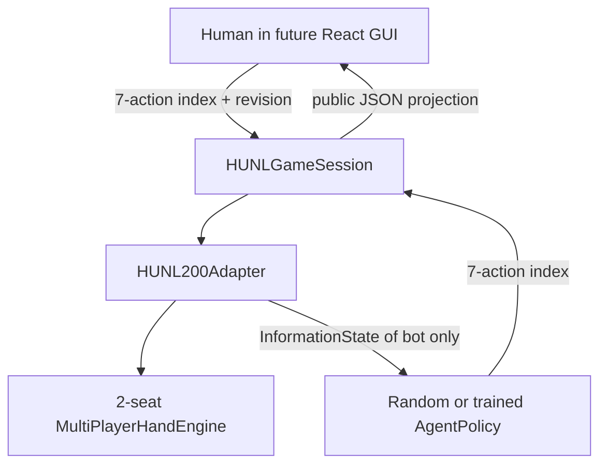
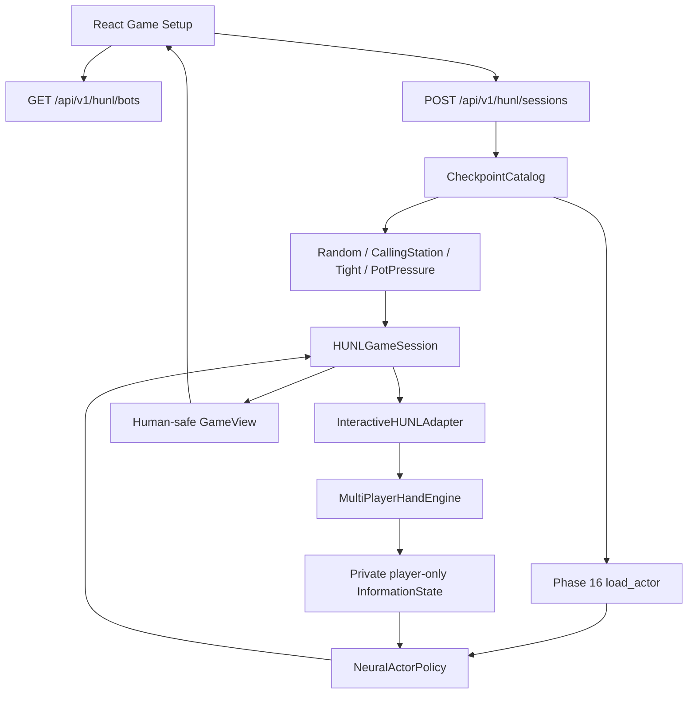
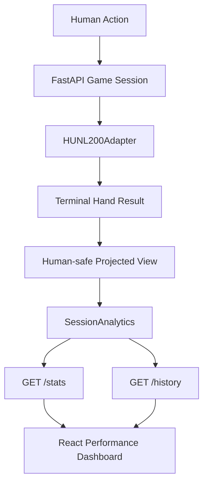

# Source documentation volume 2/7

[Final integrated technical report](../POKER_AI_FINAL_INTEGRATED_TECHNICAL_REPORT.md) · Lossless original report content from `6a8ae368ddc02f814140d3770bc5993eaf9a15e4`.

## docs/EXPAND_PHASE07_INTEGRATION_TOURNAMENT_BENCHMARK.md

Original SHA `cdd5daec6e134258c373b61508198ef703b4080f` (20388 bytes).

<a id="md-021"></a>

<!-- BEGIN_MD_SOURCE path="docs/EXPAND_PHASE07_INTEGRATION_TOURNAMENT_BENCHMARK.md" sha="cdd5daec6e134258c373b61508198ef703b4080f" -->

````````markdown
---
title: "Expand Phase 7 — Integration, Tournament Extension & Scientific Benchmark"
project: HUNL to Dynamic 6-Max NLHE
phase: "Expand 7"
version: "1.0-prototype"
status: "Local isolated tests passed; Windows Base Phase 3 engine acceptance pending"
date: 2026-10-12
tags:
  - poker/6max
  - reinforcement-learning
  - mccfr
  - tournament
  - evaluation
---

# Expand Phase 7 — Integrated 6-Max Poker Agent

> **Release classification:** An E1–E6 integration/evaluation **prototype**, not a certified production Poker Agent or reproduction of Pluribus. An E3 checkpoint remains necessary for learned play; if omitted, the example CLI runs an explicitly labelled **uniform legal baseline**. Pluribus-style E4/E5 requires an externally verified exact-infoset adapter, and is **not automatically enabled** by this CLI.
>
> **Testing:** E1–E7 source combination: `164 passed, 7 skipped` in an isolated mock-engine environment. Real Base Phase 3 engine + Windows/CUDA acceptance remains pending. No GitHub Push.

## 1. Objective and boundaries

The Phase 7 output is an **operational integration interface**, single-table tournament runner, and reproducible **evaluation** pipeline, without modifying Base Phase 1–16 or Expand Phase 1–6.

```text
                                    Dynamic 6-seat Table (E1)
                                                |
                                       InformationState (E2)
                                                |
                  +----------------- Policy Routing (E7) -----------------+
                  |                      |                                |
              E3 Neural            E4 Blueprint                      E5 Search
           trusted checkpoint     only verified key              only verified root
                  |                      |                                |
                  +----------------------+--------------------------------+
                                         |
                                E6 Optional Adaptation
                           candidate expert + KL/TV guard
                                         |
                               Legal ActionTranslator (E2)
                                         |
                                Base Phase 3 Hand Engine
                                         |
                              Independent-session Benchmark
                                         |
                                E7 Release Manifest
```

### 1.1 What is implemented?

| Capability | State | Notes |
|---|---|---|
| E1 Cash + E2 InformationState + E6 accepted public action registry | Implemented | E6 evidence updated **only after action acceptance** |
| E3 PPO checkpoint inference | Implemented | `from_e03_checkpoint` demands trusted E3 format |
| Neural/Blueprint/Search fallback router | Implemented | Search > Blueprint > Neural; source must be explicitly marked compatible |
| E4 Blueprint adapter | Opt-in adapter | Caller must provide **exact** infoset key. Rejects unknown/mismatched actions; missing key is NOT a trained strategy |
| E5 Search adapter | Opt-in adapter | Caller provides verified root belief; incomplete/timeout results fallback |
| E6 StyleExpertRouter + SafeAdaptivePolicy | Implemented / optional | Requires separately trained **hero policy** experts and enough public evidence |
| Cash benchmarks 2–6, 20/100/200BB, opponent pool | Implemented | Each scored hand is from an **independent table session** |
| Single-table Tournament with rising blinds | Implemented | Reuses Base Phase 3 Hand Engine; 0-chip elimination after settlement |
| Late registration and re-entry | Implemented | **Between hands only**; new entry ID; configurable registration cutoff and re-entry cap |
| Payout EV and terminal ranking | Implemented | per-entry finish rank/prize; same-hand equal-before-stack elimination tied |
| Repeatable A/B cash comparison | Implemented | identical scenario seeds, paired per-session differences |
| CLI JSON + SHA256 manifest | Implemented | checkpoint hashes, evaluation script hash, git SHA when available |
| Antes / multi-table tournament / ICM | **Not implemented** | Unsupported ante setting fails explicitly |
| Pluribus-equivalent 100BB Blueprint and full nested re-solving | **Not implemented** | E4 hash buckets, E5 approximate search not production solvers |

## 2. Integrated policy API

```python
from holdem_ai.expand.integration import (
    IntegratedPokerAgent, RoutingConfig, from_e03_checkpoint,
)

neural = from_e03_checkpoint("runs/expand_phase03_pilot/best.pt", device="cuda")
agent = IntegratedPokerAgent(neural, config=RoutingConfig())
choice = agent.act(phase2_information_state, rng_seed=12345)
table_adapter.act(choice.action)
```

`act()` inputs **only** `InformationState` plus RNG seed and optional Phase 6 public opponent evidence. It does **not** take engine instances, hidden deck, opponent hole cards, or CriticState. Source exceptions/mismatches cause labelled fallback.

Let allowed action set be $\mathcal A(I)$ and configured sources $S,E,B,N$ for Search/Blueprint/Neural. Source selection:

$$
\pi_{\rm route}(\cdot\mid I)=
\operatorname{FirstVerifiedValid}(\pi_{S},\pi_{B},\pi_{N},\pi_{U}),
\qquad \pi_U(a\mid I)=\frac{1}{|\mathcal A(I)|}
$$

The uniform emergency source is **not a claim of strategic correctness**. Every selected distribution is checked against precisely the acting hero's legal action support:

$$\mathcal A_{\pi}=\mathcal A(I), \quad
\pi(a)\ge 0,\quad \sum_{a\in\mathcal A(I)}\pi(a)=1.$$

The resulting choice is passed through E2 `to_table_action` so a Raise-to **always** means total committed on the current street, in **integer chips**. No silent bet clamping.

### 2.1 Critical E4 / E5 limitation

The E4 infoset-key generator requires the exact history of engine action IDs (and precise raise-to values). E2's `PublicAction` preserves *public action semantics* but does not in general preserve an unambiguous original engine-ID trace. Consequently, **a generic E2 → E4 exact Infoset map is currently unproven**. This is why Phase 7 does **not** automatically activate an E4 or E5 checkpoint.

```python
from holdem_ai.expand.integration import from_e04_checkpoint

# DO NOT deploy until exact_infoset_key is independently verified:
source, abstraction_id = from_e04_checkpoint(
    "runs/expand_phase04_holdem6/blueprint.json.gz",
    exact_infoset_key=verified_exact_infoset_key,
)
```

E5's opt-in adapter similarly requires an externally validated hero/public belief root:

```python
from holdem_ai.expand.integration import from_e05_solver
source = from_e05_solver(solver, verified_root_belief=verified_root_belief)
```

The E5 solver is still the *Phase 5 current-decision depth-limited approximation*, not the original Pluribus nested search.

### 2.2 E6 optional adaptation

Expert policies must be previously trained on hero-visible information. Phase 6 does **not** train them or guarantee profitability. For a trusted evidence structure $e$ and proposal $q$:

$$
\pi_{\rm adapt}=(1-\eta)\pi_{\rm base}+\eta q,
\qquad
D_{\rm KL}(\pi_{\rm adapt}\|\pi_{\rm base})\le\epsilon_{\rm KL},
\quad
D_{\rm TV}(\pi_{\rm adapt},\pi_{\rm base})\le\epsilon_{\rm TV}.
$$

Adaptation is withheld for insufficient evidence, context mismatch or strategy-shift detection. The Cash benchmark records public action samples through `PublicOpponentTracker`, identified by `(Player ID, join-tenure ID)`. **The opponent decision's legal-action set is never assumed equal to the hero's.**

## 3. Single-table Tournament

Source: `src/holdem_ai/expand/integration/tournament.py`.

Unlike E1's cash-only `DynamicTable`, E7 `SingleTableTournament` holds a roster and reuses the unchanged Base Phase 3 Hand Engine **each hand**, persisting stacks and rotating the button among surviving players.

```python
from holdem_ai.expand.integration import SingleTableTournament, TournamentConfig

cfg = TournamentConfig(
    starting_stack=2000,
    blind_levels=((10,20),(20,40),(40,80),(80,160),(160,320)),
    hands_per_level=4,
    registration_until_hand=3,
    max_reentries_per_player=1,
    payouts=(0.70, 0.30),
)
tour = SingleTableTournament(cfg)
tour.register("Alice", seat=0)
tour.register("Bob", seat=1)
# start_hand(seed) -> observe_current() -> act(E1 Action) -> settle_hand()
```

**Semantics:**

- Each registration creates a distinct `entry_id`. Re-entry does not revive a previously busted entry.
- All registrations/re-entries are permitted only **between hands** and before the cutoff. New entrants receive configured starting chips; a complete cash-equivalent ledger of entry fees is **not** implemented.
- All-in players with `stack==0` are **not eliminated mid-hand**. A bust is declared only after terminal settlement and side pots.
- Head-up SB/BTN uses the existing engine's moving-button model. No tournament dead-button model or missed-blind policy certification.
- One live entry remaining **while late registration is still open** is *not declared champion* until the window closes. The arena may wait for another entrant. `close_registration()` is provided.
- The ante setting is explicitly rejected (`NotImplementedError`) because the current Base Phase 3 hand engine does not support a tournament ante contract. **Do not add ante to rewards without implementing chip movement and pot eligibility.**
- Re-entry cannot occur before the prior entry has a confirmed hand-boundary elimination and is limited per player.
- The tournament ends only when one entry is left **and registration is closed**. `max_hands` raises rather than fabricating a winner.
- Payout ranks are based on elimination time. Simultaneous busts order by pre-hand stack; equal pre-hand stacks tie and split occupied prize slots. A re-entry is a new participant entry for this prototype's prize accounting.

### 3.1 Chip invariant

For a given hand $h$, with absent seats recorded as zero:

$$
\sum_{i=0}^{5}S_{i,h}^{\rm before}=
\sum_{i=0}^{5}S_{i,h}^{\rm after},\qquad
\sum_{i=0}^{5}R_{i,h}^{\rm chips}=0.
$$

For externally registered entries, tournament **total chips can increase between hands** when a new entry is admitted, so only per-hand invariants apply. Tournament chip gains **must not** be confused with final monetary prize utility.

### 3.2 Reward separation

Cash:

$$R^{\rm cash}_{i,h}=\frac{S^{\rm after}_{i,h}-S^{\rm before}_{i,h}}{BB_h},
\qquad \widehat{bb/100}=100\cdot\overline{R^{\rm cash}_{i,h}}.$$

Tournament:

$$R^{\rm tournament}_{i}=p_{\operatorname{rank}(i)},
\qquad \widehat J_{\rm prize}=\frac1K\sum_{k=1}^K R^{\rm tournament}_{i,k}.$$

A player who re-enters may have multiple entries. The Phase 7 report is **per-entry**, and any player-level economic EV would additionally require entry fees and rebuy cost accounting, which is out of scope.

## 4. Scientific Benchmark

Source: `src/holdem_ai/expand/integration/benchmark.py`.

### 4.1 Cash design

Each benchmark block constructs a **fresh table**, admits 2–6 players, plays possible BB-admission warm-up hands, and records **one** target hand after the entire roster is seated. Warm-up hands are counted separately and **excluded from the EV sample**. Important subtlety: warm-up dynamics condition the sampled stacks/seat states; this is a benchmark estimand, not a guaranteed uniform 100BB independent hand distribution. Position varies by `hero_seat = block_index % N`.

Benchmark axes include:

$$N\in\{2,3,4,5,6\},\qquad S_0\in\{20,100,200\}\,BB,
\qquad\mathcal O=\{\text{random, calling, tight, pot pressure}\}.$$

For independent session blocks $X_b$:

$$
\widehat{\mu}_{bb/100}=100\cdot\frac1K\sum_{b=1}^K X_b,
\quad
SE_{bb/100}=100\frac{s_X}{\sqrt K},
\quad CI_{95\%}^{\rm normal}\approx\widehat\mu\pm1.96 SE.
$$

**Caution:** The reported interval is a normal approximation. With a small number of blocks or rare large pots it can be severely inaccurate. More samples, heavy-tail diagnostics, and multiple independent model-training seeds are needed before reporting superiority.

### 4.2 Tournament design

One completed tournament is one cluster. Tournament metrics are payout EV, win rate, average number of hands, and score distributions. Cash `bb/100` is **not** reported as the tournament's primary reward. Single-table only; no multi-table merging/ICM validation.

### 4.3 Candidate-vs-baseline paired comparison

The same player count/stack/opponent/seat/deck seed is used for both frozen E3 checkpoint candidates (run separately):

$$D_b=X_b^{\rm candidate}-X_b^{\rm baseline}.$$

$$\widehat\Delta_{bb/100}=100\overline D,
\qquad SE(\widehat\Delta)=100\frac{s_D}{\sqrt K}.$$

The code rejects mismatched benchmark configs. **Matching initial RNG seeds does not guarantee identical paths once two policies take different actions.** The conditional paired confidence interval does not represent uncertainty across unseen training seeds.

### 4.4 Release Manifest

Generated JSON includes:

- Git commit SHA when the runtime is a Git checkout (otherwise null).
- E3 checkpoint exact SHA-256 and paths (plus baseline/expert files when supplied).
- Benchmark config, seed, abstraction ID.
- SHA-256 of the benchmark CLI.
- No raw hole cards or private deck in the JSON result.

Output files are protected by no-overwrite exclusive creation. Never upload training checkpoints (`*.pt`) or `runs/` wholesale by accident.

## 5. Install (Windows PowerShell)

**Prerequisite:** Expand Phase 1–6 installed in the original GitHub project's root.

```powershell
Expand-Archive .\holdem-ai-expand-phase07.zip -DestinationPath .\holdem-ai-expand-phase07 -Force

Copy-Item .\holdem-ai-expand-phase07\src\holdem_ai\expand\integration `
  .\src\holdem_ai\expand\ -Recurse -Force

Copy-Item .\holdem-ai-expand-phase07\scripts\expand_phase07_benchmark.py `
  .\scripts\ -Force

Copy-Item .\holdem-ai-expand-phase07\tests\expand\test_e07_*.py `
  .\tests\expand\ -Force

Copy-Item .\holdem-ai-expand-phase07\tests\expand\e07_fake_tournament.py `
  .\tests\expand\ -Force

Copy-Item .\holdem-ai-expand-phase07\docs\EXPAND_PHASE07_INTEGRATION_TOURNAMENT_BENCHMARK.md `
  .\docs\ -Force
```

Tests:

```powershell
uv run --extra dev --extra gpu python -m pytest -q -k e07
uv run --extra dev --extra gpu python -m pytest -q tests/expand
uv run --extra dev --extra gpu python -m pytest -q
```

### 5.1 Cash smoke (no E3 checkpoint required)

```powershell
uv run --extra gpu python -m scripts.expand_phase07_benchmark `
  --mode cash --groups 2 --players 2,3 --stacks-bb 100 `
  --opponents calling_station --seed 7070001 `
  --output-json runs/expand_phase07/cash_smoke_uniform.json
```

This is a uniform-legal **infrastructure smoke**, not a trained AI evaluation.

### 5.2 Cash full experiment with trained E3 checkpoint

Only after actual E3 training has produced the file:

```powershell
uv run --extra gpu python -m scripts.expand_phase07_benchmark `
  --mode cash --groups 300 --seed 7071000 `
  --checkpoint runs/expand_phase03_pilot/best.pt `
  --device cuda `
  --players 2,3,4,5,6 --stacks-bb 20,100,200 `
  --opponents random,calling_station,tight,pot_pressure `
  --output-json runs/expand_phase07/cash_ppo_300.json
```

Total target hands: $5\times3\times4\times300=18,000$, PLUS admission warm-ups. Start small before attempting 300 groups, especially on GTX 1070.

### 5.3 Optional paired PPO model comparison

```powershell
uv run --extra gpu python -m scripts.expand_phase07_benchmark `
  --mode cash --groups 100 --players 2,3,4,5,6 `
  --stacks-bb 100 --opponents random,calling_station,tight,pot_pressure `
  --checkpoint runs/expand_phase03_main/best.pt `
  --baseline-checkpoint runs/expand_phase03_pilot/best.pt `
  --device cuda --seed 7072000 `
  --output-json runs/expand_phase07/ppo_paired_100.json
```

The paths are examples. The script does not assume those checkpoints already exist.

### 5.4 Optional E6 adaptive experts

```powershell
uv run --extra gpu python -m scripts.expand_phase07_benchmark `
  --mode cash --groups 100 --players 2,3 --stacks-bb 100 `
  --opponents tight,pot_pressure --seed 7073000 `
  --checkpoint runs/expand_phase03_main/best.pt `
  --adaptive `
  --expert-checkpoint fold_heavy=runs/experts/fold.pt `
  --expert-checkpoint aggressive=runs/experts/aggressive.pt `
  --device cuda `
  --output-json runs/expand_phase07/adaptive_100.json
```

These expert files are **not** part of any delivered Phase 1–7 patch. They would need separate training and verification. With insufficient public evidence E6 will remain on the base policy.

### 5.5 Tournament smoke and benchmark

```powershell
uv run --extra gpu python -m scripts.expand_phase07_benchmark `
  --mode tournament --groups 2 --players 2,3 `
  --opponents calling_station --seed 7074000 `
  --output-json runs/expand_phase07/tournament_smoke_uniform.json
```

For real E3 candidate:

```powershell
uv run --extra gpu python -m scripts.expand_phase07_benchmark `
  --mode tournament --groups 100 --players 2,3,4,5,6 `
  --opponents random,calling_station,tight,pot_pressure `
  --checkpoint runs/expand_phase03_main/best.pt `
  --device cuda --seed 7075000 `
  --output-json runs/expand_phase07/tournament_ppo_100.json
```

Note: Tournament CLI evaluates the default **registration-closed, single-entry** configuration; late-registration/re-entry is tested via the `SingleTableTournament` API and is not an independent benchmark-axis CLI option yet.

## 6. Release acceptance and explicit gates

| Gate | Evidence | State |
|---|---|---|
| G1 Python source compiled | compileall | pass in sandbox |
| G2 E7 isolated tests | 23 passed | pass in sandbox |
| G3 E1–E7 combined isolated regression | 164 passed, 7 skipped | pass in sandbox |
| G4 Real Base Phase 3 hand engine tests | `test_e07_real_engine.py` | **pending** |
| G5 Windows GTX 1070 actual CUDA E3 inference | GPU pilot | **pending** |
| G6 Cash 2–6 / Side Pot / Join / Leave / Bust | full 6-Max evaluation | **pending** |
| G7 Tournament blind-level / registration / reentry real-engine traces | real engine | **pending** |
| G8 Robust E4 exact infoset mapping | old E2 raw ID preservation gap | **blocked** |
| G9 E5 full Pluribus nested search | prototype scope | **not implemented** |
| G10 Push to GitHub | only after user's own verification | **pending** |

## 7. Known constraints / planned remediation

1. Preserve **exact observed engine action IDs + raise-to amounts** in an actor-allowlisted public history without leaking hidden cards; then validate E4 key equality with game engine under controlled histories.
2. Replace Phase 4's hash-bucket prototype with learned/equity-based card abstraction, and re-evaluate large action trees and resource budgets.
3. Add full E5 Pluribus-style betting-round replay, safe search subgames, and more accurate continuation value computation.
4. Explicit ante support needs Base Hand Engine contract changes; do **not** silently charge ante outside the engine.
5. Add tournament fee/re-entry cost ledger for real player-level monetary EV; do not treat payout-only per-entry reward as net profit.
6. Benchmark with multiple independent training seeds and difficult learned opponents (not just fixed scripted profiles).
7. Compare Adaptive vs non-adaptive using predeclared held-out scenario blocks **after** actual exploit experts are trained.
8. Cash-game benchmark presently scores one hand *after* warm-up seating (conditional stack distribution). Use direct full-table seeded reset or stratification for truly fixed-stack experiments.
9. No support for cross-table migration, hand-for-hand, 7+ players, rake, or payout accounting in actual money.

## 8. Source attribution

- Base Phase 3: `src/holdem_ai/environment/multi_player_engine.py`, `multi_player_seats.py`, `pot_manager.py`.
- Expand E1: dynamic cash table & event ledger.
- Expand E2: acting-player InformationState and action translator.
- Expand E3: trusted PPO checkpoint inference only.
- Expand E4/E5: optional CFR/search sources with **explicit compatibility evidence**.
- Expand E6: public-only opponent registry, change detection, KL/TV guard.
- Pluribus: Brown & Sandholm, *Superhuman AI for Multiplayer Poker* (2019), https://noambrown.github.io/papers/19-Science-Superhuman.pdf ; Supplement https://noambrown.github.io/papers/19-Science-Superhuman_Supp.pdf . The E7 design is **our own extension** and is not the Pluribus source code.

````````

<!-- END_MD_SOURCE path="docs/EXPAND_PHASE07_INTEGRATION_TOURNAMENT_BENCHMARK.md" -->

## docs/GUI_1_0_HUNL_CONTRACT.md

Original SHA `6fa6c26cf6b9d442ef4943e1bc6ae1b00196e506` (7076 bytes).

<a id="md-022"></a>

<!-- BEGIN_MD_SOURCE path="docs/GUI_1_0_HUNL_CONTRACT.md" sha="6fa6c26cf6b9d442ef4943e1bc6ae1b00196e506" -->

````````markdown
---
title: GUI-1.0 HUNL Human-Agent Integration Contract
aliases: [HUNL GUI Phase 1.0]
tags: [holdem-ai, HUNL, GUI, Phase-1.0, RL, API]
status: implemented
---

# GUI-1.0 — HUNL Human vs Trained Agent: Interface Contract

> Scope: **HEADS-UP only (2 seats), single-hand reset at 200BB, human seat 0, bot seat 1**. No React or FastAPI in this phase; that is GUI-1.1~1.3. No 6-Max or tournament play.

## 1. Goal



$$
I_t^i = O_i(S_t),\qquad a_t \sim \pi_\theta(\cdot\mid I_t^i),\qquad S_{t+1}=T(S_t,a_t).
$$

Separation requirement: `AgentPolicy.act(observation, rng)` only receives its acting seat's `InformationState`. The GUI sees `project_human_view` output only. The private internal `HUNL200Adapter.engine` and `CriticState` **MUST NOT** be serialized to browser clients.

## 2. Existing code reused (no replacement)

- `holdem_ai.environment.hunl200_adapter.HUNL200Adapter`: Phase 6 heads-up interface.
- `holdem_ai.core.schema.InformationState`, `Turn`, `Terminal`: Phase 5.
- `holdem_ai.environment.bet_abstraction`: fixed 7-head action labels and masks.
- `holdem_ai.agents.policies.RandomLegalPolicy`: baseline AgentPolicy.
- `holdem_ai.agents.neural_policy.NeuralActorPolicy`: injection-ready (checkpoint loading in GUI-1.4).
- `holdem_ai.environment.multi_player_engine.MultiPlayerHandEngine`: real betting, cards, showdown.

### Seven actions

| Index | Label | Description |
|---:|---|---|
| 0 | `fold` | Fold |
| 1 | `check` | Check |
| 2 | `call` | Call (including short all-in call) |
| 3 | `raise_half_pot` | 0.5 pot raise-to abstraction |
| 4 | `raise_pot` | 1 pot raise-to abstraction |
| 5 | `raise_double_pot` | 2 pot raise-to abstraction |
| 6 | `all_in` | All-in **raise** when permitted |

`action_index` means **policy head index**; it is NOT the original 5-index engine action ID. `raise_to` means total contribution on the current street. Illegal and duplicate abstract raises are masked out. A short all-in *call* is still `call`.

**Restriction**: During GUI-1.0 humans submit an available 7-action index, just like a bot. Arbitrary `raise_to` by a human is intentionally postponed until GUI-1.3, requiring an explicit, tested method in HUNL200Adapter to keep its action history/encoder consistent. Do not write to `_history` or `_choices` directly from UI code.

## 3. Human public state

`session.view()` returns a new JSON-serializable dict, with this stable draft contract:

```json
{
  "game_type": "HUNL200",
  "hand_number": 1,
  "revision": 1,
  "phase": "playing",
  "hero_seat": 0,
  "button": 0,
  "small_blind": 50,
  "big_blind": 100,
  "street": "preflop",
  "board": [],
  "hero_cards": ["hA", "sK"],
  "seats": [
    {"seat": 0, "role": "human", "stack": 19950, "street_bet": 50, "total_contribution": 50, "status": "active"},
    {"seat": 1, "role": "bot", "stack": 19900, "street_bet": 100, "total_contribution": 100, "status": "active"}
  ],
  "pot": 150,
  "to_act": 0,
  "your_turn": true,
  "to_call": 50,
  "min_raise_to": 200,
  "max_raise_to": 20000,
  "actions": [{"index": 2, "label": "call", "kind": "call", "raise_to": null}],
  "action_log": [],
  "completed_hands": 0,
  "cumulative_bb": 0.0,
  "bb_per_100": 0.0,
  "hand_result": null
}
```

The sample contains **illustrative hole cards**; actual holes are freshly shuffled by the game engine. `actions` lists all engine-legal choices, not just the example call shown above.

At terminal state, `phase="complete"`, `to_act=null`, `actions=[]`, and `hand_result` is populated. The bot's hole cards are released only when an actual showdown occurs (`result.folded` contains no folds and five community cards are on board). They remain hidden when a hand ends by fold.

**Never expose**: opponent's unrevealed hole cards, future cards, burned cards, shuffled deck, privileged critic, or a full game engine state object.

## 4. Action and concurrency safety

Browser requests (in GUI-1.1) will contain `session_id`, `action_index`, `expected_revision`. The transport must not accept a browser-supplied mask, cards, pot, stack or bet target as authoritative.

$$
\mathrm{Accept}(a,r)\iff r=r_{server}\land a\in \mathcal A_{legal}(I_t).
$$

Every legal action increments `revision`; a stale request is refused. Per-session locks prevent concurrent state mutation in the Python process. GUI-1.1 will implement request schema, HTTP conflict status mapping, loopback binding, restricted CORS, resource limits and clear errors.

## 5. Session semantics

- `HUNLGameSession.start_hand()` deals and runs bot actions automatically until it is the human turn, or the hand finishes.
- `play_human_action(index, expected_revision=r)` validates, advances engine, executes any necessary bot turns, and returns a fresh view.
- `view()` is side-effect free, and does not start or advance hands.
- `start_hand()` rejects calls while the current hand is still active; after termination it deals a fresh 200BB hand and rotates button (`0,1,0,1,...`).
- `HUNLSessionRegistry` uses unpredictable IDs, is process-local, and is not a production persistence/auth solution.

### Metrics

$$
R_{hero,h}^{BB}=\frac{C_{hero,h}^{final}-200\,BB}{BB},
\qquad \sum_{i=0}^{1}R_{i,h}^{BB}=0.
$$

$$
\widehat J_{bb/100}=\frac{100}{N}\sum_{h=1}^N R_{hero,h}^{BB}.
$$

**Interpretation**: a descriptive session sample statistic; tiny session sample sizes, different opponents, and unbalanced seat/button mix cannot establish strategy strength. Here hands reset stacks instead of persisting cash-game bankroll.

## 6. Run/validate

From the existing project root after extracting the patch:

```powershell
uv sync --extra dev
uv run --extra dev python -m pytest -q
uv run --extra dev python -m pytest tests/test_gui10_hunl_contract.py -q
uv run python scripts/gui10_smoke.py --hands 20 --seed 42
```

No trained checkpoint is distributed in this patch. To experiment with a trained bot in Python, pass a **compatible trusted** `NeuralActorPolicy` instance as `bot_policy`. Automated checkpoint discovery/loading, configuration and validation are GUI-1.4 tasks.

## 7. GUI-1.0 non-goals and next work

- **GUI-1.1**: FastAPI endpoints, Pydantic validation, localhost-only security and CORS, serializing game sessions.
- **GUI-1.2**: React table, cards/board, dealer button, stacks and pot.
- **GUI-1.3**: Human betting controls including arbitrary raise-to; explicit `HUNL200Adapter.step_raise_to` extension, legal-reopen validation and histories.
- **GUI-1.4**: Trusted Phase-15/16 checkpoint loader, PPO/Q-Boost model compatibility checks, model-vs-human validation.
- **GUI-1.5**: Session dashboard, hand statistics, performance QA.

The project remains **HUNL only** for this GUI effort. The existing 6-Max and tournament engine source files are retained untouched for future work.

````````

<!-- END_MD_SOURCE path="docs/GUI_1_0_HUNL_CONTRACT.md" -->

## docs/GUI_1_1_FASTAPI.md

Original SHA `0b4ede0298912e8676fd35b7c3ad6fd3bdd85474` (6246 bytes).

<a id="md-023"></a>

<!-- BEGIN_MD_SOURCE path="docs/GUI_1_1_FASTAPI.md" sha="0b4ede0298912e8676fd35b7c3ad6fd3bdd85474" -->

````````markdown
---
title: "GUI-1.1 — HUNL Local HTTP Game Server"
tags: [holdem-ai, gui, hunl, fastapi, research]
status: implemented-patch
---

# GUI-1.1 — FastAPI Local Game Server

## Scope

**GUI-1.0 is assumed installed and passing.** This phase adds HTTP transport to the already existing `HUNLGameSession`. It implements no new poker betting rules. A React poker table, arbitrary human `raise_to`, and trained checkpoint loading belong to later phases.

- Human fixed to physical seat 0; Bot physical seat 1.
- Two-player HUNL200: each hand starts with 200BB and rotates BTN between hands.
- Four available built-in bot baselines: `random`, `calling_station`, `tight`, `pot_pressure`.
- Revision-based optimistic concurrency; stale action and double next-hand clicks are rejected.
- Session IDs are cryptographically unpredictable; stored **in process only** (server restart destroys sessions).
- HTTP responses are schema-whitelisted player projections. Before showdown, opponent hole cards and deck are never serialized. Opponent cards are shown only after a genuine showdown.
- Bind to `127.0.0.1`, CORS permits localhost Vite development origins. This server has **no authentication and must never be published to a remote or public interface**.

## Endpoint Contract

| Method | Path | Input | Output |
| --- | --- | --- | --- |
| `GET` | `/api/v1/hunl/health` | None | Health JSON |
| `POST` | `/api/v1/hunl/sessions` | `bot`, optional `seed`, `small_blind`, `big_blind`, `stack_bb` | `{session_id, state}` with HTTP 201 |
| `GET` | `/api/v1/hunl/sessions/{id}` | None | Current `{session_id, state}` |
| `POST` | `/api/v1/hunl/sessions/{id}/actions` | `action_index`, `expected_revision` | Updated `{session_id, state}` (bot turns auto-advanced) |
| `POST` | `/api/v1/hunl/sessions/{id}/next-hand` | `expected_revision` | Next hand `{session_id, state}` |
| `DELETE` | `/api/v1/hunl/sessions/{id}` | None | HTTP 204 |

**HTTP status semantics:** `422` malformed or illegal action, `409` stale revision or invalid game phase, `404` unknown session, `503` session capacity exceeded.

## Player-Visible State

The frontend receives `{session_id, state}`. The `state` object exposes only the following properties:

`hand_number`, `revision`, `phase`, `game_type`, `hero_seat`, `button`, `small_blind`, `big_blind`, `street`, `board`, `hero_cards`, `seats`, `pot`, `to_act`, `your_turn`, `actions`, `to_call`, `min_raise_to`, `max_raise_to`, `action_log`, `completed_hands`, `cumulative_bb`, `bb_per_100`, `hand_result`.

When `your_turn` is true, `actions` offers valid **seven-head HUNL200 action indices**, not Phase-3 engine action IDs. Each raise action includes an exact `raise_to` resolved by the environment. **Do not use the GUI action index as a raw engine action ID.**

When `phase = complete`, `hand_result.showdown` controls whether `opponent_cards` is present. After fold, cards stay hidden.

The client must always send the **most recently received** `expected_revision`; never guess it. An HTTP 409 should trigger a GET refresh.

## Mathematical Definitions

For hand $h$, the human's net payoff in big blinds is

$$
R_h^{\mathrm{BB}}=\frac{C_{h,\mathrm{final}}-C_{h,\mathrm{initial}}}{BB_h}.
$$

Across $N$ completed hands, the GUI displays

$$
\widehat{\mathrm{bb/100}}=\frac{100}{N}\sum_{h=1}^{N}R_h^{\mathrm{BB}}.
$$

Per-hand stacks reset to $200BB$ as in the existing HUNL200 research environment; this is a repeated-hand study, not a continuous cash table with accumulated stacks and not a tournament.

## Installation and Tests (PowerShell; project root)

First extract GUI-1.0 and then GUI-1.1. Add the dedicated GUI optional dependencies **once** (these modify `pyproject.toml` and `uv.lock` locally and avoid overwriting existing customized manifests):

```powershell
Expand-Archive -Path "$HOME\Downloads\holdem-ai-gui-1-0.zip" -DestinationPath . -Force
Expand-Archive -Path "$HOME\Downloads\holdem-ai-gui-1-1.zip" -DestinationPath . -Force
uv add --optional gui "fastapi>=0.115,<1" "uvicorn>=0.30,<1" "httpx>=0.27,<1"
uv sync --extra dev --extra gui
uv run --extra dev --extra gui python -m pytest tests/test_gui10_hunl_contract.py tests/test_gui11_http_api.py -q
uv run --extra dev --extra gui python -m pytest -q
uv run --extra dev --extra gui python -m scripts.gui11_smoke --hands 10 --seed 42
```

Start local API server:

```powershell
uv run --extra dev --extra gui python -m backend.main
```

Open `http://127.0.0.1:8000/docs` for Swagger OpenAPI. Stop with `Ctrl+C`.

## Example Requests (PowerShell)

```powershell
$base = 'http://127.0.0.1:8000/api/v1/hunl'
$new = Invoke-RestMethod -Method Post -Uri "$base/sessions" -ContentType 'application/json' -Body '{"bot":"calling_station","seed":42}'
$new.state | ConvertTo-Json -Depth 8
$id = $new.session_id
$action = $new.state.actions | Where-Object { $_.kind -eq 'call' -or $_.kind -eq 'check' } | Select-Object -First 1
$body = @{ action_index = $action.index; expected_revision = $new.state.revision } | ConvertTo-Json
$updated = Invoke-RestMethod -Method Post -Uri "$base/sessions/$id/actions" -ContentType 'application/json' -Body $body
$updated.state | ConvertTo-Json -Depth 8
```

This example chooses Check/Call **only when the server offers it**. The state may be terminal after actions and Bot automatic continuation.

## New Code

- `backend/__init__.py`, `backend/main.py`, `backend/schemas.py`, `backend/game_router.py`
- `src/holdem_ai/game_service/session_manager.py` (GUI-1.0 file, **one additive method** `start_next_hand` for atomic revision check)
- `tests/test_gui11_http_api.py`
- `scripts/gui11_smoke.py`

## Risks and Deliberate Limitations

1. No checkpoints loaded yet (GUI-1.4). All allowed Bot types are simple baseline policies.
2. No web poker table yet (GUI-1.2 onward).
3. Only fixed seven-head Human actions; unrestricted raise-to will be added after an explicit safe HUNL200Adapter API is designed.
4. Session registry is volatile and process-local; no persistence, multi-process coordination, remote hosting, or authentication.
5. Tests establish expected behavior for exercised cases, **not** complete poker rules certification.
6. The model's strongest available inference is still strictly HUNL (two-player), not six-player.

````````

<!-- END_MD_SOURCE path="docs/GUI_1_1_FASTAPI.md" -->

## docs/GUI_1_2_REACT_TABLE.md

Original SHA `5e340db3319e2b97059a1e0c6519a848801a4751` (4148 bytes).

<a id="md-024"></a>

<!-- BEGIN_MD_SOURCE path="docs/GUI_1_2_REACT_TABLE.md" sha="5e340db3319e2b97059a1e0c6519a848801a4751" -->

````````markdown
---
title: "holdem-ai — GUI-1.2 React HUNL Poker Table"
tags: [holdem-ai, HUNL, GUI, React, FastAPI]
status: implementation-awaiting-user-validation
---

# GUI-1.2 — Heads-Up Poker Table

## Objective

Build the **read-only** browser-based HUNL poker table on top of the GUI-1.0/1.1 FastAPI contract. Keep all poker rules in the original `HUNL200Adapter` / `MultiPlayerHandEngine` and only render the explicitly projected human-visible JSON data. This phase does **not** allow betting clicks; interactive betting is GUI-1.3.

$$
\text{Environment}\xrightarrow{O_{\mathrm{hero}}}\text{FastAPI GameView}\xrightarrow{\mathrm{GET/POST}}\text{React PokerTable}
$$

## Implemented UI

- Responsive oval green-felt table with two seats: Human seat 0 and AI seat 1.
- Hero 2 hole cards, public 0/3/4/5 board cards, opponent face-down cards.
- Opponent cards reveal **only** for `phase=complete` and `hand_result.showdown=true`.
- Dealer (BTN) marker, SB/BB, pot, total stack, street bets, active seat, hand number, action history, cumulative BB and bb/100.
- Local session create, refresh, delete, and next hand (only if previous hand complete).
- Bot selection from GUI-1.1: random, calling_station, tight, pot_pressure; seed optional.
- Design preview switch with clearly marked *fictional sample fixtures* for preflop, flop, turn, river, showdown and folded finish.
- Server health/error feedback; Vite proxy /api -> http://127.0.0.1:8000.
- Vitest utility tests and a Python real-backend JSON/CORS/privacy contract test.

## Deliberate scope exclusions

- GUI-1.3: Human action submission, raise slider, keyboard shortcuts.
- GUI-1.4: Trained PPO/Q-Boost checkpoint loading.
- GUI-1.5: Interactive game history/dashboard expansion.
- GUI Phase 2: Custom Scenario Lab.
- Tournament, 6-Max, external live poker integration.

**Important:** GUI-1.2's live game starts on preflop and stays on the human decision until GUI-1.3 adds interactive betting. The view-mode demo selector is **not** a simulation and does not change backend state.

## Dependencies and local Windows run

This GUI-1.2 ZIP includes only `frontend/`, `tests/test_gui12_readonly_api.py`, and documentation. If GUI-1.0/1.1 is not installed, use the unified GUI-1.0–1.2 archive instead. From project root:

```powershell
uv add --optional gui "fastapi>=0.115,<1" "uvicorn>=0.30,<1" "httpx>=0.27,<1"
uv sync --extra dev --extra gui
uv run --extra dev --extra gui python -m pytest tests/test_gui10_hunl_contract.py tests/test_gui11_http_api.py tests/test_gui12_readonly_api.py -q
uv run --extra dev --extra gui python -m pytest -q
```

Install a supported Node.js LTS (Node 20.19+ or 22+). In PowerShell terminal **A**:

```powershell
uv run --extra gui python -m backend.main
```

Open PowerShell terminal **B** at the project root:

```powershell
cd frontend
npm install
npm run test
npm run build
npm run dev
```

Then visit http://127.0.0.1:5173. When you see *API ONLINE*, click **Deal a new game** to create a live HUNL200 hand. Use **Preview** to inspect street and showdown layouts without playing any actions. The Vite development server's `/api` proxy will forward to FastAPI.

**Runtime limitations:** The FastAPI server is an in-memory unauthenticated local development server bound to 127.0.0.1. Never expose it to the Internet. Node packages have not been installed or built in the assistant environment because its npm registry network access failed; `npm install`, `npm run test`, and `npm run build` must be run on the target PC.

## Source-of-truth and privacy

Client receives `GameResponse { session_id, state }` from GUI-1.1. It **never** receives `CriticState`, an undealt deck, opponent private cards, or arbitrary engine object dumps. Do not import `MultiPlayerHandEngine` into the frontend. `opponentCardsToRender` shows cards only when `hand_result.showdown` is true and the game is complete. A folded opponent is never exposed.

## Incremental delivery

Next: GUI-1.3 betting controls use `GameView.actions` (index 0..6), POST `/api/v1/hunl/sessions/{id}/actions` with `expected_revision`; reconcile on HTTP 409, and use engine-derived raise amounts only.

````````

<!-- END_MD_SOURCE path="docs/GUI_1_2_REACT_TABLE.md" -->

## docs/GUI_1_3_INTERACTIVE_BETTING.md

Original SHA `971b06d6e7bba302b0bd2092e4c079ea3e603a57` (6003 bytes).

<a id="md-025"></a>

<!-- BEGIN_MD_SOURCE path="docs/GUI_1_3_INTERACTIVE_BETTING.md" sha="971b06d6e7bba302b0bd2092e4c079ea3e603a57" -->

````````markdown
---
title: "holdem-ai GUI-1.3 — Interactive Betting"
tags:
  - holdem-ai
  - hunl
  - gui
  - fastapi
  - react
  - phase-1-3
status: "implemented; local Windows acceptance pending"
---

# GUI-1.3 — Interactive Betting

## Objective

2인 HUNL200 게임에서 Human(P0)이 실제 React 테이블에서 행동을 결정한다. `HUNLGameSession`은 사람의 베팅을 서버에서 검증하고, 상대 Bot(P1)의 자동 행동을 처리한 후 다음 공개 상태를 반환한다.

$$
\boxed{\text{Human GUI}\xrightarrow{a_t}\text{FastAPI}\xrightarrow{}\text{HUNL200Adapter}\xrightarrow{}\text{MultiPlayerHandEngine}}
$$

$$
\text{GameView}_{t+1}=\operatorname{Project}_{\mathrm{hero}}\left(T(s_t,a_t)\right)
$$

Agent는 계속해서 기존 7개 추상 행동을 사용한다. Human은 **7-Action 버튼**뿐 아니라 **임의 정수 칩 단위의 합법적 `raise_to`**도 전송할 수 있다.

## Scope

| 기능 | 방식 |
| --- | --- |
| Fold, Check, Call | 서버가 제공하는 `ActionOffer.index`를 그대로 전송 |
| Half-Pot/Pot/2x-Pot | 프런트에서 `ActionOffer.raise_to`를 프리셋 금액으로 선택 |
| All-In | 서버의 합법 `all_in` ActionOffer 전송; 콜 올인은 `Call` 처리 |
| Custom Raise-to | 새 `/raise-to` 엔드포인트에 총 베팅액 전송 |
| Betting slider & number input | `min_raise_to`, `max_raise_to`, `can_raise_to`가 있는 경우에만 활성화 |
| Short All-In | 정상 최소 레이즈 미달이어도 스택 전액에 해당하면 엔진이 허용 가능 |
| 중복 클릭·오래된 상태 | 서버 `expected_revision` 검사, HTTP 409 |
| 비공개 정보 | API whitelist projection; Bot 홀카드는 진짜 Showdown 이후에만 표시 |
| Next Hand | Hand 완결 후만 가능; 버튼 교대; 시작 스택 매번 200BB로 초기화 |

### 정확한 Raise-to 정의

상대 베팅에 추가로 필요한 Call 칩을 `c`, 현재 Street에 이미 투입한 금액을 `b_i`, 남은 스택을 `s_i`, 현재 Street의 최고 베팅액을 `b_{\max}`, 마지막 Full Raise의 증분을 `\Delta`라 하자.

$$
\text{ToCall}_i=\max(0,b_{\max}-b_i)
$$

$$
\text{MinFullRaiseTo}=b_{\max}+\Delta
$$

$$
\text{MaxRaiseTo}_i=b_i+s_i
$$

$$
\boxed{\texttt{raise\_to}=\text{이 Street의 최종 총 베팅액}} 
$$

일반적인 Full Raise는 `min_raise_to <= raise_to <= max_raise_to`이지만, Short All-In은 정확히 `raise_to == max_raise_to`인 경우 엔진이 허용할 수 있다. 그 외의 예외(재오픈, 스택 부족 등)는 **프런트가 아닌 Phase-3 엔진**이 최종 결정한다.

## Existing code reuse

- `src/holdem_ai/environment/multi_player_engine.py`: `step_raise_to(amount)` 및 합법성 검사.
- `src/holdem_ai/environment/hunl200_adapter.py`: **변경하지 않음**. 7-action Neural Agent 입출력 계약 유지.
- `src/holdem_ai/game_service/interactive_adapter.py`: 새 서브클래스. 사람의 임의 `raise_to` 실행 및 공개 Action History 기록.
- `src/holdem_ai/game_service/session_manager.py`: `play_human_raise_to()` 추가, revision과 총손익 기록 통합.
- `src/holdem_ai/game_service/state_projection.py`: 서버가 판정한 `can_raise_to` 필드만 추가.
- `backend/game_router.py`: `POST /sessions/{id}/raise-to` 추가.
- `frontend/src/components/BettingPanel.tsx`: GUI 베팅 버튼, 프리셋, 슬라이더, 정확한 금액 입력.
- `frontend/src/lib/betting.ts`: 프런트 입력 검증용 휴리스틱. 최종 판정 권한 없음.

## New HTTP endpoint

`POST /api/v1/hunl/sessions/{id}/raise-to`

```json
{
  "raise_to": 350,
  "expected_revision": 17
}
```

응답: 기존 `GameResponse`와 동일. 본인이 행동한 후 Bot은 가능한 한 자동으로 연속 행동을 실행하므로 최종 응답에는 여러 Action History 항목과 최신 revision이 포함될 수 있다.

- `200`: 성공, 최신 공개 상태 반환
- `404`: 세션 없음
- `409`: stale revision, 잘못된 시점 또는 이미 끝난 핸드
- `422`: 숫자/스키마가 잘못됐거나 엔진 규칙 위반

기존 `/actions` 엔드포인트, 카드 인코딩, 7-Action Neural Policy는 변경하지 않았다.

> [!IMPORTANT]
> GUI-1.3은 연구용 로컬 실행으로 설계했으며 외부 사이트 연동·실시간 경쟁 테이블 사용을 목표로 하지 않는다. FastAPI는 127.0.0.1에 바인딩되고 인증 및 원격 배포를 지원하지 않는다.

## Acceptance criteria

1. 로컬 세션 생성 시 Human 홀 카드 2장만 표시한다.
2. `Fold/Check/Call/All-In` 버튼은 실제 서버 행동을 발생시킨다.
3. `Min/½ Pot/Pot/2× Pot/Max` 프리셋 및 숫자 입력은 `raise_to`를 설정하고 버튼으로 제출한다.
4. 누락·분수·음수·최소 미달·최대 초과 금액을 거부하고 상태와 revision을 변경하지 않는다.
5. Bot은 기존 정보 상태와 7 Action Mask만 입력받고 자동으로 대응한다.
6. 피드에 액션 이력과 공통 카드가 갱신된다. 핸드가 끝나면 Next Hand가 활성화된다.
7. 200BB 초기화 및 BTN 교대를 보존하고, 진짜 쇼다운에서만 Bot 카드를 표시한다.
8. 전체 기존 pytest와 프런트 Vitest/빌드가 완료된다.

## Validation notes

개발 환경에서 GUI-1.0~1.3과 Phase 1~4 코드 기반 **130 passed / 3 skipped**. 신규 API 액션 및 custom raise 엔드포인트 테스트 5개 포함. Node TypeScript transpilation 문법 검사 14개 파일 오류 없음.

**제한**: npm 저장소 연결 및 cached dependency 부재로 React `npm install`, `npm test`, `npm run build`, 실제 브라우저 렌더링은 아직 실행하지 못함. 전체 Phase 0~16 GitHub 코드에 대한 일괄 회귀 테스트 역시 사용자 로컬에서 필요.

## Next

**GUI-1.4 — Trained Agent Integration**: 로컬 신뢰 가능한 Phase 15 PPO / Q-Boost PPO 체크포인트를 로드하고, HUNL200 7-Action Model로 `Human vs Trained Agent` 실행. GUI-1.3은 우선 Baseline Bots(Random/CallingStation/Tight/PotPressure)만 선택할 수 있다.

````````

<!-- END_MD_SOURCE path="docs/GUI_1_3_INTERACTIVE_BETTING.md" -->

## docs/GUI_1_4_TRAINED_AGENT.md

Original SHA `8ecf0335053978f7e17c29b68801dbbf46d8b540` (6531 bytes).

<a id="md-026"></a>

<!-- BEGIN_MD_SOURCE path="docs/GUI_1_4_TRAINED_AGENT.md" sha="8ecf0335053978f7e17c29b68801dbbf46d8b540" -->

````````markdown
---
title: "holdem-ai GUI-1.4 — Trained HUNL Agent Integration"
tags:
  - holdem-ai
  - gui
  - HUNL
  - PPO
  - Q-Boost
status: code-complete-needs-windows-checkpoint-validation
---

# GUI-1.4 — Human vs Trained HUNL Agent

## Objective

`GUI-1.0~1.3`의 2인 200BB 로컬 게임에 Phase 15/16의 **신뢰할 수 있는 Actor 체크포인트**를 연결한다.

$$
I_t^{bot} = O_{bot}(s_t),\qquad
\pi_{\theta}(a\mid I_t^{bot}),\qquad
 a_t \sim \pi_{\theta}(\cdot \mid I_t^{bot})
$$

- `mode=sampled`: 합법 7-action 분포에서 확률적으로 샘플링(혼합전략 평가 권장).
- `mode=greedy`: 합법 행동 중 확률이 최대인 행동 선택(추가적인 결정론적 진단용).
- `Human`: 기존 GUI-1.3의 임의 `Raise-to` 입력 사용.
- `Bot`: 기존 HUNL200의 7개 추상 행동만 사용.
- 새로운 RL 학습은 **수행하지 않는다**. Actor는 `eval()`, frozen weights를 사용한다.

## Component flow



## Checkpoint API and file safety

| Bot id | Checkpoint source | Runtime |
|---|---|---|
| `random`, `calling_station`, `tight`, `pot_pressure` | built-in baseline | CPU / no model file |
| `ppo` | `HOLDEM_AI_PPO_CHECKPOINT` | Actor inference |
| `qboost` | `HOLDEM_AI_QBOOST_CHECKPOINT` | Actor inference |

Checkpoint *paths* are read solely from server environment variables. Client cannot submit a filesystem path, upload arbitrary weights, or ask the server to download weights. `GET /bots` advertises file presence only; the strict compatibility load happens at session creation. Unconfigured or incompatible checkpoints cause explicit 422 errors **without fallback** to Random Bot. The Phase 16 loader uses `torch.load(..., weights_only=True)` and strict `TransformerActor` weights; even so, **only load files from trusted local training runs**.

No `.pt` files are bundled in this patch. Locally choose an actual Phase 15/16-compatible checkpoint, e.g. a `best.pt` resulting from a successful long-run training execution. Algorithm IDs (`ppo` or `qboost`) are *user configuration labels* for the file paths: the GUI does not independently authenticate the training algorithm of the checkpoint.

The server locks neural game settings to `small_blind=50`, `big_blind=100`, `stack_bb=200` to avoid accidental out-of-distribution parameters. Existing custom human Raise-to options remain supported, **but non-abstract betting sequences were not necessarily present in training**. Agent quality for those sequences is not established.

## Windows PowerShell configuration

From project root:

```powershell
# GUI + API packages. Only needed once.
uv add --optional gui "fastapi>=0.115,<1" "uvicorn>=0.30,<1" "httpx>=0.27,<1"
uv sync --extra dev --extra gui --extra gpu

# IMPORTANT: replace these with YOUR ACTUAL trusted checkpoint paths.
$env:HOLDEM_AI_PPO_CHECKPOINT = (Resolve-Path ".\runs\phase15_ppo\best.pt").Path
$env:HOLDEM_AI_QBOOST_CHECKPOINT = (Resolve-Path ".\runs\phase15_qboost\best.pt").Path

# default CPU; optionally cuda if your installed PyTorch supports GPU
$env:HOLDEM_AI_GUI_DEVICE = "cpu"
$env:HOLDEM_AI_GUI_POLICY_MODE = "sampled"

uv run --extra dev --extra gui --extra gpu python -m pytest -q
uv run --extra dev --extra gui --extra gpu python -m scripts.gui14_smoke --bot ppo --hands 3
uv run --extra gui --extra gpu python -m backend.main
```

`Resolve-Path` needs the file to exist. If only one checkpoint is available, configure only its corresponding environment variable; the other neural choice remains disabled. On Windows, setting `$env:...` applies to the **current PowerShell process**. The React process can run in a separate terminal; the FastAPI server process requires the environment variables.

React:

```powershell
cd frontend
npm install
npm run test
npm run build
npm run dev
```

Open `http://127.0.0.1:5173`. The model dropdown shows both built-in and neural slots; unavailable neural slots are disabled. If the model file exists but is corrupted/incompatible, game creation returns a diagnostic error without exposing the path.

## HTTP endpoints

Existing GUI-1.3 API preserved. New:

```http
GET /api/v1/hunl/bots
```

Response (example):

```json
{
  "bots": [
    { "id": "random", "label": "Random policy", "trained": false, "available": true, "message": "Ready to play" },
    { "id": "ppo", "label": "Trained PPO", "trained": true, "available": false, "message": "Checkpoint file not configured or missing" }
  ],
  "device": "cpu",
  "policy_mode": "sampled"
}
```

The real response additionally contains the other built-in and Q-Boost slots.

```http
POST /api/v1/hunl/sessions
Content-Type: application/json

{"bot":"ppo","seed":42,"small_blind":50,"big_blind":100,"stack_bb":200}
```

All existing action, raise-to, revision, next-hand, and privacy contracts are unchanged.

## Validation and limits

- Checkpoint list: disabled without model, no file path leakage.
- Strict load error: malformed checkpoint yields 422; no fallback.
- Selection: PPO/Q-Boost independent slots, CPU vs CUDA, sampled/greedy.
- Caching: immutable actor shared; per-session independent RNG; file size/mtime change invalidates cache.
- Privacy: Bot sees only its `InformationState`, not Human's hole cards or centralized CriticState.
- Regression: GUI-1.0~1.4 backend 34 tests passed in phase-compatible fixture; all phase-compatible verification tests 137 passed, 3 skipped.
- Limit: fixture uses a **mock checkpoint loader**; genuine Phase 15 checkpoint inference, latest full repo regressions, npm build and browser end-to-end are not verified here.
- Local-only FastAPI: no authentication; never bind this development server to public networks.
- Pluribus-level strength or GTO is **not** implied by the ability to load a checkpoint.

## Follow-up

GUI-1.5: result display, hand histories, opponent selection metadata in saved outcomes, more extensive realistic hand QA and measured performance reporting (with sampling caveats).

````````

<!-- END_MD_SOURCE path="docs/GUI_1_4_TRAINED_AGENT.md" -->

## docs/GUI_1_5_PERFORMANCE_DASHBOARD.md

Original SHA `46f69c44b511bed24e9dc0e4b9bbb3408d14fd2c` (6040 bytes).

<a id="md-027"></a>

<!-- BEGIN_MD_SOURCE path="docs/GUI_1_5_PERFORMANCE_DASHBOARD.md" sha="46f69c44b511bed24e9dc0e4b9bbb3408d14fd2c" -->

````````markdown
---
title: "holdem-ai — GUI-1.5 Performance Dashboard"
tags: [holdem-ai, gui, hunl, fastapi, react, evaluation]
status: implemented-pending-user-local-validation
phase: GUI-1.5
---

# GUI-1.5 — Performance Dashboard, Hand History & Final Validation

## 1. Objective

GUI Mode 1에서 Human($i=0$)과 Bot($i=1$)이 실행한 **완료된 HUNL 핸드**의 기록을 서버 세션에 보존하고, React에서 누적 결과, 액션 타임라인 및 결과를 시각화한다.

> [!important] 구현 범위
> 이 단계는 *학습*이 아니라 GUI Mode 1의 **Human vs Agent 평가 UI**다. Tournament / 6-Max / 외부 온라인 플랫폼 연동은 포함하지 않는다.

## 2. Data Flow



$$
R_{i,h}^{BB}=\frac{S_{i,h}^{final}-S_{i,h}^{initial}}{BB_h},
\qquad
\widehat{bb/100}=\frac{100}{N}\sum_{h=1}^{N} R_{i,h}^{BB}.
$$

현재 HUNL200은 **매 핸드 200BB로 초기화**하므로, `cumulative_bb`는 각 핸드 결과의 합이며 실시간 캐시 게임의 스택 이월을 의미하지 않는다.

승률:

$$
\widehat{p}_{win}=\frac{N_{win}}{N_{completed}}.
$$

표본 표준편차와 근사 신뢰구간(설명용):

$$
s_R^2=\frac{1}{N-1}\sum_{h=1}^N (R_h^{BB}-\bar R^{BB})^2,
$$

$$
\widehat{bb/100}\pm 1.96\,\frac{100s_R}{\sqrt{N}}.
$$

> [!warning] 통계 해석
> 위 구간은 독립 핸드·정규근사를 가정한 **참고치**다. 실제 인간과의 세션은 상대 적응, 시드·포지션 차이 때문에 독립성이 보장되지 않는다. 적은 핸드의 플러스 bb/100은 강한 전략이나 GTO의 증거가 아니다. 과학적 성능 비교에는 기존 Phase 12/16의 seed-blocked 평가를 계속 사용한다.

## 3. Server implementation

- `src/holdem_ai/game_service/session_analytics.py`: 종료 핸드의 안전한 공개 상태 스냅샷만 받아 기록. 500건 상세 기록 유지, 전체 통계는 계속 누적. Welford 온라인 분산.
- `session_manager.py`: 각 핸드가 Terminal 상태가 될 때 정확히 한 번 기록. 새 핸드에서는 기록 유지.
- `backend/schemas.py`: 명시적인 `SessionStatsResponse`, `CompletedHandView`, `HistoryResponse` (Pydantic extra=forbid).
- `backend/game_router.py`: 세션별 통계/기록 조회.

| Method | Path | Result |
|---|---|---|
| GET | `/api/v1/hunl/sessions/{session_id}/stats` | 전체 누적 손익, W/L/Even, Showdown 수, CI, 최대 낙폭 |
| GET | `/api/v1/hunl/sessions/{session_id}/history?offset=0&limit=30` | 최근 완료 핸드부터 30건(최대 100건/페이지) |

새 API는 기존 `GameView`, `/actions`, `/raise-to`, `/next-hand`를 변경하지 않는다.

## 4. Privacy Invariant

게임 도중 상대 Hole Cards는 서버의 정책 입력으로만 전달된다. 공개 API에 포함하지 않는다.

$$
O_{human}(s)\cap H_{villain}=\varnothing\quad\text{(before terminal showdown)}.
$$

Fold로 종료된 완료 기록에서도 `result.opponent_cards=null`. Showdown에서만 공개. 덱, burn cards, CriticState, 체크포인트 로컬 경로는 공개 기록에 포함하지 않는다.

## 5. Frontend

- `SessionAnalyticsPanel.tsx`: 누적 BB 라인, 승률 및 핸드별 Journal, 클릭 시 개인 카드·공개 보드·행동 이력·Showdown 결과 확장
- `lib/analytics.ts`: 그래프 수치 변환, Win Rate 계산
- `api/client.ts`: `/stats`, `/history` 추가
- `App.tsx`: GUI-1.4의 라이브 테이블 및 기존 Bet Panel 아래 Dashboard 부착
- 현재 핸드를 플레이하는 동안 완료 기록 통계는 변하지 않으며, 종료 시 갱신
- Preview fixture는 실적에 포함되지 않음

## 6. Local validation

프로젝트 루트 PowerShell:

```powershell
Expand-Archive -Path "$HOME\Downloads\holdem-ai-gui-1-0-to-1-5.zip" -DestinationPath . -Force
uv add --optional gui "fastapi>=0.115,<1" "uvicorn>=0.30,<1" "httpx>=0.27,<1"
uv sync --extra dev --extra gui --extra gpu
uv run --extra dev --extra gui --extra gpu python -m pytest -q
uv run --extra dev --extra gui --extra gpu python -m scripts.gui15_smoke --hands 20 --seed 42
```

Backend 터미널:

```powershell
uv run --extra gui --extra gpu python -m backend.main
```

Frontend **별도 터미널**:

```powershell
cd frontend
npm install
npm run test
npm run typecheck
npm run build
npm run dev
```

브라우저: `http://127.0.0.1:5173`.

## 7. Validation status and limitations

- 별도 Phase 1–4 기반 통합 검증 샌드박스에서 GUI-1.0~1.5 및 기존 Environment 회귀 테스트 실행.
- Phase 15의 **실제 PPO/Q-Boost 학습 체크포인트와 함께** 돌아가는 Windows/CUDA/React 브라우저 끝단 테스트는 **아직 실행하지 못함**.
- Node 의존성 저장소 접근이 없어 npm 설치, `npm run build`, 시각적 렌더링 테스트는 사용자의 로컬 PC에서 최종 확인 필요.
- 서버 세션은 메모리 전용이다. 서버 재시작·세션 삭제 시 기록이 사라짐. CSV 영속 내보내기는 향후 확장.
- 정확한 호출 이력은 기존 게임 서비스가 제공하는 공개 이벤트 수준으로만 저장. 이전 버전부터 일부 Call/All-in의 *정확한 금액*이 보존되지 않는 제약은 여전하다.
- 기존 HUNL200의 자유 Raise-to 입력은 학습 시 사용한 7-action abstraction 밖의 금액을 포함할 수 있다. 연구 결과의 해석에 주의한다.

## 8. Acceptance Checklist

- [x] 컴포넌트/API/기록 코드 작성
- [x] 테스트: 빈 세션, 종료된 핸드, 프라이버시, 페이지네이션, 누적 통계, 세션 격리, 보존 제한
- [x] 별도 호환 환경 통합 Python 테스트
- [ ] 사용자 전체 Phase 0–16 코드 통합 테스트
- [ ] 사용자 로컬 Node 브라우저 빌드 및 실제 플레이 확인
- [ ] 사용자 Phase15 Checkpoint 경로 지정 후 Human vs PPO/QBoost E2E 확인

````````

<!-- END_MD_SOURCE path="docs/GUI_1_5_PERFORMANCE_DASHBOARD.md" -->

## docs/GUI_1_6_CONTINUOUS_STACK.md

Original SHA `a2e8a890fa6e07ba327b2e1b9575bba3e278b288` (7436 bytes).

<a id="md-028"></a>

<!-- BEGIN_MD_SOURCE path="docs/GUI_1_6_CONTINUOUS_STACK.md" sha="a2e8a890fa6e07ba327b2e1b9575bba3e278b288" -->

````````markdown
# GUI-1.6 — Continuous Stack Play Mode

> Project: `holdem-ai` / HUNL 2-player / Phase 0–16 compatible GUI patch
>
> Scope: Play sessions and frontend only. **Do not modify** the Phase-6 `HUNL200Adapter.reset()` or Phase 9–16 RL training/evaluation defaults.

## 1. Modes and invariants

| Area | Default | Beginning of hand $h$ | Interface |
|---|---|---|---|
| Local browser Play | `continuous` | Previous hand's settled final stacks | React + FastAPI |
| Python `HUNLGameSession()` / legacy independent research use | `independent` | `(200BB, 200BB)` | Python |
| Phase 6–16 training/evaluation | independent, unchanged | `(200BB, 200BB)` | Python CLI |

First Play hand with `stack_bb=200`, `BB=100` starts with 20,000 chips per player. For player $i\in\{0,1\}$ and hand $h$:

$$
S_{i,h+1}^{\mathrm{start}} = S_{i,h}^{\mathrm{final}}
$$

$$
R_{i,h}^{\mathrm{chips}}=S_{i,h}^{\mathrm{final}}-S_{i,h}^{\mathrm{start}}
$$

$$
\sum_{i=0}^1 S_{i,h}^{\mathrm{start}} = \sum_{i=0}^1 S_{i,h}^{\mathrm{final}} = 2 \times 200 \times 100=40{,}000.
$$

The button rotates each hand: $BTN_h=(h-1)\bmod2$. Blinds stay 50/100. There is no rake, rebuy, or cash top-up in GUI-1.6.

### Match terminal condition

$$
\mathrm{match\_over}=\mathbb{1}\left[\min_i(S_{i,h}^{\mathrm{final}})=0\right].
$$

When match_over is true, `/next-hand` rejects with HTTP 409. The UI hides the **Deal next hand** button and displays the winning seat. Start a **new session** to play again.

**Short stacks:** If a player's stack is smaller than a forced blind, the Phase-3 engine handles the short blind as an all-in. A hand can be dealt and settled *without any player decision*. Such a hand still advances the session `completed_hands`, cumulative chips/BB, and history.

## 2. Architecture

```text
frontend/src/App.tsx
  ├─ Play Mode (continuous HUNL; selectable bot)
  └─ Training / Research (CLI guidance; no training browser)
       |
       | POST /api/v1/hunl/sessions  {"stack_mode":"continuous", ...}
       v
backend/game_router.py + backend/schemas.py
       |
       v
HUNLGameSession(stack_mode="continuous")
       |
       ├─ Hand 1: InteractiveHUNLAdapter.reset() (original 200BB)
       |
       └─ Hand 2+: InteractiveHUNLAdapter.reset_with_stacks(
                       preceding_hand.result.final_stacks)
                             |
                             v
                 MultiPlayerHandEngine(stacks=(hero, bot), ...)
```

The GUI adapter's `reset_with_stacks()` *only* modifies the interactive GUI path and calls the Phase-3 engine's existing `stacks` argument. The Phase-6 training adapter's independent reset path remains intact. Trained bots still use the existing legal-action abstraction (7 action indices). Exact human `raise_to` passes through the existing engine validation.

## 3. API additions (backward compatible request)

`POST /api/v1/hunl/sessions` request body:

```json
{
  "bot": "calling_station",
  "seed": 42,
  "small_blind": 50,
  "big_blind": 100,
  "stack_bb": 200,
  "stack_mode": "continuous"
}
```

For compatibility with existing HTTP clients, absent `stack_mode` **defaults to `continuous` on the GUI server**. Research scripts that instantiate `HUNLGameSession` directly without specifying a mode keep independent default. The server accepts explicit `"stack_mode":"independent"` for legacy local tests/diagnostics, but the browser's Play mode *always sends `continuous`*.

Additional public fields in `GameView`:

```json
{
  "stack_mode": "continuous",
  "starting_stacks": [20000, 20000],
  "match_over": false,
  "winner_seat": null
}
```

`HandResultView.final_stacks` gives **settled** stacks, including the pot award. On a terminal view `seats[].stack` now also displays these settled stacks; earlier versions could display the remaining in-hand balance before awards. Each history item includes the corresponding `starting_stacks` for auditability.

On a zero-stack bust `match_over=true` and `winner_seat` becomes `0` (human) or `1` (bot). No opponent hole-card data is revealed on a fold; opponent hole cards are only disclosed after a genuine showdown.

**Compatibility:** The `game_type` response field remains `HUNL200` for the existing API/head-up seven-action policy family. Use `stack_mode` to distinguish the opening-stack dynamics; `HUNL200` in this field is not a promise that every subsequent hand has exactly 200BB.

## 4. Trained Agent limitations

A PPO / Q-Boost checkpoint trained under **two 200BB starting stacks** may encounter off-distribution situations in Continuous Play (unequal stacks, short stacks, deep stacks). The engine stays rule-correct, but **the policy is not guaranteed to remain strong or calibrated** outside the training distribution.

$$
\pi_\theta(a\mid I_h,\mathcal A_h^{\mathrm{legal}})
$$

The network, training script and optimization algorithm are unchanged in this patch. Variable-stack curriculum/self-play would be a separate research change.

## 5. Install (Windows PowerShell)

**Existing GUI-1.5 users**: apply only the GUI-1.6 incremental ZIP over the **root** `holdem-ai/` folder.

```powershell
cd C:\Users\yiydg\Desktop\workspace\holdem-ai-starter\holdem-ai
Expand-Archive -Path "$HOME\Downloads\holdem-ai-gui-1-6.zip" -DestinationPath . -Force

uv run --extra dev --extra gui --extra gpu python -m pytest -q
uv run --extra dev --extra gui --extra gpu python -m scripts.gui16_smoke --hands 20 --seed 42
```

**Full GUI 1.0–1.6 install**: apply only the combined `holdem-ai-gui-1-0-to-1-6.zip` to an existing Phase 0–16 root, **not** to an empty directory. The full ZIP includes the corrected GUI-1.5 TS patch. Dependencies are set up as in GUI-1.5 (`uv add --optional gui ...`, `uv sync --extra dev --extra gui --extra gpu`).

Launch in two terminals:

```powershell
# Terminal A - root
uv run --extra gui --extra gpu python -m backend.main

# Terminal B - root/frontend
cd frontend
npm.cmd run typecheck
npm.cmd run build
npm.cmd run test
npm.cmd run dev
```

Navigate to `http://127.0.0.1:5173`. Select **Play Mode** (default), choose a bot, and start a session. **Training / Research** selection shows Python CLI guidance; it does not start GPU training from a browser.

## 6. Test matrix and limitations

- GUI-1.6 test cases: default continuous, ten sequential hands, exact carryover, button alternation, chip conservation, legacy independent mode, all-in bust, revision-safe rejection, unchanged training adapter reset, short-stack zero-decision terminal.
- HTTP smoke: 20 consecutive hands with monotone revision and exact `starting_stacks == previous.final_stacks`.
- Long-run edge smoke: the sample seed and always-fold strategy runs until bankroll exhaustion. A verification run settled 267 hands, including a short blind auto-showdown, and ended with `[0, 40000]` chips.
- Tests in the assistant's container used historical Phase-2/3 engine files and **lightweight stand-ins for unavailable Phase-5/6 imports**. They do not constitute a verified build of the full latest GitHub repository on Windows.
- Full production TypeScript build was not run in the assistant's container because npm dependencies were not available. The user's Windows machine must run `npm.cmd run typecheck`, `npm.cmd run build`, and `npm.cmd run test`.

**Session/analytics persistence:** still in-memory and lost when local FastAPI server stops. This patch does not add on-disk bankroll saving or cross-session rebuys.

````````

<!-- END_MD_SOURCE path="docs/GUI_1_6_CONTINUOUS_STACK.md" -->

## docs/GUI_TRAINED_CHECKPOINT_SETUP.md

Original SHA `b5c6cdd16391bd4508572f01fbd5e4e15ab07074` (5914 bytes).

<a id="md-029"></a>

<!-- BEGIN_MD_SOURCE path="docs/GUI_TRAINED_CHECKPOINT_SETUP.md" sha="b5c6cdd16391bd4508572f01fbd5e4e15ab07074" -->

````````markdown
# GUI trained policy checkpoints (Windows)

Both GUI policy selectors stay clickable, even when no local model file is configured. Selecting a policy does **not** make missing weights available: the API rejects attempted creation with HTTP 422 and preserves the active session. There is no silent fallback to a heuristic bot.

## Required model types

| UI choice | Server variable | Compatible weights |
| --- | --- | --- |
| HUNL: Trained PPO | `HOLDEM_AI_PPO_CHECKPOINT` | HUNL200 Transformer Actor/PPO (Phase 9-compatible checkpoint) |
| HUNL: Trained Q-Boost PPO | `HOLDEM_AI_QBOOST_CHECKPOINT` | HUNL200 Transformer Actor/Q-Boost checkpoint |
| Tournament: Trained PPO with other Improved Bots | `HOLDEM_AI_TOURNAMENT_CHECKPOINT` | **Expand Phase 3 2–6-seat PPO** cash-game checkpoint |

**HUNL and Expand Phase 3 checkpoint formats are not interchangeable.** The tournament policy was not optimized specifically for knockout tournament ICM; it is a research cash-to-tournament transfer. The heuristic seats are independent of the chosen trained policy.

## Quick launch with local checkpoint discovery

Run the script **from a Windows PowerShell at the project root**:

```powershell
git switch main
git pull --ff-only origin main
uv sync --extra gui --extra gpu
.\scripts\start_gui_with_models.ps1
```

By default it checks these **exact conventional local paths** in order:

- HUNL PPO: **`runs/phase17_ppo_5h_seed_01/best.pt` first**, then `runs/phase14_main/seed_52/ppo/best.pt`, then `runs/phase14_pilot/seed_41/ppo/best.pt` if no Phase17 file exists.
- HUNL Q-Boost: `runs/phase14_pilot/seed_41/qboost/best.pt`.
- Tournament: `runs/expand_phase03_pilot/best.pt`.

If the weights are stored elsewhere, specify their **real paths** explicitly. The script validates that each supplied path exists and points to a `.pt` file, then configures the API process:

```powershell
.\scripts\start_gui_with_models.ps1 `
  -PpoCheckpoint ".\runs\my_hunl_training\best.pt" `
  -TournamentCheckpoint ".\runs\my_expand_training\best.pt" `
  -Device cpu -PolicyMode sampled
```

Run the React application in a **separate terminal**:

```powershell
cd frontend
npm ci
npm test
npm run build
npm run dev
```

Open `http://127.0.0.1:5173` and choose HUNL or Tournament. **Restart the backend**, not just Vite, whenever checkpoint environment variables change. The script uses the current process environment and does not download or create weights.

### Verify the two independent model status APIs

```powershell
Invoke-RestMethod http://127.0.0.1:8000/api/v1/hunl/bots | ConvertTo-Json -Depth 5
Invoke-RestMethod http://127.0.0.1:8000/api/v1/tournament/agent-status | Format-List
```

HUNL `available: true` and Tournament `file_found: true` indicate **file presence, not model compatibility**. The loader validates the trusted local model **on game creation**. An incompatible checkpoint produces an explicit error. No training occurs in the GUI.

**Agent Phase17 distinction:** The Phase17 five-hour PPO retrain starts from the Phase14 checkpoint, but its new model output is a separate `runs/phase17_ppo_5h_seed_01/best.pt`. An existing `HOLDEM_AI_PPO_CHECKPOINT` environment variable still overrides discovery; for a guaranteed Phase17 selection, pass `-PpoCheckpoint` explicitly and confirm the launcher prints the expected full path. The default run name is only the documented convention: inspect the *actual* training run root if you chose a different one. Whether the five-hour run completed and whether its `best.pt` actually improves on Phase14 require local `summary.json`, `progress.json` and separate final evaluation; mere file presence does not establish this.

```powershell
# Examine the local Phase17 run before selecting its weights:
Get-ChildItem ".\runs\phase17_ppo_5h_seed_01" -Filter "*.pt"
Get-Content ".\runs\phase17_ppo_5h_seed_01\summary.json" -Raw
# Stop the existing Backend and launch a NEW server using this checkpoint:
.\scripts\start_gui_with_models.ps1 -PpoCheckpoint ".\runs\phase17_ppo_5h_seed_01\best.pt"
```

## Revert a GUI bot from last.pt/latest.pt to best.pt

The GUI backend reads its model path from a PowerShell environment variable at **server start**, not from the browser. Stop the existing FastAPI server first. The launcher now recognizes an old environment variable or argument ending in `last.pt` or `latest.pt` and redirects to the **sibling** `best.pt` in that SAME run directory. If that sibling is missing, it aborts instead of silently loading last or a different run.

To set a specific known-good best model explicitly:

```powershell
.\scripts\start_gui_with_models.ps1 `
  -PpoCheckpoint ".\runs\phase17_ppo_5h_seed_01\best.pt" `
  -TournamentCheckpoint ".\runs\expand_phase03_pilot\best.pt"
```

If it was your Q-Boost slot using last.pt, supply `-QBoostCheckpoint "ACTUAL_RUN_DIRECTORY\best.pt"` too. All paths must exist locally. Restarting the browser alone does not update the running Backend's cached Actor. **Switching checkpoints affects new games only**; already-started sessions keep their frozen policy instance.

## Troubleshooting

- **Trained choice clickable, but session creation fails:** Ensure the matching file exists; check the two status APIs; stop and restart the Backend with the proper variables. The error message will identify which variable or model format is required.
- **Wrong model architecture:** The HUNL 7-action Transformer Actor is not an Expand Phase 3 multi-seat Actor. Use the correct source model.
- **Torch/device error:** Launch with `-Device cpu`. CUDA depends on GPU architecture, driver, and an appropriate PyTorch build; the PowerShell script cannot repair a mismatched CUDA installation.
- **No local `.pt` at all:** Source and experiments are merged on GitHub, but training weights under `runs/` are git-ignored and **must be provided by a completed local training run**. The GUI is not a model downloader.

````````

<!-- END_MD_SOURCE path="docs/GUI_TRAINED_CHECKPOINT_SETUP.md" -->

## docs/PHASE_VERIFIED_PYTHON_CODE_REFERENCE.md

Original SHA `3ede1ff95bf622264d3be0b6c296bbf7bbe9eabf` (14753 bytes).

<a id="md-053"></a>

<!-- BEGIN_MD_SOURCE path="docs/PHASE_VERIFIED_PYTHON_CODE_REFERENCE.md" sha="3ede1ff95bf622264d3be0b6c296bbf7bbe9eabf" -->

````````markdown
# Poker AI — Verified Python source excerpts and function contracts

These are **literal code excerpts fetched from repository main**, not generated pseudocode. Each section specifies its original path. The excerpts are intentionally partial: consult the full linked source file for behavior beyond the quoted lines. Accompanying explanations distinguish source observations from broader interpretation.

## Base Environment P3 — native betting engine

**Actual source:** [`src/holdem_ai/environment/multi_player_engine.py`](https://github.com/TheMostEvident/holdem-ai/blob/main/src/holdem_ai/environment/multi_player_engine.py)

**Role and process:** The engine fixes five native action indices, keeps physical seats, and sets chip and deck validation. Its reset and subsequent actions implement a single hand; persistence between hands is delegated to the tournament or GUI service.

```python
"""Standalone 2-6 player no-limit Hold'em *hand* environment.

Keeps RLCard's five integer action IDs, but does not reuse its unsupported
multiway betting engine. Uses the project's exact reference showdown evaluator
and side-pot settlement. A hand resets stacks; tournaments come in Phase 4.

All amounts are integral chips, and raise_to always means the total amount
invested *on the current street*, not the additional chips to push.
"""
from __future__ import annotations

import random
from dataclasses import dataclass
from typing import Any, Mapping, Sequence

from holdem_ai.environment.hand_evaluator import RANKS, SUITS, rank_showdown
from holdem_ai.environment.multi_player_seats import multi_player_seats, next_occupied
from holdem_ai.environment.pot_manager import build_side_pots, settle_pots

FOLD = 0
CHECK_CALL = 1
RAISE_HALF_POT = 2
RAISE_POT = 3
ALL_IN = 4


@dataclass(frozen=True)
class MultiPlayerHandResult:
    payoffs_chips: tuple[int, ...]
    payoffs_bb: tuple[float, ...]
    final_stacks: tuple[int, ...]
    contributions: tuple[int, ...]
    awards: tuple[int, ...]
    board: tuple[str, ...]
    folded: tuple[bool, ...]
    button: int
    action_history: tuple[tuple[int, int], ...]
    action_raise_to: tuple[int | None, ...]


class MultiPlayerHandEngine:
    """Play one hand using fixed physical seats and a moving-button model.

    `stacks` may contain zeroes for eliminated seats, provided >=2 remain.
    `deck` is only for deterministic tests; default RNG shuffles all 52 cards.
    Does not provide step_back or tournament-level chip persistence.
    """

    def __init__(self, stacks: Sequence[int] | None = None, *,
                 num_players: int = 6, starting_stack: int = 200,
                 small_blind: int = 1, big_blind: int = 2,
                 button: int = 0, seed: int | None = 42,
```

## Base Agent P9 — PPO baseline

**Actual source:** [`src/holdem_ai/training/ppo.py`](https://github.com/TheMostEvident/holdem-ai/blob/main/src/holdem_ai/training/ppo.py)

**Role and process:** The class and dataclasses show a frozen on-policy, terminal-reward PPO contract, where an actor never sees privileged critic state. Configuration validates learning rate, epsilon, batch size and other safety parameters.

```python
"""On-policy PPO baseline for Phase-8 HUNL200 networks (NOT VRPO/Q-Boosting).

Poker is undiscounted, zero-sum, and terminal-reward-only: every decision by
seat i in a finished hand has return G_i equal to that seat's final payoff BB.
A privileged Q-critic is allowed to construct a TRAINING-ONLY, action-independent
state baseline V_i(s) = sum_a pi_old(a|I_i) * Q_i(s,a). No critic state enters
Actor.forward or NeuralActorPolicy.act. Fitted Q targets only observed actions:
there are no counterfactual action labels in a single self-play trajectory.
"""
from __future__ import annotations

import math
import random
from dataclasses import asdict, dataclass
from typing import Sequence

import torch
from torch import nn
import torch.nn.functional as F

from holdem_ai.agents.policies import RandomLegalPolicy
from holdem_ai.environment.hunl200_adapter import HUNL200Adapter
from holdem_ai.training.global_rollout import collect_global_episode
from holdem_ai.encoding.tensors import batch_actors, batch_critics
from holdem_ai.encoding.observation import encode_actor, encode_critic
from holdem_ai.encoding.observation import EncodedActor, EncodedCritic
from holdem_ai.models.transformer import CentralizedQCritic, TransformerActor, chosen_q
from holdem_ai.agents.neural_policy import NeuralActorPolicy


@dataclass(frozen=True)
class PPOConfig:
    hands_per_update: int = 16
    epochs: int = 2
    minibatch_size: int = 32
    learning_rate: float = 3e-4
    clip_epsilon: float = 0.2
    value_coef: float = 0.5
    entropy_coef: float = 0.01
    grad_clip: float = 0.5
    inference_batch_size: int = 64
    max_decisions: int = 200
    big_blind: int = 100
    seed: int = 42

    def __post_init__(self) -> None:
        for field in ('hands_per_update', 'epochs', 'minibatch_size',
                      'inference_batch_size', 'max_decisions', 'big_blind'):
            value = getattr(self, field)
            if type(value) is not int or value < 1:
                raise ValueError(f'{field} must be a positive integer')
        if type(self.seed) is not int:
```

## Expand E4 — External-Sampling MCCFR

**Actual source:** [`src/holdem_ai/expand/pluribus/blueprint/mccfr.py`](https://github.com/TheMostEvident/holdem-ai/blob/main/src/holdem_ai/expand/pluribus/blueprint/mccfr.py)

**Role and process:** The source defines a game-state protocol, memory/node/depth budgets, regret matching and atomic iteration updates. Traverser branches are enumerated while chance/non-traverser actions are sampled.

```python
"""Multi-player external-sampling MCCFR with linear weights and atomic iterations.

On every traversal: chance is sampled by game.start; non-traverser actions
are sampled from their current policy; traverser actions are fully branched.
We add the traverser's own-reach-weighted strategy to the average when its
infosets are traversed. This estimator samples *opponent/chance reach* and
explicitly multiplies *own reach*, avoiding opponent-hole-card exposure.

Regret deltas and average deltas are only committed after traversal succeeds;
node/infoset cap failures cannot leave half an MCCFR iteration applied.
"""
from __future__ import annotations
from dataclasses import dataclass
from collections import defaultdict
import hashlib
import math
import random
from typing import Protocol


class SearchBudgetExceeded(RuntimeError):
    pass


class StateProtocol(Protocol):
    @property
    def current_player(self) -> int: ...
    def is_terminal(self) -> bool: ...
    def legal_actions(self) -> tuple[str, ...]: ...
    def infoset(self, player: int) -> str: ...
    def next_state(self, action: str): ...
    def terminal_payoffs(self) -> tuple[float, ...]: ...


@dataclass(frozen=True)
class MCCFRConfig:
    seed: int = 400_000_004
    max_nodes_per_iteration: int = 20_000
    max_infosets: int = 200_000
    max_depth: int = 256
    linear_weighting: bool = True
    # Negative regret pruning intentionally not enabled in Phase 4 baseline.
    # Validate baseline convergence before developing biased optional pruning.
    algorithm: str = 'external_sampling_linear_mccfr_v1'

    def __post_init__(self):
        if type(self.seed) is not int or self.seed < 0:
            raise ValueError('seed must be nonnegative integer')
        for name in ('max_nodes_per_iteration','max_infosets','max_depth'):
            if type(getattr(self,name)) is not int or getattr(self,name) <= 0:
                raise ValueError(f'{name} must be positive integer')
        if type(self.linear_weighting) is not bool:
```

## Tournament ENV 1.4 — frozen multi-seat adapter

**Actual source:** [`src/holdem_ai/tournament_service/trained_actor.py`](https://github.com/TheMostEvident/holdem-ai/blob/main/src/holdem_ai/tournament_service/trained_actor.py)

**Role and process:** The adapter explicitly identifies its cash-game transfer status, declares native and Expand action IDs, and returns a status object that does not claim validated model structure from file existence.

```python
"""Tournament ENV 1.4: frozen Expand Phase3 multi-seat PPO inference bridge.

The checkpoint was trained on a 2-6 player *cash* table, not the knockout
TournamentEnv. Tournament transfer is experimental. No training or mutation.
Never load HUNL200 2-player weights here and never pass privileged state.
"""
from __future__ import annotations

import hashlib
import math
import os
from pathlib import Path
import random
from typing import Any, Mapping, Sequence


CHECKPOINT_ENV = "HOLDEM_AI_TOURNAMENT_CHECKPOINT"
MODE_ENV = "HOLDEM_AI_TOURNAMENT_POLICY_MODE"
DEVICE_ENV = "HOLDEM_AI_TOURNAMENT_DEVICE"
FORMAT = "expand-e03-v1"

# The current Phase3 hand engine has 5 legal actions; Expand Phase3 has 7.
# Native: 0 fold, 1 check_call, 2 half pot, 3 pot, 4 all-in.
# Expand: 0 fold, 1 check, 2 call, 3 half pot, 4 pot, 5 double pot, 6 all-in.
EXPAND_TO_NATIVE: tuple[int | None, ...] = (0, 1, 1, 2, 3, None, 4)


def status() -> dict[str, object]:
    """Describe local configuration; actual model structure verified at create."""
    config = os.environ.get(CHECKPOINT_ENV, "").strip()
    selected = Path(config).expanduser() if config else None
    return {
        "configured": bool(config),
        "file_found": bool(selected and selected.is_file()),
        "checkpoint_name": selected.name if selected else None,
        "format": FORMAT,
        "model_family": "Expand Phase3 multi-seat PPO (cash-game transfer)",
        "device": os.environ.get(DEVICE_ENV, "cpu"),
        "mode": os.environ.get(MODE_ENV, "sampled"),
        "validated": False,  # a file's presence does not prove compatibility
    }


def _sha256(file: Path) -> str:
    digest = hashlib.sha256()
    with file.open("rb") as stream:
        for chunk in iter(lambda: stream.read(1 << 20), b""):
            digest.update(chunk)
    return digest.hexdigest()


def _prepare_public_state(observation: Mapping[str, Any]):
```

## HUNL GUI 1.0/1.6 — session manager

**Actual source:** [`src/holdem_ai/game_service/session_manager.py`](https://github.com/TheMostEvident/holdem-ai/blob/main/src/holdem_ai/game_service/session_manager.py)

**Role and process:** This stateful session separates transport from game logic, handles independent or continuous stacks, uses an RLock and revision checks, and prevents starting another hand before the current one ends.

```python
"""Local HUNL200 human-vs-agent game sessions; transport agnostic.

No server or React dependency. Training remains independent 200BB; local
GUI sessions may carry stacks between hands. Synchronous revision-checked play.
"""
from __future__ import annotations

import random
import secrets
import threading
from typing import Any

from holdem_ai.agents.policies import RandomLegalPolicy
from holdem_ai.core.schema import Terminal, Turn
from .interactive_adapter import InteractiveHUNLAdapter

from .action_adapter import validate_human_action
from .bot_adapter import BotActionAdapter, GUIBotPolicy
from .state_projection import project_human_view
from .session_analytics import SessionAnalytics


class HUNLGameSession:
    """An in-memory multi-hand heads-up session: human=seat 0, bot=seat 1.

    A bot policy can be RandomLegalPolicy, a diagnostic agent or a compatible
    NeuralActorPolicy. A trusted server must load checkpoints separately.
    """

    def __init__(
        self, *, bot_policy: GUIBotPolicy | None = None,
        big_blind: int = 100, small_blind: int = 50,
        stack_bb: int = 200, hero_seat: int = 0,
        seed: int | None = None, max_bot_actions: int = 1000,
        stack_mode: str = "independent",
    ) -> None:
        if hero_seat != 0:
            raise ValueError("GUI-1.0 fixes human seat to 0")
        if type(max_bot_actions) is not int or max_bot_actions < 1:
            raise ValueError("max_bot_actions must be positive integer")
        if stack_mode not in ("independent", "continuous"):
            raise ValueError("stack_mode must be independent or continuous")
        self.stack_mode = stack_mode
        # Validate configuration BEFORE accepting a game session.
        InteractiveHUNLAdapter(big_blind=big_blind, small_blind=small_blind, stack_bb=stack_bb)
        self.big_blind = big_blind
        self.small_blind = small_blind
        self.stack_bb = stack_bb
        self.hero_seat = hero_seat
        self.max_bot_actions = max_bot_actions
        self._seed_rng = random.Random(seed)
        self.bot = BotActionAdapter(bot_policy or RandomLegalPolicy(), random.Random(self._seed_rng.getrandbits(64)))
```

## Base Agent P17 — resumable PPO retrain

**Actual source:** [`src/holdem_ai/experiments/ppo_five_hour.py`](https://github.com/TheMostEvident/holdem-ai/blob/main/src/holdem_ai/experiments/ppo_five_hour.py)

**Role and process:** The typed configuration distinguishes intended active training duration, updates per call, replay/validation/critic seeds, KL guard thresholds and resume behavior. This is the training scheduler, not the policy's proof of strength.

```python
"""Phase17: resumable 5-hour PPO retraining (AGENT ONLY, new run).

Reuses validated Phase16 on-policy A0/A3 update, exact post-update KL and
matched-deck frozen-opponent evaluation. Existing engine, GUI, PPO math,
Phase14 source and Phase15/16 reports remain untouched.

The wall-clock budget accumulates ACTIVE invocation time, excluding downtime
between sessions. Training stops at an update boundary; validation at the
last update may extend past the requested wall-clock budget.
"""
from __future__ import annotations

import json
import math
import os
import shutil
import time
from dataclasses import asdict, dataclass, replace
from pathlib import Path

import torch

from holdem_ai.evaluation.checkpoint_loader import load_actor
from holdem_ai.experiments.longrun import _exclusive_lock
from holdem_ai.experiments.ppo_stress import (
    StressConfig, _baseline, _one_update, _validation,
    _json_atomic, _sha,
)
from holdem_ai.training.ppo_session import load_checkpoint


PROTOCOL = "phase17_five_hour_ppo_v1"


@dataclass(frozen=True)
class FiveHourConfig:
    source_checkpoint: str
    root: str
    device: str = "cpu"
    duration_hours: float = 5.0
    variant: str = "a0"       # A0 monitoring by default; A3 opt-in gate
    hands_per_update: int = 128
    minibatch_size: int = 128
    epochs: int = 1
    env_batch_size: int = 32
    eval_every: int = 25
    eval_groups: int = 80
    critic_eval_hands: int = 128
    save_every: int = 10
    max_updates: int = 5000
    rollout_seed: int = 700_000_000
    validation_seed: int = 80_000_000
```

````````

<!-- END_MD_SOURCE path="docs/PHASE_VERIFIED_PYTHON_CODE_REFERENCE.md" -->

## docs/phase1_rlcard.md

Original SHA `3f606d9b89d0616cfbe00361e3f2d5a414e58691` (1393 bytes).

<a id="md-072"></a>

<!-- BEGIN_MD_SOURCE path="docs/phase1_rlcard.md" sha="3f606d9b89d0616cfbe00361e3f2d5a414e58691" -->

````````markdown
# Phase 1 — RLCard HUNL baseline

This patch updates the **existing** `holdem-ai` repository. It does not create another Git repository.

## Setup (PowerShell, from `holdem-ai/`)

```powershell
py -m venv .venv
.\.venv\Scripts\Activate.ps1
python -m pip install -e ".[dev]"
python main.py --hands 5 --seed 42
python -m pytest -q tests/test_hand_engine.py tests/test_rlcard_integration.py
```

If PowerShell activation is blocked, run `.\.venv\Scripts\python.exe` instead of `python` for each command, without activating.

## Important limitations

- This adapter wraps **one hand of two-player** no-limit Hold'em. It is **not** a 6-player tournament.
- RLCard uses a simplified set of betting actions and needs independent testing for heads-up blinds, positions, raise rules and showdown behavior before serious strategy training.
- `get_result()` measures chip changes relative to starting stack. `bb/100 = 100 * sum(payoff_bb) / hands` for equal-length hands and fixed blinds.
- Do **not** give an agent `env.game`, `get_perfect_information()` or the opponent's hole cards; the intended agent input is RLCard's acting-player `state` only.
- The mock tests validate the Python adapter, but **real RLCard integration must be run on your local machine**.
- If you previously removed `create_architecture.py`, also remove or update the old `tests/test_scaffold.py`, which imports that script.

````````

<!-- END_MD_SOURCE path="docs/phase1_rlcard.md" -->
