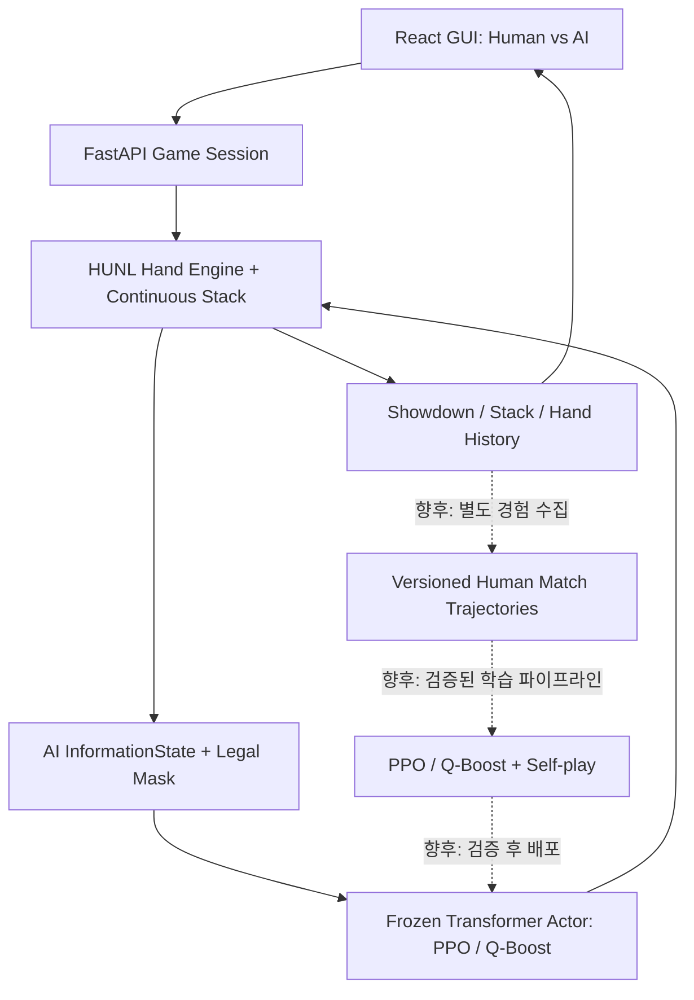
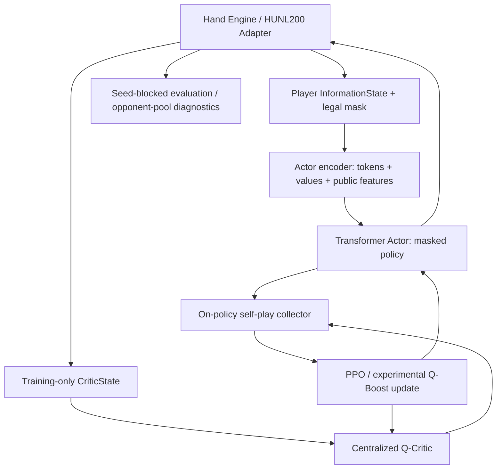

# Source documentation volume 5/7

[Final integrated technical report](../POKER_AI_FINAL_INTEGRATED_TECHNICAL_REPORT.md) · Lossless original report content from `6a8ae368ddc02f814140d3770bc5993eaf9a15e4`.

## docs/PHASE5_AGENT_INTERFACE.md

Original SHA `b4bd03f362049d11ecd8864a7aaa595a872eb7bf` (11848 bytes).

<!-- BEGIN_MD_SOURCE path="docs/PHASE5_AGENT_INTERFACE.md" sha="b4bd03f362049d11ecd8864a7aaa595a872eb7bf" -->

````````markdown
# holdem-ai — Phase 5: Agent Interface & RL Compatibility

> 상태: **additive integration kit**. 특정 GitHub 커밋의 파일을 직접 조회·수정하거나 기존 테스트를 실행한 결과가 아니다. 작성 시 제공된 기준은 `a75b632`이며 실제 API 연결은 별도 확인해야 한다.
>
> 최소 Python: **3.11**. 실행 환경에서는 **Python 3.13**으로 테스트했다. 임포트 시 NumPy 또는 RLCard를 필수 요구하지 않는다.

## 1. 목표와 책임 분리

| 모듈 | 구현 | 범위 |
|---|---|---|
| `schema.py` | `InformationState`, `Turn`, `Terminal`, `TurnBasedEnvironment` | 에이전트 경계 |
| `policy.py` | `AgentPolicy`, Random, tabular CFR 정책 샘플러, ε-greedy | 불법 행동 제외 |
| `betting.py` | 7개 No-Limit 베팅 추상화, 정수 칩 금액 및 mask | **엔진에서 계산한 법적 범위**가 반드시 필요 |
| `rewards.py` | 칩 변화량 및 토너먼트 승자 보상 | 종료 시점 보상 |
| `runner.py` | 2인 이상 멀티 에이전트 turn-based self-play와 trajectory | terminal-only rewards |
| `rlcard_adapter.py` | RLCard `reset` / `step` / `is_over` / `get_payoffs` | RLCard API wrapper |
| `snapshot.py` | `deepcopy` 기반 실험적 snapshot | 엔진별 RNG 검증 별도 필요 |

기존 코드는 **수정·삭제하지 않는다**. 엔진 규칙을 새로 구현하는 패치가 아니며 2~6인/tournament 기존 클래스에 연결할 수 있는 경계 모듈을 제공한다.

## 2. 수학적 정의

실제 세계 상태와 관측 사이를 엄격히 구별한다.

$$
 s_t \in \mathcal S,\qquad i_t=P(s_t),\qquad
 I_{i,t}=O_i(s_t,h_t^{\mathrm{obs}})
$$

- `s_t`: 전체 카드·덱·게임 정보가 들어 있는 엔진 상태. **Agent에 전달하지 않는다.**
- `I_{i,t}`: 행동 플레이어 `i`의 프라이빗 카드 + 공개 정보 + 관측 가능한 행동 이력.
- `P(s_t)`: 현재 행동할 플레이어.
- `h_t^{obs}`: 공개 행동 이력과 본인이 관찰한 과거 정보. **CFR의 perfect recall 요건**을 만족하려면 거리낌 없이 요약·삭제하면 안 된다.

법적 행동 마스크:

$$
 m_i(I_t,a)=\mathbf 1[a \in \mathcal A(I_t)],\qquad
 \pi^m(a\mid I_t)=\frac{m_i(I_t,a)\,\pi(a\mid I_t)}{\sum_{a'}m_i(I_t,a')\,\pi(a'\mid I_t)}
$$

합이 0인 정책 가중치는 현재 합법 행동에 균등 확률을 할당한다. 음수/NaN/inf 정책 가중치는 오류로 처리한다.

한 핸드에서의 칩 보상 (레이크 없음):

$$
 r_i^{\text{hand}}=\frac{S_{i,\mathrm{end}}-S_{i,\mathrm{start}}}{BB},\qquad \sum_i r_i=0
$$

주의: `scale=BB`는 **같은 핸드 시작 시점의 BB**를 사용하라. 토너먼트에서는 BB가 시간이 지나며 바뀌므로 BB-normalized reward를 핸드 간 비교할 때 기준을 기록해야 한다.

토너먼트 전체 종료 시점의 승자 독식 보상 (제로섬 중심화 버전):

$$
 r_i^{\text{tournament}}=\mathbf1[i=w]-\frac{1}{N},\qquad \sum_i r_i=0
$$

이것은 한 핸드의 칩 증감과 **다른 목적함수**다. 동일한 transition에서 뜻 없이 두 값을 합하지 않는다. 유료 상금 구조에서는 대신 순위별 상금/ICM 기반 utility 함수를 만든다.

자기 행동에 대한 RL 전이:

$$
 \tau_{i,t}=(I_{i,t},a_{i,t},r_{i,t},I_{i,t+1},d_{i,t})
$$

여기서 `I_{i,t+1}`은 다른 플레이어가 행동한 직후가 아니라 **같은 플레이어의 다음 의사결정 시점** 상태이다. 마지막 행동에서만 terminal reward를 부여하고 그 이전 행동들의 immediate reward는 0으로 보관한다. `EpisodeResult.rewards`는 행동하지 않은 좌석도 포함한 전원의 종료 utility를 제공한다.

## 3. RLCard 실행 예시

기존 RLCard를 사용하는 엔진을 별도로 교정한 프로젝트라면, 아래 예시는 **RLCard 순정 2인 HUNL**을 대상으로만 직접 적용된다.

```python
import rlcard
from holdem_agent_phase5 import (
    RLCardTurnDriver, RandomLegalPolicy, run_self_play,
)

env = rlcard.make("no-limit-holdem", config={"seed": 19})
# ID를 추측하지 않고 num_actions에 따라 id별 라벨만 부여한다.
labels = tuple(f"action_{i}" for i in range(env.num_actions))
driver = RLCardTurnDriver(env, action_labels=labels)
policies = {i: RandomLegalPolicy() for i in range(env.num_players)}
result = run_self_play(driver, policies, seed=19)
print("payoffs", result.rewards)
print("decisions", result.num_decisions)
print("seat_0_trajectory", len(result.for_seat(0)))
```

**주의:** RLCard의 `get_payoffs()` 단위는 이용 중인 게임 구현에 좌우된다. `RLCardTurnDriver`는 반환 값을 **그대로** reward 벡터로 전달하며 자동으로 big blind로 나누지 않는다. 코드 수준에서 확인하고 `terminal_rewards_fn`을 직접 설정한다.

### 3.1 6인/토너먼트 커스텀 엔진 연결

기존 Engine의 클래스명/메서드 시그니처가 확인되지 않았으므로 코드를 바꾸지 않고 다음 Protocol을 구현하는 **추가 어댑터**를 작성한다.

```python
from holdem_agent_phase5 import Turn, Terminal, InformationState

class ExistingEngineDriver:
    def __init__(self, existing_engine):
        self.engine = existing_engine

    def reset(self, seed: int | None = None) -> Turn | Terminal:
        # 1) 기존 엔진 reset 호출
        # 2) current_player의 관측 정보만 읽기
        # 3) 엔진 legal_actions를 mask로 변환
        # 4) InformationState(player_id=..., features=..., legal_action_mask=...)
        raise NotImplementedError("Fill using the actual Phase 1-4 engine API")

    def step(self, action_index: int) -> Turn | Terminal:
        # 1) 이전 InformationState.assert_legal(action_index)
        # 2) action_index를 기존 엔진 action 포맷으로 변환
        # 3) 기존 엔진 진행 / 종료 여부 확인
        # 4) 종료 시에는 좌석 전원의 utility로 Terminal(...)
        raise NotImplementedError("Fill using the actual Phase 1-4 engine API")
```

정확한 engine action 변환 없이 `step`을 묵시적으로 호출해서는 안 된다. Seat ID는 탈락해도 재할당하지 않는다.

## 4. No-Limit 행동 추상화

정책 출력 head를 다음 7개로 고정할 수 있다.

```python
BET_ACTION_LABELS = (
    "fold", "check", "call", "raise_half_pot", "raise_pot", "raise_double_pot", "all_in"
)
```

현재 스트리트에 이미 낸 금액을 `c`, 이번에 콜해야 할 추가 금액을 `k`, 행동 직전 pot을 `P`, 포트 배수를 `f`라 하면 후보 총 베팅 목표값은

$$
 B_{\mathrm{to}}^{(f)}=c+k+\mathrm{round}_{\mathrm{chip}}\bigl(f(P+k)\bigr),\qquad f\in\{0.5,1,2\}.
$$

이 수식은 **일관적인 raise 크기 후보**를 생성한다. 포커의 최소 레이즈/올인/재레이즈 개방 여부를 판정하는 수식으로 대체하지 않는다.

```python
from holdem_agent_phase5 import NoLimitBetContext, abstract_bet_actions

context = NoLimitBetContext(
    pot=100, committed=10, to_call=20, stack=200,
    min_raise_to=50, max_raise_to=210,
    can_fold=True, can_check=False, can_call=True, can_raise=True,
)
choices = abstract_bet_actions(context)
print(choices.mask)       # (True, False, True, True, True, False, True)
print(choices.resolve(3))  # EngineBetAction(kind='raise_to', raise_to=90)
```

`min_raise_to`, `max_raise_to`, `can_raise`는 **기존 게임 엔진이 책임지는 값**이다. 이미 최소 레이즈보다 적게 올인한 short all-in, 리오픈이 불가능한 상황, 토너먼트 유효 스택, side pot은 엔진 검증을 유지해야 한다. 이 abstraction은 중복 action 크기를 제거한다. `EngineBetAction.raise_to`는 **이번 스트리트 총 커밋 금액**(absolute total)이지 이번 액션에서 추가 지출한 칩(`raise_by`)이 아니다. 연결 시 해당 변환을 확인한다.

## 5. 정보 유출 방지와 CFR 가정

- `get_perfect_information()` / 엔진의 전체 덱 / 상대 홀카드는 정책에 넘기지 않는다.
- RLCard `state['obs']`는 플레이어 시점 observation으로 사용하고, `raw_obs`는 own `hand`, `public_cards`, `stage`와 명시된 public numeric 필드만 읽는다.
- 현재 릴리스의 RLCard 기본 adapter는 `history=()`이다. **이 상태 그대로 학습한 Tabular CFR은 perfect recall을 보장하지 않는다.** `history_fn`에 유효한 공개 액션 및 거리별(street) 분리 정보를 명시적으로 전달해야 한다.
- `infoset_key()`는 stable JSON serialization일 뿐, 별도의 게임 추상화·정보 유출 검증이 끝난 GTO information set이라는 뜻은 아니다.
- `AgentPolicy`는 학습된 tabular/Deep CFR 행동 분포, DQN/PPO action head 등과 교체할 수 있다. 학습 알고리즘 자체(CFR regret update / advantage training / PPO optimizer)는 Phase 5 인터페이스 범위 **밖**이다.

## 6. Snapshot vs Step Back

`copy.deepcopy(env)`로 생성한 스냅샷은 일부 엔진에서 기능할 수 있지만, 아래 조건이 실제 게임 엔진에서 테스트되어야 한다.

1. 카드/Dealer RNG 및 행동 추첨 RNG가 독립적으로 복제되는가?
2. 한 분기를 실행해도 다른 분기의 카드 순서와 stack이 변하지 않는가?
3. Action history / 블라인드 시점 / 토너먼트 탈락 좌석이 독립적으로 보존되는가?
4. RNG가 포함된 chance node를 포함하여 같은 action path 재생 시 동일한 결과가 나오는가?

RLCard의 `step_back()`을 사용할 때에는 `allow_step_back=True`가 필요하고, **액션 기록과 RNG의 처리까지** 별도로 검증해야 한다. `deepcopy`만으로 CFR에 적합한 chance-sampled traversal을 보장하지 않는다.

## 7. 적용 및 테스트

압축 해제 위치: **repository root (pyproject.toml 있는 위치)**. 동일한 이름의 파일이 이미 있을 경우에는 덮어쓰기 전에 충돌을 수동 점검한다.

Bash / macOS / Linux:

```bash
cd path/to/holdem-ai
unzip -n /path/to/holdem-ai-phase5-agent-kit.zip
uv run python -m pytest -q tests/test_phase5_*.py
uv run python -m pytest -q
```

PowerShell:

```powershell
Set-Location path\to\holdem-ai
Expand-Archive -Path path\to\holdem-ai-phase5-agent-kit.zip -DestinationPath .
uv run python -m pytest -q tests
```

첫 번째 명령은 새 기능 테스트, 두 번째는 기존 1~4 Phase 포함 전체 회귀 테스트다. 적용 전 `git status`에서 다른 작업 변경 사항을 확인하고, 완료 후 `git diff --stat; git status`를 확인한 뒤 커밋한다.

```bash
git status
uv run python -m pytest -q
# tests pass 후
git add holdem_agent_phase5 tests/test_phase5_*.py docs/PHASE5_AGENT_INTERFACE.md scripts/phase5_rlcard_smoke.py
git commit -m "feat(agent): add phase 5 observation policy reward and self-play interfaces"
git push
```

**중요:** 이 키트만 테스트하여 프로젝트 전체 `113 passed, 1 xfailed`의 회귀 통과를 단정해서는 안 된다. RLCard 실물 통합 테스트는 현재 환경에 라이브러리가 없어 skip 되었으며 실제 프로젝트 `uv run`에서 재확인해야 한다.

## 8. Phase 5 종료 조건 (검증 체크리스트)

- [x] Pure-python Agent / Observation / Reward 인터페이스 및 isolated tests
- [x] Legality mask, RNG deterministic random baseline, 6-seat trajectory fixture
- [x] 플레이어 private data whitelist 테스트
- [x] `deepcopy` smoke / synthetic RNG cloning test
- [ ] 프로젝트 기존 엔진 API와 직접 연결한 actual adapter
- [ ] 실제 RLCard 라이브러리를 이용한 통합 테스트 (현재 skip)
- [ ] 6-max 토너먼트 **실제** rollouts + action mapping 검증
- [ ] 원본 113개 테스트 전체 회귀 실행
- [ ] perfect recall history 공급 및 게임 정보 유출 audit
- [ ] real-engine deepcopy / step_back RNG 정확성 검증
- [ ] CFR / Deep CFR / RL 학습 파이프라인 구현 (후속 Phase)

````````

<!-- END_MD_SOURCE path="docs/PHASE5_AGENT_INTERFACE.md" -->

## docs/PHASE6_HUNL200_INTEGRATION.md

Original SHA `b9b45d9c8a10ea3ae02f1cdd524b01986771feed` (6229 bytes).

<!-- BEGIN_MD_SOURCE path="docs/PHASE6_HUNL200_INTEGRATION.md" sha="b9b45d9c8a10ea3ae02f1cdd524b01986771feed" -->

````````markdown
# Phase 6 — HUNL200 Environment Integration and CPU Benchmark

> [!important] Status
> This patch is an additive adapter and benchmark, **not VRPO training**. It targets `TheMostEvident/holdem-ai` at Git commit `894a466afe48309ebf01c334c3bdad7471923eb3`.
> Run all tests on the user's local repository after applying. No GitHub changes are made automatically by this ZIP.

## Objectives

- Use existing real `MultiPlayerHandEngine` in 2-player mode; keep Phase 1–5 unchanged.
- Provide HUNL200 (200BB effective stack, 100-chip BB, 50-chip SB, button selectable).
- Adapt engine's arbitrary `step_raise_to` to Phase-5 7-action policy head.
- Keep Actor observations distinct from privileged Q-Critic training states.
- Record per-**global** poker decision state-action-next-state transitions for VRPO.
- Measure CPU self-play hands/s for 1, 2, and 4 processes; estimate an achievable 5-hour training budget after benchmarking.
- Optionally check CUDA/PyTorch forward and backward on GTX 1070 8GB.

## Existing / new boundary

```text
Phase 3 MultiPlayerHandEngine (2 seats, HUNL200)
     |
     v
HUNL200Adapter (NEW) <--------- Phase 5 abstract_bet_actions (7 heads)
     |                                           |
     +-- Turn(InformationState) ----------------> Phase 5 AgentPolicy
     |                                                   |
     +<------------------------------ action index 0..6 -+
     |
     +-- Terminal(rewards in BB) -------> Phase 5 run_self_play
     |
     +-- training_state() (OPT-IN) -----> Phase 6 global trajectory for future Q-Critic

Phase 6 has no Actor network, Q-Critic network, PPO, Q-Boosting, or GPU training loop.
```

### Reward and legality

For each terminal seat $i$:

$$
r_i = \frac{C_i^{\mathrm{final}}-C_i^{\mathrm{initial}}}{BB}
$$

No-rake two-player chip conservation requires:

$$
r_0+r_1=0.
$$

Engine legal constraints are authoritative, not the adapter. Our action IDs are:

| Phase-5 ID | Meaning | Engine call |
|---|---|---|
| 0 | Fold | `engine.step(0)` |
| 1 | Check | `engine.step(1)` |
| 2 | Call | `engine.step(1)` |
| 3 | Half-pot raise | `engine.step_raise_to(amount)` |
| 4 | Pot raise | `engine.step_raise_to(amount)` |
| 5 | Double-pot raise | `engine.step_raise_to(amount)` |
| 6 | All-in raise | `engine.step(4)` |

The 7-head index 4 **does not** mean the engine's all-in ID 4. These mappings MUST remain separate. All-in short-calls are represented by `call`; an all-in *raise* is ID 6 only when legal and meaningfully exceeds call.

At decision time, `abstract_bet_actions` uses the **post-call pot** for fractional raises:

$$
B_{\mathrm{raise\ to}}=c+k+\mathrm{round}\left[f(P+k)\right],\quad f\in\{0.5,1,2\}
$$

Min/max boundaries, deduplication, and short all-in cases are supplied or validated by the real engine.

## Observation privacy / logging

`InformationState` is constructed **only** from the acting player's `engine.observe(player)` plus adapter-recorded *public* street/action/raise history. No other player's cards or hidden deck are passed to the Actor.

`CriticState` is a different dataclass, retrieved through `HUNL200Adapter(expose_training_state=True).training_state()`. It includes both hole-card pairs for **training only**. It intentionally excludes undealt deck and unrevealed future board cards, preventing trivial future-card leakage. Do not attach it to any Actor feature encoder.

`collect_global_episode` records adjacent **global** poker decisions; Phase 5 `run_self_play` records next decisions of the **same** seat. Do not confuse these two time axes when implementing VRPO temporal-difference residuals.

## Apply ZIP (PowerShell)

Open PowerShell in the **project root** (where `pyproject.toml` exists), then:

```powershell
# 1) Ensure correct baseline
 git status
 git log -1 --oneline

# 2) Make optional local development branch
 git switch -c phase6/hunl200-integration

# 3) Extract the delivered ZIP contents directly into the repository root:
# Example: Expand-Archive -Path "$HOME\Downloads\holdem-ai-phase6.zip" -DestinationPath . -Force

# 4) Test Phase 6, then the full old regression suite
uv run python -m pytest -q -k phase6
uv run python -m pytest -q

# 5) Run small and medium random-rollout throughput benchmarks
uv run python scripts/phase6_benchmark.py --hands 100 --workers 1,2,4
uv run python scripts/phase6_benchmark.py --hands 1000 --workers 1,2,4 --json-out data/phase6_rollout_speed.json

# 6) Optional hardware test (requires compatible installed PyTorch)
uv run python scripts/phase6_hardware_probe.py

# 7) Commit only when all regression tests pass
 git status
 git add holdem_agent_phase6 scripts/phase6_benchmark.py scripts/phase6_hardware_probe.py tests/test_phase6_hunl_adapter.py tests/test_phase6_benchmark.py docs/PHASE6_HUNL200_INTEGRATION.md
 git commit -m "Add Phase 6 HUNL200 agent adapter and rollout benchmark"
 git push -u origin phase6/hunl200-integration
```

Avoid committing `data/phase6_rollout_speed.json` unless desired. A report file is generated only if `--json-out` is provided. Add it to `.gitignore` before large-scale logs.

## Acceptance criteria

1. Both player seats receive correct SB/BB, and SB acts first preflop.
2. Illegal action IDs are rejected *before* changing the underlying engine.
3. 7-head actions map to legal exact engine calls, including `raise_to` and all-in.
4. Actor's `private_cards` includes only the acting player's hole cards; opponent cards never appear in public_state/history/features.
5. Critic private data can only be retrieved with explicit opt-in.
6. Zero-sum rewards in BB and all chip-conservation tests hold over 200 sampled games.
7. Phase 1–5 tests continue to pass (baseline was 176 passed, 1 xfailed before applying this patch).
8. 1/2/4-worker benchmark prints reproducible hands/s and decisions/s on the **local machine**.

## What comes next

Phase 7 must match the paper's token observation and Base-16 bet encoding to approach a faithful VRPO reproduction. This Phase 6 adapter deliberately retains the 7-head action abstraction from Phase 5 for low-cost smoke runs. Baseline performance will **not** be directly comparable to paper's HUNL results until rule/encoding/evaluation differences are addressed.

````````

<!-- END_MD_SOURCE path="docs/PHASE6_HUNL200_INTEGRATION.md" -->

## docs/PHASE7_VRPO_LITE_ENCODING.md

Original SHA `fbb83cd3ddf41d230cd5eebd6d2c285ef33a0b3b` (7323 bytes).

<!-- BEGIN_MD_SOURCE path="docs/PHASE7_VRPO_LITE_ENCODING.md" sha="fbb83cd3ddf41d230cd5eebd6d2c285ef33a0b3b" -->

````````markdown
# Phase 7 — VRPO-Lite v1 Observation & Action Encoding

> Scope: **tensor input pipeline only**. This patch does **not** implement the VRPO Transformer, Q-Critic, Q-Boosting, PPO, or training. It uses the **Phase 6 fixed 7-action abstraction**, not the paper's base-16 multi-step bet representation.

## 1. Contracts and privacy boundary

Phase 6 provides `InformationState` (player-visible) and `CriticState` (training-only). These are intentionally separate functions:

- `encode_actor(observation: InformationState) -> EncodedActor`
- `encode_critic(state: CriticState) -> EncodedCritic`

The actor has no dependency on, argument for, or direct reference to `CriticState` or the mutable engine. The caller must obey this separation when building Phase 8 networks. A privileged `CriticState` is obtainable only through `HUNL200Adapter(expose_training_state=True)` for training collectors.

$$
I_t^i = O_i(s_t, h_t^{\mathrm{public}})
$$

$$
\mathrm{ActorInput}_t^i = E_A(I_t^i)
\qquad
\mathrm{CriticInput}_t = E_C(s_t)
$$

This separation is a software boundary, not a formal proof of information-set perfection: Phase 6 currently stores coarse action history, and **all-in/call amounts are not fully recorded in every history entry**. Before claiming perfect recall, extend the source action history with exact public contributions and test all betting branches.

## 2. Vocabulary (`vocabulary.py`)

The stable 73-token **project-specific vocabulary** is not claimed to match the original VRPO paper's encoding.

| IDs | Meaning |
|---|---|
| 0 | PAD |
| 1–11 | sequence/role/seat/control markers |
| 12–63 | exactly 52 canonical cards (`s/d/c/h` × `23456789TJQKA`) |
| 64–67 | preflop, flop, turn, river |
| 68–72 | fold, check, call, raise_to, all_in |

Action history is parsed exactly from Phase 6:

`preflop|seat=0|raise_to|raise_to=450`

This becomes `[EVENT, STREET_PREFLOP, SEAT_0, ACTION_RAISE_TO, AMOUNT]`, with the final token's numeric `token_value` equal to `450/100 = 4.5` BB. Other token values are zero. An invalid history record raises `ValueError` rather than being silently ignored.

`max_tokens=256` by default. History is **never silently truncated**; exceeding capacity raises `ValueError`. Increase `max_tokens` for longer hands, and remember that learned positional embedding size must accommodate it in Phase 8.

## 3. Actor shape

`encode_actor(obs, big_blind=100, max_tokens=256)` returns:

| Field | Type / shape | Description |
|---|---|---|
| `token_ids` | tuple[int, T] | own two hole cards, visible board, street, public action sequence |
| `token_values` | tuple[float, T] | public raise-to target normalized by BB; zero on other tokens |
| `features` | tuple[float, 20] | 12 public Phase 6 features plus 2×4 status one-hot |
| `legal_action_mask` | tuple[bool, 7] | Phase 5/6's fixed discrete action head |

The first 12 scalar features, in their existing Phase 6 order:

`[acting_seat, is_button, street_index, pot_bb, to_call_bb, own_street_bet_bb, own_stack_bb, opponent_stack_bb, opponent_street_bet_bb, own_contribution_bb, opponent_contribution_bb, min_raise_to_bb]`.

Remaining eight features: statuses for seats 0,1, each one-hot in order `[active, folded, allin, out]`. Actor encodings are not permitted to include the opponent's hole cards, burned cards, or undealt deck.

## 4. Critic shape

`encode_critic(privileged_state, big_blind=100, max_tokens=256)` returns:

| Field | Type / shape | Description |
|---|---|---|
| `token_ids` | tuple[int, T'] | **both players'** hole cards, board, history, optional terminal marker |
| `token_values` | tuple[float, T'] | public raise-to amounts / BB |
| `features` | tuple[float, 24] | centralized game data normalized in BB |

Critic feature positions:

- `[0:2]`: one-hot button seat (2)
- `[2:4]`: one-hot acting seat, both zero at terminal (2)
- `[4:8]`: one-hot street (4)
- `[8:10]`: stacks / BB (2)
- `[10:12]`: total contributions / BB (2)
- `[12:14]`: current street bets / BB (2)
- `[14]`: pot / BB (1)
- `[15:23]`: 2×4 status one-hots (8)
- `[23]`: terminal flag (1)

$$
2+2+4+2+2+2+1+8+1 = 24
$$

No future deck order is included, even in the Critic state. The Critic input is centralized by design and **must not** be passed to the player-facing Actor.

## 5. Batching and legal actions

`batch_actors([encoded...], device='cuda')` yields:

- `token_ids`: `torch.int64[B,T_max]`
- `token_values`: `torch.float32[B,T_max]`
- `attention_mask`: `torch.bool[B,T_max]`, true for real tokens
- `features`: `torch.float32[B,20]`
- `legal_action_mask`: `torch.bool[B,7]`

`batch_critics(...)` uses the same first three tensors, with `features[B,24]`.

The `T_max` dimension is batch-local: shorter examples are right-padded, and only pad tokens receive `attention_mask=False`.

`encode_action(action_id, legal_mask)` returns a 7-dimensional one-hot tuple, refusing all illegal indices. `masked_categorical(logits, legal_mask)` builds a valid distribution over only legal actions:

$$
\pi_\theta(a\mid I)=\frac{m_a\exp(z_\theta(I,a))}{\sum_b m_b\exp(z_\theta(I,b))}
$$

where `m_a` is the zero/one legal-action mask. Illegal choices get probability zero and zero gradient through the masked logit.

## 6. Tests and commands (Windows / uv)

From the actual repository root (`pyproject.toml` is present):

```powershell
uv run --extra dev --extra gpu python -m pytest -q -k phase7
uv run --extra dev --extra gpu python -m pytest -q
uv run --extra gpu python -m scripts.phase7_smoke --hands 100 --device cuda
```

The Smoke Test performs **real Phase 6 HUNL200 random-policy episodes**, actor/critic encoding, target-state encoding, batched CUDA tensors, mask-correct sampling, and a single forward/backward through a tiny **synthetic head**. It is not VRPO model training. `--device cpu` is available.

## 7. Acceptance criteria

1. All Phase 7 tests pass on the user's **real existing HUNL engine**.
2. No existing Phase 1–6 regression.
3. Actor tokens/features never contain opponent hidden hole cards.
4. Critic tensors include both hole cards; no future deck.
5. Phase 6 history ordering and supplied exact `raise_to` amounts are preserved; no implicit truncation.
6. Action mask never selects illegal action, including synthetic gradient test.
7. GTX 1070 8GB can allocate tensor batches and complete synthetic head backward.

## 8. Known limitations and next steps

- Existing Phase 6 `history` sets `raise_to='-'` for `all_in`; the action is identifiable but its **exact public wager amount is missing** from the Phase 6 string. Standard `call` history also does not carry the paid chip amount. Fix this in a dedicated history-schema change before perfect-recall claims or research-grade action-conditioned Q inputs.
- The discrete action space is 7 heads; the paper's base-16 Multi-Step Action Encoding is intentionally postponed.
- Full historical `max_tokens` above 256 raises an error; the Phase 8 Transformer must support configurable positions/relative positions.
- These are *v1 data encoders*: Phase 8 builds/benchmarks real Actor and Critic; Phase 9 begins PPO training; Phase 10 introduces VRPO Q-Boosting.
- In the assistant's isolated environment tests were executed with a substitute hand engine. **Only the user's Windows full suite and real-engine smoke can close the integration validation.**

````````

<!-- END_MD_SOURCE path="docs/PHASE7_VRPO_LITE_ENCODING.md" -->

## docs/PHASE8_VRPO_LITE_NETWORKS.md

Original SHA `58fb0b05bddb8362cfa71b55ca34d51d76d8abfe` (6923 bytes).

<!-- BEGIN_MD_SOURCE path="docs/PHASE8_VRPO_LITE_NETWORKS.md" sha="58fb0b05bddb8362cfa71b55ca34d51d76d8abfe" -->

````````markdown
# Phase 8 — VRPO-Lite Transformer Actor & Centralized Q-Critic

> Baseline: `TheMostEvident/holdem-ai` main, Phase 7 complete (`5744df5` 확인 기준).  
> OS / hardware: Windows 10 · i7-8700 · 16 GB RAM · GTX 1070 8 GB · PyTorch 2.6.0+cu118.  
> **현재 구현은 네트워크 및 추론/Gradient 검증 단계. PPO나 VRPO 정책 최적화는 아직 미구현.**

## 1. 기존 시스템과 연결

```text
Phase 6: HUNL200Adapter
  ├── InformationState (only acting player's information)
  │    └── Phase 7: encode_actor → batch_actors
  │          └── Phase 8: TransformerActor → masked action logits [B, 7]
  └── CriticState (training_state() opt-in; includes both hole-card hands)
       └── Phase 7: encode_critic → batch_critics
             └── Phase 8: CentralizedQCritic → Q-values [B, 2, 7]
```

Actor에는 `CriticBatch`를 전달할 수 없게 인터페이스에서 거부한다. `NeuralActorPolicy.act(InformationState, rng)`는 오직 `encode_actor()`를 호출한다. `train_state()`를 Actor에서 호출하지 않는다.

## 2. 수학적 구조

Actor 입력:

$$
I_t^i=O_i(s_t,h_t^{\mathrm{obs}})
$$

$$
X_A(I_t^i)=(T_A,V_A,M_A,F_A,L_A)
$$

- $T_A$: Token IDs. Phase 7 어휘 $|\mathcal V|=73$.
- $V_A$: Token별 보조 금액 값(BB 단위).
- $M_A$: Token 위치별 Padding/Attention Mask.
- $F_A\in\mathbb{R}^{20}$: 플레이어가 관측하는 공개 수치 특징.
- $L_A\in\{0,1\}^7$: 유효한 Poker Action 마스크.

Transformer Encoder:

$$
Z=\mathrm{Transformer}_{\mathrm{causal}}\left( E_{\mathrm{token}}(T_A)+E_{\mathrm{pos}}+W_v\mathrm{asinh}(V_A)\right)
$$

$$
h_t=\mathrm{LayerNorm}(Z_{\mathrm{last\ valid}})
$$

수치적 안정성을 위해 BB 단위 값은 다음과 같이 변환한다.

$$
\mathrm{asinh}(x)=\ln\left(x+\sqrt{x^2+1}\right)
$$

Token 금액뿐 아니라 Actor/Critic의 Numeric Features에도 같은 함수를 적용한다. 200BB 스택처럼 큰 입력 때문에 초기 무작위 Logit이 지나치게 커지는 문제를 억제한다. 원본 VRPO 논문의 필수 정규화 방식이 아니라 **VRPO-Lite 고유의 구현 선택**이다.

Actor Action Logits:

$$
z_\theta=\mathrm{MLP}_A\left([h_t,\mathrm{asinh}(F_A)]\right)\in\mathbb{R}^7
$$

$$
\pi_\theta(a\mid I_t^i)=\frac{L_A(a)\exp z_\theta(a)}{\sum_b L_A(b)\exp z_\theta(b)}
$$

Critic:

$$
Q_{\phi,0}(s,a)=\mathrm{MLP}_Q\left([h^Q_t,\mathrm{asinh}(F_Q)]\right)_a
$$

$$
Q_{\phi,1}(s,a)=-Q_{\phi,0}(s,a)
$$

HUNL 제로섬 보상 조건에 맞춰 두 플레이어의 Q 값을 반대 부호로 제한한다. **이는 HUNL의 2인·무레이크·칩수익 제로섬 상황에서만 적용**한다. 6-Max/ICM 확장 시 그대로 쓰면 안 된다.

Terminal 상태에서는 Bootstrap Value가 0이어야 하므로:

$$
Q_\phi(s_T,a)=0
$$

`CentralizedQCritic`은 마지막 Feature인 `is_terminal`을 읽어 이를 명시적으로 적용한다. Critic 값은 BB 단위의 기대수익을 목표로 학습하도록 설계했지만, 아직 **실제 수익을 정확히 예측하도록 학습된 상태는 아니다**.

## 3. GTX 1070 초기 구성

| 하이퍼파라미터 | 설정 |
| --- | ---: |
| Actor Transformer Layers | 2 |
| Critic Transformer Layers | 2 |
| Embedding Dimension | 64 |
| Attention Heads | 2 |
| Feed-Forward Dimension | 128 |
| Head MLP Hidden | 128 |
| Max Tokens | 256 |
| Dropout | 0.0 |
| Precision | FP32 |
| Actor Parameters | 99,975 |
| Critic Parameters | 100,487 |
| Actor Output | `[B,7]` |
| Critic Output | `[B,2,7]` |

Actor/Critic은 서로 별개의 Token Encoder 가중치를 가진다. Causal Attention과 오른쪽 Padding을 사용하고, 마지막 유효 Token을 요약 벡터로 사용한다. Phase 7에서 입력 이력이 256개 Token을 넘으면 잘라내지 않고 예외가 발생한다.

## 4. Phase 8 프로그램 파일

```text
holdem_agent_phase8/
  __init__.py
  network.py   # NetworkConfig, CausalTokenEncoder, TransformerActor,
               # CentralizedQCritic, chosen_q
  policy.py    # NeuralActorPolicy(Phase-5 AgentPolicy-compatible)
scripts/
  phase8_smoke.py

tests/
  test_phase8_networks.py
  test_phase8_gpu.py
```

## 5. 로컬 실행 방법

ZIP은 `holdem-ai-phase8-networks` 이름으로 압축 해제하는 것을 가정한다. **프로젝트 루트에서 실행**한다.

```powershell
Copy-Item .\holdem-ai-phase8-networks\holdem_agent_phase8 .\ -Recurse -Force
Copy-Item .\holdem-ai-phase8-networks\tests\test_phase8_*.py .\tests\ -Force
Copy-Item .\holdem-ai-phase8-networks\scripts\phase8_smoke.py .\scripts\ -Force
Copy-Item .\holdem-ai-phase8-networks\docs\PHASE8_VRPO_LITE_NETWORKS.md .\docs\ -Force
```

```powershell
uv run --extra dev --extra gpu python -m pytest -q -k phase8
uv run --extra dev --extra gpu python -m pytest -q
uv run --extra dev --extra gpu python -m scripts.phase8_smoke --hands 20 --batch-size 16 --device cuda
```

검증용 `phase8_smoke`는 20개의 실제 HUNL 핸드를 수집하고 네트워크 두 개의 Forward/Backward를 한 번 실행하며, 무작위 초기 Actor로 실제 한 핸드도 플레이한다. **Optimizer Step을 실행하지 않으므로 실제 강화학습 모델의 성능을 주장할 수 없다.**

출력의 `cuda_peak_allocated_mb`는 PyTorch가 예약한 전체 VRAM이 아니라 해당 프로세스의 최대 Tensor 할당량이다. GPU 사용량 전체는 `nvidia-smi`에서도 확인할 수 있다.

### 검증 범위

- 입력/출력 차원, Legal Mask, Probability 합=1, 불법 행동 미샘플링
- Actor가 `CriticBatch`를 거부함
- Critic 제로섬 값, Terminal Value 0, 올바른 Player/Action Q 선택
- Padding 안정성, Token 금액 채널, Gradient, 가중치 저장 및 로드
- CPU 격리 시험, CUDA 가능 시 GPU 시험

### 알려진 한계

- 이 구조는 **VRPO-Lite**로, 논문 전체 네트워크나 Base-16 Action Abstraction을 재현한 것은 아니다.
- Phase 6 이력은 일부 All-in / Call 액수 정보를 잃는다. Phase 8에서 복구하지 않는다.
- 현재 `NeuralActorPolicy`는 Decision마다 한 샘플씩 GPU 추론한다. Phase 11의 대량 Self-Play에는 추론 배치화가 필요하다.
- Actor에게 상대 홀카드가 입력으로 전달되지 않도록 모듈과 계약으로 분리했지만, 프로젝트 외부의 임의 호출자가 ActorBatch를 악의적으로 조작하는 것을 방지하는 보안 경계는 아니다.
- Phase 9 PPO/GAE, Phase 10 VRPO Q-Boosting 및 Target Network/Replay는 이후 단계에서 구현한다.

## 6. Git 반영 (테스트 통과 후)

```powershell
git add holdem_agent_phase8/
git add tests/test_phase8_*.py
git add scripts/phase8_smoke.py
git add docs/PHASE8_VRPO_LITE_NETWORKS.md
git diff --cached --stat
git commit -m "Implement Phase 8 VRPO-Lite transformer actor and Q-critic"
git push origin main
```

기존 압축해제 폴더와 개인 파일을 무조건 `git add .`로 포함시키지 않는다.

````````

<!-- END_MD_SOURCE path="docs/PHASE8_VRPO_LITE_NETWORKS.md" -->

## docs/PHASE9_PPO_BASELINE.md

Original SHA `2171a73abb056d33428a883967917b5829945dea` (8515 bytes).

<!-- BEGIN_MD_SOURCE path="docs/PHASE9_PPO_BASELINE.md" sha="2171a73abb056d33428a883967917b5829945dea" -->

````````markdown
# Phase 9 — HUNL200 PPO Baseline Training

> Target: `TheMostEvident/holdem-ai`, branch `main`, Phase 8 baseline commit `25f47f4`.
> **This is Monte-Carlo PPO, not the full VRPO algorithm and not Q-Boosting.**
> Standalone additive files; Phase 1–8 are unchanged.

## 1. Design

- One **shared decentralized Transformer Actor** (Phase 8) controls both seats during on-policy self-play. The inference policy receives only `InformationState` from Phase 6.
- One **centralized Q-Critic** (Phase 8) trains on the opt-in `CriticState` with both players' cards; this information is never fed to Actor.
- Terminal zero-sum chip rewards are measured in **big blinds**, not bb/100.
- All actor actions are masked to the existing seven legal abstract poker actions.
- Self-play is sequential, with single-decision GPU inference. **Do not extrapolate Phase 6 random CPU benchmark throughput to Phase 9.** Multiprocessing/batched model serving is future work.
- PPO uses terminal Monte-Carlo returns, **not GAE**, not TD(0), and not discounting. In an episodic zero-sum cash-game hand, `gamma = 1`.

## 2. Mathematical derivation (Obsidian Markdown)

Let $T$ be the last global poker action in one hand and $i_t\in\{0,1\}$ the acting seat. The environment returns $R_i\in[-200,200]$ BB and $R_0+R_1=0$.

$$
G_t^{i_t}=R_{i_t}, \qquad t\le T.
$$

The old **decentralized** policy is $\pi_{\theta_{\mathrm{old}}}(a\mid I_t^{i_t})$ and its legal support is $\mathcal A(I_t^{i_t})$.

$$
\ell_t^{\mathrm{old}} = \log \pi_{\theta_{\mathrm{old}}}(a_t\mid I_t^{i_t})
$$

The centralized critic predicts seven action values for each seat. Its outputs obey the zero-sum relation

$$
Q_{\phi,0}(s_t,a)=-Q_{\phi,1}(s_t,a).
$$

**Do not use $Q_\phi(s_t,a_t)$ directly as an actor baseline:** it depends on the sampled action. Instead use a frozen, action-independent expectation,

$$
V_{\mathrm{old}}^{i_t}(s_t,I_t^{i_t})
=\sum_{a\in\mathcal A(I_t^{i_t})}
\pi_{\theta_{\mathrm{old}}}(a\mid I_t^{i_t})\,Q_{\phi_{\mathrm{old}},i_t}(s_t,a).
$$

This baseline may use privileged training information **only in the advantage computation**, not in the Actor forward pass. It is valid as an action-independent control variate for policy-gradient estimation, although its variance-reduction quality depends on critic accuracy.

$$
\widehat A_t=G_t^{i_t}-V_{\mathrm{old}}^{i_t}(s_t,I_t^{i_t})
$$

Advantages are standardized across the collected decisions:

$$
\widetilde A_t=\frac{\widehat A_t-\mu_A}{\max(\sigma_A,10^{-6})}.
$$

For an epoch of PPO updates,

$$
r_t(\theta)
=\exp\left[\log\pi_\theta(a_t\mid I_t^{i_t})-\ell_t^{\mathrm{old}}\right].
$$

$$
L^{\mathrm{CLIP}}(\theta)
=\mathbb E_t\left[\min\left(
 r_t(\theta)\widetilde A_t,
 \mathrm{clip}(r_t(\theta),1-\epsilon,1+\epsilon)\widetilde A_t
\right)\right].
$$

Actor *minimizes*

$$
\mathcal L_{\mathrm{actor}}=-L^{\mathrm{CLIP}}(\theta)-c_H\,\mathbb E_t[H(\pi_\theta(\cdot\mid I_t))].
$$

Critic is trained on the **observed action only**, using terminal Monte-Carlo targets:

$$
\mathcal L_Q=\mathbb E_t\left[
\mathrm{Huber}\left(Q_{\phi,i_t}(s_t,a_t)-G_t^{i_t}\right)
\right].
$$

No claim is made that the Q-values for unobserved counterfactual actions are supervised by that single hand.

## 3. Modules

| File | Purpose |
| --- | --- |
| `holdem_agent_phase9/ppo.py` | Self-play collection, frozen old policy/baseline, PPO clipping, Huber Q loss, seat-balanced random evaluation |
| `holdem_agent_phase9/trainer.py` | Optimizers, step loop, atomic checkpoint, weights-only resume |
| `holdem_agent_phase9/__init__.py` | Public functions |
| `scripts/phase9_train.py` | Real training CLI, JSON per-update metrics |
| `tests/test_phase9_ppo.py` | PPO math, legal masks, gradients, reward and seat handling, checkpoint/resume |
| `tests/test_phase9_cli.py` | End-to-end CLI test |
| `tests/test_phase9_gpu.py` | CUDA optimizer smoke (skipped without CUDA) |

`checkpoints/phase9_ppo.pt` stores Actor/Critic state, both Adam optimizers, config, current update and CPU Torch RNG. It is **not** an exact bitwise cross-device/Windows resume guarantee. Only load checkpoints created by you, and keep large checkpoint files out of Git.

## 4. Install patch on Windows (PowerShell)

From your existing project root after extracting the ZIP as `holdem-ai-phase9-ppo`:

```powershell
Copy-Item .\holdem-ai-phase9-ppo\holdem_agent_phase9 .\ -Recurse -Force
Copy-Item .\holdem-ai-phase9-ppo\tests\test_phase9_*.py .\tests\ -Force
Copy-Item .\holdem-ai-phase9-ppo\scripts\phase9_train.py .\scripts\ -Force
Copy-Item .\holdem-ai-phase9-ppo\docs\PHASE9_PPO_BASELINE.md .\docs\ -Force
```

No PyTorch dependencies are added; your installed `torch==2.6.0+cu118` GPU extra is used.

## 5. Tests and actual first GPU training

```powershell
uv run --extra dev --extra gpu python -m pytest -q -k phase9
uv run --extra dev --extra gpu python -m pytest -q
uv run --extra gpu python -m scripts.phase9_train --device cuda --updates 2 --hands-per-update 16 --epochs 2 --minibatch-size 32 --eval-hands 20 --checkpoint checkpoints/phase9_ppo.pt
```

If initial GPU per-decision inference is too slow, use `--hands-per-update 8 --updates 1 --eval-hands 4`. You can verify on CPU by replacing `cuda` with `cpu`. An even evaluation count is insufficient: **eval hands must be divisible by four** so each combination of neural seat and button is sampled equally.

To continue from a checkpoint, adding two **further** updates (not to a total of two):

```powershell
uv run --extra gpu python -m scripts.phase9_train --device cuda --resume checkpoints/phase9_ppo.pt --updates 2 --eval-hands 20
```

The program reuses `--resume` as the output path when `--checkpoint` has not been overridden. When resuming, saved PPO/network config takes precedence over fresh-run flags. The evaluation RNG seed is unchanged before and after, but **poker decisions differ with policy**, so this is not a duplicated-card paired-outcome evaluator.

For faster CLI integration testing:

```powershell
uv run --extra gpu python -m scripts.phase9_train --device cuda --updates 1 --hands-per-update 2 --epochs 1 --minibatch-size 4 --eval-hands 4 --small-network --checkpoint checkpoints/phase9_tiny.pt
```

## 6. Interpret the JSON

- `update`: training iterations completed.
- `decisions`: number of observed self-play decisions.
- `actor_loss`: clipped PPO surrogate loss for the sampled data; **not** a monotonic convergence metric.
- `critic_loss`: Huber regression to own-seat BB return.
- `approx_kl`, `clip_fraction`: policy change diagnostics.
- `entropy`: policy distribution entropy, ideally monitored for premature collapse.
- `grad_norm_actor`, `grad_norm_critic`: norms prior to gradient clipping.
- `mean_bb100`, `ci95_lower_bb100`, `ci95_upper_bb100`: neural policy returns against RandomLegalPolicy, not GTO exploitability. Tiny 20-hand CI can be huge and normal approximation is unreliable at small samples.
- `cuda_peak_allocated_mb`: program-local PyTorch allocated peak, not all VRAM or future five-hour train memory.
- `trained_policy: true`: optimizer updates were applied, **not** proof of poker improvement.

## 7. Limitations and next phases

1. One GPU policy inference call **per action**; the 4-worker Phase 6 CPU-only throughput is not applicable.
2. Random-vs-random and self-play are **weak baselines**; measure Random, prior self, frozen snapshots, and seats at larger evaluation sizes before making improvement claims.
3. `Q(s,a)` is trained only on actually sampled actions and is a **variance-reduction baseline**, not Q-Boosting or an accurate counterfactual oracle.
4. Phase 6 history logs exact `raise_to` but omit amount for `all_in`/`call`; history representation can be improved before high-fidelity training.
5. PPO is not generally guaranteed to converge to a Nash equilibrium in imperfect-information zero-sum games. Exploitability/GTO evaluation is a later independent workstream.
6. The pilot uses no GAE, no recurrent belief tracker, no parallel neural rollout workers and no full VRPO Q-Boosting; these are future enhancements.

To commit the patch after your actual GTX 1070 tests:

```powershell
git add holdem_agent_phase9/ tests/test_phase9_*.py scripts/phase9_train.py docs/PHASE9_PPO_BASELINE.md
git diff --cached --stat
git commit -m "Implement Phase 9 on-policy PPO baseline training"
git push origin main
```

Do **not** `git add .` while extracted ZIP folders and `.pt` model checkpoints are in your local project. Consider adding `checkpoints/` to `.gitignore` separately.

````````

<!-- END_MD_SOURCE path="docs/PHASE9_PPO_BASELINE.md" -->

## docs/POKER_AI_FINAL_INTEGRATED_TECHNICAL_REPORT.md

Original SHA `120aeaa740695dc3889e697b2b3c28c85b993bd7` (24744 bytes).

<!-- BEGIN_MD_SOURCE path="docs/POKER_AI_FINAL_INTEGRATED_TECHNICAL_REPORT.md" sha="120aeaa740695dc3889e697b2b3c28c85b993bd7" -->

````````markdown
---
title: "Poker AI — Unified Engineering & Research Technical Report"
date: 2026-10-13
status: "source-grounded consolidated technical reference"
aliases: ["Poker AI 최종 통합 기술보고서"]
tags: [HUNL, tournament, PPO, MCCFR, game-engine, reinforcement-learning]
---

# Poker AI — Final Integrated Technical Report

> [!note] Verified implementation excerpts
> The [Phase-verified Python code reference](PHASE_VERIFIED_PYTHON_CODE_REFERENCE.md) contains **literal GitHub source excerpts** for the native multiplayer engine, PPO trainer, MCCFR prototype, Tournament actor bridge, HUNL session manager and GPU retrain scheduler. Conceptual execution sketches in this document are separately labeled pseudocode.

> [!important] Evidence and coverage
> This report synthesizes the checked-in \`AGENT_DEVELOPMENT_TECHNICAL_REPORT_2026-10-13.md\`, \`TOURNAMENT_ENV_PHASE1_FULL_TECHNICAL_REPORT.md\`, \`PROJECT_REPORT.md\`, Expand E1–E7 documentation and GUI / P15–17 research notes. It is a **navigable engineering synthesis, not a verbatim replacement of every historical source file**. Historical logs and detailed code remain in version control. A phase being documented is not proof of a trained strong or GTO-equivalent agent. Source code excerpts below are deliberately short and labeled by path or API; pseudocode is expressly identified.

## 1. Objective and formal mathematical contract

\`\`\`mermaid
flowchart TD
    C[Chance: shuffle and deal] --> E[Environment: hand rules / pot / payoff]
    E --> I[Actor-visible information state and legal mask]
    I --> P[Agent: frozen or trainable policy]
    P --> A[Action abstraction and native-action translation]
    A --> E
    E --> D[Rollout / rewards]
    D --> U[PPO / QBoost / MCCFR research]
    U --> P
    E --> G[HUNL or Tournament GUI / replay]
\`\`\`

The Environment and Agent are independent components of an imperfect-information extensive-form stochastic game:

$$
\mathcal G=(N,H,Z,A,P,f_c,\{\mathcal I_i\},\{u_i\}),
\quad s_{t+1}=T(s_t,a_t,\omega_t), \quad a_t\in A_{\rm legal}(s_t).
$$

Here $N$ denotes participants, $H$ histories, $Z$ terminal histories, $A$ admissible actions, $P$ actor selection, $f_c$ chance/card allocation, $\mathcal I_i$ information partitions and $u_i$ payoff. The acting policy must use only its own hole cards and public board, stacks, position and betting history. Training-only centralized critics can access privileged state, but cannot leak it into inference.

$$
\boxed{\sum_{i\in N}S_{i,t}^{behind}+Pot_t=C_t},\quad
\boxed{R_{i,h}^{BB}=\frac{S_{i,h}^{final}-S_{i,h}^{initial}}{BB_h}},\quad
\boxed{\widehat{bb/100}=\frac{100}{H}\sum_{h=1}^H R_{i,h}^{BB}}.
$$

Chip conservation holds during a hand without rake; for dynamic cash tables, join/rebuy/cash-out events change the table total at explicitly recorded **hand boundaries**. Continuous-stack sessions obey $S_{i,h+1}^{start}=S_{i,h}^{final}$. In two-player rake-free play, $\sum_iR_{i,h}^{BB}=0$.

The masked actor policy is

$$
\pi_\theta(a\mid I)=
\frac{\mathbf1[a\in A(I)]\,e^{\ell_\theta(I,a)}}
{\sum_{b\in A(I)}e^{\ell_\theta(I,b)}}.
$$

An invalid action must receive probability zero. No high win-rate measurement can compensate for a broken game rule or private information leak.

## 2. Project boundaries and development-phase matrix

| Track | Phase | Why it exists | Core source files | Acceptance / limitations |
|---|---|---|---|---|
| Base Environment | P0 | Reproducible package and CLI | \`main.py\` | Python / uv setup |
| Base Environment | P1 | RLCard minimal HUNL baseline | \`environment/rlcard_adapter.py\`, \`hand_engine.py\` | Initial smoke, not game-rule certification |
| Base Environment | P2/2.1 | Audit and correct button, blinds, round order | \`environment/rules_audit.py\`, \`corrected_game.py\`, \`corrected_round.py\` | Heads-up SB acts first preflop, BB postflop |
| Base Environment | P3 | Native 2–6 person betting, all-ins, side pots | \`environment/multi_player_engine.py\`, \`multi_player_seats.py\` | Pot and valid raise invariants |
| Base Environment | P4 | Knockout tournament state, blind progression | \`environment/tournament_env.py\`, \`blind_manager.py\`, \`player_manager.py\`, \`rewards.py\` | Elimination and rank correctness |
| Base Agent | P5 | Shared legal policy contract | \`core/schema.py\`, \`agents/policies.py\`, \`training/episode_runner.py\` | Actor legal mask |
| Base Agent | P6 | HUNL200 adapter + actor/critic privacy | \`environment/hunl200_adapter.py\`, \`training/global_rollout.py\` | 7-action → native mapping |
| Base Agent | P7 | Token/action encoder | \`encoding/observation.py\`, \`actions.py\`, \`tensors.py\` | Padding, public info privacy |
| Base Agent | P8 | Transformer actor and centralized Q critic | \`models/transformer.py\`, \`agents/neural_policy.py\` | Frozen inference |
| Base Agent | P9 | On-policy Monte-Carlo PPO | \`training/ppo.py\`, \`ppo_session.py\` | Masked clipped loss, checkpoint |
| Base Agent | P10 | Experimental QBoost action-dependent control variate | \`training/qboost.py\`, \`qboost_session.py\` | Baseline equivalence for zero correction |
| Base Agent | P11 | Batch collector and time budget | \`training/batched_collector.py\`, \`experiments/time_budget.py\` | Checkpoint/resume |
| Base Agent | P12 | Seat/button matched-deck evaluation | \`evaluation/seed_blocked.py\`, \`seed_statistics.py\` | Seed groups, not games, independent |
| Base Agent | P13 | Batch scaling and action diagnostics | \`experiments/batch_scaling.py\`, \`evaluation/action_diagnostics.py\` | Throughput vs learning |
| Base Agent | P14 | Multi-seed paired PPO-vs-QBoost | \`experiments/controlled_study.py\` | Validation vs sealed test |
| Base Agent | P15 | Long-run, critic and preflop-collapse diagnosis | \`experiments/longrun.py\`, \`evaluation/critic_diagnostics.py\`, \`preflop_sequence_audit.py\` | Per-hand vs per-legal-action denominators |
| Base Agent | P16 | Frozen opponent pool, A0–A3 ablation and long stress | \`experiments/ppo_ablation.py\`, \`ppo_stress.py\`, \`evaluation/opponent_pool.py\` | Paired CI, update KL, stable PPO |
| Base Agent | P17a | Continuous-stack test only | \`evaluation/continuous_stack.py\` | No 5h training claim |
| Base Agent | P17b | 5h target GPU retrain | \`experiments/ppo_five_hour.py\`, \`scripts/phase17_gpu_retrain.py\` | 5h target **not completed** |
| Expand 6-max | E1 | Join/leave/rebuy boundary state | \`expand/environment/table_manager.py\`, \`event_ledger.py\` | Real engine acceptance needed |
| Expand 6-max | E2 | Variable-player information/action encoding | \`expand/information/builder.py\`, \`encoder.py\`, \`actions.py\` | Legal / private boundaries |
| Expand 6-max | E3 | Multi-seat PPO/G​AE | \`expand/rl/collector.py\`, \`ppo.py\`, \`trainer.py\` | Cash → tournament transfer is not tournament training |
| Expand 6-max | E4 | External-sampling MCCFR research blueprint | \`expand/pluribus/blueprint/mccfr.py\`, \`holdem.py\` | Toy NashConv ≠ six-player exploitability |
| Expand 6-max | E5 | Budgeted belief-conditioned subgame search | \`expand/pluribus/search/belief.py\`, \`solver.py\` | True 6-max search performance unproven |
| Expand 6-max | E6 | Public-action opponent modeling | \`expand/opponent/model.py\`, \`adaptive.py\`, \`router.py\` | Expert switching with divergence guards |
| Expand 6-max | E7 | Policy routing, tournament/benchmark bridges | \`expand/integration/agent.py\`, \`tournament.py\`, \`benchmark.py\` | E4/E5 use needs explicit verification |
| HUNL GUI | G1.0–G1.6 | Human gameplay, HTTP, React, betting, trained checkpoints, analytics, continuous stacks | \`game_service/*.py\`, \`backend/game_router.py\`, \`frontend/src/HUNLApp.tsx\` | Freeze actor; do not treat GUI as trainer |
| Tournament ENV | T1.1–T1.7 | API, React table, improved bots, trained 6-seat actor, rankings, SQLite, reveal, QA | \`tournament_service/*.py\`, \`backend/tournament_router.py\`, \`frontend/src/tournament/TournamentApp.tsx\` | Replay and showdown privacy; no proven tournament-optimized PPO |

All relative \`environment/\`, \`training/\`, etc. paths above (except \`scripts/\`, \`backend/\`, \`frontend/\`) are relative to \`src/holdem_ai/\`.

## 3. Environment implementation: input → rule → state → reward

### 3.1 Hand lifecycle and rule corrections (P1–P4)

$$
\operatorname{start\_hand}\to\operatorname{post\_blinds}\to
\operatorname{deal}\to\operatorname{legal\_action}\to
\operatorname{act}\to\operatorname{advance\_street}\to
\operatorname{settle}.
$$

The principal \`src/holdem_ai/environment/multi_player_engine.py\` owns the hand state and rules. \`multi_player_seats.py\` determines actor/seat order, \`actions.py\` validates betting operations, \`pot_manager.py\` forms side pots, and \`hand_evaluator.py\` resolves ranked hands. The test and audit scripts are \`scripts/audit_multiplayer.py\`, \`tests/test_multi_player_engine.py\`, \`tests/environment/test_side_pot.py\`. P2.1 corrected a crucial heads-up order difference:

$$
\operatorname{first}_{preflop}=\mathrm{SB/BTN},\qquad
\operatorname{first}_{postflop}=\mathrm{BB}.
$$

Without this distinction, even flawless RL optimization would target a different game. P4 \`tournament_env.py\` adds hand-to-hand stack carry, blind levels, elimination and ranking, not a decision-making neural policy.

The following is an **execution-flow illustration, not a direct source quotation**:

\`\`\`python
# Conceptual interface; use the native engine's actual methods/contracts.
state = environment.start_hand(seed=seed)
while not environment.is_terminal():
    information = environment.observe_current()
    legal = environment.legal_actions()
    action = acting_policy(information, legal)
    state = environment.act(action)
result = environment.settle_hand()
\`\`\`

### 3.2 Native and abstract action mapping

HUNL Head indices $0..6$ mean respectively Fold, Check, Call, Half-Pot Raise, Pot Raise, Double-Pot Raise, Explicit All-In. Some native engines index action 4 as All-In, so matching integer indices alone is invalid.

For Tournament, the 7-action Expand Head must be translated into its 5-action native contract:

$$
\mathcal A_E=\{F,X,C,\tfrac12P,P,2P,\mathrm{AllIn}\},\ 
\mathcal A_T=\{F,X/C,\tfrac12P,P,\mathrm{AllIn}\}
$$

$$
\boxed{m_{E\to T}(0,1,2,3,4,5,6)=(0,1,1,2,3,\bot,4)}
$$

Index 5, Double-Pot, is excluded if unsupported; Check and Call are distinguished through **current legal context**. The probability mass is renormalized over compatible legal native actions. The implementation reference is \`src/holdem_ai/tournament_service/trained_actor.py\` and \`docs/TOURNAMENT_ENV_PHASE_1_4.md\`.

## 4. PPO, critic, QBoost and diagnostics (P5–P17)

### 4.1 Actor–Critic execution

\`\`\`mermaid
flowchart LR
    E[HUNL200 Environment] --> O[Actor observation + legal mask]
    O --> A[Transformer logits]
    A --> S[Sample legal native action]
    S --> E
    E --> C[Training-only privileged critic state]
    C --> Q[Centralized Q critic]
    E --> R[Terminal returns]
    R --> L[On-policy update]
    Q --> L
    L --> A
\`\`\`

P7 encoder transforms cards, streets, bet history and numeric quantities into masked tensors. P8 \`models/transformer.py\` computes policy logits and an action-value head. P9 \`training/ppo.py\` calculates

$$
\rho_t(\theta)=\frac{\pi_\theta(a_t\mid I_t)}{\pi_{\theta_{\rm old}}(a_t\mid I_t)}
$$

$$
\boxed{L_\mathrm{PPO}=
-\mathbb E_t\left[\min\{\rho_t\hat A_t,\operatorname{clip}(\rho_t,1-\epsilon,1+\epsilon)\hat A_t\}\right]
-\alpha \mathcal H(\pi_\theta)}
$$

$$
V_\phi(s_t,i)=\sum_{a\in A(I_t)}\pi_{\rm old}(a\mid I_t)Q_\phi(s_t,i,a),\quad
\hat A_t=\operatorname{Normalize}(G_{i_t}-V_\phi(s_t,i))
$$

$$
L_Q=\operatorname{SmoothL1}(Q_\phi(s_t,i,a_t),G_{i_t}).
$$

P10 QBoost retains a critic but adds an **experimental action-dependent control variate and analytic correction term** to the policy gradient; it is not a reproduction-certified full VRPO implementation. The original \`docs/PHASE10_QBOOST_PPO.md\` and the checked-in \`training/qboost.py\` remain authoritative for the implemented formula.

The following is **schematic pseudocode**, not a quotation from \`training/ppo.py\`:

\`\`\`python
for update in range(num_updates):
    trajectories = collect_on_policy(current_actor)
    returns = compute_terminal_returns(trajectories)
    advantages = normalize(returns - frozen_old_critic_values)
    update_actor_with_clipped_objective(trajectories, advantages)
    update_critic_on_observed_action_returns(trajectories, returns)
    save_checkpoint_if_needed()
\`\`\`

### 4.2 Experimental controls (P11–P14)

$$
X_k=\tfrac14\sum_{j=1}^4R^{BB}_{k,j},\quad
\widehat J_{bb/100}=100\frac1K\sum_{k=1}^K X_k,\quad
CI_{95\%}\simeq\widehat J\pm1.96\frac{s_{100X}}{\sqrt K}.
$$

The statistical replicate is a **deck seed block** containing four balanced seat/button layouts, not each hand. P11 batching improves sequential sampling efficiency. P12 evaluates reproducibly; P13 compares batch sizing; P14 controls matched starting actor/critic/optimizer, training seed, and a separate validation/test division. Historical P14 validation scores do not imply GTO strength or generalize to live human play.

### 4.3 Collapse, preflop and reward audits (P15–P16)

$$
\widehat D_{\mathrm{KL}}=
\frac1M\sum_{I\in D_{\mathrm{old}}}\sum_{a\in A(I)}
\pi_{\mathrm{old}}(a\mid I)\log
\frac{\pi_{\mathrm{old}}(a\mid I)}
{\pi_{\mathrm{new}}(a\mid I)}
$$

$$
p_{\mathrm{allin,hand}}=
\frac{\#\text{hands with all-in}}{\#\text{hands}},\quad
p_{\mathrm{allin\mid legal}}=
\frac{\#\text{selected all-in at eligible decisions}}{\#\text{eligible decisions}}
$$

Historical 438/512 preflop-all-in hands is a **per-hand count**, not policy probability conditional on a legal all-in opportunity. \`evaluation/preflop_sequence_audit.py\` and \`terminal_reward_audit.py\` trace when hand exits occur; \`critic_diagnostics.py\` compares calibration quantities:

$$
e_i=\hat V_\phi(s_i)-G_i,\ 
\mathrm{RMSE}=\sqrt{\frac1M\sum_i e_i^2},\ 
\mathrm{EV}=1-\frac{\mathrm{Var}(e)}{\mathrm{Var}(G)}.
$$

P16 separates A0–A3 optimizer experiments and A0/A3 100-update stress from real strategy validation. Exact sampled-state post-update KL and diverse frozen opponents are diagnostics, not a global Nash guarantee. No definitive root cause of collapse is established simply from run duration.

### 4.4 P17 is two different tracks

**P17 Continuous-Stack:** \`evaluation/continuous_stack.py\` tests unequal initial stacks and match continuation; it is not training. **P17 GPU Retrain:** \`experiments/ppo_five_hour.py\` and \`scripts/phase17_gpu_retrain.py\` manage active-runtime accounting, update-boundary safety, atomic checkpoint, resume, validation and PPO diagnostics.

Historical 2026-10-13 run:

| Metric | Recorded |
|---|---:|
| Attempted / accepted updates | 5000 / 5000 |
| Training hands | 640000 |
| Global update | 5104 |
| Active duration | 12743.274 seconds |
| Target duration | 18000 seconds |
| Stop reason | \`max_updates_ceiling\` |
| \`complete\` | \`false\` |
| Best global update | 2104 |
| Best repeated-validation bb/100 | 1450.4687 |

$$
640000=5000\times128,\qquad
\frac{12743.274}{18000}\approx 0.708.
$$

The target five active hours were **not completed**. Best validation was a repeated model-selection criterion, **not independent held-out performance**.

## 5. Expanded 6-max research track (E1–E7)

E1 \`expand/environment/table_manager.py\` and \`event_ledger.py\` add join/leave/sit-out/rebuy only at hand boundaries and preserve chip ledger. E2 \`expand/information/builder.py\`, \`encoder.py\`, \`actions.py\` encode 2–6 seats without revealing opponents' private cards. E3 \`expand/rl/collector.py\`, \`returns.py\`, \`ppo.py\`, \`trainer.py\` implement independent multi-seat neural PPO:

$$
\delta_t=r_t+\gamma V(s_{t+1})-V(s_t),\quad
\hat A_t^{GAE}=\sum_{\ell\ge0}(\gamma\lambda)^\ell\delta_{t+\ell}.
$$

E4 \`expand/pluribus/blueprint/mccfr.py\` implements a research-scale **external-sampling MCCFR** blueprint. Its regret-matching foundation is

$$
R_i^T(I,a)=\sum_{t=1}^Tr_i^t(I,a),\qquad
\sigma_i^{T+1}(I,a)=
\begin{cases}
[R_i^T(I,a)]_+/\sum_b[R_i^T(I,b)]_+,&\sum_b[R_i^T(I,b)]_+>0,\\
1/|A(I)|,&\text{otherwise}.
\end{cases}
$$

Kuhn/Leduc toy validations do **not** certify six-player no-limit exploitability or reproduce original Pluribus. E5 \`expand/pluribus/search/belief.py\`, \`solver.py\` support depth-limited belief-dependent search and fallback under node/time constraints:

$$
b(h_1,\dots,h_n\mid h_{\rm public})\propto
\mathbf1[\text{card-consistent}]\,b_0(h_1,\dots,h_n)
\prod_{j,k}\hat\pi_j(a_k\mid h_j,I_{j,k}).
$$

E6 \`expand/opponent/model.py\`, \`adaptive.py\`, \`router.py\` infer opponent tendencies only from **public actions** and route among known experts with bounded policy divergence:

$$
\pi_{\rm adapt}=(1-\eta)\pi_{\rm base}+\eta q,\quad
D_{\rm KL}(\pi_{\rm adapt}\Vert\pi_{\rm base})\le\epsilon_{\rm KL}.
$$

E7 \`expand/integration/agent.py\` and \`benchmark.py\` combine compatible source policies using **FirstVerifiedValid** fallbacks, but E4/E5 information-set adapters and search are **not automatically certified end-to-end**. The previously recorded 164 passed / 7 skipped were isolated-package tests; full Windows/native-engine/CUDA acceptance remained pending.

## 6. HUNL GUI 1.0–1.6: functional evolution

| GUI phase | Purpose | Main implementation and processing |
|---|---|---|
| 1.0 | Human-vs-Bot single-hand interaction | \`game_service/session_manager.py\` owns state, \`interactive_adapter.py\` selects legal bot actions |
| 1.1 | HTTP contract | \`backend/main.py\`, \`game_router.py\`; revision conflict 409 / illegal 422 |
| 1.2 | Poker table view | \`frontend/src/HUNLApp.tsx\`, \`PokerTable.tsx\`; uses projected information |
| 1.3 | User-defined raises | \`game_service/action_adapter.py\`; validates raise-to in engine |
| 1.4 | PPO/QBoost frozen agents | \`game_service/checkpoint_catalog.py\`, \`agents/neural_policy.py\`; inference only |
| 1.5 | Match history/performance | \`game_service/session_analytics.py\`; history/bb/100/showdown |
| 1.6 | Persistent stacks across hands | \`game_service/session_manager.py\`; bankruptcy ends match |

$$
\operatorname{GUIObservation}_i=
\operatorname{PublicProjection}(s)\cup\operatorname{PrivateOwnCards}(s,i).
$$

**Model selection is not model execution.** Checkpoint configured, file found, format compatible, actor instantiated, legal action sampled, browser request succeeded, and completed match are separate acceptance conditions. GUI human play does not automatically update training weights.

## 7. Tournament ENV 1.1–1.7: functional evolution

| ENV phase | Purpose | Primary code and flow |
|---|---|---|
| 1.1 | Tournament engine ↔ HTTP | \`tournament_service/session.py\`, \`backend/tournament_router.py\` |
| 1.2/1.2.1 | React six-seat table/card display fixes | \`frontend/src/tournament/TournamentApp.tsx\` |
| 1.3 | Four improved heuristic bots | \`tournament_service/improved_bot.py\`, turn-state policy |
| 1.3.1 | Fix over-calling/folding | Evaluate raise when **either** native ID 2 or 3 is legal |
| 1.4 | Connect trained multi-seat actor | \`tournament_service/trained_actor.py\`; 7→5 action bridge |
| 1.5 | Blind/ranking/champion UX | Tournament service state and frontend controls |
| 1.6 | Persistent match history | \`tournament_service/journal.py\`: SQLite/WAL/replay/JSONL |
| 1.6.1 | Post-settlement showdown cards | \`environment/tournament_env.py\`; reveal only non-folded showdown hands |
| 1.7 | Release and regression audit | \`scripts/tournament_env17_release_audit.py\`; Git safety checks |

The allowed showdown reveal rule is:

$$
C_h=\{i:\neg\mathrm{folded}_{i,h}\},\quad
\mathrm{Reveal}(i,h)=
\begin{cases}
\mathrm{HoleCards}(i,h)&i\in C_h,\ |C_h|\ge2,\ |\mathrm{Board}|=5,\ \text{after settlement},\\
\varnothing&\text{otherwise}.
\end{cases}
$$

SQLite persistence and recorded replay do not mean every uncommitted action survives a hardware crash. Folded hole cards are never exposed through public replay, and private actor transitions remain separate from public showdown data.

The Tournament trained PPO was originally **multi-seat cash-game E3**, not a tournament-specific optimized model. Tournament-specific PPO must address blind progression, elimination and payout objectives; prospective prize objective:

$$
J_i^{prize}(\theta)=\mathbb E_{\pi_\theta,\pi_{-i}}[\mathrm{Payout}(\mathrm{FinalRank}_i)].
$$

This is an **objective proposal**, not proof of an existing ICM-aware implementation.

## 8. Acceptance gates and research priorities

1. **Rules Gate:** heads-up button/SB order, side pots, all-in/short-call, min-raise, settlements, elimination, showdown public/private projection.
2. **Actor Gate:** masked legality, model/encoder/action-contract fingerprint, no privileged critic data at inference, checkpoint file SHA, loaded actor inference.
3. **Agent Training Gate:** on-policy reproducibility, resume integrity, critic calibration, preflop/postflop coverage, stability over fixed updates.
4. **Evaluation Gate:** seed-blocked paired results, multiple train seeds, confidence intervals, held-out final tests, diverse frozen opponent pool.
5. **Expand Gate:** native 2–6-engine operation, MCCFR toy-vs-Holdem boundary, belief and source routing compatibility.
6. **Tournament Gate:** actual trained E3 actor smoke and separate tournament-specific retraining/payout evaluation.
7. **GUI Gate:** live browser click-to-action loop, HTTP codes, history/replay database consistency and privacy, frozen checkpoint selection.

$$
\widehat{\Delta J}_{bb/100}
=\frac{100}{K}\sum_{k=1}^K
(X_{candidate,k}-X_{baseline,k}),\quad
SE(\widehat{\Delta J})=\frac{100s_{\Delta X}}{\sqrt K}.
$$

Independent deck seed groups (not four matching games) are the experimental replicate. Evaluation against random/calling/tight bots does not prove equilibrium strength.

## 9. How to inspect the actual Python implementation

This report identifies real tracked paths and interfaces, but uses **execution-flow pseudocode rather than fabricated verbatim source snippets** where a direct code-level excerpt has not been independently matched. Treat the Git file as the implementation truth. Each phase has its own source document and \`tests/\` cases and CLI under \`scripts/\`.

\`\`\`powershell
git switch main
git pull --ff-only origin main
uv sync --extra dev --extra gui --extra gpu
uv run --extra dev --extra gui --extra gpu python -m pytest -q
cd frontend
npm.cmd ci
npm.cmd test
npm.cmd run build
\`\`\`

These commands are reproducibility instructions, **not tests newly run for this report**. The model weights in \`runs/*.pt\` are generally Git-ignored. A code push does not transfer neural checkpoints. HUNL P17, QBoost and Expand E3 models must not be interchanged without architecture/action/encoder checks.

## 10. Source registry and archival policy

- \`docs/AGENT_DEVELOPMENT_TECHNICAL_REPORT_2026-10-13.md\`: Base P0–17, Expand E1–E7, P15/16 diagnostics, GUI PR chronology.
- \`docs/TOURNAMENT_ENV_PHASE1_FULL_TECHNICAL_REPORT.md\`: detailed T1.1–1.7 including UI bugfixes, improved bot, actor mapping, SQLite and release QA.
- \`docs/PROJECT_REPORT.md\`: Base P0–16 canonical historical summary.
- \`docs/EXPAND_MASTER_DESIGN_6MAX_v1_0.md\` and \`docs/EXPAND_PHASE0*.md\`: originally proposed/implemented designs; preserve source/implementation distinctions.
- \`docs/PHASE15_*.md\`, \`PHASE16_*.md\`, \`PHASE17_*.md\`: original measurements, controls and unresolved issues.
- \`docs/GUI_1_*.md\` and \`TOURNAMENT_ENV_PHASE_1_*.md\`: detailed HTTP/GUI contracts and acceptance commands.
- \`docs/archive/INTEGRATED_SOURCE_SNAPSHOT_01.md\`: partial source archive created in earlier work; it is **not** evidence that all 72 originals have been archived.

**Deletion policy:** Do not delete historical markdown before its full original source text, provenance, and deep links have been verified in a complete archive. A consolidated synopsis is not a lossless replacement. Work branch/PR review should separately approve any cleanup. 

## 11. Next engineering change contract

For every future phase, document (1) Objective, (2) mathematical specification, (3) exact code changed with file path/function references, (4) input→call graph→output with legal/private invariants, (5) run commands and expected artifacts, (6) real test evidence, (7) limitations/remaining acceptance. Avoid replacing actual technical evidence with generic conceptual code. Every model checkpoint must record training seed, architecture, action contract, model hash, prior weights, validation-selection protocol and independent test ID.

````````

<!-- END_MD_SOURCE path="docs/POKER_AI_FINAL_INTEGRATED_TECHNICAL_REPORT.md" -->

## docs/PROJECT_PROGRESS_GUI16_PHASE17.md

Original SHA `3cb8d12d81f341fdccbf41a9e2bb4eb39436e052` (16132 bytes).

<!-- BEGIN_MD_SOURCE path="docs/PROJECT_PROGRESS_GUI16_PHASE17.md" sha="3cb8d12d81f341fdccbf41a9e2bb4eb39436e052" -->

````````markdown
# holdem-ai — GUI 1.0–1.6 / Phase 17 개발 현황 및 Human-in-the-Loop RL 로드맵

> 작성일: 2026-10-13  
> 범위: 기존 [Phase 0–16 기술 보고서](PROJECT_REPORT.md) 이후의 GUI 개발, Phase 17 가변 스택 평가, 실제 Windows 검증, 향후 사람과의 대국 기반 학습 목표  
> 상태 표기: **구현**, **사용자 로컬 실행 확인**, **미검증**, **향후 개발 계획**을 엄격히 구분한다.

## 1. Executive summary

현재 프로젝트의 목표는 단순한 Random Bot 게임이 아니다. **인간 플레이어가 GUI에서 대결하는 상대가 바로 프로젝트에서 PPO 또는 Q-Boost PPO로 학습한 HUNL 정책이어야 하며, 인간 대국을 이후의 개선된 정책 학습에 활용하는 시스템**을 구축하는 것이다.

현재까지 확인된 사실:

1. Phase 0–16: HUNL200 실험 환경, Transformer Actor, PPO 및 실험적 Q-Boost PPO 학습/평가 도구가 존재한다.
2. GUI 1.0–1.6: React + FastAPI의 HUNL Heads-Up 게임, 베팅 입력, 모델 체크포인트 추론 연결, Hand History/통계, **Continuous Stack Play Mode** 코드를 구현했다.
3. **학습 코드는 Independent Hand(각 핸드 200BB 초기화)가 기본값**이며, GUI Play는 이전 핸드의 칩을 이어받도록 분리했다.
4. 사용자 Windows 로컬에서 Phase 17 통합 Python 테스트 **690 passed, 1 xfailed, 1 warning (30.40초)**를 보고했다.
5. GUI 1.5 TypeScript 오류 수정 후 Windows에서 `typecheck`·`vite build` 및 Vitest **11/11** 통과를 보고했다. GUI 1.6 초기 테스트 타입 오류는 수정 패치가 전달되었으며, 최신 완성본 전체 TypeScript 재검증 로그는 별도로 확보하지 않았다.
6. 실제 GUI 스크린샷에서 Continuous Stack 매치의 정산 및 Match Over 화면을 확인했다. 단일 스크린샷은 모든 규칙·상태 전이를 완전 검증하는 근거가 아니다.
7. Phase 17은 Phase 14 Pilot **Q-Boost PPO** 체크포인트로 Calling Station 상대 **가변 스택 평가를 실제 실행**했다.
8. **인간과 대국하면서 Actor 가중치를 자동 업데이트하고 다음 대국에 배포하는 Human-in-the-Loop 학습 루프는 아직 구현되지 않았다.**

> **저장소 상태 주의:** 본 문서가 GitHub에 게시되는 시점, GUI 1.0–1.6 및 Phase 17 소스·테스트는 사용자의 Windows 프로젝트에 ZIP 패치로 설치·검증되었다. 해당 소스들이 모두 원격 GitHub `main`에 Push되었다는 뜻은 아니다. 보고서 커밋과 로컬 코드 Push는 별개이다.

## 2. 사용자 목표와 실행 모드

| 구분 | Training / Research | GUI Play |
|---|---|---|
| 주된 실행 경로 | Python CLI / RL 파이프라인 | React + FastAPI |
| 기본 핸드 | Independent, 매번 200BB | Continuous, 최초 200BB |
| 핸드 간 스택 | 매번 초기화 | 직전 최종 스택 계승 |
| 정책 | PPO / Q-Boost, 실험·자기대국 | 학습된 정책을 명시 선택하여 대전 |
| 게임 종료 | 다음 독립 핸드 가능 | 한쪽 스택 0 시 Match Over |
| 모델 가중치 갱신 | 별도 학습 명령으로 가능 | 현재 GUI 대국 도중 자동 갱신 **안 함** |

**Independent Hand는 폐기하지 않는다.** 기존 재현 가능한 PPO/Q-Boost 학습 환경을 유지한다. 브라우저 Play는 Continuous Stack을 사용한다.

### 2.1 칩 보존과 스택 승계

```math
S_{i,h+1}^{\mathrm{start}}=S_{i,h}^{\mathrm{final}}
```

기본 스택은 각 200BB이며 리바이와 레이크가 없는 Heads-Up Play 매치에서는

```math
S_{\mathrm{Hero},h}+S_{\mathrm{Agent},h}=400\,BB
```

가 성립해야 한다. 예: BB=100칩일 때 총합은 40,000칩. 매 핸드 버튼 위치를 교대하고, 블라인드보다 작은 Short Stack과 강제 올인 이후의 자동 정산까지 처리해야 한다.

### 2.2 AI 추론과 정보 보호

```math
a_t^{\mathrm{AI}}\sim\pi_{\theta}(\cdot\mid I_t^{\mathrm{AI}},\mathcal A_t^{\mathrm{legal}})
```

- Actor 입력은 자기 Hole Cards, 공개 카드/베팅·히스토리, 합법 행동 마스크 등 **해당 플레이어가 관측 가능한 InformationState**만 포함한다.
- 상대의 비공개 카드는 합법적인 Showdown이 일어나기 전 GUI/Actor에 제공하지 않는다.
- 학습 중 중앙집중식 Critic의 특권 상태를 추론 시 Actor에 전달하지 않는다.
- GUI 사람이 입력하는 자유로운 `raise-to`와, 학습 정책의 **7개 행동 추상화**는 별도 경계로 유지한다.

## 3. GUI 개발 현황

| GUI 단계 | 주요 개발 내용 | 증거 / 제한 |
|---|---|---|
| 1.0 | HUNL Game Session, Bot 인터페이스, 상태 프로젝션 | Python 테스트 및 스모크 |
| 1.1 | FastAPI 게임 세션, 턴, 액션, revision 충돌 방지 | API 테스트 |
| 1.2 | React/TypeScript Heads-Up 테이블 | 실제 Windows에서 프론트엔드 빌드 검증 진행 |
| 1.3 | Fold / Check / Call / Raise-to / All-In 조작 | GUI API 연동 |
| 1.4 | 로컬 체크포인트 로더와 PPO/Q-Boost 추론 선택 | 체크포인트 지정 필요; 기본 Random Bot과 구분 |
| 1.5 | Hand History, 누적 BB, 승패, 통계 및 차트 | 로컬에서 TypeScript 수정 후 빌드·테스트 통과 |
| 1.6 | Continuous Stack, Match Over, Play/Training 구분 | 사용자 실제 브라우저 대전 화면 확인; 추가 회귀 검증 필요 |

### 3.1 실행 아키텍처



실선은 현재 구현된 대국 흐름을 의미한다. 점선은 **미구현 Human-in-the-Loop 기능**이다.

### 3.2 실제 학습된 AI와 대국하기

사용자 로컬에 다음 Phase 14 Pilot 체크포인트가 존재함을 파일 목록으로 확인했다.

- `runs/phase14_pilot/seed_41/ppo/best.pt`
- `runs/phase14_pilot/seed_41/qboost/best.pt`
- Phase 14 Main의 `seed_51`, `seed_52`, `seed_53` PPO/Q-Boost `best.pt`도 확인했다.

반면 예시 경로 `runs/phase15_ppo/best.pt`는 로컬에 없어서 `FileNotFoundError`가 발생했다. **Phase 15 장시간 학습을 완료한 최종 모델이 있다는 증거는 아직 없다.**

예시: Windows PowerShell에서 프로젝트 루트 기준

```powershell
$env:HOLDEM_AI_QBOOST_CHECKPOINT = (Resolve-Path ".\runs\phase14_pilot\seed_41\qboost\best.pt").Path
$env:HOLDEM_AI_PPO_CHECKPOINT = (Resolve-Path ".\runs\phase14_pilot\seed_41\ppo\best.pt").Path
$env:HOLDEM_AI_GUI_DEVICE = "cpu"
$env:HOLDEM_AI_GUI_POLICY_MODE = "sampled"
uv run --extra gui --extra gpu python -m backend.main
```

React GUI에서 **Trained Q-Boost PPO**를 선택하고 새 세션을 생성해야 학습된 정책과 대국하게 된다. 환경변수 없이 기본 Random Bot을 선택한 게임은 학습된 정책과의 대전이 아니다. **이 연결은 추론 전용이며 온라인 학습이 아니다.**

## 4. 테스트 및 현장 검증

### 4.1 Python

사용자가 GUI/Phase 17 적용 후 Windows Python 3.11/uv 프로젝트에서 실행한 결과:

```text
690 passed, 1 xfailed, 1 warning in 30.40s
```

`xfailed` 1개는 예상 실패로서 일반적인 테스트 실패가 아니다. Starlette/httpx deprecation 경고가 1개 있었고, 향후 의존성 관리 대상이다.

### 4.2 React / TypeScript

사용자는 GUI 1.5 TypeScript 핫픽스 이후 다음 항목의 성공 로그를 제공했다.

- `npm.cmd run typecheck` 성공
- `npm.cmd run build` 성공 (Vite 6.4.4)
- `npm.cmd run test` 성공 (**11 tests, 3 files**)
- `npm.cmd run dev` 성공 (127.0.0.1:5173)

GUI 1.6에서 테스트 fixture의 `starting_stacks` 누락으로 타입 검사가 한 차례 실패했고, 이를 보완한 수정 패치를 전달했다. 실제 Continuous Stack 대전 화면은 제공되었으나, **그 이후의 전체 타입 검사·빌드 로그는 추가 확인 대상**이다.

### 4.3 플레이 검증

사용자가 GUI 스크린샷을 제공했다. 스택을 연속 승계하는 설계의 대전 화면, 쇼다운/정산, 파산에 따른 Match Over 화면을 확인했다. 코드 내부 검증에서는 Short Stack 자동 종료도 다루었지만, 추가 Windows 실제 플레이 케이스(블라인드 미만 스택, 여러 핸드의 버튼 교대, 중복 요청)를 더 점검해야 한다.

## 5. Phase 17 — 가변 스택 평가 결과

### 5.1 실험 프로토콜

- 후보: Phase 14 Pilot `seed_41/qboost/best.pt`
- Actor ID: `actor:1aacab05bca91717`
- 상대: `builtin:calling_station` (**인간이 아님**)
- 정책 행동 선택: `sampled`
- 그룹: 독립 카드 시드 10개 / 시나리오
- 그룹당 위치 배치: 4개 (좌석과 버튼 교차)
- 최대 핸드: 20 / 매치
- 시작 스택: 후보 50, 100, 200, 300, 350BB (상대는 400BB에서 차감)
- 평가 대상: **매 핸드 스택이 이어지는 Continuous Match**, Phase 16의 독립 200BB 평가와 다름

```math
b_g = 100\,\frac{\sum_{\ell=1}^{4} \Delta S_{g,\ell}^{BB}}
{\sum_{\ell=1}^{4} H_{g,\ell}},
\qquad
\widehat{\mu}=\frac{1}{G}\sum_{g=1}^{G} b_g
```

```math
CI_{95\%}\approx \widehat{\mu}\pm1.96\,\frac{s_b}{\sqrt G}
```

통계 단위는 **핸드가 아니라 시드 그룹**이다. 파산 시 매치가 조기 종료되므로 시나리오별 실제 핸드 수가 다르다.

### 5.2 실제 관측 결과

| 후보/상대 시작 스택 (BB) | 매치 | 핸드 | 평균 bb/100 | 근사 95% 신뢰구간 | 후보 파산율 |
|---|---:|---:|---:|---|---:|
| 50 / 350 | 40 | 151 | -621.854 | [-1554.417, +310.709] | 90.0% |
| 100 / 300 | 40 | 161 | -363.636 | [-1076.364, +349.091] | 77.5% |
| 200 / 200 | 40 | 109 | +318.182 | [-961.519, +1597.882] | 50.0% |
| 300 / 100 | 40 | 131 | -29.060 | [-2018.023, +1959.904] | 27.5% |
| 350 / 50 | 40 | 173 | -47.351 | [-1358.976, +1264.274] | 15.0% |

**해석 한계**

1. 모든 95% 신뢰구간이 0을 포함한다. 특정 스택에서의 수익성이나 스택 간 우월성이 입증된 것은 아니다.
2. 50BB 시작의 높은 파산율과 350BB 시작의 낮은 파산율은 **처음 감당할 수 있는 손실의 차이**에도 영향을 받는다.
3. 각 그룹의 핸드 수가 조기 파산에 의해 달라져 `bb/100`가 불안정할 수 있다.
4. Calling Station에 대한 결과이지 강한 인간 플레이어·GTO 정책에 대한 보증이 아니다.
5. 200/200BB 역시 Continuous Match이므로 기존 200BB Independent Hand 학습 성적과 동일시하면 안 된다.

추가 지표로 평균 매치 순손익, Match Over 도달 비율, 생존 핸드 수, SPR/스택 구간별 행동 빈도를 함께 보고한다.

```math
\overline R_{\mathrm{match}}^{BB}
=\frac1M\sum_{m=1}^{M}
\frac{S_{m,\mathrm{final}}-S_{m,\mathrm{initial}}}{BB}
```

현재 제공된 보고서의 `Control: None`은 **PPO vs Q-Boost 직접 비교가 아직 실행되지 않았다는 뜻**이다.

## 6. 목표 수정: Human-in-the-Loop RL

사용자가 명확히 한 최종 요구는 다음과 같다.

> **GUI에서 나와 대국하는 상대는 훈련된, 그리고 지속적으로 개선할 HUNL AI여야 한다. 내 대국 경험이 학습에 반영되어야 한다. Random Bot은 테스트 기준선이지 최종 상대가 아니다.**

### 6.1 목표 학습 루프

```text
Human vs current trained checkpoint
  -> durable, versioned AI-side trajectories
  -> offline quality/safety checks
  -> PPO/Q-Boost updates + self-play mixture
  -> held-out evaluation vs frozen baselines
  -> checkpoint promotion only if accepted
  -> next GUI sessions use approved model
```

이를 위해 다음 구분이 중요하다.

- **현재 구현:** 학습된 Actor **로드 및 추론**, GUI 플레이, 표시용 손익/핸드 기록.
- **미구현:** 학습에 충분한 상세 로그의 영구 저장, 정책 버전 관리, 사람 대국 경험의 학습 파이프라인 통합, 모델 자동 갱신, 안전한 체크포인트 승격.
- **주의:** Human Match History가 존재한다는 사실만으로 PPO 학습이 이루어지는 것은 아니다.

### 6.2 경험 데이터 설계 초안

AI가 행동한 시점의 데이터만 Actor 업데이트에 사용해야 한다.

```math
D_{\mathrm{human}}
=
\left\{(I_t^{AI}, a_t^{AI},
\log\pi_{\theta_{\mathrm{behavior}}}(a_t^{AI}\mid I_t^{AI}),
\mathcal A_t^{legal}, R_h^{AI},
v_{\mathrm{checkpoint}}, \mathrm{match\_id})\right\}.
```

보존할 권장 메타데이터: 체크포인트 SHA/버전, 행동 마스크, 액션 인덱스/실제 엔진 실행 액션, 데크 시드 또는 공개 가능한 재현 ID(비밀 카드 비공개 정책 준수), 블라인드, 실제 시작 스택, 핸드 종료 보상, 정책 추론 모드, 오류/중단 여부.

**PPO는 On-policy 알고리즘**이므로 오래된 체크포인트가 생성한 경험을 현재 정책의 데이터인 것처럼 반복해서 사용하면 안 된다. 정책 버전 식별, 중요도 보정 또는 별도 오프폴리시/보조 학습 설계, 최신 Self-play와의 혼합 및 검증이 필요하다. 인간의 선택을 즉시 모방하는 것과 인간을 상대로 더 나은 정책을 학습하는 것은 다른 과제다.

### 6.3 다음 우선순위

1. GUI Play의 기본 상대를 **설정된 학습 체크포인트가 유효할 때 Trained Q-Boost**로 지정한다. 체크포인트가 없다면 명시적으로 오류를 표시하고 Random Bot으로 조용히 대체하지 않는다.
2. 인간 대국의 **AI 관측 기반 상세 Trajectory**를 메모리 외에 영구 저장한다.
3. 학습용/배포용 체크포인트를 분리하고 **정책 버전별 리플레이 버퍼**를 구축한다.
4. 제한된 인간 대국 경험 + 새로운 Self-play를 사용하는 보수적 업데이트를 구현한다.
5. 이전 승인 정책·기준 Bot과 고정 시드 블록으로 비교하고 개선된 체크포인트만 배포한다.
6. GUI에는 상대 모델 ID, 학습 버전, 업데이트 상태, 학습용으로 보관된 핸드 수를 표시한다.

## 7. 저장소 통합 및 재현성 체크리스트

**원격 `main`에 보고서만 추가하는 것과 사용자의 로컬 GUI/Phase17 구현 코드를 업로드하는 것은 별개다.**

권장 원칙:

- 로컬 `backend/`, `frontend/`, `src/holdem_ai/game_service/`, GUI 스모크/테스트, `scripts/phase17_evaluate.py` 및 `src/holdem_ai/evaluation/continuous_stack.py`를 검토·선별하여 Push한다.
- `runs/`의 학습 결과, `checkpoints/` 가중치, `frontend/node_modules/`, `frontend/dist/`, `.venv/`, 모든 다운로드 ZIP을 소스 커밋에 무조건 포함하지 않는다.
- `git add -A`보다는 명시적 경로 `git add ...`를 사용한다.
- Push 이전 `git diff --cached --stat`와 `git status --short`를 확인하고 비밀 정보와 큰 바이너리 파일을 검사한다.
- 최종 Windows 회귀 테스트: Python `pytest`, React `typecheck`/`build`/`test`, FastAPI + GUI 실제 연속 대국, 학습 체크포인트로 실제 추론 테스트.
- 모든 평가 수치에는 **체크포인트 경로/해시, 시드, 매치 수, 환경 모드**를 기록한다.

## 8. 결론

**Environment / GUI**는 연속 스택 기반으로 실제 브라우저에서 대국하는 수준까지 도달했다. **Agent / Evaluation**은 학습된 Q-Boost 체크포인트의 가변 스택 상대 평가를 실행했다. 하지만 **인간과의 대국으로 모델을 지속 학습시키는 폐루프(collect → train → evaluate → deploy)**는 아직 개발 목표다.

다음 우선순위는 가변 스택에서 무작정 장시간 재학습하는 것이 아니라 **실제 학습된 Agent 기본 연결, 인간 대국 데이터의 지속 저장, 정책 버전별 학습·검증·배포 파이프라인**을 구현하는 것이다.

````````

<!-- END_MD_SOURCE path="docs/PROJECT_PROGRESS_GUI16_PHASE17.md" -->

## docs/PROJECT_REPORT.md

Original SHA `e405d3c1f5f8e84c6d4f5135ab85dce2a2c9ab5d` (28236 bytes).

<!-- BEGIN_MD_SOURCE path="docs/PROJECT_REPORT.md" sha="e405d3c1f5f8e84c6d4f5135ab85dce2a2c9ab5d" -->

````````markdown
# holdem-ai — Integrated Research and Engineering Report (Phase 0–16)

> **Scope and evidence.** This report integrates the project's Phase 0–16 engineering records (including Phase 2.1, the Phase 11 progress patch, and the Phase 12–16 roadmap). It distinguishes **locally reported execution results** from **implementation documentation**, **later retrospective claims**, and **proposed tests**. Some phase documents were prepared with simulated engines; their acceptance criteria are not equivalent to verified execution on the target Windows/GTX 1070 machine.
>
> **Scientific interpretation.** A functioning poker simulator is not complete rules certification; passing unit tests is not evidence of strong poker play; beating selected fixed opponents is not a Nash exploitability or GTO measurement. This project's experimental VRPO-Lite/Q-Boost methods are not presented as a full replication of the original VRPO paper.

**Repository:** [TheMostEvident/holdem-ai](https://github.com/TheMostEvident/holdem-ai)  
**Related document:** [Project README](../README.md)  
**Report date:** October 12, 2026

## 1. Research objectives

The project separates two interconnected objectives:

- **Environment:** build a poker simulator with legal betting, randomized cards, player-specific observations, showdown accounting, terminal payoffs, and tournament state.
- **Agent:** build learning and evaluation pipelines for strategies that interact with that simulator; first using legal random policies and later Transformer Actor/Critic models trained by PPO and experimental Q-Boosting.

The general agent-environment interaction is

$$
I_t^i=O_i(s_t,h_t^{\mathrm{public}}),\quad
a_t\sim\pi_\theta(\cdot\mid I_t^i),\quad
s_{t+1}\sim P(\cdot\mid s_t,a_t),\quad
r_{t+1}^i=R_i(s_t,a_t,s_{t+1}).
$$

Here $s_t$ includes private game-engine state, whereas $I_t^i$ is limited to player $i$'s permissible information. The Environment work expanded from heads-up no-limit Hold'em (HUNL) to 2–6-player hands and a six-player elimination tournament. The neural-learning track subsequently refocused on two-player **HUNL200**, with 200 big blinds of starting stack.

## 2. System architecture



Privacy and correctness are distinct responsibilities: the environment decides which bets are legal, the observation adapter prevents opponent hole cards from entering the Actor input, and the Critic's privileged state is restricted to training. The 7-action abstraction is a project-specific approximation to continuous no-limit betting.

## 3. Development timeline and evidence

| Phase | Scope | Evidence or qualification |
| --- | --- | --- |
| 0 | Git, GitHub, Python, uv, reproducible structure | Developer environment configured |
| 1 | RLCard HUNL baseline | 5 tests passed; 5-hand smoke rollout |
| 2 | Rule specifications and upstream audit | 27 passed, 1 xfailed; three upstream position/blind failures |
| 2.1 | Corrected local HUNL rules | 43 passed, 1 xfailed; 100 sampled corrected hands audited |
| 3 | Independent 2–6-player hand engine | 74 passed, 1 xfailed; multiplayer audits reported |
| 4 | 6-max tournament | 113 passed, 1 xfailed; 100 completed tournaments reported |
| 5 | Agent interface, masks, betting abstraction, rewards | 176 passed, 1 xfailed for the full regression suite |
| 6 | HUNL200 adapter, training-state isolation, CPU benchmark | Implementation specification; target-machine confirmation separate |
| 7 | Actor/Critic observation encoding | Documented tests and smoke criteria; exact action history incomplete |
| 8 | Transformer Actor and centralized Q-Critic | Model structure and forward/backward smoke; not yet PPO |
| 9 | Monte-Carlo PPO | Optimization and checkpoint interfaces; not VRPO |
| 10 | Experimental Q-Boost PPO | Corrected control-variate surrogate; comparative benefit unproven |
| 11 | Batched self-play, runs, checkpoints, progress | Later progress document reports 304 Windows/CUDA tests passed |
| 12 | Reproducible seed-blocked evaluation | Statistical protocol and evaluator; held-out results not supplied here |
| 13 | Batch scaling and diagnostics | Phase 14 cites 91.77 training hands/s for H=64/B=32, based on two measurements |
| 14 | Matched-start, multi-seed comparison | Controlled design; later Phase 15 report quotes validation scores |
| 15 | Long-run and best-checkpoint management | Implementation specification; five-hour final results unverified here |
| 16 | Fixed opponent pool and strategy diagnostics | Evaluation-only code; final trained-policy pool results not provided |

Bracketed test counts are **historical records**, not a fresh end-to-end regression run performed while preparing this document.

## 4. Phase 0 — Project foundation

The repository is named `holdem-ai` and the Python import namespace is `holdem_ai`. The original source layout separated `environment`, `agents`, `training`, `evaluation`, and `ui`, with later phases adding standalone `holdem_agent_phaseN/` packages and `scripts/phaseN_*.py` command-line programs.

The Windows workflow uses Git, GitHub, Python 3.11 and `uv`, with `uv.lock` capturing dependency resolution and `.venv/` excluded from Git. A remote repository already existed when the initial local repository was pushed, so unrelated Git histories were merged and the README conflict resolved rather than force-pushing. The repeated deployment cycle is:

```text
Implement Python + tests -> apply patch -> uv test -> scenario audit
-> inspect logs -> git commit -> push
```

For general setup:

```powershell
uv sync --extra dev
uv run --extra dev python -m pytest -q
```

## 5. Phase 1 — RLCard baseline

A two-player `HandEngine` wrapper exposed `reset`, `state`, `current_player`, `legal_actions`, `step`, `is_over`, `get_result`, and `play_hand`. A `RandomAgent` selected among available actions. RLCard's original abstraction used five action indices, not arbitrary continuous bets. The initial experiment used 200-chip stacks and a 2-chip big blind.

Five observed hands yielded $-50$ bb/100 for player 0:

$$
\widehat J_0=\frac{100}{5}(-0.5-0.5+1-2-0.5)=-50.
$$

Five hands demonstrate integration, not statistically meaningful performance.

## 6. Phase 2 / 2.1 — Rules audit and correction

For heads-up poker the dealer/button is also the small blind:

$$
\mathrm{BTN}=\mathrm{SB},\qquad
\mathrm{FirstActor}_{\mathrm{preflop}}=\mathrm{BTN},\qquad
\mathrm{FirstActor}_{\mathrm{postflop}}=\mathrm{BB}.
$$

For a player's street contribution $c$, the current street maximum $h$, previous full-raise increment $r$, and remaining stack $S$, the main legality reference is

$$
\mathrm{ToCall}=\min(S,\max(0,h-c)),\qquad
\mathrm{MinRaiseTo}=\begin{cases}BB & h=0,\\ h+r & h>0,\end{cases}\qquad
\mathrm{MaxRaiseTo}=c+S.
$$

A raise below the minimum is only permitted in defined short all-in conditions, and such an all-in need not reopen raising. Side pots use sorted positive contribution levels $0=u_0<u_1<\dots<u_m$:

$$
P_k=(u_k-u_{k-1})\left|\{i:c_i\ge u_k\}\right|.
$$

An audit of the original RLCard 1.2.0 configuration found that the button posted the wrong blind and acted in the wrong preflop order, even while zero-sum payoffs held in all 100 random audit hands. The correction was implemented **inside the project**, without editing installed RLCard files. The corrected adapter tested position/blinds for both button assignments, postflop order, and 100 sampled games, passing the checked scenarios. This was **not** an independent certification of all poker rules.

## 7. Phase 3 — Independent multiplayer hand engine

A separate `MultiPlayerHandEngine` implemented two to six seats, rotating positions, card dealing, street-by-street betting, folds, checks, calls, raises, all-ins, side pots, showdown, and payout. The custom interface additionally allowed `step_raise_to(amount)`, where `amount` denotes the **target total committed in the current street**, not chips to add.

The main financial invariant is chip conservation:

$$
\sum_i C_i^{\mathrm{before}}=\sum_i C_i^{\mathrm{after}}.
$$

The reported tests verified selected betting, seat, all-in, side-pot, and randomized gameplay cases. The corrected RLCard heads-up wrapper and this independent multiplayer engine remained separate components.

## 8. Phase 4 — Tournament engine

The tournament layer maintains chip stacks between hands, rotating button/blind positions as players bust, escalating blinds, and stopping when one participant owns all chips. A recorded example ended after 15 hands with the winner holding 6,000 chips. The reported 100-tournament audit completed **100/100 tournaments**, with 1,086 total hands, 500 total eliminations, and average 10.86 hands per tournament. The full test suite then reported **113 passed, 1 xfailed**.

The tournament's elimination/placement objective differs from maximizing the chip delta in a cash-game hand. No prize-payout or ICM policy objective was claimed for this stage.

## 9. Phase 5 — Agent interface and self-play

Phase 5 introduced the immutable `InformationState` record, `Turn`/`Terminal` return types, an `AgentPolicy.act(observation,rng)` protocol, policy masking, rewards, an RLCard adapter, a self-play runner, and a JSON-stable information-state key.

The information-state contract stores acting player, scalar features, legal action mask, own private cards, visible board, stage, public state, and observable history. A serialized key alone **does not prove perfect recall**.

For legal-action indicator $m_a$ and nonnegative proposed weights $w_a$, the policy distribution is

$$
\pi(a\mid I)=\begin{cases}
\frac{m_aw_a}{\sum_b m_bw_b},&\sum_bm_bw_b>0,\\
\frac{m_a}{\sum_bm_b},&\text{otherwise}.
\end{cases}
$$

The seven abstract action heads are: fold, check, call, half-pot raise, pot raise, double-pot raise, and all-in. For pot $P$, street contribution $c$, call amount $k$, and multiplier $f\in\{1/2,1,2\}$:

$$
B_{\mathrm{raise\ to}}^{(f)}=c+k+\mathrm{round}_{\mathrm{chip}}\left[f(P+k)\right].
$$

The engine supplies the actual minimum/maximum raise, re-opening, all-in and side-pot rules. A separate reward interface includes chip delta and a zero-sum tournament winner indicator:

$$
r_i^{\mathrm{chip}}=\frac{C_i^{\mathrm{end}}-C_i^{\mathrm{start}}}{c},\qquad
r_i^{\mathrm{tournament}}=\mathbf1[i=w]-\frac1N.
$$

A NumPy-to-JSON conversion hotfix resolved a serialization failure. Historical regression results: **176 passed, 1 xfailed**. The phase did not yet train a CFR algorithm or connect the pre-existing 6-max tournament engine to a trainable 6-player policy.

## 10. Phase 6 — HUNL200 integration

The independent multiplayer engine was used in two-seat mode with a fixed 200-BB starting stack, BB=100 chips, SB=50 chips and configurable button. `HUNL200Adapter` maps seven policy actions to the existing engine's integer calls or `step_raise_to`. Importantly, policy index **4 is pot-raise**, whereas the underlying engine index **4 means all-in**; action-ID spaces must never be conflated.

The acting policy receives only `InformationState`. The explicitly enabled `training_state()` path returns a distinct `CriticState` containing both hole-card pairs, but no undealt future deck order. A global trajectory collector records adjacent **global decision transitions**, whereas Phase 5's runner can connect successive actions of the **same seat**. These are different time indices.

Terminal BB payoffs satisfy

$$
R_i=\frac{C_i^{\mathrm{final}}-C_i^{\mathrm{initial}}}{BB},\quad R_0+R_1=0.
$$

CPU one/two/four-worker random-policy benchmarks were designed for this phase. A later document cites approximately 2,896 random hands/s, which is **not** a valid estimate of neural PPO training throughput.

## 11. Phase 7 — VRPO-Lite encoding

The project-specific vocabulary has **73 token types**: padding, sequence/role/seat markers, 52 cards, 4 streets, and 5 poker action types. Raise-to amounts are represented in a token-value channel normalized by the big blind. Inputs are not silently truncated at 256 tokens; excess history raises an exception.

`encode_actor(InformationState)` supplies token IDs, token values, 20 scalar features, and a seven-action mask. `encode_critic(CriticState)` supplies training-only tokens and 24 centralized numeric features. GPU batching produces padded tensors and attention masks. The action mask ensures that illegal actions have zero selection probability.

The Phase 6 history schema did not preserve **exact paid amounts** for every call/all-in entry. This prevents a perfect-recall claim without further data-model changes. The encoding is not the original paper's base-16 multi-step betting scheme.

## 12. Phase 8 — Neural architecture

Phase 8 implements a causal-token Transformer Actor and a separate centralized Q-Critic. Token embeddings, position embeddings and an `asinh`-transformed numeric-value embedding feed the Transformer; the last valid position is pooled with transformed scalar features.

$$
Z=\mathrm{Transformer}_{\mathrm{causal}}
\left(E_{\mathrm{token}}(T)+E_{\mathrm{pos}}+W_v\mathrm{asinh}(V)\right)
$$

$$
\pi_\theta(a\mid I)=\frac{m_a\exp z_\theta(I,a)}
{\sum_b m_b\exp z_\theta(I,b)}.
$$

The reported initial network configuration uses two Transformer layers, embedding width 64, two attention heads, feed-forward width 128, and maximum length 256. The Actor has **99,975 parameters**, Critic **100,487**, Actor output `[B,7]`, and Critic output `[B,2,7]`.

The Critic enforces two-seat zero-sum values $Q_{\phi,1}(s,a)=-Q_{\phi,0}(s,a)$ and terminal bootstrap values of zero. These constraints would need reconsideration for tournament/ICM objectives. Phase 8 validates forward/backward and tensor contracts; it does **not** by itself perform policy optimization.

## 13. Phase 9 — On-policy Monte-Carlo PPO

The same decentralized Actor acts in both seats during self-play; a privileged centralized Critic is a training-time estimator, not an information channel to the playing Actor. Returns are terminal hand payoffs in BB, with $\gamma=1$, **no GAE** and **no TD(0)**.

For acting seat $i_t$:

$$
G_t^{i_t}=R_{i_t},\qquad
V_{\mathrm{old}}^{i_t}(s_t,I_t)
=\sum_a\pi_{\mathrm{old}}(a\mid I_t)Q_{\phi_{\mathrm{old}},i_t}(s_t,a),
$$

$$
\hat A_t=G_t^{i_t}-V_{\mathrm{old}}^{i_t}(s_t,I_t).
$$

After standardizing advantage and defining $\rho_t(\theta)=\pi_\theta(a_t\mid I_t)/\pi_{\mathrm{old}}(a_t\mid I_t)$, the PPO objective maximizes

$$
L^{\mathrm{CLIP}}
=\mathbb E_t\left[
\min\left(\rho_t\tilde A_t,\mathrm{clip}(\rho_t,1-\epsilon,1+\epsilon)\tilde A_t\right)
\right].
$$

The Q-Critic minimizes the observed-action Huber loss against Monte-Carlo returns:

$$
\mathcal L_Q=\mathbb E_t\left[
\mathrm{Huber}(Q_{\phi,i_t}(s_t,a_t)-G_t^{i_t})
\right].
$$

It does **not** obtain supervised labels for every unplayed counterfactual action. Training/Adam/checkpoint functionality was introduced at this phase, but PPO is not guaranteed to converge to a Nash equilibrium in general imperfect-information games.

## 14. Phase 10 — Experimental Q-Boost control variate

Naively substituting $G-Q(s,a)$ in a policy-gradient surrogate omits an action-dependent gradient component. Phase 10 adds an analytic sum over all seven actions. With $\beta\in[0,1]$, frozen old policy $\pi_0$, and frozen old critic $\hat Q_0$:

$$
\hat V_0=\sum_a\pi_0(a\mid I)\hat Q_0(s,a)
$$

$$
\delta_t^{(\beta)}
=G_t-\hat V_0-\beta\left[\hat Q_0(s_t,a_t)-\hat V_0\right].
$$

Standardization uses the **same fixed mean and scale computed from the unboosted Monte-Carlo advantage**, rather than separately normalizing the residual and analytic term. The maximized objective is

$$
\begin{aligned}
J_{\mathrm{QB}}(\theta)=\frac1N\sum_t\Big[&
\min\{\rho_t\tilde\delta_t,\mathrm{clip}(\rho_t,1-\epsilon,1+\epsilon)\tilde\delta_t\}\\
&+\frac\beta{\sigma_A}\sum_a\big(\pi_\theta(a\mid I_t)-\pi_0(a\mid I_t)\big)\hat Q_0(s_t,a)\Big].
\end{aligned}
$$

At $\beta=0$, the objective reduces to the PPO baseline. The phase documents an old-policy gradient identity, but PPO clipping away from the old policy introduces surrogate bias. A reported logit-gradient **proxy** variance ratio is not a variance guarantee for the full network gradient. Whether Q-Boost improves real poker performance must be established empirically.

## 15. Phase 11 — Batched on-policy self-play

Multiple independent HUNL200 games are held active within one process. At each scheduling step, the current decision from each active game is batched for neural Actor inference. All data for update $k$ is collected using the frozen current policy $\theta_k$; only then are optimizer steps performed.

$$
D_k\sim\pi_{\theta_k},\qquad\theta_{k+1}=\mathrm{Update}(\theta_k,D_k).
$$

The infrastructure includes an elapsed-time budget, resumable atomic checkpoints, structured JSONL logs, random and frozen-anchor evaluation, optional `tqdm` progress, ETA and safe stopping at update/evaluation boundaries. A later Phase 11 progress note reports **304 passed** on the user's Windows/CUDA environment, although the full raw console log is not among the supplied sources.

The approximately **30–45 neural hands/s** cited in that documentation, the Phase 6 random CPU hands/s, and the Phase 13 end-to-end optimizer hands/s measure different workloads and must not be interchanged.

## 16. Phase 12 — Seed-blocked reproducible evaluation

For each independently shuffled deck seed $k$, evaluate the candidate in all four seat/button combinations. Each seed block is the statistical unit:

$$
X_k=\frac14\sum_{b=0}^{1}\sum_{s=0}^{1}R(k,b,s),\qquad
\hat J=100\bar X\ \ [\mathrm{bb/100}].
$$

Approximate standard error and confidence interval:

$$
\mathrm{SE}(\hat J)=100\frac{s_X}{\sqrt K},\qquad
\mathrm{CI}_{0.95}\approx\hat J\pm1.96\,\mathrm{SE}(\hat J).
$$

To compare candidate A and control C against the **same opponent** under the **same seed blocks**:

$$
D_k=X_k^A-X_k^C,\qquad
\widehat{\Delta J}=100\bar D.
$$

The interval must use the variation in $D_k$, not a subtraction of independent confidence intervals. The evaluator separates validation and held-out test card seeds, greedy versus sampled policies, action counts and weight fingerprints. This is seed-matched and seat-swapped, but **not** a complete counterfactual duplicate-poker estimator.

## 17. Phase 13 — Batch scaling

The key controlled parameters are update hands $H$, simultaneously active environments $B$, minibatch decisions $M$, and PPO epochs $E$. For $N_k$ collected decisions, the optimizer performs approximately

$$
N_{\mathrm{mini},k}=E\left\lceil\frac{N_k}{M}\right\rceil
$$

minibatches per update. The rate is evaluated against the **number of opportunities where an action was legal**:

$$
\hat p(a\mid a\text{ legal})=
\frac{\sum_t\mathbf1[a_t=a]}{\sum_t\mathbf1[a\in\mathcal A(I_t)]}.
$$

This is an aggregated descriptive rate, not one fixed information-state probability. A later Phase 14 document cites **91.77 end-to-end training hands/s** for $H=64$, $B=32$ on the GTX 1070, based on only two observations for that case. It is a useful provisional configuration, not a proven globally optimal batch setting.

## 18. Phase 14 — Multi-seed controlled PPO vs. Q-Boost experiment

For each training seed, PPO and Q-Boost are initialized from the **same complete Phase 9 checkpoint**, including Actor, Critic and Adam states. Each algorithm subsequently collects its **own on-policy trajectories**, even when deck seed schedules are matched.

$$
N_{\mathrm{train}}=S\times2\times U\times H,
$$

where $S$ is number of training seeds, $U$ is updates per algorithm, and $H$ is hands per update.

The best model in each arm is selected on a fixed validation opponent, including the original untrained-from-stage checkpoint as an eligible candidate. Held-out test is run only after all arms finish, and must not be reused to tune hyperparameters.

For the paired effect per training seed $s$, aggregate deck-block differences:

$$
\hat\Delta_s=\frac{100}{K}\sum_{k=1}^K
\left(X_{s,\mathrm{QB},k}-X_{s,\mathrm{PPO},k}\right).
$$

Cross-seed standard error uses $\mathrm{sd}(\hat\Delta_s)/\sqrt S$; a small $S=3$ yields low power. A later Phase 15 document quotes PPO's **best validation** scores for seeds 51/52/53 as **809.50 / 858.125 / 456.75 bb/100**. These are not final held-out effect estimates. The supplied evidence does not justify a definitive claim that either algorithm is statistically superior.

## 19. Phase 15 — Long-run training and checkpoint selection

The long-running stage warm-starts from selected Phase 14 `best.pt` checkpoints while preserving Actor, Critic and Adam states. It reuses the earlier PPO/Q-Boost losses and collects new on-policy data. Validation is performed against two fixed opponents: the frozen stage-start Actor and RandomLegalPolicy.

A heuristic validation score is

$$
S_t=\frac12\left[
\big(J_A(t)-J_A(0)\big)+\big(J_R(t)-J_R(0)\big)
\right],\qquad
t^*=\arg\max_t S_t.
$$

Checkpoint safeguards include atomic `latest.pt`, separate `best.pt`, SHA-256 lineage, resume/config checks, per-run locking, recovery records and safety stops on sustained entropy or approximate-KL warnings. Typical documented thresholds are entropy below 0.45 or approximate KL above 0.10 for 12 consecutive warnings; these are protective heuristics, not optimality conditions.

The finalization command uses an untouched card bank, writes `final_report.json`, and seals the run. A five-hour budget and a documented command are **not** proof that a particular five-hour run completed or improved strategy strength.

## 20. Phase 16 — Opponent pool and poker strategy diagnostics

Phase 16 is **evaluation only**. It does not update Phase 15 models or learn an adaptive opponent. A frozen candidate plays a fixed pool of intentionally simple opponents:

| Opponent | Description | Diagnostic purpose |
| --- | --- | --- |
| Random | Uniform among legal actions | Sanity baseline |
| CallingStation | Prefer check/call | Overcalling sensitivity |
| Tight | Prefer check/fold | Overfolding sensitivity |
| PotPressure | Prefer pot-sized aggression | Aggression response |
| Frozen checkpoint | Prior trained Actor | Snapshot comparison |

For opponent $o$, estimate:

$$
X_{o,k}=\frac14\sum_{b,s\in\{0,1\}}R_{o,k,b,s},\qquad
\hat J_o=\frac{100}{K}\sum_k X_{o,k}.
$$

The average over a **predeclared** opponent pool and the worst observed pool mean are descriptive indicators, not a minimax game value or Nash exploitability. Strategy metrics are stratified by street, button versus big-blind position, and effective stack-to-pot ratio:

$$
\mathrm{SPR}(I)=
\frac{\min(S_{\mathrm{hero}},S_{\mathrm{villain}})}
{\max(P,10^{-9})}.
$$

Normalized policy entropy is

$$
H_{\mathrm{norm}}(\pi\mid I)=
\begin{cases}
\frac{-\sum_{a\in\mathcal A(I)}\pi(a\mid I)\log\pi(a\mid I)}
{\log\lvert\mathcal A(I)\rvert}, & \lvert\mathcal A(I)\rvert>1,\\
0,&\text{otherwise}.
\end{cases}
$$

Reports can be exported to JSON, CSV and Markdown without raw hole cards or Critic state. The source documentation describes Linux/CPU mock-engine development validation; it does **not** supply final pool performance for a completed Phase 15 model.

## 21. Core invariants and performance units

1. **Privacy:** the acting Actor cannot receive the other player's hole cards or deck order.
2. **Legality:** the environment enforces minimum raise, all-in, reopening and side-pot eligibility; a policy mask is a representation of its admissible moves.
3. **Chip conservation:** for no-rake hands, total chips before and after equal.
4. **Zero-sum terminal returns:** for HUNL chip objectives, $R_0+R_1=0$.
5. **On-policy training:** each optimization update uses decisions sampled by the current old policy, not replay from a diverged behavior policy.
6. **Units:** per-hand BB return and **bb/100** are different quantities:

$$
R_{i,h}^{\mathrm{BB}}=\frac{C_{i,h}^{\mathrm{end}}-C_{i,h}^{\mathrm{start}}}{BB_h},\quad
\widehat{bb/100}_i=\frac{100}{N}\sum_{h=1}^{N}R_{i,h}^{\mathrm{BB}}.
$$

7. **Inference limits:** sequential single-decision GPU inference, CPU random rollout, and batched neural self-play have different computational costs.

## 22. Risks and next steps

| Priority | Open issue | Recommended verification |
| --- | --- | --- |
| P0 | Latest Phase 15/16 Windows/GPU logs and final artifacts not available in these source records | Run complete regression suite; archive hashes, checkpoint lineage and held-out reports |
| P0 | Action history can omit exact call/all-in amounts | Version a complete public action-history schema and test perfect recall |
| P1 | Fixed baseline pool is weak | Add stronger frozen snapshots and rule-based opponents with preregistered evaluation |
| P1 | Q-Boost performance gain is not established | Matched initial checkpoints, multiple seeds, paired deck-block differences and uncertainty intervals |
| P1 | Simulator not externally certified | Differential tests against independent poker rules engines; adversarial edge cases |
| P2 | Exploitability/GTO assessment missing | Add an independently justified best-response/CFR evaluation methodology |
| P2 | Full VRPO paper replication incomplete | Separate the project-specific VRPO-Lite contract from faithful paper replication goals |

## 23. Reproduction commands

From the Git repository root on Windows PowerShell:

```powershell
uv sync --extra dev --extra gpu
uv run --extra dev --extra gpu python -m pytest -q

# Corrected HUNL baseline
uv run python main.py --hands 100 --seed 42

# Phase 12 seeded validation; requires a real local checkpoint
uv run --extra gpu python -m scripts.phase12_evaluate --candidate checkpoints/phase11_pilot.pt --groups 100 --partition validation --mode greedy --device cuda --output-json runs/phase12/greedy_random.json

# Phase 16 opponent-pool diagnostics; requires a real local checkpoint
uv run --extra gpu python -m scripts.phase16_evaluate --candidate runs/phase14_main/seed_52/ppo/best.pt --opponents random,calling_station,tight,pot_pressure --groups 100 --seed 16010000 --mode sampled --device cuda --output-json runs/phase16/pool.json
```

Outputs under `runs/`, checkpoint `.pt` files and extracted deployment bundles must not be automatically committed to Git. Always validate a checkpoint's provenance before loading it.

## Appendix A — Source document map

This English integrated report is a **consolidated technical rendition** of the following primary project notes; long per-phase installation transcripts, individual test inventories and historical PowerShell error logs remain in those source documents:

| Phase | Source document |
| --- | --- |
| 0–4 | `Environment_Phase0-4_전체_구축_기록.md` (user-provided source) |
| 5 | `Phase5_Agent_구현_기록.md` (user-provided source) |
| 6 | `docs/PHASE6_HUNL200_INTEGRATION.md` |
| 7 | `docs/PHASE7_VRPO_LITE_ENCODING.md` |
| 8 | `docs/PHASE8_VRPO_LITE_NETWORKS.md` |
| 9 | `docs/PHASE9_PPO_BASELINE.md` |
| 10 | `docs/PHASE10_QBOOST_PPO.md` |
| 11 | `docs/PHASE11_FIVE_HOUR_TRAINING.md`, `docs/PHASE11_PROGRESS.md` |
| 12 | `docs/PHASE12_EVALUATION.md` |
| 13 | `docs/PHASE13_BATCH_SCALING.md` |
| 14 | `docs/PHASE14_CONTROLLED_STUDY.md` |
| 15 | `docs/PHASE15_LONG_RUN_TRAINING.md` |
| 16 | `docs/PHASE16_OPPONENT_POOL_AND_STRATEGY.md` |
| Roadmap | `docs/ROADMAP_PHASE12_TO_16.md` |

**Evidence boundary:** repository source code and existing phase descriptions were consulted for documentation purposes. This report does not claim any new live training experiment, independent poker-rule certification or statistically significant GTO/exploitability finding.

````````

<!-- END_MD_SOURCE path="docs/PROJECT_REPORT.md" -->

## docs/ROADMAP_PHASE12_TO_16.md

Original SHA `1e536aab637a1540dd4317b6e9371b604858565e` (3492 bytes).

<!-- BEGIN_MD_SOURCE path="docs/ROADMAP_PHASE12_TO_16.md" sha="1e536aab637a1540dd4317b6e9371b604858565e" -->

````````markdown
# HUNL AI roadmap — Phase 12 to 16

> Priority order: establish a trustworthy evaluation protocol **before** increasing expensive training budgets. No phase claims Nash equilibrium or GTO exploitability from Random-vs-agent scores.

| Phase | Scope | Implementation acceptance conditions | Gate before next phase |
|---|---|---|---|
| **12. Evaluation 2.0** | Common shuffled-deck seeds, 4 seat×button hands/seed, seed-block 95% CI, PPO-QBoost paired difference, greedy vs sampled, validation/test partitions, action histograms. | 4-layout test; identical independent actor clone has zero grouped return; summary JSON/CSV; GTX1070 tests and held-out scores. | Run 100+ seed validation, record limitations. |
| **13. Training Scale + Optimizer Controls** | Increase `hands_per_update` to 64/128 and `env_batch_size` to 32/64 **even on checkpoint resume** through explicitly documented safe config migration; gradient clipping, LR scheduler, batch throughput, memory and per-update decisions. | Checkpoint optimizer compatibility; batch shape and reward invariants; benchmark end-to-end **including optimizer**. | Compare 16/64/128 hands-update at matched total training hands. |
| **14. Controlled PPO vs QBoost Study** | Identical initial weights, 3+ random seeds, separately collected on-policy self-play, held-out paired evaluation at matched hands, critic calibration and sample-variance reduction diagnostics. | Publish means, between-seed spread, win/loss by position; no conflation of proxy logit variance with full-gradient variance. | Determine whether QBoost adds measurable value beyond PPO. |
| **15. Five-hour Training** | Config freeze, ETA/tqdm, regular checkpoints, early-stop safety, time-budget accounting, snapshot league of opponents, periodic validation, **test exactly once**. | Reproducible 5-hour runs; checkpoint resumption; learning curve and independent held-out evaluation of selected snapshot. | Training stability and no leaks/strategy collapse. |
| **16. Poker Strategy Diagnostics** | Policy action statistics by street, position, SPR, bet action size, opening ranges; detect illegal-policy and pathological-fold/raise patterns; exploitability proxy if validated against equilibrium methods. | Interpretable strategy report, action distributions, game-rule regression, stronger fixed-policy benchmark, next RL/CFR design recommendations. | Define the next research iteration from measured weaknesses. |

## Essential experimental quantities

`K`: independent deck seed blocks (not fourfold number of games). Each candidate/opponent matchup takes `4*K` hands.

$$
X_k=\frac14\sum_{b,s\in\{0,1\}}R_A(k,b,s), \quad \hat J=100\overline X.
$$

$$
D_k=X_k^{\mathrm{QBoost}}-X_k^{\mathrm{PPO}},\qquad
\widehat{\Delta J}=100\overline D.
$$

Uncertainty estimates use the empirical variance *across independent deck seed blocks*; if training replicas share initializations/seed schedules, report also across-run variation.

Batch scaling compares `hands/sec` **including** actor forward, critic, optimizer and checkpoint overhead on the target GPU. The Phase11 `phase11_benchmark` is forward/rollout only and cannot stand in for training throughput.

### Phase12 restrictions

This package does not modify Phase11. An evaluation performed repeatedly during a training run is a *validation* score. Reserve `test` seed blocks for a final, precommitted assessment. Multiple comparisons on validation require caution as they can overfit the checkpoint-selection process.

````````

<!-- END_MD_SOURCE path="docs/ROADMAP_PHASE12_TO_16.md" -->

## docs/TECH_REPORT.md

Original SHA `b477ee10aeeaf55abb25c1f2fb181f3958b8ebe8` (2369 bytes).

<!-- BEGIN_MD_SOURCE path="docs/TECH_REPORT.md" sha="b477ee10aeeaf55abb25c1f2fb181f3958b8ebe8" -->

````````markdown
---
title: Poker AI — Technical Report
date: 2026-10-13
status: canonical-index
---

# Poker AI — Technical Report

This is the **technical report entry point** for the HUNL and Tournament AI project. Read the sources in this order:

1. [Final integrated research and engineering report](POKER_AI_FINAL_INTEGRATED_TECHNICAL_REPORT.md) — phase objectives, mathematical contracts, implementation map, reward/strategy derivations, experiments, risk and acceptance boundaries.
2. [Verified Python source excerpts](PHASE_VERIFIED_PYTHON_CODE_REFERENCE.md) — **actual repository source**, selected from core phases and explained by execution role.
3. [Original Agent report](AGENT_DEVELOPMENT_TECHNICAL_REPORT_2026-10-13.md) — the detailed Base P0–17 and Expand E1–E7 research record.
4. [Original Tournament Environment report](TOURNAMENT_ENV_PHASE1_FULL_TECHNICAL_REPORT.md) — detailed ENV 1.1–1.7 history, API, bot fix, SQLite, replay and GUI QA.
5. [Original Expand design](EXPAND_MASTER_DESIGN_6MAX_v1_0.md) — detailed specification and proposed contracts.

## Mathematical nucleus

$$
s_{t+1}=T(s_t,a_t,\omega_t),\quad a_t\in\mathcal A_{\rm legal}(s_t)
$$

$$
\pi_\theta(a\mid I)=\frac{\exp(\ell_\theta(I,a))\,\mathbf1[a\in\mathcal A(I)]}
{\sum_{b\in\mathcal A(I)}\exp(\ell_\theta(I,b))}
$$

$$
\sum_i S_{i,t}^{behind}+Pot_t=C_t,\quad R_{i,h}^{BB}=\frac{S_{i,h}^{final}-S_{i,h}^{initial}}{BB_h}
$$

$$
\widehat{bb/100}=\frac{100}{H}\sum_{h=1}^{H}R_{i,h}^{BB}
$$

The equations define **correctness contracts**, not a claim of a solved game or a specific strategy's out-of-sample strength. Treat HUNL Agent, Expand multi-seat Agent, HUNL GUI, and Tournament Environment as distinct development tracks. Detailed phase explanation and verified code are linked above.

## Report preservation policy

All existing granular \`docs/\` reports are retained until **lossless text coverage and source provenance** are checked. The current integrated report is a substantive synthesis but is not yet a complete exact copy of every previous document or every tracked Python file. No historical report should be deleted merely because this summary exists.

For commands and phase-specific test matrices refer to the linked source reports. Historical test counts are attributed to their original phase; this update does not claim newly executed end-to-end tests.

````````

<!-- END_MD_SOURCE path="docs/TECH_REPORT.md" -->

## docs/TOURNAMENT_ENV_PHASE_1_1_KO.md

Original SHA `939c874554e64c4f986ca2b8fba865ac57283de3` (4487 bytes).

<!-- BEGIN_MD_SOURCE path="docs/TOURNAMENT_ENV_PHASE_1_1_KO.md" sha="939c874554e64c4f986ca2b8fba865ac57283de3" -->

````````markdown
# Tournament ENV Phase 1.1 — 개발·검증 요약

> 기준 커밋: `d818f44`
> 담당 범위: **Environment Only**
> 현 단계: **6-Max Tournament Engine ↔ FastAPI 연동**
> 주의: **6인 React 화면과 Tournament Agent/Improved Bot 연결은 아직 아님.**

## 1. Objective

기존 Phase 3의 `MultiPlayerHandEngine`과 Phase 4의 `TournamentEnv`를 재사용하여 Human이 참가하는 6인 토너먼트의 서버 API를 구축한다.

$$
\mathrm{TournamentENV}_{1.1}
=\mathrm{Phase4\ Engine}+\mathrm{SessionAdapter}+\mathrm{FastAPI}
$$

`/api/v1/hunl/*`는 기존 그대로 유지하고, `/api/v1/tournament/*`를 추가한다.

## 2. Tournament Invariants

6명의 물리적 좌석을 유지하며, 리바이·레이크가 없을 때 총 칩 수는 일정하다.

$$
C_{\mathrm{total}}=\sum_{i=0}^{5}S_{i,0}=6S_0
$$

진행 중인 핸드에서 베팅된 금액은 팟에 포함되므로:

$$
\boxed{\sum_{i=0}^{5} S_{i,t}^{\mathrm{behind}}+P_t=C_{\mathrm{total}}}
$$

핸드 종료 시 팟을 분배하고 스택을 다음 핸드로 승계한다.

$$
\boxed{S_{i,h+1}^{\mathrm{start}}=S_{i,h}^{\mathrm{final}}}
$$

탈락한 플레이어는 스택 0으로 유지되며 다음 핸드에서 카드를 받지 않는다.

$$
S_{i,h}^{\mathrm{final}}=0\Rightarrow i\notin\mathcal P_{h+1}^{\mathrm{alive}}
$$

## 3. API Contract

| Endpoint | 역할 |
|---|---|
| `GET /api/v1/tournament/health` | 서버 동작 점검 |
| `POST /api/v1/tournament/sessions` | 새 6인 토너먼트 생성 |
| `GET /api/v1/tournament/sessions/{id}` | Human에게 공개할 상태만 반환 |
| `POST /api/v1/tournament/sessions/{id}/actions` | Human 행동 입력 |
| `POST /api/v1/tournament/sessions/{id}/raise-to` | Human이 임의 금액 Raise |
| `GET /api/v1/tournament/sessions/{id}/history` | 완료된 핸드 기록 조회 |
| `DELETE /api/v1/tournament/sessions/{id}` | 세션 삭제 |

Phase 4 엔진의 행동 인덱스는 다음과 같다.

| Index | 행동 |
|---:|---|
| 0 | Fold |
| 1 | Check / Call |
| 2 | Half-Pot Raise |
| 3 | Pot Raise |
| 4 | All-In |

`raise-to`는 별도 엔드포인트를 통해 실행한다. **HUNL200 PPO의 7개 Action Head 인덱스와 다르므로 자동 변환하지 않는다.**

## 4. Player Configuration — 현재와 목표

| Seat | 현재 Phase 1.1 | 향후 목표 |
|---:|---|---|
| 0 | Human | Human |
| 1 | Calling Station (임시 기준 Bot) | Tournament Agent |
| 2–5 | Calling Station (임시 기준 Bot) | Improved Bot ×4 |

지금은 서버 연결 테스트를 위한 **Baseline Bot**만 사용한다. 새 PPO/Q-Boost 학습과 가중치 업데이트는 여기서 하지 않는다.

## 5. 실행 순서

```powershell
# GitHub 프로젝트 루트
Expand-Archive -Path "$HOME\Downloads\holdem-ai-tournament-env-phase-1-1.zip" -DestinationPath . -Force

# Tournament API 신규 테스트
uv run --extra dev --extra gui --extra gpu python -m pytest -q tests/test_tournament_env1_api.py

# 실제 엔진을 이용한 6인 API 스모크
uv run --extra dev --extra gui --extra gpu python -m scripts.tournament_env1_smoke

# 전체 회귀 테스트
uv run --extra dev --extra gui --extra gpu python -m pytest -q

# Backend 실행
uv run --extra gui --extra gpu python -m backend.main
```

API를 테스트하려면 `http://127.0.0.1:8000/docs`에 접속한다. **6인 React GUI 화면은 아직 생성되지 않는다.**

## 6. 테스트 및 한계

- API 계약 관련 신규 테스트 **11개 통과** (부분 호환 검증 환경)
- API Smoke: Human 25회 행동, 총 10핸드, 6인 매치 종료 확인 (부분 호환 검증 환경)
- 별도 30개 시드의 6인 매치를 반복 실행하여 칩 보존 및 핸드 승계 확인
- **중요:** 검증 환경에 없는 기존 저장소 모듈 일부를 검증용 대체 코드로 처리했기 때문에, 사용자 Windows 전체 프로젝트에서 신규 테스트와 전체 테스트를 다시 실행해야 한다. 대체 코드는 배포 ZIP에 포함하지 않는다.
- 현재 서버 세션은 메모리에만 존재하므로 재시작하면 대국 기록은 사라진다. 영구 기록은 Phase 1.6에서 구현한다.

## 7. Remaining Phase 1 Roadmap

- [x] **1.1** Tournament Engine ↔ FastAPI
- [ ] **1.2** React 6인 Tournament 테이블
- [ ] **1.3** Improved Bot ×4 연결
- [ ] **1.4** Tournament Agent 연결
- [ ] **1.5** 블라인드 상승·탈락·우승 화면
- [ ] **1.6** 영구 대국 기록 및 Replay
- [ ] **1.7** Windows 통합 테스트 및 GitHub Push

````````

<!-- END_MD_SOURCE path="docs/TOURNAMENT_ENV_PHASE_1_1_KO.md" -->
