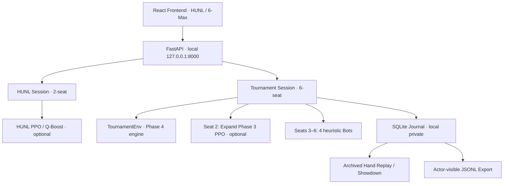
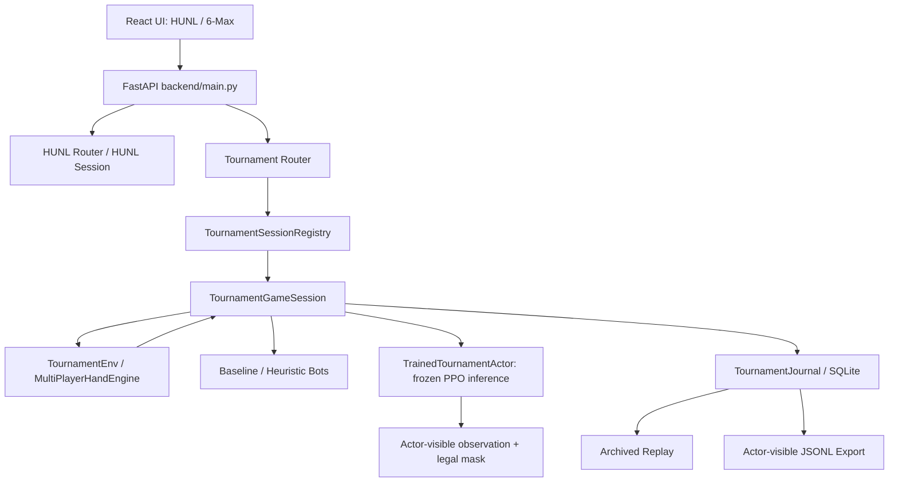

# Original documentation volume 6B/7

[Final technical report](../POKER_AI_FINAL_INTEGRATED_TECHNICAL_REPORT.md) · exact source commit `6a8ae368ddc02f814140d3770bc5993eaf9a15e4`.

## docs/TOURNAMENT_ENV_PHASE_1_5.md

Original blob `c8ab128bf34226ccaf0284f575abce9351b11655` (7204 bytes).

<!-- BEGIN_MD_SOURCE path="docs/TOURNAMENT_ENV_PHASE_1_5.md" sha="c8ab128bf34226ccaf0284f575abce9351b11655" -->

````````markdown
# Tournament ENV Phase 1.5 — 6-Max Tournament Progress UX

> 담당 영역: **Environment Only**
> 기준: Tournament ENV Phase 1.1–1.4 + Improved Bot Aggression 1.3.1
> 목적: 6인 토너먼트의 **생존/탈락**, **블라인드 레벨 진행**, **정산 기준 칩 순위**, **공식 순위**, **최종 우승**을 혼동 없이 표시한다.

## 1. 기존 구현과 추가 기능

기존 Phase 1.4의 **학습된 Expand Phase 3 PPO**(6인 Cash-game 학습 정책의 Tournament 전이 추론), **Human 1명**, **Improved Heuristic Bot 4명**, 엔진 베팅 규칙은 변경하지 않는다. React/FastAPI 응답의 표시 정보를 확장하는 작업이다.

| 기능 | 기존 | Phase 1.5 |
| --- | --- | --- |
| 생존자 정보 | 현재 핸드 `stack`/`status`에 의존 | `alive_seats` (마지막 핸드 정산 이후 생존 좌석) |
| 칩 순위 | 별도 순위표 없음 | `tournament_stacks` 기준 임시 칩 순위(~N) |
| 확정 순위 | 각 좌석 `rank` | 생존자의 임시 칩 순위와 탈락자의 공식 배치(`#N`) 구분 |
| 블라인드 레벨 | 현재 SB/BB 및 `level_index` | 다음 SB/BB, 레벨 내 진행, 다음 레벨까지 남은 핸드 수 |
| 탈락 이벤트 | 완료된 핸드 History 열람 | 최근 탈락자와 해당 핸드 번호 |
| 우승 | 완료 메시지 | 명시적인 Champion 화면·공식 #1 |

## 2. 토너먼트 스택과 핸드 내부 칩 구분

홀덤 핸드 중 베팅된 칩은 `stack`에서 차감되어 `pot`에 들어간다. 따라서 **현재 핸드에서 `stack=0`이라고 바로 탈락은 아니다.** Short Stack의 강제 올인이나 자발적 올인을 잘못 탈락 처리하면 안 된다.

### 실시간 칩 보존

$$\boxed{\sum_{i=0}^5 S_{i,t}^{\mathrm{behind}}+P_t=C_{\mathrm{total}}}$$

- `seats[i].stack`: 현재 액션 직후 **팟에 투입하고 남은 칩**.
- `pot`: 현재 핸드의 전체 기여 칩.
- `tournament_stacks[i]`: 직전 완료 핸드 이후 정산된 해당 좌석 스택. 현재 핸드가 끝나기 전까지 **리더보드에서 고정**.
- `alive_seats`: 직전 정산 기준 생존 중인 물리적 좌석 번호. 현재 핸드의 올인은 탈락이 아님.
- `seats[i].rank`: 엔진이 제공한 **확정 토너먼트 순위**. 일반적으로 생존 플레이어는 `null`, 탈락한 플레이어는 확정 순위, 최종 우승자는 `1`.

### 순위 계산

생존자 집합은

$$\mathcal A_h=\{i\mid S_{i,h}^{\mathrm{settled}}>0\}.$$

**임시 칩 순위**는 생존자에 대해서만 정산 기준 스택을 내림차순으로 정렬한다. 동점이면 공동 순위(competition ranking)를 준다.

$$\widetilde{r}_i=1+\#\{j\in\mathcal A_h:S_{j,h}^{\mathrm{settled}}>S_{i,h}^{\mathrm{settled}}\}.$$

이는 토너먼트 상금·탈락 순위가 아니며 GUI에 `~N`으로 표시한다. 반대로 엔진의 탈락 확정 순위는 `#N`으로 표시한다. 동시 탈락의 순위 결정은 기존 Phase 4 `PlayerManager` 규칙을 그대로 따른다.

## 3. 블라인드 레벨 진행

`BlindManager`의 공식 일정표를 사용한다. `hands_per_level=L`, 현재 1-based 핸드 번호가 `h`라면, 마지막 레벨을 제외한 다음 레벨 시작까지 필요한 핸드 수(현재 핸드 포함)는

$$H_{\mathrm{to\ next}}=L-((h-1)\bmod L).$$

API에서 이 값을 서버가 계산해 넘겨 주기 때문에, 브라우저 화면이 독립적인 블라인드 일정표를 만들 필요가 없다. 마지막 레벨에서는 다음 블라인드가 존재하지 않으므로 거짓 카운트다운을 보여주지 않는다.

### 읽기 전용 API 변경

기존 응답 `GET /api/v1/tournament/sessions/{id}` 및 액션 반환 `state`에 다음을 추가한다.

```json
{
  "alive_seats": [0, 1, 2, 3, 4, 5],
  "tournament_stacks": [1000, 1000, 1000, 1000, 1000, 1000],
  "blind_progress": {
    "hands_per_level": 10,
    "hand_in_level": 1,
    "hands_to_next": 10,
    "next_small_blind": 10,
    "next_big_blind": 20,
    "final_level": false
  }
}
```

최종 완료 상태에서 `hands_to_next`, `hand_in_level`, `next_small_blind`, `next_big_blind`는 `null` 가능하다. 이전 Phase 1.1 API의 모든 필드는 유지한다.

## 4. 파일 변경

```text
backend/tournament_schemas.py                   # API 응답 Pydantic 확장
src/holdem_ai/tournament_service/session.py      # 읽기 전용 정산 기반 정보 공개
frontend/src/tournament/types.ts                 # TS API 계약 확장
frontend/src/tournament/standings.ts             # 임시/확정 순위, 탈락 기록, 블라인드 문구
frontend/src/tournament/standings.test.ts        # 신규 유닛 테스트
frontend/src/tournament/TournamentProgressPanel.tsx
frontend/src/tournament/TournamentApp.tsx
frontend/src/tournament/TournamentTable.tsx
frontend/src/tournament/rules.ts
frontend/src/tournament/rules.test.ts
frontend/src/styles.css
```

학습용 `src/holdem_ai/expand/rl/...`은 수정하지 않는다. 체크포인트 파일도 건드리지 않는다.

## 5. 적용 및 검증 (Windows PowerShell)

프로젝트 루트에서 ZIP을 덮어쓴 다음 **Backend를 재시작**해야 한다. 기존 세션 데이터는 서버 메모리에만 저장되므로, 가능한 토너먼트를 끝낸 뒤 재시작한다.

```powershell
cd C:\Users\yiydg\Desktop\workspace\holdem-ai-starter\holdem-ai
Expand-Archive -Path "$HOME\Downloads\holdem-ai-tournament-env-phase-1-5.zip" -DestinationPath . -Force

uv run --extra dev --extra gui --extra gpu python -m pytest -q tests/test_tournament_env15_progress.py
uv run --extra dev --extra gui --extra gpu python -m pytest -q

cd frontend
npm.cmd run typecheck
npm.cmd run build
npm.cmd run test
```

기존 모델을 사용하려면 같은 Backend 터미널에서:

```powershell
cd C:\Users\yiydg\Desktop\workspace\holdem-ai-starter\holdem-ai
$env:HOLDEM_AI_TOURNAMENT_CHECKPOINT = (Resolve-Path '.\runs\expand_phase03_pilot\best.pt').Path
$env:HOLDEM_AI_TOURNAMENT_DEVICE = 'cpu'
$env:HOLDEM_AI_TOURNAMENT_POLICY_MODE = 'sampled'
uv run --extra gui --extra gpu python -m backend.main
```

프론트엔드는 별도 터미널 `cd frontend; npm.cmd run dev`, 브라우저 `http://127.0.0.1:5173`.

### Acceptance checklist

- [ ] Tournament Agent 실제 체크포인트 추론 기능 유지
- [ ] 6인 Seat 및 기존 자유로운 Raise-to 정상 동작
- [ ] 올인으로 현재 Behind Stack이 0이어도 탈락 처리하지 않음
- [ ] 토너먼트 칩 보존 검증 통과
- [ ] 생존자의 임시 칩 순위와 탈락자의 공식 순위가 서로 다르게 표시됨
- [ ] 블라인드 레벨 변경 시 다음 레벨과 남은 핸드 수가 갱신됨
- [ ] 최종 레벨에서 가짜 다음 레벨을 표시하지 않음
- [ ] 탈락 이벤트 및 최종 Champion 표시
- [ ] 기존 HUNL GUI·RL 학습 파이프라인은 불변

## 6. 한계와 다음 단계

현재 History는 세션 메모리에 유지된다. **지속 저장과 Hand Replay는 Phase 1.6**이다. 기존 Expand Phase 3 PPO는 캐시게임에서 학습된 모델이며, Tournament Transfer 추론이 더 강한 전략임을 보장하지 않는다. 이번 Phase 1.5는 **Environment 표시·관측 정확성 개선**이며 학습·전략 개선은 수행하지 않는다.

````````

<!-- END_MD_SOURCE path="docs/TOURNAMENT_ENV_PHASE_1_5.md" -->

## docs/TOURNAMENT_ENV_PHASE_1_6_1_SHOWDOWN.md

Original blob `00d7761c462b6e686b41980210e700b87ea265e7` (4890 bytes).

<!-- BEGIN_MD_SOURCE path="docs/TOURNAMENT_ENV_PHASE_1_6_1_SHOWDOWN.md" sha="00d7761c462b6e686b41980210e700b87ea265e7" -->

````````markdown
# Tournament ENV Phase 1.6.1 — Showdown Hole Cards 공개

> Scope: **Environment only**. No Agent training, model update, or change to betting rules.

## 요구사항

- 실제 Showdown이 발생하고 **핸드 정산이 완료된 뒤**에만 카드 공개.
- Fold한 플레이어는 본인의 홀 카드를 공개하지 않음.
- Fold 승리(무경쟁 팟)는 승자라도 홀 카드 공개하지 않음.
- 마지막 핸드 결과, 완료 핸드 목록, SQLite Replay의 **최종 정산 프레임**에서 동일한 정보를 표시.
- 진행 중인 핸드의 모든 상대 홀 카드, 덱, 번 카드는 비공개.
- 기존 JSONL Actor-visible Export 계약은 변경하지 않음.

## 1. 공개 조건

`result.folded[i]`는 해당 플레이어가 Fold했거나 핸드에 참가하지 않았는지를 나타냅니다.

$$
C_h = \{ i \mid \operatorname{folded}_{i,h} = \mathrm{False} \}
$$

$$
\boxed{
\operatorname{Reveal}(i,h)
= \begin{cases}
\operatorname{HoleCards}(i,h), & |C_h|\ge 2 \land i\in C_h \land |B_h|=5\\
\varnothing, & \text{otherwise}
\end{cases}
}
$$

카드는 `TournamentEnv._finish_hand()`에서 정산 완료 시에 캡처하므로, 다음 핸드가 자동 시작돼도 직전 핸드의 Showdown을 볼 수 있습니다. 이 데이터는 행동 선택을 위한 `observe()`에는 전달하지 않습니다.

## 2. HTTP 계약

기존 Hand Settlement JSON에 **선택적** 필드 `showdown_cards`가 추가됩니다.

```json
{
  "hand_number": 5,
  "board": ["sA", "dK", "h7", "c3", "d2"],
  "showdown_cards": [
    {"seat": 0, "cards": ["sQ", "sJ"]},
    {"seat": 1, "cards": ["cK", "dQ"]}
  ]
}
```

위 JSON은 **구조 예시이며 실제 핸드 데이터가 아닙니다**. 반환되는 다른 핸드 결과 필드는 유지됩니다.

API 반영 위치:

- `GET /api/v1/tournament/sessions/{session_id}` → `state.last_hand.showdown_cards`
- `GET /api/v1/tournament/sessions/{session_id}/history` → `hands[].showdown_cards`
- `GET /api/v1/tournament/archive/{session_id}/hands` → `hands[].showdown_cards`
- `GET /api/v1/tournament/archive/{session_id}/hands/{hand_number}/replay` → `settlement.showdown_cards`

Replay의 `actions[]`에는 `showdown_cards`가 들어가지 않습니다. **Showdown 카드는 최종 정산(`settlement`)에서만 공개됩니다.**

오래된 SQLite 기록에는 `showdown_cards`가 없을 수 있으며, 화면은 이를 빈 목록으로 처리합니다. 이미 저장된 기록을 소급 복원하지 않습니다.

## 3. UI 동작

1. 핸드가 완료되면 `MOST RECENT SETTLEMENT`에서 **SHOWDOWN · REVEALED HANDS**에 카드 앞면을 표시.
2. `Completed hands`의 핸드를 펼쳐도 같은 카드를 표시.
3. `Saved sessions & hand replay`의 마지막 프레임에서 Showdown을 표시.
4. Fold 승리 또는 오래된 기록에는 `NO CARD REVEAL` 안내를 표시.

현재 UI에서는 엔진이 **다음 핸드를 자동으로 시작**합니다. 따라서 쇼다운 결과는 새로운 핸드의 좌석 카드 자리에 섞지 않고 별도의 **이전 핸드 결과 패널**에 표시합니다.

## 4. 변경 파일

- `src/holdem_ai/environment/tournament_env.py`: 완료 핸드별 showdown 공개 카드 보존.
- `src/holdem_ai/tournament_service/session.py`: 완료 핸드 요약에 `showdown_cards` 직렬화.
- `backend/tournament_schemas.py`: 엄격한 응답 모델 확장.
- `frontend/src/tournament/types.ts`: 타입 필드 확장(구형 아카이브 호환).
- `frontend/src/tournament/TournamentShowdown.tsx`: 재사용 카드 컴포넌트.
- `frontend/src/tournament/TournamentApp.tsx`: 최근 결과와 히스토리 카드 공개.
- `frontend/src/tournament/TournamentArchive.tsx`: Replay 마지막 프레임에 카드 공개.
- `frontend/src/styles.css`: 숫자·문양·반응형 카드 표시.
- `tests/test_tournament_env161_showdown.py`: 6개 신규 테스트.

## 5. Windows 설치

Backend를 Ctrl+C로 종료한 뒤 프로젝트 루트에서:

```powershell
Expand-Archive -Path "$HOME\Downloads\holdem-ai-tournament-env-phase-1-6-1-showdown.zip" -DestinationPath . -Force

uv run --extra dev --extra gui --extra gpu python -m pytest -q tests/test_tournament_env161_showdown.py
uv run --extra dev --extra gui --extra gpu python -m pytest -q

cd frontend
npm.cmd run typecheck
npm.cmd run build
npm.cmd run test
```

Frontend는 Vite dev 서버가 이미 실행 중이라면 변경 사항이 자동 반영됩니다. Backend는 새 Python 코드를 읽도록 **반드시 재시작**해야 합니다.

## 6. 참고

원래 Phase 1.6에서 저장하던 `actor_hole` 기록은 **행동한 선수 본인에게만 관측 가능한 정보**로 별도 보관하며, 그대로 유지합니다. 이번 변경은 공개 가능한 쇼다운 결과에 대한 읽기 전용 확장입니다.

본 기능은 토너먼트 Agent 체크포인트나 학습 알고리즘을 변경하지 않습니다.

````````

<!-- END_MD_SOURCE path="docs/TOURNAMENT_ENV_PHASE_1_6_1_SHOWDOWN.md" -->

## docs/TOURNAMENT_ENV_PHASE_1_6.md

Original blob `017a110414d33503c9a734346ba2e2781d495cf4` (6756 bytes).

<!-- BEGIN_MD_SOURCE path="docs/TOURNAMENT_ENV_PHASE_1_6.md" sha="017a110414d33503c9a734346ba2e2781d495cf4" -->

````````markdown
# Tournament ENV Phase 1.6 — Persistent Match History / Recorded Replay / Actor Export

> **범위: Environment.** 기존 HUNL, Tournament Engine, PPO/Q-Boost 모델 가중치, 강화학습 알고리즘은 수정하지 않는다.

## 1. 목적

기존 `/api/v1/tournament/sessions/{id}/history`는 **프로세스 메모리**에만 기록을 보관한다. 이 단계는 로컬 SQLite 저장소를 추가해서 게임 중 서버가 종료되거나 사용자가 `End session`을 눌러도 **기존에 커밋된 대국 행동/정산 기록이 남도록** 한다.

- **재현(Recorded Replay)**: 플레이 도중 저장된 프레임을 시간순으로 조회. 새로운 샘플링, 새로운 Bot 정책 실행 또는 덱 재생성이 아니다.
- **계속 플레이(Resume)**: **이번 단계에는 없음.** 서버 재시작 후 과거 토너먼트를 이어 하는 기능은 제공하지 않는다.
- **데이터 내보내기**: 각 행동의 *acting player* 기준 관측과 실제 행동을 NDJSON(JSONL)로 제공한다. 알고리즘 업데이트는 수행하지 않는다.

## 2. 저장 위치와 데이터 모델

기본값은 프로젝트 루트:

```text
.local/tournament_history.sqlite3
.local/tournament_history.sqlite3-wal
.local/tournament_history.sqlite3-shm
```

설정 변경:

```powershell
$env:HOLDEM_AI_TOURNAMENT_JOURNAL = "E:\\PrivateHoldemData\\tournament_history.sqlite3"
```

`.local/.gitignore`로 기본 기록 파일과 WAL/SHM 파일은 Git 추적 대상에서 제외한다. 사용자 지정 경로도 `git add -A` 전에 별도로 확인한다.

저장 스키마:

| 테이블 | 내용 | 기록 시점 |
| --- | --- | --- |
| `tournament_sessions` | 세션 ID, 생성 시각, 설정, 상태, 최종 우승자 | 세션 생성/행동/종료 |
| `tournament_actions` | 핸드 번호, 행동 순서, 액터의 결정 직전 정보, 행동 | **모든 합법 행동 직후** |
| `tournament_hands` | 공개 보드, 행동 목록, 배당, 최종 스택, 탈락자 | **핸드 정산 후** |

저장은 트랜잭션 단위로 커밋된다. `DELETE /sessions/{id}`는 라이브 세션만 종료하고 저장된 기록은 삭제하지 않는다.

**주의:** 시스템 강제 종료 직전에 DB로 커밋되지 못한 행동은 기록되지 않을 수 있다. WAL과 FULL 동기화를 사용하지만 디스크·하드웨어 장애에 대한 무손실 보장을 뜻하지 않는다.

## 3. 칩 보존 및 Replay 검사

실시간 시점:

$$
\boxed{\sum_{i=0}^{5} S_{i,t}^{\text{behind}} + P_t = C_{\text{total}}}
$$

핸드 정산:

$$
\boxed{\sum_{i=0}^{5} S_{i,h}^{\text{final}} = C_{\text{total}}}
$$

각 Replay 프레임은 **행동 직전** 시점의 `board`, `stacks`, `street_bets`, `contributions`, `legal_actions`, `pot`, `to_call`을 갖는다. 최종 프레임은 엔진의 `TournamentHandRecord`를 사용하므로 실제 `awards`, `payoffs_chips`, `eliminated` 기록과 일치한다.

## 4. API

기존 `/api/v1/tournament/sessions` 및 HUNL API는 그대로 유지한다.

| HTTP | Endpoint | 기능 |
| --- | --- | --- |
| GET | `/api/v1/tournament/archive` | 최근 저장된 세션 50개(페이지네이션 지원) |
| GET | `/api/v1/tournament/archive/{session_id}/hands` | 완료 핸드 최근순 조회 |
| GET | `/api/v1/tournament/archive/{session_id}/hands/{hand_number}/replay` | 시점별 행동 + 완료 시 정산 |
| GET | `/api/v1/tournament/archive/{session_id}/export` | `application/x-ndjson` 파일 다운로드 |

Swagger: `http://127.0.0.1:8000/docs`. 프론트엔드는 6-Max 탭의 **Saved sessions & hand replay** 패널에서 위 API를 사용한다. 1.5의 Live Tournament UI는 유지한다.

## 5. Actor-visible Export Contract

각 행동 $t$의 데이터는 다음과 같다.

$$
D_t=(I_t,a_t,R_h,\text{session\_id},\text{hand\_number})
$$

- $I_t$: 행동 플레이어의 **자기 홀 카드 2장**, 공개 보드, 공개 스택, 팟, 행동 가능 목록
- $a_t$: 실제 선택 행동과 정확한 `raise_to` 목표 금액
- $R_h$: 완료된 핸드의 **그 플레이어 칩 수익(라벨)**, 미정산이면 `null`

```json
{
  "schema": "tournament.actor_transition.v1",
  "session_id": "...",
  "hand_number": 1,
  "action_no": 1,
  "acting_seat": 3,
  "observation": {
    "street": "preflop",
    "board": [],
    "button": 0,
    "stacks": [1000, 995, 990, 1000, 1000, 1000],
    "pot": 15,
    "to_call": 10,
    "legal_actions": [0, 1, 2, 3, 4],
    "own_hole_cards": ["d4", "c5"]
  },
  "action": {"index": 1, "kind": "check_call", "raise_to": null},
  "hand_settled": false,
  "payoff_chips": null
}
```

이것은 필드를 간략화한 예시다. **타인 홀 카드, 전체 덱, 학습용 Critic/Optimizer 상태는 포함하지 않는다.** Replay 화면에는 Human 본인 턴에서만 Human 홀 카드가 표시되고, 다른 좌석의 홀 카드는 숨긴다. **반면 Export 파일은 각 행동자의 본인 홀 카드를 포함하므로 공개 저장소에 업로드해서는 안 된다.**

다시 강조하면 이 JSONL은 **행동 데이터 계약**이지, PPO 학습기에 곧바로 투입할 수 있는 GAE/return 확정 형식은 아니다. 신경망 구조나 학습 루프는 여기서 수정하지 않는다.

## 6. Windows 설치 및 테스트

Phase 1.1~1.5 패치가 설치된 프로젝트 루트에서:

```powershell
cd C:\Users\yiydg\Desktop\workspace\holdem-ai-starter\holdem-ai
Expand-Archive "$HOME\Downloads\holdem-ai-tournament-env-phase-1-6.zip" -DestinationPath . -Force
uv run --extra dev --extra gui --extra gpu python -m pytest -q tests/test_tournament_env16_persistence.py
uv run --extra dev --extra gui --extra gpu python -m pytest -q
cd frontend
npm.cmd run typecheck
npm.cmd run build
npm.cmd run test
```

Backend 재시작 전 기존 토너먼트를 마무리하는 것이 좋다. **1.6이 설치되기 전에 플레이한 과거 세션은 자동 복구되지 않는다.** 새 패치 적용 후 시작한 세션부터 DB에 저장된다.

Backend를 **체크포인트 환경변수를 설정한 동일한 PowerShell에서** 실행한다. Frontend는 별도 PowerShell에서 `npm.cmd run dev`.

## 7. 검증 범위와 제한 사항

- Python Phase 1.6 테스트: SQLite 재오픈, 완료 핸드 순서, Hero/Bot Hole 분리, 무효 행동 원자성, JSONL/HTTP, Live 세션 삭제 후 Archive 유지.
- 기존 Phase 1.1~1.5 및 프론트엔드 전체 회귀 검사는 사용자 PC에서 수행해야 한다.
- 기록 DB에는 액터 자신의 비공개 카드가 있으므로 **로컬 전용 서버를 외부 네트워크에 노출하지 않는다.**
- 파일 시스템에 같은 SQLite 경로를 쓰는 여러 서버 인스턴스를 띄우는 것은 피한다.
- 과거 Session ID로 게임을 재개하는 기능은 지원하지 않는다.

````````

<!-- END_MD_SOURCE path="docs/TOURNAMENT_ENV_PHASE_1_6.md" -->

## docs/TOURNAMENT_ENV_PHASE_1_7_FINAL.md

Original blob `d74fc8e95137a3732ce48a4bbba462970fdb61f3` (10078 bytes).

<!-- BEGIN_MD_SOURCE path="docs/TOURNAMENT_ENV_PHASE_1_7_FINAL.md" sha="d74fc8e95137a3732ce48a4bbba462970fdb61f3" -->

````````markdown
# Tournament ENV Phase 1.7 — 최종 통합 검증 및 GitHub Release 준비

> **Scope:** Environment only · Windows PowerShell · HUNL/6-Max 공존 · 학습 코드/모델 가중치 변경 없음
>
> **상태:** 최종 점검용 스크립트와 통합 테스트 제공. **전체 Windows 테스트·실제 Push는 사용자 로컬에서 수행 후 확인해야 한다.**

## 1. 아키텍처 및 구성



**세션 설정을 명시적으로 구분한다.**

| 모드 | 학습 모델 | Checkpoint 예 | 기본·Fallback |
| --- | --- | --- | --- |
| HUNL | `PPO` 또는 `Q-Boost PPO` | `runs/phase14_pilot/seed_41/qboost/best.pt` | GUI 선택에 따라 Random·기준 Bot |
| Tournament | `Expand Phase3 multi-seat PPO` (2–6인 캐시게임용) | `runs/expand_phase03_pilot/best.pt` | 정책 명시 선택; 누락 시 오류, 몰래 대체 금지 |
| Tournament Improved | 별도 강화학습 모델 아님 | 없음 | 규칙 기반 Heuristic Bot 4명 |

Tournament에서 학습된 PPO를 사용하는 경우 **원래 학습 환경이 캐시게임이며 토너먼트 전용 최적화가 검증된 모델은 아니라는 사실**을 유지한다.

## 2. 완료 범위

| 단계 | 내용 | 근거·상태 |
| --- | --- | --- |
| 1.1 | 6인 엔진 / FastAPI / Human 행동 | Windows 11개 테스트 + 전체 713개 통과 보고 |
| 1.2 | 6인 React GUI | Windows TypeScript typecheck/build/Vitest 18개 통과 보고 |
| 1.2.1 | Hole Card 숫자·문양 표시 | 사용자 실제 GUI 수정 확인 |
| 1.3 | Improved Bot 4명 | 코드 구현 / 이후 공격성 패치 적용 확인 |
| 1.3.1 | Call/Fold 편향 및 Raise 조건 버그 수정 | 사용자 실제 Bot Raise 동작 확인 |
| 1.4 | Expand Phase3 PPO inference | 사용자 브라우저 대전 성공 보고 |
| 1.5 | Blind/Ranking/Elimination/Champion UX | 패치 제공; 이전 테스트 로그와 구분 |
| 1.6 | SQLite·Recorded Replay·JSONL Export | 사용자 전체 테스트 통과 + 게임 재실행 확인 |
| 1.6.1 | Showdown Hole Card 공개 | 패치 전달; 최종 로컬 빌드 재검증 필요 |
| **1.7** | **통합 계약 테스트·안전한 Stage/Push·문서** | **이 패치의 범위** |

**반드시 구분:** GitHub `main`에는 이전 GUI/Phase17 소스까지만 반영되어 있었고, 오늘의 Tournament ENV 1.1~1.6.1 변경은 로컬 패치로 제공되었다. Phase 1.7 스크립트는 자동 Push를 수행하지 않는다.

## 3. Environment 불변 조건

### 3.1 칩 보존

진행 중인 6인 토너먼트:

$$
\boxed{\sum_{i=0}^{5} S_{i,t}^{\mathrm{behind}} + P_t = C_{\mathrm{total}}}
$$

핸드 정산 후:

$$
\boxed{\sum_{i=0}^{5} S_{i,h}^{\mathrm{final}} = C_{\mathrm{total}}}
$$

정산 간 스택 연속성:

$$
\boxed{S_{i,h+1}^{\mathrm{start}}=S_{i,h}^{\mathrm{final}}}
$$

### 3.2 Actor 정보 경계

$$
\pi_{\theta}(a\mid I_t,\mathcal A_t^{\mathrm{legal}})
$$

`I_t`에는 행동 플레이어의 자신의 홀 카드만 포함한다. 덱, 상대의 숨겨진 손패, 모델 학습용 특권 Critic State는 입력되지 않는다. **5-action Tournament 엔진과 7-action 멀티플레이어 PPO 간 변환은 어댑터에서만 수행**한다.

### 3.3 Showdown 공개

$$
\operatorname{Reveal}(i,h)=\begin{cases}
\operatorname{HoleCards}(i,h), & i\in C_h,\ |C_h|\ge2,\ |B_h|=5,\ \text{after settlement}\\
\varnothing,&\text{otherwise}
\end{cases}
$$

Fold한 선수의 홀 카드는 공개하지 않는다. 구형 SQLite 기록에는 공개 카드 필드가 없을 수 있다. **Showdown 정보는 오직 정산 결과에서 공개**하며, `actor_transition.v1` 행동 데이터에 섞지 않는다.

### 3.4 영구성 범위

- `SQLite`: 기록은 서버 재시작 후에도 조회 가능.
- `Recorded Replay`: 저장 당시의 행동·공개 프레임을 재생. 게임 엔진을 새로 실행하는 Deterministic Re-simulation이 아님.
- `Resume`: 서버 종료 전 진행 중이던 게임을 이어서 플레이하는 기능은 **없음**.
- `JSONL`: Acting-player visible transition 데이터. PPO 학습용 GAE/Return이 완성된 형식은 아님.

## 4. Phase 1.7 패치 적용

오늘 Phase 1.1~1.6.1까지 순서대로 ZIP을 적용했다는 전제다. 프로젝트 루트에서:

```powershell
cd C:\Users\yiydg\Desktop\workspace\holdem-ai-starter\holdem-ai
Expand-Archive -Path "$HOME\Downloads\holdem-ai-tournament-env-phase-1-7.zip" -DestinationPath . -Force
```

### 4.1 통합 테스트 — 로컬 Windows

Backend와 Frontend Dev 서버를 먼저 종료한 후:

```powershell
powershell -ExecutionPolicy Bypass -File .\scripts\tournament_env17_verify.ps1
```

실행 구성:

1. `uv run --extra dev --extra gui --extra gpu python -m pytest -q` — 전체 Python 회귀.
2. `npm.cmd run typecheck` — TypeScript.
3. `npm.cmd run build` — Vite 생산 빌드.
4. `npm.cmd run test` — Vitest.
5. `tournament_env17_release_audit.py` — Git 민감 파일 검사(읽기 전용).

빠른 검사(전체 회귀 대신 1.7 테스트 중심):

```powershell
powershell -ExecutionPolicy Bypass -File .\scripts\tournament_env17_verify.ps1 -Quick
```

실제 학습된 6인 PPO 체크포인트 로딩까지 재검증:

```powershell
$env:HOLDEM_AI_TOURNAMENT_CHECKPOINT = (Resolve-Path ".\runs\expand_phase03_pilot\best.pt").Path
$env:HOLDEM_AI_TOURNAMENT_DEVICE = "cpu"
$env:HOLDEM_AI_TOURNAMENT_POLICY_MODE = "sampled"
powershell -ExecutionPolicy Bypass -File .\scripts\tournament_env17_verify.ps1 -WithAgentSmoke
```

**주의:** Phase 1.7 통합 테스트는 캐시게임용 PPO가 토너먼트에서 강하다는 승률 검증이 아니다. 배포 연결·규칙·영구성 검증이다.

## 5. 안전한 GitHub Stage → Commit → Push

### 5.1 Git 상태 확인 (먼저 실행)

```powershell
git status -sb
git branch --show-current
git remote -v
git diff --stat
```

다른 작업의 수정 사항도 있을 수 있으므로 **`git add -A`, `git add .` 사용 금지**. Phase1.7 스크립트는 Phase 1.1~1.7 코드·테스트·문서만 Stage한다.

Dry-run으로 Stage 예정 파일 확인:

```powershell
powershell -ExecutionPolicy Bypass -File .\scripts\tournament_env17_stage.ps1 -DryRun
```

Git에 추가하고 `.gitignore` 보호 규칙을 **기존 내용 뒤에 덧붙일 때**:

```powershell
powershell -ExecutionPolicy Bypass -File .\scripts\tournament_env17_stage.ps1
```

스크립트는 다음을 수행한다.

- `runs/`, `checkpoints/`, `.local/`, `*.pt`, `*.sqlite3`, `*.jsonl` 등의 패턴을 `.gitignore`에 *추가*.
- `tournament_env17_manifest.txt`에 적힌 **한정된 파일만** `git add --`.
- `git diff --cached --check`로 포맷 검사.
- `release_audit --strict`로 Git 인덱스의 민감 자료 검사.
- **절대로 Commit이나 Push를 자동 수행하지 않음.**

**커밋 전 필수 검토:**

```powershell
git diff --cached --name-status
git diff --cached --stat
git diff --cached --check
uv run --extra dev --extra gui python -m scripts.tournament_env17_release_audit --strict
```

의도치 않게 Stage된 파일은 `git restore --staged -- "경로"`로 제거한다. 기존 Staged 파일이 이미 있으면 Stage 스크립트는 제거하지 않으므로 직접 검토해야 한다.

### 5.2 Commit과 Push (전체 테스트 확인 후, 사용자 수동 실행)

```powershell
git commit -m "feat(tournament-env): complete six-max GUI, inference and persistent replay"
git push origin main
```

**단, 현재 Branch가 `main`이고 원격이 동일할 때만 위 명령을 그대로 사용한다.** 다른 Branch나 최신 원격 커밋이 있다면 먼저 `git branch --show-current`, `git fetch origin`, `git status -sb` 등으로 확인해야 한다. 다른 사람 작업이 있을 때 무조건 강제 Push하지 않는다.

최종 확인:

```powershell
git log -1 --oneline
git status -sb
git rev-parse HEAD
git rev-parse origin/main
```

커밋 SHA와 `origin/main`이 같으면 해당 Branch Push 동기화가 완료된 것이다. 단, 다른 untracked 파일이 남아 있으면 `git status`는 깨끗하지 않을 수 있으며 이는 다른 작업 파일일 수 있다.

## 6. 최종 QA 수동 체크리스트

- [ ] HUNL 모드에서 학습된 PPO/Q-Boost를 명시 선택해 대전 가능.
- [ ] Tournament에서 실제 체크포인트를 선택했을 때 Seat 2가 **trained**로 표시.
- [ ] Tournament의 Improved Bot 4명이 Fold/Call/Raise를 정상 선택.
- [ ] 모든 공개 프레임에서 칩 총량 보존.
- [ ] 블라인드 상승, 버튼 회전, 생존/탈락, 우승 표시.
- [ ] 쇼다운 이후 **참가자 홀 카드만** 공개하고 폴더의 카드는 비공개.
- [ ] Saved Sessions & Replay에서 완료된 핸드 조회.
- [ ] Backend 재시작 이후 기록 열람(라이브 재개 기능은 없음).
- [ ] JSONL 내보내기에서 각 Acting Player 자신의 카드만 포함.
- [ ] SQLite, Checkpoints, `runs/`, `.env` 등 민감 자료 Stage되지 않음.
- [ ] 전체 Python + TypeScript + Vite + Vitest 통과.
- [ ] `origin/main`의 최신 Commit과 로컬 `HEAD` 동기화 확인.

## 7. 다음 확장 작업 (현재 범위 밖)

1. Tournament 특화 PPO/CFR 학습: **Agent 팀 관할**.
2. 영구 세션 *이어하기(Resume)*: 다음 Environment 개발 후보.
3. 게임 정책 우열 실험(승률, bb/100, CI): Agent 평가 프로젝트와 분리해 검증.
4. 네트워크 공개 서버·다중 사용자 인증: 현재는 127.0.0.1 전용 테스트 서버로 유지.

> Phase 1.7 완료 선언은 **실제 Windows 통합 테스트 + Stage 검사 + 성공적인 GitHub Push** 로그가 확인된 뒤에만 한다.

````````

<!-- END_MD_SOURCE path="docs/TOURNAMENT_ENV_PHASE_1_7_FINAL.md" -->

## docs/TOURNAMENT_ENV_PHASE1_FULL_TECHNICAL_REPORT.md

Original blob `f0b72d9bc86e8238c44a63f52a59547c534be4a8` (52111 bytes).

<!-- BEGIN_MD_SOURCE path="docs/TOURNAMENT_ENV_PHASE1_FULL_TECHNICAL_REPORT.md" sha="f0b72d9bc86e8238c44a63f52a59547c534be4a8" -->

````````markdown
---
title: "Hold'em AI — Tournament ENV Phase 1 전체 개발 기술보고서"
aliases:
  - "Tournament ENV 전체 개발 보고서"
  - "6-Max Tournament Environment Technical Report"
tags:
  - holdem-ai
  - tournament-env
  - six-max
  - fastapi
  - react
  - sqlite
  - replay
  - technical-report
created: 2026-10-13
status: completed
repository: "https://github.com/TheMostEvident/holdem-ai"
release_commit: "b2313fb"
---

# Hold'em AI — Tournament ENV Phase 1 전체 개발 기술보고서

> [!abstract] 보고서 개요
> **범위:** 기존 Heads-Up(HUNL) GUI·멀티플레이어 게임 엔진을 기반으로, **Tournament ENV Phase 1.1~1.7**, 추가 핫픽스 **1.2.1 / 1.3.1 / 1.6.1**까지의 개발 과정 전체를 기술한다.
> **핵심 관점:** 각 단계의 **신규/수정 `.py` 파일**, 주요 클래스·함수, 수정 동기, 해결한 문제, 데이터·API 계약, 검증 증거.
> **담당 경계:** **Environment Only**. PPO/Q-Boost의 네트워크 학습·손실 함수·가중치 최적화 작업은 포함하지 않는다.
> **최종 기준:** GitHub `main`, 커밋 [`b2313fb`](https://github.com/TheMostEvident/holdem-ai/commit/b2313fb), 2026-10-13 사용자 Windows 실행 로그.
> **상태:** Phase 1 완료 및 Push 확인. 단, 일부 향후 개선 과제는 별도 기재한다.

## 0. Executive Summary

Tournament ENV Phase 1의 목표는 **이미 학습된 멀티플레이어 AI를 사람과 실제 6-Max 토너먼트에서 대결시키는 실행 환경**을 만드는 것이었다. 개발 착수 시점에는 2~6인 핸드 엔진과 토너먼트 엔진, 기존 HUNL Heads-Up GUI가 존재했지만, **6인 토너먼트의 브라우저 세션·AI 연결·영구 기록·Replay가 하나의 제품 흐름으로 이어져 있지 않았다.**

최종적으로 다음을 구현했다.

1. `TournamentEnv`를 FastAPI 세션으로 연결하고 Human의 합법 행동·임의 Raise-to를 지원.
2. React에서 HUNL / 6-Max 두 모드를 분리하고, 6인 테이블 및 베팅 인터페이스를 제공.
3. 네 가지 규칙 기반 Bot과 학습된 **Expand Phase 3 multi-seat PPO**의 읽기 전용 추론을 연결.
4. 블라인드 상승, 생존·탈락, 확정/임시 순위, 최종 우승 상태를 표시.
5. SQLite에 대국·행동·정산 데이터를 영구 저장하고, 기록 기반 Replay 및 Actor-visible JSONL Export를 제공.
6. 실제 Showdown 후 **폴드하지 않은 참가자**의 홀 카드만 결과 화면과 Archive에 공개.
7. 통합 테스트, Git 개인정보 감사, 독립 Environment 브랜치 Commit 및 `main` Push 완료.

최종 6개 물리적 좌석의 구성은 다음과 같다.

| 내부 Seat | UI Seat | 플레이어 | 실제 정책 |
|---:|---:|---|---|
| `0` | 1 | Human | React GUI 입력 |
| `1` | 2 | Tournament Agent | Expand Phase 3 PPO 체크포인트 또는 명시적 미학습 대체 정책 |
| `2` | 3 | Improved Bot 1 | `tight_aggressive` 규칙 기반 |
| `3` | 4 | Improved Bot 2 | `balanced_value` 규칙 기반 |
| `4` | 5 | Improved Bot 3 | `pot_odds` 규칙 기반 |
| `5` | 6 | Improved Bot 4 | `controlled_pressure` 규칙 기반 |

> [!warning] 모델 성격
> Seat 2의 `runs/expand_phase03_pilot/best.pt`는 **2~6인 캐시게임으로 학습한 PPO Actor**다. 토너먼트 전용으로 학습된 모델이 아니며, Tournament ENV는 **실험적 Cash → Tournament Transfer Inference**를 제공한다. 또한 `Improved Bot`은 개발상의 역할명으로, 기준 Bot보다 높은 승률을 입증한 명칭이 아니다.

### 0.1 전체 개발 연표

| 순서 | 단계 | 구현 또는 해결한 문제 | 대표 파일 |
|---|---|---|---|
| 기반 | 기존 Phase 3 | 멀티플레이어 한 핸드, 턴·사이드팟 | `environment/multi_player_engine.py` |
| 기반 | 기존 Phase 4 | 토너먼트 핸드 승계·블라인드·탈락·순위 | `environment/tournament_env.py` |
| 기반 | HUNL GUI 1.0~1.6 | Human vs AI, FastAPI, React, 체크포인트, 연속 스택 | `game_service/*.py`, `backend/game_router.py` |
| 1 | Tournament ENV 1.1 | 6인 세션·API | `tournament_service/session.py`, `backend/tournament_router.py` |
| 2 | 1.2 | 6인 React GUI | `frontend/src/tournament/*.tsx` |
| 수정 | 1.2.1 | 홀 카드 숫자 가림·아래쪽 잘림 | `frontend/src/styles.css` |
| 3 | 1.3 | 규칙 기반 Bot 4명 | `tournament_service/improved_bot.py` |
| 수정 | 1.3.1 | Call/Fold 편향 및 Pot Raise 조건 버그 | `tournament_service/improved_bot.py` |
| 4 | 1.4 | 실제 멀티시트 PPO 로드·행동 변환 | `tournament_service/trained_actor.py` |
| 5 | 1.5 | 정확한 생존·순위·블라인드 UI | `tournament_service/session.py`, `backend/tournament_schemas.py` |
| 6 | 1.6 | SQLite·Replay·JSONL Export | `tournament_service/journal.py` |
| 수정 | 1.6.1 | Showdown 공개 및 Archive 반영 | `environment/tournament_env.py`, `tournament_service/session.py` |
| 7 | 1.7 | 릴리스 검증·Git 안전 감사·Push | `scripts/tournament_env17_release_audit.py` |

---

## 1. 기존 기술 기반 — 이번 Tournament 작업 이전에 존재하던 코드

### 1.1 Phase 3: 2~6인 Hand Engine

**목적:** 2인 전용 HUNL 흐름을 그대로 6인 규칙에 사용하지 않고, 인원수·자리·블라인드·멀티웨이 베팅·사이드팟을 처리할 수 있는 **독립 핸드 엔진**을 제공한다.

| 파일 | 핵심 구성 | 필요했던 이유 |
|---|---|---|
| `src/holdem_ai/environment/multi_player_engine.py` | `MultiPlayerHandEngine`, `MultiPlayerHandResult`, `reset()`, `observe()`, `legal_actions`, `step()`, `step_raise_to()`, `_settle()` | 게임 규칙을 HTTP·GUI로부터 분리하고 **한 핸드의 최종 정산**을 단일 권위로 유지 |
| `src/holdem_ai/environment/multi_player_seats.py` | `multi_player_seats()`, `next_occupied()`, `rotate_button()` | 6인과 인원 감소 후 2인에서 **BTN/SB/BB 위치를 정확히 배치** |
| `src/holdem_ai/environment/pot_manager.py` | `build_side_pots()`, `settle_pots()` | 서로 다른 스택의 올인 플레이어가 존재할 때 사이드팟과 배당 처리 |
| `src/holdem_ai/environment/hand_evaluator.py` | `parse_card()`, `rank_five()`, `rank_seven()`, `rank_showdown()` | 홀덤 족보를 정확한 조합 평가로 판정 |

핸드 도중 보존해야 할 불변식은 다음과 같다.

$$
\boxed{\sum_{i=0}^{5} S_{i,t}^{\mathrm{behind}}+P_t=C_{\mathrm{total}}}
$$

`S^{behind}`는 **베팅하고 남은 스택**, `P_t`는 이미 투입된 칩의 팟이다. 따라서 핸드 진행 중 단순히 `sum(stacks)`만으로 총 칩 수를 검사하는 것은 잘못이다.

사이드팟은 기여 칩의 서로 다른 경계값 $0=c_0<c_1<\cdots<c_K$에 대하여 다음과 같이 층별로 표현할 수 있다.

$$
P_k=(c_k-c_{k-1})\left|\{i:\operatorname{contribution}_i\ge c_k\}\right|.
$$

각 팟의 수상 자격은 해당 층에 기여한 플레이어 중 Fold하지 않은 플레이어로 제한된다. **팟 정산 알고리즘은 Phase 3 엔진에 있으며 Tournament GUI에서 다시 구현하지 않았다.**

### 1.2 Phase 4: Knockout Tournament Engine

| 파일 | 핵심 구성 | Tournament ENV에서 재사용한 이유 |
|---|---|---|
| `src/holdem_ai/environment/tournament_env.py` | `TournamentEnv`, `TournamentHandRecord`, `TournamentResult` | 핸드 시작부터 최종 우승까지의 상위 상태 전이 관리 |
| `src/holdem_ai/environment/blind_manager.py` | `BlindLevel`, `BlindManager.at_hand()` | 핸드 수에 따른 SB/BB 레벨 관리 |
| `src/holdem_ai/environment/player_manager.py` | `PlayerManager.update()`, `alive`, `winner` | 파산·동시 탈락·공식 순위와 총 칩 수 유지 |
| `src/holdem_ai/environment/rewards.py` | `placement_rewards()` | 완료 토너먼트의 순위 기반 결과 처리 |

Phase 4의 스택 승계는 다음과 같다.

$$
\boxed{S_{i,h+1}^{\mathrm{start}}=S_{i,h}^{\mathrm{final}}}
$$

$$
S_{i,h}^{\mathrm{final}}=0\implies i\notin\mathcal P_{h+1}^{\mathrm{alive}}.
$$

내부의 `TournamentEnv._next_hand()`는 `MultiPlayerHandEngine`을 새로 열고, `_finish_hand()`는 정산 후 `PlayerManager`로 결과를 반영한다. `rotate_button()`으로 다음 BTN을 결정하며 최종 생존자 1명이 남으면 종료된다. **1.1~1.5에서는 이 규칙을 재작성하지 않고 서비스 계층으로 감쌌다.** `tournament_env.py`에 이루어진 이번 개발의 명시적 기능 추가는 **Phase 1.6.1 Showdown 카드 보존**이다.

### 1.3 HUNL GUI 1.0~1.6: 선행 인터페이스 기반

Tournament ENV와 별개의 기존 HUNL 시스템은 이미 다음 파일을 사용했다.

- `src/holdem_ai/game_service/session_manager.py` — 2인 HUNL 라이브 세션, 사람 턴, Bot 자동 처리.
- `src/holdem_ai/game_service/interactive_adapter.py` — HUNL 포커 엔진의 플레이용 래퍼.
- `src/holdem_ai/game_service/action_adapter.py` — 합법 Human Action 검증.
- `src/holdem_ai/game_service/bot_adapter.py` — HUNL Bot 정책 인터페이스.
- `src/holdem_ai/game_service/state_projection.py` — Human이 볼 수 있는 상태 프로젝션.
- `src/holdem_ai/game_service/checkpoint_catalog.py` — HUNL PPO/Q-Boost 모델 선택 및 읽기 전용 로드.
- `src/holdem_ai/game_service/session_analytics.py` — 누적 결과·핸드 통계.
- `backend/game_router.py`, `backend/schemas.py` — `/api/v1/hunl/*` 계약.
- `frontend/src/HUNLApp.tsx` — 기존 Heads-Up GUI를 Tournament 탭과 공존하도록 분리한 컴포넌트.

HUNL GUI 개발 단계의 역할을 요약하면 **1.0 세션 계약 → 1.1 FastAPI → 1.2 React 테이블 → 1.3 자유 Raise-to → 1.4 학습 체크포인트 선택 → 1.5 통계·히스토리 → 1.6 연속 스택 및 매치 종료**다. Tournament의 신규 세션 코드는 이 설계를 참고했지만, **2인 HUNL의 7-action 모델 인덱스를 6인 엔진에 직접 전달하지 않았다.**

**HUNL GUI의 선행 개발을 Phase별 Python 수정 이유로 정리하면 다음과 같다.** 이 작업들은 Tournament Phase 1보다 먼저 구축된 독립 Environment 기능이다.

| HUNL GUI | 핵심 신규/수정 `.py` | 수정 목적 및 기술적 이유 |
|---|---|---|
| **1.0** | `game_service/session_manager.py`, `interactive_adapter.py`, `action_adapter.py`, `bot_adapter.py`, `state_projection.py` | 사람/AI 턴 분리, 법적 행동 검증, 정책 독립성, 상대 비공개 정보의 HTTP 전송 방지. `HUNLGameSession` 도입 |
| **1.1** | `backend/main.py`, `backend/game_router.py`, `backend/schemas.py` 신규; `session_manager.py`의 `start_next_hand()` 확장 | 2인 게임을 HTTP 세션으로 제공하고 예상 revision으로 중복 요청 방지. 아직 화면·실제 학습 모델 연결은 후속 단계 |
| **1.2** | **주로 Frontend**; `game_service`의 공개 상태 프로젝션을 재사용 | 읽기 전용 Heads-Up React 테이블 표시, 상대 홀 카드 비공개를 일관적으로 유지. Python 포커 규칙 변경을 피함 |
| **1.3** | `interactive_adapter.py`에 자유 Raise-to 래핑, `session_manager.py`에 `play_human_raise_to()`, `state_projection.py`에 가용 범위 필드, `backend/game_router.py`에 `/raise-to` | Human은 직접 베팅 금액을 지정하되 7-action Neural Actor의 학습 계약과 엔진 합법성 검사를 유지 |
| **1.4** | `game_service/checkpoint_catalog.py` 신규, `backend/game_router.py`와 모델 조회 응답 확장 | PPO/Q-Boost 체크포인트를 서버에서 신뢰된 경로로만 로드. 모델 미설정 기본 Bot과 학습된 모델을 명확히 구분 |
| **1.5** | `game_service/session_analytics.py` 신규, `session_manager.py`에 핸드 요약/성과 기록 연동 | 누적 BB·히스토리·승패 통계 표시. 게임 규칙 엔진의 상태와 사용자 분석 데이터를 분리 |
| **1.6** | `game_service/session_manager.py`, `interactive_adapter.py` 등 기존 Play 경로 확장 | GUI에서 핸드별 스택 초기화를 중단하고 이전 정산 스택을 다음 핸드로 승계. 한쪽 파산 시 Match Over 처리. 독립 200BB 학습 환경 유지 |

HUNL GUI 1.6의 스택 승계 조건은 $S_{i,h+1}^{start}=S_{i,h}^{final}$이고, 양쪽이 각 200BB로 시작할 때 총합은 $400BB$이다. **HUNL Play의 연속 매치**와 **기존 Agent 학습의 독립 200BB 핸드**는 의도적으로 다른 실행 모드이며 서로 덮어쓰지 않는다. 이 선행 분리 경험이 Tournament 서비스 계층 구현의 설계 기준이 되었다.


---

## 2. 시스템 아키텍처와 책임 경계



| 계층 | 담당 책임 | 담당하지 않는 일 |
|---|---|---|
| Poker Engine | 합법 행동, 턴, 블라인드, 팟 분배, 순위 | GUI 렌더링, HTTP |
| Tournament Session | 사용자 행동, 자동 Bot, 리비전, 공개 상태, 기록 호출 | 새로운 베팅 규칙, RL 학습 |
| Policy Adapter | 훈련된 Actor를 읽기 전용으로 호출, 관측/행동 변환 | 모델 학습·재훈련 |
| FastAPI | 요청 검증, 세션 관리, 오류·응답 스키마 | 승패 재계산 |
| React | 표시, 사용자 입력, Replay 인터페이스 | 게임 규칙의 최종 판정 |
| SQLite Journal | 액션·정산 기록, Archive, JSONL | 라이브 게임 복구, GAE 계산 |

---

## 3. Phase 1.1 — Tournament Engine ↔ FastAPI 연결

### 3.1 문제와 목적

Phase 4에는 `TournamentEnv.reset() → step() → get_result()`가 있었지만 **사람이 브라우저에서 액션을 보내고, Bot 다섯 명이 차례대로 자동 행동하고, 그 결과를 조회하는 HTTP 세션**은 없었다. 이를 위해 **게임 규칙과 GUI 제어를 분리한 서비스 계층**이 필요했다.

### 3.2 신규 `.py` 파일 및 주요 구현

| 파일 | 신규/수정 | 구체적인 구현 |
|---|---|---|
| `src/holdem_ai/tournament_service/__init__.py` | 신규 | 6인 서비스 패키지 도입 |
| `src/holdem_ai/tournament_service/session.py` | **신규** | `TournamentPolicy`, `TournamentGameSession`, `TournamentSessionRegistry`; `play_action()`, `play_raise_to()`, `_run_bots()`, `view()` |
| `src/holdem_ai/tournament_service/baseline.py` | **신규** | `TournamentBaseline.select_action()`; 합법 5-action 정책, 초기 `calling_station` |
| `backend/tournament_router.py` | **신규** | 6-Max 세션 생성·조회·액션·Raise-to·히스토리·종료 API |
| `backend/tournament_schemas.py` | **신규** | Pydantic `StrictModel`, 생성·행동·상태 스키마 |
| `backend/main.py` | **수정** | 기존 HUNL 라우터와 별개로 Tournament 라우터 등록 |
| `tests/test_tournament_env1_api.py` | **신규** | 요청·상태·합법성·수정 리비전·칩 보존 회귀 |
| `scripts/tournament_env1_smoke.py` | **신규** | 실제 API를 통한 6인 토너먼트 전 과정을 빠르게 검증 |

### 3.3 설계상 핵심 변경

**① 세션/게임 규칙 분리:** `TournamentGameSession`은 `TournamentEnv`를 포함하지만 포커 룰 자체를 재정의하지 않는다. `TournamentSessionRegistry`가 세션 ID와 수용량을 관리한다.

**② 자동 Bot 루프:** 사용자가 한 번 행동하면 `_run_bots()`가 다음 Human 턴 또는 토너먼트 종료까지 행동을 진행한다. 따라서 Tournament는 HUNL GUI처럼 **수동 Next Hand API를 필요로 하지 않는다.**

**③ 중복·지연 요청 보호:** `expected_revision`을 서버의 `revision`과 비교한다.

$$
\operatorname{Accept}(a_t)\iff r_{\mathrm{client}}=r_{\mathrm{server}}\land a_t\in\mathcal A_t^{\mathrm{legal}}.
$$

Stale revision은 HTTP `409`, 허용하지 않는 액션은 일반적으로 `422`, 세션 미존재는 `404`로 처리한다.

**④ 인간의 임의 Raise-to 별도 제공:** `POST /raise-to`는 목표 금액을 **현재 스트리트 누적 총 베팅액**으로 받아 엔진의 `step_raise_to()`에 전달한다. 버튼 인덱스 `0~4`와 혼합하지 않는다.

**⑤ 초기 정책을 명시적으로 미학습 Bot으로 제한:** 1.1에서 물리적 좌석 `1~5`는 `TournamentBaseline("calling_station")`을 사용했다. **이 시점에는 Tournament Agent 연결 완료가 아니었다.**

### 3.4 확인된 결과

사용자 Windows에서 1.1 신규 테스트 **11 passed**, 전체 Python **713 passed / 1 xfailed**, 스모크 테스트에서 **13핸드, Human 행동 25회, 총 600칩 보존, 종료 성공**을 확인했다. 초기 개발용 부분 호환 검증 결과와 구분하여 **실제 Windows 로그를 최종 기준**으로 기록한다.

---

## 4. Phase 1.2 + 1.2.1 — React 6인 테이블과 카드 표시 수정

### 4.1 Phase 1.2 목적

API가 동작하더라도 사람은 텍스트/Swagger로만 플레이할 수 있었다. **6인 좌석·커뮤니티 카드·스택·팟·베팅 조작을 한 화면에 표시**하고, 기존 HUNL 모드와 병행할 React GUI가 필요했다.

### 4.2 변경 파일과 이유

| 파일 | 생성/수정 | 역할 |
|---|---|---|
| `frontend/src/App.tsx` | 수정 | Heads-Up / 6-Max 탭 라우팅 |
| `frontend/src/HUNLApp.tsx` | 신규 분리 | 기존 HUNL 화면과 상태 보존 |
| `frontend/src/tournament/TournamentApp.tsx` | 신규 | 세션 생성·갱신, Human Action 요청, 화면 상태 |
| `frontend/src/tournament/TournamentTable.tsx` | 신규 | 6인 좌석·공개 보드·버튼·팟 시각화 |
| `frontend/src/tournament/TournamentBetting.tsx` | 신규 | 5-action 버튼, 합법 Raise-to 입력 |
| `frontend/src/tournament/api.ts` | 신규 | `/api/v1/tournament` 전용 HTTP Client |
| `frontend/src/tournament/types.ts` | 신규 | 서버 응답의 TS 타입 |
| `frontend/src/tournament/rules.ts` | 신규 | 프론트엔드 보조 합법성·칩 보존 검사 |
| `frontend/src/tournament/rules.test.ts` | 신규 | 행동/베팅/칩 검증 테스트 |
| `frontend/src/styles.css` | 수정 | 6인 원탁 및 반응형 UI |
| Python `.py` | **변경 없음** | Phase 1.1의 API를 그대로 소비하는 Frontend 단계 |

**주요 설계:** 클라이언트는 `state.actions`를 토대로 버튼을 활성화한다. 허용 행동의 최종 판정은 서버의 엔진에 있고, UI 검사는 오작동을 줄이는 **보조 안전장치**다. Bot의 Hole Cards는 공개되지 않는다.

### 4.3 Phase 1.2.1 실제 화면 버그와 수정 동기

사용자 실전 화면에서는 **Human 카드의 문양은 보이지만 A/K/Q 등의 숫자가 사라졌고, 카드가 아래쪽에 잘리는 현상**이 발생했다.

- **원인:** `frontend/src/styles.css`에 `.t-seat-cards .card-corner { display: none; }` 규칙이 있어 숫자 요소를 숨겼다. Human 카드도 좌석 아래에 배치되어 영역 밖으로 잘렸다.
- **수정:** Human 카드의 숫자·문양을 복원하고 카드 위치를 좌석 위로 이동했으며 반응형 크기를 조정했다.
- **경계:** 상대 Bot의 비공개 카드 앞면은 계속 숨겼다.
- **사용자 검증:** 패치 후 카드 가시성 문제가 해결되었다고 확인했다.

Phase 1.2 적용 당시 사용자는 **TypeScript Typecheck, Vite Build, Vitest 18/18** 통과를 보고했다.

---

## 5. Phase 1.3 — Improved Heuristic Bot 4명 연결

### 5.1 목적

처음에는 5명이 모두 Calling Station이라 6인 테이블이 지나치게 수동적이었다. 실제 학습된 Tournament Agent가 연결되기 전이라도 **서로 다른 스타일의 자동 플레이 상대 네 명**이 필요했다.

### 5.2 신규·수정 `.py`

| 파일 | 변경 | 핵심 기능 |
|---|---|---|
| `src/holdem_ai/tournament_service/improved_bot.py` | **신규** | `PROFILES`, `_preflop_strength()`, `_postflop_strength()`, `ImprovedTournamentBot.select_action()` |
| `src/holdem_ai/tournament_service/session.py` | 수정 | `lineup`에 따라 Seat 1에 임시 정책, Seat 2~5에 규칙 기반 Bot 배치 |
| `backend/tournament_schemas.py` | 수정 | `lineup` 허용값 및 좌석 역할/정책명 확장 |
| `backend/tournament_router.py` | 기존 경로 재사용 | 신규 라인업을 생성 요청에서 받아 세션에 전달 |
| `tests/test_tournament_env13_improved_bots.py` | 신규 | Bot 합법 행동·상태 비공개·라인업 테스트 |
| `scripts/tournament_env13_smoke.py` | 신규 | 실제 6인 대국 진행·종료 확인 |

`lineup="baseline_5"`를 기본값으로 유지해 Phase 1.1의 API·테스트 호환성을 보존하고, React GUI는 새 환경을 위해 `lineup="improved_4"`를 명시한다.

### 5.3 판단 로직과 기술적 성격

프리플랍은 카드의 높은 랭크, 낮은 랭크, 포켓페어, 수딧 여부, 랭크 간격을 조합한 **휴리스틱 점수**를 사용한다. 플랍 이후에는 자기 카드+공용 카드에서 가능한 5장 조합으로 `rank_five()`를 사용해 만든 족보 강도와 단순 드로우 가산치를 이용한다.

$$
q_t=\frac{\min(c_t,S_t)}{P_t+\min(c_t,S_t)}
$$

위 $q_t$는 콜 비용을 기준으로 계산한 팟 오즈이며, 실제 멀티웨이 승률이 아니다. 상대 인원 증가에 따른 간단한 패널티와 seeded 난수 변동도 활용한다.

Bot은 항상 **자신의 Hole Cards와 공개 정보**만 읽고 `legal_actions` 중 `0~4`를 반환한다.

> [!important] 성능 해석
> `_preflop_strength()`와 `_postflop_strength()`는 **정확한 Equity, GTO, CFR, ICM 또는 상대 레인지 추정치가 아니다.** 서로 구분되는 규칙 기반 Bot을 연결하는 것이 이 단계의 목적이었다. 이름 `Improved`만으로 승률 개선을 주장하지 않는다.

---

## 6. Phase 1.3.1 — Call/Fold 편향과 Raise 조건 수정

### 6.1 사용자가 발견한 문제

실전에서 Bot들이 대부분 **Call 또는 Fold**만 했고, Raise가 거의 관찰되지 않았다. 이 문제는 React가 아니라 **Bot 정책과 합법 행동 분기**에 있었다.

### 6.2 세 가지 원인

1. **Seat 1 임시 Agent:** 원래 Calling Station이어서 Check/Call을 우선 선택했다.
2. **네 가지 휴리스틱:** 특히 5명 상대가 살아 있는 경우 프리플랍 강도에서 패널티를 차감해 Raise 임계값 충족이 어려웠다.
3. **명확한 분기 버그:** Half-pot Raise(ID 2)가 없으면 Pot Raise(ID 3)가 합법이어도 Raise를 건너뛰었다.

문제가 있던 조건과 수정 조건은 아래와 같다.

```python
# 기존: ID 2가 없으면 ID 3이 가능해도 Raise 판단으로 진입하지 못함
if value >= raise_threshold and 2 in legal:
    ...

# 수정: ID 2 또는 ID 3이 합법이면 Raise를 검토
if value >= raise_threshold and (2 in legal or 3 in legal):
    ...
```

### 6.3 변경 파일 및 후속 효과

| 파일 | 수정 사항 | 이유 |
|---|---|---|
| `src/holdem_ai/tournament_service/improved_bot.py` | Raise 임계값 하향·프로필별 공격성 조정·`2 or 3` 합법 조건 | Pot Raise 기회를 누락하지 않도록 교정 |
| `src/holdem_ai/tournament_service/session.py` | `improved_4`의 Seat 1 임시 정책을 `controlled_pressure`로 변경 | 학습 전에도 지나치게 수동적인 상대만 남지 않도록 |
| `tests/test_tournament_env131_aggression.py` | 신규 | Raise 진입 조건·각 프로필별 반환 행동 검증 |
| `scripts/tournament_env131_diagnose.py` | 신규 | 가능한 1,326개 시작 패와 여러 게임 시드에서 행동 분포 진단 |
| `frontend/src/tournament/TournamentApp.tsx` | 수정 | Seat 1이 **미학습 Placeholder**임을 명시 |

최종 소스의 Raise 임계값은 `tight_aggressive=0.675`, `balanced_value=0.565`, `pot_odds=0.635`, `controlled_pressure=0.495`이며, 다인 대결 패널티 등을 추가로 적용한다. 해당 수치는 **전략적 최적값을 입증한 값이 아니라 휴리스틱 활성 조건**이다.

부분 호환 개발 환경의 30시드/388핸드 진단에서 Bot마다 Raise가 발생함을 확인했으며, 사용자도 이후 **실제 GUI에서 수정이 적용되었다**고 보고했다. 이 진단을 승률 또는 우월성 실험으로 해석하지 않는다.

---

## 7. Phase 1.4 — Trained Multi-seat PPO Inference Adapter

### 7.1 개발 목적

Seat 1의 임시 정책을 **실제로 학습된 Actor**로 바꾸되, 2인 HUNL Q-Boost와 6인 토너먼트의 서로 다른 관측 및 행동 계약을 혼합하지 않는 것이 핵심이었다.

### 7.2 신규·수정 `.py` 파일

| 파일 | 변경 | 기능 및 수정 이유 |
|---|---|---|
| `src/holdem_ai/tournament_service/trained_actor.py` | **신규** | `status()`, `_prepare_public_state()`, `TrainedTournamentActor.from_environment()`, `select_action()`; 모델 검증·관측·합법 행동 변환 |
| `src/holdem_ai/tournament_service/session.py` | 수정 | `lineup="trained_1_improved_4"`일 때 Seat 1 정책을 PPO로 교체하고 공개 행동 로그 제공 |
| `backend/tournament_router.py` | 수정 | `GET /agent-status` 추가 |
| `backend/tournament_schemas.py` | 수정 | `TournamentAgentStatus`, trained 모드 및 `tournament_agent` 역할 |
| `tests/test_tournament_env14_trained_actor.py` | 신규 | 모델 형식 거부, 불법 행동 차단, 공개 관측 변환, 추론 계약 |
| `scripts/tournament_env14_smoke.py` | 신규 | 실제 `best.pt`를 사용한 대국 추론 검증 |

### 7.3 체크포인트 로딩 방식

환경변수는 다음과 같다.

```powershell
$env:HOLDEM_AI_TOURNAMENT_CHECKPOINT = (Resolve-Path ".\runs\expand_phase03_pilot\best.pt").Path
$env:HOLDEM_AI_TOURNAMENT_DEVICE = "cpu"
$env:HOLDEM_AI_TOURNAMENT_POLICY_MODE = "sampled"
```

`TrainedTournamentActor.from_environment()`는 모델 경로와 `cpu/cuda`, `sampled/greedy`를 검증한 뒤 기존 `holdem_ai.expand.rl.trainer.load_trained_actor()`를 호출한다. 저장 포맷은 `expand-e03-v1` 계열로 검사되며, SHA-256 지문 일부를 정책명에 표시한다. **모델이 없거나 호환성이 맞지 않으면 오류를 반환하고 무작위 Bot으로 조용히 대체하지 않는다.**

### 7.4 핵심 문제: 5-action Engine vs 7-action Actor

| Tournament Native ID | 의미 | Expand PPO ID |
|---:|---|---:|
| 0 | Fold | 0 |
| 1 | Check 또는 Call | 1(체크) 또는 2(콜) |
| 2 | Half-pot Raise | 3 |
| 3 | Pot Raise | 4 |
| 4 | All-in | 6 |
| — | Double-pot Raise (미지원) | 5 (항상 마스크) |

관측의 `to_call`에 따라 Actor의 Check/Call 마스크를 다르게 설정한다.

$$
\operatorname{map}(a_E)=
\begin{cases}
0,&a_E=0\\
1,&a_E\in\{1,2\}\\
2,&a_E=3\\
3,&a_E=4\\
4,&a_E=6.
\end{cases}
$$

$$
\boxed{\pi_\theta^{\mathrm{legal}}(a\mid I)=
\frac{\pi_\theta(a\mid I)\mathbf1[a\in\mathcal A^{\mathrm{legal}}(I)]}
{\sum_b\pi_\theta(b\mid I)\mathbf1[b\in\mathcal A^{\mathrm{legal}}(I)]}}
$$

`_prepare_public_state()`는 **행동할 플레이어 자신의 카드**, 공개 보드·스택·베팅·행동 이력으로 `InformationState`를 만들고 `encode_observation()`을 이용한다. 다른 플레이어 홀 카드·덱·학습용 Critic 입력을 사용하지 않는다. `select_action()`은 Actor의 확률에 합법 마스크를 적용하여 샘플링 또는 argmax를 수행한 후 Native Action ID로 변환한다.

### 7.5 실제 발생한 UI 선택 비활성화 문제

초기에 Trained PPO 옵션이 검은 글씨로 표시되고 클릭되지 않았다. 원인은 **Backend 터미널에 `HOLDEM_AI_TOURNAMENT_CHECKPOINT`가 설정되지 않아 `agent-status.file_found=false`가 된 것**이었다. 체크포인트를 Backend와 동일한 PowerShell에서 설정하고 재실행하자 정상적으로 선택 및 대전할 수 있었다. **학습 실패나 모델의 가중치 부재로 단정할 문제가 아니었다.**

### 7.6 달성 범위의 정확한 표현

이 단계가 제공한 것은 **Frozen Actor 추론 및 실행 환경**이다. `best.pt`는 멀티플레이어 캐시게임 체크포인트이며, 토너먼트에 대한 학습 안정성·수익률·최적 플레이를 증명하지 않는다. 사용자 브라우저에서 실제 학습된 정책과 대결하는 흐름을 확인했다.

---

## 8. Phase 1.5 — Blind / Elimination / Ranking / Champion UX

### 8.1 변경 이유

현재 핸드의 `stacks[i]`는 베팅 이후의 잔액이기 때문에 **올인 플레이어의 잔액이 0이라고 즉시 탈락으로 표시하는 오류**가 발생할 수 있다. 또한 생존자의 *임시 칩 순위*와 탈락자의 *확정 최종 순위*는 의미가 다르다. 블라인드 레벨 진행 정보도 UI에 명시적으로 필요했다.

### 8.2 수정 파일

| 파일 | 변경 | 주요 로직 |
|---|---|---|
| `src/holdem_ai/tournament_service/session.py` | **수정** | `_view_unlocked()`에서 `alive_seats`, `tournament_stacks`, `blind_progress` 반환 |
| `backend/tournament_schemas.py` | **수정** | `BlindProgressView`, `TournamentView` 확장 |
| `frontend/src/tournament/standings.ts` | 신규 | 칩 임시 순위와 탈락 확정 순위를 구분 |
| `frontend/src/tournament/TournamentProgressPanel.tsx` | 신규 | 생존자·블라인드 레벨·순위·최근 탈락·우승 UI |
| `frontend/src/tournament/standings.test.ts` | 신규 | 동점·공식 순위·블라인드 표시 계산 |
| `tests/test_tournament_env15_progress.py` | **신규** | 서버 응답·정산 기준·블라인드 상승 검증 |
| `frontend/src/tournament/TournamentApp.tsx`, `TournamentTable.tsx`, `types.ts`, `styles.css` | 수정 | 패널 연결·좌석 표시·타입/디자인 |

### 8.3 스택 의미를 분리한 수식

- `seats[i].stack`: 현재 핸드에서 팟에 베팅하고 **남은 스택**.
- `tournament_stacks[i]`: 마지막 완료 핸드 **정산 이후 스택**.
- `alive_seats`: 마지막 정산에서 스택이 0보다 큰 사람의 집합.
- `seats[i].rank`: 확정 탈락 순위 또는 우승 순위; 생존자는 보통 `null`.

$$
\mathcal A_h=\{i:S_{i,h}^{\mathrm{settled}}>0\}
$$

$$
\widetilde r_i=1+\left|\{j\in\mathcal A_h:S_{j,h}^{\mathrm{settled}}>S_{i,h}^{\mathrm{settled}}\}\right|.
$$

`~N`은 생존자의 **임시 칩 순위**이고 `#N`은 확정 탈락/우승 순위다. 동시 탈락은 기존 `PlayerManager`의 직전 스택 기준 규칙을 재사용한다.

### 8.4 블라인드 레벨

`L = hands_per_level`, 현재 핸드 번호 `h`이면 현재 레벨 내 순번은

$$
\ell_h=1+((h-1)\bmod L)
$$

이고, 아직 다음 레벨이 존재하는 경우 다음 레벨이 시작되기까지 **현재 핸드 포함** 남은 핸드 수는

$$
H_{\mathrm{next}}=L-\ell_h+1.
$$

마지막 레벨에서는 `next_*` 필드를 `null`로 처리해 존재하지 않는 다음 레벨을 예고하지 않는다. Python 신규 **13개 테스트**가 Phase 3·4 실제 엔진 조합 검증 환경에서 통과했다.

---

## 9. Phase 1.6 — SQLite Persistent History / Recorded Replay / Export

### 9.1 변경 목적

이전 `TournamentGameSession.history()`는 메모리에 핸드 기록을 보관했다. 따라서 Backend 종료 시 **완료된 핸드의 히스토리도 사라지는 문제**가 있었다. 또 핸드 최종 요약만으로는 각 결정 직전의 팟·베팅 상태를 Replay할 수 없었다.

**목표:** 엔진 재실행이나 재학습 없이, **실제 플레이 당시의 행동 직전 공개 상태와 정산 결과**를 기록하고 서버 재시작 후 열람할 수 있게 한다.

### 9.2 신규·수정 `.py` 파일

| 파일 | 변경 | 주요 기능 |
|---|---|---|
| `src/holdem_ai/tournament_service/journal.py` | **신규** | `TournamentJournal`, SQLite 스키마·WAL·쓰기·Archive·Replay·Export |
| `src/holdem_ai/tournament_service/session.py` | **수정** | `_step()`에서 행동 전 관측과 행동 후 기록을 연결, 완료 핸드 정산 저장 |
| `backend/tournament_router.py` | **수정** | `/archive`, `/hands`, `/replay`, `/export` 경로 추가 |
| `backend/main.py` | **수정** | 앱 생성 시 `TournamentJournal`을 Registry에 주입 |
| `tests/test_tournament_env16_persistence.py` | **신규** | DB 재오픈·중복 거부·세션 삭제 후 기록 보존·JSONL 검증 |
| `frontend/src/tournament/TournamentArchive.tsx` | 신규 | 아카이브·선택 핸드·이전/다음 프레임·다운로드 |
| `frontend/src/tournament/api.ts`, `types.ts`, `TournamentApp.tsx` | 수정 | Archive 계약 사용 |

### 9.3 DB 구조와 트랜잭션

기본 경로는 `.local/tournament_history.sqlite3`이고 환경변수 `HOLDEM_AI_TOURNAMENT_JOURNAL`로 변경할 수 있다. `TournamentJournal._connect()`는 외래키 검사, WAL, `synchronous=FULL`을 설정한다.

| SQLite 테이블 | 핵심 데이터 | 기록 시점 |
|---|---|---|
| `tournament_sessions` | `session_id`, 시간, 설정, 상태, revision, 우승자 | 세션 생성·갱신·종료 |
| `tournament_actions` | `(session_id,hand_number,action_no)`, 관측/행동 JSON | 각 합법 행동 직후 |
| `tournament_hands` | `(session_id,hand_number)`, 최종 정산 JSON | 핸드 완료 직후 |

`TournamentJournal.record_step()`은 액션 INSERT, 새로 완료된 핸드 INSERT, 세션 최신 상태 UPDATE를 **하나의 SQLite 트랜잭션**에서 기록한다. 잘못된 액션은 엔진이 먼저 거부하므로 DB에 정상 액션인 것처럼 남기지 않는다. `TournamentSessionRegistry.delete()`는 메모리상의 세션을 제거하지만 Journal은 보존한다.

### 9.4 Replay: 상태의 저장 시점과 정보 경계

`TournamentGameSession._step()`은 **액션을 실행하기 전**의 `street`, `board`, `button`, `stacks`, `street_bets`, `contributions`, `statuses`, `pot`, `to_call`, `legal_actions`를 저장한다. 자기 홀 카드는 해당 행동자에 대해서만 `actor_hole`로 저장하고, 일반 Replay 프레임에서는 상대 패를 숨긴다. 완료 핸드는 `_hand_summary()`의 공식 정산 결과를 사용한다.

$$
\mathrm{Replay}(h)=\left[(I_{h,1},a_{h,1}),\ldots,(I_{h,T},a_{h,T}),\mathrm{Settlement}_h\right]
$$

> [!important] Replay ≠ Resume
> **Recorded Replay:** 저장된 시점과 행동을 보여준다.
> **Deterministic Re-simulation:** 덱·정책을 다시 실행하여 역산하는 기능이 아니다.
> **Live Session Resume:** Backend 종료 후 같은 토너먼트를 이어 플레이하는 기능은 **구현하지 않았다**.

### 9.5 Actor-visible JSONL Export

`TournamentJournal.actor_export_rows()`는 행동자 관측과 행동, 완료된 핸드의 수익 레이블을 다음 계약으로 내보낸다.

$$
\boxed{D_t=(I_t^{\mathrm{actor}},a_t,R_h,\mathrm{session\_id},h,t)}
$$

- `I_t^{actor}`: 공개 보드·스택·팟·합법 행동 + **해당 행동자 본인 Hole Cards**.
- `a_t`: 실제 Native Action 인덱스·종류·`raise_to` 목표.
- `R_h`: 해당 핸드의 정산 후 `payoff_chips`이며 미정산이면 `null`.
- 제외: 다른 플레이어 홀 카드, 미래 덱, Critic 특권 상태, 옵티마이저 내부 상태.

```json
{
  "schema": "tournament.actor_transition.v1",
  "session_id": "example-session",
  "hand_number": 3,
  "action_no": 1,
  "acting_seat": 1,
  "observation": {
    "street": "preflop",
    "board": [],
    "pot": 15,
    "to_call": 10,
    "legal_actions": [0, 1, 2, 3, 4],
    "own_hole_cards": ["d4", "c5"]
  },
  "action": {"index": 1, "kind": "check_call", "raise_to": null},
  "hand_settled": true,
  "payoff_chips": -10
}
```

*위 데이터는 필드를 생략한 구조 예시이며 실제 대국 로그가 아니다.* 이 파일은 Actor-visible 정보 경계를 유지하지만 **각 행동자의 사적인 카드가 포함되므로 외부 공개나 GitHub 업로드 대상이 아니다.** 또한 즉시 PPO 업데이트에 사용할 수 있는 GAE/return이 완성된 데이터셋은 아니다.

### 9.6 결과와 제약

사용자 Windows에서 테스트 통과와 실제 Replay 화면 동작을 확인했다. 기록은 Backend 재시작 후에도 조회 가능하도록 구현했다. 단 **패치 설치 이전의 메모리 이력은 자동 이전되지 않으며**, 저장된 상태도 라이브 게임의 이어하기를 지원하지 않는다.

---

## 10. Phase 1.6.1 — Showdown Hole Cards 공개

### 10.1 사용자 피드백과 문제

Hand Replay는 완성됐지만, 사용자는 **한 핸드가 끝났을 때 Showdown 참가자가 실제로 어떤 홀 카드로 승부했는지 볼 수 없었다.** 진행 중 카드의 비공개 원칙을 유지하면서 **정산 이후의 공개 가능 정보**를 별도로 처리해야 했다.

### 10.2 실제 변경 파일

| 파일 | 변경 | 이유 |
|---|---|---|
| `src/holdem_ai/environment/tournament_env.py` | **수정** | `TournamentHandRecord.showdown_hole_cards` 필드 및 `_finish_hand()`의 정산 후 공개 카드 캡처 |
| `src/holdem_ai/tournament_service/session.py` | **수정** | `_hand_summary()`에 `showdown_cards` 생성 |
| `backend/tournament_schemas.py` | **수정** | `TournamentShowdownSeat`·`TournamentHandView.showdown_cards`를 허용. 엄격한 응답 검증과 일치 |
| `tests/test_tournament_env161_showdown.py` | **신규** | 정산 전 비공개, Showdown 참가자 공개, Fold 종료 미공개, Journal 호환성 |
| `frontend/src/tournament/TournamentShowdown.tsx` | 신규 | 공개 카드 재사용 렌더링 |
| `frontend/src/tournament/TournamentApp.tsx`, `TournamentArchive.tsx`, `types.ts`, `styles.css` | 수정 | 최근 정산·이전 핸드·Replay 마지막 프레임에서 카드 표시 |

### 10.3 공개 판단 기준

$$
C_h=\{i:\operatorname{folded}_{i,h}=\mathrm{False}\}
$$

$$
\boxed{\mathrm{Reveal}(i,h)=
\begin{cases}
\mathrm{HoleCards}(i,h),&i\in C_h,\ |C_h|\ge2,\ |B_h|=5,\ \mathrm{settled}\\
\varnothing,&\mathrm{otherwise}.
\end{cases}}
$$

`TournamentEnv._finish_hand()`은 **완료 시점에**, 다음 핸드가 덱/홀 카드를 덮어쓰기 전에 공개 대상을 캡처한다. Fold한 사람과 상대 전원 Fold에 의한 무경쟁 승자는 공개하지 않는다.

- **정산 전:** 상대 카드 앞면 비공개.
- **정산 후:** `state.last_hand.showdown_cards`, `history[].showdown_cards`, `archive.hands[].showdown_cards`.
- **Replay:** `actions[]`는 비공개 유지, `settlement.showdown_cards`에서만 공개.
- **과거 데이터:** 기존 SQLite에는 필드가 없을 수 있으므로 누락을 빈 목록으로 처리하며 소급 생성하지 않는다.

### 10.4 결과

신규 Showdown 관련 테스트와 기존 관련 테스트를 통과했고, 사용자 실전 화면에서 결과 공개 기능을 확인한 뒤 Phase 1.7로 넘어갔다. **행동 관측/JSONL Export가 미래의 Showdown 정보를 몰래 노출하지 않도록** 결과 데이터와 Actor 데이터 계층을 분리했다.

---

## 11. Phase 1.7 — 통합 QA·Git 보호·릴리스

### 11.1 개발 목적

마지막 Phase는 새로운 게임 기능을 만드는 것이 아니라, **오늘 누적된 여러 패치를 하나의 릴리스로 통합**하고, 기존 HUNL·Tournament 공존, 모델 로드, DB Replay, 개인정보 노출, Git 브랜치 혼합을 방지하는 단계였다.

### 11.2 신규 `.py`·스크립트·테스트

| 파일 | 변경 | 역할 |
|---|---|---|
| `scripts/tournament_env17_release_audit.py` | **신규** | Git Index/Tracked 파일에 모델·DB·개인 기록 등이 포함되었는지 검사 |
| `tests/test_tournament_env17_release_audit.py` | **신규** | 민감 경로 검출 및 감사 코드 테스트 |
| `tests/test_tournament_env17_integration.py` | **신규** | HUNL과 Tournament API 공존·Showdown·Replay 등의 통합 계약 |
| `scripts/tournament_env17_verify.ps1` | **신규** | `pytest`·PPO Smoke·Typecheck·Vite·Vitest·Git Audit 통합 실행 |
| `scripts/tournament_env17_stage.ps1` | **신규** | 허용 목록에 있는 Tournament 파일만 Git Stage |
| `scripts/tournament_env17_manifest.txt` | **신규** | Stage 대상 코드·테스트·문서의 명시적 목록 |
| `docs/TOURNAMENT_ENV_PHASE_1_7_FINAL.md` | 신규 | 릴리스 체크리스트·범위·제약 |
| `.gitignore` | 수정 | `.local/`, `runs/`, `checkpoints/`, `*.pt`, `*.sqlite3`, `*.jsonl` 등 보호 |

`release_audit.py`의 `unsafe_reason()`은 위험한 경로/확장자를 판정하고, `check_release()`는 추적·Stage된 파일을 검사한다. 감사는 모델 파일의 실제 내용이나 소스 내 임베드된 비밀을 완전히 검출하지 않으므로 **수동 Diff 검토가 추가로 필요**하다.

### 11.3 실전 Git 문제와 해결 과정

**문제 A — `trailing whitespace`:** Phase 1.7 Stage 스크립트가 **63개 파일을 정상 Stage**한 뒤, `git diff --cached --check`에서 문서 두 개와 `release_audit.py`의 줄 끝 공백을 탐지해 중단했다. 해당 세 파일의 끝 공백만 제거하고 다시 Stage하여 검사를 통과했다. Windows의 `LF → CRLF` 메시지는 이 실패의 직접 원인이 아니었다.

**문제 B — Agent 브랜치에서 작업 중:** `git status -sb`에서 현재 브랜치가 `agent/phase15-collapse-diagnostics`임을 발견했다. Agent 작업과 Environment 변경 이력을 분리하기 위해:

```powershell
# 이미 Stage된 Tournament 파일을 새 Environment 브랜치에 독립 커밋
git switch -c env/tournament-phase1-release
git commit -m "feat(tournament-env): complete six-max GUI, inference and persistent replay"

# 환경 전용 커밋을 main에 반영
$envCommit = (git rev-parse HEAD).Trim()
git fetch origin
git switch main
git pull --ff-only origin main
git cherry-pick $envCommit
```

Environment 브랜치의 원본 커밋은 `825a507`, `main`으로 Cherry-pick한 결과 커밋은 **`b2313fb`**다. 서로 다른 커밋 SHA는 **부모 커밋이 달라졌기 때문**이며 같은 Tournament 변경 집합을 반영했다.

### 11.4 최종 Windows 실행 결과 — 사용자 실측

| 검증 | 최종 결과 | 의미 |
|---|---|---|
| 전체 Python | **757 passed, 1 xfailed, 1 warning** / 38.06초 | 회귀 테스트 실패 없음. `xfailed`는 예상 실패 |
| 실학습 Actor Smoke | **passed** | `best.pt` 로드, 13핸드, Human 액션 2회, 칩 보존 `true` |
| TypeScript | **통과** | `tsc -b --pretty false` |
| Vite Production Build | **통과** | 48 modules transformed |
| Vitest | **25 passed / 5 files** | HUNL·Tournament 규칙 및 순위 테스트 |
| Git Privacy Audit | **PASSED** | 커밋 전 Stage 안전 감사(읽기 전용); 모델/DB 민감 경로 보호 |
| GitHub Push | **성공** | `main -> origin/main`, `d818f44..b2313fb` |

```text
Tournament ENV 1.7: LOCAL VERIFICATION PASSED
b2313fb (HEAD -> main, origin/main, origin/HEAD)
feat(tournament-env): complete six-max GUI, inference and persistent replay
```

최종 `git status -sb`에 표시된 여러 `??`는 아직 **추적하지 않는 로컬 파일**로, 커밋과 Push에 포함되지 않았다. 특히 별도 Agent 실험 디렉터리나 ZIP 파일을 `git add -A`로 무차별 Stage하지 않는 것이 중요하다.

---

## 12. 최종 Python 파일 인벤토리

> [!note] 분류 기준
> **기반**은 Tournament ENV 착수 전에 있었던 엔진/Heads-Up 모듈이다. **신규**는 Tournament Phase 1 과정에서 생성된 파일이고, **수정**은 이후 Phase에서 기능을 확장한 파일이다. 아래 표는 주요 `.py` 파일 중심이며 `.tsx`, `.ts`, `.md`는 각 Phase에 별도로 기술했다.

| 경로(저장소 루트 기준) | 최초 단계 | 최종 주요 책임 |
|---|---|---|
| `src/holdem_ai/environment/multi_player_engine.py` | 기존 Phase 3 | 2~6인 핸드 엔진·합법 베팅·Showdown 정산 |
| `src/holdem_ai/environment/multi_player_seats.py` | 기존 Phase 3 | 버튼·SB/BB 및 살아 있는 좌석 순환 |
| `src/holdem_ai/environment/pot_manager.py` | 기존 | 메인팟/사이드팟 정산 |
| `src/holdem_ai/environment/hand_evaluator.py` | 기존 | 5/7장 정확 족보 판정 |
| `src/holdem_ai/environment/blind_manager.py` | 기존 Phase 4 | 블라인드 레벨 계산 |
| `src/holdem_ai/environment/player_manager.py` | 기존 Phase 4 | 탈락·칩 보존·공식 순위 |
| `src/holdem_ai/environment/rewards.py` | 기존 Phase 4 | 최종 순위 결과 |
| `src/holdem_ai/environment/tournament_env.py` | 기존 Phase 4 → **1.6.1 수정** | 토너먼트 핸드 승계·정산·Showdown 공개 카드 보존 |
| `src/holdem_ai/tournament_service/__init__.py` | **1.1 신규** | 서비스 패키지 |
| `src/holdem_ai/tournament_service/baseline.py` | **1.1 신규** | 초기 5인 Baseline 정책 |
| `src/holdem_ai/tournament_service/session.py` | **1.1 신규**, 1.3/1.4/1.5/1.6/1.6.1 수정 | Human/Bot 세션·리비전·관측·상태·영구기록 |
| `src/holdem_ai/tournament_service/improved_bot.py` | **1.3 신규**, **1.3.1 수정** | 4개 규칙 기반 플레이 스타일·Raise 핫픽스 |
| `src/holdem_ai/tournament_service/trained_actor.py` | **1.4 신규** | Expand PPO 체크포인트·Actor 인코딩·행동 마스킹 |
| `src/holdem_ai/tournament_service/journal.py` | **1.6 신규** | SQLite, Archive, Replay, JSONL Export |
| `backend/tournament_router.py` | **1.1 신규**, 1.4/1.6 수정 | 6인 API 및 저장 기록 엔드포인트 |
| `backend/tournament_schemas.py` | **1.1 신규**, 1.3/1.4/1.5/1.6.1 수정 | 엄격한 API 스키마 |
| `backend/main.py` | **1.1 수정**, 1.6 수정 | HUNL+Tournament 라우터/Journal 조립 |
| `tests/test_tournament_env1_api.py` | **1.1 신규** | 기본 세션/API 계약 |
| `tests/test_tournament_env13_improved_bots.py` | **1.3 신규** | Improved Bot/라인업 검증 |
| `tests/test_tournament_env131_aggression.py` | **1.3.1 신규** | Pot Raise 누락·행동 빈도 회귀 |
| `tests/test_tournament_env14_trained_actor.py` | **1.4 신규** | 추론 어댑터·마스크·형식 거부 |
| `tests/test_tournament_env15_progress.py` | **1.5 신규** | 스택·블라인드·순위 읽기 전용 계약 |
| `tests/test_tournament_env16_persistence.py` | **1.6 신규** | SQLite 재열기·Replay·Export |
| `tests/test_tournament_env161_showdown.py` | **1.6.1 신규** | 공개 타이밍·Fold 비공개·기존 Archive 호환 |
| `tests/test_tournament_env17_integration.py` | **1.7 신규** | HUNL/Tournament 통합 API |
| `tests/test_tournament_env17_release_audit.py` | **1.7 신규** | Git Privacy Audit 자체 테스트 |
| `scripts/tournament_env1_smoke.py` | **1.1 신규** | 초기 API 전 경기 시뮬레이션 |
| `scripts/tournament_env13_smoke.py` | **1.3 신규** | Improved 6인 대국 Smoke |
| `scripts/tournament_env131_diagnose.py` | **1.3.1 신규** | Raise 행동 분포 확인 |
| `scripts/tournament_env14_smoke.py` | **1.4 신규** | 실제 Frozen PPO 추론 Smoke |
| `scripts/tournament_env17_release_audit.py` | **1.7 신규** | Git Index·민감 파일 검사 |

### 12.1 현재 서비스의 중요한 실행 흐름

```text
TournamentApp.tsx
  -> POST /api/v1/tournament/sessions
    -> TournamentSessionRegistry.create()
      -> TournamentGameSession(...)
        -> TournamentEnv.reset()
        -> TournamentGameSession._run_bots()
          -> TournamentBaseline / ImprovedTournamentBot / TrainedTournamentActor
          -> TournamentEnv.step()
          -> TournamentJournal.record_step()
          -> TournamentEnv._finish_hand() -> TournamentHandRecord
          -> TournamentJournal.tournament_hands
  -> TournamentView (Human-safe state)
  -> Replay/Archive/Export requests
    -> TournamentJournal.replay()/hands()/actor_export_rows()
```

---

## 13. 최종 HTTP·데이터 계약

| Method | 경로 | 의미 |
|---|---|---|
| `GET` | `/api/v1/tournament/health` | 서버 점검 |
| `GET` | `/api/v1/tournament/agent-status` | 학습 체크포인트 경로 구성·존재 정보 |
| `POST` | `/api/v1/tournament/sessions` | 새로운 6인 토너먼트 생성 |
| `GET` | `/api/v1/tournament/sessions/{session_id}` | 현재 Human-safe 상태 |
| `POST` | `/api/v1/tournament/sessions/{session_id}/actions` | Native Action + 예상 리비전 |
| `POST` | `/api/v1/tournament/sessions/{session_id}/raise-to` | 임의 Raise-to + 예상 리비전 |
| `GET` | `/api/v1/tournament/sessions/{session_id}/history` | 라이브 완료 핸드 요약 |
| `DELETE` | `/api/v1/tournament/sessions/{session_id}` | 라이브 세션 종료; DB는 보존 |
| `GET` | `/api/v1/tournament/archive` | 영구 세션 목록 |
| `GET` | `/api/v1/tournament/archive/{session_id}/hands` | 영구 완료 핸드 |
| `GET` | `/api/v1/tournament/archive/{session_id}/hands/{hand_number}/replay` | 기록된 액션·최종 정산 |
| `GET` | `/api/v1/tournament/archive/{session_id}/export` | `application/x-ndjson` 다운로드 |

기본 서버는 **인증되지 않은 로컬 연구용 API**이며 `127.0.0.1:8000`에 바인딩한다. Frontend는 기본 `127.0.0.1:5173`에서 실행한다. 외부 공개 서버를 전제로 보안이 강화된 API는 아니다.

---

## 14. 기술적 한계 및 차기 개발 후보

| 영역 | 현재 구현 | 범위 밖 또는 검증 필요 |
|---|---|---|
| Tournament Agent | Expand Phase 3 **캐시게임** PPO 추론 | 토너먼트 특화 학습·ICM 최적화·전략 성능 증명(Agent 담당) |
| Improved Bot | 네 개 규칙 기반 프로필 | 독립 시드·대조군 기반 승률 검증, 정확 Equity/GTO |
| Tournament 룰 | 싱글 테이블 Knockout, 현재 엔진의 Blind/Side Pot 규칙 | Ante, Rebuy, 다중 테이블, 운영용 토너먼트 인증 |
| Replay | SQLite 기록 기반 프레임 재생 | 라이브 세션 Resume, 실제 엔진 재시뮬레이션 |
| Showdown | 완료된 Showdown 참가자만 공개 | 구형 DB에 없는 카드 정보 소급 복원 |
| Export | 행동자 기준 InformationState·Action·칩 결과 | PPO용 GAE/Advantage/Return 계산 및 학습(Agent 담당) |
| 시스템 | 127.0.0.1 단일 연구용 서버 | 인증·접근제어·동시 다중 사용자 공개 서비스 |
| Git | `main` Push 완료 | 추적하지 않는 Agent 실험/ZIP 폴더는 별도 관리 |

### 14.1 유지해야 할 핵심 회귀 불변식

$$
\boxed{\sum_i S_{i,t}^{\mathrm{behind}}+P_t=C_{\mathrm{total}}}
$$

$$
\boxed{S_{i,h+1}^{\mathrm{start}}=S_{i,h}^{\mathrm{final}}}
$$

$$
\boxed{a_t\in\mathcal A^{\mathrm{legal}}(I_t)}
$$

$$
\boxed{\mathrm{PolicyInput}_t=I_t^{\mathrm{actor\ visible}}}
$$

$$
\boxed{\mathrm{ShowdownReveal}\Rightarrow \mathrm{HandSettled}\ \land\ \mathrm{Contested}}.
$$

---

## 15. 최종 결론

Tournament ENV Phase 1에서 가장 중요한 설계 결정은 **기존 정확한 게임 엔진을 유지하면서, 서비스·AI 추론·UI·영구 기록을 분리**한 것이다. 개발 과정 중 발견된 두 종류의 문제—**게임 UI 표시 오류(1.2.1)**와 **Bot 정책 조건 오류(1.3.1)**—를 독립적으로 수정했고, 추가 사용자 요구인 **Showdown 공개(1.6.1)**도 정보 비공개 계약을 깨지 않도록 완료 핸드 결과 계층에만 추가했다.

최종 검증에서 **757개 Python 테스트 통과, Vitest 25개 통과, 실제 PPO 추론 Smoke 성공, GitHub 커밋 `b2313fb`의 `main` 동기화**가 확인되었다. 따라서 현재 개발의 결과물은 **Human vs Trained Multi-seat PPO + Improved Bots 4명의 6-Max Tournament를 실행·기록·재생할 수 있는 Environment**라고 기술할 수 있다. **Tournament PPO의 전략적 우월성이나 실전 토너먼트 최적성을 검증했다는 의미는 아니다.**

> [!success] 최종 개발 상태
> **Tournament ENV Phase 1.1~1.7: CLOSED — 2026-10-13**
> **최종 커밋:** `b2313fb` (`main`, `origin/main`)
> **프로젝트:** [TheMostEvident/holdem-ai](https://github.com/TheMostEvident/holdem-ai)
> **유지 원칙:** Environment는 안정적으로 보존하고, 향후 개선된 Agent 체크포인트는 별도 학습 단계에서 검증한 후 추론 어댑터로 연결한다.

````````

<!-- END_MD_SOURCE path="docs/TOURNAMENT_ENV_PHASE1_FULL_TECHNICAL_REPORT.md" -->

## README_TOURNAMENT_ENV_1_3_1.md

Original blob `9ddd521e1ec07b255cfe6cc29f272a479b1e0ba7` (399 bytes).

<!-- BEGIN_MD_SOURCE path="README_TOURNAMENT_ENV_1_3_1.md" sha="9ddd521e1ec07b255cfe6cc29f272a479b1e0ba7" -->

````````markdown
# Tournament ENV 1.3.1 — Bot Aggression Fix

**Applies on top of Tournament ENV Phase 1.3.** This patch corrects a pot-raise legal-mask bug and tunes excessive passivity. Seat 2 is still untrained, now using a heuristic fallback. Four improved bot slots remain untrained, distinct heuristics.

See `docs/TOURNAMENT_ENV_PHASE_1_3_1_AGGRESSION_FIX.md` for cause, changes, commands and verification.

````````

<!-- END_MD_SOURCE path="README_TOURNAMENT_ENV_1_3_1.md" -->
